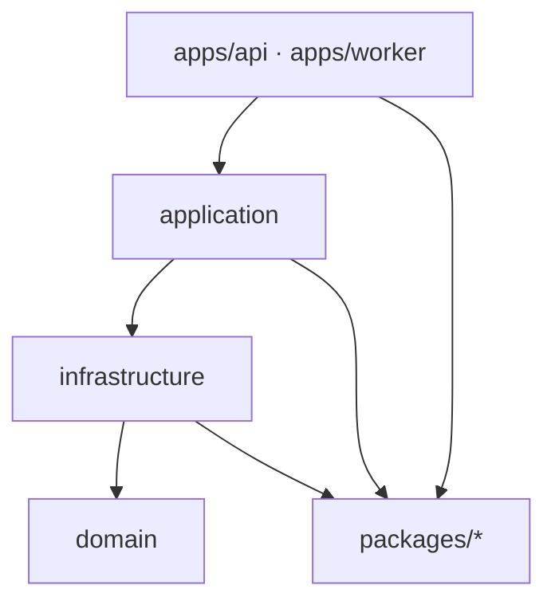

# PR template — worked example

This is a **reference**, not a template GitHub offers on PR creation (only
`PULL_REQUEST_TEMPLATE.md` is). It shows a fully filled PR for a real ticket
(`2026-10-16-1433_monorepo-setup`) and the exact commit it squash-merges into. Use
it to see the shape end-to-end. Source of truth for the format stays
`.claude/rules/commits.md`.

---

## 1. The PR title (becomes the squash commit subject)

```
:wrench: chore(monorepo-setup): Scaffold Bun monorepo
```

## 2. The PR description (pasted into the description box, template filled)

````markdown
<!--
  Review-only — stripped from the squashed commit.
  TITLE = commits.md subject: <gitmoji> <type>(<scope>): <subject> (≤50, imperative).

  Author self-check:
  [x] Title is a commits.md subject line
  [x] `make check` passes (Biome + tsc -b + vitest)
  [x] Imports follow docs/knowledge/architecture.md › Dependency rules
  [x] #<workspace>/… imports inside workspaces, no relative paths
  [x] Every dependency pinned in catalogs.tools or catalogs.runtime
  [x] Ticket docs updated

  How to test:
    make setup && make check && make dev
    curl localhost:3000/health; open localhost:3001

  Screenshots / notes:
    Keep chore/monorepo-setup after the squash: it holds the step history.
-->

## Summary

Scaffold App Template on Bun 1.4 and TypeScript 7: one workspace
per layer, an example slice through every layer, and the tooling and
in-repo SDD flow that every later ticket builds on. No product
behaviour yet; the slice proves the wiring compiles, runs and is tested.

## What changed

- Workspaces domain, application, infrastructure, packages/*, apps/*
  and deployment, with exact versions in named catalogs (tools, runtime).
- Example slice: domain model and port, in-memory adapters, a use case,
  and runnable api (--hot), worker (--watch) and web (HMR) apps.
- Biome with import-direction guards, husky hooks, PR template and CI.
- Makefile as the human interface; a single root .env.

## How it works

Imports only go down the stack; Biome rejects upward and sibling-app
imports, the isolated linker and bun check reject undeclared ones.

<details><summary>Layer stack</summary>



</details>

## Decisions

Decision: Project references with composite + emitDeclarationOnly, since
referenced projects may not disable emit (TS6310); bun check emits
nothing and tsc -b writes only to a gitignored cache.

Decision: Inside a workspace, import through #<workspace>/… subpaths. A
bare #/ prefix type-checks but Bun cannot resolve it.

## Refs

Refs: docs/tickets/2026-10-16-1433_monorepo-setup/
````

## 3. The squashed commit it produces

After GitHub strips the HTML comment, the commit on `main` is:

**Subject** (from the PR title):

```
:wrench: chore(monorepo-setup): Scaffold Bun monorepo
```

**Body**: the PR description from `## Summary` down to `## Refs`, with the
comment gone. The checklist, *How to test* and reviewer notes leave no
trace; the Summary, Decisions and diagram survive, so `git log -p`
reconstructs WHAT and WHY without opening the ticket.
