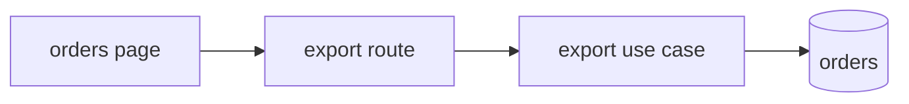

# PR template — worked example

This is a **reference**, not a template GitHub offers on PR creation (only
`PULL_REQUEST_TEMPLATE.md` is). It shows a fully filled PR for an invented ticket,
`order-export`, and the exact commit it squash-merges into. Use it to see the shape
end-to-end. Source of truth for the format stays `.claude/rules/commits.md`.

---

## 1. The PR title (becomes the squash commit subject)

```
:sparkles: feat(order-export): Add order CSV export
```

## 2. The PR description (pasted into the description box, template filled)

````markdown
<!--
  Review-only — left out of the squashed commit.
  TITLE = commits.md subject: <gitmoji> <type>(<scope>): <subject> (≤50, imperative).

  Author self-check:
  [x] Title is a commits.md subject line
  [x] `make check` passes
  [x] Every new dependency pinned in a named catalog
  [x] Ticket docs and docs/knowledge/ updated

  How to test:
    make up && make dev
    export the orders from the orders page; open the downloaded CSV

  Screenshots / notes:
    An export of ten thousand orders streams in about two seconds locally.
-->

## Summary

Let a user export their orders as one CSV file. Support asked for it to
reconcile invoices; until now users copied rows from the page by hand.

## What changed

- A use case that streams a user's orders as CSV rows.
- A route that answers the file as a download.
- An export button on the orders page.

## How it works

The use case reads the orders a page at a time and encodes each row as
it goes, so memory stays flat however many orders a user has.

<details><summary>Export flow</summary>



</details>

## Decisions

Decision: Stream the rows instead of building the file first. A user
with years of orders would otherwise hold the whole file in memory;
the cost is that a failure midway leaves the browser a cut file, which
the user downloads again.

## Refs

Refs: docs/tickets/<YYYY-MM-DD-HHmm>_order-export/
````

## 3. The squashed commit it produces

Merged with the HTML comment left out of `--body-file`, the commit on `main` is:

**Subject** (from the PR title):

```
:sparkles: feat(order-export): Add order CSV export
```

**Body**: the PR description from `## Summary` down to `## Refs`, with the
comment gone. The checklist, *How to test* and reviewer notes leave no
trace; the Summary, Decisions and diagram survive, so `git log -p`
reconstructs WHAT and WHY without opening the ticket.
