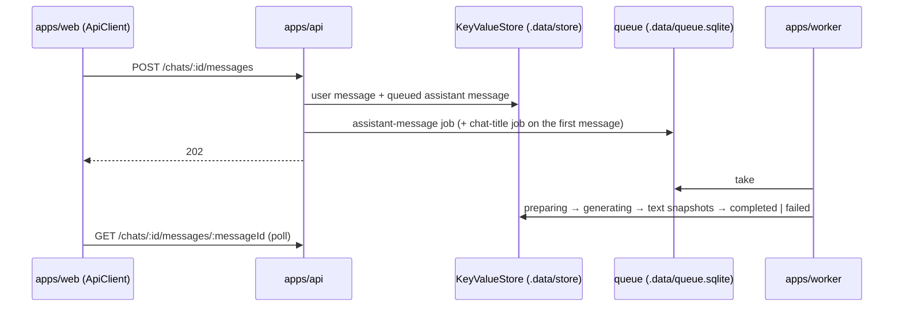

# App Template

A chat clone (visitor → message → assistant reply) built as a template for enterprise projects.
It grows one ticket at a time along the [roadmap](docs/knowledge/roadmap.md), and each ticket keeps
its spec, design and plan in `docs/tickets/`, so a project started from it inherits the reasoning
along with the code. Bun + TypeScript 7 + Effect 4 modular monolith with three processes:
`apps/api`, `apps/worker` and `apps/web`.

## What it does today

An anonymous user gets a secret in a cookie, creates chats, sends messages with attachments, and
the assistant answers. The api stores the user's message and a `queued` assistant message, enqueues
a job and answers `202`; the worker streams the model's reply into that one message as snapshots
and titles the chat from its first message; the client polls the message until it is `completed`
or `failed`. State is in memory for now: a key-value store on disk shared by both processes, a
SQLite job queue, and a stub language model. Postgres, S3, SQS and a real provider each replace one
layer later.



The browser UI still shows only the health panel; the chat screens are the next roadmap entries.

## Quick start

Requires Bun 1.4.3 (the `packageManager` field) and GNU Make.

```sh
make setup   # bun install, git hooks, and .env from .env.example
make dev     # api, worker and web together
```

| Process | URL | Try |
|---|---|---|
| `apps/api` | <http://localhost:3000> | `/docs` (Scalar over the contract), `/openapi.json`, `/health` |
| `apps/web` | <http://localhost:3001> | the health panel; `/api/*` is proxied to the api |
| `apps/worker` | — | logs `worker started` and consumes the two queues |

A whole conversation from the shell, with the cookie kept in a jar:

```sh
curl -s -c jar -X POST localhost:3000/users
curl -s -b jar -X POST localhost:3000/chats
curl -s -b jar -X POST localhost:3000/chats/<chatId>/messages \
  -H 'content-type: application/json' -d '{"text":"Hello","attachmentIds":[]}'
# repeat while the assistant message is queued, preparing or generating: its text grows
curl -s -b jar localhost:3000/chats/<chatId>/messages/<assistantMessageId>
```

`make check` runs every gate (Biome, `tsc -b`, vitest); `make help` lists the rest.

## How it is built

Each line names one choice and where it lives; the rejected alternatives are in the tickets'
`architecture.md › Decisions`.

- **Layers import only downwards:** the matrix is in
  [docs/knowledge/architecture.md › Dependency rules](docs/knowledge/architecture.md#dependency-rules);
  Biome rejects the rest.
- **The domain is pure Effect:** models are `Schema.Class`, ids and constrained values are brands,
  errors are `Schema.TaggedError`, time and ids come in as input, and ports are `Context.Service`
  declarations with no error channel. `domain/`.
- **One HTTP contract, three consumers.** `http-api/` declares the `HttpApi` over the domain's
  schemas; `apps/api` implements it with `HttpApiBuilder`, the browser calls it through
  `ApiClient`, and `/openapi.json` is derived from it, never committed. A domain error becomes a
  status through one annotation in the contract.
- **Services are simple, use cases compose them.** A service owns one aggregate's writes; a flow
  across aggregates or a critical section is a use case under the user's lock, and the checks hand
  the writes a proof value (`SendableChat`, `BindableAttachments`) so the order cannot be skipped.
  [.claude/rules/use-cases.md](.claude/rules/use-cases.md).
- **Adapters are `Layer`s over effect's `KeyValueStore`:** one module gives every repository
  collections, indexes and blobs with a process-wide lock, and turns a store failure into a defect
  once. `infrastructure/kv/`.
- **Jobs live in one file, both sides:** a `.job` service enqueues, its `worker` is a `Layer` that
  consumes in a fiber the layer's scope owns. The reply job gets three attempts plus one that only
  settles a message the last attempt left active. `application/chat/*.job.ts`, `packages/queue`.
- **A process is one `Layer`:** `apps/api/src/layer.ts` and `apps/worker/src/layer.ts` close the
  leaves (store, queue, platform) with `Layer.provide` and `main.ts` is
  `BunRuntime.runMain(Layer.launch(...))`; stopping closes one scope.
- **Tests sit at agreed seams** with `@effect/vitest`: domain rules, the kv module on both stores,
  services on memory adapters under `TestClock`, jobs with a fake model, the api through
  `BunHttpServer.layerTest` and the real `ApiClient`.
- **Configuration is read once,** in `packages/config`, and reaches clients as options; the root
  `.env` is the only environment file.

The Effect rules the code follows are in `.claude/rules/effect*.md`; a worked walkthrough of any
step or module is one `/explain` away (see
[docs/knowledge/sdd.md › Reading what was built](docs/knowledge/sdd.md#reading-what-was-built)).

## Where to read next

| Question | Document |
|---|---|
| How do I run, debug, test, add a dependency or a workspace? Why did a check fail? | [docs/knowledge/tooling.md](docs/knowledge/tooling.md) |
| Which layer does my code belong to, and what may it import? How do I add an entity? | [docs/knowledge/architecture.md](docs/knowledge/architecture.md) |
| What do the domain words mean? | [docs/knowledge/glossary.md](docs/knowledge/glossary.md) |
| How is a change specified, planned, implemented and verified? What do the `/ticket-*` skills use under the hood? | [docs/knowledge/sdd.md](docs/knowledge/sdd.md) |
| What is built next, in which order, and what does each ticket inherit? | [docs/knowledge/roadmap.md](docs/knowledge/roadmap.md) |
| What are the rules for one layer? | its `CLAUDE.md`, listed in [CLAUDE.md](CLAUDE.md) |
| How are commits and pull requests written? | [.claude/rules/commits.md](.claude/rules/commits.md), [.claude/rules/pull-requests.md](.claude/rules/pull-requests.md) |
| Why is the scaffold built this way? | `docs/tickets/2026-10-16-1433_monorepo-setup/`, and the step commits on branch `chore/monorepo-setup` |
| Why is the chat built this way? | `docs/tickets/2026-10-17-1748_chat-core/` (`feature.md` for the requirements, `architecture.md › Decisions` for every choice and its rejected alternative) |

## Branches

| Branch | Holds |
|---|---|
| `main` | one squash commit per ticket, whose body is the PR description |
| `chore/monorepo-setup` | the scaffold ticket's plan steps, one commit each |
| `chore/enterprise-template` | the plan steps of every ticket after the scaffold |

Why the steps live next to a clean `main`, and how a ticket reaches both:
[sdd.md › Roadmap and the teaching branch](docs/knowledge/sdd.md#roadmap-and-the-teaching-branch).

## Starting a new project

On GitHub, *Use this template → Include all branches* copies every branch, the three above among
them. What to rename, delete and keep afterwards is roadmap entry 12,
[`template-handoff`](docs/knowledge/roadmap.md#12-template-handoff).
