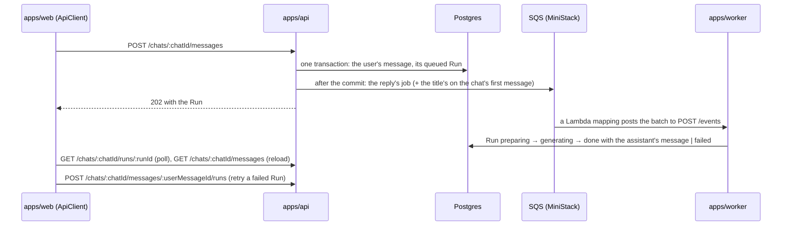
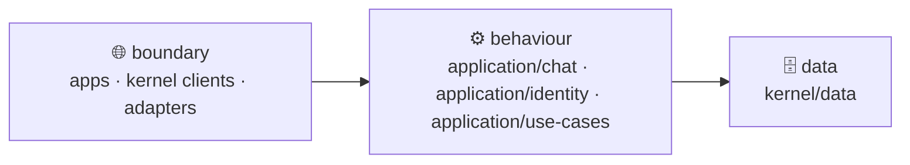

# App Template

A working enterprise application to start new ones from, and the AI-assisted process that builds
it.

The application is a chat clone: a user sends a message, the assistant replies. The chat is only
the worked example; what a new project inherits is around it:

- 🏛️ **An architecture that holds.** A Bun, TypeScript and Effect modular monolith: three
  processes (`api`, `worker`, `web`) over one domain, the code cut in three rings, and the build,
  not a reviewer, refusing an import that points the wrong way.
- 🧱 **A stack wired end to end.** Postgres through Drizzle, files in S3 and jobs in SQS (MiniStack
  locally), Pulumi to provision the stores, a language model behind a port.
- 🤖 **A development process run with AI agents.** Every change of substance runs through one
  skill, `/lab`: you set the intent and the shape, agents find the facts, write test first and
  review in a fresh context, and every round is a green commit you read alone. The reasoning is
  committed next to its code, so a project started from here inherits the why with the what.

It is not a framework, and nothing here is generated: every layer is plain code meant to be read,
copied and changed.

## ✨ What the example does

An anonymous user gets a secret in a cookie, creates chats, sends messages with attachments, and
the assistant answers. A user's message starts a Run, the work of answering it: the api writes the
message and its queued Run in one transaction, sends the jobs to SQS after it commits and answers
`202` with the Run. SQS invokes the worker through a Lambda function's mapping; the worker moves
the Run through `preparing` and `generating`, then writes the assistant's message and the Run's
`done` in one transaction, or the Run's `failed` with its reason, and titles the chat. The client
polls the Run, reads the chat's messages with their Runs after a reload, and retries a failed Run
as a new Run of the same message. The language model is Anthropic's. The browser UI still shows
only the health panel.



How the transaction and the jobs work:
[database.md › The sends](docs/knowledge/database.md#the-sends),
[aws.md › Queues](docs/knowledge/aws.md#queues).

## 🚀 Quick start

Requires Bun at the version in `package.json › packageManager`, GNU Make, Docker running and the
[Pulumi CLI](https://www.pulumi.com/docs/install/). The development process also needs
[Claude Code](https://code.claude.com/docs/en); the application does not.

```sh
make setup   # bun install, git hooks, the Claude Code plugin, .env from .env.example
make up      # MiniStack with Postgres, the bucket and the queues inside it, and Grafana; migrates
             # (the first run downloads several GB: the provider plugins and the Grafana image)
make dev     # runs make migrate, then api, worker and web together; needs make up's stand
```

`.env` needs your `ANTHROPIC_API_KEY`; `.env.example` leaves it empty and names the models in
`LLM_REPLY_MODEL` and `LLM_TITLE_MODEL`. An empty or missing key stops the worker at start with a
`ConfigError` naming it; the api and the web read none of them.

| Process | URL | Try |
|---|---|---|
| `apps/api` | <http://localhost:3000> | `/health` |
| `apps/web` | <http://localhost:3001> | the health panel; `/api/*` is proxied to the api |
| `apps/worker` | <http://localhost:3002> | `POST /events`, the batches MiniStack's SQS mappings send |
| Grafana | <http://localhost:3003> | `admin`/`admin`: one trace per message, its logs inside ([observability.md](docs/knowledge/observability.md)) |

A whole conversation from the shell, with the cookie kept in a jar:

```sh
curl -s -c jar -X POST localhost:3000/users
curl -s -b jar -X POST localhost:3000/chats
curl -s -b jar -X POST localhost:3000/chats/<chatId>/messages \
  -H 'content-type: application/json' -d '{"text":"Hello","attachmentIds":[]}'
# repeat while the Run is queued, preparing or generating: its assistantMessage arrives whole
curl -s -b jar localhost:3000/chats/<chatId>/runs/<runId>
# the reload: the chat's messages, each with its Run
curl -s -b jar localhost:3000/chats/<chatId>/messages
```

`make down` stops the stand and keeps its data; `make reset` removes it whole. When `make up`
fails: [aws.md › When the stand fails](docs/knowledge/aws.md#when-the-stand-fails).

## 🗺️ The repository as a system

The repository holds three things: the application, the knowledge about it, and the toolkit that
changes it.

| Folder | What it holds |
|---|---|
| `apps/` | the three processes, thin entry points that assemble the layers; `apps/e2e` tests them assembled |
| `application/` | the behaviour: the modules `chat` and `identity`, and every use case in `application/use-cases` |
| `kernel/` | the configured clients (`config`, `postgres`, `aws`, `llm`) and `kernel/data`: every table, migration and repository |
| `packages/` | generic tools that know no app: database, S3 and queue clients, the AWS inventory's types, UI, test helpers |
| `deployment/` | the Pulumi program that provisions the stores in MiniStack, from resource code an AWS stack can call |
| `docs/knowledge/` | how the system works today: architecture, data, AWS, AI, telemetry, tooling, process, decisions, glossary, roadmap |
| `docs/tickets/` | one folder per ticket: its `lab.md` (intent, steps, shapes, decisions); older ones keep their requirements, design, plan and verification |
| `.claude/` | the agent toolkit: the project's `CLAUDE.md`, skills, agents, hooks, rules and settings |
| `repos/` | Effect's and Drizzle's source at the pinned versions, to read rather than guess |
| `CLAUDE.md` in a folder | the rules of that layer, written for the agent and short enough for you |

## 🏛️ Architecture at a glance

The code is cut in three rings, and every dependency points inward:



- **The data** at the centre: `kernel/data` is the one source of truth over every store.
- **The behaviour** around it: each module holds its models, rules and services; a use case above
  the modules composes their services in one transaction.
- **The boundary** outside: everything that touches the world, from the configured clients to the
  apps.

The guards are in the build, so a wrong import fails before a review: Biome refuses a cycle and an
import across a ring, `tsc -b` an undeclared workspace, and `make bundle-check` a server module in
the browser's bundle. The rules a change most often breaks:

- no rule outside the modules
  ([Use cases above the modules](docs/knowledge/decisions.md#use-cases-above-the-modules));
- no lock but a guard in the write ([database.md › Guards](docs/knowledge/database.md#guards));
- no message without its job ([database.md › The sends](docs/knowledge/database.md#the-sends));
- no service in the browser
  ([architecture.md › Boundary guards](docs/knowledge/architecture.md#boundary-guards)).

One name crosses every ring: a module's files read from the data outward, table and repository,
then model, service, use case, adapter and handler. Every file of `chat`:
[architecture.md › Where things live](docs/knowledge/architecture.md#where-things-live). Why each
boundary holds, what it costs and what breaks if it is reversed:
[decisions.md](docs/knowledge/decisions.md), one record per decision.

## 🤖 How work gets done

You work in this repository with Claude Code. Every change of substance goes through `/lab`,
sized once: a **micro** change (one session, no new decision) is a branch built from a plan of
five lines and reviewed once; a **macro** one gets a `lab.md` in its ticket folder, with your
intent, its steps and the shape of each, built with you in the session or handed to an
`implementer` once the shape is settled. A typo, a version bump or a doc fix needs neither.

What keeps the agents honest:

- 🧪 **Red, then green.** Each behaviour starts as a failing test; an `implementer` cannot
  finish red, since a hook runs `make check` when it stops.
- 🔍 **Every round is a commit you read alone,** your own edits a round of their own, and each
  step is reviewed once by read-only `reviewer` agents in a fresh context: against the intent,
  for silent failures and against the rules.
- 👀 **Done is visible:** a command you can repeat, and the whole feature played before the PR.
- 📜 **The reasoning stays.** The lab's file and the commit messages keep each decision and its
  rejected alternatives; `main` holds one squash commit per change.

Why it is cut so: [sdd.md](docs/knowledge/sdd.md).

## 🛠️ Daily development

| To | Run | More |
|---|---|---|
| run every gate before a commit | `make check` (Docker running) | [tooling.md › Commands](docs/knowledge/tooling.md#commands) |
| run one process, or debug it | `make dev-api`, `make debug-api` (also `-worker`, `-web`) | [tooling.md › Run and debug](docs/knowledge/tooling.md#run-and-debug) |
| run the unit suites only, in seconds | `make test-unit` | [tooling.md › Tests](docs/knowledge/tooling.md#tests) |
| run one test file or one test | `vitest` on the file, with `-t` | [tooling.md › Commands](docs/knowledge/tooling.md#commands) |
| fix formatting and import order | `make fmt` | [tooling.md › Troubleshooting](docs/knowledge/tooling.md#troubleshooting) |
| change a table | edit its `.table.ts`, regenerate the one `init` migration, rebuild the local database | [database.md › Migrations](docs/knowledge/database.md#migrations) |
| start over with an empty database | `make reset && make up` | [tooling.md › Environment](docs/knowledge/tooling.md#environment) |
| work on two branches at once | a worktree with its own ports and containers | [tooling.md › Worktrees](docs/knowledge/tooling.md#worktrees) |
| learn why a check failed | the symptom table | [tooling.md › Troubleshooting](docs/knowledge/tooling.md#troubleshooting) |
| learn why a commit or a push was rejected | the hooks; never `--no-verify` | [tooling.md › Git hooks and CI](docs/knowledge/tooling.md#git-hooks-and-ci) |
| write a test | the kinds, where each goes, and time in `it.effect` | [tooling.md › Tests](docs/knowledge/tooling.md#tests) |

## 🧩 Extending it

Each addition has a checklist, written from the data outward and test first:

- an entity and its model: [architecture.md › Add a new entity](docs/knowledge/architecture.md#add-a-new-entity);
- a module: [architecture.md › Add a module](docs/knowledge/architecture.md#add-a-module);
- a store's client: [architecture.md › Add a store's client](docs/knowledge/architecture.md#add-a-stores-client);
- an AWS resource, local and deployed alike:
  [aws.md › Adding a resource](docs/knowledge/aws.md#adding-a-resource);
- a dependency or a workspace: [tooling.md › Dependencies](docs/knowledge/tooling.md#dependencies).

## 🌱 Starting a new project

On GitHub, *Use this template* starts a new project from `main`. The checklist of what to rename,
delete and keep afterwards is planned as the roadmap's
[`template-handoff`](docs/knowledge/roadmap.md#12-template-handoff). What is built next, and in
which order: [roadmap.md](docs/knowledge/roadmap.md).

## 📚 Where to read next

| Question | Document |
|---|---|
| How do I run, debug, test, add a dependency or a workspace? Why did a check fail? | [docs/knowledge/tooling.md](docs/knowledge/tooling.md) |
| Which ring and layer does my code belong to, and what may it import? | [docs/knowledge/architecture.md](docs/knowledge/architecture.md) |
| How are records stored, guarded, migrated and tested? | [docs/knowledge/database.md](docs/knowledge/database.md) |
| How do the apps reach S3 and SQS, locally and on AWS? | [docs/knowledge/aws.md](docs/knowledge/aws.md) |
| How does the assistant ask the model for a reply or a title? | [docs/knowledge/ai.md](docs/knowledge/ai.md) |
| How do I follow one message through the api and the worker? | [docs/knowledge/observability.md](docs/knowledge/observability.md) |
| What do the domain words mean? | [docs/knowledge/glossary.md](docs/knowledge/glossary.md) |
| How does a change get built, and why that way? | [docs/knowledge/sdd.md](docs/knowledge/sdd.md) |
| What is built next, and in which order? | [docs/knowledge/roadmap.md](docs/knowledge/roadmap.md) |
| What are the rules for one layer? | the `CLAUDE.md` in its folder, and `.claude/rules/` |
| How are commits and pull requests written? | [.claude/rules/commits.md](.claude/rules/commits.md), [.claude/rules/pull-requests.md](.claude/rules/pull-requests.md) |
| Why is it built this way? | [docs/knowledge/decisions.md](docs/knowledge/decisions.md): each binding decision with its reason, its rejected alternatives and what a reversal breaks; its history in the ticket that made it, under `docs/tickets/` |

How a merged ticket's steps and reasoning stay findable in the history:
[sdd.md › Roadmap and history](docs/knowledge/sdd.md#roadmap-and-history).
