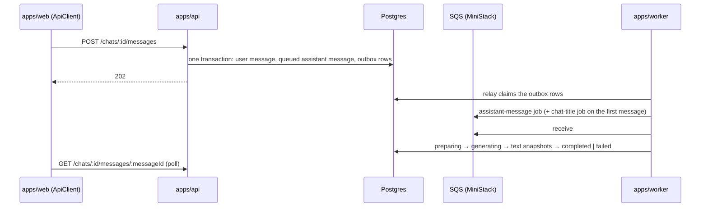

# App Template

A chat clone (visitor → message → assistant reply) built as a template for enterprise projects.
It grows one ticket at a time along the [roadmap](docs/knowledge/roadmap.md), and each ticket keeps
its spec, design and plan in `docs/tickets/`, so a project started from it inherits the reasoning
along with the code. Bun + TypeScript 7 + Effect 4 modular monolith with three processes:
`apps/api`, `apps/worker` and `apps/web`.

## What it does today

An anonymous user gets a secret in a cookie, creates chats, sends messages with attachments, and
the assistant answers. The api stores the user's message, a `queued` assistant message and its
jobs in one transaction (the jobs as outbox rows) and answers `202`; the worker relays the outbox to
SQS, streams the model's reply into that one message as snapshots
and titles the chat from its first message; the client polls the message until it is `completed`
or `failed`. Records live in Postgres, attachment bytes in S3, and jobs go through SQS (MiniStack
locally); the language model is a stub that a real provider replaces later.



The browser UI still shows only the health panel; the chat screens are the next roadmap entries.

## Quick start

Requires Bun 1.4.3 (the `packageManager` field) and GNU Make.

```sh
make setup   # bun install, git hooks, and .env from .env.example
make up      # MiniStack with Postgres, the bucket and the queues; migrates (needs Docker, Pulumi)
make dev     # api, worker and web together
```

| Process | URL | Try |
|---|---|---|
| `apps/api` | <http://localhost:3000> | `/health` |
| `apps/web` | <http://localhost:3001> | the health panel; `/api/*` is proxied to the api |
| `apps/worker` | — | logs `worker started` and consumes the two queues |

A whole conversation from the shell, with the cookie kept in a jar:

```sh
curl -s -c jar -X POST localhost:3000/users
curl -s -b jar -X POST localhost:3000/chats
curl -s -b jar -X POST localhost:3000/chats/<chatId>/messages \
  -H 'content-type: application/json' -d '{"text":"Hello","attachmentIds":[]}'
# repeat while the assistant message is queued, preparing or generating: its text grows
curl -s -b jar localhost:3000/chats/<chatId>/messages/<assistantMessageId>
```

`make check` runs every gate: ids, the names the docs cite, Biome, `tsc -b`, the migration check,
the unit and e2e suites (Docker running; the e2e run starts its own Postgres and MiniStack) and
the web-bundle guard. `make help` lists the rest.

### The local AWS environment

MiniStack stands in for S3, SQS and RDS on `localhost:4566`; a Pulumi program in `deployment/local/`
runs it in Docker and creates inside it the bucket, the queues and the Postgres instance, whose
`DATABASE_URL` it writes to `.env.pulumi`. `make dev` needs it: the apps read the database, the
bucket and the queues from there. `make check` needs Docker only. The design and the resource inventory:
[docs/knowledge/aws.md](docs/knowledge/aws.md).

```sh
make setup   # once; then add Docker and the Pulumi CLI (https://www.pulumi.com/docs/install/)
make up      # starts MiniStack, creates the resources (unchanged on a rerun), migrates
make dev
make down    # stops it; the resources and their data survive
make reset   # removes MiniStack, the database's container and volume, and .data/ whole
```

| When | Then |
|---|---|
| Docker is not running | `make up` fails in the Docker provider; start Docker and run it again |
| the Pulumi CLI is missing | `make up`, `down`, `reset` and `stack` fail at `pulumi`; install it from the link above. `make check` does not need it |
| an older `.env` lacks `AWS_*`, `STAGE` or `RDS_BASE_PORT` | `make up` fails with a `ConfigError` naming the variable; `make setup` leaves an existing `.env` alone, so copy the block from `.env.example` |
| the first `make up` takes longer | it downloads the Docker and AWS provider plugins into `.pulumi/` once; worktrees reuse them |
| port 4566 is taken | the container fails to start; free the port (a leftover `app-template-ministack-4566`, or another emulator) |
| `make up` failed midway | run it again; it goes on from what it created |
| you want a clean slate | `make reset` also wipes the database, not only MiniStack |

## How it is built

Each line names one choice and where it lives; the rejected alternatives are in the tickets'
`architecture.md › Decisions`.

- **Layers import only downwards:** the matrix is in
  [docs/knowledge/architecture.md › Dependency rules](docs/knowledge/architecture.md#dependency-rules);
  Biome rejects most of what it forbids, and
  [› Known gaps](docs/knowledge/architecture.md#known-gaps) lists the rest.
- **The domain is pure Effect:** models are `Schema.Class`, ids and constrained values are brands,
  errors are `Schema.TaggedError`, pure operations take time and ids as input, and ports are
  `Context.Service` declarations with no error channel. `domain/`.
- **One HTTP contract, two consumers.** `http-api/` declares the `HttpApi` over the domain's
  schemas; `apps/api` implements it with `HttpApiBuilder`, and the browser calls it through
  `ApiClient`. A domain error becomes a status through one annotation in the contract.
- **Domain services own the rules, use cases compose them, handlers call one of the two.** A
  domain service in `domain/` writes its entity's records over the ports; a flow across services,
  the queue or one transaction is a use case in `application/`; an api or worker handler holds no
  rule. [.claude/rules/layering.md](.claude/rules/layering.md).
- **Repositories are `Layer`s over Drizzle on `@effect/sql-pg`:** each entity declares its tables
  once, the row codecs and migrations derive from them, a use case runs its writes in one
  `Transaction`, and the database's guards (a partial unique index, conditional updates) stand in
  for locks. [docs/knowledge/database.md](docs/knowledge/database.md).
- **A queue has a producer and a handler:** a use case sends the job with `QueueClient.send`, which
  writes an outbox row in the use case's transaction; the worker's relay forwards it to SQS;
  `apps/worker/<entity>/<object>.handler.ts` consumes it over a use case in a `worker` `Layer`
  that runs in a fiber the layer's scope owns. `packages/queue`.
- **A process is one `Layer`:** `apps/api/layer.ts` and `apps/worker/layer.ts` close the
  leaves (database, S3, queue, platform) with `Layer.provide` and `main.ts` is
  `BunRuntime.runMain(Layer.launch(...))`; stopping closes one scope.
- **Tests sit at agreed seams** with `@effect/vitest`: unit tests in `tests/` run the domain
  services, the use cases and both apps' handlers over memory layers of the ports; e2e tests in
  `e2e/` run the adapters and one journey through both apps on a Postgres and a MiniStack the run
  starts for itself. [docs/knowledge/tooling.md › Tests](docs/knowledge/tooling.md#tests).
- **Configuration is read once,** in `packages/config`, and reaches clients as options; the root
  `.env` is the only environment file.

The Effect rules the code follows are in `.claude/rules/effect*.md`; a worked walkthrough of any
step or module is one `/explain` away (see
[docs/knowledge/sdd.md › Reading what was built](docs/knowledge/sdd.md#reading-what-was-built)).

## Where to read next

| Question | Document |
|---|---|
| How do I run, debug, test, add a dependency or a workspace? Why did a check fail? | [docs/knowledge/tooling.md](docs/knowledge/tooling.md) |
| Which layer does my code belong to, and what may it import? How do I add an entity? | [docs/knowledge/architecture.md](docs/knowledge/architecture.md) |
| What do the domain words mean? | [docs/knowledge/glossary.md](docs/knowledge/glossary.md) |
| How do the apps reach S3 and SQS, locally and on AWS? How is a resource added? | [docs/knowledge/aws.md](docs/knowledge/aws.md) |
| How is a change specified, planned, implemented and verified? What do the `/ticket-*` skills use under the hood? | [docs/knowledge/sdd.md](docs/knowledge/sdd.md) |
| What is built next, in which order, and what does each ticket inherit? | [docs/knowledge/roadmap.md](docs/knowledge/roadmap.md) |
| What are the rules for one layer? | its `CLAUDE.md`, listed in [CLAUDE.md](CLAUDE.md) |
| How are commits and pull requests written? | [.claude/rules/commits.md](.claude/rules/commits.md), [.claude/rules/pull-requests.md](.claude/rules/pull-requests.md) |
| Why is the scaffold built this way? | `docs/tickets/2026-10-16-1433_monorepo-setup/`, and the step commits on branch `chore/monorepo-setup` |
| How are records stored, migrated and tested on Postgres? | [docs/knowledge/database.md](docs/knowledge/database.md) |
| Why is the chat built this way? | `docs/tickets/2026-10-17-1748_chat-core/` (`feature.md` for the requirements, `architecture.md › Decisions` for every choice and its rejected alternative) |
| Why Postgres and the outbox, and why the layers look as they do? | `docs/tickets/2026-10-22-1915_postgres-drizzle/`, `docs/tickets/2026-10-27-1433_architecture-audit/` |

## Branches

| Branch | Holds |
|---|---|
| `main` | one squash commit per ticket, whose body is the PR description |
| `chore/monorepo-setup` | the scaffold ticket's plan steps, one commit each |
| `chore/enterprise-template` | the plan steps of every ticket after the scaffold |

Why the steps live next to a clean `main`, and how a ticket reaches both:
[sdd.md › Roadmap and the teaching branch](docs/knowledge/sdd.md#roadmap-and-the-teaching-branch).

## Starting a new project

On GitHub, *Use this template → Include all branches* copies every branch, the three above among
them. What to rename, delete and keep afterwards is roadmap entry 12,
[`template-handoff`](docs/knowledge/roadmap.md#12-template-handoff).
