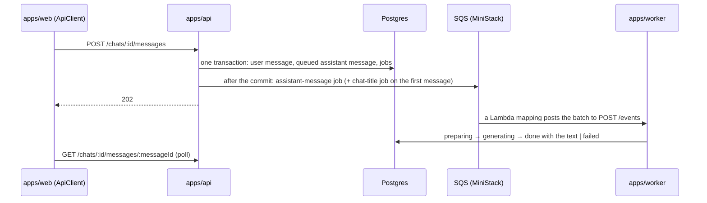
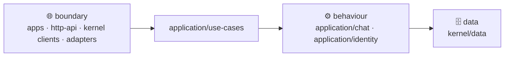
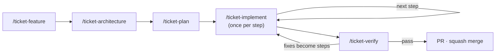

# App Template

A working enterprise application to start new ones from, and the AI-assisted process that builds
it.

The application is a chat clone: a user sends a message, the assistant replies. The chat is only
the worked example; what a new project inherits is around it:

- 🏛️ **An architecture that holds.** A Bun, TypeScript and Effect modular monolith: three
  processes (`api`, `worker`, `web`) over one domain, the code cut in three rings, and the build,
  not a reviewer, refusing an import that points the wrong way.
- 🧱 **A stack wired end to end.** Postgres through Drizzle, files in S3 and jobs in SQS (MiniStack
  locally), Pulumi to provision the stores, a language model behind a port.
- 🤖 **A development process run with AI agents.** Every change of substance is a ticket that
  Claude Code agents specify, design, plan, implement and verify, while you decide at each gate.
  The ticket's reasoning is committed next to its code, so a project started from here inherits
  the why along with the what.

It is not a framework, and nothing here is generated: every layer is plain code meant to be read,
copied and changed.

## ✨ What the example does

An anonymous user gets a secret in a cookie, creates chats, sends messages with attachments, and
the assistant answers. The api writes the message and its jobs in one transaction, sends the jobs
to SQS once it commits and answers `202`; SQS invokes the worker through a Lambda function's
mapping, and the worker writes the model's whole reply into the message and titles the chat;
the client polls the message until it is `done` or `failed`. The language model is Anthropic's.
The browser UI still shows only the health panel.



How the transaction and the jobs work:
[database.md › The outbox](docs/knowledge/database.md#the-outbox),
[aws.md › Queues](docs/knowledge/aws.md#queues).

## 🚀 Quick start

Requires Bun at the version in `package.json › packageManager`, GNU Make, Docker running and the
[Pulumi CLI](https://www.pulumi.com/docs/install/). The development process also needs
[Claude Code](https://code.claude.com/docs/en); the application does not.

```sh
make setup   # bun install, git hooks, the Claude Code plugin, .env from .env.example
make up      # MiniStack with Postgres, the bucket and the queues inside it; migrates
make dev     # runs make migrate, then api, worker and web together; needs make up's stand
```

`.env` needs your `ANTHROPIC_API_KEY`; `.env.example` leaves it empty and names the models in
`LLM_REPLY_MODEL` and `LLM_TITLE_MODEL`. An empty or missing key stops the worker at start with a
`ConfigError` naming it; the api reads only `LLM_REPLY_MODEL`, and the web none of them.

| Process | URL | Try |
|---|---|---|
| `apps/api` | <http://localhost:3000> | `/health` |
| `apps/web` | <http://localhost:3001> | the health panel; `/api/*` is proxied to the api |
| `apps/worker` | <http://localhost:3002> | `POST /events`, the batches MiniStack's SQS mappings send |

A whole conversation from the shell, with the cookie kept in a jar:

```sh
curl -s -c jar -X POST localhost:3000/users
curl -s -b jar -X POST localhost:3000/chats
curl -s -b jar -X POST localhost:3000/chats/<chatId>/messages \
  -H 'content-type: application/json' -d '{"text":"Hello","attachmentIds":[]}'
# repeat while the assistant message is queued, preparing or generating: its text arrives whole
curl -s -b jar localhost:3000/chats/<chatId>/messages/<assistantMessageId>
```

`make down` stops the stand and keeps its data; `make reset` removes it whole. When `make up`
fails: [aws.md › When the stand fails](docs/knowledge/aws.md#when-the-stand-fails).

## 🗺️ The repository as a system

The repository holds three things: the application, the knowledge about it, and the toolkit that
changes it.

| Folder | What it holds |
|---|---|
| `apps/` | the three processes, thin entry points that assemble the layers; `apps/e2e` tests them assembled |
| `http-api/` | the HTTP contract the api serves and the web client calls |
| `application/` | the behaviour: the modules `chat` and `identity`, and every use case in `application/use-cases` |
| `kernel/` | the configured clients (`config`, `postgres`, `aws`, `queue`, `llm`) and `kernel/data`: every table, migration and repository |
| `packages/` | generic tools that know no app: database, S3, queue and model clients, UI, test helpers |
| `deployment/` | Pulumi programs that provision the stores, in MiniStack locally and on AWS |
| `docs/knowledge/` | how the system works today: architecture, data, AWS, AI, tooling, process, decisions, glossary, roadmap |
| `docs/tickets/` | one folder per ticket: its requirements, design, plan and verification |
| `.claude/` | the agent toolkit: the project's `CLAUDE.md`, skills, agents, hooks, rules and settings |
| `repos/` | Effect's and Drizzle's source at the pinned versions, to read rather than guess |
| `CLAUDE.md` in a folder | the rules of that layer, written for the agent and short enough for you |

## 🏛️ Architecture at a glance

The code is cut in three rings, and every dependency points inward:



- **The data** at the centre: `kernel/data` is the one source of truth over every store.
- **The behaviour** around it: each module holds its models, rules and services; a use case above
  the modules composes their services in one transaction.
- **The boundary** outside: everything that touches the world, from the configured clients to the
  apps.

The guards are in the build, so a wrong import fails before a review: `tsc -b` refuses a cycle and
an undeclared workspace, Biome refuses an import across a ring, and `make bundle-check` refuses a
server module in the browser's bundle. The rules a change most often breaks:

- no rule outside the modules
  ([Use cases above the modules](docs/knowledge/decisions.md#use-cases-above-the-modules));
- no lock but a guard in the write ([database.md › Guards](docs/knowledge/database.md#guards));
- no message without its job ([database.md › The outbox](docs/knowledge/database.md#the-outbox));
- no service in the browser
  ([architecture.md › Boundary guards](docs/knowledge/architecture.md#boundary-guards)).

One name crosses every ring: a module's files read from the data outward, table and repository,
then model, mapper, service, use case, adapter and handler. Every file of `chat`:
[architecture.md › Where things live](docs/knowledge/architecture.md#where-things-live). Why each
boundary holds, what it costs and what breaks if it is reversed:
[decisions.md](docs/knowledge/decisions.md), one record per decision.

## 🤖 How work gets done

You work in this repository with Claude Code. A change of substance becomes a ticket on its own
branch, and five skills you type carry it from an idea to a pull request. The agents do the
reading, writing and reviewing; you answer their questions and approve what lands.



| Skill | What it produces | What you decide |
|---|---|---|
| `/ticket-feature` | `feature.md`: the requirements, as testable `WHEN … THE SYSTEM SHALL …` sentences | the answers to its questions, the domain terms |
| `/ticket-architecture` | `architecture.md`: the seams to test at and the decisions | the seams and each decision |
| `/ticket-plan` | `plan.md`: a skeleton of every step, then one stage of about three steps at a time, each step small enough for one session and with its first test | the skeleton and the first stage, in the one heavy review; a later stage only when its preparation asks |
| `/ticket-implement` | one step, written test-first, committed round by round, then reviewed | whether it closes, what to fix first, or which round to reject |
| `/ticket-verify` | `verification.md`: every requirement checked against observable behaviour | the fixes to make, and whether to open the PR |

What keeps the agents honest:

- 🧪 **An `implementer` cannot finish red.** A hook runs `make check` when it stops and sends it
  back until it passes; the only other way out is to report itself blocked, which reaches you.
- 🔍 **Every round is a commit you read alone, and every step is reviewed before it closes,** by
  read-only `reviewer` agents in a fresh context, each owning one kind of finding.
- ✅ **Every requirement is verified** by `verifier` agents that see the behaviour, not the
  implementer's report.
- 📜 **The reasoning stays.** The ticket folder and the commit messages keep each decision, its
  rejected alternatives and its cost; `main` holds one squash commit per ticket.

A typo or a version bump needs no ticket, and a small fix skips the architecture: which cycle a
change needs, what each skill does under the hood and the plugin it wraps:
[sdd.md](docs/knowledge/sdd.md).

## 🛠️ Daily development

| To | Run | More |
|---|---|---|
| run every gate before a commit | `make check` (Docker running) | [tooling.md › Commands](docs/knowledge/tooling.md#commands) |
| run one process, or debug it | `make dev-api`, `make debug-api` (also `-worker`, `-web`) | [tooling.md › Run and debug](docs/knowledge/tooling.md#run-and-debug) |
| run the unit suites only, in seconds | `make test-unit` | [tooling.md › Tests](docs/knowledge/tooling.md#tests) |
| run one test file or one test | `vitest` on the file, with `-t` | [tooling.md › Commands](docs/knowledge/tooling.md#commands) |
| fix formatting and import order | `make fmt` | [tooling.md › Troubleshooting](docs/knowledge/tooling.md#troubleshooting) |
| change a table | edit its `.table.ts`, then `make migration NAME=<name>` and `make migrate` | [database.md › Migrations](docs/knowledge/database.md#migrations) |
| start over with an empty database | `make reset && make up` | [tooling.md › Environment](docs/knowledge/tooling.md#environment) |
| work on two branches at once | a worktree with its own ports and containers | [tooling.md › Worktrees](docs/knowledge/tooling.md#worktrees) |
| learn why a check failed | the symptom table | [tooling.md › Troubleshooting](docs/knowledge/tooling.md#troubleshooting) |
| learn why a commit or a push was rejected | the hooks; never `--no-verify` | [tooling.md › Git hooks and CI](docs/knowledge/tooling.md#git-hooks-and-ci) |
| write a test | the kinds, where each goes, and time in `it.effect` | [tooling.md › Tests](docs/knowledge/tooling.md#tests) |

## 🧩 Extending it

Each addition has a checklist, written from the data outward and test first:

- an entity and its model: [architecture.md › Add a new entity](docs/knowledge/architecture.md#add-a-new-entity);
- a module: [architecture.md › Add a module](docs/knowledge/architecture.md#add-a-module);
- a store's client: [architecture.md › Add a store's client](docs/knowledge/architecture.md#add-a-stores-client);
- an AWS resource, local and deployed alike:
  [aws.md › Adding a resource](docs/knowledge/aws.md#adding-a-resource);
- a dependency or a workspace: [tooling.md › Dependencies](docs/knowledge/tooling.md#dependencies).

## 🌱 Starting a new project

On GitHub, *Use this template* starts a new project from `main`. The checklist of what to rename,
delete and keep afterwards is planned as the roadmap's
[`template-handoff`](docs/knowledge/roadmap.md#12-template-handoff). What is built next, and in
which order: [roadmap.md](docs/knowledge/roadmap.md).

## 📚 Where to read next

| Question | Document |
|---|---|
| How do I run, debug, test, add a dependency or a workspace? Why did a check fail? | [docs/knowledge/tooling.md](docs/knowledge/tooling.md) |
| Which ring and layer does my code belong to, and what may it import? | [docs/knowledge/architecture.md](docs/knowledge/architecture.md) |
| How are records stored, guarded, migrated and tested? | [docs/knowledge/database.md](docs/knowledge/database.md) |
| How do the apps reach S3 and SQS, locally and on AWS? | [docs/knowledge/aws.md](docs/knowledge/aws.md) |
| How does the assistant ask the model for a reply or a title? | [docs/knowledge/ai.md](docs/knowledge/ai.md) |
| What do the domain words mean? | [docs/knowledge/glossary.md](docs/knowledge/glossary.md) |
| How is a change specified, planned, implemented and verified? | [docs/knowledge/sdd.md](docs/knowledge/sdd.md) |
| What is built next, and in which order? | [docs/knowledge/roadmap.md](docs/knowledge/roadmap.md) |
| What are the rules for one layer? | the `CLAUDE.md` in its folder, and `.claude/rules/` |
| How are commits and pull requests written? | [.claude/rules/commits.md](.claude/rules/commits.md), [.claude/rules/pull-requests.md](.claude/rules/pull-requests.md) |
| Why is it built this way? | [docs/knowledge/decisions.md](docs/knowledge/decisions.md): each binding decision with its reason, its rejected alternatives and what a reversal breaks; its history in the ticket that made it, under `docs/tickets/` |

How a merged ticket's steps and reasoning stay findable in the history:
[sdd.md › Roadmap and history](docs/knowledge/sdd.md#roadmap-and-history).
