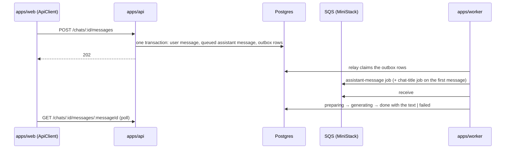

# App Template

A chat clone (visitor → message → assistant reply) built as a template for enterprise projects:
a Bun + TypeScript 7 + Effect 4 modular monolith, with an api, a worker and a web client over one
domain. It grows one ticket at a time along the [roadmap](docs/knowledge/roadmap.md), and each
ticket keeps its spec, design and plan in `docs/tickets/`, so a project started from it inherits
the reasoning along with the code.

It is not a framework, and nothing here is generated: every layer is plain code meant to be read,
copied and changed.

## What it does today

An anonymous user gets a secret in a cookie, creates chats, sends messages with attachments, and
the assistant answers. The api writes the message and its jobs in one transaction and answers
`202`; the worker relays the jobs to SQS, writes the model's whole reply into the message and
titles the chat; the client polls the message until it is `done` or `failed`. Records
live in Postgres, attachment bytes in S3, and jobs go through an outbox and SQS (MiniStack
locally); `LLM_PROVIDER` picks the language model: Anthropic, or a stub that needs no key. The
browser UI still shows only the health panel.



How the transaction, the outbox and the relay work:
[database.md › The outbox](docs/knowledge/database.md#the-outbox),
[aws.md › Queues](docs/knowledge/aws.md#queues).

## Quick start

Requires Bun at the version in `package.json › packageManager`, GNU Make, Docker running and the
[Pulumi CLI](https://www.pulumi.com/docs/install/).

```sh
make setup   # bun install, git hooks, and .env from .env.example
make up      # MiniStack with Postgres, the bucket and the queues inside it; migrates
make dev     # api, worker and web together
```

| Process | URL | Try |
|---|---|---|
| `apps/api` | <http://localhost:3000> | `/health` |
| `apps/web` | <http://localhost:3001> | the health panel; `/api/*` is proxied to the api |
| `apps/worker` | — | logs `worker started`, relays the outbox and consumes the queues |

A whole conversation from the shell, with the cookie kept in a jar:

```sh
curl -s -c jar -X POST localhost:3000/users
curl -s -b jar -X POST localhost:3000/chats
curl -s -b jar -X POST localhost:3000/chats/<chatId>/messages \
  -H 'content-type: application/json' -d '{"text":"Hello","attachmentIds":[]}'
# repeat while the assistant message is queued, preparing or generating: its text arrives whole
curl -s -b jar localhost:3000/chats/<chatId>/messages/<assistantMessageId>
```

`make down` stops the stand and keeps its data; `make reset` removes it whole. When `make up`
fails: [aws.md › When the stand fails](docs/knowledge/aws.md#when-the-stand-fails).

## Architecture at a glance

Three processes share one codebase and one database. Each is one `Layer`, launched by
`BunRuntime.runMain(Layer.launch(...))`, so stopping it closes one scope.

The workspaces, from the bottom up; each imports only from the ones below it:

| Workspace | Holds | Never holds |
|---|---|---|
| `domain/` | models (`Schema.Class`), branded ids, errors, ports, and the domain services that own the rules | SQL, HTTP, AWS, an `@effect/*` package (tests aside) |
| `http-api/` | the `HttpApi` contract over the domain's schemas, shared by the api and the browser | handlers, services |
| `application/` | use cases: a flow across domain services, the queue, the bucket, the assistant, in one `Transaction` | rules of an entity, adapters |
| `infrastructure/` | adapters of the ports: Postgres repositories, the S3 bucket, the LLM, the outbox relay | business rules |
| `packages/*` | generic clients (`config`, `queue`, `s3`, `llm`, `aws`) knowing nothing of the chat | domain imports |
| `apps/*` | thin entry points: api and worker handlers, the browser client | rules |

The invariants a change must keep:

- **The rules live in domain services.** A use case composes them and adds only rule-free
  writes; it never decides what an entity may do.
- **No rule in a handler.** An api or worker handler decodes, calls one use case or service, and
  maps the answer.
- **The database guards, not locks.** One active message per chat, a bind only while unbound and
  every status move are single conditional statements.
- **A message never exists without its job.** The job is an outbox row in the same transaction.
- **No service reaches the browser.** `make bundle-check` fails if one does.

The full matrix, and how Biome enforces it:
[architecture.md › Dependency rules](docs/knowledge/architecture.md#dependency-rules). The choices
and the alternatives they rejected: each ticket's `architecture.md › Decisions`.

## Anatomy of a slice

One entity crosses every layer under the same folder name. The `chat` slice, by file suffix:

```text
domain/chat/            chat.id  chat.model  chat.error  chat.port  chat.service
application/chat/       send-message.use-case  generate-assistant-message.use-case
infrastructure/chat/    chat.entity  chat.repository  chat.queue  assistant.llm  assistant.client
http-api/chat/          chat.http
apps/api/chat/          chat.handler
apps/worker/chat/       assistant-message.handler  chat-title.handler
<workspace>/tests/…     <source path>.test.ts   unit, over memory layers, no Docker
<workspace>/e2e/…       <source path>.e2e.ts    on the run's own Postgres and MiniStack
<workspace>/testing/    .test-fake  .test-layer  .test-fixture  test support, never in a module
```

Read it bottom-up: the model and its pure operations, the port the service writes through, the
service with the rules, the use case composing services, the adapter implementing the port, the
handler calling the use case. Every file of the slice and what it is named:
[architecture.md › Where things live](docs/knowledge/architecture.md#where-things-live); the
suffixes and naming verbs: [.claude/rules/naming.md](.claude/rules/naming.md).

## Daily development

| To | Run | More |
|---|---|---|
| run every gate before a commit | `make check` (Docker running) | [tooling.md › Commands](docs/knowledge/tooling.md#commands) |
| run one process, or debug it | `make dev-api`, `make debug-api` (also `-worker`, `-web`) | [tooling.md › Run and debug](docs/knowledge/tooling.md#run-and-debug) |
| run the unit suites only, in seconds | `make test-unit` | [tooling.md › Tests](docs/knowledge/tooling.md#tests) |
| run one test file or one test | `bun --bun vitest run --project unit <file> -t <name>` | [tooling.md › Commands](docs/knowledge/tooling.md#commands) |
| fix formatting and import order | `make fmt` | [tooling.md › Troubleshooting](docs/knowledge/tooling.md#troubleshooting) |
| change a table | edit its `.entity.ts`, then `make migration NAME=<name>` and `make migrate` | [database.md › Migrations](docs/knowledge/database.md#migrations) |
| start over with an empty database | `make reset && make up` | [tooling.md › Environment](docs/knowledge/tooling.md#environment) |
| work on two branches at once | a worktree with its own ports and containers | [tooling.md › Worktrees](docs/knowledge/tooling.md#worktrees) |
| read Effect's or Drizzle's source at our pin | `repos/effect`, `repos/drizzle` | [tooling.md › Commands](docs/knowledge/tooling.md#commands) |
| learn why a check failed | the symptom table | [tooling.md › Troubleshooting](docs/knowledge/tooling.md#troubleshooting) |

Tips that save time:

- **Test at the lowest seam that shows the rule.** A rule of an entity is a unit test of its
  domain service over memory layers; only an adapter or a transaction needs e2e.
- **Every e2e test owns its database and its stage,** so suites run in parallel and in two
  worktrees at once; nothing needs `make up`.
- **Time stands still in `it.effect`.** Move it with `TestClock.adjust`, or use `it.live`.
- **The worker reloads by re-exec, the api in place,** so a worker edit never leaves a second
  consumer behind: [tooling.md › Run and debug](docs/knowledge/tooling.md#run-and-debug).
- **A rejected commit is the hook:** `make typecheck`, then Biome on the staged files. Fix and
  commit again; never `--no-verify`.

## Adding a feature

1. **Specify it as a ticket:** `/ticket-feature`, then architecture, plan, implement, verify —
   [sdd.md › The five skills](docs/knowledge/sdd.md#the-five-skills).
2. **Add an entity** layer by layer, bottom-up, test first —
   [architecture.md › Add a new entity](docs/knowledge/architecture.md#add-a-new-entity).
3. **Add an AWS resource** to the inventory, local and deployed alike —
   [aws.md › Adding a resource](docs/knowledge/aws.md#adding-a-resource).

## Where to read next

| Question | Document |
|---|---|
| How do I run, debug, test, add a dependency or a workspace? Why did a check fail? | [docs/knowledge/tooling.md](docs/knowledge/tooling.md) |
| Which layer does my code belong to, and what may it import? | [docs/knowledge/architecture.md](docs/knowledge/architecture.md) |
| How are records stored, guarded, migrated and tested? | [docs/knowledge/database.md](docs/knowledge/database.md) |
| How do the apps reach S3 and SQS, locally and on AWS? | [docs/knowledge/aws.md](docs/knowledge/aws.md) |
| What do the domain words mean? | [docs/knowledge/glossary.md](docs/knowledge/glossary.md) |
| How is a change specified, planned, implemented and verified? | [docs/knowledge/sdd.md](docs/knowledge/sdd.md) |
| What is built next, and in which order? | [docs/knowledge/roadmap.md](docs/knowledge/roadmap.md) |
| What are the rules for one layer? | its `CLAUDE.md`, listed in [CLAUDE.md](CLAUDE.md) |
| How are commits and pull requests written? | [.claude/rules/commits.md](.claude/rules/commits.md), [.claude/rules/pull-requests.md](.claude/rules/pull-requests.md) |
| Why is it built this way? | the tickets in `docs/tickets/`: `feature.md` for the requirements, `architecture.md › Decisions` for every choice and its rejected alternative |

## History and new projects

`main` is the only long-lived branch: one squash commit per ticket, whose body is the PR
description. A ticket's plan steps stay in its merged PR's commit list and in its `plan.md`:
[sdd.md › Roadmap and history](docs/knowledge/sdd.md#roadmap-and-history).

On GitHub, *Use this template* starts a new project from `main`; what to rename, delete and keep
afterwards is the roadmap's
[`template-handoff`](docs/knowledge/roadmap.md#12-template-handoff).
