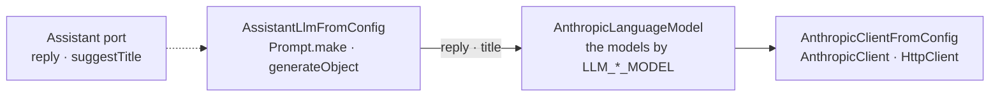

# AI

How the assistant asks a language model for a reply or a title, which parts of `effect/ai` and
`@effect/ai-anthropic` it uses, and what to know before changing its prompt or its schema. The
code: `AssistantLlmFromConfig`, the chat module's adapter of its `Assistant` port (the prompts,
the schemas, one `AnthropicLanguageModel` per purpose with its model of `LLM_REPLY_MODEL` or
`LLM_TITLE_MODEL` and its settings, the finish-reason hook, the retries and the failure
mapping); `AnthropicClientFromConfig` in `@app-template/kernel/llm` (Anthropic's client with the
key of `ANTHROPIC_API_KEY`); and those settings in `@app-template/kernel/config`. The adapter's
suite runs over a fake `HttpClient` that answers canned Anthropic bodies, so no test needs a key
or the network.

Every module named here is unstable at the pinned version: check an API against the vendored
sources (`repos/effect/packages/effect/src/ai/`, `repos/effect/packages/ai/anthropic/src/`)
before using it, and read this page again after an upgrade.

## The request

1. `reply` turns the chat's messages into a `Prompt`: the fixed system prompt first, then
   each user turn as its text and files, each assistant turn as its text. A failed Run leaves no
   reply, so two user turns may follow each other: `@effect/ai-anthropic` folds them into one,
   and the Messages API takes either shape. `suggestTitle` sends
   the title instruction and the opening message.
2. It calls `generateObject` on its purpose's model with the answer schema (`ReplyAnswer`,
   `TitleAnswer`). Nothing streams: the answer arrives whole.
3. `AnthropicLanguageModel` sends one Messages request with the schema as
   `output_config.format` (Anthropic's native structured output). The schema's `description`
   annotations reach the model; length bounds and other checks do not, so the decode enforces
   them.
4. The JSON answer is decoded by the same schema; the reply's field is the domain's
   `AssistantReply` text, so a blank reply fails the decode and is asked again.

The e2e journey runs no language model: its stand gives the worker a scripted `Assistant`
([tooling.md › Tests](tooling.md#tests)), so only the adapter's suite covers these steps.

## Request settings per purpose

| Purpose | Model setting | Sent |
|---|---|---|
| reply | `LLM_REPLY_MODEL` | `max_tokens` 16 000, top-level `cache_control: { type: 'ephemeral' }`; effort and thinking left to the model's default |
| title | `LLM_TITLE_MODEL` | `max_tokens` 1 000, `output_config.effort: 'low'`, `thinking: { type: 'disabled' }`; no cache |

- **The title model must accept `thinking: { type: 'disabled' }`.** Sonnet 5.5 rejects it, so a
  title model set to Sonnet 5.5 fails every title request with a 400, which is not retried;
  `.env.example` names a model that accepts it.
- No `temperature` is sent: the package sends none by default, and the Claude 5 models want it
  left out.
- Anthropic's requests wait up to 10 minutes for a byte (`transformClient` on
  `AnthropicClient.layer` in `AnthropicClientFromConfig`): Bun's `fetch` cuts a silent request at
  360 s, and a non-streamed answer of 16 000 tokens arrives only at the end.

## Failures and retries

`AssistantLlmFromConfig` retries in place what a retry can fix and lets only a final failure out of
the port, as `AssistantRefusedError` or `AssistantFailedError`; the use cases turn them into a
`failed` message (`ReplyRefused` or `ReplyFailed`) or an untitled chat. A job is never retried
([aws.md › Queues](aws.md#queues)).

| `AiError` reason | Retried |
|---|---|
| finish reason `content-filter` (Anthropic's `refusal`), or `ContentPolicyError` | no: refused |
| finish reason `length` (`max_tokens` reached), raised as `InvalidOutputError` | yes |
| `StructuredOutputError` (the answer failed the schema) | yes |
| `RateLimitError` with `retryAfter` up to 30 s | yes, waiting at least `retryAfter` |
| `RateLimitError` with a longer `retryAfter` | no |
| any other reason with `isRetryable` (5xx, 529, a transport error) | yes |
| any other reason (401/403, 400/404/422, an overlong prompt, no credit) | no |

A reply makes three requests at most, 1 s then 2 s apart; a title five, 1, 2, 4 and 8 s apart.
The final error's `cause` is the `AiError`'s message, for operators; it never reaches the wire.

### The finish-reason hook

`generateObject` ignores the finish reason, and `StructuredOutputError` does not carry it, so a
refusal written as prose would look like a malformed answer and be retried. `AssistantLlmFromConfig`
provides `Telemetry.CurrentSpanTransformer` for each request: `generateObject` hands it every
response part after the provider answers and **before** it decodes, so the hook keeps the
`finish` part and the adapter reads it whether the decode passed or failed. A `length` finish
fails even when its JSON decodes, since a cut answer can still be valid JSON.

**Upgrade risk:** a telemetry hook here does control flow. An `effect` release that calls the
span transformer after the decode, or not at all, turns a refusal back into three retried requests
ending as `ReplyFailed`. The suite's refusal case fails on such an upgrade; read
`generateObject` in `repos/effect/packages/effect/src/ai/LanguageModel.ts` when it does.

## Prompt caching

- **What is cached.** The reply request's top-level `cache_control` puts the cache breakpoint on
  its last block, so it moves with the growing history: the next reply in the same chat, within
  the 5-minute lifetime, reads the whole earlier prefix (system prompt, then messages). On
  Sonnet 5.5 a read costs 5% of the input price and a write 125%. The title request is not
  cached.
- **The 512-token floor.** Anthropic caches no prefix shorter than 512 tokens on the 5.5 models
  (1 024 on Sonnet 5), and says nothing: the request runs uncached with no error. The system
  prompt alone is far below it, so two chats never share a cached prefix; a chat starts reading
  its cache once its history passes the floor. `usage.cache_creation_input_tokens` and
  `usage.cache_read_input_tokens` both 0 means nothing was cached.
- **What breaks it.** A cache belongs to one model and one prefix. Changing the reply model, the
  system prompt, the reply schema, the thinking setting or the effort invalidates every chat's
  cached prefix; the next reply of each chat writes it again at the write price.

## Changing the system prompt or the reply schema

Both live beside `AssistantLlmFromConfig`: `systemPrompt` and `ReplyAnswer`.

- **The system prompt.** Keep it fixed per process: a date, a name or any user data in it would
  give every request its own prefix, and nothing would be cached. Anthropic adds its own format
  instructions for structured output, so the prompt need not restate the schema, and asking the
  model to show its reasoning invites a refusal.
  - *Cache:* every chat's cached prefix is invalidated once, when the new prompt deploys.
- **A field description.** Edit the `annotateKey` of the field. On a checked schema `annotate`
  lands on the check, which the JSON Schema leaves out, so the model would read no description;
  the suite's description case catches that.
  - *Cache:* invalidated as for a structural change: the description is part of
    `output_config.format`, and Anthropic invalidates the prompt cache on any change to it. It
    spares only Anthropic's separate cache of the compiled schema, which a description change
    does not recompile.
- **A new or changed field.** Add the bound to the domain's `AssistantReply` and the field, with
  its description, to `ReplyAnswer`.
  - *Cache:* every chat's cached prefix is invalidated, and the first request with the new
    schema waits while Anthropic compiles it.

## Modules left unused

Four modules a reader would reach for are left alone on purpose: `Chat`, since the history lives
in the database and every request is rebuilt from it; `Model`, since the adapter holds two
`LanguageModel` values, one per purpose; `ResponseIdTracker`, since Anthropic's Messages API keeps
no server-side conversation; and `AnthropicConfig`, since the wait is set once, on
`AnthropicClient.layer`, for every request. What every other module of the two vendored folders
is: its first comment.
