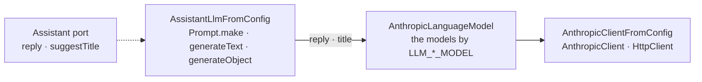

# AI

How the assistant asks a language model for a reply or a title, which parts of `effect/ai` and
`@effect/ai-anthropic` it uses, and what to know before changing its prompt or the title's
schema. The code: `AssistantLlmFromConfig`, the chat module's adapter of its `Assistant` port
(the prompts, the title's schema, one `AnthropicLanguageModel` per purpose with its model of
`LLM_REPLY_MODEL` or `LLM_TITLE_MODEL` and its settings, the finish-reason check, the retries
and the failure mapping); `AnthropicClientFromConfig` in `@app-template/kernel/llm` (Anthropic's
client with the key of `ANTHROPIC_API_KEY`); and those settings in `@app-template/kernel/config`.
The adapter's suite runs over a fake `HttpClient` that answers canned Anthropic bodies, so no
test needs a key or the network.

Every module named here is unstable at the pinned version: check an API against the vendored
sources (`repos/effect/packages/effect/src/ai/`, `repos/effect/packages/ai/anthropic/src/`)
before using it, and read this page again after an upgrade.

## The request

1. `reply` turns the chat's messages into a `Prompt`: the fixed system prompt first, then
   each user turn as its text (none when blank) and files, each assistant turn as its text. A
   failed Run leaves no reply, so two user turns may follow each other: `@effect/ai-anthropic`
   folds them into one, and the Messages API takes either shape. `suggestTitle` sends the title
   instruction and the opening message.
2. `reply` calls `generateText` on the reply model and decodes the text as the domain's
   `AssistantReply`, so a blank reply fails as `InvalidOutputError` and is asked again.
   `suggestTitle` calls `generateObject` on the title model with `TitleAnswer`. Nothing streams:
   the answer arrives whole.
3. For the title, `AnthropicLanguageModel` sends the schema as `output_config.format`
   (Anthropic's native structured output). The schema's `description` annotations reach the
   model; length bounds and other checks do not, so the decode of the JSON answer enforces them.

The e2e journey runs no language model: its stand gives the worker a scripted `Assistant`
([tooling.md › Tests](tooling.md#tests)), so only the adapter's suite covers these steps.

## Request settings per purpose

| Purpose | Model setting | Sent |
|---|---|---|
| reply | `LLM_REPLY_MODEL` | `max_tokens` 16 000, top-level `cache_control: { type: 'ephemeral' }`; effort and thinking left to the model's default |
| title | `LLM_TITLE_MODEL` | `max_tokens` 1 000, `output_config.effort: 'low'`, `thinking: { type: 'disabled' }`; no cache |

- **The title model must accept `thinking: { type: 'disabled' }`.** Sonnet 5.5 rejects it, so a
  title model set to Sonnet 5.5 fails every title request with a 400, which is not retried;
  `.env.example` names a model that accepts it.
- No `temperature` is sent: the package sends none by default, and the Claude 5 models want it
  left out.
- Anthropic's requests wait up to 10 minutes for a byte (`transformClient` on
  `AnthropicClient.layer` in `AnthropicClientFromConfig`): Bun's `fetch` cuts a silent request at
  360 s, and a non-streamed answer of 16 000 tokens arrives only at the end.

## Failures and retries

`AssistantLlmFromConfig` retries in place what a retry can fix and lets only a final failure out of
the port, as `AssistantRefusedError` or `AssistantFailedError`; the use cases turn them into a
`failed` message (`ReplyRefused` or `ReplyFailed`) or an untitled chat. A job is never retried
([aws.md › Queues](aws.md#queues)).

| `AiError` reason | Retried |
|---|---|
| finish reason `content-filter` (Anthropic's `refusal`), or `ContentPolicyError` | no: refused |
| finish reason `length` (`max_tokens` reached), raised as `InvalidOutputError` | yes |
| a blank reply (`InvalidOutputError`), a title that fails its schema (`StructuredOutputError`) | yes |
| `RateLimitError` with `retryAfter` up to 30 s | yes, waiting at least `retryAfter` |
| `RateLimitError` with a longer `retryAfter` | no |
| any other reason with `isRetryable` (5xx, 529, a transport error) | yes |
| any other reason (401/403, 400/404/422, an overlong prompt, no credit) | no |

A reply makes three requests at most, 1 s then 2 s apart; a title five, 1, 2, 4 and 8 s apart.
The final error's `cause` is the `AiError`'s message, for operators; it never reaches the wire.

### The finish reason

The adapter reads `finishReason` from each answer before it decodes it, so a `content-filter` or
`length` finish fails even when the text reads whole. A title the model refuses as prose fails
`generateObject`'s decode first: `StructuredOutputError` carries no finish reason, so it is
retried as a malformed answer and ends as `AssistantFailedError`, not `AssistantRefusedError`.
The title's use case logs either and leaves the chat untitled.

## Prompt caching

- **What is cached.** The reply request's top-level `cache_control` puts the cache breakpoint on
  its last block, so it moves with the growing history: the next reply in the same chat, within
  the 5-minute lifetime, reads the whole earlier prefix (system prompt, then messages). On
  Sonnet 5.5 a read costs 5% of the input price and a write 125%. The title request is not
  cached.
- **The 512-token floor.** Anthropic caches no prefix shorter than 512 tokens on the 5.5 models
  (1 024 on Sonnet 5), and says nothing: the request runs uncached with no error. The system
  prompt alone is far below it, so two chats never share a cached prefix; a chat starts reading
  its cache once its history passes the floor. `usage.cache_creation_input_tokens` and
  `usage.cache_read_input_tokens` both 0 means nothing was cached.
- **What breaks it.** A cache belongs to one model and one prefix. Changing the reply model, the
  system prompt, the thinking setting or the effort invalidates every chat's cached prefix; the
  next reply of each chat writes it again at the write price.

## Changing the system prompt

It lives beside `AssistantLlmFromConfig` as `systemPrompt`, and it is all the reply's model
reads besides the history: the reply is asked as text, with no schema.

- Keep it fixed per process: a date, a name or any user data in it would give every request its
  own prefix, and nothing would be cached. Asking the model to show its reasoning invites a
  refusal.
- *Cache:* every chat's cached prefix is invalidated once, when the new prompt deploys.

## Modules left unused

Four modules a reader would reach for are left alone on purpose: `Chat`, since the history lives
in the database and every request is rebuilt from it; `Model`, since the adapter holds two
`LanguageModel` values, one per purpose; `ResponseIdTracker`, since Anthropic's Messages API keeps
no server-side conversation; and `AnthropicConfig`, since the wait is set once, on
`AnthropicClient.layer`, for every request. What every other module of the two vendored folders
is: its first comment.
