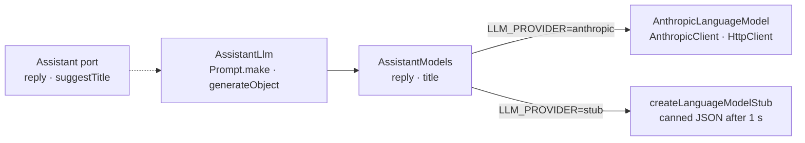

# AI

How the assistant asks a language model for a reply or a title, which parts of `effect/ai` and
`@effect/ai-anthropic` it uses, and what to know before changing its prompt or its schema. The
code: `infrastructure/chat/assistant.llm.ts` (`AssistantLlm`: the prompts, the schemas, the
finish-reason hook, the retries and the failure mapping), `infrastructure/chat/assistant.client.ts`
(`AssistantModels`: one language model per purpose, Anthropic or the stub),
`packages/llm/client.ts` (the stub) and `packages/config/config.ts` (`LlmConfig`,
`ReplyModelConfig`). The suite: `infrastructure/tests/chat/assistant.llm.test.ts`, over a fake
`HttpClient` that answers canned Anthropic bodies, so no test needs a key or the network.

Every module named here is unstable at 4.0.6: check an API against the vendored sources
(`repos/effect/packages/effect/src/ai/`, `repos/effect/packages/ai/anthropic/src/`) before using
it, and read this page again after an upgrade.

## The request

1. `reply` turns the chat's `done` messages into a `Prompt`: the fixed system prompt first, then
   each user turn as its text and files, each assistant turn as its text. `suggestTitle` sends
   the title instruction and the opening message.
2. It calls `generateObject` on its purpose's model with the answer schema (`ReplyAnswer`,
   `TitleAnswer`). Nothing streams: the answer arrives whole.
3. `AnthropicLanguageModel` sends one Messages request with the schema as
   `output_config.format` (Anthropic's native structured output). The schema's `description`
   annotations reach the model; length bounds and other checks do not, so the decode enforces
   them.
4. The JSON answer is decoded by the same schema; the reply's field is the domain's
   `AssistantReply` text, so a blank reply fails the decode and is asked again.

`LLM_PROVIDER=stub` swaps step 3 for a `LanguageModel` that answers canned JSON after 1 s, decoded
by the same schemas; the suite's stub case fails when the canned JSON no longer passes them.

## Request settings per purpose

| Purpose | Model setting | Sent |
|---|---|---|
| reply | `LLM_REPLY_MODEL` | `max_tokens` 16 000, top-level `cache_control: { type: 'ephemeral' }`; effort and thinking left to the model's default |
| title | `LLM_TITLE_MODEL` | `max_tokens` 1 000, `output_config.effort: 'low'`, `thinking: { type: 'disabled' }`; no cache |

- **The title model must accept `thinking: { type: 'disabled' }`.** Sonnet 5.5 rejects it, so a
  title model set to Sonnet 5.5 fails every title request with a 400, which is not retried;
  `.env.example` names Haiku 5.5.
- No `temperature` is sent: the package sends none by default, and the Claude 5 models want it
  left out.
- Anthropic's requests wait up to 10 minutes for a byte (`transformClient` on
  `AnthropicClient.layer`): Bun's `fetch` cuts a silent request at 360 s, and a non-streamed
  answer of 16 000 tokens arrives only at the end.

## Failures and retries

`AssistantLlm` retries in place what a retry can fix and lets only a final failure out of the
port, as `AssistantRefusedError` or `AssistantFailedError`; the use cases turn them into a
`failed` message (`ReplyRefused` or `ReplyFailed`) or an untitled chat. The queue's own retries
cover crashes only.

| `AiError` reason | Retried |
|---|---|
| finish reason `content-filter` (Anthropic's `refusal`), or `ContentPolicyError` | no: refused |
| finish reason `length` (`max_tokens` reached), raised as `InvalidOutputError` | yes |
| `StructuredOutputError` (the answer failed the schema) | yes |
| `RateLimitError` with `retryAfter` up to 30 s | yes, waiting at least `retryAfter` |
| `RateLimitError` with a longer `retryAfter` | no |
| any other reason with `isRetryable` (5xx, 529, a transport error) | yes |
| any other reason (401/403, 400/404/422, an overlong prompt, no credit) | no |

A reply makes three requests at most, 1 s then 2 s apart; a title five, 1, 2, 4 and 8 s apart.
The final error's `cause` is the `AiError`'s message, for operators; it never reaches the wire.

### The finish-reason hook

`generateObject` ignores the finish reason, and `StructuredOutputError` does not carry it, so a
refusal written as prose would look like a malformed answer and be retried. `AssistantLlm`
provides `Telemetry.CurrentSpanTransformer` for each request: `generateObject` hands it every
response part after the provider answers and **before** it decodes, so the hook keeps the
`finish` part and the adapter reads it whether the decode passed or failed. A `length` finish
fails even when its JSON decodes, since a cut answer can still be valid JSON.

**Upgrade risk:** a telemetry hook here does control flow. An `effect` release that calls the
span transformer after the decode, or not at all, turns a refusal back into three retried requests
ending as `ReplyFailed`. The suite's refusal case fails on such an upgrade; read
`generateObject` in `repos/effect/packages/effect/src/ai/LanguageModel.ts` when it does.

## Prompt caching

- **What is cached.** The reply request's top-level `cache_control` puts the cache breakpoint on
  its last block, so it moves with the growing history: the next reply in the same chat, within
  the 5-minute lifetime, reads the whole earlier prefix (system prompt, then messages). On
  Sonnet 5.5 a read costs 5% of the input price and a write 125%. The title request is not
  cached.
- **The 512-token floor.** Anthropic caches no prefix shorter than 512 tokens on the 5.5 models
  (1 024 on Sonnet 5), and says nothing: the request runs uncached with no error. The system
  prompt alone is far below it, so two chats never share a cached prefix; a chat starts reading
  its cache once its history passes the floor. `usage.cache_creation_input_tokens` and
  `usage.cache_read_input_tokens` both 0 means nothing was cached.
- **What breaks it.** A cache belongs to one model and one prefix. Changing the reply model, the
  system prompt, the reply schema, the thinking setting or the effort invalidates every chat's
  cached prefix; the next reply of each chat writes it again at the write price.

## Changing the system prompt or the reply schema

Both live in `infrastructure/chat/assistant.llm.ts`: `systemPrompt` and `ReplyAnswer`.

- **The system prompt.** Keep it fixed per process: a date, a name or any user data in it would
  give every request its own prefix, and nothing would be cached. Anthropic adds its own format
  instructions for structured output, so the prompt need not restate the schema, and asking the
  model to show its reasoning invites a refusal.
  - *Cache:* every chat's cached prefix is invalidated once, when the new prompt deploys.
- **A field description.** Edit the `annotateKey` of the field. On a checked schema `annotate`
  lands on the check, which the JSON Schema leaves out, so the model would read no description;
  the suite's description case catches that.
  - *Cache:* invalidated as for a structural change: the description is part of
    `output_config.format`, and Anthropic invalidates the prompt cache on any change to it. It
    spares only Anthropic's separate cache of the compiled schema, which a description change
    does not recompile.
- **A new or changed field.** Add the bound to the domain's `AssistantReply` and the field, with
  its description, to `ReplyAnswer`; update the stub's canned reply in
  `infrastructure/chat/assistant.client.ts`, or the suite's stub case fails.
  - *Cache:* every chat's cached prefix is invalidated, and the first request with the new
    schema waits while Anthropic compiles it.

Either change moves the instructions hash, the SHA-256 of the system prompt and the reply
schema's JSON Schema document, which the api writes into each reply's job as its provenance
(**Provenance** in [glossary.md](glossary.md)). Operators read it from the outbox to tell
which replies were asked under which instructions.

## The modules of `effect/ai`

Every file of `repos/effect/packages/effect/src/ai/` but `index.ts`, at 4.0.6.

| Module | What it is | Here |
|---|---|---|
| `AiError` | the one error of every AI call, with a `reason` per failure kind, `isRetryable` and `retryAfter` | `assistant.llm.ts`: the retry decision and the mapping to the port's errors; `AiError.make` raises an early finish |
| `AnthropicStructuredOutput` | turns a `Schema` into the JSON Schema subset Anthropic accepts, with a codec that still enforces what was left out | indirectly: `AnthropicLanguageModel` calls it for `generateObject` |
| `Chat` | a stateful session that keeps the prompt history in a `Ref` | not used: the history lives in the database and every request is rebuilt from it |
| `Decision` | named classification, rating or probability decisions over one input | not used: nothing is classified |
| `DecisionModel` | the service that answers a `Decision` in one call | not used: as `Decision` |
| `EmbeddingModel` | text to vectors | not used: no search or retrieval |
| `IdGenerator` | ids for tool calls and response items | indirectly: `LanguageModel` falls back to its default generator |
| `LanguageModel` | the provider-neutral service: `generateText`, `streamText`, `generateObject`, and `make` for providers | `assistant.llm.ts` calls `generateObject`; `AssistantModels` holds two; the stub is built with `make` |
| `McpClient` | a client of Model Context Protocol servers | not used: the assistant calls no tools |
| `McpClientError` | the errors of `McpClient` | not used: as `McpClient` |
| `McpProtocol` | the MCP protocol versions a server can speak | not used: the app serves no MCP |
| `McpSchema` | schemas of MCP messages | not used: as `McpProtocol` |
| `McpServer` | builds an MCP server | not used: as `McpProtocol` |
| `Model` | a provider layer carrying its provider and model names (`ProviderName`, `ModelName`) | not used: `AssistantModels` holds two `LanguageModel` values, one per purpose, instead of one model per context; provenance names the model from `ReplyModelConfig` |
| `OpenAiStructuredOutput` | `AnthropicStructuredOutput`'s counterpart for OpenAI | not used: no OpenAI provider (roadmap `openai-provider`) |
| `Prompt` | the message list sent to a model: roles and text, file, tool parts | `assistant.llm.ts`: the chat and title prompts |
| `Response` | the parts a model answers: text, finish, tool calls, usage | `assistant.llm.ts` reads `FinishReason`; the stub answers `Response` parts |
| `ResponseIdTracker` | sends only the new messages after a provider's earlier response id | not used: Anthropic's Messages API keeps no server-side conversation |
| `Telemetry` | OpenTelemetry `gen_ai.*` span attributes and `CurrentSpanTransformer` | `assistant.llm.ts`: the finish-reason hook; no trace exporter yet (roadmap `observability`) |
| `Tokenizer` | token counting and truncating a prompt to a limit | not used: no provider implements it (roadmap `context-window`) |
| `Tool` | a tool the model may call, with its parameter and result schemas | not used: the assistant calls no tools |
| `Toolkit` | tools grouped with their handlers | not used: as `Tool` |

## The modules of `@effect/ai-anthropic`

Every file of `repos/effect/packages/ai/anthropic/src/` but `index.ts`, at 4.0.6.

| Module | What it is | Here |
|---|---|---|
| `AnthropicClient` | the Messages API client: auth and version headers, decoding, error mapping | `AssistantModels.layerAnthropic` provides `AnthropicClient.layer` with the key and the 10-minute wait |
| `AnthropicConfig` | changes the HTTP client for the requests one effect makes | not used: the wait is set once, on `AnthropicClient.layer`, for every request |
| `AnthropicError` | Anthropic's fields on `AiError` metadata, by module augmentation | not read: the mapping needs `AiError`'s reason, and `cause` its message |
| `AnthropicLanguageModel` | the Anthropic `LanguageModel`: prompts, files and options to Messages requests and back | `AssistantModels.layerAnthropic`: `make` twice, one request config per purpose |
| `AnthropicTelemetry` | `gen_ai.anthropic.*` span attributes | indirectly: the language model writes them on its spans |
| `AnthropicTool` | Anthropic's own tools (web search, code execution, …) | not used: the assistant calls no tools |
| `Generated` | the schemas and types of Anthropic's API, generated from its spec | the suite types its canned response bodies with them |
