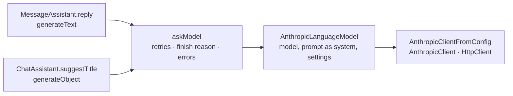

# AI

How the assistant asks a language model for a reply or a title, which parts of `effect/ai` and
`@effect/ai-anthropic` it uses, and what to know before changing its prompt or the title's
schema. The code: the chat module's two services in its `infrastructure/`, one per job,
`MessageAssistant` (the reply: the system prompt and the reply model of `LLM_REPLY_MODEL`) and
`ChatAssistant` (the title: its instruction, its schema and the title model of
`LLM_TITLE_MODEL`), each an `AnthropicLanguageModel` with its settings; in
`@app-template/kernel/llm` the one function both pipe, `askModel` (the retries, the
finish-reason check and the failure mapping, generic over the errors its caller names: chat
passes `assistantErrors`), and `AnthropicClientFromConfig` (Anthropic's client with the key of
`ANTHROPIC_API_KEY`); and those settings in `@app-template/kernel/config`.
The assistants' suite runs over a fake `HttpClient` that answers canned Anthropic bodies, so no
test needs a key or the network.

Every module named here is unstable at the pinned version: check an API against the vendored
sources (`repos/effect/packages/effect/src/ai/`, `repos/effect/packages/ai/anthropic/src/`)
before using it, and read this page again after an upgrade.

## The request

1. Each model sends its fixed prompt as the request's `system`, set in its `config`: the system
   prompt for a reply, the title instruction for a title. A prompt that asks the model to show
   its reasoning invites a refusal.
2. `MessageAssistant.reply` calls `generateText` on the reply model with the chat's messages:
   each user turn as its text (none when blank) and files, each assistant turn as its text. A
   failed Run leaves no reply, so two user turns may follow each other: `@effect/ai-anthropic`
   folds them into one, and the Messages API takes either shape. The text is decoded as the domain's
   `AssistantReply`, which drops U+0000 (a text column refuses it), then fails a blank reply.
   Nothing streams: the answer arrives whole.
3. `ChatAssistant.suggestTitle` calls `generateObject` on the title model with the opening
   message and `TitleAnswer`, which the package sends as `output_config.format` (Anthropic's
   native structured output). The schema's checks are not sent: the instruction states the
   language and the 120-character bound; the decode of the JSON answer trims the title and
   enforces the bound.

The e2e journey runs no language model: its stand gives the worker a scripted `MessageAssistant`
and `ChatAssistant` ([tooling.md › Tests](tooling.md#tests)), so only the assistants' suite
covers these steps.

## Request settings per purpose

| Purpose | Model setting | Sent |
|---|---|---|
| reply | `LLM_REPLY_MODEL` | `max_tokens` 16 000, top-level `cache_control: { type: 'ephemeral' }`; effort and thinking left to the model's default |
| title | `LLM_TITLE_MODEL` | `max_tokens` 1 000, `output_config.effort: 'low'`, `thinking: { type: 'disabled' }`; no cache |

- **The title model must accept `thinking: { type: 'disabled' }`.** Sonnet 5.5 rejects it, so a
  title model set to Sonnet 5.5 fails every title request with a 400, which is not retried;
  `.env.example` names a model that accepts it.
- No `temperature` is sent: the package sends none by default, and the Claude 5 models want it
  left out.
- Anthropic's requests wait up to 10 minutes for a byte (`transformClient` on
  `AnthropicClient.layer` in `AnthropicClientFromConfig`): Bun's `fetch` cuts a silent request at
  360 s, and a non-streamed answer of 16 000 tokens arrives only at the end.

## Failures and retries

`askModel` asks again in place only what the provider marks retryable, and lets out of either
assistant only a final failure, as the caller's `refused` or `failed` error, for chat
`AssistantRefusedError` or `AssistantFailedError`; the use
cases turn them into a failed Run (`ReplyRefused` or `ReplyFailed`) or an untitled chat. A
job is never retried ([aws.md › Queues](aws.md#queues)).

| Failure | Asked again |
|---|---|
| an `AiError` whose `isRetryable` holds (5xx, 529, a rate limit, a transport error, a title that fails its schema) and whose `retryAfter` is at most 30 s | twice, 1 s then 2 s apart, never before `retryAfter` |
| a rate limit asking a longer wait, such as a daily token limit | no |
| any other `AiError` (401/403, 400/404/422, an overlong prompt, no credit) | no |
| an answer the model refused (finish reason `content-filter`, Anthropic's `refusal`) | no: `AssistantRefusedError`, its partial text dropped |
| an answer that finished any other way than `stop` (`length` at `max_tokens`, `unknown` for a stop reason the package does not map), or a blank reply | no: `AssistantFailedError` |

The final error's `cause` is the `AiError`'s message, the finish reason or a blank reply's decode
error, for operators: the use cases log it, and a failed Run keeps only its reason and sentence,
so it never reaches the wire.

### The finish reason

`askModel` reads `finishReason` after its retries, so an answer that did not finish fails at
once, even when its text reads whole. A title cut at `max_tokens` inside its JSON, or refused as
prose, fails `generateObject`'s decode first: `StructuredOutputError` carries no finish reason, so
it is asked again as a malformed answer and ends as `AssistantFailedError`, a refusal too. The
title's use case logs either and leaves the chat untitled.

## Prompt caching

- **What is cached.** The reply request's top-level `cache_control` puts the cache breakpoint on
  its last block, so it moves with the growing history: the next reply in the same chat, within
  the 5-minute lifetime, reads the whole earlier prefix (system prompt, then messages). On
  Sonnet 5.5 a read costs 10% of the input price and a write 125%. The title request is not
  cached.
- **The 512-token floor.** Anthropic caches no prefix shorter than 512 tokens on the 5.5 models
  (1 024 on Sonnet 5), and says nothing: the request runs uncached with no error. The system
  prompt alone is far below it, so two chats never share a cached prefix; a chat starts reading
  its cache once its history passes the floor. `usage.cache_creation_input_tokens` and
  `usage.cache_read_input_tokens` both 0 means nothing was cached.
- **What breaks it.** A cache belongs to one model and one prefix. Changing the reply model, the
  system prompt, the thinking setting or the effort invalidates every chat's cached prefix once;
  the next reply of each chat writes it again at the write price.

## Modules left unused

Four modules a reader would reach for are left alone on purpose: `Chat`, since the history lives
in the database and every request is rebuilt from it; `Model`, since each assistant holds
its one `LanguageModel` value; `ResponseIdTracker`, since Anthropic's Messages API keeps
no server-side conversation; and `AnthropicConfig`, since the wait is set once, on
`AnthropicClient.layer`, for every request. What every other module of the two vendored folders
is: its first comment.
