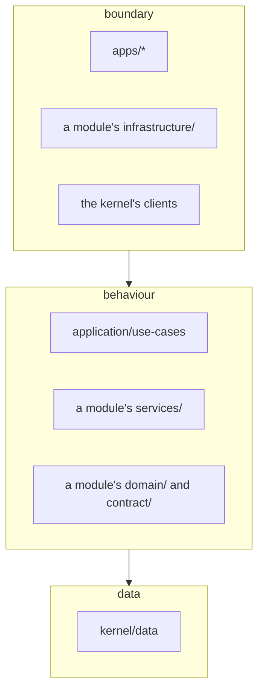

# Architecture

How the code is cut and how to extend it: the three rings, what may import what and the guard
that refuses the rest, where tests live, the shape of a use case, and the checklists to add an
entity, a store's client or a module. **Why each boundary holds, what it costs and what breaks if
it is reversed live in [decisions.md](decisions.md),** the living decisions, one entry each;
read the decision before changing a boundary. Decisions older than those live in
[architecture.md › Decisions](../tickets/2026-10-16-1433_monorepo-setup/architecture.md#decisions)
of the scaffold ticket and of the architecture audit
(`docs/tickets/2026-10-27-1433_architecture-audit/`). Each layer's binding rules live in its
`CLAUDE.md` and in `.claude/rules/`.

## The three rings

Every dependency points inward, from the boundary to the behaviour to the data:

- **The data**, `kernel/data`, the one source of truth over every store: `Db` over every table and
  relation, the migrations, and a repository per store in the data layer's own types, the
  bucket's objects among them. It takes its clients from the context.
- **The behaviour**, `application/`: the modules and above them every use case in
  `application/use-cases`. A module's `domain/` holds its models, pure rules and the utils they
  share, errors and the ports that reach outside; its `services/` the domain services, each
  model's `<Model>Service` over the data layer's repositories and the services composed over it;
  its `infrastructure/` everything of it that connects to the environment, the adapters of its
  ports, the services a use case or the chat's worker services call over a client (the
  assistants) and its queues' definitions ([A module's layers](decisions.md#a-modules-layers));
  its `contract/`, once another module needs one, what other modules may take of it.
- **The boundary**, everything that touches the world outside the process: the kernel's
  configured clients (`/config`, `/postgres`, `/aws`, `/llm`), each module's
  `infrastructure/`, and the apps, thin entry points that assemble the layers and provide the
  clients; the api declares the HTTP contract from the domain's schemas and writes it as
  `apps/api/openapi.json`, from which the web's client is generated. Nothing of `application/`
  reaches the browser.

`packages/*` holds generic tools, configured by their caller, that know no app. `deployment/`
provisions the stores of the local stand ([aws.md](aws.md)). What each ring and layer may import:
[Dependency rules](#dependency-rules). The decisions:
[Modules by capability](decisions.md#modules-by-capability),
[A module's layers](decisions.md#a-modules-layers), [One kernel](decisions.md#one-kernel),
[The data at the centre](decisions.md#the-data-at-the-centre),
[The API contract in the api](decisions.md#the-api-contract-in-the-api).



`application/` is one workspace, `@app-template/application`, and one `tsconfig.json` project:
each module and the use cases a folder with one entry, a module's contract a folder in it,
exported through the module's entry. The `apps/e2e` test app runs both app layers in one test
process, starts no process of its own, and nothing imports it.

## Dependency rules

Each row lists what its code may import (✓ allowed, ✗ refused), and the last column the guard
that refuses the row's ✗, each guard described in [Boundary guards](#boundary-guards):

| From ↓ / may import → | another module | a contract | `use-cases` | `kernel/data` | rest of `kernel` | `packages/*` | Refused by |
|---|---|---|---|---|---|---|---|
| a module's `domain/` | ✗ | ✓, through its entry | ✗ | the tables' values only | ✗ | `schema` only | `application/*/domain/**`, `kernel/data` by name |
| a module's `services/` | ✗ | ✓, through its entry | ✗ | ✓, but `Db` and the relations | ✗ | `schema` only; the chat's ask and reply services `db`'s `Transaction` too, its ask service `queue`'s `QueueSender` | `application/*/services/**`; the chat's ask service, `application/chat/services/ask-chat.service.ts`; its reply service, `application/chat/services/reply-chat.service.ts`; its title service, `application/chat/services/title-chat.service.ts` |
| a module's `infrastructure/` | ✗, its own entry too | ✓, through its entry | ✗ | ✓ | ✓ | ✓ | `application/*/infrastructure/**`; its own entry, `use-cases`: `noImportCycles` on a cycle, else review |
| a contract | ✗, nor its module's files | ✗ | ✗ | ✗ | ✗ | `schema` only | `application/*/contract/**` |
| `use-cases` | ✓, every layer; `/testing` in its tests only | ✓ | — | its tests only | `/llm/error`'s errors only | ✓ | `application/use-cases/**`, `/llm/error` by name; review, `/testing` and `kernel/data` |
| `kernel/data` | ✗ | ✗ | ✗ | — | ✗ | ✓ | `kernel/data/**` |
| rest of `kernel` | ✗ | ✗ | ✗ | ✓ | ✓, the parts below it | ✓ | TS2307, a module, `use-cases`; a part above or beside it: `noImportCycles` on a cycle, else review |
| `packages/*` | ✗ | ✗ | ✗ | ✗ | ✗ | ✓, the ones below it | `biome-imports.grit` and TS2307, any workspace; a package above it: `noImportCycles` on a cycle, else review |
| `apps/api` | ✓ | ✓ | ✓ | `layer.ts` only | ✓ | ✓ | `biome-imports.grit`, another app and `deployment`; review, the data |
| `apps/worker` | ✓ | ✓ | ✓ | `layer.ts` only | ✓ | ✓ | `biome-imports.grit`, another app and `deployment`; review, the data |
| `apps/web` client | ✗ | ✗ | ✗ | ✗ | ✗ | `ui` only | `apps/web/**`; TS2307, any workspace but `packages`; `make bundle-check` |
| `apps/web/main.ts` | ✗ | ✗ | ✗ | ✗ | ✗ | `ui` only | `biome-imports.grit`, another app and `deployment`; TS2307, any workspace but `packages`; review, a package but `ui` |
| `deployment` | ✗ | ✗ | ✗ | the files' key only | `/config`, `/aws`: the inventory | ✓ | `biome-imports.grit`, any workspace but these and another part; review, the kernel's names |
| `apps/e2e` | ✓ | ✓ | ✓ | ✓ | ✓ | ✓ | the apps' `exports`, their `./testing` only |

- **Inside a module** the layers point inward too: `domain/` imports neither
  `#<module>/services/*` nor `#<module>/infrastructure/*`, `services/` not
  `#<module>/infrastructure/*` but, in the chat's ask service, its `<model>.queue` file, whose
  jobs the services' tests read too, and, in its reply and title services, each its assistant's
  `.llm` file, and
  `infrastructure/` not `#<module>/services/*`; a service reaches the outside world only
  through a port its `domain/` declares, a job's send in that queue file, or, in the worker's
  services, the assistants that do the jobs' work, and a module reaches its
  own files, its contract's too, through `#<module>/…`, never its entry. Of another module's
  entry a module takes only the names of its contract, which review holds
  ([modules.md](../../.claude/rules/modules.md)), not Biome.
- **The apps** never import each other or `deployment`:
  [Independent apps](decisions.md#independent-apps). What a handler may call and import:
  [layering.md › Handlers](../../.claude/rules/layering.md#handlers).
- **The api's HTTP groups take the domain's schemas** through the modules' entries; the web
  takes none of them, only its generated client
  ([The API contract in the api](decisions.md#the-api-contract-in-the-api)). **A contract
  imports only `effect` and `packages/schema`, for the id schema** (and `type-fest` for types),
  **a module's `domain/` also the values its tables declare** (a limit, a pattern, an enum's
  values, a JSON column's shape, from `@app-template/kernel/data`), and none of them nor a
  module's `services/` import an `@effect/*` package ([A module's layers](decisions.md#a-modules-layers)).
- **A dependency on a module's contract counts as one on the module**, so two modules that import
  each other's contracts form a cycle, refused by review where no tool sees it
  ([modules.md](../../.claude/rules/modules.md)).
- **A ✓ is permission, not a declaration.** The dependency must also be in the importer's
  `package.json`, or the isolated linker and `tsc -b` refuse it. A package imports only the
  packages below it.
- **The kernel's parts are ordered.** `/config` and `/data` are at the bottom, and `/data`
  imports no other part. `/aws`, `/llm` and `/postgres` sit above them: each imports `/config`
  through its entry, `/postgres` `/data` too, and none of the three imports another. Only the
  data's e2e reaches up, to the part whose containers it runs on (`/aws`'s inventory and
  `AwsTest`, through its entry and `/testing/e2e`). Biome refuses a part reaching another part's
  files (`biome-imports.grit`) and `kernel/data`'s source importing any part (its override); a
  part importing one beside it, `/aws` the `/llm` entry say, passes Biome unless the two form a
  cycle, and review alone refuses it ([modules.md](../../.claude/rules/modules.md)).
- **Tests** and the support they may import: [tooling.md › Tests](tooling.md#tests).

## Imports: `#<workspace>/` vs `@app-template/`

Every import line says where its code lives:

```ts
import { readFileSync } from 'node:fs'                      // Bun and Node built-ins

import { Effect } from 'effect'                             // external packages

import { ChatService } from '@app-template/application/chat'  // another part

import { askChat } from '#use-cases/chat/ask-chat.use-case'  // this part
```

- **`@app-template/<folder>`** reaches another part through its workspace's `exports`, each
  entry an `index.ts` barrel: the kernel one per part (`@app-template/kernel/data` →
  `kernel/data/index.ts`, every store), a package by its folder (`@app-template/packages/db`),
  a module or the use cases by theirs (`@app-template/application/<module>` →
  `application/<module>/index.ts`, every layer), each with its test support's entries
  ([tooling.md › Tests](tooling.md#tests)). An entry only re-exports what other parts import,
  never what loads code they do not run (a process's entry, the migration runner,
  testcontainers), so e2e support sits behind an entry of its own.
- **`#<part>/<path>`** reaches a file of the same part, through the `imports` map in its
  workspace's `package.json` (`"#chat/*": "./chat/*.ts"`, `"#api/*": "./*.ts"`); a kernel part,
  a package or a module reaches another through that one's entry, never its files. Each layer
  of a module keeps its name in the path (`#chat/services/…`), so a layer's Biome override
  matches the others by glob (`#*/services/**`). Relative `./` and `../` paths are banned, by
  `biome-imports.grit` ([Imports through subpaths](decisions.md#imports-through-subpaths)). A
  bare `#/` prefix would be shorter, but the pinned Bun cannot resolve it.
- **Order** is the four groups above, separated by blank lines. `make fmt` sorts them.

## Where things live

Using the files of `chat` as the map; what each may import: [Dependency rules](#dependency-rules).

| What | File | Named |
|---|---|---|
| model with its pure operations, the codec of its own row | `application/chat/domain/chat.model.ts`, `message.model.ts`; the shared `Status` in `status.model.ts` | `Chat`, `Message` (`Schema.Class`) |
| util: a model's branded id and its pure steps with no domain meaning that the module's code shares; what it imports: [naming.md › Files](../../.claude/rules/naming.md#files) ([Utils apart from models](decisions.md#utils-apart-from-models)) | `application/chat/domain/chat.util.ts`, `message.util.ts` | `ChatId`, `MessageId`, `isBlank` |
| domain errors | `application/chat/domain/chat.error.ts`, `message.error.ts` | `ChatNotFoundError` (`Schema.TaggedError`) |
| what a service over a client takes and returns | `application/chat/domain/assistant.model.ts` | `AssistantReply` |
| domain service | `application/chat/services/chat.service.ts` | `ChatService`, over the data layer's `ChatRepository` |
| a module's queues: their definitions and the send of each job | `application/chat/infrastructure/chat.queue.ts` | `replyToMessageQueue` with its job's schema `ReplyToMessage`; `sendReplyToMessage`, `sendTitleChat` |
| service over a client, one per output it asks a language model for (a reply, a title), holding the language model, its prompt and its request settings, with its `static layer` and no port in front | `application/chat/infrastructure/message-assistant.llm.ts`, `chat-assistant.llm.ts` | `MessageAssistant`, `ChatAssistant`, both piping the kernel's `askModel` and failing with its `LlmError` ([ai.md](ai.md)) |
| use case | `application/use-cases/chat/ask-chat.use-case.ts` | `askChat` |
| tables, entities, relations: a table with the values its checks declare and its `<Name>Columns` ([database.md](database.md)); an entity, the one shape its store's reads return, with the types its repository's verbs take ([repositories.md](../../.claude/rules/repositories.md)) | `kernel/data/chat/chat.table.ts`, `chat.entity.ts`; `kernel/data/relations.ts` | `chats`, `ChatEntity`, `relations` |
| repository | `kernel/data/chat/chat.repository.ts`; `kernel/data/file/file.repository.ts` | `ChatRepository` over `Db`; `FileRepository` over `S3Bucket` |
| database client and migrations | `kernel/data/db.client.ts`, `kernel/data/data-migrations.ts`; `kernel/postgres/` | `Db`; `PgClientFromConfig` and the `make migrate` program ([database.md](database.md)) |
| database tools any app could use | `packages/db/` | `Transaction`, `createDb`, the shared columns |
| the queue's two ends: the send of a definition's job with the current trace, the run of a handler on each job a batch delivers | `packages/queue/queue.sender.ts`, `queue.consumer.ts` | `QueueSender`, `consumeQueue` ([aws.md](aws.md)) |
| codecs that turn a failure into a defect; the id format, its schema and its generation | `packages/schema/` | `encodeWith`, `decodeWith`, `buildIdSchema`, `idGenerator` |
| HTTP group | `apps/api/chat/chat.http.ts` | `ChatHttp` (`HttpApiGroup`); `ApiChat` (`Chat.mapFields(…)`) |
| the contract | `apps/api/api.ts`, `apps/api/openapi.json` | `Api` |
| api handler | `apps/api/chat/chat.handler.ts` | `ChatHandler` (`HttpApiBuilder.group`) |
| mapper from a model to its wire shape | `apps/api/chat/chat.mapper.ts` | `buildApiChat` |
| worker route: each queue's use case, run through `consumeQueue` | `apps/worker/worker.handler.ts` | `WorkerHandler` |
| the process's layer | `apps/api/layer.ts`, `apps/worker/layer.ts` | `ApiHttp`, the routes with the services a use case reads, over the repositories and ports, `ApiLayer` with the clients, `WorkerProcess` but its assistants, `WorkerLayer` with them and Anthropic's client; `main.ts` runs them |
| browser feature | `apps/web/features/health/health-panel.ts` | `renderHealthPanel` |
| the web's client | `apps/web/shared/api.generated.ts`, `apps/web/shared/api.client.ts` | `Api`, `ApiClient` |
| test fixture: sample values and the functions that build them, plain data with no `Effect` to run and no layer | `application/chat/__tests__/testing/chat.test-fixture.ts`; `packages/testing/clock.test-fixture.ts` | `chat`, `chatId`; `epoch` |
| test util: a function tests and test layers call (an assertion, a predicate, a builder of a value, a stream or an error, an effect on the e2e run's containers), building no layer and doubling no service | `application/chat/__tests__/testing/chat.test-util.ts`; `kernel/aws/__tests__/testing/e2e/provision.test-util.ts` | `holdCall`; `provision` |
| test fake: the double of one service, port or leaf, a stateful one returning its handle with its layer | `application/chat/__tests__/testing/message-assistant.test-fake.ts`; `packages/db/__tests__/testing/transaction.test-fake.ts` | `recordMessageAssistant()`; `TransactionTest` |
| test layer: a unit's real services over mocks and fakes, or a client on the e2e run's containers | `application/chat/__tests__/testing/chat.test-layer.ts`; `kernel/data/__tests__/testing/e2e/db.test-layer.ts` | `layerChatTest(…)`; `DbTest` |
| test setup: the e2e run's vitest `globalSetup`, starting the containers and providing their addresses | `kernel/data/__tests__/testing/e2e/e2e.test-setup.ts` | its default export |

Every store folder of `kernel/data`, and every layer of a module, has an `index.ts` barrel, and
each module's own `index.ts` re-exports its layers. The
file suffixes and the naming verbs: [.claude/rules/naming.md](../../.claude/rules/naming.md).

## Where tests live

What goes where, which support a test may import and what runs on what:
[tooling.md › Tests](tooling.md#tests). Why:
[Tests in their folders](decisions.md#tests-in-their-folders).

## A use case

Every use case lives in `application/use-cases/<module>/<verb>-<object>.use-case.ts`, whichever
modules it touches: it composes their services and model rules, holds the transaction and
enqueues the jobs, and holds nothing else: a rule, a read or a write stays in its module's models
and services. When a flow becomes one and how it orders its writes:
[.claude/rules/layering.md](../../.claude/rules/layering.md). One that spans
modules has the same shape as one that does not:

```ts
// application/use-cases/order/place-order.use-case.ts
/** Places the order of an active customer. */
export const placeOrder = Effect.fn('placeOrder')(
  function* (customerId: CustomerId, lines: OrderLines) {
    const customers = yield* CustomerService   // the customer module
    const orders = yield* OrderService         // the order module

    yield* customers.requireActive(customerId) // the customer's rule, called
    return yield* orders.place(customerId, lines)
  },
  // the writes commit together or not at all
  (place) => Transaction.use((transaction) => transaction.run(place)),
)
```

- **Its type is inferred, its services its process's.** A handler calls it as it calls a service
  method, and the endpoint's error list checks what it fails with; the api provides the services
  it reads in `ApiHttp`, after `HttpRouter.serve`, the worker in its layer, and a unit test from
  its mocks. Decision: [Use cases as functions](decisions.md#use-cases-as-functions).
- **A rule another module owns is called, never copied.** The order module may read the
  customer's row itself, but whether a customer may order is the customer module's rule, so the
  use case calls it. How to tell one rule from two that only look alike:
  [modules.md › Another module's rule copied](../../.claude/rules/modules.md#another-modules-rule-copied).
  Decision: [Records open, rules called](decisions.md#records-open-rules-called).
- **No module reacts to another's write.** The flow runs synchronously in one use case; a job
  carries only work that outlives the request (the assistant's reply, the title). Decision:
  [Use cases above the modules](decisions.md#use-cases-above-the-modules).

## Add a new entity

An entity is the data layer's record; its model is the module's. Follow the files of `chat` from the
data outward, write each test before its code and run `make check` after each step. `<entity>` is
the kebab name (`document`), `<Name>` the Pascal one of the data layer's names, `<Model>` the
model's. A new module starts with its entry ([Add a module](#add-a-module)), which the model's
imports need.

1. **The data.** `kernel/data/<store>/`, a store's folder (messages share `chat/`):
   `<entity>.table.ts` (the table), `<entity>.entity.ts` (`<Name>Entity` with its `Where` and
   `Set`), `<entity>.repository.ts` (`<Name>Repository` over `Db`), and an `index.ts`, re-exported
   by `kernel/data/index.ts`; the table in `kernel/data/relations.ts` when a relational query
   reads or nests it ([database.md › Repositories](database.md#repositories)); the repository's
   layer in `PostgresRepositories` (`kernel/data/postgres-repositories.ts`), which both processes
   provide; the one `init` migration regenerated ([database.md](database.md#migrations)). What a
   table and an entity may import and declare: [kernel/CLAUDE.md](../../kernel/CLAUDE.md).
   Ownership is a field of the `<Name>EntityWhere` the reads take, so a record of another owner
   reads as absent, never a check after the read. Test the repository on `DbTest`, every guard
   the database adds included; the unit tests above it mock it
   ([tooling.md › Tests](tooling.md#tests)).
2. **The model.** `application/<module>/domain/`: `<entity>.util.ts` (its id),
   `<entity>.model.ts` (a `Schema.Class` with its pure operations, which read no clock;
   a limit, a pattern or an enum's values imported from its table, never declared again,
   [Checks kept in the tables](decisions.md#checks-kept-in-the-tables); each stored value
   declared as its row holds it, so the model is its row's codec and needs no mapper,
   [database.md › Entities and models](database.md#entities-and-models)), `<entity>.error.ts`,
   each with its unit test.
3. **The service.** `application/<module>/services/<entity>.service.ts`: `<Model>Service` over the
   repository, coding its rows through the model with `encodeWith` and `decodeWith`, the
   one owner every handler goes through, tested over mocks of the repositories it calls, and
   provided in `ApiHttp` ([apps/CLAUDE.md](../../apps/CLAUDE.md)). The layers' barrels re-export
   the new files. A purpose the service was not made for comes later as a service composed over it,
   never as an edit of it ([Composition: wrap or compose](decisions.md#composition-wrap-or-compose)).
4. **The flows.** A flow over two services or a job is a [use case](#a-use-case). A job adds its
   queue to the inventory and its definition to the module's `infrastructure/`
   ([aws.md › Adding a resource](aws.md#adding-a-resource)), its send
   ([database.md › The sends](database.md#the-sends)) and the use case it runs, entered in the
   worker's route, the services it reads provided in the worker's layer.
5. **The boundary.** A group in `apps/api/<entity>/<entity>.http.ts` over the domain's ids,
   models and errors, each error with its status where its endpoint lists it, a wire shape only
   where it differs from the model ([apps/CLAUDE.md](../../apps/CLAUDE.md)), added to `Api` in
   `apps/api/api.ts`, in the first `.add(…)` when it needs a user, else in the second, since
   `.middleware(Auth)` reaches only the groups added before it; its handler beside it, with a
   mapper in `apps/api/<entity>/<entity>.mapper.ts` only where the wire adds a field, the handler
   added to `ApiRoutes`; then `make api-snapshot`. Test only what HTTP adds, on the api test
   layer; a new module's journey case goes in a file of its own on `StandTest`. A browser feature
   calls it from `apps/web/features/<entity>/` through the web's `ApiClient`, as
   `<group><Endpoint>`.

A new entity in existing workspaces usually needs no new dependency; an undeclared one fails
`make typecheck` with TS2307 ([tooling.md › Add a dependency](tooling.md#add-a-dependency)).

## Add a store's client

The data layer names the client it needs, the kernel builds it from config, the process provides
it. Decision: [Clients from the context](decisions.md#clients-from-the-context).

```ts
// kernel/data: the repository asks the context for the client
static readonly layer = Layer.effect(this, S3Bucket.useSync((bucket) => this.of({ … })))
// kernel/aws/aws.client.ts: the boundary builds it from config
export const S3BucketFromConfig: Layer.Layer<S3Bucket, Config.ConfigError>
// a process's layer.ts provides it, after the repositories that need it
Layer.provide([Db.layer, FileRepository.layer]), Layer.provide([PgClientFromConfig, S3BucketFromConfig])
```

1. **The client** is a generic package (`packages/<store>`) or an Effect library; it takes its
   settings as options and never reads the environment.
2. **The data layer** takes its service from the context in the repository's `layer`, and
   imports nothing of the rest of the kernel ([Dependency rules](#dependency-rules)).
3. **The kernel** reads the settings from the `Config` values of `kernel/config` and builds
   `<Client>FromConfig` in its part (`kernel/<store>/<store>.client.ts`); a resource's name comes
   from the inventory in `kernel/aws/resources`.
4. **Each process** provides it in its `layer.ts`; a missing one is a type error in the layer's
   requirements.
5. **The e2e harness,** in the part's e2e support ([tooling.md › Tests](tooling.md#tests)),
   provides a client of the test's own (a database, a stage) the same way `DbTest` and `AwsTest`
   do; `deployment/local/` provisions the store on the local stand ([aws.md](aws.md)).

## Add a module

A module is a folder `application/<module>/` of the `@app-template/application` workspace,
imported as `@app-template/application/<module>`; its contract, once another module needs it,
the folder `application/<module>/contract/`, exported through the same entry.
Decision: [Modules by capability](decisions.md#modules-by-capability).

1. **The entry.** `application/<module>/index.ts` re-exports each layer's barrel; in
   `application/package.json`, an `exports` entry `./<module>` and the alias `#<module>/*`, and
   once it has test support that support's entry and alias
   ([tooling.md › Tests](tooling.md#tests)), as chat's. The folder's one `tsconfig.json` project
   already includes it, and `bun install` links nothing new.
2. **No Biome override.** The overrides and the plugin already match a new module; a layer of a
   new name passes every ban but the plugin's
   ([Guards are configuration](decisions.md#guards-are-configuration)).
3. **A contract** is a folder `contract/` with an `index.ts`, re-exported by the module's entry;
   the `application/*/contract/**` override already covers it. Decision:
   [Module contracts](decisions.md#module-contracts).
4. **The workspaces that import it** declare `@app-template/application` in their `package.json`;
   the browser is none, and `make bundle-check` refuses the module in its bundle with no edit.
5. **The docs.** The glossary gains the module's words; `decisions.md` a decision if the cut is
   one ([Decisions recorded in one page](decisions.md#decisions-recorded-in-one-page)).

## Boundary guards

Each import rule of [Dependency rules](#dependency-rules) is held once, by the guard that can see
it, and a last guard checks what an allowed import brings into the web bundle; what no
guard sees, review refuses ([.claude/rules/modules.md](../../.claude/rules/modules.md), and
[layering.md](../../.claude/rules/layering.md) for a handler). Decision:
[Guards are configuration](decisions.md#guards-are-configuration).

| Guard | Catches | Reports |
|---|---|---|
| Biome `noRestrictedImports`, one `overrides` entry per layer in `.misc/lint/biome.base.json`, covering the layer's tests (the services' tests: one of their own) | the ✗ of each row whose *Refused by* names its glob, by part and by imported name, test support aside in the tests; a layer that points outward inside a module; any workspace in an entry of `application/`; the decision named in the message | `make lint`, `pre-commit`, CI |
| the GritQL plugin `biome-imports.grit`, which reads the part (`application/<module>`, `kernel/<part>`, `packages/<package>`) and the ring (`apps/<app>`, `deployment`) from the file's path | another part's `#<part>/…`, `#kernel/<part>/…` or `#testing/<part>/…` file, in an import, an `export … from`, an `import()` in code or in a type, a `require()`, a `require.resolve()` or `import.meta.resolve()`, or a `vi` loader (`vi.mock`, `vi.importActual`, …), a template literal included; any relative path; the workspaces the rows whose *Refused by* names it refuse, even when the manifest declares them | the same |
| Biome `noImportCycles` | a cycle of value imports: two files, two modules, a kernel part and one that imports it, a module and its own entry | the same |
| the isolated linker with `tsc -b` | an import of a workspace the importer's `package.json` does not declare: the TS2307 cells of [Dependency rules](#dependency-rules) | TS2307 in `make typecheck` and at runtime |
| `composite` project references (`rootDir: "."`), one project per workspace | a path that reaches into an unreferenced workspace's files; a cycle of references between workspaces | TS6059 / TS6307 / TS6202 in `make typecheck` |
| `make bundle-check`: `bun build` of `apps/web/app/main.ts` with a metafile, read by `.misc/lint/bundle-check.mjs` | a package in the browser bundle outside `browserPackages` in `apps/web/package.json`: a workspace's entry, a third-party library, a Node built-in | the package and the shortest import chain from the entry, in `make check` |

Why each rule sits with its guard, and what that costs:
[Guards are configuration](decisions.md#guards-are-configuration). Symptoms and fixes:
[tooling.md › Troubleshooting](tooling.md#troubleshooting).

The bundle guard passes a type-only import, which the build erases, as it should. `apps/web`
imports only `packages/ui` and its generated client, which imports only `effect`, so a leak
comes through a package the list allows growing a server import, which the guard refuses with
its chain.

### Known gaps

The import forms below break an import rule and pass every import guard, so only review refuses
them:

- **A type import inside an expression in web client code.** `export type X =
  import('@app-template/packages/db').Transaction` in `app/`, `features/` or
  `shared/` passes Biome's `noRestrictedImports`, which does not see `import()` inside a type,
  and `tsc -b`, because web declares `@app-template/packages` for `ui`. The type is erased, so
  nothing reaches the browser, but the client then depends on the shape of server code.
- **A namespace import of an entry.** `import * as Data from '@app-template/kernel/data'` where
  only its stores are allowed passes every ban by name (`importNamePattern` sees no name);
  `Data.<Name>` then reaches what the names were refused for.
- **A data layer's export named like a value, in a module's `domain/`.** Of
  `@app-template/kernel/data` the domain guard admits only the names of a value's shape
  (`<name>Pattern`, `<name>Length`, a plural such as `<name>Statuses`) and refuses
  the rest, a namespace import included; a table or an enum given such a name passes it, so
  review keeps those names to values.
- **A runtime module or third-party package in a module's `domain/`.** `node:crypto` or any npm
  package passes the domain guard, which bans only workspaces and `@effect/*`. `Bun.env` passes
  too; `make typecheck` refuses `Date.now`, `new Date`, `crypto.randomUUID`, `fetch` and
  `process.env` anywhere in `application/`.
- **A test's needs in a layer's source, a test file outside a layer.** A layer's override covers
  its tests, save the services', whose tests have one of their own, so `@effect/vitest` and a
  `/testing` entry pass in the source of every other layer too. A module's test support
  (`application/<module>/__tests__/testing/`) serves several layers and keeps no list, and the
  data layer's tests and e2e sit outside its override, so `@app-template/kernel/llm` passes
  there; `tsc -b` too, as the folder's manifest declares the kernel.
- **A specifier the plugin cannot read.** `biome-imports.grit` reads a literal in the forms
  [Boundary guards](#boundary-guards) lists; one built at runtime (`import(name)`, a string
  joined at runtime) or handed to another loader passes it. In `packages/` it then reaches any
  workspace the one manifest declares, elsewhere another part's file.
