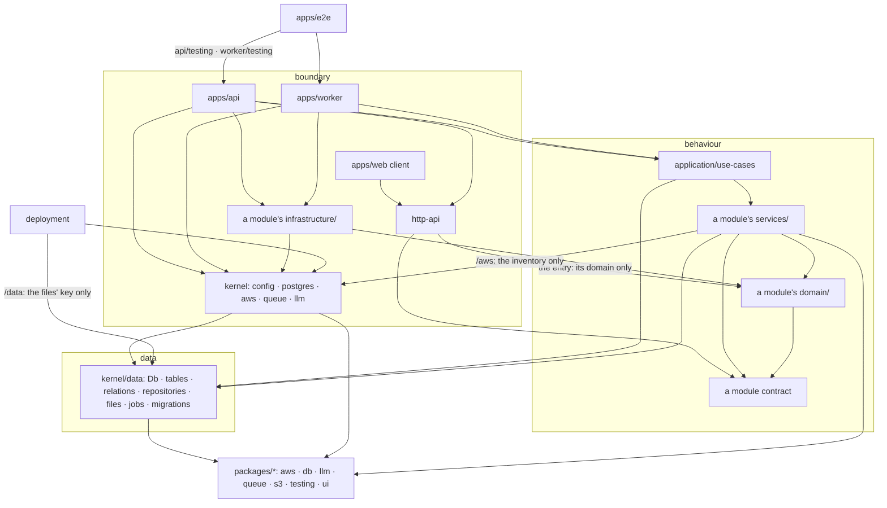

# Architecture

How the code is cut and how to extend it: the three rings, what may import what and the guard
that refuses the rest, where tests live, the shape of a use case, and the checklists to add an
entity, a store's client or a module. **Why each boundary holds, what it costs and what breaks if
it is reversed live in [decisions.md](decisions.md),** the living decisions, one record each;
read the record before changing a boundary. Decisions older than those records live in
`architecture.md › Decisions` of the scaffold ticket
(`docs/tickets/2026-10-16-1433_monorepo-setup/`) and of the architecture audit
(`docs/tickets/2026-10-27-1433_architecture-audit/`). Each layer's binding rules live in its
`CLAUDE.md` and in `.claude/rules/`.

## The three rings

Every dependency points inward, from the boundary to the behaviour to the data:

- **The data**, `kernel/data`, the one source of truth over every store: `Db` over every table and
  relation, the migrations, and a repository per store in the data layer's own types, the
  attachments' objects and the jobs among them. It imports only `packages/*`
  and takes its clients from the context.
- **The behaviour**, `application/`: the modules (`chat`, `identity`) and above them every use
  case in `application/use-cases`. A module's `domain/` holds its models, pure rules, errors and
  the ports that reach outside, and ships to the browser; its `services/` the domain services, the
  mappers between an entity and a model and the job definitions, over the data layer's
  repositories; its `infrastructure/` the adapters of its ports. A module reaches another only
  through its entry, and takes from it only its contract (`application/identity/contract/`).
- **The boundary**, everything that touches the world outside the process: the kernel's
  configured clients (`/config`, `/postgres`, `/aws`, `/queue`, `/llm`), each module's
  `infrastructure/`, `http-api` and the apps, which assemble the layers and provide the clients.

`packages/*` is configurable and knows no app; every ring may use it. The records:
[Modules by capability](decisions.md#modules-by-capability),
[A module's layers](decisions.md#a-modules-layers), [One kernel](decisions.md#one-kernel),
[The data at the centre](decisions.md#the-data-at-the-centre).



`application/` is one workspace, `@app-template/application`, and one `tsconfig.json` project:
each module and the use cases a folder with one entry (`@app-template/application/chat` →
`application/chat/index.ts`), a module's contract a folder in it
(`application/identity/contract/`), exported through the module's entry. The `apps/e2e` test
app runs both app layers in one test process, starts no process of its own, and nothing imports
it.

## Dependency rules

Each row lists what its code may import (✓ allowed, ✗ refused); the last column is the guard
that refuses the row's ✗: a Biome override in `biome.json`, one per layer and its tests, or
`biome-imports.grit`, whose message names its record in [decisions.md](decisions.md); the
linker, when the importer's manifest does not declare the workspace (TS2307); or review, by
[.claude/rules/modules.md](../../.claude/rules/modules.md)
([Guards are configuration](decisions.md#guards-are-configuration)):

| From ↓ / may import → | another module | a contract | `use-cases` | `kernel/data` | rest of `kernel` | `packages/*` | `http-api` | Refused by |
|---|---|---|---|---|---|---|---|---|
| a module's `domain/` | ✗ | ✓, through its entry | ✗ | ✗ | ✗ | ✗ | ✗ | `application/*/domain/**` |
| a module's `services/` | ✗ | ✓, through its entry | ✗ | ✓, but `Db` and the relations | `/aws`: the inventory only | `db`, `queue` only | ✗ | `application/*/services/**` |
| a module's `infrastructure/` | ✗, its own entry too | ✓, through its entry | ✗ | ✓ | ✓ | ✓ | ✗ | `application/*/infrastructure/**`; its own entry, `use-cases`: `noImportCycles` on a cycle, else review |
| a contract | ✗, nor its module's files | ✗ | ✗ | ✗ | ✗ | ✗ | ✗ | `application/*/contract/**` |
| `use-cases` | ✓, every layer; `/testing` in its tests only | ✓ | — | ✓ | ✗ | ✓ | ✗ | `application/use-cases/**`; review, `/testing` |
| `kernel/data` | ✗ | ✗ | ✗ | — | ✗ | ✓ | ✗ | `kernel/data/**` |
| rest of `kernel` | ✗ | ✗ | ✗ | ✓ | ✓, the parts below it | ✓ | ✗ | TS2307, a module, `use-cases`, `http-api`; a part above it: `noImportCycles` on a cycle, else review |
| `packages/*` | ✗ | ✗ | ✗ | ✗ | ✗ | ✓, the ones below it | ✗ | TS2307, any workspace; a package above it: `noImportCycles` on a cycle, else review |
| `http-api` | its domain only: no service, mapper or adapter by name | ✓ | ✗ | ✗ | ✗ | ✗ | — | `http-api/**` |
| `apps/api` | ✓, a mapper in `layer.ts` only | ✓ | ✓ | `layer.ts` only | ✓ | ✓ | ✓ | `biome-imports.grit`, another app and `deployment`; review, the data and the mappers |
| `apps/worker` | ✓, a mapper in `layer.ts` only | ✓ | ✓ | `layer.ts` only | ✓ | ✓ | ✗ | `biome-imports.grit`, another app and `deployment`; TS2307, `http-api`; review, the data and the mappers |
| `apps/web` client | ✗ | ✗ | ✗ | ✗ | ✗ | `ui` only | ✓ | `apps/web/**`; `make bundle-check` |
| `apps/web/main.ts` | ✗ | ✗ | ✗ | ✗ | `/config` only | `ui` only | ✗ | `biome-imports.grit`, another app and `deployment`; TS2307, a module, `use-cases`; review, the rest |
| `deployment` | ✗ | ✗ | ✗ | the files' key only | `/config`, `/aws`: the inventory | ✓ | ✗ | `biome-imports.grit`, any workspace but these and another part; review, the kernel's names |
| `apps/e2e` | ✓ | ✓ | ✓ | ✓ | ✓ | ✓ | ✓ | the apps' `exports`, their `./testing` only |

- **Inside a module** the layers point inward too: `domain/` imports neither
  `#<module>/services/*` nor `#<module>/infrastructure/*`, `services/` not
  `#<module>/infrastructure/*`, and `infrastructure/` not `#<module>/services/*`; a service
  reaches the outside world only through a port its `domain/` declares, and a module reaches its
  own files, its contract's too, through `#<module>/…`, never its entry. Another unit's files
  are refused whatever the layer, by `biome-imports.grit`; of another module's entry a module
  takes only the names of its contract, which review holds (`modules.md`), not Biome.
- **An app's handler** calls one service method or one use case: it imports no repository and no
  mapper (`<Model>FromEntity`, `encode<Model>`, `decode<Model>`); only the process's `layer.ts`
  provides the data layer; review holds it (`modules.md`). The apps never import each other or
  `deployment`: [Independent apps](decisions.md#independent-apps).
- **A module's `domain/` and a contract import only `effect`** (and `type-fest` for types), and
  neither they nor a module's `services/` nor `http-api` import an `@effect/*` package: the
  domain ships to the browser through `http-api`, and what that asks of its code is
  [application/CLAUDE.md](../../application/CLAUDE.md)'s.
- **A dependency on a module's contract counts as one on the module**, so two modules that import
  each other's contracts form a cycle; Biome's `noImportCycles` refuses one of value imports,
  and [.claude/rules/modules.md](../../.claude/rules/modules.md) lists one through `import type`
  with the other forms only review refuses.
- **A ✓ is permission, not a declaration.** The dependency must also be in the importer's
  `package.json`, or the isolated linker and `tsc -b` refuse it
  ([Boundary guards](#boundary-guards)). Inside the kernel and `packages/` the units are
  ordered: a kernel part imports only the parts below it (`/config` at the bottom, `/data` beside
  it and importing none), a package only the packages below it; `noImportCycles` refuses a part
  that imports one importing it, review the rest.
- **Tests** and the support they may import: [tooling.md › Tests](tooling.md#tests).

## Imports: `#<workspace>/` vs `@app-template/`

Every import line says where its module lives:

```ts
import { readFileSync } from 'node:fs'                      // Bun and Node built-ins

import { Effect } from 'effect'                             // external packages

import { buildChat } from '@app-template/application/chat'  // another unit

import { SendMessageUseCase } from '#use-cases/chat/send-message.use-case'  // this unit
```

- **`@app-template/<folder>`** reaches another unit through its workspace's `exports`, each
  entry an `index.ts` barrel: the kernel one per part (`@app-template/kernel/data` →
  `kernel/data/index.ts`, every store), a package by its folder (`@app-template/packages/db`),
  a module or the use cases by theirs (`@app-template/application/chat` →
  `application/chat/index.ts`, every layer), each with its test support's entries
  ([tooling.md › Tests](tooling.md#tests)).
- **`#<unit>/<path>`** reaches a file of the same unit, through the `imports` map in its
  workspace's `package.json` (`"#chat/*": "./chat/*.ts"`, `"#api/*": "./*.ts"`); a kernel part,
  a package or a module reaches another through that one's entry, never its files. Each layer
  of a module keeps its name in the path (`#chat/services/…`), so a layer's Biome override
  matches the others by glob (`#*/services/**`). Relative `./` and `../` paths are banned, by
  `biome-imports.grit` ([Imports through subpaths](decisions.md#imports-through-subpaths)). A
  bare `#/` prefix would be shorter, but the pinned Bun cannot resolve it.
- **Order** is the four groups above, separated by blank lines. `make fmt` sorts them.

## Where things live

Using the `chat` slice as the map:

| What | File | Named |
|---|---|---|
| branded id | `application/chat/domain/chat.id.ts` | `ChatId`, `MessageId` |
| model with its pure operations | `application/chat/domain/chat.model.ts`, `message.model.ts`; each with its subset of the shared `Status`, whose predicates live in `status.model.ts` beside them | `Chat`, `Message` (`Schema.Class`), `buildChat({ id, userId, createdAt })`, the transitions `prepareMessage` … `failMessage` |
| domain errors | `application/chat/domain/chat.error.ts`, `message.error.ts` | `ChatNotFoundError` (`Schema.TaggedError`) |
| port | `application/chat/domain/assistant.port.ts` | `Assistant`, `CurrentReplyProvenance` (`Context.Service` with no layer) |
| domain service | `application/chat/services/chat.service.ts` | `ChatService`, `ChatService.layer`, over the data layer's `ChatRepository` |
| mapper from an entity to a model | `application/chat/services/chat.mapper.ts` | `ChatFromEntity`, `MessageFromEntity` with their codecs `encodeChat`, `decodeChat` … |
| queue definitions | `application/chat/services/chat.queue.ts` | `assistantMessageQueue`, `GenerateAssistantMessage` (the job schema) |
| adapter implementing a port | `application/chat/infrastructure/assistant.llm.ts` | `AssistantLlmFromConfig`, the prompts over the kernel's `createLanguageModel` ([ai.md](ai.md)) |
| use case | `application/use-cases/chat/send-message.use-case.ts` | `SendMessageUseCase`, `SendMessageUseCase.layer` |
| tables, entities, relations | `kernel/data/chat/chat.table.ts`, `chat.entity.ts`; `kernel/data/relations.ts` | `chats` (`snakeCase.table`), `ChatEntity`, `relations` |
| repository | `kernel/data/chat/chat.repository.ts`; `kernel/data/file/file.repository.ts`; `kernel/data/job/job.repository.ts` | `ChatRepository` over `Db`; `FileRepository` over `S3Bucket`; `JobRepository` |
| database client and migrations | `kernel/data/db.client.ts`, `kernel/data/migrations.ts`; `kernel/postgres/` | `Db` over the `PgClient` in the context, `migrationsFolder`; `PgClientFromConfig` and the `make migrate` program ([database.md](database.md)) |
| the queue's transport | `kernel/queue/queue.client.ts`, `job.relay.ts` | `QueueSenderJobs`, `QueueConsumerSqs`, `JobRelaySqs`, over `JobRepository` |
| database tools any app could use | `packages/db/` (`@app-template/packages/db`) | `createDb(relations)`, `Transaction`, the shared columns, `generateId`, `migrateDatabase(folder)` |
| contract group | `http-api/chat/chat.http.ts` | `ChatHttp` (`HttpApiGroup`), the DTOs |
| api handler | `apps/api/chat/chat.handler.ts` | `ChatHandler` (`HttpApiBuilder.group`) |
| worker handler: a queue's consumer over a use case | `apps/worker/chat/assistant-message.handler.ts` | `handle`, `handleDeadLettered`, `AssistantMessageHandler` |
| the process's layer | `apps/api/layer.ts`, `apps/worker/layer.ts` | `ApiHttp` over the repositories and ports, `ApiLayer` with the clients, `WorkerLayer`; `main.ts` runs them |
| browser feature | `apps/web/features/health/health-panel.ts` | `renderHealthPanel(root)` |

Every store folder of `kernel/data`, and every layer of a module, has an `index.ts` barrel, and
each module's own `index.ts` re-exports its layers. The
file suffixes and the naming verbs: [.claude/rules/naming.md](../../.claude/rules/naming.md).

## Where tests live

Every workspace keeps its unit tests in `__tests__/` and its e2e in `__e2e__/`, each with its
support under `__tests__/testing/`, but for the test app `apps/e2e`, which is all e2e. What goes
where, which support a test may import and what runs on what: [tooling.md ›
Tests](tooling.md#tests). Why: [Tests in their folders](decisions.md#tests-in-their-folders).

## A use case

Every use case lives in `application/use-cases/<object>/<verb>-<object>.use-case.ts`, whichever
modules it touches: it composes their services, holds the transaction and enqueues the jobs, and a
rule stays in its module. When a flow becomes one, what it may write past a service and how it
orders its writes: [.claude/rules/layering.md](../../.claude/rules/layering.md). One that spans
modules has the same shape as one that does not (none spans today):

```ts
// application/use-cases/order/place-order.use-case.ts
export class PlaceOrderUseCase extends Context.Service<PlaceOrderUseCase, {
  /** Places the order of an active customer. */
  readonly place: (
    customerId: CustomerId,
    lines: OrderLines,
  ) => Effect.Effect<Order, CustomerBlockedError>
}>()('@app-template/application/use-cases/order/PlaceOrderUseCase', {
  make: Effect.gen(function* () {
    const customers = yield* CustomerService // the customer module
    const orders = yield* OrderService       // the order module
    const transaction = yield* Transaction
    const place = Effect.fn('PlaceOrderUseCase.place')(function* (
      customerId: CustomerId,
      lines: OrderLines,
    ) {
      yield* customers.requireActive(customerId) // the customer's rule, called
      return yield* orders.place(customerId, lines)
    }, transaction.run)                      // the writes commit together or not at all
    return { place }
  }),
}) {
  static readonly layer = Layer.effect(this, this.make).pipe(
    Layer.provide([CustomerService.layer, OrderService.layer]),
  )
}
```

- **A rule another module owns is called, never copied.** The order module may read the
  customer's row itself, but whether a customer may order is the customer module's rule, so the
  use case calls it. The test: if the owner changes the rule, must this module change too? Yes,
  one rule, called; no, two rules that only look alike, each kept by its module (two length
  limits that happen to match stay two). Record:
  [Records open, rules called](decisions.md#records-open-rules-called).
- **No module reacts to another's write.** The flow runs synchronously in one use case; a job
  carries only work that outlives the request (the assistant's reply, the title). Record:
  [Use cases above the modules](decisions.md#use-cases-above-the-modules).

## Add a new entity

An entity is the data layer's record; its model is the module's. Follow the `chat` slice from the
data outward, write each test before its code and run `make check` after each step. `<entity>` is
the kebab name (`document`), `<Name>` the Pascal one of the data layer's names, `<Model>` the
model's.

1. **The data.** `kernel/data/<store>/`, a store's folder (messages share `chat/`):
   `<entity>.table.ts` (the table), `<entity>.entity.ts` (`<Name>Entity` with its `Insert`,
   `Where` and `Set`), `<entity>.repository.ts` (`<Name>Repository` over `Db`), and an
   `index.ts`, re-exported by `kernel/data/index.ts`; the table in
   `kernel/data/relations.ts`; `make migration` writes the migration
   ([database.md](database.md)). What a table and an entity may import and declare:
   [kernel/CLAUDE.md](../../kernel/CLAUDE.md). Ownership is a field of the `<Name>EntityWhere`
   the reads take, so a record of another owner reads as absent, never a check after the read.
   Test the repository on `DbTest`, and add its memory repository with a twin of every guard
   the e2e proves ([tooling.md › Tests](tooling.md#tests)).
2. **The model.** `application/<module>/domain/`: `<entity>.id.ts`, `<entity>.model.ts` (a
   `Schema.Class` with its pure operations; time and ids come in as input), `<entity>.error.ts`,
   each with its unit test.
3. **The mapper.** `application/<module>/services/<entity>.mapper.ts`: `<Model>FromEntity` lays the
   model's schemas over the entity's fields; its unit test encodes the model's extreme values
   through the entity's insert schema and compares every limit and pattern both sides declare,
   so none can drift ([Checks kept in the tables](decisions.md#checks-kept-in-the-tables)).
4. **The service.** `application/<module>/services/<entity>.service.ts`: `<Model>Service` over the
   repository, the one owner every handler goes through, tested over the memory repositories.
   The layers' barrels re-export the new files.
5. **The flows.** A flow over two services or a job is a [use case](#a-use-case); asynchronous
   work is a queue definition in the module's `services/` and a handler in `apps/worker/`
   ([database.md › The outbox](database.md#the-outbox)).
6. **The boundary.** A contract group in `http-api/<entity>/<entity>.http.ts`, listing the domain's
   errors with their statuses, added to `Api` in `http-api/api.ts` before
   `.middleware(SchemaErrors)`, which reaches only the groups added before it; its handler in
   `apps/api/<entity>/`, added to `ApiRoutes` and its services to `ApiHttp`, the repository's
   layer to `ApiLayer`. Test only what HTTP adds, on the
   api test layer; a flow new to both apps joins the journey. A browser feature calls it through
   `ApiClient` from `apps/web/features/<entity>/`.

A new entity in existing workspaces usually needs no new dependency; an undeclared one fails
`make typecheck` with TS2307 ([tooling.md › Add a dependency](tooling.md#add-a-dependency)).

## Add a store's client

The data layer names the client it needs, the kernel builds it from config, the process provides
it. Record: [Clients from the context](decisions.md#clients-from-the-context).

```ts
// kernel/data: the repository asks the context for the client
static readonly layer = Layer.effect(this, S3Bucket.useSync((bucket) => this.of({ … })))
// kernel/aws/aws.client.ts: the boundary builds it from config
export const S3BucketFromConfig: Layer.Layer<S3Bucket, Config.ConfigError>
// apps/api/layer.ts: the process provides it, after the repositories
Layer.provide(Db.layer), Layer.provide([PgClientFromConfig, S3BucketFromConfig])
```

1. **The client** is a generic package (`packages/<store>`) or an Effect library; it takes its
   settings as options and never reads the environment.
2. **The data layer** takes its service from the context in the repository's `layer` and imports
   no `@app-template/kernel/config`, `#kernel/postgres` or `#kernel/aws`.
3. **The kernel** reads the settings in a config service of `kernel/config` and builds
   `<Client>FromConfig` in its part (`kernel/<store>/<store>.client.ts`); a resource's name comes
   from the inventory in `kernel/aws/resources`.
4. **Each process** provides it in its `layer.ts`; a missing one is a type error in the layer's
   requirements.
5. **The e2e harness,** in the part's e2e support ([tooling.md › Tests](tooling.md#tests)),
   provides a client of the test's own (a database, a stage) the same way `DbTest` and `AwsTest`
   do; `deployment/local/` provisions the store on the local stand ([aws.md](aws.md)).

## Add a module

A module is a folder `application/<module>/` of the `@app-template/application` workspace,
imported as `@app-template/application/<module>`; its contract, once another module needs it,
the folder `application/<module>/contract/`, exported through the same entry.
Record: [Modules by capability](decisions.md#modules-by-capability).

1. **The entry.** `application/<module>/index.ts` re-exports each layer's barrel; in
   `application/package.json`, an `exports` entry `./<module>` and the alias `#<module>/*`, and
   once it has test support that support's entry and alias
   ([tooling.md › Tests](tooling.md#tests)), as chat's. The folder's one `tsconfig.json` project
   already includes it, and `bun install` links nothing new.
2. **No Biome override.** The overrides and the plugin already match a new module; a layer of a
   new name passes every ban but the plugin's
   ([Guards are configuration](decisions.md#guards-are-configuration)).
3. **A contract** is a folder `contract/` with an `index.ts`, re-exported by the module's entry;
   the `application/*/contract/**` override already covers it. Record:
   [Module contracts](decisions.md#module-contracts).
4. **The consumers** declare `@app-template/application` in their `package.json`; the service
   keys read `'@app-template/application/<module>/services/<Name>'`, which `make bundle-check`
   already greps.
5. **The docs.** The glossary gains the module's words; `decisions.md` a record if the cut is a
   decision ([Decisions recorded in one page](decisions.md#decisions-recorded-in-one-page)).

## Boundary guards

Each import rule is held once, by the guard that can see it, and a last guard checks what the
import rules leave to tree shaking, the web bundle; what no guard sees, review refuses
([.claude/rules/modules.md](../../.claude/rules/modules.md)). Record:
[Guards are configuration](decisions.md#guards-are-configuration).

| Guard | Catches | Reports |
|---|---|---|
| Biome `noRestrictedImports`, one `overrides` entry per layer in `biome.json`: `http-api`, the web client, and of `application/*/` the `domain/`, `contract/`, `services/`, `infrastructure/` and `index.ts`, the use cases, the data layer; a layer's override covers its tests (`application/*/__tests__/<layer>/`, `application/use-cases/__tests__/`) | what reaches the browser, by unit and by imported name; the kernel's boundary in a module's services and in a use case; any workspace but `packages/*` in the data layer, and any in an entry of `application/`; a layer that points outward inside a module; in a layer's tests, what the layer may not import, test support aside; with the record named in the message | `make lint`, `pre-commit`, CI `static` |
| the GritQL plugin `biome-imports.grit`, which reads the unit (`application/<module>`, `kernel/<part>`, `packages/<package>`) and the ring (`apps/<app>`, `deployment`) from the file's path | another unit's `#<unit>/…`, `#kernel/<unit>/…` or `#testing/<unit>/…` file, in an import, an `export … from`, an `import()` in code or in a type, a `require()`, a `require.resolve()` or `import.meta.resolve()`, or a `vi` loader (`vi.mock`, `vi.importActual`, …), a template literal included; any relative path; even when the manifest declares it, any workspace but `@app-template/packages` under `packages/`, any but it and the kernel's `/config`, `/aws` and `/data` under `deployment/`, another app or `deployment` under `apps/api`, `apps/worker` and `apps/web` | the same |
| Biome `noImportCycles` | a cycle of value imports: two files, two modules, a kernel part and one that imports it, a module and its own entry | the same |
| the isolated linker with `tsc -b` | an import of a workspace the importer's `package.json` does not declare: a module in the kernel, the kernel in a package, an app in another, a module in `deployment` | TS2307 in `make typecheck` and at runtime |
| `composite` project references (`rootDir: "."`), one project per workspace | a path that reaches into an unreferenced workspace's files; a cycle of references between workspaces | TS6059 / TS6307 / TS6202 in `make typecheck` |
| `make bundle-check`: `bun build` of `apps/web/app/main.ts`, then a `grep` of the bundle | a key of the kernel, of the use cases, or of a module's `services/`, `infrastructure/` or `domain/`, where only its ports carry one, in the browser bundle | the matched service keys, in `make check` |

Why each rule sits with its guard, and what that costs:
[Guards are configuration](decisions.md#guards-are-configuration). Symptoms and fixes:
[tooling.md › Troubleshooting](tooling.md#troubleshooting).

The bundle guard greps the service keys
(`"@app-template/application/chat/services/ChatService"`): string literals, which survive the
build however Bun applies `"sideEffects": false`. A type-only import is erased and passes, as it
should. `apps/web` cannot import a module at all, so a leak comes through `http-api`, which
imports the modules' entries for their schemas and errors; tree shaking drops the services,
adapters and ports beside them, and the guard proves it on every check. Bun still parses what it
drops, so the build warns about `node:net`, which `@effect/sql-pg` reaches below a module's
services.

### Known gaps

What no tool checks, review refuses through
[.claude/rules/modules.md](../../.claude/rules/modules.md). Six import forms also pass every
guard; no code uses them:

- **A type import inside an expression in web client code.** `export type X =
  import('@app-template/kernel/config').ApiConfig['Service']` in `app/`, `features/` or
  `shared/` passes Biome's `noRestrictedImports`, which does not see `import()` inside a type,
  and `tsc -b`, because web declares `@app-template/kernel` for its server entry. The type is
  erased, so nothing reaches the browser, but the client then depends on the shape of the server
  config.
- **A namespace import of an entry.** `import * as Chat from '@app-template/application/chat'`
  in `http-api/` passes every ban by name (`importNamePattern` sees no name), and so does one of
  `@app-template/kernel/data` where only its stores are allowed; `Chat.ChatService` then reaches
  what the names were refused for, and `make bundle-check` catches it only in the browser's
  bundle.
- **A runtime module or third-party package in a module's `domain/`.** `node:crypto` or any npm
  package passes the domain guard, which bans only workspaces and `@effect/*`. Purity rests on
  review and on the grep for `Date.now`, `new Date(` and `randomUUID`.
- **A server library in a browser-safe package.** An import of `<server library>` in
  `packages/ui` passes Biome, which keeps no list for a package, and `tsc -b`, because
  the one `packages/package.json` declares every package's libraries for all of them. `make
  bundle-check` greps only this app's keys, so the library reaches the browser's bundle unseen.
- **A test's needs in a layer's source, a test file outside a layer.** A layer's override covers
  its tests, so `@effect/vitest`, a `/testing` entry and, in a module's services,
  `@effect/platform-bun` pass in the layer's source too. A module's test support
  (`application/<module>/__tests__/testing/`) serves several layers and keeps no list, and the
  data layer's tests and e2e sit outside its override, so `@app-template/kernel/llm` passes
  there; `tsc -b` too, as the folder's manifest declares the kernel.
- **A specifier the plugin cannot read.** `biome-imports.grit` reads a literal in the forms
  [Boundary guards](#boundary-guards) lists; one built at runtime (`import(name)`, a string
  joined from parts) or handed to another loader passes it. In `packages/` it then reaches any
  workspace the one manifest declares, elsewhere another unit's file.
