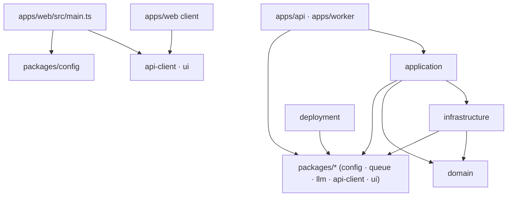

# Architecture

Where code belongs, what it may import, and how to add a new entity. Each layer's binding rules
live in its `CLAUDE.md`; the decisions behind them, with the rejected alternatives, live in the
scaffold ticket's `architecture.md › Decisions` (`docs/tickets/2026-10-15_monorepo-setup/`).

## Layers



Imports only go **down**: `apps` → `application` → `infrastructure` → `domain`. A layer may skip
levels: `application` usually imports `domain` directly.

| Workspace | Holds | Rules |
|---|---|---|
| `domain/` | entity models, errors, ports and pure operations; no I/O, no clock | [domain/CLAUDE.md](../../domain/CLAUDE.md) |
| `infrastructure/` | adapters that implement domain ports on top of `packages/*` clients | [infrastructure/CLAUDE.md](../../infrastructure/CLAUDE.md) |
| `application/` | services over ports, and use cases that compose services | [application/CLAUDE.md](../../application/CLAUDE.md) |
| `packages/*` | generic, project-agnostic clients and libraries | [packages/CLAUDE.md](../../packages/CLAUDE.md) |
| `apps/*` | entry points (`main.ts`) and composition roots (`layer.ts`) | [apps/CLAUDE.md](../../apps/CLAUDE.md) |
| `deployment/` | local Docker Compose and AWS Pulumi, stubs for now | [deployment/CLAUDE.md](../../deployment/CLAUDE.md) |

### Dependency rules

Each row lists what a workspace may import.

| From ↓ / may import → | domain | infrastructure | application | packages/* | apps |
|---|---|---|---|---|---|
| domain | — | ✗ | ✗ | ✗ | ✗ |
| infrastructure | ✓ | — | ✗ | ✓ | ✗ |
| application | ✓ | ✓ | — | ✓ | ✗ |
| packages/* | ✗ | ✗ | ✗ | ✓ (each other) | ✗ |
| apps/api · apps/worker | ✓ | ✓ | ✓ | ✓ | ✗ (no sibling app) |
| apps/web client (`app/`, `features/`, `shared/`) | ✗ | ✗ | ✗ | `api-client`, `ui` only | ✗ |
| apps/web/src/main.ts | ✗ | ✗ | ✗ | `api-client`, `ui`, `config` | ✗ |
| deployment | ✗ | ✗ | ✗ | ✓ | ✗ |

- **`domain` imports `effect` and no workspace,** not even `packages/*`, and no `@effect/*`
  package but the test runner `@effect/vitest`, so it stays pure and testable without fakes.
- **`apps/web` client code ships to the browser.** Only its server entry `main.ts` may read
  `config`, to get a validated `WEB_PORT`.
- **A ✓ is permission, not a declaration.** The dependency must also be in the importer's
  `package.json`; see [the three guards](#three-boundary-guards).

## Imports: `#<workspace>/` vs `@oblik/`

Every import line says where its module lives:

```ts
import { readFileSync } from 'node:fs'                      // Bun and Node built-ins

import { z } from 'zod'                                     // external packages

import { buildExample } from '@oblik/domain/example'         // another workspace

import { ExampleService } from '#application/example/example.service' // this workspace
```

- **`@oblik/<workspace>[/<entity>]`** reaches another workspace through its `exports`. A layer
  exposes each entity as a subpath (`@oblik/domain/example` → `domain/example/index.ts`).
- **`#<workspace>/<path>`** reaches a file inside the same workspace, through the `imports` map in
  its `package.json` (`"#domain/*": "./*.ts"`, `"#api/*": "./src/*.ts"`). Relative `./` and `../`
  paths are banned. A bare `#/` prefix would be shorter, but Bun 1.4.3 cannot resolve it.
- **Order** is the four groups above, separated by blank lines. `make fmt` sorts them.

## Where things live

Using the `example` slice as the map:

| What | File | Named |
|---|---|---|
| entity schema and branded id | `domain/example/example.model.ts` | `Example` (`Schema.Class`), `ExampleId` |
| domain errors | `domain/example/example.error.ts` | `ExampleNotFoundError` (`Schema.TaggedError`) |
| port and pure operations | `domain/example/example.service.ts` | `ExampleRepository`, `buildExample({ id, name, createdAt })` |
| adapter implementing the port | `infrastructure/example/example.repository.ts` | `ExampleRepositoryMemory` (a `Layer`) |
| service over the port | `application/example/example.service.ts` | `ExampleService`, `ExampleService.layer` |
| browser feature | `apps/web/src/features/example/health-panel.ts` | `renderHealthPanel(root, apiClient)` |

Every entity folder has an `index.ts` barrel, and tests sit next to their source as `*.test.ts`.
The file suffixes and naming verbs are listed in
[.claude/rules/naming.md](../../.claude/rules/naming.md).

## Add a new entity

> **In transition.** The [effect-setup](../tickets/2026-10-16_effect-setup/) ticket has retired the
> plain use case, the app wiring (`createLayer()`), the example routes with `statusByTag` and the
> job handler. Steps 6–8 and [The Effect seam](#the-effect-seam) describe that retired shape until
> the ticket rewrites them.

Follow the `example` slice layer by layer, from the bottom up. Write each test before its code,
and run `make check` after each layer. `<entity>` is the kebab name (`document`), `<Entity>` the
Pascal one (`Document`).

1. **Domain model.** `domain/<entity>/<entity>.model.ts`: `<Entity>` as a `Schema.Class` and
   `<Entity>Id` as a branded `Schema` with a same-named type.
2. **Domain errors.** `<entity>.error.ts`: `Schema.TaggedError` classes named
   `<Entity><Problem>Error`, whose tag is the class name.
3. **Port and operations.** `<entity>.service.ts`: the `<Entity>Repository` port as a
   `Context.Service` with no layer, and `Effect` functions such as `build<Entity>(input)`. Time and
   ids come in as input, never from `Date.now()` or `crypto.randomUUID()`. Test them in
   `<entity>.service.test.ts`.
4. **Domain exports.** `domain/<entity>/index.ts` re-exports the three files, and
   `domain/package.json` gains `"./<entity>": "./<entity>/index.ts"` in `exports`.
5. **Adapter.** `infrastructure/<entity>/<entity>.repository.ts`: `<Entity>RepositoryMemory`, a
   `Layer` that provides the domain port. Start in-memory, like the example; a real client later
   adds another layer of the same port. Add `index.ts` and the `exports` entry.
6. **Service and use cases.** `application/<entity>/<entity>.service.ts` holds the service, and
   `<verb>.use-case.ts` composes services. A service may import its adapter or receive the port as
   an argument, and may read the time with `new Date()`. Add `index.ts` and the `exports` entry.
7. **Wiring.** In `apps/api/src/layer.ts` (and the worker's, if it needs it), create the service
   and the use cases, with whatever they take as arguments, and return them from `createLayer()`.
8. **Delivery.** Add routes in `apps/api/src/http.ts`, and map each new error `_tag` to a status in
   `statusByTag`. Extend `apps/api/src/http.test.ts` with a round trip.
9. **Client, if the browser needs it.** Add a method to `@oblik/api-client`, then a feature folder
   under `apps/web/src/features/<entity>/`.

A new entity in existing workspaces usually needs no new dependency, because the layers already
declare each other. Check the importer's `package.json` anyway: `apps/worker`, for one, does not
declare `@oblik/domain`. A new external client is a new dependency; see
[tooling.md](tooling.md#add-a-dependency).

## The Effect seam

The code is plain TypeScript, but it is shaped so that adopting Effect later replaces bodies, not
structure:

| Today | Becomes | Why it already fits |
|---|---|---|
| `apps/*/src/layer.ts` with `createLayer()` | an Effect `Layer` | the one place where adapters are wired into services |
| ports in `domain/<entity>/<entity>.service.ts` | `Context.Tag` services | the port already sits where the tag will be declared |
| `DomainError` subclasses with `_tag` | `Data.TaggedError` | `_tag` already discriminates errors, as in `http.ts` |
| the example's dependencies passed as arguments (`{ repository }`, `now`) | requirements in the `Effect` type | the example reaches for no global |

## Three boundary guards

The import rules are enforced three times, each catching what the others miss:

| Guard | Catches | Reports |
|---|---|---|
| Biome `noRestrictedImports`, one `overrides` entry per layer in `biome.json` | an import that goes up a layer or into a sibling app; any relative path; a workspace or an `@effect/*` package other than `@effect/vitest` in `domain`; `effect` in web client code | `make lint`, `pre-commit`, CI `static` |
| the isolated linker with `tsc -b` | an allowed import of a workspace that is not declared in `package.json` | TS2307 in `make typecheck` and at runtime |
| `composite` project references (`rootDir: "."`) | a path that reaches into an unreferenced workspace's files | TS6059 / TS6307 in `make typecheck` |

The Biome overrides are **deny-lists**: each names the workspaces a layer must not import. A new
`packages/*` workspace therefore needs no Biome change, while a new layer or app does. Test files
follow their workspace's override; none has its own. Overrides that match the same file replace
each other's options rather than merge, so every override repeats the relative-path ban. Symptoms
and fixes:
[tooling.md › Troubleshooting](tooling.md#troubleshooting).

### Known gaps

Three forms pass all three guards. No code uses them; review is what catches them.

- **A type import inside an expression in web client code.** `export type X =
  import('@oblik/config').ApiConfig['Service']` in `app/`, `features/` or `shared/` passes
  Biome, which does not see `import()` inside a type, and `tsc -b`, because web declares `@oblik/config` for its
  server entry. The type is erased, so nothing reaches the browser, but the client then depends on
  the shape of the server config.
- **A workspace importing itself by name.** `@oblik/application/example` from inside
  `application/` passes Biome, whose overrides list only other workspaces, and `tsc -b`, which
  resolves a package's own `exports`. It skips the `#<workspace>/` convention and can import the
  file's own barrel, a cycle that shows up as `undefined` while modules initialise.
- **A runtime module or third-party package in `domain`.** `node:crypto` or any npm package passes
  the domain guard, which bans only workspaces and `@effect/*`. Purity rests on review and on the
  grep for `Date.now`, `new Date(` and `randomUUID`.
