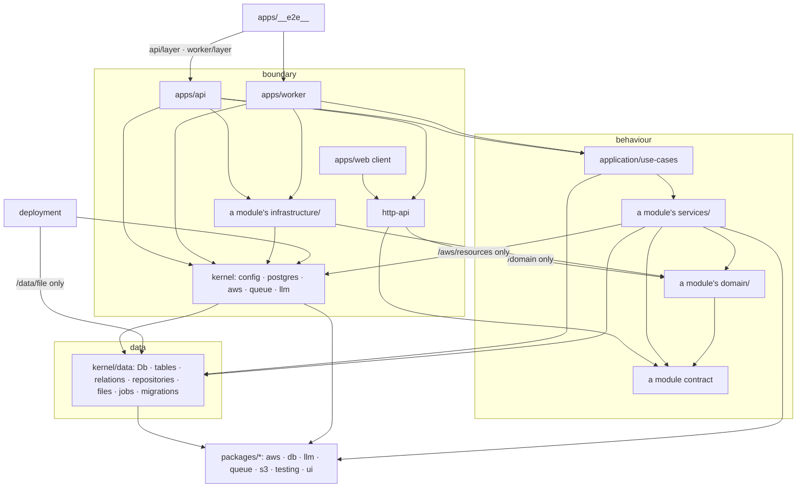

# Architecture

How the code is cut and how to extend it: the three rings, what may import what and the guard
that refuses the rest, where tests live, the shape of a use case, and the checklists to add an
entity, a store's client or a module. **Why each boundary holds, what it costs and what breaks if
it is reversed live in [decisions.md](decisions.md),** the living decisions, one record each;
read the record before changing a boundary. Decisions older than those records live in
`architecture.md › Decisions` of the scaffold ticket
(`docs/tickets/2026-10-16-1433_monorepo-setup/`) and of the architecture audit
(`docs/tickets/2026-10-27-1433_architecture-audit/`). Each layer's binding rules live in its
`CLAUDE.md` and in `.claude/rules/`.

## The three rings

Every dependency points inward, from the boundary to the behaviour to the data:

- **The data**, `kernel/data`, the one source of truth over every store: `Db` over every table and
  relation, the migrations, and a repository per store in the data layer's own types, the
  attachments' objects and the jobs among them. It imports only `packages/*`
  and takes its clients from the context.
- **The behaviour**, `application/`: the modules (`chat`, `identity`) and above them every use
  case in `application/use-cases`. A module's `domain/` holds its models, pure rules, errors and
  the ports that reach outside, and ships to the browser; its `services/` the domain services, the
  mappers between an entity and a model and the job definitions, over the data layer's
  repositories; its `infrastructure/` the adapters of its ports. A module reaches another only
  through its contract (`identity-contract`).
- **The boundary**, everything that touches the world outside the process: the kernel's
  configured clients (`/config`, `/postgres`, `/aws`, `/queue`, `/llm`), each module's
  `infrastructure/`, `http-api` and the apps, which assemble the layers and provide the clients.

`packages/*` is configurable and knows no app; every ring may use it. The records:
[Modules by capability](decisions.md#modules-by-capability),
[A module's layers](decisions.md#a-modules-layers), [One kernel](decisions.md#one-kernel),
[The data at the centre](decisions.md#the-data-at-the-centre).



`application/` is a folder of workspaces with no `package.json` of its own: `use-cases` and the
modules, each module's contract nested in its folder (`application/identity/contract/`). The
`apps/__e2e__` workspace runs both app layers in one test process, and nothing imports it.

## Dependency rules

Each row lists what its code may import (✓ allowed, ✗ refused); the last column is the guard
that refuses the row's ✗, a Biome override in `biome.json` whose message names its record in
[decisions.md](decisions.md):

| From ↓ / may import → | another module | a contract | `use-cases` | `kernel/data` | rest of `kernel` | `packages/*` | `http-api` | Refused by |
|---|---|---|---|---|---|---|---|---|
| a module's `domain/` | ✗ | ✓ | ✗ | ✗ | ✗ | ✗ | ✗ | `application/*/domain/**` |
| a module's `services/` | ✗ | ✓ | ✗ | `/data/<store>` | `/aws/resources` only | `aws`, `db`, `queue` only | ✗ | `application/*/services/**` |
| a module's `infrastructure/` | ✗, its own by name too | ✓ | ✗ | ✓ | ✓ | ✓ | ✗ | `application/*/infrastructure/**` |
| a contract | ✗ | ✗ | ✗ | ✗ | ✗ | ✗ | ✗ | `application/*/contract/**` |
| `use-cases` | `/domain`, `/services`; `/testing` in its tests only | ✓ | — | ✓ | ✗ | ✓ | ✗ | `application/use-cases/**` |
| `kernel/data` | ✗ | ✗ | ✗ | — | ✗ | ✓, by name | ✗ | `kernel/data/**` |
| rest of `kernel` | ✗ | ✗ | ✗ | ✓ | ✓ | ✓ | ✗ | `kernel/**` |
| `packages/*` | ✗ | ✗ | ✗ | ✗ | ✗ | ✓ (each other) | ✗ | `packages/**` |
| `http-api` | `/domain` only | ✓ | ✗ | ✗ | ✗ | ✗ | — | `http-api/**` |
| `apps/api` | ✓, a mapper in `layer.ts` only | ✓ | ✓ | `layer.ts` only | ✓ | ✓ | ✓ | `apps/api/**`; `apps/api/layer.ts` lifts the data and mapper bans |
| `apps/worker` | ✓, a mapper in `layer.ts` only | ✓ | ✓ | `layer.ts` only | ✓ | ✓ | ✗ | `apps/worker/**`; `apps/worker/layer.ts` lifts the data and mapper bans |
| `apps/web` client | ✗ | ✗ | ✗ | ✗ | ✗ | `ui` only | ✓ | `apps/web/**`; `make bundle-check` |
| `apps/web/main.ts` | ✗ | ✗ | ✗ | ✗ | `/config` only | `ui` only | ✗ | `apps/web/main.ts` |
| `deployment` | ✗ | ✗ | ✗ | `/data/file` only | `/config`, `/aws/resources` | ✓ | ✗ | `deployment/**` |
| `apps/__e2e__` | ✓ | ✓ | ✓ | ✓ | ✓ | ✓ | ✓ | its `package.json`; apps through `api/layer`, `worker/layer` |

- **Inside a module** the layers point inward too: `domain/` imports neither `#services/*` nor
  `#infrastructure/*`, `services/` not `#infrastructure/*`, and `infrastructure/` not
  `#services/*`; a service reaches the outside world only through a port its `domain/` declares,
  and an adapter reaches its own module through `#domain/*`, never the package's name.
- **An app's handler** calls one service method or one use case: it imports no repository and no
  mapper (`<Model>FromEntity`, `encode<Model>`, `decode<Model>`); only the process's `layer.ts`
  provides the data layer. The apps never import each other or `deployment`:
  [Independent apps](decisions.md#independent-apps).
- **A module's `domain/` and a contract import only `effect`** (and `type-fest` for types), and
  neither they nor a module's `services/` nor `http-api` import an `@effect/*` package: the
  domain ships to the browser through `http-api`, and what that asks of its code is
  [application/CLAUDE.md](../../application/CLAUDE.md)'s.
- **A dependency on a module's contract counts as one on the module**, so two modules that import
  each other's contracts form a cycle no tool sees:
  [.claude/rules/modules.md](../../.claude/rules/modules.md) lists it with the other forms only
  review refuses.
- **A ✓ is permission, not a declaration.** The dependency must also be in the importer's
  `package.json`, or the isolated linker and `tsc -b` refuse it
  ([Boundary guards](#boundary-guards)).
- **Tests** import as their workspace's source does, plus the test support of the workspaces it
  declares: [Where tests live](#where-tests-live).

## Imports: `#<workspace>/` vs `@app-template/`

Every import line says where its module lives:

```ts
import { readFileSync } from 'node:fs'                      // Bun and Node built-ins

import { Effect } from 'effect'                             // external packages

import { buildChat } from '@app-template/chat/domain'        // another workspace

import { SendMessageUseCase } from '#use-cases/chat/send-message.use-case'  // this workspace
```

- **`@app-template/<workspace>[/<subpath>]`** reaches another workspace through its `exports`: a
  module one subpath per layer (`@app-template/chat/domain` → `application/chat/domain/index.ts`),
  the kernel one per part and per store (`@app-template/kernel/data/chat`), each with its
  `index.ts` barrel.
- **`#<workspace>/<path>`** reaches a file inside the same workspace, through the `imports` map in
  its `package.json` (`"#domain/*": "./domain/*.ts"`, `"#api/*": "./*.ts"`). Every module uses the
  same aliases, so one Biome override per layer covers them all. Relative `./` and `../` paths are
  banned ([Imports through subpaths](decisions.md#imports-through-subpaths)). A bare `#/` prefix
  would be shorter, but Bun 1.4.3 cannot resolve it.
- **Order** is the four groups above, separated by blank lines. `make fmt` sorts them.

## Where things live

Using the `chat` slice as the map:

| What | File | Named |
|---|---|---|
| branded id | `application/chat/domain/chat.id.ts` | `ChatId`, `MessageId` |
| model with its pure operations | `application/chat/domain/chat.model.ts`, `message.model.ts`; each with its subset of the shared `Status`, whose predicates live in `status.model.ts` beside them | `Chat`, `Message` (`Schema.Class`), `buildChat({ id, userId, createdAt })`, the transitions `prepareMessage` … `failMessage` |
| domain errors | `application/chat/domain/chat.error.ts`, `message.error.ts` | `ChatNotFoundError` (`Schema.TaggedError`) |
| port | `application/chat/domain/assistant.port.ts` | `Assistant`, `CurrentReplyProvenance` (`Context.Service` with no layer) |
| domain service | `application/chat/services/chat.service.ts` | `ChatService`, `ChatService.layer`, over the data layer's `ChatRepository` |
| mapper from an entity to a model | `application/chat/services/chat.mapper.ts` | `ChatFromEntity`, `MessageFromEntity` with their codecs `encodeChat`, `decodeChat` … |
| queue definitions | `application/chat/services/chat.queue.ts` | `assistantMessageQueue`, `GenerateAssistantMessage` (the job schema) |
| adapter implementing a port | `application/chat/infrastructure/assistant.llm.ts` | `AssistantLlm`, the prompts over the kernel's `createLanguageModel` ([ai.md](ai.md)) |
| use case | `application/use-cases/chat/send-message.use-case.ts` | `SendMessageUseCase`, `SendMessageUseCase.layer` |
| tables, entities, relations | `kernel/data/chat/chat.table.ts`, `chat.entity.ts`; `kernel/data/relations.ts` | `chats` (`snakeCase.table`), `ChatEntity`, `relations` |
| repository | `kernel/data/chat/chat.repository.ts`; `kernel/data/file/file.repository.ts`; `kernel/data/job/job.repository.ts` | `ChatRepository` over `Db`; `FileRepository` over `S3Bucket`; `JobRepository` |
| database client and migrations | `kernel/data/db.client.ts`, `kernel/data/migrations.ts`; `kernel/postgres/` | `Db` over the `PgClient` in the context, `migrationsFolder`; `PgClientFromConfig` and the `make migrate` program ([database.md](database.md)) |
| the queue's transport | `kernel/queue/queue.client.ts`, `job.relay.ts` | `QueueSenderJobs`, `QueueConsumerSqs`, `JobRelaySqs`, over `JobRepository` |
| database tools any app could use | `packages/db/` (`@app-template/db`) | `createDb(relations)`, `Transaction`, the shared columns, `generateId`, `migrateDatabase(folder)` |
| contract group | `http-api/chat/chat.http.ts` | `ChatHttp` (`HttpApiGroup`), the DTOs |
| api handler | `apps/api/chat/chat.handler.ts` | `ChatHandler` (`HttpApiBuilder.group`) |
| worker handler: a queue's consumer over a use case | `apps/worker/chat/assistant-message.handler.ts` | `handle`, `handleDeadLettered`, `AssistantMessageHandler` |
| the process's layer | `apps/api/layer.ts`, `apps/worker/layer.ts` | `ApiHttp` over the repositories and ports, `ApiLayer` with the clients, `WorkerLayer`; exported as `./layer` |
| browser feature | `apps/web/features/health/health-panel.ts` | `renderHealthPanel(root)` |

Every store folder of `kernel/data`, and every layer of a module, has an `index.ts` barrel. The
file suffixes and the naming verbs: [.claude/rules/naming.md](../../.claude/rules/naming.md).

## Where tests live

Every workspace keeps its unit tests in `__tests__/` and its e2e in `__e2e__/`, at its top,
mirroring the source path; vitest's `unit` project runs `**/__tests__/**/*.test.ts`, its `e2e`
project `**/__e2e__/**/*.e2e.ts` ([tooling.md › Tests](tooling.md#tests)). Test support lives in
the `testing/` inside each: `__tests__/testing/` aliased `#testing/*` and exported as `./testing`,
`__e2e__/testing/` aliased `#testing-e2e/*` and exported as `./testing-e2e`. A unit test imports
its workspace's source and the `./testing` of the workspaces it declares; an e2e suite also their
`./testing-e2e`; a unit test never imports e2e support. Record:
[Tests in their folders](decisions.md#tests-in-their-folders).

| Ring | Suite | Runs on |
|---|---|---|
| behaviour | `application/<module>/__tests__/`, `application/use-cases/__tests__/` | memory only: the kernel's memory repositories (`@app-template/kernel/testing`), a module's memory layers of its ports (`@app-template/chat/testing`), `TransactionTest`; `application` has no e2e |
| data | `kernel/__e2e__/data/<store>/` | Postgres (`DbTest`) or MiniStack (`AwsTest`), in entities |
| boundary | `kernel/__e2e__/postgres/`, `kernel/__e2e__/queue/`, `packages/<package>/__e2e__/`; an adapter's suite in `application/<module>/__tests__/infrastructure/` | the run's containers; the adapter over a recording client |
| tools | `kernel/__tests__/`, `packages/<package>/__tests__/` | memory only |
| apps | `apps/api/__tests__/`, `apps/worker/__tests__/` | the app's layer over the memory layers |
| assembled | `apps/__e2e__/`: the use cases on Postgres in `use-cases/`, the mappers' round trips in `mappers/`, the journey `chat.e2e.ts` | both app layers in one runtime (`StandTest`) |

The memory repositories live in `kernel/__tests__/testing/`, over the same entities as the real
ones. What each kind of test checks, what a memory layer must copy and how to write a test:
[.claude/rules/effect-tests.md](../../.claude/rules/effect-tests.md).

## A use case

Every use case lives in `application/use-cases/<object>/<verb>-<object>.use-case.ts`, whichever
modules it touches: it composes their services, holds the transaction and enqueues the jobs, and a
rule stays in its module. When a flow becomes one, what it may write past a service and how it
orders its writes: [.claude/rules/layering.md](../../.claude/rules/layering.md). One that spans
modules has the same shape as one that does not (none spans today):

```ts
// application/use-cases/user/delete-user.use-case.ts
export class DeleteUserUseCase extends Context.Service<DeleteUserUseCase, {
  /** Deletes the user with every chat they own. */
  readonly delete: (id: UserId) => Effect.Effect<void, UserUnknownError>
}>()('@app-template/use-cases/user/DeleteUserUseCase', {
  make: Effect.gen(function* () {
    const users = yield* UserService       // identity
    const chats = yield* ChatService       // chat
    const files = yield* FileRepository
    const transaction = yield* Transaction
    const deleteRows = Effect.fn('DeleteUserUseCase.deleteRows')(function* (id: UserId) {
      yield* users.getOne({ id })          // identity's rule, called: an unknown user fails
      const fileIds = yield* chats.deleteAllOf(id) // chat's own rule over its rows
      yield* users.delete(id)
      return fileIds
    }, transaction.run)                    // the rows commit together or not at all
    const remove = Effect.fn('DeleteUserUseCase.delete')(function* (id: UserId) {
      const fileIds = yield* deleteRows(id)
      yield* files.delete({ id: fileIds }) // after the commit: an object store joins no transaction
    })
    return { delete: remove }
  }),
}) {
  static readonly layer = Layer.effect(this, this.make).pipe(
    Layer.provide([UserService.layer, ChatService.layer]),
  )
}
```

- **A rule another module owns is called, never copied.** Chat may read the user's row itself, but
  whether a user counts as unknown is identity's rule, so the use case calls identity. The test:
  if the owner changes the rule, must this module change too? Yes, one rule, called; no, two
  rules that only look alike, each kept by its module (two length limits that happen to match
  stay two). Record: [Records open, rules called](decisions.md#records-open-rules-called).
- **No module reacts to another's write.** The flow runs synchronously in one use case; a job
  carries only work that outlives the request (the assistant's reply, the title). Record:
  [Use cases above the modules](decisions.md#use-cases-above-the-modules).

## Add a new entity

An entity is the data layer's record; its model is the module's. Follow the `chat` slice from the
data outward, write each test before its code and run `make check` after each step. `<entity>` is
the kebab name (`document`), `<Name>` the Pascal one of the data layer's names, `<Model>` the
model's.

1. **The data.** `kernel/data/<store>/`, a store's folder (messages share `chat/`):
   `<entity>.table.ts` (the table), `<entity>.entity.ts` (`<Name>Entity` with its `Insert`,
   `Where` and `Set`), `<entity>.repository.ts` (`<Name>Repository` over `Db`), and an
   `index.ts`; an `exports` entry `./data/<store>` in `kernel/package.json`; the table in
   `kernel/data/relations.ts`; `make migration` writes the migration
   ([database.md](database.md)). What a table and an entity may import and declare:
   [kernel/CLAUDE.md](../../kernel/CLAUDE.md). Ownership is a field of the `<Name>EntityWhere`
   the reads take, so a record of another owner reads as absent, never a check after the read.
   Test the repository in
   `kernel/__e2e__/data/<store>/` on `DbTest`, and add its memory repository to
   `kernel/__tests__/testing/` with a twin of every guard the e2e proves.
2. **The model.** `application/<module>/domain/`: `<entity>.id.ts`, `<entity>.model.ts` (a
   `Schema.Class` with its pure operations; time and ids come in as input), `<entity>.error.ts`,
   tested in `application/<module>/__tests__/domain/`.
3. **The mapper.** `application/<module>/services/<entity>.mapper.ts`: `<Model>FromEntity` lays the
   model's schemas over the entity's fields; its round trip through Postgres, with the model's
   extreme values, goes in `apps/__e2e__/mappers/`, so a limit both sides declare cannot drift
   ([Checks kept in the tables](decisions.md#checks-kept-in-the-tables)).
4. **The service.** `application/<module>/services/<entity>.service.ts`: `<Model>Service` over the
   repository, the one owner every handler goes through, tested over the memory repositories.
   The layers' barrels re-export the new files.
5. **The flows.** A flow over two services or a job is a [use case](#a-use-case); asynchronous
   work is a queue definition in the module's `services/` and a handler in `apps/worker/`
   ([database.md › The outbox](database.md#the-outbox)).
6. **The boundary.** A contract group in `http-api/<entity>/<entity>.http.ts`, listing the domain's
   errors with their statuses, added to `Api` in `http-api/api.ts` before
   `.middleware(SchemaErrors)`, which reaches only the groups added before it; its handler in
   `apps/api/<entity>/`, added to `ApiRoutes` and its services to `ApiHttp`, the repository's
   layer to `ApiLayer`. Test only what HTTP adds, on the
   api test layer; a flow new to both apps joins the journey. A browser feature calls it through
   `ApiClient` from `apps/web/features/<entity>/`.

A new entity in existing workspaces usually needs no new dependency; an undeclared one fails
`make typecheck` with TS2307 ([tooling.md › Add a dependency](tooling.md#add-a-dependency)).

## Add a store's client

The data layer names the client it needs, the kernel builds it from config, the process provides
it. Record: [Clients from the context](decisions.md#clients-from-the-context).

```ts
// kernel/data: the repository asks the context for the client
static readonly layer = Layer.effect(this, S3Bucket.useSync((bucket) => this.of({ … })))
// kernel/aws/aws.client.ts: the boundary builds it from config
export const S3BucketFromConfig: Layer.Layer<S3Bucket, Config.ConfigError>
// apps/api/layer.ts: the process provides it, after the repositories
Layer.provide(Db.layer), Layer.provide([PgClientFromConfig, S3BucketFromConfig])
```

1. **The client** is a generic package (`packages/<store>`) or an Effect library; it takes its
   settings as options and never reads the environment.
2. **The data layer** takes its service from the context in the repository's `layer` and imports
   no `@app-template/kernel/config`, `#kernel/postgres` or `#kernel/aws`.
3. **The kernel** reads the settings in a config service of `kernel/config` and builds
   `<Client>FromConfig` in its part (`kernel/<store>/<store>.client.ts`); a resource's name comes
   from the inventory in `kernel/aws/resources`.
4. **Each process** provides it in its `layer.ts`; a missing one is a type error in the layer's
   requirements.
5. **The e2e harness** in `kernel/__e2e__/testing/` provides a client of the test's own (a
   database, a stage) the same way `DbTest` and `AwsTest` do; `deployment/local/` provisions the
   store on the local stand ([aws.md](aws.md)).

## Add a module

A module is a workspace `application/<module>/` named `@app-template/<module>`; its contract, once
another module needs it, `application/<module>/contract/` named `@app-template/<module>-contract`.
Record: [Modules by capability](decisions.md#modules-by-capability).

1. **The workspace.** A `package.json` with `"sideEffects": false`, an `exports` entry per layer
   (`./domain`, `./services`; `./infrastructure` once it has an adapter, `./testing` once it has
   test support) and the same `imports` aliases as `application/chat/package.json`; a
   `tsconfig.json` like `application/identity/tsconfig.json`, referenced from the root
   `tsconfig.json`. The root `workspaces` globs `application/*` and `application/*/contract`
   already match it; `bun install` links it.
2. **The Biome lists that name the module packages.** Add `@app-template/<module>` and
   `@app-template/<module>/**` to every list that names them, or the new module passes those
   overrides; how to find the lists:
   [tooling.md › Add a workspace](tooling.md#add-a-workspace).
3. **A nested contract** is a workspace of its own: a `package.json` declaring only `effect` and a
   `tsconfig.json` like `application/identity/contract/`'s, referenced from the root
   `tsconfig.json`, then `bun install`. The module sets `"exclude": ["contract"]` and a reference
   to `./contract` in its `tsconfig.json`; without both, `tsc -b` compiles the contract twice.
   Record: [Module contracts](decisions.md#module-contracts).
4. **The consumers** declare the module or its contract in their `package.json`; the service keys
   read `'@app-template/<module>/services/<Name>'`, which `make bundle-check` already greps.
5. **The docs.** The glossary gains the module's words; `decisions.md` a record if the cut is a
   decision ([Decisions recorded in one page](decisions.md#decisions-recorded-in-one-page)).

## Boundary guards

The import rules are enforced three times, each catching what the others miss, and a fourth guard
checks what the import rules leave to tree shaking, the web bundle. Record:
[Guards are configuration](decisions.md#guards-are-configuration).

| Guard | Catches | Reports |
|---|---|---|
| Biome `noRestrictedImports`, one `overrides` entry per ring and layer in `biome.json` | each ✗ of [Dependency rules](#dependency-rules), with the record named in the message; any relative path; in each `<workspace>/__tests__/**`, e2e support (`#testing-e2e/**`, `@app-template/*/testing-e2e`) | `make lint`, `pre-commit`, CI `static` |
| the isolated linker with `tsc -b` | an allowed import of a workspace that is not declared in `package.json` | TS2307 in `make typecheck` and at runtime |
| `composite` project references (`rootDir: "."`) | a path that reaches into an unreferenced workspace's files; a cycle of references | TS6059 / TS6307 / TS6202 in `make typecheck` |
| `make bundle-check`: `bun build` of `apps/web/app/main.ts`, then a `grep` of the bundle | a key of the kernel, of the use cases, of a module's `services/` or `infrastructure/`, or a port key of its `domain/`, in the browser bundle | the matched service keys, in `make check` |

Most Biome overrides deny what a layer must not import, but `kernel/data/**` and a module's
`services/**` allow only the packages they name, and the lists that name the module packages grow
one entry per module: what a new package, module, layer or app adds to `biome.json` is in
[tooling.md › Add a workspace](tooling.md#add-a-workspace). When two overrides match one file,
Biome replaces the first one's options with the last one's instead of merging them, so every
override repeats the relative-path ban and every `__tests__/**` override repeats its workspace's
bans. Inside the kernel, one project for `tsc -b`, the data's direction rests on Biome alone.
Symptoms and fixes: [tooling.md › Troubleshooting](tooling.md#troubleshooting).

The bundle guard greps the service keys (`"@app-template/chat/services/ChatService"`): string
literals, which survive the build however Bun applies a module's `"sideEffects": false`. A
type-only import is erased and passes, as it should. `apps/web` cannot import a module at all, so
a leak comes through `http-api`, which imports the modules' `domain` barrels for their schemas
and errors; tree shaking drops the ports beside them, and the guard proves it on every check.

### Known gaps

What no tool checks, review refuses through
[.claude/rules/modules.md](../../.claude/rules/modules.md). Three import forms also pass every
guard; no code uses them:

- **A type import inside an expression in web client code.** `export type X =
  import('@app-template/kernel/config').ApiConfig['Service']` in `app/`, `features/` or
  `shared/` passes Biome, which does not see `import()` inside a type, and `tsc -b`, because web
  declares `@app-template/kernel` for its server entry. The type is erased, so nothing reaches
  the browser, but the client then depends on the shape of the server config.
- **A workspace importing itself by name.** `@app-template/use-cases/chat` from inside
  `application/use-cases/` passes Biome, whose override there does not name its own workspace,
  and `tsc -b`, which resolves a package's own `exports`. It skips the `#<workspace>/` convention
  and can import the file's own barrel, a cycle that shows up as `undefined` while modules
  initialise.
- **A runtime module or third-party package in a module's `domain/`.** `node:crypto` or any npm
  package passes the domain guard, which bans only workspaces and `@effect/*`. Purity rests on
  review and on the grep for `Date.now`, `new Date(` and `randomUUID`.
