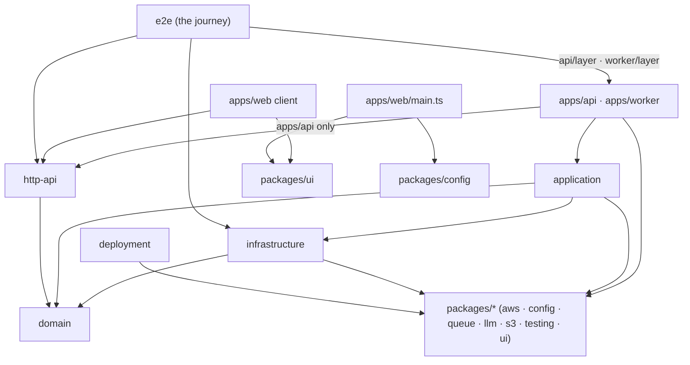

# Architecture

Where code belongs, what it may import, and how to add a new entity. What a layer may import is
the [Dependency rules](#dependency-rules) table below, which Biome enforces; each layer's other
binding rules live in its `CLAUDE.md` and in `.claude/rules/`. The decisions behind them, with the rejected alternatives,
live in `architecture.md › Decisions` of the scaffold ticket
(`docs/tickets/2026-10-16-1433_monorepo-setup/`) and of the architecture audit
(`docs/tickets/2026-10-27-1433_architecture-audit/`).

## Layers



Imports only go **down**: `apps` → `application` → `infrastructure` → `domain`, and `apps/api`
and `apps/web` → `http-api` → `domain`. A layer may skip levels: `application` usually imports
`domain` directly. The root `e2e` workspace sits above the apps: it runs both app layers in one
test process, and nothing imports it.

| Workspace | Holds | Rules |
|---|---|---|
| `domain/` | entity models and their pure operations, errors, ports, and the domain services that own the rules over them; no I/O of its own, time and ids only through `DateTime.now` and `Crypto` | [domain/CLAUDE.md](../../domain/CLAUDE.md) |
| `http-api/` | the HTTP contract (`HttpApi`) over the domain, shared by `apps/api` and the browser | [http-api/CLAUDE.md](../../http-api/CLAUDE.md) |
| `infrastructure/` | adapters that implement domain ports on top of `packages/*` clients | [infrastructure/CLAUDE.md](../../infrastructure/CLAUDE.md) |
| `application/` | use cases: the flows that join the domain's writes in one transaction, or reach the queue, the bucket or the assistant | [layering.md](../../.claude/rules/layering.md) |
| `packages/*` | generic, project-agnostic clients and libraries, with the one exception its rules name | [packages/CLAUDE.md](../../packages/CLAUDE.md) |
| `apps/*` | entry points (`main.ts`), the handlers, and the process's layer (`layer.ts`) | [apps/CLAUDE.md](../../apps/CLAUDE.md) |
| `e2e/` | the journey: `ApiLayer` and `WorkerLayer` in one runtime over the run's containers | [tooling.md › Tests](tooling.md#tests) |
| `deployment/` | `local/`, the Pulumi program of the local stand: MiniStack and the resources inside it ([aws.md](aws.md)); `aws/`, the resource code as functions of a provider, the rest a stub for now | [deployment/CLAUDE.md](../../deployment/CLAUDE.md) |

### Dependency rules

Each row lists what a workspace may import.

| From ↓ / may import → | domain | http-api | infrastructure | application | packages/* | apps |
|---|---|---|---|---|---|---|
| domain | — | ✗ | ✗ | ✗ | ✗ | ✗ |
| http-api | ✓ | — | ✗ | ✗ | ✗ | ✗ |
| infrastructure | ✓ | ✗ | — | ✗ | ✓ | ✗ |
| application | ✓ | ✗ | ✓ | — | ✓ | ✗ |
| packages/* | ✗ | ✗ | ✗ | ✗ | ✓ (each other) | ✗ |
| apps/api | ✓ | ✓ | ✓ | ✓ | ✓ | ✗ (no sibling app) |
| apps/worker | ✓ | ✗ | ✓ | ✓ | ✓ | ✗ (no sibling app) |
| apps/web client (`app/`, `features/`, `shared/`) | ✗ | ✓ | ✗ | ✗ | `ui` only | ✗ |
| apps/web/main.ts | ✗ | ✗ | ✗ | ✗ | `ui`, `config` | ✗ |
| deployment | ✗ | ✗ | ✗ | ✗ | ✓ | ✗ |
| e2e | ✓ | ✓ | ✓ | ✗ | `config`, `testing` | ✓ (`api/layer`, `worker/layer`) |

- **`domain` imports `effect` and no workspace,** not even `packages/*`, and no `@effect/*`
  package but the test runner `@effect/vitest`, so it stays pure and testable without fakes;
  `type-fest` it imports for types only (`RequireAtLeastOne`). Its `tests/` and `testing/` may
  also import the test support `@app-template/testing`, and its `tests/` `@effect/platform-bun`
  for `BunCrypto.layer`.
- **`http-api` imports `effect` and `domain` only.** It is the system's HTTP boundary, shared by
  the api that implements it and the browser that calls it, so it lists the domain's ids, models
  and errors instead of copies, and the wire carries the domain's tags (`UserUnknownError`). The
  domain therefore ships to the browser: it declares `"sideEffects": false`, so a bundle keeps
  only the schemas it uses and drops the ports.
- **`apps/web` client code ships to the browser.** It calls the api through `ApiClient` from
  `http-api` and runs its Effects itself; only its server entry `main.ts` may read `config`, to
  get a validated `WEB_PORT`.
- **A ✓ is permission, not a declaration.** The dependency must also be in the importer's
  `package.json`; see [the boundary guards](#boundary-guards).

## Imports: `#<workspace>/` vs `@app-template/`

Every import line says where its module lives:

```ts
import { readFileSync } from 'node:fs'                      // Bun and Node built-ins

import { z } from 'zod'                                     // external packages

import { buildChat } from '@app-template/domain/chat'        // another workspace

import { SendMessageUseCase } from '#application/chat/send-message.use-case'  // this workspace
```

- **`@app-template/<workspace>[/<entity>]`** reaches another workspace through its `exports`. A
  layer exposes each entity as a subpath (`@app-template/domain/chat` →
  `domain/chat/index.ts`).
- **`#<workspace>/<path>`** reaches a file inside the same workspace, through the `imports` map in
  its `package.json` (`"#domain/*": "./*.ts"`, `"#api/*": "./*.ts"`). Relative `./` and `../`
  paths are banned. A bare `#/` prefix would be shorter, but Bun 1.4.3 cannot resolve it.
- **Order** is the four groups above, separated by blank lines. `make fmt` sorts them.

## Where things live

Using the `chat` slice as the map:

| What | File | Named |
|---|---|---|
| branded id | `domain/chat/chat.id.ts` | `ChatId`, `MessageId` |
| entity schema with its pure operations | `domain/chat/chat.model.ts`, `message.model.ts`; each with its subset of the shared `Status`, whose predicates live in `domain/shared/status.model.ts` | `Chat`, `Message` (`Schema.Class`), `buildChat({ id, userId, createdAt })`, `buildChatTitle`, the transitions `prepareMessage` … `failMessage` |
| domain errors | `domain/chat/chat.error.ts`, `message.error.ts` | `ChatNotFoundError` (`Schema.TaggedError`) |
| port | `domain/chat/chat.port.ts`, `message.port.ts`, `assistant.port.ts` | `ChatRepository`, `MessageRepository`, `Assistant` (`Context.Service` with no layer) |
| domain service: the rules that need a port | `domain/chat/chat.service.ts` | `ChatService`, `ChatService.layer` |
| memory layers and fixtures | `domain/testing/chat.test-fake.ts`, `chat.test-fixture.ts`, `user.test-fixture.ts` | `ChatRepositoryTest`, `ChatRows`, `chat`, `owner`; `RepositoryStackTest` in `repository-stack.test-layer.ts`; all as `@app-template/domain/testing` |
| database client, transaction and migrations | `infrastructure/db/` | `Db`, `Db.layerFromConfig`, `Transaction`, `migrations/`, the shared columns in `columns.ts`, the relations in `relations.ts`; `DbTest`, `TransactionTest` in `db/testing/` |
| tables and row codecs | `infrastructure/chat/chat.entity.ts`, `message.entity.ts` | `chats` (`snakeCase.table`), `ChatRow`, `ChatInsert` |
| adapter implementing a port | `infrastructure/chat/chat.repository.ts`, `assistant.llm.ts`; `attachment/attachment.bucket.ts` | `ChatRepositoryPg`, `AssistantLlm` (with the prompts, over `AssistantModels`, the language model per purpose that `LLM_PROVIDER` picks), `AttachmentBucketS3` (each a `Layer` of its port) |
| queue definitions | `infrastructure/chat/chat.queue.ts` | `assistantMessageQueue`, `GenerateAssistantMessage` (the job schema) |
| relay from the database to a queue | `infrastructure/outbox/outbox.relay.ts` | `OutboxRelay` (a worker `Layer` that runs a fiber and provides nothing) |
| use case composing domain services | `application/chat/send-message.use-case.ts`, `generate-assistant-message.use-case.ts` | `SendMessageUseCase`, `SendMessageUseCase.layer`, `GenerateAssistantMessageUseCase` |
| contract group | `http-api/chat/chat.http.ts` | `ChatHttp` (`HttpApiGroup`), the DTOs `Chat`, `Message` |
| api handler | `apps/api/chat/chat.handler.ts` | `ChatHandler` (`HttpApiBuilder.group`) |
| worker handler: a queue's consumer over a use case | `apps/worker/chat/assistant-message.handler.ts` | `handle`, `handleDeadLettered`, `AssistantMessageHandler` (a worker `Layer`) |
| the process's layer | `apps/api/layer.ts`, `apps/worker/layer.ts` | `ApiHttp` over the ports, `ApiLayer` with the adapters, `WorkerLayer`; exported as `./layer` |
| browser feature | `apps/web/features/health/health-panel.ts` | `renderHealthPanel(root)` |
| unit test | `<workspace>/tests/<source path>.test.ts` | `domain/tests/chat/chat.service.test.ts`, `application/tests/chat/send-message.use-case.test.ts` |
| e2e test | `<workspace>/e2e/<source path>.e2e.ts`; the journey `e2e/chat.e2e.ts` | `infrastructure/e2e/chat/chat.repository.e2e.ts`, `application/e2e/chat/send-message.use-case.e2e.ts` |
| test support | `<workspace>/testing/`, exported as `./testing` | `ChatTest` (`application/testing/chat.test-layer.ts`), `ApiTest`, `StandTest` |

Every entity folder has an `index.ts` barrel. What each kind of test runs on:
[tooling.md › Tests](tooling.md#tests). The file suffixes, the `./testing` exports
and the naming verbs are listed in [.claude/rules/naming.md](../../.claude/rules/naming.md). How
the tables, codecs and migrations work: [database.md](database.md).

## Add a new entity

Follow the `chat` slice layer by layer, from the bottom up. Write each test before its code,
and run `make check` after each layer. `<entity>` is the kebab name (`document`), `<Entity>` the
Pascal one (`Document`).

1. **Domain model.** `domain/<entity>/<entity>.id.ts`: `<Entity>Id` as a branded `Schema` with a
   same-named type; `<entity>.model.ts`: `<Entity>` as a `Schema.Class`.
2. **Domain errors.** `<entity>.error.ts`: `Schema.TaggedError` classes named
   `<Entity><Problem>Error`, whose tag is the class name.
3. **Port and operations.** `<entity>.port.ts`: the `<Entity>Repository` port as a
   `Context.Service` with no layer; `<entity>.model.ts`: pure operations such as
   `build<Entity>(input)`. Time and ids come in as input, never from `Date.now()` or
   `crypto.randomUUID()`. Test them in `domain/tests/<entity>/<entity>.model.test.ts`. Ownership
   is a field of the `<Entity>OneWhere` the port's `selectOne(where)` takes, so an owner mismatch
   reads as absent, never a predicate after the read.
4. **Memory layer.** `domain/testing/<entity>.test-fake.ts`: `<Entity>RepositoryTest` over
   `<Entity>Rows`, a `Ref` of the rows, with the guards the database will add (an index, a
   `where`, a cascade), and the fixtures in `<entity>.test-fixture.ts`; `domain/testing/index.ts`
   exports both.
5. **Domain service, if a rule needs a port.** `domain/<entity>/<entity>.service.ts`:
   `<Entity>Service`, a `Context.Service` with a `layer` over the ports.
   Test it in `domain/tests/<entity>/<entity>.service.test.ts` over the memory layer. What it may
   see and when a flow leaves it: [.claude/rules/layering.md](../../.claude/rules/layering.md).
6. **Domain exports.** `domain/<entity>/index.ts` re-exports its files, and
   `domain/package.json` gains `"./<entity>": "./<entity>/index.ts"` in `exports`.
7. **Tables and adapter.** `infrastructure/<entity>/<entity>.entity.ts` declares the tables and
   their row codecs, `infrastructure/db/relations.ts` gains them, and `make migration` writes the
   migration ([database.md](database.md)). `<entity>.repository.ts`: `<Entity>RepositoryPg`, a
   `Layer` constant that provides the domain port over `Db`. Add `index.ts`, which also exports
   `<Entity>Pg`, the one layer of every adapter of the aggregate
   (`ChatPg = Layer.mergeAll(ChatRepositoryPg, MessageRepositoryPg)`), and the `exports` entry.
   Test it in `infrastructure/e2e/<entity>/<entity>.repository.e2e.ts` on `DbTest`, with a twin
   of every guard the memory layer copies.
8. **Use cases, if a flow composes two domain services or sends a job.**
   `application/<entity>/<verb>-<object>.use-case.ts`, a `Context.Service` with a `layer`, like
   `application/chat/`. Test it in `application/tests/` over the memory layers, with
   `TransactionTest` and `recordQueue()`, and its transaction in `application/e2e/` with a write
   the database refuses. Shared test support goes in `application/testing/`. Add `index.ts`
   and the `exports` entry.
9. **Job, if the entity has asynchronous work.** `infrastructure/<entity>/<entity>.queue.ts`
   holds the queue definitions (name, job schema, retry policy, `jobId`); a model the work calls
   is a domain port with its `.llm.ts` adapter, which holds the prompts. The use case that starts
   the work sends the job with `QueueClient.send` from `packages/queue`;
   `apps/worker/<entity>/<object>.handler.ts` holds `handle` and `handleDeadLettered` over a use
   case and their `worker` layer, which `apps/worker/layer.ts` merges and provides with the
   `<Entity>Pg` layers the handlers read. Test `handle` in `apps/worker/tests/` over the memory
   layers.
10. **Contract.** Add the group in `http-api/<entity>/<entity>.http.ts`, listing the domain's errors
    with their statuses (`HttpApiSchema.status`), and add it to `Api` in `http-api/api.ts` before
    `.middleware(SchemaErrors)`.
11. **Delivery.** Implement the group in `apps/api/<entity>/<entity>.handler.ts` with
    `HttpApiBuilder.group(Api, '<group>', …)`: it calls the use cases and services and returns
    their models as is, since each DTO's encoder drops the fields the DTO leaves out. Add it
    to `ApiRoutes` and its services to `ApiHttp` in `apps/api/layer.ts`; its `<Entity>Pg` and any
    AWS adapter go to `ApiLayer`, so `ApiHttp` runs over the ports alone and the api test layer
    provides the memory layers in their place (`@app-template/domain/testing`, with the recording
    queue's client from `@app-template/application/testing`).
    Test in `apps/api/tests/<entity>/<entity>.handler.test.ts`, on
    `apps/api/testing/api.test-layer.ts`, only what HTTP adds (statuses, cookies, the wire shape);
    the rules stay in the domain and application suites. A flow that crosses both apps joins the
    journey in `e2e/chat.e2e.ts` only when its wiring is new.
12. **Client, if the browser needs it.** `ApiClient` from `@app-template/http-api` already has
    every endpoint of the contract; add a feature folder under `apps/web/features/<entity>/`
    whose Effect calls it through `ApiClient.use`.

A new entity in existing workspaces usually needs no new dependency, because the layers already
declare each other. Check the importer's `package.json` anyway: an undeclared workspace fails
`make typecheck` with TS2307. A new external client is a new dependency; see
[tooling.md](tooling.md#add-a-dependency).

## Boundary guards

The import rules are enforced three times, each catching what the others miss, and a fourth guard
checks what the import rules leave to tree shaking, the web bundle:

| Guard | Catches | Reports |
|---|---|---|
| Biome `noRestrictedImports`, one `overrides` entry per layer in `biome.json` | an import that goes up a layer or into a sibling app; any relative path; a workspace or an `@effect/*` package other than `@effect/vitest` in `domain` (in its `tests/` and `testing/`, a workspace other than `@app-template/testing`); a workspace other than `domain`, or an `@effect/*` package, in `http-api`; `http-api` in a lower layer, a package, the worker or `deployment` | `make lint`, `pre-commit`, CI `static` |
| the isolated linker with `tsc -b` | an allowed import of a workspace that is not declared in `package.json` | TS2307 in `make typecheck` and at runtime |
| `composite` project references (`rootDir: "."`) | a path that reaches into an unreferenced workspace's files | TS6059 / TS6307 in `make typecheck` |
| `make bundle-check`: `bun build` of `apps/web/app/main.ts`, then a `grep` of the bundle | a domain service or port in the browser bundle, or an adapter, which carries its port's key: a value import of one that `http-api` passes on | the matched service keys, in `make check` |

The Biome overrides are **deny-lists**: each names the workspaces a layer must not import. A new
`packages/*` workspace therefore needs no change to them, while a new layer or app does. The
root `e2e` workspace has none: the root rule bans its relative paths, and its `package.json`
declares only the workspaces the journey runs. Test
files follow their workspace's override, save `domain/tests/**` and `domain/testing/**`: an
override each, after domain's, lets both import `@app-template/testing`, and the tests alone
`@effect/platform-bun`. Overrides that match the same file replace each other's options rather
than merge, so every override repeats the relative-path ban, and the two domain test overrides
repeat every domain ban. Symptoms
and fixes:
[tooling.md › Troubleshooting](tooling.md#troubleshooting).

The bundle guard greps the service keys (`"@app-template/domain/chat/ChatRepository"`): string
literals, which survive the build however Bun applies `domain`'s `"sideEffects": false`. A
type-only import is erased and passes, as it should. `apps/web` cannot import `domain` at all, so
a leak comes through `http-api`, which imports the domain barrels for their schemas and errors;
tree shaking drops the services and ports beside them, and the guard proves it on every check.

### Known gaps

Three forms pass every guard. No code uses them; review is what catches them.

- **A type import inside an expression in web client code.** `export type X =
  import('@app-template/config').ApiConfig['Service']` in `app/`, `features/` or `shared/` passes
  Biome, which does not see `import()` inside a type, and `tsc -b`, because web declares
  `@app-template/config` for its server entry. The type is erased, so nothing reaches the browser,
  but the client then depends on the shape of the server config.
- **A workspace importing itself by name.** `@app-template/application/chat` from inside
  `application/` passes Biome, whose overrides list only other workspaces, and `tsc -b`, which
  resolves a package's own `exports`. It skips the `#<workspace>/` convention and can import the
  file's own barrel, a cycle that shows up as `undefined` while modules initialise.
- **A runtime module or third-party package in `domain`.** `node:crypto` or any npm package passes
  the domain guard, which bans only workspaces and `@effect/*`. Purity rests on review and on the
  grep for `Date.now`, `new Date(` and `randomUUID`.
