# Database

How the app stores its records in Postgres: where the tables are declared, how a row becomes a
domain model, how the schema changes, and how tests get a database. The code:
`@app-template/packages/db`, which knows no table (the client factory `createDb`, `Transaction`,
the shared columns and the query helpers); the kernel's `postgres` part (`PgClientFromConfig`
and the migrate program); the data layer, `kernel/data/` (the client `Db`, made by
`createDb(relations)` over the `PgClient` in the context, the tables, their entities, the
migrations and the repositories over them); and a module's models, each the codec of its own
row. Drizzle runs on `@effect/sql-pg` and is reached only through Effect: every query is an
`Effect`, never a promise.

## Schema and entity files

The data layer, `kernel/data/<store>/`, declares each table in `<name>.table.ts`, with its
columns' schema `<Name>Columns` (`createSelectSchema(<table>)`) where a neighbour's entity nests
it, and its entities, the schemas read from it, in `<name>.entity.ts`; what each may import:
[kernel/CLAUDE.md](../../kernel/CLAUDE.md).
The tables form a DAG and import no entity, so an entity nests a neighbour's `<Name>Columns`
from the table file without a cycle: `ChatEntity` and `MessageEntity` nest `RunColumns`. A Run
nests nothing, so its reads return `RunColumns` itself and its messages are the ids it holds.
The tables are the one declaration of the schema: the migrations are generated from them and
the entities derived from them.

- **Names.** A table is declared with `snakeCase.table` from `drizzle-orm/pg-core`, so the
  `camelCase` keys in code (`createdAt`) become `snake_case` columns (`created_at`) with no name
  spelled twice.
- **Shared columns** come from `@app-template/packages/db`: `id()`, a `uuid` primary key with
  `DEFAULT uuidv7()`, and `createdAt()` and `updatedAt()`, `timestamptz` columns with no default
  and no `$onUpdate`. A model's insert and update variants make every id and every timestamp
  from the app's clock ([Entities and models](#entities-and-models)), so `TestClock` holds and
  the database's clock is never read; the `uuidv7()` default serves only
  hand-written SQL, and needs Postgres 18 or later.
- **Enums and checks state the data layer's own values.** An enum takes its values from a tuple
  the table exports (`runStatuses = ['queued', …] as const`, then
  `pgEnum('run_status', runStatuses)`), and a check declares its own pattern or limit
  beside the table (`credentials_hash_check` the lower-case hex SHA-256 a credential's hash is;
  `chats_title_check` a trimmed, non-empty title), so a row written by hand cannot hold
  what the domain rejects. A model that holds the value declares it again on its side and checks
  the same rule there, never importing the table's
  ([Checks kept in the tables](decisions.md#checks-kept-in-the-tables)); a value no model holds,
  such as the hash its service computes, has the check alone. drizzle-kit inlines the values
  into the DDL, so a changed literal, pattern or limit changes the schema, and
  `make migration-check` fails until a migration exists.
- **A check is a backstop, never stricter than the brand.** It may let through what the brand
  refuses, never the reverse: `chats_title_check` trims spaces only and caps no length, where
  `ChatTitle` trims every whitespace and caps the length, a rule of the domain alone. Checks are named
  `<table>_<column>_check`, indexes `<table>_<columns>_index` and partial indexes
  `<table>_<columns>_<predicate>_index` (`runs_chat_id_active_index`).
- **A rule across rows is a partial unique index.** `runs_chat_id_active_index` allows one
  active Run per chat; its predicate reads the active statuses from `activeRunStatuses`, exported
  from `run.table.ts` beside the table.
- **A descending index states its null order.** Drizzle's `desc()` indexes nulls last while
  Postgres's `ORDER BY … DESC` sorts them first, so an index for that order is
  `.desc().nullsFirst()` (`chats_user_id_created_at_index`).
- **Foreign keys say what a delete does.** `credentials`, `messages` and `runs` cascade from
  their parent, so a chat's delete is one statement. A Run names its user message by the pair
  `(user_message_id, chat_id)` over `messages (id, chat_id)` (`runs_user_message_id_chat_id_fk`),
  so the message can only be one of the Run's chat. The cascade never reaches S3: a flow that
  stores bytes beside a row deletes them itself.
- **A message and a Run store their chat's owner.** `messages.user_id` and `runs.user_id` repeat
  `chats.user_id`, so a user's read filters the row itself (`{ id, userId }`), as a chat's does,
  with no relation to its chat. The insert writes it once: an ask takes it from the chat it was
  given, a retry from the failed Run, a reply from the Run it started. The key that names the
  chat holds the copy: the pair `(chat_id, user_id)` over `chats (id, user_id)`
  (`messages_chat_id_user_id_fk`, `runs_chat_id_user_id_fk`), in place of a key on `chat_id`
  alone and cascading as it did, so the database refuses a row whose owner is not its chat's.
- **A link lives in one foreign key, never in an array beside it.** Postgres cannot hold a
  foreign key on array elements, so a copy would drift: a message's Runs are the rows whose
  `runs.user_message_id` names it, and `messages` keeps no list of them.

## Entities and models

An entity file lays its entity over the table's columns, in the data layer's own types
(`string`, `string | null`, `Date`), beside the `<Name>EntityWhere` and `<Name>EntitySet` its
reads and writes filter and change by. A repository's `insert` takes the table's full row, its
`<Name>Columns` (the entity itself where it nests nothing), so a row that leaves a column out
fails typecheck. An entity is the shape every read returns, one level deep: a chat's and a
message's nest their Run's columns, and the nested columns nest nothing:

```ts
export const ChatEntity = Schema.Struct({
  ...ChatColumns.fields,
  run: Schema.NullOr(RunColumns),
})
```

Where a read's shape is not the entity's, the entity file holds the function from the one to the
other: a message's Run comes from two relations, the newest that answers a user's message and
the one that wrote an assistant's, so `buildMessageEntity` keeps the one its author has and the
repository maps every read through it.

A model is the codec of its own row: a `Model.Class` that declares each stored value as its row
holds it, a nullable column as `Schema.OptionFromNullOr(…)` and a timestamp as a `Date`
(`Model.DateTimeInsertFromDate`, `Model.DateTimeUpdateFromDate`), so its encoded side is its
entity and its type side is what the rules read. No mapper sits between them: a service codes a
row through the statics of `RowCodec` (`@app-template/packages/schema`), which take the model: a
read's through `decodeOne` or `decodeMany`, a write's through `makeInsert` or `makeUpdate` over
its variant ([models.md](../../.claude/rules/models.md)). A read decodes the entity with the
model in the read's shape, whose nested models decode their own rows. A write builds and encodes a variant:
`insert` makes the id and both times, `update` holds only the fields an update may set and moves
`updatedAt`, and neither holds a nested record, which is a field of the select variant alone
([Models with variants](decisions.md#models-with-variants)):

```ts
const { set, row } = yield* RowCodec.makeInsert(Chat)({ userId })
const found = yield* chats
  .selectOne(encodeWhere(where))
  .pipe(Effect.flatMap(RowCodec.decodeOne(Chat)))
```

- A model's encoded side is the row of its one store. A second stored form of a model brings
  back a mapper of its own, which lays the model's schemas over that store's columns.
- A service writes a model encoded through `RowCodec.makeInsert` into the row the repository's `insert`
  takes, the table's full row, so a column the model lacks fails typecheck at that insert; a
  read drops it. A value already in the data layer's types (brands, literals) is passed as is:
  `UserRepository.insertCredential` takes the credential's row `{ hash, kind, userId }` with no
  codec, `IdentityService` setting `userId` from the user's row.
- A `jsonb` column carries its shape's type (`jsonb().$type<RunFailure>()`),
  declared as a schema beside the table, so the row Drizzle returns fits the entity.

## Relations

The data layer declares the relations once, with `defineRelations` over every table, and `Db` is
built with them (`PgDrizzle.make({ relations })`), so `db.query.<table>` is typed. A relation
names its columns (`from`, `to`) and joins on their equality only, and holds no order: a query
states it with `orderBy`. A relational query returns nested rows typed as the entity, so a
repository returns them as they are:

```ts
const rows = yield* db.query.chats.findMany({ with: { run: { orderBy: newestFirst } } })
// rows: [{ id, userId, …, run: { id, chatId, status, … } | null }]
```

A repository whose entity nests a relation reads the entity `with` the top-level relations it nests,
in one relational query, and never a nested `with`: `Chat.run` and `Message.run` are model
fields another table holds, read and never written by their own writes. A `one` relation over
many rows (a chat's Runs) is ordered by the read, `{ run: { orderBy: newestFirst } }`, since a
relation holds no order and renders `limit 1`. A relational query
aliases its table, so its `where` is the filter object, which the query renders on that alias,
never a condition built on the `chats` constant.

## Repositories

A repository is a `Layer` over `Db` in its entity's `.repository.ts` (names:
[naming.md › Symbols](../../.claude/rules/naming.md#symbols)). The data layer's, in
`kernel/data/<store>/`, `FileRepository` over the bucket's objects among them
([aws.md › Files](aws.md#files)), speak entities: they take a table's row (an
object store a `<Name>EntityInsert`), a `<Name>EntitySet` and a `<Name>EntityWhere` and return
`<Name>Entity`. A module's service calls one directly, with no port in front, and codes its rows
through its models (`IdentityService` over `UserRepository`). Rows of several tables that commit
together are a method each, which their service commits in one transaction
([Transactions](#transactions)), as `IdentityService` does a user and its credential
([why](decisions.md#one-way-to-open-a-transaction)). Every method ends with `orDieWithSqlError`
from `@app-template/packages/db`.

A module's services call the data layer's repositories with the models as
their codecs: a write encodes the model into the row, the set takes its fields from that row,
and a read decodes the entities into models; a mapping failure, a value a variant refuses
included, dies as a `Schema.SchemaError`, whose message is the issue's text, so no service
settles it.

A `where` has two forms, one on each side of a service. What a caller hands a service is model
values alone: a branded id, an `Option` for a field that may be null (`{ id, title: Option.none() }`
is a chat still untitled), a list for one of several (`status: activeRunStatuses`). It is one plain
type whose key is a required field, and so is the owner on a type only a call on a user's behalf
takes (`SetRequired<ChatWhere, 'userId'>` of `type-fest`, `MessageWhere`, the first member of
`RunWhere`); a narrowing a caller may leave out is an absent key, never an `Option` nor an
`undefined` ([effect.md › Schemas](../../.claude/rules/effect.md#schemas)): `ChatWhere`, a model's
one where, is the id with `userId?` and `title?`, so `ChatService.update` takes the user's rename
and the title job's alike. What a service hands a repository is Drizzle's filter object, which
`encodeWhere(where)` of `@app-template/kernel/data` makes of any service's where: an `Option` of
none becomes `{ isNull: true }`, of some its value, a list `{ in: […] }`, any other value stays
itself (`chats.selectOne(encodeWhere(where))`). Every field of the value becomes a condition, so a
caller writes its where as a literal of the type's fields, which the compiler checks, and never
hands a record whole. `RunService.getOne` reads by either of two keys, as `RunEntitySelectWhere`
does, so `RunWhere` is a union of one member per key, the api's by the id and owner or the worker's
by the message and statuses. So Drizzle's operators appear in that one function, never in a service,
a handler or a use case. Neither an `undefined` field, which `exactOptionalPropertyTypes`
([tooling.md › TypeScript](tooling.md#typescript)) refuses at `make typecheck`, nor an empty where
has a rule: Drizzle throws on the first, and the repository's key refuses the second.

A read that nests a relation or filters on one is a relational query (`db.query.<table>.findFirst`
and `findMany`); a read of one table with neither goes through the core builder
(`db.select().from(<table>)`), and so do the writes
(`db.insert`, `db.update`, `db.delete`). A relational read of at most one row is a `findFirst`,
which emits the `limit 1` itself, even where a key makes the row unique, so the query states its
intent; the row it finds is the entity as Drizzle types it, returned with no decode, and
`Option.fromUndefinedOr` turns the `undefined` of none into `Option.none()`. A core-builder read
of one row takes the head of its many (`Arr.head`). A filter on a relation (`{ credentials: {
kind, hash } }`) renders as `exists (…)`.

A write of some fields under a condition takes a `<Name>EntitySet` and a `<Name>EntityWhere`,
whose key is required, so no write compiles that names no row (`ChatEntityWhere`,
`RunEntityWhere`); a read that also finds rows by another field takes its own
`<Name>EntitySelectWhere` (a user's chats by `userId`, a Run by its user message).
The entity file lists the columns an update may write once, as `<name>SetColumns`, typed by the
table's columns (`satisfies ReadonlyArray<keyof <Name>Columns>`), so a name that is no column
fails typecheck on the tuple, and derives the `Set` type from it over the same columns; the
repository writes `Struct.pick(set, <name>SetColumns)`, so a whole entity passed as a set writes
only those columns; a column the set leaves out is not written, and a set that holds an
`undefined` does not compile.
A `where` type is the table's filter with its key required, `Keyed<TableFilter<typeof <table>>,
<Name>Columns, '<key>'>` from `@app-template/packages/db`, over the data layer's
`FilterOf<'<table>'>` where the read is a relational query; a read that finds by either of two
keys names both, and its `where` must hold one. A relational query takes it as it
is, and a core-builder statement as `encodeFilter(<table>, where)`, which renders the same
object as that statement's condition. There a filter that names nothing matches no row
(`` sql`false` ``), so no write goes without its `WHERE`; the key each `where` type requires
keeps a read from one.
A column that is null is matched by `{ isNull: true }`: Drizzle throws on a `null` in a filter,
as on an `undefined`.

## Guards

A rule that two writers could break between a read and a write is held by the database, in the
statement that writes. The caller checks the rule first, so a write the guard refuses only lost
a race: every repository's `insert`, `update` and `delete` dies when Postgres refuses it or it
touches no row (`Effect.filterOrFail(Arr.isReadonlyArrayNonEmpty)` over the write's `RETURNING`,
whose `NoSuchElementError` the method's `orDieWithSqlError` turns into the defect):

- **Insert under a partial unique index.** `RunRepository.insert` is a plain insert, so a second
  active Run in a chat fails on the index and dies. `AskChatService.ask` reads the chat
  with its newest Run and refuses a chat whose Run is active (`ChatPolicy.ensureNotBusy`,
  `ChatBusyError`, 409);
  of two asks that both read none at once, the second's Run insert, its last write, dies on the
  index, rolled back whole with its message and binds: a lost race of that narrow window responds with
  500.
- **Update under a `where`.** `RunRepository.update(set, where)` writes the columns of
  `runSetColumns` `WHERE id = … AND status = …`: `RunService.update(from, to)` takes the Run a
  caller read and the Run its move made, stamps the second with the current time and passes it,
  encoded, as the set, with the first's id under the status it was read in as the `where`, where
  a read's `RunEntitySelectWhere` takes the id or the user's message under a status; so a write
  whose expected status another worker has left, or whose Run is gone, changes nothing and dies,
  in the repository. The reply's tail fails the Run its start wrote, by that write's status, so on
  a Run settled meanwhile it dies too and leaves the Run as the other writer left it. A Run's
  completion writes the assistant's message, then moves the Run to `done` naming it, in one
  transaction, so a lost race keeps no reply.
- **A message is never changed.** `MessageRepository` has no `update`: a user's message is
  finished when the user asks, an assistant's when its Run writes it. The Run names its reply:
  `runs_assistant_message_id_check` holds that a Run names one exactly when it is `done`, and
  `runs_assistant_message_id_unique` that a reply belongs to one Run. The key sits on `runs`, so
  `messages` names no Run and the two tables never import each other.
- **A count per owner.** A limit on how many rows an owner holds fits no guard here: an insert
  that writes only while the owner's count is under the limit, even as one statement, lets two
  concurrent creates both count one under it and both insert. Such a create checks the count
  first and accepts the overshoot, one row per concurrent create; the `FOR UPDATE` read that
  would close it is rejected in
  [decisions.md › Guards in the write, no lock](decisions.md#guards-in-the-write-no-lock).
- **Update of some fields under a `where`.** A service reads by the caller's `where` to name the
  refusal, then writes only the changed fields under the same `where`, so a row another writer
  changed in between is missed and the write dies. A repository's `update(set, where)` takes a
  set that is `RequireAtLeastOne` from `type-fest`, so an empty write fails typecheck, and a
  `where` of a key and any field the row must still hold, rendered by `encodeFilter`
  (above). The worked case is a chat's rename: the title job renames `where` `title` is still
  `none`, so a rename landing between its read and its write wins, and the title job dies and
  fails.

`ChatRepository.delete(where)` is one statement: the chat's messages and Runs go by the cascade, and
`ChatService.delete` is all the api's delete calls. It takes the chat's id with its owner, both
required (`SetRequired<ChatWhere, 'userId'>`), reads the chat under them to name the refusal and
deletes under them again, so a call that names no user fails typecheck and another user's chat is
`ChatNotFoundError`.

## Transactions

A use case that writes several aggregates commits them together: the `Effect.fn` that holds the
writes yields `Transaction` and pipes its `run` on them (`yield* writes.pipe(transaction.run)`;
`Transaction.layer` wraps `SqlClient.withTransaction` over the `PgClient` that `Db.layer` takes
from the context, `PgClientFromConfig` in the processes and `DbTest` in the e2e, so it runs on the
connection `Db` uses), the one way to open a transaction. A `run` inside a `run` is a savepoint of
the outer one: it rolls back alone on its own failure and commits with the outer
([its e2e](../../packages/db/__e2e__/db.client.e2e.ts)). A service whose writes commit together
passes `transaction.run` as the last argument of the function that holds them: `IdentityService`'s
new user and its credential, `AskChatService.ask`'s the user's message and its queued Run,
`ReplyChatService.reply`'s answer the chat's history, the assistant's call and the reply with the
Run's `done`, so that transaction,
and the pooled connection it holds, stays open for the language model's call. Every
repository call inside joins the transaction through the connection `@effect/sql` keeps in the
fiber's context, so no repository takes a transaction parameter. The guards above decide every
race inside Postgres, with no lock in the process, and two api processes behave as two fibers. S3
stays outside the transaction: the bytes are kept before the row that binds them and deleted once
the rows are gone, so no row names bytes that are gone; a failure between the two leaves only
bytes no row names. SQS joins none either: the sends follow the
commit ([The sends](#the-sends)).

## A Run's life

A Run has the statuses of `runStatuses` (`kernel/data/chat/run.table.ts`); `queued` and
`generating` are active, `done` and `failed` end it. Each arrow is the model's transition that
`RunService.update` writes, and in brackets its caller; every move is written under the status
read ([Guards](#guards)).

```mermaid
stateDiagram-v2
  [*] --> queued: RunService.create (AskChatService.ask, AskChatService.retry)
  queued --> generating: RunMove.start (ReplyChatService.reply)
  queued --> failed: RunMove.fail (AskChatService on a refused send)
  generating --> done: RunMove.complete (ReplyChatService.reply)
  generating --> failed: RunMove.fail (ReplyChatService.reply's tail; its start, on a Run some worker started)
  done --> [*]
  failed --> [*]
```



## Stuck Runs

A Run that no worker settles stays active and its chat `queued`, so every next ask of the chat
fails `ChatBusyError`. A worker that dies (a killed process, the function's timeout) is settled
by the next delivery, up to the queue's visibility timeout later, which finds the Run started,
and fails it; a store failing
the `failed` write, a process that dies between the commit and the send, or a job whose every
delivery dies, leaves it so, and nothing consumes
the dead-letter queue ([aws.md › Queues](aws.md#queues)). No sweep over active Runs exists: by
age alone it could not tell a dead Run from one waiting in a backlog.

## The sends

A job is a queue message, and no table holds it: the record of its work (the Run, the
chat's title) is the one the worker reads
([decisions.md › Jobs as queue messages](decisions.md#jobs-as-queue-messages)).

- **`QueueSender.send(definition, message)`** (`packages/queue`) encodes the queue message through the
  definition's schema to a JSON string and sends it to the definition's queue;
  `QueueSenderOfStage` in `kernel/aws` names that queue for the stage. A `<Verb><Model>Service`
  sends its jobs after its transaction commits, so a delivery always finds the record it names. A transaction
  that fails keeps no row and responds with `500`.
- **A send SQS refuses** is logged with the id of its chat, and the reply's with its user
  message's and its Run's too. For the reply's, `AskChatService` also fails the Run it sent
  through `RunService.update` and the Run's `fail`, by its id, with the queue's error's full text
  as its failure, and the request responds with `202` and that failed Run; the message is stored
  and shown failed with its retry, `POST /chats/:chatId/runs`. The title's send only logs it. A
  send that never happens after the commit: [Stuck Runs](#stuck-runs).

## Migrations

The schema changes only through SQL migrations that drizzle-kit generates from the table files
and that are committed. drizzle-kit's own guide to the folder, its snapshots, branches and errors,
at the pinned version: `repos/drizzle/drizzle-kit/skills/drizzle/migrations.md`.

| Command | Does |
|---|---|
| `make migration NAME=<name>` | `drizzle-kit generate --config kernel/data/drizzle.config.ts` from the root, whose paths it resolves against the working directory: compares the table files with the last snapshot and writes `kernel/data/migrations/<timestamp>_<name>/` (`migration.sql`, `snapshot.json`); needs no database |
| `make migrate` | applies the pending migrations to `DATABASE_URL` through `migrateDatabase(folder)`, then logs `database migrated`, whether it applied one or none; while the database refuses connections it retries, logging `database not reachable yet, retrying`; any other failed connection or query logs its cause at once |
| `make migration-check` | drizzle-kit's dry run (`generate --explain`): fails when the table files differ from the migrations, printing the missing SQL and how to regenerate `init`; it writes nothing |

- **`make migration-check` is soft locally and strict in CI.** In `make check` it counts every
  folder in the tree, committed or not, so a step that adds a migration stays green before its
  commit. CI runs it on a fresh checkout, which holds only committed migrations, so there an
  table changed without a committed migration fails the build.
- Commit `migration.sql` and `snapshot.json` together. The ledger `drizzle.__drizzle_migrations`
  records each migration once, so an edit never reaches a database that already applied it.
- **Until a deployed database holds data, the migrations stay one `init`, whose `migration.sql`
  reads as the whole schema in one file.** Every change to a table deletes
  `kernel/data/migrations/` and regenerates it with `make migration NAME=init`, never a second
  migration, a rename by `--hints` or hand-written SQL; a local database then rebuilds by
  `make reset && make up`. Two branches that both regenerated it merge as two folders, which
  `make migration-check` refuses: regenerate once more. The first deployed database ends this:
  from then on a committed migration is never edited.
- The apps neither migrate nor check the schema at startup; only `make migrate` and the tests'
  setup apply migrations.
- Biome skips `kernel/data/migrations/`: the files are drizzle-kit's output, and a
  reformatted snapshot would differ from the next one it writes.

## The local database

`make up` creates it as an RDS instance inside MiniStack and writes its `DATABASE_URL` to
`.env.pulumi`: [aws.md › The local stand-in](aws.md#the-local-stand-in).

## Tests

A repository's e2e runs on `DbTest`, in entities, its parent rows written through `Db`. An entity's
e2e checks, in entities only, what the schema itself refuses (a check, a foreign key, a partial
unique index) and reads the `SqlError` of a refused statement with `flipSqlError`. Each
[guard](#guards) the database adds, the cascades of its [foreign keys](#schema-and-entity-files)
included, has its case in a repository suite: a unit test mocks the repository, so it sees none
([effect-tests.md › Unit and e2e](../../.claude/rules/effect-tests.md#unit-and-e2e)). Where each
suite and its support live and the e2e of a service's or use case's transaction:
[tooling.md › Tests](tooling.md#tests).
