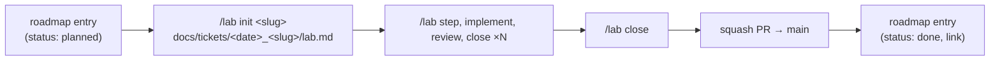

# Roadmap

The tickets that turn this repository into **App Template**: a chat clone (user → message →
assistant reply) built as a worked example of an Effect v4 modular monolith on
Bun, with Postgres, AWS and Pulumi, so that a new enterprise project starts from it in minutes.

This file is the **only place a future ticket exists** before `/lab init <slug>` starts it: each
entry below holds what a ticket is *for* (goal, scope, out of scope, dependencies, inherited
requirements, open questions); the *how* is decided in its lab. `init` seeds the lab's Intent from
the entry, and the entry's `Status` becomes a link to the ticket folder. At the lab's close, the
row is marked done and the entry's section goes, so the PR's squash carries both.

## How a ticket flows

- **One ticket = one branch `<type>/<slug>` cut from `main` = one squash-merged PR.**
- **`main` is the only long-lived branch:** the steps of a merged ticket stay in its PR's commit
  list and its `lab.md`; see [sdd.md › Roadmap and history](./sdd.md#roadmap-and-history).
- **Order below is the default, dependencies are the law.** A ticket may start when every entry in
  its `Depends on` is done. Two independent tickets may run in parallel on separate branches.
- **Facts expire.** Every `Facts` line carries the date it was checked; `/lab init` has a
  `researcher` re-check the ones it relies on.

## Tickets

| # | Ticket | Type | Depends on | Status |
|---|---|---|---|---|
| 1 | `template-bootstrap` | `chore` | — | done: [docs/tickets/2026-10-17-1508_template-bootstrap/](../tickets/2026-10-17-1508_template-bootstrap/feature.md) |
| 2 | `claude-toolkit` | `chore` | 1, 3 | done: [docs/tickets/2026-10-20-2313_claude-toolkit/](../tickets/2026-10-20-2313_claude-toolkit/feature.md) |
| 3 | `chat-core` | `feat` | 1 | done: [docs/tickets/2026-10-17-1748_chat-core/](../tickets/2026-10-17-1748_chat-core/feature.md) |
| 4 | `postgres-drizzle` | `feat` | 3 | done: [docs/tickets/2026-10-22-1915_postgres-drizzle/](../tickets/2026-10-22-1915_postgres-drizzle/feature.md) |
| 5 | `aws-local` | `feat` | 3 | done: [docs/tickets/2026-10-19-1448_aws-local/](../tickets/2026-10-19-1448_aws-local/feature.md) |
| 6 | `llm-providers` | `feat` | 5 | done: [docs/tickets/2026-10-29-1435_llm-providers/](../tickets/2026-10-29-1435_llm-providers/feature.md) |
| 7 | [`web-app`](#7-web-app) | `feat` | 3 (18 for assistant attachments) | planned |
| 8 | `observability` | `feat` | 3 | done, as `telemetry-minimal`: [docs/tickets/2026-11-07-0944_telemetry-minimal/](../tickets/2026-11-07-0944_telemetry-minimal/feature.md) |
| 9 | [`aws-deployment`](#9-aws-deployment) | `feat` | 4, 5 | planned |
| 10 | `client-publishing` | `chore` | 3 | done: [docs/tickets/2026-11-04-1131_client-publishing/](../tickets/2026-11-04-1131_client-publishing/feature.md) |
| 12 | [`template-handoff`](#12-template-handoff) | `chore` | all above | planned |
| 13 | `ticket-folder-order` | `chore` | 3 | done: [docs/tickets/2026-10-20-2313_claude-toolkit/](../tickets/2026-10-20-2313_claude-toolkit/feature.md) |
| 14 | `toolkit-reading` | `chore` | 2 | done: [docs/tickets/2026-10-21-1347_toolkit-reading/](../tickets/2026-10-21-1347_toolkit-reading/feature.md) |
| 15 | `architecture-audit` | `refactor` | 4 | done: [docs/tickets/2026-10-27-1433_architecture-audit/](../tickets/2026-10-27-1433_architecture-audit/feature.md) |
| 16 | [`shared-files`](#16-shared-files) | `feat` | 15, 23 | paused: attachments removed, to be rethought ([docs/tickets/2026-11-16-1401_shared-files/](../tickets/2026-11-16-1401_shared-files/lab.md)) |
| 17 | `docs-diet` | `docs` | 15 | done, as `lean-instructions`: [docs/tickets/2026-11-02-1820_lean-instructions/](../tickets/2026-11-02-1820_lean-instructions/feature.md) |
| 18 | [`assistant-files`](#18-assistant-files) | `feat` | 6, 23 | paused: attachments removed, to be rethought |
| 20 | `context-window` | `feat` | 6 | done: [docs/tickets/2026-11-26-1022_context-window/](../tickets/2026-11-26-1022_context-window/lab.md) |
| 21 | [`bedrock-provider`](#21-bedrock-provider) | `feat` | 6, 9 | planned |
| 23 | `modular-monolith` | `refactor` | 15 | done: [docs/tickets/2026-10-31-0926_modular-monolith/](../tickets/2026-10-31-0926_modular-monolith/feature.md) |
| 24 | `attachment-storage-failures` | `fix` | 23 | done: [docs/tickets/2026-11-06-0947_attachment-storage-failures/](../tickets/2026-11-06-0947_attachment-storage-failures/plan.md) |
| 25 | `toolkit-quality` | `chore` | 17 | done: [docs/tickets/2026-11-04-1009_toolkit-quality/](../tickets/2026-11-04-1009_toolkit-quality/feature.md) |
| 26 | `domain-from-data` | `refactor` | 10 | done: [docs/tickets/2026-11-06-1005_domain-from-data/](../tickets/2026-11-06-1005_domain-from-data/plan.md) |
| 29 | `sdd-stages` | `chore` | 2 | done: [docs/tickets/2026-11-07-1232_sdd-stages/](../tickets/2026-11-07-1232_sdd-stages/feature.md) |
| 30 | `effect-4-1` | `chore` | PR #39 | done, in the design audit's PR #39 |
| 31 | `pure-models` | `refactor` | 30 | done: [docs/tickets/2026-11-25-1922_pure-models/](../tickets/2026-11-25-1922_pure-models/lab.md) |
| 32 | `queue-events` | `feat` | 31 | done: [docs/tickets/2026-11-27-1131_queue-events/](../tickets/2026-11-27-1131_queue-events/lab.md) |
| 33 | [`security-hardening`](#33-security-hardening) | `fix` | — | planned |
| 34 | [`spend-limits`](#34-spend-limits) | `feat` | 33 | planned |
| 35 | [`identity-cost`](#35-identity-cost) | `feat` | 34 (9 for the edge rules) | planned |

The ticket `2026-10-16-1607_effect-setup` is **superseded at S12**; later tickets built what it
left.

### 7. `web-app`

- **Goal.** The chat UI a user uses: TanStack Start on React 19, `@effect/atom-react` for
  state over the typed client, Chakra UI v3 for components, streaming replies, inline
  placeholders, a chat list, all server-rendered and hydrated.
- **Scope.** `apps/web` rebuilt on TanStack Start (Vite 8, Nitro `bun` preset in dev); TanStack
  Router, Query and DB where they fit (intent recorded; see the open question); `effect/reactivity`
  atoms with `AtomHttpApi` over the web's generated client and `HydrationBoundary` for SSR; Chakra
  UI v3 theme in `packages/ui`; a nested `biome.json` (`"root": false, "extends": "//"`) with the
  `react` domain; the user cookie flowing through the Start server; the web `Dockerfile` or
  Nitro output for 9.
- **Out of scope.** Authentication; mobile; i18n.
- **Open questions for its feature phase.** TanStack Query and TanStack DB overlap with
  `AtomHttpApi` and atoms: which owns server state, which owns client state, or whether atoms alone
  suffice and Query/DB stay out; whether web client code may now import `effect` (today it is
  banned by Biome and must change for atoms); SSR of streams.
- **Re-read against `chat-core` (2026-10-20).** "Streaming replies" means, today, polling the
  assistant message until its status is terminal, since the api streams nothing and the worker
  writes snapshots; an SSE tail is `llm-providers`' (6) open question, so this ticket depends on
  3 alone for the reply, and on 6 only for assistant attachments and placeholders.
- **Re-read against `llm-providers` (2026-10-29).** The reply now arrives whole: no snapshots, so
  the client polls until the message is terminal and shows its text at once. The
  SSE tail is this ticket's to decide, if it still earns its place. Assistant attachments and
  placeholders moved to `assistant-files` (18).
  The web's cookie is the user cookie the api's `IdentityMiddleware` reads to provide the request's
  `IdentityClaims` under `Identity`.
- **What the browser's bundle holds** is this ticket's to check, on the new bundler: `make check`
  reads no bundle, and only the `apps/web/**` override and the web's manifest hold the browser's
  imports (the owner's word, 2026-11-25:
  [Later › From `pure-models`](#from-pure-models)).
- **Facts (2026-10-17).** `@tanstack/react-start@1.169.3` (router 1.170, Vite ≥ 8, React 19 for
  the Bun preset, `aws_lambda` preset with streaming); `@chakra-ui/react@3.37.0`; Effect v4 atoms
  are `effect/reactivity/*` in core plus `@effect/atom-react@4.0.5` (React ≥ 19 only) with
  `ReactHydration.HydrationBoundary`; `@effect-atom/*` is the v3 line; no official TanStack bridge
  exists; nothing is called "Effect UI".
- **To weigh.** [Ideas to weigh › Smaller fits](#smaller-fits): `Sse`, and why not `eventlog`.

### 9. `aws-deployment`

- **Goal.** One Pulumi program deploys the api, the worker, Postgres, S3 and SQS to AWS, from the
  resource inventory `aws-local` (5) introduced, and the same program provisions MiniStack for the
  "true emulator" local mode, so a new project is live in one command.
- **Scope.** `deployment/` on Pulumi `runtime: bun`; Lambda packaging for api and worker (Lambda
  Web Adapter container is the official Bun path; the `bun-lambda` layer is the alternative), the
  web on its Nitro `aws_lambda` output or static hosting; Aurora Serverless v2 with auto-pause
  versus RDS; SQS event source mapping for the worker; secrets in SSM; the local mode where
  MiniStack runs the Lambdas in Docker from the same artefacts; CI deploying a preview stack;
  `docs/knowledge/deployment.md`.
- **Out of scope.** Multi-account or multi-region; a custom domain and CDN beyond the minimum; the
  web and the observability backend while `web-app` (7) and `observability` (8) have not landed:
  each adds its own resources to this program, and one that lands first is deployed here.
- **Decided (2026-10-19).** Split from `aws-local` (5); depends on `postgres-drizzle` (4), since
  the deployed processes need a shared database, and on 5, not on 7 or 8.
- **Decided (2026-10-21).** The applications never check or create their resources: the
  infrastructure provides them (`aws-local` D5 dropped the startup `verify`); `provision` in
  `packages/aws` serves the tests only (each test file creates its own resources in milliseconds,
  without the Pulumi CLI).
- **Open questions for its feature phase.** Cold starts of `@effect/platform-bun` on Lambda; whether
  `pulumi.dynamic.Resource`, unsupported under `runtime: bun`, is ever needed.
- **Facts (2026-10-17).** Pulumi ≥ 3.227 runs TypeScript under `runtime: bun` (no function
  serialisation, no dynamic providers); CLI 3.270, `@pulumi/aws` 7.51. Bun on Lambda: the official
  guide uses Lambda Web Adapter in a container (also gives response streaming for SSE);
  `provided.al2` is deprecated since 2026-07-31. MiniStack has no Lambda hot reload and runs
  non-Python runtimes in Docker, so the emulator mode verifies deployment artefacts; live
  development stays on `bun --watch` against MiniStack's queues and buckets.
- **Rechecked (2026-10-19).** Pulumi CLI 3.270.0, `@pulumi/aws` 7.51.1. Bun runs the program only
  under `runtime: bun`, as `deployment/local` runs; the AWS stack has no project file yet. Bun's
  Lambda guide (Lambda Web Adapter 1.0.1 in a container; 1.1.0 is current) says nothing about
  response streaming. `provided.al2023` replaces `provided.al2` (deprecated 2026-07-31). Aurora
  Serverless v2 pauses at 0 ACU and resumes in about 15 s; Postgres 18 is on RDS and on Aurora
  (Serverless v2 from 18.3). App Runner has been closed to new customers since 2026-04-30; AWS
  points to ECS Express Mode. Lambda Web Functions (2026-10-12) serve HTTP without an adapter, but
  only on `nodejs24.x`, so not under Bun. SQS event source mappings with `ReportBatchItemFailures`
  remain the recommended worker pattern.
- **Inherits from `aws-local` (2026-10-22).** Check on AWS what MiniStack cannot show: the
  `unbound` tag sent with `CreateMultipartUpload` and the lifecycle deletion it drives. Share one
  AWS client builder between `kernel/aws/aws.client.ts` and the tests' clients, and
  brand `Stage`.
- **Inherits from `postgres-drizzle` (2026-10-23).** The bucket with its lifecycle rule, the
  queues with their dead-letter queues and the RDS instance are already Pulumi resources, created
  on MiniStack by `deployment/local` (`provision.ts` is gone): `deployment/aws/{provider,database,
  storage,queue}.ts` take an `aws.Provider`, so the prod stack calls them without an endpoint,
  with Aurora or RDS settings and a managed password for the database. This ticket adds the
  migration command for a deployed stage. Locally `make up` sets `VCR_MODE=REPLAY_ONLY` to skip
  the provider's fixed waits; never on AWS.
- **Inherits from `llm-providers` (2026-10-30).** `deployment/` sets no LLM variables, so a
  deployed worker fails at start: it needs `LLM_REPLY_MODEL`, `LLM_TITLE_MODEL` and
  `ANTHROPIC_API_KEY` (in SSM). The api reads none of them.
- **Inherits from `lambda` (2026-11-08).** Dev runs the worker behind MiniStack's SQS mapping in
  proxy mode: the code stays on the host. The production build in dev, api and worker as real
  Lambda functions inside MiniStack (a Bun image with Lambda Web Adapter,
  `LAMBDA_EXECUTOR=docker`, a Function URL for the api), moved here unbuilt. Two researchers'
  runs, stopped before their reports and not rechecked: an image function responded through a
  Function URL with a cold start of 130–180 ms; a partial batch failure worked; the function
  reaches Postgres only at `host.docker.internal`, not at the `localhost` the RDS endpoint
  reports; a rebuild to a response took about 2 s. Pulumi creating these functions was not run.
- **Inherits from `telemetry-minimal` (2026-11-14).** Two things only AWS can show, researched
  there with sources (`docs/tickets/2026-11-07-0944_telemetry-minimal/lab.md`, L3 and L6 Notes):
  the OTLP receivers (X-Ray traces, CloudWatch Logs and CloudWatch metrics take OTLP/HTTP directly
  with an `Authorization: Bearer <API key>` header; the switch from the local backend is the
  per-signal `OTEL_EXPORTER_OTLP_<SIGNAL>_{ENDPOINT,HEADERS}` variables, no code; Transaction
  Search, the keys and the log group must exist first; nothing was sent to a real account), and
  getting an invocation's telemetry out before Lambda freezes (Effect's exporter batches on an
  interval and the server span closes after the response; the reliable patterns are a flush
  before the response in the worker's `POST /events`, which `OtlpExporter.Flusher` gives in three
  lines, a flush after it held by an `INVOKE`-registered process, or the Collector extension
  copied into the image, since no ADOT layer exists for `provided.al2023`; the shutdown window is
  2 s with LWA, below the exporter's 3 s default).
- **Inherits from the design audit (2026-11-18).** A job's reader is released before its writer
  stops sending a field: a body with a field its schema no longer has decodes with the field
  dropped, while a reader of the old build refuses a body without it (`Missing key`), the case
  [aws.md › Queues](aws.md#queues) logs and acknowledges unrun. The reply and title jobs lost `chatId`
  this way; the title's later took `chatId` in place of `messageId`, on a new queue (2026-11-21).
- **Inherits from the security audit (2026-11-27).** What only the AWS stack can close, each read
  from AWS's documentation on that date and none run, as no stack exists and MiniStack 1.5.31
  evaluates no WAF rule and models no CloudFront viewer header:
  - **An edge in front of the api.** AWS WAF attaches to a CloudFront distribution, an ALB or a
    REST API, not to a Lambda function URL or an HTTP API, so a Function URL for the api needs
    CloudFront before any WAF rule exists; behind origin access control a function URL wants the
    client to send the SHA-256 of a POST's body in `x-amz-content-sha256`, which a REST API as the
    origin does not. The api accepts requests through the edge alone, so the viewer's address it
    reads (`CloudFront-Viewer-Address`) is the edge's word.
  - **The web without the hand-written proxy.** Static files from S3 and `/api/*` as a cache
    behaviour replace `apps/web/main.ts`'s proxy outside development.
  - **The worker with no public listener.** A Lambda on its SQS mappings, no function URL of
    `AuthType NONE`; `scalingConfig.maximumConcurrency` on each mapping and an explicit pool size,
    as a reply holds a connection for its model's call
    ([decisions.md](./decisions.md), "The chat's jobs in their services").
  - **The database's defaults.** `deployment/aws/database.ts` declares `publiclyAccessible: true`,
    `skipFinalSnapshot: true`, a password from settings and no `storageEncrypted`, right for the
    emulator alone: an AWS stage takes a private instance in a VPC, encrypted at creation (it
    cannot be added later), with deletion protection and a password RDS manages.
  - **The cookie and the headers.** HTTPS only at the viewer, the managed
    `SecurityHeadersPolicy`, and `NODE_ENV` set on every deployed process, as the cookie is
    `Secure` under `production` alone (`apps/api/identity/identity.handler.ts`).
  - **Logs that name who.** WAF logs and CloudFront standard logs hold the viewer's address,
    country, network and TLS fingerprint with no application code; cookie logging stays off, and
    a rate rule is never keyed on the `user_secret` cookie as is, since a WAF log prints the first
    32 characters of a custom key. `LOG_LEVEL` is never `Debug` on a deployed stage:
    `packages/db/db.client.ts` logs every statement's parameters at that level.
  The edge's rules themselves belong to [`identity-cost`](#35-identity-cost).
- **To weigh.** [Ideas to weigh › Queue on SQS or in Postgres](#queue-on-sqs-or-in-postgres)
  decides whether the worker is a Lambda on SQS or a long-running poller;
  [Telemetry readable by an agent and on AWS](#telemetry-readable-by-an-agent-and-on-aws) the
  CloudWatch and X-Ray path; [Alchemy in place of Pulumi](#alchemy-in-place-of-pulumi) whether
  `deployment/` stays on Pulumi, weighed by its probe before the AWS stack is written.

### 12. `template-handoff`

- **Goal.** "Use this template" to a running, renamed project in ten minutes.
- **Scope.** `make rename SCOPE=@acme NAME="Acme"`; a checklist of what to delete (`docs/tickets/`
  of the template, the example domain if unwanted) and what to keep (`docs/knowledge/`, rules,
  skills); a fresh-clone rehearsal in CI; the README's "Starting a new project" rewritten; the
  GitHub template flag verified; the toolkit items that matter only when the template changes
  hands, inherited from `claude-toolkit` (2): `/skill-doctor` as a periodic check, pinning
  `mattpocock-skills` by `sha`, agent `memory`, `SessionStart` and `PostToolUse` hooks.
- **Out of scope.** A generator or CLI.

### 16. `shared-files`

- **Goal.** A user uploads files to a pool of their own and links them to a message or a chat
  later, instead of uploading for one message.
- **Scope.** The pool and the link as domain concepts, the words first; upload, list and delete
  of pool files; linking at an ask and to a chat; what the reply reads when a chat has linked
  files.
- **Out of scope.** Sharing between users; assistant-produced files (`assistant-files`, 18).
- **Paused (2026-11-19).** The owner removed attachments from every ring, to be rethought
  ([decisions.md › Attachments removed](decisions.md#attachments-removed)); the lab's L1 and L2
  built on them. The redesign starts from the generic core that stayed: `FileRepository` and
  `FileObject` in `kernel/data/file`, the kernel's S3 clients and the `attachments` bucket. Its
  first questions: the words for a file and its link, the module that owns them, and the bucket's
  name and key prefix, which still say `attachments`.
- **Inherits from `architecture-audit` (2026-10-27).** A file lives as long as its owner needs it:
  no expiry of unlinked files, so no unbound lifetime or `unbound` S3 tag.
- **Inherits from `modular-monolith` (2026-10-31, done 2026-11-02).** A module of its own for the
  files, reached by chat only through its contract, with an ask that links files as one use
  case over both modules, in one transaction; the split rewrites the decisions
  [Modules by capability](decisions.md#modules-by-capability) and
  [Files in the data layer](decisions.md#files-in-the-data-layer), whose *Revisit when* name
  files outside a chat.
- **Open questions for its feature phase.** Whether one file may be linked to several messages;
  whether deleting a chat deletes its linked files or only the links; the quota per user; the
  owner's draft idea (2026-11-19): a library file copied into a chat before the ask, so the
  draft lives on the server.
- **Status.** Paused: attachments removed, to be rethought. Its lab:
  [docs/tickets/2026-11-16-1401_shared-files/](../tickets/2026-11-16-1401_shared-files/lab.md).

### 18. `assistant-files`

- **Goal.** Files the way the Claude apps handle them: the user attaches Word, Excel, PowerPoint,
  CSV, Markdown, images and PDF; the assistant reads them and produces Word, Excel, PowerPoint,
  PDF, CSV and PNG files, shown in its text through placeholders.
- **Scope.** Anthropic's code execution tool with its `docx`, `xlsx`, `pptx`, `pdf` Skills and the
  Files API; uploading a user's file into the container; downloading produced files into S3 as
  attachments of the assistant message; the placeholder syntax; the `pause_turn` continuation;
  deleting files at Anthropic once copied; the e2e's scripted assistant producing a file; audio by a
  speech-to-text service.
- **Out of scope.** Providers other than Anthropic.
- **Open questions for its feature phase.** One container per chat or per reply; which files go
  to the model natively (images, PDF, text) and which through the container; how to send a
  `container_upload` block that `@effect/ai-anthropic`'s prompt converter cannot express (a
  local patch with an upstream PR, an own HTTP call, or converting on our side); the
  speech-to-text service
  (AWS Transcribe or another provider); retention, since code execution and the Files API are not
  zero-data-retention eligible.
- **Facts (2026-10-29).** Code execution, the Files API and Skills are GA, no beta header; Skills
  go in the request's `container.skills`; produced files are those written to `$OUTPUT_DIR` and
  come back as file ids in `bash_code_execution_tool_result`, downloaded with
  `GET /v1/files/{id}/content`; containers live 30 days; code execution costs $0.05 per container
  hour past 1 550 free hours a month per organisation, five minutes minimum, billed whenever a
  request holds files. `.docx` and `.xlsx` are not accepted by any message block, and no Claude
  model takes audio. `@effect/ai-anthropic` passes `container` through its `Config` and
  surfaces tool results with file ids; its generated Files API calls are awkward for binary
  uploads.
- **Rechecked on `@effect/ai-anthropic` 4.1.5 (2026-11-21).** Its generated schema has the
  request's `container_upload` block (`RequestContainerUploadBlock` in `Generated.ts`, as 4.0.6
  had), but the prompt converter in `AnthropicLanguageModel.ts` never emits it and still rejects
  any file media type but images, PDF and text.
- **Inherits from `modular-monolith` (2026-11-02).** The prompts and the Anthropic calls live in
  chat's assistant `ChatAssistant` (`application/chat/infrastructure/`),
  the provider's settings in `kernel/llm`; a produced file is stored through `FileRepository` in
  the data layer, its bytes kept before the row that binds them, since S3 joins no transaction.
  Files outside a chat reopen [Files in the data layer](decisions.md#files-in-the-data-layer).
- **Facts on AWS (2026-10-29).** Claude on Bedrock has no code execution, Files API, Skills, web
  search or Message Batches. Bedrock Converse `DocumentBlock` takes `docx`, `xlsx`, `csv`, `md`,
  `html` (how they are converted is undocumented). Bedrock Knowledge Bases answer with retrieved
  chunks, need an ingestion job and create no file: a fit for `shared-files` (16), not for a
  message's attachment. Amazon Quick's Microsoft 365 extensions are Office add-ins with no
  backend API. Bedrock Data Automation reads DOCX (as PDF), PDF, images and audio up to
  240 minutes, not `xlsx` or `pptx`, and creates no file. AgentCore Code Interpreter is the AWS
  way to create files (inline upload up to 100 MB, sessions up to 8 hours, $0.0895 per vCPU hour),
  driven by a tool loop we write. Claude Platform on AWS is Anthropic-run, billed through AWS,
  and has code execution, the Files API and Skills; its client is beta. MiniStack emulates
  Transcribe (canned transcript) and Knowledge Bases (lexical search), not Data Automation or the
  Code Interpreter.
- **To weigh.** [Ideas to weigh › Smaller fits](#smaller-fits): `Zip`, `Xml` and `workers` to
  turn Office files into text on our side.
- **Status.** Planned.

### 21. `bedrock-provider`

- **Goal.** Claude on Amazon Bedrock as a third value of the provider setting, so a deployed
  project pays through its AWS bill and the worker authenticates with its IAM role instead of an
  API key.
- **Scope.** `@effect/ai-anthropic` against Bedrock's Anthropic Messages endpoint
  (`bedrock-mantle.<region>.api.aws/anthropic`) with a SigV4-signing `HttpClient` over the default
  credential chain; explicit cache points instead of the automatic top-level cache; a request
  timeout of at least two minutes for the first compile of a new schema; the IAM permission
  `bedrock-mantle:CreateInference` and model access in `aws-deployment` (9); the error mapping
  of Bedrock's gateway errors and its rate limits.
- **Out of scope.** Converse and `InvokeModel`; Bedrock-only services (Knowledge Bases, Data
  Automation, AgentCore), which belong to `assistant-files` (18) or `shared-files` (16).
- **Open questions for its feature phase.** Whether the endpoint accepts the provider's
  `?beta=true` query; how throttling surfaces and whether a wait is given; effort and thinking
  support; the global route or a regional profile (+10%).
- **Facts (2026-10-29).** `@effect/ai-amazon-bedrock` is Effect v3 only (0.17.0);
  `@effect-aws/client-bedrock-runtime@2.0.0` fits Effect 4 but is a client, not a
  `LanguageModel`. The endpoint takes the first-party request body; model ids
  `anthropic.claude-sonnet-5-5`, `anthropic.claude-haiku-5-5`. Structured output works through
  `output_config.format` (at most 12 optional and 16 union-typed properties, no length or range
  bounds, about 90 s to compile a new schema). The same model specs as Anthropic's (1M context,
  128K output); not supported: code execution, web tools, Files API, Skills, Message Batches,
  automatic prompt caching. Default quota 2M input tokens a minute, up to 5M on request.
  Billed through AWS Marketplace; the global route has no premium, regional profiles +10%;
  per-token prices were not readable from aws.amazon.com/bedrock/pricing and need the AWS
  calculator. MiniStack 1.5.31 emulates Bedrock Runtime with canned replies that fail a schema
  and does not emulate the Messages endpoint, so local runs call Anthropic.
- **Status.** Planned.

### 33. `security-hardening`

- **Goal.** The holes the security audit of 2026-11-27 found that code alone closes are closed,
  each with a test that fails before its fix: none waits for the AWS stack, and
  [sdd.md](./sdd.md) defers no security hole.
- **Scope.**
  - **The web's proxy targets the api alone.** `proxyToApi` (`apps/web/main.ts`) builds its target
    from the request's path against the api's origin, so a path can name another host: the
    request, its cookie included, goes there and the answer comes back on the web's origin. The
    target is built from the fixed origin, its path and query set after.
  - **A title is asked for an untitled chat alone.** `TitleChatService.title` asks the model
    before it applies the "still untitled" condition, so a replayed or duplicated event pays a
    call for nothing; the condition is read first.
  - **A batch runs bounded.** `QueueConsumer` runs a batch's records with
    `concurrency: 'unbounded'`; a number takes its place.
  - **A request's body is bounded.** `BunHttpServer.layer` takes only a port in
    `apps/api/layer.ts` and `apps/worker/layer.ts`, so a body is buffered up to Bun's own cap
    before the 20 000-character check reads it, and an idle connection is never closed; both
    servers take a body limit and an idle timeout.
  - **`recognise` refuses a cross-site form.** `POST /identity` answers any request with no valid
    cookie with a new user and its cookie, and a cross-site form post carries none
    (`SameSite=Lax`), so a page elsewhere can replace a visitor's user, whose chats are then out
    of reach for good; the endpoint requires what a form cannot send.
  - **A process states its environment.** `NODE_ENV` defaults to `development`
    (`kernel/config/config.ts`), under which the cookie is not `Secure`.
  - **The local stand listens on loopback.** The containers of `deployment/local/` and the three
    dev servers bind every interface, with no authentication on MiniStack, Postgres (`app`/`app`)
    or Grafana.
  - **The Claude workflows run for the repository's own people.** `.github/workflows/claude.yml`
    starts on any `@claude` mention, with no `author_association` condition.
- **Out of scope.** A limit on what a user spends ([`spend-limits`](#34-spend-limits)); what makes
  a user cost something ([`identity-cost`](#35-identity-cost)); the AWS stack's own settings
  ([`aws-deployment`](#9-aws-deployment)); pagination, already in
  [Later › From `pure-models`](#from-pure-models); a secret's rotation and revocation, which
  wait for [Authentication with Jose](#authentication-with-jose).
- **Open questions for its Shape.** Whether loopback binds break MiniStack's delivery to the
  worker through `host.docker.internal` on Linux; which request `recognise` refuses (a required
  header, visible in the contract and needing `make api-snapshot`, or `Sec-Fetch-Site`); the body
  limit's value, 256 KiB holding 20 000 characters as escaped JSON; whether the Postgres
  container MiniStack publishes takes a bind address at all.
- **Facts (2026-11-27).** Run against the local stand, the three dev servers started by hand:
  through the web's port a request reached a listener on another port with the visitor's cookie,
  and that listener's `Set-Cookie` and HTML came back on the web's origin; one record repeated
  three times in a batch for a titled chat showed three `ChatAssistant.proposeTitle` spans; a
  120 MB body to `POST /chats/:chatId/messages` answered 400 and left the api at 558 MB from 116;
  `POST /identity` with a foreign `Origin`, a form content type and no cookie answered 201 with a
  new user. Checked and sound: every read's `where` carries the user (ten cross-user requests
  answered 404), the request schemas, parameterised SQL, the one active Run per chat.
- **Status.** Planned.

### 34. `spend-limits`

- **Goal.** No user, and no number of users together, spends more of the owner's model budget in
  a day than the owner set: every model call is recorded against its user, and an ask is refused
  once the day's budget is spent.
- **Scope.**
  - **A usage record per model call**, reply, summary and title alike, whatever the call's end,
    keyed to the user and to no chat, priced when written. It is what a budget reads and what
    answers "who spent the most in the last hour".
  - **A daily budget for the whole service**, checked before a Run is created and again before a
    model's call, with an error of its own on the wire (429) and what its user is told.
  - **A daily allowance per user**, a cap on a user's chats and on a user's active Runs.
  - **Smaller requests by default**: the context limit and each call's `max_tokens`.
  - **A retry counted as an ask**, and a title's schema failure not retried: `LlmCall.ask`
    retries it twice, so a first message that makes the model overrun the title's length pays
    three calls.
  - **The provider's own limits documented** as the stop behind the app's: a workspace for the
    app apart from the one its developers use, its monthly spend limit and its `tokens_per_day`,
    auto-reload off.
  - **What is left, on the wire.** A user reads their own spend, their allowance and when it
    renews; anyone reads the service's totals for the period, spent and left, with no user named.
    The page that shows either is `web-app`'s (7). It takes
    [Later › From `context-window`](#from-context-window)'s usage that counts a summary's call.
- **Out of scope.** Telling one person from another, and anything at the edge
  ([`identity-cost`](#35-identity-cost)); billing, credits or payment; the page that shows a
  usage (`web-app`, 7).
- **The fact that shapes it.** While a user is free to create, an allowance per user bounds
  nothing: the service's budget is the bound, and the allowance only keeps one user from spending
  the day. Whoever spends the day's budget still denies the service to every user until the next
  day; making that dear is `identity-cost`.
- **Open questions for its Shape.** The budget's and the allowance's values and their period: the
  owner's own figures (2026-11-28) are 150 USD a month for users, of a provider credit of 200 a
  month whose other 50 stay for development, and 5 USD a user as an example; against them stands
  that 30 users, or one person behind 30, spend the month at 5 USD each, so a daily share of the
  month (about 5 USD) and a smaller allowance for a user nobody knows are to weigh; the unit a
  user is shown, a share left or money, as a token's price differs tenfold by its kind and no one
  count of tokens says what is left; what a user reads when either is spent; totals read by a
  `sum` over an index or kept in a counter row, the second being what
  `.claude/rules/repositories.md` leans to and one row every ask contends for; how an unfinished
  answer's usage reaches the record, `LlmCall.ask` discarding it with the answer; the limit's
  floor, as a limit small against one message summarises on every turn (seen at a limit of 100);
  whether the budget counts money or tokens, a dense message costing ten times an English one of
  the same length; whether a cut-off answer is stored as the reply or stays a failed Run.
- **Facts (2026-11-27).**
  - **Nothing limits spend.** `ask` checks that the chat is not busy and no more
    (`application/chat/services/ask-chat.service.ts`); a user's chats are unbounded, one active
    Run a chat. Run locally: 40 `POST /identity` and 150 `POST /chats` all answered 201 within a
    second.
  - **A deleted chat takes its spend with it.** A Run's key to its chat cascades and the usage
    is the Run's (`kernel/data/chat/run.table.ts`). Run locally: a chat deleted while its Run
    generated answered 204, the model's call ran on and failed on the foreign key, and no usage
    was left.
  - **Only a done Run holds a usage** (`RunMove.complete`, `runs_usage_check`); a failed or
    unfinished reply, a summary and a title are billed and recorded nowhere.
  - **Sizes.** A reply's `max_tokens` is 16 000, a summary's 8 000, a title's 1 000
    (`application/chat/infrastructure/chat-assistant.llm.ts`); `LLM_CHAT_CONTEXT_TOKENS_LIMIT` is
    1 000 000 in `.env.example`. Run locally: 19 992 characters of English counted 4 294 prompt
    tokens, 20 000 CJK characters 41 901.
  - **The cache.** Run locally: a turn 17 s after the last read 41 897 tokens from the cache, a
    turn 5 min 41 s after read none and wrote them all again; the summary's model sets no cache.
  - **Estimates, not run**, from the provider's pricing and rate-limit pages as an agent read
    them on that date: the dearest ask about 3.30 USD; one chat about 0.24 USD a minute; enough
    chats to meet the provider's limit 9 to 45 USD a minute by tier. The provider offers a
    monthly spend limit for a workspace, a `tokens_per_day` rate limit and no limit per key; its
    usage API lags by hours, so a budget cannot read it.
- **Status.** Planned.

### 35. `identity-cost`

- **Goal.** Spending the service's daily budget, and so denying it to honest users, costs an
  attacker more than creating users: a new user is slower to make, worth less, and seen.
- **Scope.**
  - **The network a user was created from**, a truncated address on the user, so users of one
    network share an allowance and a network creates so many a day.
  - **A share of the day's budget for new users**, so a wave of them cannot take the share of
    the users already there.
  - **The viewer's address the api can trust**, and one log line a request with its user,
    address and TLS fingerprint, never a message's text or the cookie's secret.
  - **At the edge**, once `aws-deployment` (9) gives one: a rate rule per address on
    `POST /identity`, AWS WAF's Challenge action on the routes that write, the address
    reputation rule groups.
  - **Alerts**: the cost of each call as a metric, an alarm on a share of the day's budget
    spent within an hour.
  - **Retention**: how long an address and a usage row are kept, and where a project says so.
- **Out of scope.** The budget itself ([`spend-limits`](#34-spend-limits)); payment; phone
  verification.
- **Open questions for its Shape.** **Anonymous use or sign-in**: proposed to the owner, a small
  anonymous allowance and sign-in for more, which rewrites the glossary's User ("Not an account:
  there is nothing to sign in to") and meets
  [Authentication with Jose](#authentication-with-jose); Cognito or another provider; what of the
  edge can be tested, MiniStack evaluating no WAF rule; whether CloudFront overwrites a
  `CloudFront-Viewer-*` header a viewer sent, not verified; the truncation (`/24` and `/48`
  proposed) and the retention (30 days for an address, 90 for a usage row proposed; general
  guidance, not legal advice).
- **Facts (2026-11-27).** As an agent read the sources on that date, none run. OWASP LLM10:2025
  (Unbounded Consumption) names rate limits, user quotas and monitoring; OWASP's Automated
  Threat Handbook, for account creation, limiting what a new account can do and the rate of
  creation; its cheat sheets call CAPTCHA defence in depth and an address block no sole defence.
  Each cost on a user is cheap to pay, by the sellers' own price pages: residential proxies 2 to
  8 USD a GB, a solved challenge 1.2 to 2 USD a thousand; so none of them is a bound. No AWS
  service keeps a daily token budget per user: API Gateway usage plans count requests and its
  documentation says not to rely on them to control cost. AWS WAF's Account Creation Fraud
  Prevention wants a registration page with a form, which this app has not. Today the api logs a
  request's method, URL and status, no address and no user, and stores no address anywhere.
- **Status.** Planned.

## Later

What a ticket's `Later` leaves unresolved at its PR: edge cases, error paths, hardening, open
questions. One section per ticket; each item says what goes wrong, with its file and symbol, why
it was left, and the ways out to weigh. A design audit has a section too, whose findings no
verifier has checked stand by title alone, marked so, until one does. A ticket that takes an item
moves it into its own `Later` and deletes it here.

### From `chat-assistant`

- (2026-11-27) Once, under `make check`, four cases of `apps/e2e/api/chat.e2e.ts`, all in
  `a write Postgres refuses, through the api`, failed with "Test timed out in 30000ms" or
  "60000ms": "an ask whose Run is refused leaves no message and no chat change", "a Run whose
  move to done Postgres refuses ends failed with its chat and keeps no reply", "a retry after a
  failed Run is answered by the worker, and a reload shows the reply" and "a refused chat delete
  keeps every row". Vitest pointed at `:118`, `:134`, `:153` and `:177`, lines of other cases
  among them, and printed a run of 5.43 s. The next `make test-e2e` and `make check`, the tree
  unchanged, passed 87 of 87. The cause is not known. A first look: run `make test-e2e` again
  until a case times out, and time each of those cases' stand, built per case as it alters the
  schema; a guess, not checked: a stand's containers or a schema change slow under load.

### From `queue-events`

- (2026-11-27) A store unavailable under a reply's handling leaves its Run active for good, its
  chat refusing every ask: the handler can neither run nor write the Run's failure
  (`failUnanswered` in `application/chat/services/reply-chat.service.ts`), and the worker
  acknowledges a record whose handler died (`QueueConsumer.consume`, `packages/aws/queue/queue.consumer.ts`).
  Left on the owner's word. Ways out to weigh: a retry of the failure's write inside the process,
  the owner's; a sweep of active Runs ([database.md › Stuck Runs](database.md#stuck-runs)).
- (2026-11-27) A chat's newness is judged on a read before the write (`ChatState.isNew` in
  `askChat`, `application/use-cases/chat/ask-chat.use-case.ts`): a second ask whose read
  precedes a first one's whole reply sends a second `ChatInitialized`, of the second message,
  which titles the chat if the first title is not written yet. Left: the window is a whole reply
  wide on one side and a read wide on the other. Way out: judge newness inside the transaction.
- (2026-11-27) A new chat's `ChatInitialized` is lost for good when `AskChatService.ask` dies
  after its commit: SQS refuses `UserMessageCreated` to the client but took it, and the worker
  started the Run, so the refusal's guarded `failed` write dies; or a store error on that write.
  `askChat` (`application/use-cases/chat/ask-chat.use-case.ts`) then dies before the chat's send,
  the reply is stored, and the chat is never titled, as every later ask reads a Run. Before
  `askChat`, the title's event went before the reply's. Ways out to weigh: send `ChatInitialized`
  before the ask's send, or on the ask's death too.
- (2026-11-27) A dead-letter queue now fills only from a record whose process died three times
  under it (`kernel/aws/resources/resources.ts`), and nothing reads one: weigh dropping the
  queues against a consumer of them.
- (2026-11-27) `QueueConsumer.consume` (`packages/aws/queue/queue.consumer.ts`): no test that an
  interrupt of the worker ends the handling with no response, which a probe showed; the `process <queue>`
  span ends successful when a handler died, its own span alone failing; a handler that interrupts
  itself is acknowledged.
- (2026-11-27) The worker's handler test (`apps/worker/__tests__/chat/chat.handler.test.ts`)
  asserts the Run's rules, which belong in `ReplyChatService`'s test.
- (2026-11-27) `.claude/rules/layering.md` › Handlers gives a handler's span as
  `'<Group>Handler.<endpoint|job>'`, which does not name a listener; `aws.md` › Queues does not
  point to the store-outage cost that Jobs as queue messages states.
- (2026-11-27) A chat already titled still costs one assistant call when `ChatInitialized` is
  delivered again or late: `TitleChatService.title` reads the message and asks
  `assistant.proposeTitle` (`application/chat/services/title-chat.service.ts:34`) before the
  update guarded by `title: Option.none()` refuses the titled chat, which the worker logs as
  `title skipped: chat deleted or titled`. Left: found while grouping the data layer, out of its
  scope. Way out to weigh: read the chat untitled before the assistant's call.

### From `lambda-processes`

- (2026-11-09) A reply that never settles leaves its chat `queued` for good, so every next ask
  fails `ChatBusyError`: a job whose body no longer decodes is failed unrun, so the reply's use
  case never runs; a job's handler dies, and the worker acknowledges the job; every delivery of
  a job kills its process, 3 receives, and nothing reads the dead-letter queue; or the queue
  drops its messages (a purge, a replaced queue, SQS's retention, 4 days by default and unset in
  the inventory). Ways out to weigh: the handler gets the undecodable body
  to fail its own work, a consumer of the dead-letter queues, or a sweep of active Runs
  ([database.md › Stuck Runs](database.md#stuck-runs)).

### From `reply-run`

- (2026-11-11) A Run stays `queued` for good, its chat busy, when the api dies between the commit
  and the reply's send (`ChatQueue.sendUserMessageCreated` or `sendMessageRetried`, called by
  `application/chat/services/ask-chat.service.ts`, the last step of `ask` and
  `retry`): a send SQS refuses fails the Run, and a client's abort leaves it sent
  ([decision](decisions.md#a-runs-job-on-interrupt-and-on-two-deliveries)), but no handler runs in
  a dead process. Ways out to weigh: a ledger of jobs, an outbox row sent by a poller, a sweep of
  active Runs; [Jobs as queue messages](decisions.md#jobs-as-queue-messages) rejects a table of
  jobs. The owner refused a rule by a Run's age.
- (2026-11-13) Two asks or two retries of one chat that arrive within the few milliseconds between
  the check and the insert (two tabs, a client that asks again) both pass their check
  (`ChatPolicy.ensureNotBusy`, `RunPolicy.ensureRetryable`); the active Run's index refuses the
  second insert, which dies, so the client gets a bare `500`, not a `409`; a double click, its
  second request arriving after the first Run is stored, already gets the `409`
  (`RunRepository.insert`, `RunService.create`). Left: a lost race dies by [database.md ›
  Guards](database.md#guards), and no client offers a retry button yet. Ways out to weigh: the
  insert fails a typed `RunActiveError` that `RunService.create` maps to `ChatBusyError` (an
  exception to `repositories.md`'s "a write dies where it misses"), or a `SELECT … FOR UPDATE` on
  the chat before the check.
- (2026-11-13) A retry reads the chat's newest Run, then inserts a new Run of that Run's message;
  an ask of a newer message whose Run commits and fails between the two lets the insert pass the
  active Run's index, so an older message holds the chat's newest Run, against the premise that
  only the newest user message gets one (`AskChatService.retry`'s chat read and its `runs.create`,
  `application/chat/services/ask-chat.service.ts`).
  Claimed by a review, not reproduced: it needs an ask, a retry and a failure in one gap of
  milliseconds. Ways out to weigh: the insert also refuses a Run of a message older than the
  chat's newest, or a row lock on the chat before the check.
- (2026-11-13) `listMessages` reads the chat, then its messages in a second query, so a delete
  between the two leaves it responding with `200 []`, not `404 ChatNotFoundError`; the next read
  gives the `404` (`ChatHandler.listMessages`, `apps/api/chat/chat.handler.ts`). Way out: one
  query that reads the chat with its messages, or the two reads in one `REPEATABLE READ`
  transaction: `Transaction` opens with a plain `BEGIN`, so Postgres's default `READ COMMITTED`
  gives each statement its own snapshot.
- (2026-11-13) No e2e runs a worker's lost race of a completion against a rival that settles the
  Run first, where the update matches no row
  (`application/chat/services/reply-chat.service.ts`, `ReplyChatService.reply`); an e2e holds the
  case Postgres refuses, its reply taken back (`apps/e2e/api/chat.e2e.ts`). Way out: an e2e of
  the rival's settlement.
- (2026-11-13) Errors without context: `RunNotRetryableError` not why,
  `ChatBusyError` not the Run in work, the assistant's errors only `error.message`
  (`LlmCall.toLlmError` in `kernel/llm/llm-call.ts`); `IdentityUnknownError`
  stays empty, so no secret reaches a reply or a log. Left: the lab's step for it was skipped.
  First check, by a live run, which of an error's fields reach the api's and the worker's logs and
  spans.

### From `telemetry-minimal`

- (2026-11-15) Tempo's metrics per route and status lump every `POST` route into one line: its
  span metrics count by span name and status, and the api's server span is named by the method
  alone (`POST`), so `http.route` and `http.response.status_code` need dimensions in
  `otel-lgtm`'s metrics-generator config. Left: the minimal feature reads traces, not metrics.
  Ways out to weigh: those dimensions in the generator's config, or a server span named
  `<method> <route>`.
- (2026-11-15) The api's first `QueueSender.send` spends 281 ms of its 288 in
  `QueueClient.getUrl`, the second 3 ms (a trace on the local stand). Left: not looked into; it
  looks like a cold request to MiniStack. Ways out to weigh: measure it on AWS before acting, or
  resolve the queue's URL once when the layer is built.
- Entry 8's scope that the ticket narrowed away: `web` in the trace, Effect DevTools, health and
  readiness endpoints, and log conventions.

### From the design audit of 2026-11-19

- (2026-11-19, verified) The replays' anchors: tags for the four commits they start from that
  `main` lacks.
- (2026-11-19, verified) Biome admits `kernel/data` in use-case and handler sources, so only review
  keeps a repository out; split the use cases' override from their suites and add one for the apps.
- (2026-11-19, verified) `FileRepository.selectMany` and `FileEntity`'s metadata have no reader;
  with attachments removed, the redesign of `shared-files` (16) decides whether they stay.
- (2026-11-19, verified) The rules make a wrap a static on the class it wraps, so adding one edits
  that class; a wrap in a file of its own, `<model>-<variant>.service.ts`, and one author per
  composition fact.
- (2026-11-19, verified) The `reviewer` and `researcher` agents' model defaults contradict the lab
  skill and every spawn overrides them; delete the defaults. The implementer's `tdd` precedence
  stays unproven.
- (2026-11-19) The CI Claude review runs once per PR, is documented, and drops its boilerplate
  (found by the audit, not verified).
- (2026-11-19) The Design pass reads the rules `make review-rules` prints; `stops.md` question 5
  goes (found by the audit, not verified).
- (2026-11-19) The e2e provisioner drops its guard against reruns that never happen (found by the
  audit, not verified).
- (2026-11-19) The imports plugin drops six loader forms no file uses (found by the audit, not
  verified).
- (2026-11-19) The kernel's language-model client uses the library's `layerConfig`, as
  `PgClientFromConfig` does (`kernel/llm/llm.client.ts` maps the config and unwraps a layer);
  the AWS clients' packages export none. One rule bullet says who closes what (found by the
  audit, not verified).
- (2026-11-19) `/lab` is model-invocable again; `CLAUDE.md`, `sdd.md` and the README stop restating
  it (found by the audit, not verified).
- (2026-11-19) A micro's PR follows the `Later` rule (found by the audit, not verified).
- (2026-11-19) Lab skill rails: `/cd`, a new module's test folder, standing owner edits, stacked
  labs (found by the audit, not verified).
- (2026-11-19) Scope the pattern-only rule to instruction files (the owner's call) (found by the
  audit, not verified).
- (2026-11-19) Drop the 5 parameter annotations left that restate a repository's Shape
  (`kernel/data/user/user.repository.ts`, `kernel/data/file/file.repository.ts`; found by the
  audit, not verified).
- (2026-11-19) `review-brief` stops citing the owner's private style file and Russian literals
  (found by the audit, not verified).
- (2026-11-19) `"sideEffects": false` weighed against its decision's 27 KB clause (found by the last
  audit, not verified).
- (2026-11-19) Tables of effects drop the type scaffolding `effect-style.md` forces (found by the
  audit, not verified).
- (2026-11-19) Toolkit housekeeping: Makefile defaults (found by the audit, not verified).
- (2026-11-19) Drop the `RETURNING` read-back of a known id where nothing reads it: an update
  and a delete return `{ id }` to tell a row they missed (found by the audit, not verified).
- (2026-11-19) Record mocked calls with `vi.fn` in place of 38 hand-written arrays (found by the
  audit, not verified).
- (2026-11-21) vitest is held at 5.1.0 (the `tools` catalog in `package.json`): 5.1.1's forks
  pool forks a watchdog and calls `child.channel?.unref()`, which Bun 1.4.4 and 1.4.5 lack, so
  every unit file fails. Its `pool: 'threads'` passed all unit and e2e files once, not soaked.
  Ways out to weigh: wait for a Bun with the call, or move every test run to threads on the owner's
  word.
- (2026-11-21) A service that holds its own transaction and sends its events after it
  (`AskChatService.ask`) cannot join a caller's transaction: wrapped in an outer
  `transaction.run`, its transaction becomes a savepoint (`makeWithTransaction` "uses savepoints
  for nested transactions", `repos/effect/packages/effect/src/sql/SqlClient.ts:620-621`, effect
  4.1.5), and its jobs are sent before the outer `COMMIT`, against the send after the commit. The
  ask that binds files in one transaction over two modules (`shared-files`, 16) meets this. Ways
  out to weigh: the service's sends through `SqlClient.afterCommit` (effect 4.1.5,
  `effect/src/sql/SqlClient.ts:144-184`), whose callback is `Effect<void, never>`, so the `202`'s
  Run comes back another way, a callback that dies is only logged, and `Transaction` must offer
  it; the service's writes split from its sends, the use case ordering them, which walks back
  "its writes in a helper beside them" of
  [Composition: wrap or compose](decisions.md#composition-wrap-or-compose); the service taking the
  attachments, refused today, as a module's services import no other module.
- (2026-11-21) The non-blank check of a message's text is a `Schema.makeFilter` on
  a message's `text`, which the OpenAPI document of `POST /chats/:chatId/messages`
  (`application/http-api/chat/chat.http.ts`) does not carry: its `text` has only the pattern and
  `maxLength`, so the web's generated client accepts a blank text the api responds to with
  400 `RequestInvalidError`. Ways out to weigh: a check the JSON Schema expresses
  (a pattern with a non-whitespace character), or accept the round trip.
- (2026-11-21) The reply's start (`ReplyChatService.reply` in
  `application/chat/services/reply-chat.service.ts`) cannot tell a Run left `generating` by a dead
  worker from one a live worker still answers, so it fails every Run it finds started: a failed
  Run's job delivered again after a retry fails the retry's Run, and a copy delivered while the
  first is still handled fails a live Run. A Run's age would tell them apart: a started Run older
  than the worker's timeout is abandoned and failed, a younger one is left to its worker, which
  closes both cases. Its cost: a rule by time in the Run's model (the clock passed in), and a bound
  that must stay above the worker's timeout as either changes. The owner refused a rule by age for
  a Run the api leaves queued (`reply-run` above); this entry, for the worker's start, is the
  owner's (2026-11-21).
- (2026-11-22) `make link-check` passes a relative link whose `#anchor` names no heading: lychee
  runs without `--include-fragments`, so it checks the file alone. An agent's wrong anchor stayed
  green on 2026-11-22, and a probe link to `decisions.md#no-such-heading` passed. The pinned
  lychee 0.24.2 has `--include-fragments`, which catches the probe and today fails 22 anchors, all
  in `docs/tickets/` (roadmap entries since removed, headings since renamed). Ways out to weigh:
  the flag, with those links fixed or `docs/tickets/` left out of it; or an anchor rule in
  `.misc/lint/markdownlint-cli2.mjs`, whose built-in `MD051` checks only a link within its file.
- (2026-11-22) `ReplyChatService` and `TitleChatService` (`application/chat/services/`) each have
  one method, one implementation, no state across calls and one caller, its job's use case; no
  test replaces them, as the unit suites mock the leaves (the repositories, the queue sender, the
  assistant). Effect's guidance leaves the choice open: `repos/effect/LLMS.md` says to prefer
  services, while its `Effect.fn` guidance and examples support a plain function that yields its
  services; each takes its assistant in its `make`, so its method requires nothing, as "service
  operations should have the `Requirements` parameter set to `never`"
  ([Avoiding Requirement Leakage](https://effect.website/docs/requirements-management/layers/)).
  As functions they would cost the two files, their tests and the worker's two `.layer` entries,
  lose the `layer<Variant>` wrap point, and leave each use case wrapping one function. The owner
  chose services by verb on 2026-11-20
  ([The chat's jobs in their services](decisions.md#the-chats-jobs-in-their-services)); this
  entry records the open question, not a plan.
- (2026-11-22) Docker held 178 anonymous dangling volumes (about 0.8 GB) and a testcontainers
  Postgres up 17 hours, removed by hand. The e2e run is not shown to leave them: its `globalSetup`
  (`kernel/data/__tests__/testing/e2e/e2e.test-setup.ts`) ends with `stop()`, which removes the
  volumes by default in testcontainers 12.2.2, and Ryuk reaps a killed run's; a finished run and
  one killed by `SIGKILL` each left none (2026-11-22). A likelier source: `make reset` before #39
  removed MiniStack and the database's container by `docker rm -f`, no `-v`, leaving their images'
  anonymous volumes (MiniStack declares two, Postgres `/var/lib/postgresql`); it now runs
  `docker rm -fv`. Unexplained: the orphan Ryuk did not reap. Ways out to weigh: count the dangling
  volumes again after a week of resets and e2e runs before acting; a tmpfs for the test
  database's data (`withTmpFs`), so even an unreaped run leaves no Postgres volume.

### From `model-members`

- (2026-11-25) The Biome override of a module's `services/` (`.misc/lint/biome.base.json`) still
  admits all of `@app-template/packages/schema`, "for the codecs" as its message says, while
  [models.md](../../.claude/rules/models.md) has a service code its rows through `RowCodec` alone.
  A service that calls `SchemaCodec.decode` again passes `make lint`; none does today. Left on the
  owner's word: no guard before the harm is seen. The package cannot leave that override's
  exceptions, as every service imports `RowCodec` from it. Ways out to weigh: admit of the
  package only the name `RowCodec`, with an `importNamePattern` as the override admits only
  `Transaction` of `@app-template/packages/db`, and name `RowCodec` in the message, once a
  service has slipped; or leave it to the rule.
- (2026-11-25) `kernel/aws/__e2e__/queue.sender.e2e.ts` keeps its `sampleQueue` as a separate
  definition object, the form the job classes left for a `queue` static. It is a package test
  with no job class, so it was left. Way out: a job class of its own in the test, if the two
  forms come to confuse a reader.
- (2026-11-25) The README picture's `<Model>Service` row (`.misc/readme/build.py`) names an
  update's first parameter `to`, while `ChatService.update` calls it `fields`. Older than the
  ticket, noticed in its review. Way out: rename it in the picture and rebuild.
- (2026-11-25) The api's and the worker's lifecycle log layer is built beside the server layer by
  `Layer.merge`, which builds both concurrently (`apps/api/layer.ts:48-53`,
  `apps/worker/layer.ts:29-35`), so "api started" or "worker started" can be logged before the
  server listens, or when binding the port fails. Claimed by a review, not reproduced. Way out:
  order the log after the server in both processes.

### From `pure-models`

- (2026-11-25) No check reads what a bundle holds: a server import that reaches the browser
  through a package the `apps/web/**` override admits (`packages/ui` importing `packages/db`),
  or a service, the kernel or Drizzle that reaches the API contract's bundle past the domain's
  and the contracts' overrides, passes `make check`. Left on the owner's word: "It will be task
  of web framework". Way out: the bundler of `web-app` (7) checks both.
- (2026-11-26) The web takes the API contract as the generated client, never as code: the
  contract shared with the browser (`HttpApiClient.make(Api)`, `sideEffects: false`, a values
  file) was left to `web-app` (7) on the owner's yes. Way out: that ticket weighs it against the
  generated client.
- (2026-11-26) `<Name>Statement.setColumns` copy by hand the fields a model's update variant
  writes (`kernel/data/chat/run.entity.ts`, `RunStatement.setColumns`): a field added to one side
  alone is not refused. Way out: derive the list from the table's columns, or compare the two in a test.
- (2026-11-26) A domain's source may import test support through the `#testing/<module>/*` alias:
  the `application/*/domain/**` override refuses the `/testing` entries by their package path
  alone (`.misc/lint/biome.base.json`). Claimed by a review, not probed. Way out: refuse the
  alias in that override, with a red probe.
- (2026-11-26) The Grit plugin that refuses `use`, `useSync` and a combinator over a service
  (`.misc/lint/biome-effect.grit`) knows a service by its capitalised name, so a read through a
  lower-case alias or `this.use` passes. Left as no code does either. Way out: a pattern for
  each, once one appears.
- (2026-11-26) `GET /chats` and `GET /chats/:chatId/messages` return the whole list
  (`application/http-api/chat/chat.http.ts`): no pagination. A matter of scale, left until the lists
  grow. Way out: cursor pagination with `web-app` (7).

### From `context-window`

- (2026-11-26) A Run's usage stays off the wire, and the tokens of a summary's call are stored
  nowhere, a Run's usage holding its reply's alone. Way out: once the chat shows a cost, a usage
  on the wire that counts the summary's call.
- (2026-11-26) A chat that passes the model's window fails its Run as any other failure, and its
  user is not told to open a new chat; a summary that fails discards a reply already generated,
  and a chat whose summary fails on every try stops answering at 0.8 of its limit. A message is
  at most 20 000 characters by the api's contract alone
  (`application/http-api/chat/chat.http.ts`). Way out: a failed Run's reason on the wire, and the
  chat's message for a context that can grow no more.
- (2026-11-26) A reply and its summary that together outlast the worker's 600 s
  (`kernel/aws/resources/resources.ts`) are killed, no reply stored, and the redelivery fails
  the Run; the reply's transaction holds a pooled connection for both calls. Reachable only with
  a limit near the model's window. Way out: the summary in a job of its own, with the cut applied
  before the chat's next reply.
- (2026-11-26) With Anthropic's `fallbacks` on, a response holds two `response-metadata` parts
  and `ChatAssistant.reply` keeps the model asked, not the one that answered; the app sends
  none. Way out: read the last part once `fallbacks` is set.
- (2026-11-26) A message's text goes into a summary's transcript unescaped
  (`application/chat/infrastructure/chat-assistant.llm.ts`), so one holding `</message>`
  reads as a turn of its own; it reaches the summary of its user's chat alone. Claimed by a
  review, not run. Way out: a delimiter a text cannot hold.
- (2026-11-26) A first answer over the limit compacts a context no done Run has sized, so the
  split drops none and the question alone is summarised. Unreachable while a message holds at
  most 20 000 characters and a reply 16 000 tokens. Way out: size the split from the answer's
  usage.
- (2026-11-26) A summary's headings are English in a chat of any language, and the assistant's
  form of address is whatever the summary settled on, as the reply's system prompt names none.
  Seen in a run on the provider's API. Way out: a form of address in the reply's system prompt.

## Ideas to weigh

Options raised outside a ticket, **not decided**: the plan above stands until a ticket's feature
phase weighs one. Each holds what it would bring, what it would cost, and what to check first.
Raised on 2026-11-02 by a review of Effect's modules (`effect@4.0.6`, Jose from `4.1.1`) for
hand-written code they could replace; only the queue qualified.

### The toolkit after `toolkit-quality`

What its third verification left open
([verification.md › run 3](../tickets/2026-11-04-1009_toolkit-quality/verification.md)).

- **Brings:**
  - **R4, a known limit:** the hunt names a discarded result and clears it. In 3 of 4 runs it
    did not name the foreign-key 500 that `Effect.asVoid` hid on `postgres-drizzle` S8.1. A line
    in `reviewer.md` would ask it to follow the hidden failure to what the caller returns.
  - **A rate, not one eval run:** a requirement on what a model does passes when it holds in N of
    M eval runs (say 3 of 5). Otherwise R4 passes and fails by chance.
  - **Its lesson L3:** a lesson about an agent's tool habit proposes a check of the output, never
    a hook.
- **Costs:** a step or two in a later toolkit ticket; the rate makes a no-op run five times longer.
- **Check first:** the R4 line by a no-op run of five on S8.1, with the line and without it.

### Post-edit type diagnostics

For Claude Code's LSP ([tooling.md › Claude Code's LSP](tooling.md#claude-codes-lsp)).

- **Brings:** a type error shown to the agent right after its edit, before `make check`.
- **Blocked by:** TypeScript 7 serves only pulled diagnostics, and Claude Code reads only pushed
  ones. A typescript-go maintainer (microsoft/typescript-go#2362): "We only support pull
  diagnostics (`textDocument/diagnostic`) … It's a significant architectural change to use push
  diagnostics, which we haven't looked into yet." No `anthropics/claude-code` issue on pull
  diagnostics was found (`gh search issues`, 2026-11-03).
- **Revisit when:** Claude Code pulls diagnostics, or typescript-go pushes them; then drop
  `"diagnostics": false` from the server entry in `.misc/claude/`.
- **Rejected:** a stdio proxy that pulls and re-pushes, which is protocol code the template would
  keep.
- Raised on 2026-11-03 by `lean-instructions` S23.

### Queue on SQS or in Postgres

For `aws-deployment` (9), and the decision
[Jobs as queue messages](decisions.md#jobs-as-queue-messages).

- **The option.** Effect's `PersistedQueue` (`effect/persistence`) with `layerStoreSql` keeps
  the jobs in a Postgres table and replaces our queue: `packages/aws/queue` (`QueueConsumer.consume`,
  `QueueSender` over SQS), the jobs' sends beside the queues' definitions, and the SQS
  queues, their dead letters and the worker's event source mapping in `deployment/`.
- **What Postgres would bring.**
  - The job commits with its message: `offer` writes through the current `SqlClient`, so inside
    the send's transaction (assumed from the code, to prove by one e2e), and a process that dies
    after the commit no longer leaves its Run queued unsent. One system holds a job's whole
    state, so 22's question "what the worker does when Postgres refuses an outcome SQS has
    already settled" disappears.
  - Per row `state` (`pending` → `processing` → `completed` or `failed`), `attempts` and
    `last_failure`: most of 22's ledger without writing it. `layerCleanup` for retention.
  - Retries by `maxAttempts` and a `retrySchedule` replayed from the stored attempt count;
    `offer` with `delay`; de-duplication by `id`; an interrupt does not cost an attempt, as it
    does on SQS.
  - `layerStoreMemory` with the same semantics, so tests above the queue run without Docker.
- **What SQS gives that Postgres would lose.**
  - Monitoring without code: CloudWatch metrics per queue (messages visible, in flight, age of
    the oldest), alarms on a dead-letter queue's depth, messages browsable in the console, and a
    built-in redrive from a dead-letter queue back to its source. In Postgres all of this is ours
    to build, as SQL or as metrics of `observability` (8).
  - A worker that is not always on: a Lambda event source mapping scales consumers with the
    backlog and to zero, billed per use. A Postgres queue needs a long-running poller (ECS), paid
    while idle.
  - A database that can sleep: Aurora Serverless v2 pauses at 0 ACU, which 9 weighs; a poller
    every second never lets it.
  - Load kept off the database: a backlog's receives, retries and locks hit SQS, not the rows
    the api reads; a queue table updated on every attempt needs its vacuum watched.
  - Other AWS services can send or consume (EventBridge Pipes, SNS) without database access.
  - The template shows AWS integration, which is part of its purpose.
- **What Postgres would cost besides.** `@stability unstable` (may change in a minor of
  `effect`); the library creates its own table (`CREATE TABLE IF NOT EXISTS`), outside the one
  Drizzle migration ([One initial migration](decisions.md#one-initial-migration)); the job body
  is `TEXT`, not `jsonb`, so 22's search of a job by what it is about needs an index of ours; it
  reverses `aws-local` D1.
- **Rejected already.** Postgres locally and SQS on AWS: `aws-local` D1 refused two queue
  semantics under one interface.
- **Check before deciding.** An e2e that a rolled-back send leaves no job; the lines of code and
  tests it would delete; the cost of an always-on ECS worker against Lambda at this template's
  load; whether CloudWatch's SQS metrics are something the team would really watch.

### Workflow on top of the queue

For a future ticket on durable workflows.

- **What it is.** The durable engine is `ClusterWorkflowEngine.layer` (needs `Sharding` and
  `MessageStorage`; `WorkflowEngine.layerMemory` is for tests). One process runs it on
  `SingleRunner.layer({ runnerStorage: 'memory' })`, with `SqlClient` and `Digest`, in the
  tables `cluster_messages`, `cluster_replies` and `cluster_migrations` that its own migrations
  create. `Activity` stores and replays a step's result, `DurableClock` is a timer that survives
  restarts, `DurableDeferred` a wait an outside call completes, `DurableQueue` hands work to a
  worker over `PersistedQueue`.
- **What it would bring.** Multi-step flows that resume after a crash without our own state
  machine (18's upload → extract → summarise is the first candidate).
- **What it would cost.** A long-running runner (no Lambda), no SQS transport, tables outside the
  Drizzle migration, `@stability unstable`.
- **To weigh.** Today's jobs are one step each, so Workflow brings nothing until a multi-step flow
  exists; if the queue moves to Postgres, `DurableQueue` sits on the same `PersistedQueue`. The
  spike needs no tracing, so its dependency on 8 may drop.

### Authentication with Jose

No ticket yet; `chat-core` decided that today's user later merges into an account.

- **Today.** `identity`'s `IdentityService` issues 32 random bytes as a base64url secret in an
  `HttpOnly` cookie, stores only its SHA-256, and resolves the user by that hash on every request
  through `IdentityMiddleware`. A session is revoked by deleting its row. No JWT exists.
- **What Jose is.** `effect/jose`, from `effect@4.1.1` and in the catalog's `4.1.5`,
  `@stability unstable`, on Web Crypto through the new `effect/crypto`, no third-party
  dependency. `Jwt.sign` and `Jwt.verify` decode claims with a `Schema`; `Jwt.verifyWithKeySet`
  resolves keys through `Jwks`; `Jwks.layerRemote({ url })` fetches and caches a provider's key
  set (10-minute TTL, 30-second cooldown for unknown `kid`s, one request shared by concurrent
  callers, redirects refused); JWE only with `dir` and A256GCM; HS, RS, PS, ES and EdDSA, compact
  serialisation only. No `HttpApiSecurity` or middleware helper: a bearer check is ours.
- **Where it would bring something.** Signing in through an external provider (Cognito, Auth0,
  any OIDC): `Jwks.layerRemote` is the part we would otherwise write.
- **What it would cost.** Replacing today's session rows with signed tokens saves one query a
  request but loses revocation (expiry or a deny-list instead): a change of behaviour, not a
  simplification. The move to `4.1.x` it once needed is done.

### Telemetry readable by an agent and on AWS

For `observability` (8) and `aws-deployment` (9).

- **The need.** Telemetry a person reads locally, an agent (Claude Code) queries from the
  terminal while it debugs, and the deployed app shows on AWS; the user works in Vim.
- **Facts.** No tracer is installed, though every `Effect.fn('<name>')` opens a span (68 in
  `application`, `kernel` and `apps`). `Otlp.layer({ baseUrl, resource, headers, compression })`
  sends logs, metrics and traces over OTLP/HTTP and takes an `HttpClient`; `Logger.consoleJson`
  writes JSON lines. AWS takes OTLP/HTTP at `https://xray.<region>.amazonaws.com/v1/traces` and
  `https://logs.<region>.amazonaws.com/v1/logs`, signed with SigV4; ECS and Lambda ship stdout
  to CloudWatch Logs. Grafana's `mcp-grafana` queries Loki; a community `lgtm-mcp` also reads
  Tempo traces. Not checked: an AWS MCP server for CloudWatch Logs and X-Ray.
- **Options to weigh.** A local backend with an HTTP query API (Grafana's `otel-lgtm` image, or
  Jaeger for traces only) behind `make` targets that print a trace or a trace's logs as compact
  text, against an MCP server; JSON logs on stdout carrying trace ids, so `make dev`'s output and
  CloudWatch read alike; X-Ray signed in-process by a SigV4 `HttpClient` (the one
  `bedrock-provider` (21) needs) against an ADOT collector sidecar.
- **Not a fit.** `effect/devtools`: its tracer streams only to the VS Code extension "Effect Dev
  Tools", and its debugger panels need VS Code too.

### Alchemy in place of Pulumi

For `aws-deployment` (9). [Alchemy](https://alchemy.run/) describes infrastructure as Effect
programs in an `alchemy.run.ts`, run by `bun alchemy deploy | plan | destroy | drift`. Read on
2026-11-22 from its site and README; nothing was run.

- **Brings:**
  - **One language for the program:** the stack is an `Effect.gen` that reads `Config` and
    layers as the apps do, with no Pulumi CLI to install and no `runtime: bun` limits.
  - **IAM from the code:** a binding such as `AWS.S3.GetObject(bucket)` creates the policy, the
    environment variable and the typed call. `deployment/` has no IAM yet: the worker's role is
    a constant ARN in `deployment/local/index.ts`.
  - **Lambda packaging:** `AWS.Lambda.Function` bundles its handler; this repo bundles nothing
    for Lambda.
  - **The rest it covers:** `Docker.Container` (ports, volumes, healthcheck) for MiniStack and
    the telemetry container; typed `AWS.S3`, `AWS.SQS`, `AWS.RDS` and `AWS.Lambda` resources; a
    state per stage in `.alchemy/`, or in DynamoDB or Postgres.
- **Costs:**
  - **A beta:** `alchemy@2.0.0-beta.87` (`npm view alchemy`, 2026-11-22), and its README says
    "alchemy v2 is in beta. Expect breaking changes". It asks for `effect ^4.1.4`.
  - **MiniStack is not documented:** its local mode runs its own emulator, a fork of floci in an
    `alchemy-floci` container, and no page names an endpoint override for the AWS provider's own
    calls. This repo relies on MiniStack starting a real Postgres for the RDS instance and on
    `MINISTACK_LAMBDA_PROXY_URL` forwarding SQS batches to the worker on the host.
  - **A rewrite of `deployment/`,** about 330 lines, and of the `make` targets around it.
  - **Nothing for the tests:** they provision a stage per test through the SDK; Alchemy's
    `Test.make` deploys once per suite.
- **Check first:** a probe in a worktree: one bucket and one queue declared in Alchemy and
  deployed to MiniStack through `AWS_ENDPOINT_URL`. If it deploys, compare its time with
  `make up` (8 s) and move `deployment/` whole. If it does not, Pulumi stays for both: Alchemy
  for AWS beside Pulumi for MiniStack would declare each resource twice.
- **Not read:** state locking outside the Postgres store, whether secrets are encrypted in
  `.alchemy/`, and the `drift`, `--adopt` and v1-migration pages.

### Effect SQL and `Model.Class` in place of Drizzle

For the data layer, and the decisions [The data at the centre](decisions.md#the-data-at-the-centre)
and [A module's layers](decisions.md#a-modules-layers). Researched and tried on 2026-11-23
against `effect@4.1.5` and `drizzle-orm@1.0.0-rc.6`; the owner kept Drizzle as it is, and wants
two versions built side by side to review before deciding again. Since then the domain models
became `Model.Class` over the kept tables
([Models with variants](decisions.md#models-with-variants)); Effect SQL in place of Drizzle
stays the idea here.

- **What the trial found.** A table's row is declared three times: the Drizzle table
  (`kernel/data/chat/run.table.ts`), the entity beside it (`run.entity.ts`: the nested read, the
  `where` types, the columns an update may write) and the domain model
  (`application/chat/domain/run.model.ts`), with `SchemaCodec.encode` and `.decode` between
  them in every service. Most of what a version on Effect alone removed sat on those seams, not
  in Drizzle's queries.
- **The two versions to build and compare,** each on Message and Run first, each proved by the
  journeys in `apps/e2e/` passing unchanged:
  - **Effect alone.** One `Model.Class` per table in its module's domain; the row a read decodes,
    the insert row with its id and stamps, the update set and the wire shape (`<Model>.json`) are
    derived from it; filtered and nested reads, the status-guarded update and the migrations are
    hand-written SQL. Drizzle, drizzle-kit, the kernel's tables, entities and relations go. A
    trial of it exists on the local branch `spike-effect-sql-message-run`, cut from this
    branch's head: its journeys pass, its `make check` stops at `doc-lint` on the docs it did not
    rewrite.
  - **Drizzle kept, two declarations.** The table and the domain model stay; the entity between
    them goes, its shapes taken from Drizzle's own types, and the repositories speak models if
    they move into their modules. Not tried: the domain's brands, `DateTime` and `Option` differ
    from the row's strings, `Date` and `null`, so a field is still named twice, and the kernel
    may not import a module's domain.
- **Facts, checked 2026-11-23.**
  - Drizzle here already runs on `@effect/sql-pg`'s `PgClient` and its transactions, and Effect's
    own v3-to-v4 guide sends query building to Drizzle's Effect integration
    (`repos/effect/migration/v3-to-v4.md`, `@effect/sql-drizzle/Pg`). `effect/sql` has no query
    builder beyond fragments (`sql.and`, `sql.or`, `sql.in`, `sql.insert`, `sql.update`) and
    generates no migration from a schema.
  - `SqlModel.makeRepository` derives insert, update, find and delete of one row by its id: 3 of
    the 13 repository methods. Its update matches by id alone, so a guarded move is hand-written,
    as Effect's own cluster storage writes it (`UPDATE … WHERE <state> RETURNING`).
  - Effect's `Migrator` skips, without an error, a migration whose id is at or below the highest
    applied one, so a branch's migration merged late is lost on a database that moved on; an id
    must fit an `integer`; `@effect/sql-pg` takes one statement per call.
  - With Drizzle kept, `Model.Class` gives a model its insert defaults, its update set and its
    json variants; the row's shape the table already gives (`createSelectSchema`).
  - `Model.UuidV7Insert` reads random bytes past the `SecureRandom` service, so a test cannot
    fix an id; an insert stamps `createdAt` and `updatedAt` by two reads of the clock; a
    constructor default applies in the `update` variant too, so an omitted field is written.
  - A span's annotations never reach a log line: `Effect.annotateLogs` cannot give way to them.
- **Effect alone would bring.** One declaration per table; no codec step in a service; the wire
  shapes and the list of updatable columns derived; the query that runs readable in the
  repository; one library fewer.
- **Effect alone would cost.** Column names checked by Postgres at a test's run, not by the
  compiler; hand-written migrations with `make migration` and `make migration-check` gone, and
  enum values, limits and the active index's predicate written twice with nothing tying them;
  every module used (`effect/sql`, `effect/schema` `Model`, `PgMigrator`) `@stability unstable`;
  the statements' `Debug` log gone; four decisions and three rules rewritten.
- **Check before deciding.** The two versions' diffs side by side on the same slice; a guard
  against the migrator's silent skip (ids checked in CI, or a drift check by
  `drizzle-kit push --explain` against a migrated database, which the trial saw work); one task
  ("add a column and a filter on it") given to an agent on each version, counting its errors and
  the time to green.

### Smaller fits

- `effect/encoding` `Sse` (unstable): the codec for an SSE tail in `web-app` (7), if one earns
  its place. `Base64Url` and `Hex` are already used for the user secret.
- `effect/encoding` `Zip` and `Xml`: `.docx`, `.xlsx` and `.pptx` are zip archives of XML, so
  `assistant-files` (18) could turn them into text without a third-party library; check their
  stability tags first.
- `effect/workers` (`BunWorker`, `BunWorkerRunner` in `@effect/platform-bun`): runs CPU-heavy
  work, such as that conversion, on a worker thread.
- `effect/eventlog`: not a fit; it syncs an event journal between offline-capable clients and a
  server, so it would replace the data layer of a chat whose source of truth is the server.
