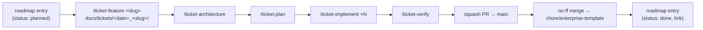

# Roadmap

The tickets that turn this repository into **App Template**: a chat clone (visitor → message →
assistant reply, with attachments) built as a worked example of an Effect v4 modular monolith on
Bun, with Postgres, AWS and Pulumi, so that a new enterprise project starts from it in minutes.

This file is the **only place a future ticket exists** before its `/ticket-feature` runs. SDD knows
no "draft ticket": each entry below holds what a ticket is *for* (goal, scope, out of scope,
dependencies, inherited requirements, open questions); the *how* is decided by `/ticket-architecture`
inside the ticket. When a ticket starts, `/ticket-feature <slug>` reads its entry, grills from
there, and the entry's `Status` becomes a link to the ticket folder.

## How a ticket flows

- **One ticket = one branch `<type>/<slug>` cut from `main` = one squash-merged PR.** Unchanged
  from `.claude/rules/sdd.md`.
- **`chore/enterprise-template` is the teaching branch:** every plan step stays readable as its own
  commit next to the squash that `main` keeps; why and how in
  [sdd.md › Roadmap and the teaching branch](./sdd.md#roadmap-and-the-teaching-branch).
- **Order below is the default, dependencies are the law.** A ticket may start when every entry in
  its `Depends on` is done. Two independent tickets may run in parallel on separate branches.
- **Facts expire.** Every `Facts` line carries the date it was checked; `/ticket-feature`
  re-verifies the ones it relies on and moves them into the ticket's `feature.md › Context`.

## Tickets

| # | Ticket | Type | Depends on | Status |
|---|---|---|---|---|
| 1 | [`template-bootstrap`](#1-template-bootstrap) | `chore` | — | done: [docs/tickets/2026-10-17-1508_template-bootstrap/](../tickets/2026-10-17-1508_template-bootstrap/feature.md) |
| 2 | [`claude-toolkit`](#2-claude-toolkit) | `chore` | 1, 3 | done: [docs/tickets/2026-10-20-2313_claude-toolkit/](../tickets/2026-10-20-2313_claude-toolkit/feature.md) |
| 3 | [`chat-core`](#3-chat-core) | `feat` | 1 | done: [docs/tickets/2026-10-17-1748_chat-core/](../tickets/2026-10-17-1748_chat-core/feature.md) |
| 4 | [`postgres-drizzle`](#4-postgres-drizzle) | `feat` | 3 | planned |
| 5 | [`aws-local`](#5-aws-local) | `feat` | 3 | done: [docs/tickets/2026-10-19-1448_aws-local/](../tickets/2026-10-19-1448_aws-local/feature.md) |
| 6 | [`llm-providers`](#6-llm-providers) | `feat` | 5 | planned |
| 7 | [`web-app`](#7-web-app) | `feat` | 3 (6 for assistant attachments and an SSE tail) | planned |
| 8 | [`observability`](#8-observability) | `feat` | 3 | planned |
| 9 | [`aws-deployment`](#9-aws-deployment) | `feat` | 4, 5 | planned |
| 10 | [`client-publishing`](#10-client-publishing) | `chore` | 3 | planned |
| 11 | [`workflow-cluster`](#11-workflow-cluster) | `feat` | 4, 8 | planned, exploratory |
| 12 | [`template-handoff`](#12-template-handoff) | `chore` | all above | planned |
| 13 | [`ticket-folder-order`](#13-ticket-folder-order) | `chore` | 3 | done: [docs/tickets/2026-10-20-2313_claude-toolkit/](../tickets/2026-10-20-2313_claude-toolkit/feature.md) |
| 14 | [`toolkit-reading`](#14-toolkit-reading) | `chore` | 2 | done: [docs/tickets/2026-10-21-1347_toolkit-reading/](../tickets/2026-10-21-1347_toolkit-reading/feature.md) |

The ticket `2026-10-16-1607_effect-setup` is **superseded at S12**; its remaining work is re-homed
in [Re-homing `effect-setup`](#re-homing-effect-setup).

### 1. `template-bootstrap`

- **Goal.** A public repository `khotei/app-template` with `main`, `chore/monorepo-setup` and
  `chore/enterprise-template`, the scope renamed to `@app-template`, this roadmap and the glossary
  committed, and the SDD rules extended with the roadmap and the branch model. Everything after
  this ticket happens in the new repository.
- **Scope.** Repository creation and settings; branch transfer; rename; `LICENSE`; `README.md`
  and `CLAUDE.md` as a template's; `effect-setup` marked superseded; the first squash PR.
- **Out of scope.** Any behaviour change; finishing `effect-setup`; the rename script and the
  "new project" checklist (12).
- **Status.** Done: [docs/tickets/2026-10-17-1508_template-bootstrap/](../tickets/2026-10-17-1508_template-bootstrap/feature.md).

### 2. `claude-toolkit`

- **Goal.** The Claude Code configuration of a template: `CLAUDE.md` files, `.claude/rules/`,
  `.claude/skills/ticket-*`, `.claude/agents/`, hooks and settings organised so that every later
  ticket is built by agents with the right context at the right time, and so that a new project
  inherits the toolkit unchanged.
- **Scope.** The Effect rule `effect.md` and `docs/knowledge/effect.md` (inherited from
  `effect-setup` R37–R39, written against `chat-core`'s code); naming and layer `CLAUDE.md` updates
  the same requirements ask for; agent frontmatter (`memory`, `effort`, `background`), hooks beyond
  the `Stop` gate (`SessionStart` context, `PostToolUse` format, `PrePermissionRequest` guards),
  the committed `settings.json` versus `settings.local.json` split, plugin pinning, nested
  `<workspace>/.claude/skills/` where a layer deserves one, `claude plugin eval` cases for the
  `ticket-*` skills, `/skill-doctor` as a periodic check; a re-read of `docs/knowledge/sdd.md`.
- **Out of scope.** Changing the SDD gates themselves; product code.
- **Inherits.** `effect-setup` R37, R37a, R37b, R38, R39, R40; three lessons of
  [`template-bootstrap`](../tickets/2026-10-17-1508_template-bootstrap/verification.md#lessons):
  - `ticket-plan` step 3 checks every literal the plan fixes against the rules and the tree.
  - `implementer` greps for a fact before a doc states it, and links the doc that owns it.
  - A `.husky/commit-msg` hook fails on a body line over 72 columns.
- **Open questions for its feature phase.** Which rules are conventions Biome or a hook can enforce
  instead (the Lessons mechanism says: mechanical → a check); whether `argument-hint` is still a
  supported skill field; whether an agent `memory` helps the `implementer` across steps or only
  adds drift; whether ticket skills should `context: fork`.
- **Facts (2026-10-17).** The configuration matches the official October 2026 guidance: sizes,
  `paths:` on rules, `disable-model-invocation`, `disallowedTools`, one `Stop` hook. Unused and
  available: agent `memory`/`effort`/`background`, `SessionStart`/`PostToolUse`/
  `PrePermissionRequest` hooks, nested skills, plugin evals, `/skill-doctor`, output styles,
  Workflow tool, cross-session messaging.
- **Re-read (2026-10-20).** Most of the Scope landed during `chat-core`: the Effect rule split,
  `naming.md`, `use-cases.md`, the layer `CLAUDE.md` rewrites, `/explain`, the rounds rule. The
  ticket is now an audit of the toolkit by evidence (the two verifications, the plan findings, the
  `Decision:` paragraphs): what stays, what becomes a check, what loads lazily. Evals,
  `/skill-doctor`, plugin pinning, `skillOverrides`, agent `memory` and the extra hooks move to
  `template-handoff` (12): nothing recorded would have been prevented by them.
- **Status.** Done: [docs/tickets/2026-10-20-2313_claude-toolkit/](../tickets/2026-10-20-2313_claude-toolkit/feature.md).

### 3. `chat-core`

- **Goal.** The example domain end to end, in memory: a visitor opens the web app and gets a
  secret, creates a chat, sends a message with optional attachments, receives the assistant's reply
  as a stream, and lists and reopens their chats. Everything crosses the layers the architecture
  prescribes: `domain` → `infrastructure` → `application` → `apps/api`, a contract-derived client,
  a worker job. The `example` slice is deleted; `chat` is the new worked example.
- **First Effect rule.** Its first slice ends with a short `.claude/rules/effect.md` drawn from that
  code, so later steps follow it; `claude-toolkit` (2) polishes it.
- **Scope.** `domain/chat` (Visitor, Chat, Message, Attachment, Placeholder as `Schema`, errors,
  ports); in-memory adapters on `KeyValueStore`; `application/chat` services and the job;
  `@app-template/http-api` as an `HttpApi` with the visitor secret as `HttpApiSecurity`, SSE for the
  reply (`HttpApiSchema.StreamSse` over `LanguageModel.streamText` from the stub), multipart upload
  for attachments (`asMultipartStream` with limits, stored in `KeyValueStore` for now), the spec
  served at `/openapi.json`; its `ApiClient` over `HttpApiClient`, the web on Effect; `apps/api` on
  `HttpApiBuilder` and `BunRuntime`; `apps/worker` running one real job (chat title generation
  after the first reply, as ChatGPT does) on the `PersistedQueue` port; tests at the seams with
  `@effect/vitest`, `TestClock`, `TestCrypto`, `BunHttpServer.layerTest` and the typed client.
- **Out of scope.** Postgres (4), S3 and SQS (5), real providers and assistant-produced attachments
  (6), the browser UI (7), tracing (8).
- **Inherits.** `effect-setup` R23–R29a (jobs), R30–R33 (contract and client), R35–R36 (runtime and
  dev modes); its `architecture.md` D2 (both sides of a job in one file), D16, D17, D20, D21.
- **Decided in grilling (2026-10-17).** The visitor is identified by a server-issued secret kept in
  an `HttpOnly` cookie, not by chat ids kept in `localStorage`: one secret per browser gives the
  chat list for free, needs no per-chat owner token, and later merges into an account. Visitor ids
  and chat ids are UUIDv7 from `Crypto`.
- **Open questions for its feature phase.** Whether the reply streams from the api directly
  (simplest, lowest latency) while the worker owns only asynchronous jobs, or whether the reply
  itself is a job relayed over SSE (one path for every provider call, but a queue hop in the
  critical path). Message roles: `visitor | assistant`. Attachment size and type limits. Whether
  `HttpApiSecurity.apiKey` in a cookie or a custom middleware carries the visitor secret.
- **Facts (2026-10-17).** `effect/http-api` covers typed SSE (`HttpApiSchema.StreamSse`, decoded
  by `HttpApiClient`), multipart (`asMultipart`, `asMultipartStream` with `Multipart.withLimits`),
  security, OpenAPI, Swagger and Scalar UIs, and in-memory handler tests (`HttpApiTest`).
  `effect/ai` streams `Response` parts (`text-delta`, `file`, `tool-call`, …) and takes
  `Prompt.FilePart` for images and PDFs. `@effect/sql-pglite@4.0.5` exists for later in-process
  Postgres tests.
- **Status.** Done: [docs/tickets/2026-10-17-1748_chat-core/](../tickets/2026-10-17-1748_chat-core/feature.md),
  merged as `d142143`. Its grilling departed from this entry: the assistant's message is a worker job polled by the
  client (no SSE here), the title job starts from the first user message, and `Visitor` became
  `User`.

### 4. `postgres-drizzle`

- **Goal.** Chats, messages and attachments persisted in Postgres through Drizzle's first-party
  Effect integration, with migrations, a transactional outbox feeding the job queue, and tests that
  run in parallel without touching each other.
- **Scope.** `drizzle-orm@1.0.0-rc.*` with `drizzle-orm/effect-postgres` over `@effect/sql-pg`
  and `drizzle-orm/effect-schema` for `Schema` derivation; `drizzle-kit` migrations; `timestamptz`
  and `$onUpdate` columns, UUIDv7 ids, `as const` value lists shared by `Schema.Literals` and
  `pgEnum`; repositories replacing the in-memory adapters; the outbox table and relay into
  `PersistedQueue.layerStoreSql` (or proof that `offer` inside `withTransaction` is the outbox),
  which also closes `chat-core`'s enqueue-after-insert risks (a `queued` message with no job, the
  chat busy for good; or no title job, the chat untitled for good) by committing the jobs with the
  messages; and the two guards that let a second api process drop the in-process `UserLock`:
  a partial unique index allowing one active message per chat, and the bind as `UPDATE … WHERE
  message_id IS NULL`;
  `FOR UPDATE SKIP LOCKED` where the queue store does not already provide it; the test strategy
  (per-suite `@effect/sql-pglite` versus Testcontainers with a schema or database per test, with
  a replacement `ConfigProvider` built from the running instance); `docker-compose` Postgres for
  dev; `make` targets for migrate and reset.
- **Out of scope.** AWS resources (5), Aurora versus RDS (9). If `aws-local` (5) lands first, the
  outbox relay publishes to the queue port's SQS layer instead.
- **Leaning (2026-10-18).** Keys stay UUIDv7 generated by the application, so an id exists
  before the write; columns are `id uuid PRIMARY KEY DEFAULT uuidv7()` (Postgres 18), the default
  only a fallback for hand-written SQL and data scripts. A `bigint` identity was set aside: it
  needs a round trip, invites id guessing and reveals volumes.
- **Open questions for its feature phase.** Which `drizzle-orm` rc is pinned and whether it
  compiles against `effect@4.0.5` (the donor pinned `rc.3` against `beta.78`); pglite versus
  Testcontainers as the default test database, and whether both are kept (fast local, real CI);
  how the job queue's SQL store and the domain tables share one `SqlClient` and one transaction.
- **Facts (2026-10-17).** `drizzle-orm@1.0.0-rc.3` exports `./effect-postgres`,
  `./effect-schema`, `./effect-postgres/migrator`, `./pg-core/effect/*`, with peers
  `effect >=4.0.0` and `@effect/sql-pg >=4.0.0` (checked on the npm registry; `latest` is still
  `0.45.4`, so `bun info` without a tag misses it). `@effect/sql-pg@4.0.5` is a dependency-free
  wire-protocol driver that runs on Bun. `effect/sql` has `SqlClient.withTransaction`, `Migrator`,
  `SqlModel`, `SqlResolver`, but no isolation helper for tests and no `SKIP LOCKED` helper;
  `PersistedQueue.layerStoreSql` implements polling with `SKIP LOCKED`, lock refresh and lock
  expiration. The donor isolates tests by one container per file plus `TRUNCATE` at the top of
  each test, which forbids parallel tests inside a file.
- **Inherits from `aws-local` (2026-10-22).** A sweep of unbound attachment records past
  `unboundLifetime` (the key-value store cannot list them; they read as not found until then); a
  consumer or sweep for replies left active in the dead-letter queue (a killed worker, a failed
  `failed` write, a stopped worker's long poll); a `WHERE stage IN (…)` guard on the reply's
  terminal write.

### 5. `aws-local`

- **Goal.** Attachments in S3 and jobs on SQS, with MiniStack as the local AWS and one resource
  inventory shared by local provisioning, tests and the later Pulumi program.
- **Scope.** A storage port with an S3 adapter (multipart upload streamed from the api, presigned
  download URLs); the queue port's SQS layer replacing the SQLite layer in the composition roots;
  the choice of queue type (standard, with idempotent handlers) and client (`@effect-aws/client-*`
  on Effect v4 versus the AWS SDK behind a thin port); MiniStack in `docker-compose` next to
  Postgres; a plain-data AWS resource inventory and a provisioner; tests against MiniStack through
  Testcontainers with a replacement `ConfigProvider`; `.env.example` for endpoints and credentials.
- **Out of scope.** Lambda packaging and Pulumi (9); emulated Lambdas (9); the outbox, so the api
  sends a job right after its write as it does today, and the enqueue-after-insert risk stays with
  `postgres-drizzle` (4).
- **Decided (2026-10-19).** AWS work is two tickets, this one and `aws-deployment` (9), sharing one
  resource inventory. This ticket depends on `chat-core` (3) only: S3 and SQS need no Postgres.
  MiniStack emulates the services only; the api and worker keep running on `bun --hot` and
  `--watch` against it.
- **Queue-port caveat.** The port promises one delivery per `jobId` (SQLite and Postgres: a
  unique `(id, queue_name)`). A standard SQS queue has no dedupe and FIFO dedupes only within
  5 minutes, and `isLastAttempt` must come from `ApproximateReceiveCount` against the redrive
  policy's `maxReceiveCount`. Handlers stay idempotent either way.
- **Rechecked (2026-10-19).** MiniStack verifies SigV4 presigned GET and PUT and runs SQS event
  source mappings (source and tests, not yet run live); it dedupes FIFO messages in a 300 s
  window; Node.js and `provided.*` Lambdas run as local processes, Docker only for images.
  `@effect-aws/client-s3` and `client-sqs` 2.0.0 peer `effect >=4.0.0-beta.66 <5.0.0`, install
  under Bun 1.4.3, type-check under `tsc` 7 and presign on Bun (scratch run, no live endpoint).
- **Status.** Done: [docs/tickets/2026-10-19-1448_aws-local/](../tickets/2026-10-19-1448_aws-local/feature.md),
  merged as `30fa816`. The settling attempt of the reply job and the startup `verify` went; an
  expired attachment reads as not found, and no read deletes it.
- **Facts (2026-10-17).** LocalStack's OSS repository was archived on 2026-03-23 and its image
  requires an account; free only for non-commercial use. MiniStack: MIT, Python, images ~110–360 MB,
  4.9k stars, releases every 1–3 days, SQS (DLQ redrive, FIFO attributes stored), S3 (multipart,
  versioning, events to SQS/SNS/Lambda), Lambda (Python locally, other runtimes in Docker, no hot
  reload), API Gateway, CloudWatch Logs, SSM, Secrets, RDS as a real Postgres container; Pulumi
  and Terraform through endpoint overrides. Effect has no SQS or S3 module; `@effect-aws/client-sqs`
  and `@effect-aws/client-s3` 2.0.0 (2026-10-02) peer `effect >=4.0.0-beta.66`. AWS recommends a
  standard queue with idempotent workers for "many workers, task type picks the handler".

### 6. `llm-providers`

- **Goal.** Real assistants: Anthropic and OpenAI behind `LanguageModel`, chosen by configuration,
  with visitor attachments passed to the model and assistant attachments rendered through
  placeholders.
- **Scope.** `@effect/ai-anthropic` and `@effect/ai-openai` layers; provider and model from
  `Config`; `Prompt.FilePart` for images and PDFs from S3; assistant attachments (how they are
  produced is this ticket's first decision: a tool the model calls, a worker job, or both) and
  the placeholder syntax; retries and budgets as decorator layers with `Schedule`; retries that
  read `AiError.isRetryable` and `retryAfter`, so a provider error no retry can fix (auth, an
  invalid request, content policy) stops spending attempts and a rate limit is honoured, which
  changes the chat's retry requirement and so goes through this ticket's `feature.md`; the
  history trimmed to the model's context window with `Tokenizer.truncate` or an equivalent,
  since today every completed message is sent and a long chat grows without bound; prompt
  provenance (hash of templates stored with the message); tests on a fake `LanguageModel` and
  one recorded provider round trip.
- **Out of scope.** Google and Bedrock (v3-only providers); agents and tool-use beyond what
  attachments need.
- **Open questions for its feature phase.** Placeholder syntax; which model produces files in the
  template demo; token and cost accounting per chat; whether the reply streams through the worker
  (see 3).
- **Re-read against `chat-core` (2026-10-20).** The reply already runs in a worker job
  (`AssistantMessageJob`), which writes the growing text into the message as throttled snapshots
  that the client polls; the question above narrows to whether an SSE tail over the stored message
  is added. Assistant attachments are therefore produced inside that job: the first decision is
  whether the model's tool call or a second job writes them, not whether a job exists. Provider
  layers replace `LanguageModelStub`, which `apps/worker/src/layer.ts` provides today.
- **Facts (2026-10-17).** `@effect/ai-anthropic@4.0.5` and `@effect/ai-openai@4.0.5` exist;
  `@effect/ai-google` and `@effect/ai-amazon-bedrock` are Effect v3 only. The Anthropic Files API
  is GA; `document` blocks take PDFs up to 32 MB, images by base64, URL or file id.

### 7. `web-app`

- **Goal.** The chat UI a visitor uses: TanStack Start on React 19, `@effect/atom-react` for
  state over the typed client, Chakra UI v3 for components, streaming replies, attachment upload
  and inline placeholders, a chat list, all server-rendered and hydrated.
- **Scope.** `apps/web` rebuilt on TanStack Start (Vite 8, Nitro `bun` preset in dev); TanStack
  Router, Query and DB where they fit (intent recorded; see the open question); `effect/reactivity`
  atoms with `AtomHttpApi` over `@app-template/http-api` and `HydrationBoundary` for SSR; Chakra
  UI v3 theme in `packages/ui`; a nested `biome.json` (`"root": false, "extends": "//"`) with the
  `react` domain; the visitor cookie flowing through the Start server; the web `Dockerfile` or
  Nitro output for 9.
- **Out of scope.** Authentication; mobile; i18n.
- **Open questions for its feature phase.** TanStack Query and TanStack DB overlap with
  `AtomHttpApi` and atoms: which owns server state, which owns client state, or whether atoms alone
  suffice and Query/DB stay out; whether web client code may now import `effect` (today it is
  banned by Biome and must change for atoms); SSR of streams.
- **Re-read against `chat-core` (2026-10-20).** "Streaming replies" means, today, polling the
  assistant message until its stage is terminal, since the api streams nothing and the worker
  writes snapshots; an SSE tail is `llm-providers`' (6) open question, so this ticket depends on
  3 alone for the reply and the upload, and on 6 only for assistant attachments and placeholders.
  The visitor cookie is the user cookie of `chat-core`'s `CurrentUser` security.
- **Facts (2026-10-17).** `@tanstack/react-start@1.169.3` (router 1.170, Vite ≥ 8, React 19 for
  the Bun preset, `aws_lambda` preset with streaming); `@chakra-ui/react@3.37.0`; Effect v4 atoms
  are `effect/reactivity/*` in core plus `@effect/atom-react@4.0.5` (React ≥ 19 only) with
  `ReactHydration.HydrationBoundary`; `@effect-atom/*` is the v3 line; no official TanStack bridge
  exists; nothing is called "Effect UI".

### 8. `observability`

- **Goal.** Every request, job and model call traced, logged and measured, visible locally in one
  UI and exportable to any OTLP backend, with Effect DevTools for debugging.
- **Scope.** `effect/observability` (`Otlp.layer` for traces, logs and metrics without the OTel
  SDK) in the three processes; spans across api → queue → worker → model; `effect/ai`
  `Telemetry`; `effect/devtools` client layer in dev; a local collector and UI in
  `docker-compose`; structured logging conventions; health and readiness endpoints; a
  `docs/knowledge/observability.md`.
- **Out of scope.** Dashboards and alerting in AWS (9).
- **Open questions for its feature phase.** `Otlp.layer` versus `@effect/opentelemetry` with the
  OTel SDK (needed only if a vendor SDK is required); which local UI (Jaeger, Grafana LGTM,
  SigNoz).

### 9. `aws-deployment`

- **Goal.** One Pulumi program deploys the api, the worker, Postgres, S3 and SQS to AWS, from the
  resource inventory `aws-local` (5) introduced, and the same program provisions MiniStack for the "true emulator" local mode, so a new
  project is live in one command.
- **Scope.** `deployment/` on Pulumi `runtime: bun`; Lambda packaging for api and worker (Lambda
  Web Adapter container is the official Bun path; the `bun-lambda` layer is the alternative), the
  web on its Nitro `aws_lambda` output or static hosting; Aurora Serverless v2 with auto-pause
  versus RDS; SQS event source mapping for the worker; secrets in SSM; the local mode where
  MiniStack runs the Lambdas in Docker from the same artefacts; CI deploying a preview stack;
  `docs/knowledge/deployment.md`.
- **Out of scope.** Multi-account or multi-region; a custom domain and CDN beyond the minimum; the
  web and the observability backend while `web-app` (7) and `observability` (8) have not landed:
  each adds its own resources to this program, and one that lands first is deployed here.
- **Decided (2026-10-19).** Split from `aws-local` (5); depends on `postgres-drizzle` (4), since
  the deployed processes need a shared database, and on 5, not on 7 or 8.
- **Decided (2026-10-21).** The applications never check or create their resources: the
  infrastructure provides them (`aws-local` D5 dropped the startup `verify`). This program also
  creates the inventory's buckets and queues on MiniStack for `make up`, replacing
  `deployment/local/provision.ts`; `provision` in `packages/aws` then serves the tests only (each
  test file creates its own resources in milliseconds, without the Pulumi CLI).
- **Open questions for its feature phase.** Whether `@pulumi/aws` creates the bucket and the
  queues on MiniStack (a bucket reads back its ACL, CORS and versioning, which an emulator may not
  serve): a spike first. Whether the local Pulumi project of `aws-local` (5)
  (the Docker provider runs MiniStack; there is no compose file) and the AWS program become one
  project with two stacks; cold starts of `@effect/platform-bun` on Lambda; whether
  `pulumi.dynamic.Resource`, unsupported under `runtime: bun`, is ever needed.
- **Facts (2026-10-17).** Pulumi ≥ 3.227 runs TypeScript under `runtime: bun` (no function
  serialisation, no dynamic providers); CLI 3.270, `@pulumi/aws` 7.51. Bun on Lambda: the official
  guide uses Lambda Web Adapter in a container (also gives response streaming for SSE);
  `provided.al2` is deprecated since 2026-07-31. MiniStack has no Lambda hot reload and runs
  non-Python runtimes in Docker, so the emulator mode verifies deployment artefacts; live
  development stays on `bun --watch` against MiniStack's queues and buckets.
- **Rechecked (2026-10-19).** Pulumi CLI 3.270.0, `@pulumi/aws` 7.51.1. Bun runs the program only
  under `runtime: bun`; `deployment/Pulumi.yaml` still says `nodejs` with `packagemanager: bun`,
  which runs it on Node, so its feature phase picks one. Bun's Lambda guide (Lambda Web Adapter
  1.0.1 in a container; 1.1.0 is current) says nothing about response streaming. `provided.al2023`
  replaces `provided.al2` (deprecated 2026-07-31). Aurora Serverless v2 pauses at 0 ACU and resumes
  in about 15 s; Postgres 18 is on RDS and on Aurora (Serverless v2 from 18.3). App Runner has been
  closed to new customers since 2026-04-30; AWS points to ECS Express Mode. Lambda Web Functions
  (2026-10-12) serve HTTP without an adapter, but only on `nodejs24.x`, so not under Bun. SQS event
  source mappings with `ReportBatchItemFailures` remain the recommended worker pattern.
- **Inherits from `aws-local` (2026-10-22).** Check on AWS what MiniStack cannot show: the
  `unbound` tag sent with `CreateMultipartUpload` and the lifecycle deletion it drives. Share one
  AWS client builder between `infrastructure/shared/aws.client.ts` and
  `deployment/local/provision.ts`, and brand `Stage`.

### 10. `client-publishing`

- **Goal.** `@app-template/http-api` and its `ApiClient` consumable from any TypeScript
  project without the server code, with every type intact.
- **Scope.** Build and `exports` of `http-api` (types from the `HttpApi` definition; the
  `domain` it imports ships with it); versioning; publishing to GitHub Packages or npm from CI on a tag; a consumer
  smoke test in a scratch project.
- **Out of scope.** A client for other languages; an SDK generator from the served `/openapi.json`.
- **Open questions for its feature phase.** Registry; whether the spec is published too;
  how the client's `effect` dependency is declared for consumers that do not use Effect.

### 11. `workflow-cluster`

- **Goal.** Decide, with a running example, whether `effect/workflow` and `effect/cluster` belong
  in the template: a durable multi-step flow (for instance: upload → extract text → summarise →
  notify) that survives restarts, compared with the plain job queue.
- **Scope.** A spike on `ClusterWorkflowEngine` with `SqlMessageStorage` and `SingleRunner`; the
  comparison written to `docs/knowledge/`; adoption or removal, recorded as a decision.
- **Out of scope.** Multi-node sharding in AWS.
- **Facts (2026-10-17).** Both modules are in `effect@4.0.5` (`@stability unstable`); the cluster
  runtime has HTTP and socket runners, SQL message storage and Kubernetes discovery, but no SQS
  transport.

### 12. `template-handoff`

- **Goal.** "Use this template" to a running, renamed project in ten minutes.
- **Scope.** `make rename SCOPE=@acme NAME="Acme"`; a checklist of what to delete (`docs/tickets/`
  of the template, the example domain if unwanted) and what to keep (`docs/knowledge/`, rules,
  skills); a fresh-clone rehearsal in CI; the README's "Starting a new project" rewritten; the
  GitHub template flag verified with all branches; the toolkit items that matter only when the
  template changes hands, inherited from `claude-toolkit` (2): `claude plugin eval` cases for the
  `ticket-*` skills (they must be wrapped as a plugin to load), `/skill-doctor` as a periodic
  check, pinning `mattpocock-skills` by `sha`, `skillOverrides` for the plugin skills the wrappers
  never use, agent `memory`, `SessionStart` and `PostToolUse` hooks.
- **Out of scope.** A generator or CLI.

### 13. `ticket-folder-order`

- **Status.** Done: taken into `claude-toolkit` (2) as R6,
  [docs/tickets/2026-10-20-2313_claude-toolkit/](../tickets/2026-10-20-2313_claude-toolkit/feature.md).

### 14. `toolkit-reading`

- **Goal.** The second wave of the `claude-toolkit` audit: agents read only what a step needs, and
  the lessons of `chat-core` become checks.
- **Scope.**
  - Agents read their step, not the whole ticket. In `chat-core` the implementer and both
    reviewers each read about 60k tokens of `feature.md`, `architecture.md` and `plan.md` per
    step, where the step and the `R…` and `D…` it cites hold 1–2k: a reading rule in
    `implementer` and `reviewer`, or one file per step.
  - The import direction has five authors (`biome.json`, root `CLAUDE.md`, `naming.md`, seven
    workspace `CLAUDE.md`, `docs/knowledge/architecture.md`): keep one for agents, or leave the
    cheap on-directory lines.
  - `ticket-plan`: a step names a file or an API only after `researcher` confirmed it, and every
    literal the plan fixes is checked against the rules (49 *Amended in* notes in `chat-core`).
  - `implementer`: a rule line added or sharpened comes with a `git grep` for what it forbids.
  - `make lint-docs` on lines over 100 characters in the living docs; whether `docs/tickets/` is
    in.
  - Biome guards for `node:`/`bun:` imports and `Bun`/`process` globals in the browser-facing
    layers, and `Date`/`crypto`/`fetch` in `domain`: no recorded agent mistake, but a hand grep in
    every verification.
- **Out of scope.** A cut made for tokens alone that saves under 20% of the load it targets.
- **Facts (2026-10-21).** Rewording four rules without losing a constraint saved 11%; the
  always-loaded project files measured 4.5k tokens by `/context` before `claude-toolkit`.
- **Status.** Done: [docs/tickets/2026-10-21-1347_toolkit-reading/](../tickets/2026-10-21-1347_toolkit-reading/feature.md).

## Re-homing `effect-setup`

`2026-10-16-1607_effect-setup` reached S12 on `chore/effect-setup`, which `template-bootstrap`
pushes as `chore/enterprise-template`. Its steps S13–S23 are not implemented as written; their
requirements move to the tickets that will build them on the real domain:

| `effect-setup` | Was | Goes to |
|---|---|---|
| R1–R3, S23 | branch, PR, step size | superseded by this roadmap's branch model; the step size rule stays in `sdd.md` |
| R23–R29a, S13, S18 | `ExampleSummaryJob`, worker | 3 `chat-core`, as the chat title job |
| R30–R33, S14–S17 | `ExampleService.create`, contract, client, api | 3 `chat-core`, on `Chat` and `Message` |
| R34, S19 | web server entry | 7 `web-app` |
| R35–R36 | logging, signals, `--watch` | 3 `chat-core` |
| R37–R39, S20–S22 | `effect.md`, naming, layer `CLAUDE.md`, knowledge docs, README | 2 `claude-toolkit` |
| R40 | English only | every ticket |

## Facts

Cross-ticket facts checked on 2026-10-17; re-verify before relying on one.

- **Donor `khotei/kotodama-core`** (main @ `018b275f`, 2026-07-27): borrow the per-file
  Testcontainers service with `acquireRelease`, the replacement `ConfigProvider.fromDotEnvContents`
  built from the running container so production layers run verbatim in tests, the plain-data AWS
  resource inventory with a drift guard, single-tag decorator layers for timeout and retry wired only
  at the root, the worker's core/edge split (`processBatch` never acks; the Lambda edge returns
  `batchItemFailures`), `Context.Reference` for tunables, `BunHttpServer.layerTest` with the typed
  client in api tests. Avoid its two S3 clients, caret ranges in catalogs, missing root `tsc -b`,
  hand-rolled queue port, write-then-enqueue without an outbox, `TRUNCATE`-per-test isolation.
- **Effect 4.0.5** ships almost everything as sub-paths of `effect` (`sql`, `persistence`, `ai`,
  `http-api`, `observability`, `devtools`, `rpc`, `cluster`, `workflow`, `reactivity`, `testing`);
  `@effect/*` 4.0.5 adapters: `platform-bun`, `sql-pg`, `sql-pglite`, `ai-anthropic`, `ai-openai`,
  `atom-react`, `opentelemetry`, `vitest`. Stable: `Config`, `ConfigProvider`, `Metric`, `Tracer`,
  `TestClock`; the rest `@stability unstable`. Nothing in Effect covers SQS, S3, Lambda or Drizzle.
- **Hand-written risk list**, the places where "derive from Effect" cannot hold and the design must
  stay thin: outbox relay, SQS and S3 adapters, multipart-to-S3 sink, Lambda event adapter,
  per-test database isolation. Covered by Effect with only glue: SSE chat stream, multipart
  parsing, typed client, OTLP export, config from `.env` and the environment.
