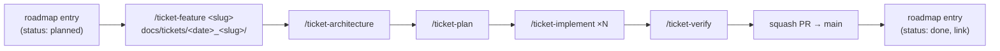

# Roadmap

The tickets that turn this repository into **App Template**: a chat clone (user → message →
assistant reply, with attachments) built as a worked example of an Effect v4 modular monolith on
Bun, with Postgres, AWS and Pulumi, so that a new enterprise project starts from it in minutes.

This file is the **only place a future ticket exists** before its `/ticket-feature` runs. SDD knows
no "draft ticket": each entry below holds what a ticket is *for* (goal, scope, out of scope,
dependencies, inherited requirements, open questions); the *how* is decided by
`/ticket-architecture` inside the ticket. When a ticket starts, `/ticket-feature <slug>` reads its
entry, grills from there, and the entry's `Status` becomes a link to the ticket folder.

## How a ticket flows

- **One ticket = one branch `<type>/<slug>` cut from `main` = one squash-merged PR.** Unchanged
  from `.claude/rules/sdd.md`.
- **`main` is the only long-lived branch:** the steps of a merged ticket stay in its PR's commit
  list and its `plan.md`; see [sdd.md › Roadmap and history](./sdd.md#roadmap-and-history).
- **Order below is the default, dependencies are the law.** A ticket may start when every entry in
  its `Depends on` is done. Two independent tickets may run in parallel on separate branches.
- **Facts expire.** Every `Facts` line carries the date it was checked; `/ticket-feature`
  re-verifies the ones it relies on and moves them into the ticket's `feature.md › Context`.

## Tickets

| # | Ticket | Type | Depends on | Status |
|---|---|---|---|---|
| 1 | [`template-bootstrap`](#1-template-bootstrap) | `chore` | — | done: [docs/tickets/2026-10-17-1508_template-bootstrap/](../tickets/2026-10-17-1508_template-bootstrap/feature.md) |
| 2 | [`claude-toolkit`](#2-claude-toolkit) | `chore` | 1, 3 | done: [docs/tickets/2026-10-20-2313_claude-toolkit/](../tickets/2026-10-20-2313_claude-toolkit/feature.md) |
| 3 | [`chat-core`](#3-chat-core) | `feat` | 1 | done: [docs/tickets/2026-10-17-1748_chat-core/](../tickets/2026-10-17-1748_chat-core/feature.md) |
| 4 | [`postgres-drizzle`](#4-postgres-drizzle) | `feat` | 3 | in progress: [docs/tickets/2026-10-22-1915_postgres-drizzle/](../tickets/2026-10-22-1915_postgres-drizzle/feature.md) |
| 5 | [`aws-local`](#5-aws-local) | `feat` | 3 | done: [docs/tickets/2026-10-19-1448_aws-local/](../tickets/2026-10-19-1448_aws-local/feature.md) |
| 6 | [`llm-providers`](#6-llm-providers) | `feat` | 5 | done: [docs/tickets/2026-10-29-1435_llm-providers/](../tickets/2026-10-29-1435_llm-providers/feature.md) |
| 7 | [`web-app`](#7-web-app) | `feat` | 3 (18 for assistant attachments) | planned |
| 8 | [`observability`](#8-observability) | `feat` | 3 | planned |
| 9 | [`aws-deployment`](#9-aws-deployment) | `feat` | 4, 5 | planned |
| 10 | [`client-publishing`](#10-client-publishing) | `chore` | 3 | planned |
| 11 | [`workflow-cluster`](#11-workflow-cluster) | `feat` | 4, 8 | planned, exploratory |
| 12 | [`template-handoff`](#12-template-handoff) | `chore` | all above | planned |
| 13 | [`ticket-folder-order`](#13-ticket-folder-order) | `chore` | 3 | done: [docs/tickets/2026-10-20-2313_claude-toolkit/](../tickets/2026-10-20-2313_claude-toolkit/feature.md) |
| 14 | [`toolkit-reading`](#14-toolkit-reading) | `chore` | 2 | done: [docs/tickets/2026-10-21-1347_toolkit-reading/](../tickets/2026-10-21-1347_toolkit-reading/feature.md) |
| 15 | [`architecture-audit`](#15-architecture-audit) | `refactor` | 4 | in progress: [docs/tickets/2026-10-27-1433_architecture-audit/](../tickets/2026-10-27-1433_architecture-audit/feature.md) |
| 16 | [`shared-files`](#16-shared-files) | `feat` | 15, 23 | planned |
| 17 | [`docs-diet`](#17-docs-diet) | `docs` | 15 | done, as `lean-instructions`: [docs/tickets/2026-11-02-1820_lean-instructions/](../tickets/2026-11-02-1820_lean-instructions/feature.md) |
| 18 | [`assistant-files`](#18-assistant-files) | `feat` | 6, 23 | planned |
| 19 | [`openai-provider`](#19-openai-provider) | `feat` | 6 | planned |
| 20 | [`context-window`](#20-context-window) | `feat` | 6 | planned |
| 21 | [`bedrock-provider`](#21-bedrock-provider) | `feat` | 6, 9 | planned |
| 22 | [`jobs`](#22-jobs) | `feat` | 4, 23 | planned |
| 23 | [`modular-monolith`](#23-modular-monolith) | `refactor` | 15 | done: [docs/tickets/2026-10-31-0926_modular-monolith/](../tickets/2026-10-31-0926_modular-monolith/feature.md) |
| 24 | [`attachment-storage-failures`](#24-attachment-storage-failures) | `fix` | 23 | planned |
| 25 | [`toolkit-quality`](#25-toolkit-quality) | `chore` | 17 | planned |

The ticket `2026-10-16-1607_effect-setup` is **superseded at S12**; its remaining work is re-homed
in [Re-homing `effect-setup`](#re-homing-effect-setup).

### 1. `template-bootstrap`

- **Goal.** A public repository `khotei/app-template` with `main`, `chore/monorepo-setup` and
  `chore/enterprise-template`, the scope renamed to `@app-template`, this roadmap and the glossary
  committed, and the SDD rules extended with the roadmap and the branch model. Everything after
  this ticket happens in the new repository.
- **Scope.** Repository creation and settings; branch transfer; rename; `LICENSE`; `README.md`
  and `CLAUDE.md` as a template's; `effect-setup` marked superseded; the first squash PR.
- **Out of scope.** Any behaviour change; finishing `effect-setup`; the rename script and the
  "new project" checklist (12).
- **Status.** Done:
  [docs/tickets/2026-10-17-1508_template-bootstrap/](../tickets/2026-10-17-1508_template-bootstrap/feature.md).

### 2. `claude-toolkit`

- **Goal.** The Claude Code configuration of a template: `CLAUDE.md` files, `.claude/rules/`,
  `.claude/skills/ticket-*`, `.claude/agents/`, hooks and settings organised so that every later
  ticket is built by agents with the right context at the right time, and so that a new project
  inherits the toolkit unchanged.
- **Scope.** The Effect rule `effect.md` and `docs/knowledge/effect.md` (inherited from
  `effect-setup` R37–R39, written against `chat-core`'s code); naming and layer `CLAUDE.md` updates
  the same requirements ask for; agent frontmatter (`memory`, `effort`, `background`), hooks beyond
  the `Stop` gate (`SessionStart` context, `PostToolUse` format, `PrePermissionRequest` guards),
  the committed `settings.json` versus `settings.local.json` split, plugin pinning, nested
  `<workspace>/.claude/skills/` where a layer deserves one, `claude plugin eval` cases for the
  `ticket-*` skills, `/skill-doctor` as a periodic check; a re-read of `docs/knowledge/sdd.md`.
- **Out of scope.** Changing the SDD gates themselves; product code.
- **Inherits.** `effect-setup` R37, R37a, R37b, R38, R39, R40; three lessons of
  [`template-bootstrap`](../tickets/2026-10-17-1508_template-bootstrap/verification.md#lessons):
  - `ticket-plan` step 3 checks every literal the plan fixes against the rules and the tree.
  - `implementer` greps for a fact before a doc states it, and links the doc that owns it.
  - A `.husky/commit-msg` hook fails on a body line over 72 columns.
- **Open questions for its feature phase.** Which rules are conventions Biome or a hook can enforce
  instead (the Lessons mechanism says: mechanical → a check); whether `argument-hint` is still a
  supported skill field; whether an agent `memory` helps the `implementer` across steps or only
  adds drift; whether ticket skills should `context: fork`.
- **Facts (2026-10-17).** The configuration matches the official October 2026 guidance: sizes,
  `paths:` on rules, `disable-model-invocation`, `disallowedTools`, one `Stop` hook. Unused and
  available: agent `memory`/`effort`/`background`, `SessionStart`/`PostToolUse`/
  `PrePermissionRequest` hooks, nested skills, plugin evals, `/skill-doctor`, output styles,
  Workflow tool, cross-session messaging.
- **Re-read (2026-10-20).** Most of the Scope landed during `chat-core`: the Effect rule split,
  `naming.md`, `use-cases.md`, the layer `CLAUDE.md` rewrites, `/explain`, the rounds rule. The
  ticket is now an audit of the toolkit by evidence (the two verifications, the plan findings, the
  `Decision:` paragraphs): what stays, what becomes a check, what loads lazily. Evals,
  `/skill-doctor`, plugin pinning, `skillOverrides`, agent `memory` and the extra hooks move to
  `template-handoff` (12): nothing recorded would have been prevented by them.
- **Status.** Done:
  [docs/tickets/2026-10-20-2313_claude-toolkit/](../tickets/2026-10-20-2313_claude-toolkit/feature.md).

### 3. `chat-core`

- **Goal.** The example domain end to end, in memory: a visitor opens the web app and gets a
  secret, creates a chat, sends a message with optional attachments, receives the assistant's reply
  as a stream, and lists and reopens their chats. Everything crosses the layers the architecture
  prescribes: `domain` → `infrastructure` → `application` → `apps/api`, a contract-derived client,
  a worker job. The `example` slice is deleted; `chat` is the new worked example.
- **First Effect rule.** Its first slice ends with a short `.claude/rules/effect.md` drawn from that
  code, so later steps follow it; `claude-toolkit` (2) polishes it.
- **Scope.** the chat domain (Visitor, Chat, Message, Attachment, Placeholder as `Schema`, errors,
  ports); in-memory adapters on `KeyValueStore`; `application/chat` services and the job;
  `@app-template/http-api` as an `HttpApi` with the visitor secret as `HttpApiSecurity`, SSE for the
  reply (`HttpApiSchema.StreamSse` over `LanguageModel.streamText` from the stub), multipart upload
  for attachments (`asMultipartStream` with limits, stored in `KeyValueStore` for now), the spec
  served at `/openapi.json`; its `ApiClient` over `HttpApiClient`, the web on Effect; `apps/api` on
  `HttpApiBuilder` and `BunRuntime`; `apps/worker` running one real job (chat title generation
  after the first reply, as ChatGPT does) on the `PersistedQueue` port; tests at the seams with
  `@effect/vitest`, `TestClock`, `TestCrypto`, `BunHttpServer.layerTest` and the typed client.
- **Out of scope.** Postgres (4), S3 and SQS (5), real providers and assistant-produced attachments
  (6), the browser UI (7), tracing (8).
- **Inherits.** `effect-setup` R23–R29a (jobs), R30–R33 (contract and client), R35–R36 (runtime and
  dev modes); its `architecture.md` D2 (both sides of a job in one file), D16, D17, D20, D21.
- **Decided in grilling (2026-10-17).** The visitor is identified by a server-issued secret kept in
  an `HttpOnly` cookie, not by chat ids kept in `localStorage`: one secret per browser gives the
  chat list for free, needs no per-chat owner token, and later merges into an account. Visitor ids
  and chat ids are UUIDv7 from `Crypto`.
- **Open questions for its feature phase.** Whether the reply streams from the api directly
  (simplest, lowest latency) while the worker owns only asynchronous jobs, or whether the reply
  itself is a job relayed over SSE (one path for every provider call, but a queue hop in the
  critical path). Message roles: `visitor | assistant`. Attachment size and type limits. Whether
  `HttpApiSecurity.apiKey` in a cookie or a custom middleware carries the visitor secret.
- **Facts (2026-10-17).** `effect/http-api` covers typed SSE (`HttpApiSchema.StreamSse`, decoded
  by `HttpApiClient`), multipart (`asMultipart`, `asMultipartStream` with `Multipart.withLimits`),
  security, OpenAPI, Swagger and Scalar UIs, and in-memory handler tests (`HttpApiTest`).
  `effect/ai` streams `Response` parts (`text-delta`, `file`, `tool-call`, …) and takes
  `Prompt.FilePart` for images and PDFs. `@effect/sql-pglite@4.0.5` exists for later in-process
  Postgres tests.
- **Status.** Done:
  [docs/tickets/2026-10-17-1748_chat-core/](../tickets/2026-10-17-1748_chat-core/feature.md), merged
  as `d142143`. Its grilling departed from this entry: the assistant's message is a worker job
  polled by the client (no SSE here), the title job starts from the first user message, and
  `Visitor` became `User`.

### 4. `postgres-drizzle`

- **Goal.** Chats, messages and attachments persisted in Postgres through Drizzle's first-party
  Effect integration, with migrations, a transactional outbox feeding the job queue, and tests that
  run in parallel without touching each other.
- **Scope.** `drizzle-orm@1.0.0-rc.*` with `drizzle-orm/effect-postgres` over `@effect/sql-pg`
  and `drizzle-orm/effect-schema` for `Schema` derivation; `drizzle-kit` migrations; `timestamptz`
  and `$onUpdate` columns, UUIDv7 ids, `as const` value lists shared by `Schema.Literals` and
  `pgEnum`; repositories replacing the in-memory adapters; the outbox table and relay into
  `PersistedQueue.layerStoreSql` (or proof that `offer` inside `withTransaction` is the outbox),
  which also closes `chat-core`'s enqueue-after-insert risks (a `queued` message with no job, the
  chat busy for good; or no title job, the chat untitled for good) by committing the jobs with the
  messages; and the two guards that let a second api process drop the in-process `UserLock`:
  a partial unique index allowing one active message per chat, and the bind as `UPDATE … WHERE
  message_id IS NULL`;
  `FOR UPDATE SKIP LOCKED` where the queue store does not already provide it; the test strategy
  (per-suite `@effect/sql-pglite` versus Testcontainers with a schema or database per test, with
  a replacement `ConfigProvider` built from the running instance); `docker-compose` Postgres for
  dev; `make` targets for migrate and reset.
- **Out of scope.** AWS resources (5), Aurora versus RDS (9). If `aws-local` (5) lands first, the
  outbox relay publishes to the queue port's SQS layer instead.
- **Leaning (2026-10-18).** Keys stay UUIDv7 generated by the application, so an id exists
  before the write; columns are `id uuid PRIMARY KEY DEFAULT uuidv7()` (Postgres 18), the default
  only a fallback for hand-written SQL and data scripts. A `bigint` identity was set aside: it
  needs a round trip, invites id guessing and reveals volumes.
- **Open questions for its feature phase.** Which `drizzle-orm` rc is pinned and whether it
  compiles against `effect@4.0.5` (the donor pinned `rc.3` against `beta.78`); pglite versus
  Testcontainers as the default test database, and whether both are kept (fast local, real CI);
  how the job queue's SQL store and the domain tables share one `SqlClient` and one transaction.
- **Facts (2026-10-17).** `drizzle-orm@1.0.0-rc.3` exports `./effect-postgres`,
  `./effect-schema`, `./effect-postgres/migrator`, `./pg-core/effect/*`, with peers
  `effect >=4.0.0` and `@effect/sql-pg >=4.0.0` (checked on the npm registry; `latest` is still
  `0.45.4`, so `bun info` without a tag misses it). `@effect/sql-pg@4.0.5` is a dependency-free
  wire-protocol driver that runs on Bun. `effect/sql` has `SqlClient.withTransaction`, `Migrator`,
  `SqlModel`, `SqlResolver`, but no isolation helper for tests and no `SKIP LOCKED` helper;
  `PersistedQueue.layerStoreSql` implements polling with `SKIP LOCKED`, lock refresh and lock
  expiration. The donor isolates tests by one container per file plus `TRUNCATE` at the top of
  each test, which forbids parallel tests inside a file.
- **Inherits from `aws-local` (2026-10-22).** A sweep of unbound attachment records past
  `unboundLifetime` (expired unbound records read as not found, and no sweep deletes them yet); a
  consumer or sweep for replies left active in the dead-letter queue (a killed worker, a failed
  `failed` write, a stopped worker's long poll); a `WHERE status IN (…)` guard on the reply's
  terminal write.
- **Status.** In progress:
  [docs/tickets/2026-10-22-1915_postgres-drizzle/](../tickets/2026-10-22-1915_postgres-drizzle/feature.md).
  Its grilling departed from this entry: the outbox relays to SQS (there is no SQL queue store any
  more); `$onUpdate` is dropped, timestamps and ids stay the domain's; tests run on Testcontainers
  only, one Postgres per `vitest` run with a database per test, PGlite rejected as a second driver;
  the local stand is one Pulumi program, MiniStack with the RDS instance, the bucket and the queues
  inside it; the attachment record sweep was declined.

### 5. `aws-local`

- **Goal.** Attachments in S3 and jobs on SQS, with MiniStack as the local AWS and one resource
  inventory shared by local provisioning, tests and the later Pulumi program.
- **Scope.** A storage port with an S3 adapter (multipart upload streamed from the api, presigned
  download URLs); the queue port's SQS layer replacing the SQLite layer in the composition roots;
  the choice of queue type (standard, with idempotent handlers) and client (`@effect-aws/client-*`
  on Effect v4 versus the AWS SDK behind a thin port); MiniStack in `docker-compose` next to
  Postgres; a plain-data AWS resource inventory and a provisioner; tests against MiniStack through
  Testcontainers with a replacement `ConfigProvider`; `.env.example` for endpoints and credentials.
- **Out of scope.** Lambda packaging and Pulumi (9); emulated Lambdas (9); the outbox, so the api
  sends a job right after its write as it does today, and the enqueue-after-insert risk stays with
  `postgres-drizzle` (4).
- **Decided (2026-10-19).** AWS work is two tickets, this one and `aws-deployment` (9), sharing one
  resource inventory. This ticket depends on `chat-core` (3) only: S3 and SQS need no Postgres.
  MiniStack emulates the services only; the api and worker keep running on `bun --hot` and
  `--watch` against it.
- **Queue-port caveat.** The port promises one delivery per `jobId` (SQLite and Postgres: a
  unique `(id, queue_name)`). A standard SQS queue has no dedupe and FIFO dedupes only within
  5 minutes, and `isLastAttempt` must come from `ApproximateReceiveCount` against the redrive
  policy's `maxReceiveCount`. Handlers stay idempotent either way.
- **Rechecked (2026-10-19).** MiniStack verifies SigV4 presigned GET and PUT and runs SQS event
  source mappings (source and tests, not yet run live); it dedupes FIFO messages in a 300 s
  window; Node.js and `provided.*` Lambdas run as local processes, Docker only for images.
  `@effect-aws/client-s3` and `client-sqs` 2.0.0 peer `effect >=4.0.0-beta.66 <5.0.0`, install
  under Bun 1.4.3, type-check under `tsc` 7 and presign on Bun (scratch run, no live endpoint).
- **Status.** Done:
  [docs/tickets/2026-10-19-1448_aws-local/](../tickets/2026-10-19-1448_aws-local/feature.md), merged
  as `30fa816`. The settling attempt of the reply job and the startup `verify` went; an expired
  attachment reads as not found, and no read deletes it.
- **Facts (2026-10-17).** LocalStack's OSS repository was archived on 2026-03-23 and its image
  requires an account; free only for non-commercial use. MiniStack: MIT, Python, images ~110–360 MB,
  4.9k stars, releases every 1–3 days, SQS (DLQ redrive, FIFO attributes stored), S3 (multipart,
  versioning, events to SQS/SNS/Lambda), Lambda (Python locally, other runtimes in Docker, no hot
  reload), API Gateway, CloudWatch Logs, SSM, Secrets, RDS as a real Postgres container; Pulumi
  and Terraform through endpoint overrides. Effect has no SQS or S3 module; `@effect-aws/client-sqs`
  and `@effect-aws/client-s3` 2.0.0 (2026-10-02) peer `effect >=4.0.0-beta.66`. AWS recommends a
  standard queue with idempotent workers for "many workers, task type picks the handler".

### 6. `llm-providers`

- **Goal.** Real assistants: Anthropic and OpenAI behind `LanguageModel`, chosen by configuration,
  with visitor attachments passed to the model and assistant attachments rendered through
  placeholders.
- **Scope.** `@effect/ai-anthropic` and `@effect/ai-openai` layers; provider and model from
  `Config`; `Prompt.FilePart` for images and PDFs from S3; assistant attachments (how they are
  produced is this ticket's first decision: a tool the model calls, a worker job, or both) and
  the placeholder syntax; retries and budgets as decorator layers with `Schedule`; retries that
  read `AiError.isRetryable` and `retryAfter`, so a provider error no retry can fix (auth, an
  invalid request, content policy) stops spending attempts and a rate limit is honoured, which
  changes the chat's retry requirement and so goes through this ticket's `feature.md`; the
  history trimmed to the model's context window with `Tokenizer.truncate` or an equivalent,
  since today every completed message is sent and a long chat grows without bound; prompt
  provenance (hash of templates stored with the message); tests on a fake `LanguageModel` and
  one recorded provider round trip.
- **Out of scope.** Google and Bedrock (v3-only providers); agents and tool-use beyond what
  attachments need.
- **Narrowed at its feature phase (2026-10-29).** Anthropic only, one structured reply per
  request, no streaming; OpenAI, files, history trimming, token and cost
  accounting, budgets and the recorded round trip moved to 18–20 or were dropped, and the SSE
  tail moved to `web-app` (7). See the ticket's `feature.md › Out of scope`.
- **Status.** Done:
  [docs/tickets/2026-10-29-1435_llm-providers/](../tickets/2026-10-29-1435_llm-providers/feature.md).
- **Open questions for its feature phase.** Placeholder syntax; which model produces files in the
  template demo; token and cost accounting per chat; whether the reply streams through the worker
  (see 3).
- **Re-read against `chat-core` (2026-10-20).** The reply already runs in a worker job
  (`AssistantMessageJob`), which writes the growing text into the message as throttled snapshots
  that the client polls; the question above narrows to whether an SSE tail over the stored message
  is added. Assistant attachments are therefore produced inside that job: the first decision is
  whether the model's tool call or a second job writes them, not whether a job exists.
- **Facts (2026-10-17).** `@effect/ai-anthropic@4.0.5` and `@effect/ai-openai@4.0.5` exist;
  `@effect/ai-google` and `@effect/ai-amazon-bedrock` are Effect v3 only. The Anthropic Files API
  is GA; `document` blocks take PDFs up to 32 MB, images by base64, URL or file id.

### 7. `web-app`

- **Goal.** The chat UI a visitor uses: TanStack Start on React 19, `@effect/atom-react` for
  state over the typed client, Chakra UI v3 for components, streaming replies, attachment upload
  and inline placeholders, a chat list, all server-rendered and hydrated.
- **Scope.** `apps/web` rebuilt on TanStack Start (Vite 8, Nitro `bun` preset in dev); TanStack
  Router, Query and DB where they fit (intent recorded; see the open question); `effect/reactivity`
  atoms with `AtomHttpApi` over `@app-template/http-api` and `HydrationBoundary` for SSR; Chakra
  UI v3 theme in `packages/ui`; a nested `biome.json` (`"root": false, "extends": "//"`) with the
  `react` domain; the visitor cookie flowing through the Start server; the web `Dockerfile` or
  Nitro output for 9.
- **Out of scope.** Authentication; mobile; i18n.
- **Open questions for its feature phase.** TanStack Query and TanStack DB overlap with
  `AtomHttpApi` and atoms: which owns server state, which owns client state, or whether atoms alone
  suffice and Query/DB stay out; whether web client code may now import `effect` (today it is
  banned by Biome and must change for atoms); SSR of streams.
- **Re-read against `chat-core` (2026-10-20).** "Streaming replies" means, today, polling the
  assistant message until its status is terminal, since the api streams nothing and the worker
  writes snapshots; an SSE tail is `llm-providers`' (6) open question, so this ticket depends on
  3 alone for the reply and the upload, and on 6 only for assistant attachments and placeholders.
- **Re-read against `llm-providers` (2026-10-29).** The reply now arrives whole: no snapshots, so
  the client polls until the message is terminal and shows its text at once. The
  SSE tail is this ticket's to decide, if it still earns its place. Assistant attachments and
  placeholders moved to `assistant-files` (18).
  The visitor cookie is the user cookie of `chat-core`'s `CurrentUser` security.
- **Inherited from `architecture-audit`.** `make bundle-check` builds `apps/web/app/main.ts` with
  `bun build` and greps the bundle for service keys ending in `Service`, `Repository`, `Bucket` or
  `Assistant`; `modular-monolith` (23) replaced the suffixes with key paths: every key of the
  kernel, of the use cases and of a module's `services/`, `infrastructure/` and `domain/`, where
  only its ports carry one
  ([architecture.md › Boundary guards](architecture.md#boundary-guards)). On the new bundler:
  rebuild its command, clear the output dir before each build, keep that grep, and run it in CI's
  `static` job.
- **Facts (2026-10-17).** `@tanstack/react-start@1.169.3` (router 1.170, Vite ≥ 8, React 19 for
  the Bun preset, `aws_lambda` preset with streaming); `@chakra-ui/react@3.37.0`; Effect v4 atoms
  are `effect/reactivity/*` in core plus `@effect/atom-react@4.0.5` (React ≥ 19 only) with
  `ReactHydration.HydrationBoundary`; `@effect-atom/*` is the v3 line; no official TanStack bridge
  exists; nothing is called "Effect UI".
- **To weigh.** [Ideas to weigh › Smaller fits](#smaller-fits): `Sse`, and why not `eventlog`.

### 8. `observability`

- **Goal.** Every request, job and model call traced, logged and measured, visible locally in one
  UI and exportable to any OTLP backend, with Effect DevTools for debugging.
- **Scope.** `effect/observability` (`Otlp.layer` for traces, logs and metrics without the OTel
  SDK) in the three processes; spans across api → queue → worker → model; `effect/ai`
  `Telemetry`; `effect/devtools` client layer in dev; a local collector and UI in
  `docker-compose`; structured logging conventions; health and readiness endpoints; a
  `docs/knowledge/observability.md`.
- **Out of scope.** Dashboards and alerting in AWS (9).
- **Open questions for its feature phase.** `Otlp.layer` versus `@effect/opentelemetry` with the
  OTel SDK (needed only if a vendor SDK is required); which local UI (Jaeger, Grafana LGTM,
  SigNoz).
- **To weigh.** [Ideas to weigh › Telemetry readable by an agent and on
  AWS](#telemetry-readable-by-an-agent-and-on-aws): agent access, AWS export, no DevTools in Vim.

### 9. `aws-deployment`

- **Goal.** One Pulumi program deploys the api, the worker, Postgres, S3 and SQS to AWS, from the
  resource inventory `aws-local` (5) introduced, and the same program provisions MiniStack for the
  "true emulator" local mode, so a new project is live in one command.
- **Scope.** `deployment/` on Pulumi `runtime: bun`; Lambda packaging for api and worker (Lambda
  Web Adapter container is the official Bun path; the `bun-lambda` layer is the alternative), the
  web on its Nitro `aws_lambda` output or static hosting; Aurora Serverless v2 with auto-pause
  versus RDS; SQS event source mapping for the worker; secrets in SSM; the local mode where
  MiniStack runs the Lambdas in Docker from the same artefacts; CI deploying a preview stack;
  `docs/knowledge/deployment.md`.
- **Out of scope.** Multi-account or multi-region; a custom domain and CDN beyond the minimum; the
  web and the observability backend while `web-app` (7) and `observability` (8) have not landed:
  each adds its own resources to this program, and one that lands first is deployed here.
- **Decided (2026-10-19).** Split from `aws-local` (5); depends on `postgres-drizzle` (4), since
  the deployed processes need a shared database, and on 5, not on 7 or 8.
- **Decided (2026-10-21).** The applications never check or create their resources: the
  infrastructure provides them (`aws-local` D5 dropped the startup `verify`); `provision` in
  `packages/aws` serves the tests only (each test file creates its own resources in milliseconds,
  without the Pulumi CLI).
- **Open questions for its feature phase.** Cold starts of `@effect/platform-bun` on Lambda; whether
  `pulumi.dynamic.Resource`, unsupported under `runtime: bun`, is ever needed.
- **Facts (2026-10-17).** Pulumi ≥ 3.227 runs TypeScript under `runtime: bun` (no function
  serialisation, no dynamic providers); CLI 3.270, `@pulumi/aws` 7.51. Bun on Lambda: the official
  guide uses Lambda Web Adapter in a container (also gives response streaming for SSE);
  `provided.al2` is deprecated since 2026-07-31. MiniStack has no Lambda hot reload and runs
  non-Python runtimes in Docker, so the emulator mode verifies deployment artefacts; live
  development stays on `bun --watch` against MiniStack's queues and buckets.
- **Rechecked (2026-10-19).** Pulumi CLI 3.270.0, `@pulumi/aws` 7.51.1. Bun runs the program only
  under `runtime: bun`, as `deployment/local` runs; the AWS stack has no project file yet. Bun's
  Lambda guide (Lambda Web Adapter 1.0.1 in a container; 1.1.0 is current) says nothing about
  response streaming. `provided.al2023` replaces `provided.al2` (deprecated 2026-07-31). Aurora
  Serverless v2 pauses at 0 ACU and resumes in about 15 s; Postgres 18 is on RDS and on Aurora
  (Serverless v2 from 18.3). App Runner has been closed to new customers since 2026-04-30; AWS
  points to ECS Express Mode. Lambda Web Functions (2026-10-12) serve HTTP without an adapter, but
  only on `nodejs24.x`, so not under Bun. SQS event source mappings with `ReportBatchItemFailures`
  remain the recommended worker pattern.
- **Inherits from `aws-local` (2026-10-22).** Check on AWS what MiniStack cannot show: the
  `unbound` tag sent with `CreateMultipartUpload` and the lifecycle deletion it drives. Share one
  AWS client builder between `kernel/aws/aws.client.ts` and the tests' clients, and
  brand `Stage`.
- **Inherits from `postgres-drizzle` (2026-10-23).** The bucket with its lifecycle rule, the
  queues with their dead-letter queues and the RDS instance are already Pulumi resources, created
  on MiniStack by `deployment/local` (`provision.ts` is gone): `deployment/aws/{provider,database,
  storage,queue}.ts` take an `aws.Provider`, so the prod stack calls them without an endpoint,
  with Aurora or RDS settings and a managed password for the database. This ticket adds the
  migration command for a deployed stage. Locally `make up` sets `VCR_MODE=REPLAY_ONLY` to skip
  the provider's fixed waits; never on AWS.
- **Inherits from `llm-providers` (2026-10-30).** `deployment/` sets no LLM variables, so a
  deployed worker and api fail at start: both need `LLM_PROVIDER` and, for `anthropic`,
  `LLM_REPLY_MODEL`; the worker also `LLM_TITLE_MODEL` and `ANTHROPIC_API_KEY` (in SSM). The api
  never reads the key.
- **To weigh.** [Ideas to weigh › Queue on SQS or in Postgres](#queue-on-sqs-or-in-postgres)
  decides whether the worker is a Lambda on SQS or a long-running poller, and where the relay
  runs; [Telemetry readable by an agent and on AWS](#telemetry-readable-by-an-agent-and-on-aws)
  the CloudWatch and X-Ray path.

### 10. `client-publishing`

- **Goal.** `@app-template/http-api` and its `ApiClient` consumable from any TypeScript
  project without the server code, with every type intact.
- **Scope.** Build and `exports` of `http-api` (types from the `HttpApi` definition; the
  modules' `domain` subpaths and contracts it imports ship with it); versioning; publishing to
  GitHub Packages or npm from CI on a tag; a consumer smoke test in a scratch project.
- **Out of scope.** A client for other languages; an SDK generator, which would need an OpenAPI
  spec the api does not serve.
- **Open questions for its feature phase.** Registry; how the client's `effect` dependency is
  declared for consumers that do not use Effect.

### 11. `workflow-cluster`

- **Goal.** Decide, with a running example, whether `effect/workflow` and `effect/cluster` belong
  in the template: a durable multi-step flow (for instance: upload → extract text → summarise →
  notify) that survives restarts, compared with the plain job queue.
- **Scope.** A spike on `ClusterWorkflowEngine` with `SqlMessageStorage` and `SingleRunner`; the
  comparison written to `docs/knowledge/`; adoption or removal, recorded as a decision.
- **Out of scope.** Multi-node sharding in AWS.
- **Facts (2026-10-17).** Both modules are in `effect@4.0.5` (`@stability unstable`); the cluster
  runtime has HTTP and socket runners, SQL message storage and Kubernetes discovery, but no SQS
  transport.
- **To weigh.** [Ideas to weigh › Workflow on top of the queue](#workflow-on-top-of-the-queue).

### 12. `template-handoff`

- **Goal.** "Use this template" to a running, renamed project in ten minutes.
- **Scope.** `make rename SCOPE=@acme NAME="Acme"`; a checklist of what to delete (`docs/tickets/`
  of the template, the example domain if unwanted) and what to keep (`docs/knowledge/`, rules,
  skills); a fresh-clone rehearsal in CI; the README's "History and new projects" rewritten; the
  GitHub template flag verified; the toolkit items that matter only when the
  template changes hands, inherited from `claude-toolkit` (2): `claude plugin eval` cases for the
  `ticket-*` skills (they must be wrapped as a plugin to load), `/skill-doctor` as a periodic
  check, pinning `mattpocock-skills` by `sha`, `skillOverrides` for the plugin skills the wrappers
  never use, agent `memory`, `SessionStart` and `PostToolUse` hooks.
- **Out of scope.** A generator or CLI.

### 13. `ticket-folder-order`

- **Status.** Done: taken into `claude-toolkit` (2) as R6,
  [docs/tickets/2026-10-20-2313_claude-toolkit/](../tickets/2026-10-20-2313_claude-toolkit/feature.md).

### 14. `toolkit-reading`

- **Goal.** The second wave of the `claude-toolkit` audit: agents read only what a step needs, and
  the lessons of `chat-core` become checks.
- **Scope.**
  - Agents read their step, not the whole ticket. In `chat-core` the implementer and both
    reviewers each read about 60k tokens of `feature.md`, `architecture.md` and `plan.md` per
    step, where the step and the `R…` and `D…` it cites hold 1–2k: a reading rule in
    `implementer` and `reviewer`, or one file per step.
  - The import direction has five authors (`biome.json`, root `CLAUDE.md`, `naming.md`, seven
    workspace `CLAUDE.md`, `docs/knowledge/architecture.md`): keep one for agents, or leave the
    cheap on-directory lines.
  - `ticket-plan`: a step names a file or an API only after `researcher` confirmed it, and every
    literal the plan fixes is checked against the rules (49 *Amended in* notes in `chat-core`).
  - `implementer`: a rule line added or sharpened comes with a `git grep` for what it forbids.
  - `make lint-docs` on lines over 100 characters in the living docs; whether `docs/tickets/` is
    in.
  - Biome guards for `node:`/`bun:` imports and `Bun`/`process` globals in the browser-facing
    layers, and `Date`/`crypto`/`fetch` in `domain`: no recorded agent mistake, but a hand grep in
    every verification.
- **Out of scope.** A cut made for tokens alone that saves under 20% of the load it targets.
- **Facts (2026-10-21).** Rewording four rules without losing a constraint saved 11%; the
  always-loaded project files measured 4.5k tokens by `/context` before `claude-toolkit`.
- **Status.** Done:
  [docs/tickets/2026-10-21-1347_toolkit-reading/](../tickets/2026-10-21-1347_toolkit-reading/feature.md).

### 15. `architecture-audit`

- **Goal.** One layering model: domain services and ports in `domain`, use cases only in
  `application`, handlers in the apps (the worker like the api), tests in `tests/` over memory
  ports and `e2e/` over the real infrastructure, the architecture language in the
  glossary.
- **Status.** In progress:
  [docs/tickets/2026-10-27-1433_architecture-audit/](../tickets/2026-10-27-1433_architecture-audit/feature.md).
  Its branch is cut from `feat/postgres-drizzle`; its PR waits for that merge.

### 16. `shared-files`

- **Goal.** A user uploads files to a pool of their own and links them to a message or a chat
  later, instead of uploading for one message.
- **Scope.** The pool and the link as domain concepts (the glossary bans "File" for an attachment
  today, so the words come first); upload, list and delete of pool files; linking at send and to
  a chat; what the reply reads when a chat has linked files; the `shared-files` migration of
  today's `attachments` rows.
- **Out of scope.** Sharing between users; assistant-produced files (`assistant-files`, 18).
- **Inherits from `architecture-audit` (2026-10-27).** A file lives as long as its owner needs it:
  no expiry of unlinked files, so the 24-hour unbound lifetime and the `unbound` S3 tag go.
- **Inherits from `modular-monolith` (2026-10-31, done 2026-11-02).** Files are split out of
  `chat` into a module named `drive` (not `files`, the banned word for an attachment; not
  `bucket`, a technology). Chat owns the link between a message and a file, with a copy of the
  file's metadata taken at link time, so a chat's read stays one query; `drive` owns the pool and
  the bytes and knows no chat. The bytes and the rows are already the data layer's
  (`FileRepository` in `kernel/data/file`, the attachments' table in `kernel/data/attachment`),
  so `drive` is a new module of services over them, added by
  [architecture.md › Add a module](architecture.md#add-a-module); the pool's table is a new store
  in `kernel/data`. Chat reaches `drive` only through `drive`'s contract, and a send that links
  files is one use case over both modules, in one transaction. The split rewrites the records
  [Modules by capability](decisions.md#modules-by-capability) and
  [Files in the data layer](decisions.md#files-in-the-data-layer), whose *Revisit when* name this
  ticket.
- **Open questions for its feature phase.** Whether one file may be linked to several messages;
  whether deleting a chat deletes its linked files or only the links; the quota per user.
- **Status.** Planned.

### 17. `docs-diet`

- **Goal.** The living docs name concepts and point to one exemplar, as `claude-md.md` binds since
  `architecture-audit`; the tables and lists written before that rule are trimmed to it.
- **Scope.** Every `docs/knowledge/` page, rule and `CLAUDE.md`: the file tables of a slice, the
  lists of a module's exports or class names, the layouts `ls` reproduces. Each becomes the
  concept and one exemplar, or goes; a code name stays where a rule or a gotcha needs it.
- **Out of scope.** The ticket folders and the roadmap's history.
- **Inherits from `architecture-audit` (2026-10-29).** `make doc-lint` keeps the paths the docs
  name true, but not whether a true name restates the code: that judgement is this ticket's. Most
  review rounds of that ticket's last steps fixed copies of code names gone stale.
- **Status.** Done, absorbed by `lean-instructions`:
  [docs/tickets/2026-11-02-1820_lean-instructions/](../tickets/2026-11-02-1820_lean-instructions/feature.md).

### 18. `assistant-files`

- **Goal.** Files the way the Claude apps handle them: the user attaches Word, Excel, PowerPoint,
  CSV, Markdown, images and PDF; the assistant reads them and produces Word, Excel, PowerPoint,
  PDF, CSV and PNG files, shown in its text through placeholders.
- **Scope.** Anthropic's code execution tool with its `docx`, `xlsx`, `pptx`, `pdf` Skills and the
  Files API; uploading a user's file into the container; downloading produced files into S3 as
  attachments of the assistant message; the placeholder syntax; the `pause_turn` continuation;
  deleting files at Anthropic once copied; the stub producing a file for dev and e2e; audio by a
  speech-to-text service.
- **Out of scope.** Providers other than Anthropic.
- **Open questions for its feature phase.** One container per chat or per reply; which files go
  to the model natively (images, PDF, text) and which through the container; how to send a
  `container_upload` block that `@effect/ai-anthropic` 4.0.6 cannot express (a local patch with
  an upstream PR, an own HTTP call, or converting on our side); the speech-to-text service
  (AWS Transcribe or another provider); retention, since code execution and the Files API are not
  zero-data-retention eligible.
- **Facts (2026-10-29).** Code execution, the Files API and Skills are GA, no beta header; Skills
  go in the request's `container.skills`; produced files are those written to `$OUTPUT_DIR` and
  come back as file ids in `bash_code_execution_tool_result`, downloaded with
  `GET /v1/files/{id}/content`; containers live 30 days; code execution costs $0.05 per container
  hour past 1 550 free hours a month per organisation, five minutes minimum, billed whenever a
  request holds files. `.docx` and `.xlsx` are not accepted by any message block, and no Claude
  model takes audio. `@effect/ai-anthropic` 4.0.6 passes `container` through its `Config` and
  surfaces tool results with file ids, but its prompt converter rejects any media type but
  images, PDF and text and has no `container_upload`; its generated Files API calls are awkward
  for binary uploads.
- **Inherits from `modular-monolith` (2026-11-02).** The prompts and the Anthropic calls live in
  chat's adapter `AssistantLlmFromConfig` (`application/chat/infrastructure/`), the provider's
  settings in `kernel/llm`; a produced file is stored through `FileRepository` in the data layer,
  its bytes kept before the row that binds them, since S3 joins no transaction. Files outside a chat
  reopen [Files in the data layer](decisions.md#files-in-the-data-layer).
- **Facts on AWS (2026-10-29).** Claude on Bedrock has no code execution, Files API, Skills, web
  search or Message Batches. Bedrock Converse `DocumentBlock` takes `docx`, `xlsx`, `csv`, `md`,
  `html` (how they are converted is undocumented). Bedrock Knowledge Bases answer with retrieved
  chunks, need an ingestion job and create no file: a fit for `shared-files` (16), not for a
  message's attachment. Amazon Quick's Microsoft 365 extensions are Office add-ins with no
  backend API. Bedrock Data Automation reads DOCX (as PDF), PDF, images and audio up to
  240 minutes, not `xlsx` or `pptx`, and creates no file. AgentCore Code Interpreter is the AWS
  way to create files (inline upload up to 100 MB, sessions up to 8 hours, $0.0895 per vCPU hour),
  driven by a tool loop we write. Claude Platform on AWS is Anthropic-run, billed through AWS,
  and has code execution, the Files API and Skills; its client is beta. MiniStack emulates
  Transcribe (canned transcript) and Knowledge Bases (lexical search), not Data Automation or the
  Code Interpreter.
- **To weigh.** [Ideas to weigh › Smaller fits](#smaller-fits): `Zip`, `Xml` and `workers` to
  turn Office files into text on our side.
- **Status.** Planned.

### 19. `openai-provider`

- **Goal.** OpenAI as a second value of the provider setting, behind the same structured reply.
- **Scope.** `@effect/ai-openai` layers; the reply and title schemas through OpenAI's structured
  output; its error mapping (a 429 for an exhausted quota is `QuotaExhaustedError`, not a rate
  limit).
- **Facts (2026-10-29).** `@effect/ai-openai@4.0.6` peers `effect ^4.0.6` and targets the Responses
  API; it rejects `text/plain` files and silently drops a PDF given as a plain base64 string, and
  OpenAI caps a request at 50 MB of files.
- **Status.** Planned.

### 20. `context-window`

- **Goal.** A long chat keeps answering: the history sent to the model is trimmed to the model's
  context window instead of failing every reply once it outgrows it.
- **Scope.** Dropping the oldest messages whole, never splitting one, always keeping the system
  prompt and the newest user message; failing with a user-facing reason when even that does not
  fit; counting tokens of attachments.
- **Facts (2026-10-29).** `effect/ai` `Tokenizer.truncate` drops the oldest messages whole but
  does not protect the system message; no provider package implements `Tokenizer`, so counting
  is ours (a heuristic or Anthropic's token-counting endpoint). An overlong prompt is a 400
  `InvalidRequestError` with no special mapping.
- **Status.** Planned.

### 21. `bedrock-provider`

- **Goal.** Claude on Amazon Bedrock as a third value of the provider setting, so a deployed
  project pays through its AWS bill and the worker authenticates with its IAM role instead of an
  API key.
- **Scope.** `@effect/ai-anthropic` against Bedrock's Anthropic Messages endpoint
  (`bedrock-mantle.<region>.api.aws/anthropic`) with a SigV4-signing `HttpClient` over the default
  credential chain; explicit cache points instead of the automatic top-level cache; a request
  timeout of at least two minutes for the first compile of a new schema; the IAM permission
  `bedrock-mantle:CreateInference` and model access in `aws-deployment` (9); the error mapping
  of Bedrock's gateway errors and its rate limits.
- **Out of scope.** Converse and `InvokeModel`; Bedrock-only services (Knowledge Bases, Data
  Automation, AgentCore), which belong to `assistant-files` (18) or `shared-files` (16).
- **Open questions for its feature phase.** Whether the endpoint accepts the provider's
  `?beta=true` query; how throttling surfaces and whether a wait is given; effort and thinking
  support; the global route or a regional profile (+10%).
- **Facts (2026-10-29).** `@effect/ai-amazon-bedrock` is Effect v3 only (0.17.0);
  `@effect-aws/client-bedrock-runtime@2.0.0` fits Effect 4 but is a client, not a
  `LanguageModel`. The endpoint takes the first-party request body; model ids
  `anthropic.claude-sonnet-5-5`, `anthropic.claude-haiku-5-5`. Structured output works through
  `output_config.format` (at most 12 optional and 16 union-typed properties, no length or range
  bounds, about 90 s to compile a new schema). The same model specs as Anthropic's (1M context,
  128K output); not supported: code execution, web tools, Files API, Skills, Message Batches,
  automatic prompt caching. Default quota 2M input tokens a minute, up to 5M on request.
  Billed through AWS Marketplace; the global route has no premium, regional profiles +10%;
  per-token prices were not readable from aws.amazon.com/bedrock/pricing and need the AWS
  calculator. MiniStack 1.5.31 emulates Bedrock Runtime with canned replies that fail a schema
  and does not emulate the Messages endpoint, so local runs stay on the stub.
- **Status.** Planned.

### 22. `jobs`

- **Goal.** Every job, whatever its queue, leaves one row that says where it stands and why it
  failed, searchable by what it is about; and deleting a chat or a file never waits on S3,
  however many files it holds: the request deletes rows only, and a job deletes the bytes.
- **Scope.**
  - The table `jobs` (renamed from `outbox` by `modular-monolith`) keeps one row per job with
    `status`, `attempts`, the last `error`,
    `updated_at`, and a GIN index (`jsonb_path_ops`) on `body`, so `body @> '{"chatId": …}'`
    finds a chat's jobs.
  - The statuses, the shared `Status` of `application/chat/domain/status.model.ts` whole:
    `idle` (written by `QueueSenderJobs.send`, not yet in SQS) → `queued` (the
    relay sent it; the job is in work) → `done` (the handler succeeded) or `failed` (its last
    attempt or its dead letter, with the error). The relay takes `idle` rows under `FOR UPDATE
    SKIP LOCKED` (a partial index on `status = 'idle'`) and marks them `queued` instead of
    deleting them. A run needs no status of its own: the queue's lock covers it.
  - The worker writes each outcome back by `queue` and `job_id`, which SQS carries in the
    message's attributes: a wrapper of `QueueConsumer` in `kernel/queue`, since
    `packages/queue` knows no database.
  - Attachment deletions are jobs of this ledger: a statement-level trigger `AFTER DELETE ON
    attachments` (`REFERENCING OLD TABLE`) writes one `attachment-deletion` job with the deleted
    ids and their `chatId`, `messageId` and `userId`, whichever path deleted them (a chat's
    cascade, a message's, a user's delete of an unbound file), in the deleting statement. Its
    handler deletes the bytes by `FileRepository.delete`. `ChatService.delete` drops its
    attachment read and its bucket call; the memory fake records the job as the trigger does,
    with an e2e twin.
  - The message keeps its own status, its subset of the shared `Status`: it is the reply's
    state, which the client polls and the guards read, not the job's.
  - The relay gets attempts and a dead letter of its own: today a job SQS refuses forever blocks
    its batch and re-sends the jobs before it on every poll.
- **Why a trigger.** It catches every path in the same statement, including a file a concurrent
  send binds between the attachments' read and the chat's delete, whose bytes today stay in S3,
  bound and never expired.
- **Open questions for its feature phase.** The retention of `done` rows; whether a `failed`
  job returns to `idle` by hand; how a deletion job of a very large chat splits its ids; what the
  worker does when Postgres refuses an outcome SQS has already settled.
- **Related, not in scope.** A chat with millions of messages: a soft delete (`chats.deleted_at`
  hiding the chat's reads) and a purge in batches, so the request deletes one row. Uploads into a
  chat (`POST /chats/:chatId/attachments`) with keys `chats/<chatId>/…`, which a delete clears by
  prefix listing.
- **Inherits from `llm-providers` (2026-10-30).** The relay already keeps its rows: it sets
  `sent_at` instead of deleting, over a partial index `WHERE sent_at IS NULL`, so a reply's job
  keeps its provenance in `body`. The ledger's statuses replace `sent_at`; nothing removes sent
  rows yet, which the retention question above now settles for every row.
- **Inherits from `modular-monolith` (2026-10-31, done 2026-11-02).** The table is `jobs`, read
  and written by `JobRepository` in `kernel/data/job`, so the statuses and the trigger are the
  data layer's, in this ticket's migration, the second since the schema restarted as one;
  `QueueSenderJobs`, the consumer and the relay live in `kernel/queue` over it, so the outcome
  write-back lands there; the handler of a deletion job calls `FileRepository.delete`. A deletion
  job carries work that outlives the request, which
  [Use cases above the modules](decisions.md#use-cases-above-the-modules) allows, never a
  module's reaction to another's write. `Status` belongs to `chat` (the chat's and the message's
  states); the jobs' states are a vocabulary of their own, since `queued` means "sent to SQS" for
  a job and "reply in work" for a message. The statuses rewrite
  [Jobs as a table in the data layer](decisions.md#jobs-as-a-table-in-the-data-layer), whose
  *Revisit when* names this ticket.
- **Facts (2026-10-30).** S3 lists by key prefix only and cannot list, delete or filter by
  metadata or tag; lifecycle rules filter by prefix, tag and size, a few static rules per bucket;
  `DeleteObjects` takes 1000 keys a request.
- **To weigh first.** [Ideas to weigh › Queue on SQS or in Postgres](#queue-on-sqs-or-in-postgres):
  Effect's `PersistedQueue` would give most of this ledger and delete our queue, at the cost of
  SQS. Decide it before this ticket's design.
- **Status.** Planned.

### 23. `modular-monolith`

- **Goal.** The code is cut in three rings: the data layer at the centre, every store in its own
  types; the modules by business capability (`chat`, `identity`) and the use cases above them;
  the boundary outside. A module is reached only through its contract, and the build rejects an
  import that points outward or across, naming the decision it breaks.
- **Status.** Done:
  [docs/tickets/2026-10-31-0926_modular-monolith/](../tickets/2026-10-31-0926_modular-monolith/feature.md).
  How the code is cut and how to extend it: [architecture.md](architecture.md); why each boundary
  holds and when to revisit it: [decisions.md](decisions.md).

### 24. `attachment-storage-failures`

- **Goal.** A failure in the attachments' object store is never silent: a lost file is logged or
  refused where it is noticed, and no bytes are left in S3 that no rule or job will remove.
- **Scope.**
  - The reply's history: a bound attachment whose bytes `FileRepository.selectOne` no longer
    finds is dropped from the assistant's input without a word today; it logs a warning with the
    attachment's and the chat's ids, or fails the reply while the chat still exists.
  - The bind: `FileRepository.update({ bound: true })` succeeds on a missing object, since S3's
    untag ignores `NoSuchKey`, so a row binds to no bytes and its download answers 404; the bind
    refuses it with `AttachmentNotFoundError`, or the untag dies on a missing object.
  - The send's rollback: the bind untags inside the send's transaction, which S3 does not join,
    so a rollback leaves unbound rows over untagged bytes that the lifecycle rule never expires;
    the transaction's failure restores the tag, or logs the ids.
- **Related, not in scope.** The bytes of a deleted chat whose `FileRepository.delete` fails after
  the rows are gone: 22 `jobs` moves that delete into an `attachment-deletion` job.
- **Found by** `modular-monolith` S18's review (2026-11-01): every gap predates that ticket,
  which moves the code as is.
- **Status.** Planned.

### 25. `toolkit-quality`

- **Goal.** A step's review finds what makes the code hard to change, not only what breaks a
  rule or the spec, and every check a plan names can fail before its step runs.
- **Scope.**
  - A **Design** axis replaces Depth in `/ticket-implement`'s review of a behaviour step. It
    looks for a narrower interface; composition over a wrapper per case; pure functions taken
    out of effects; the links between modules (horizontal) and between rings (vertical); a
    shorter or plainer implementation, shown as a before → after sketch. It judges each by
    cohesion (what changes together lives together) and coupling (a module knows of another
    only its contract).
  - The axis carries do and don't examples in code, written on a neutral entity
    (`claude-md.md › The pattern`), and the experience of past tickets: the lessons of each
    `verification.md` and the `decisions.md` records they produced. Where they live, a file
    the reviewer reads by link or the brief, is decided in the feature phase.
  - The hunt asks of each `catchAll`, `orElse`, `ignore`, `Option.getOrElse`, retry, and error
    folded into a refusal what it hides; a hard finding is confirmed by a `researcher` before it
    reaches the user.
  - A missing test is reported with the failure it would catch.
  - `/ticket-plan` checks that each step's checks can turn red before the plan is presented.
  - A skill or rule edit passes the tests of `mattpocock-skills:writing-for-agents`.
  - A bug ticket starts from phases 1–2 of `mattpocock-skills:diagnosing-bugs` as its red loop.
  - Each lint rule's outcome since `lean-instructions`: its real catches in the session
    transcripts, the planted probes and the cleanup of the step that introduced it left out. As
    of 2026-11-03 the doc width and the missing paths catch agent mistakes often; the Effect
    style rules caught 64, 101 and 5 sites at their introduction and nothing since, which the
    rule text alone may explain; the bundle check caught nothing and went stale twice. A rule
    that still catches nothing is kept or dropped on the user's word.
- **Not adopted.** A plugin agent that runs unasked, edits code, writes outside
  `docs/tickets/` or filters findings by a confidence score; a second artifact store.
- **Found by** `lean-instructions`' review of the installed plugins (2026-11-03), which turns
  the overlapping ones off and keeps here what they did better.
- **Status.** Planned.

## Ideas to weigh

Options raised outside a ticket, **not decided**: the plan above stands until a ticket's feature
phase weighs one. Each holds what it would bring, what it would cost, and what to check first.
Raised on 2026-11-02 by a review of Effect's modules (`effect@4.0.6`, Jose from `4.1.1`) for
hand-written code they could replace; only the queue qualified.

### Queue on SQS or in Postgres

For `jobs` (22) and `aws-deployment` (9), and the record
[Jobs as a table in the data layer](decisions.md#jobs-as-a-table-in-the-data-layer).

- **The option.** Effect's `PersistedQueue` (`effect/persistence`) with `layerStoreSql` keeps
  the jobs in a Postgres table and replaces our queue: `packages/queue` (`QueueConsumer`,
  `QueueSender`, `QueueTransport` over SQS), `kernel/queue` (`QueueSenderJobs`, `JobRelay`,
  `QueueConsumerSqs`), `kernel/data/job`, the dead-letter handlers and definitions, the SQS queues
  in `deployment/`, three queue variables: about 610 lines of code and 960 of tests.
- **What Postgres would bring.**
  - No relay: `offer` writes through the current `SqlClient`, so inside the send's transaction
    the job commits with the message (assumed from the code, to prove by one e2e). One system
    holds a job's whole state, so 22's question "what the worker does when Postgres refuses an
    outcome SQS has already settled" disappears.
  - Per row `state` (`pending` → `processing` → `completed` or `failed`), `attempts` and
    `last_failure`: most of 22's ledger without writing it. `layerCleanup` for retention.
  - Retries by `maxAttempts` and a `retrySchedule` replayed from the stored attempt count;
    `offer` with `delay`; de-duplication by `id`; an interrupt does not cost an attempt, as it
    does on SQS.
  - `layerStoreMemory` with the same semantics, so tests above the queue run without Docker.
- **What SQS gives that Postgres would lose.**
  - Monitoring without code: CloudWatch metrics per queue (messages visible, in flight, age of
    the oldest), alarms on a dead-letter queue's depth, messages browsable in the console, and a
    built-in redrive from a dead-letter queue back to its source. In Postgres all of this is ours
    to build, as SQL or as metrics of `observability` (8).
  - A worker that is not always on: a Lambda event source mapping scales consumers with the
    backlog and to zero, billed per use. A Postgres queue needs a long-running poller (ECS), paid
    while idle.
  - A database that can sleep: Aurora Serverless v2 pauses at 0 ACU, which 9 weighs; a poller
    every second never lets it. Today's `JobRelay` also polls Postgres, so this holds for the
    current design too until 9 says where the relay runs.
  - Load kept off the database: a backlog's receives, retries and locks hit SQS, not the rows
    the api reads; a queue table updated on every attempt needs its vacuum watched.
  - Other AWS services can send or consume (EventBridge Pipes, SNS) without database access.
  - The template shows AWS integration, which is part of its purpose.
- **What Postgres would cost besides.** `@stability unstable` (may change in a minor of
  `effect`); the library creates its own table (`CREATE TABLE IF NOT EXISTS`), outside the one
  Drizzle migration ([One initial migration](decisions.md#one-initial-migration)); the job body
  is `TEXT`, not `jsonb`, so 22's search `body @> '{"chatId": …}'` needs an index of ours; 22's
  trigger would write into the library's private table; it reverses `aws-local` D1.
- **Rejected already.** Postgres locally and SQS on AWS: `aws-local` D1 refused two queue
  semantics under one interface.
- **Check before deciding.** An e2e that a rolled-back send leaves no job; where the relay runs
  if the worker becomes a Lambda; the cost of an always-on ECS worker against Lambda at this
  template's load; whether CloudWatch's SQS metrics are something the team would really watch.

### Workflow on top of the queue

For `workflow-cluster` (11).

- **What it is.** The durable engine is `ClusterWorkflowEngine.layer` (needs `Sharding` and
  `MessageStorage`; `WorkflowEngine.layerMemory` is for tests). One process runs it on
  `SingleRunner.layer({ runnerStorage: 'memory' })`, with `SqlClient` and `Crypto`, in the
  tables `cluster_messages`, `cluster_replies` and `cluster_migrations` that its own migrations
  create. `Activity` stores and replays a step's result, `DurableClock` is a timer that survives
  restarts, `DurableDeferred` a wait an outside call completes, `DurableQueue` hands work to a
  worker over `PersistedQueue`.
- **What it would bring.** Multi-step flows that resume after a crash without our own state
  machine (18's upload → extract → summarise is the first candidate).
- **What it would cost.** A long-running runner (no Lambda), no SQS transport, tables outside the
  Drizzle migration, `@stability unstable`.
- **To weigh.** Today's jobs are one step each, so Workflow brings nothing until a multi-step flow
  exists; if the queue moves to Postgres, `DurableQueue` sits on the same `PersistedQueue`. The
  spike needs no tracing, so its dependency on 8 may drop.

### Authentication with Jose

No ticket yet; `chat-core` decided that today's user later merges into an account.

- **Today.** `identity`'s `UserService` issues 32 random bytes as a base64url secret in an
  `HttpOnly` cookie, stores only its SHA-256, and resolves the user by that hash on every request
  through the `Auth` middleware. A session is revoked by deleting its row. No JWT exists.
- **What Jose is.** `effect/jose`, from `effect@4.1.1` (2026-10-30; `4.1.2` current),
  `@stability unstable`, on Web Crypto through the new `effect/crypto`, no third-party
  dependency. `Jwt.sign` and `Jwt.verify` decode claims with a `Schema`; `Jwt.verifyWithKeySet`
  resolves keys through `Jwks`; `Jwks.layerRemote({ url })` fetches and caches a provider's key
  set (10-minute TTL, 30-second cooldown for unknown `kid`s, one request shared by concurrent
  callers, redirects refused); JWE only with `dir` and A256GCM; HS, RS, PS, ES and EdDSA, compact
  serialisation only. No `HttpApiSecurity` or middleware helper: a bearer check is ours.
- **Where it would bring something.** Signing in through an external provider (Cognito, Auth0,
  any OIDC): `Jwks.layerRemote` is the part we would otherwise write.
- **What it would cost.** Moving the catalog from `effect@4.0.6` to `4.1.x` (no changelog found).
  Replacing today's session rows with signed tokens saves one query a request but loses
  revocation (expiry or a deny-list instead): a change of behaviour, not a simplification.

### Telemetry readable by an agent and on AWS

For `observability` (8) and `aws-deployment` (9).

- **The need.** Telemetry a person reads locally, an agent (Claude Code) queries from the
  terminal while it debugs, and the deployed app shows on AWS; the user works in Vim.
- **Facts.** No tracer is installed, though every `Effect.fn('<name>')` opens a span (68 in
  `application`, `kernel` and `apps`). `Otlp.layer({ baseUrl, resource, headers, compression })`
  sends logs, metrics and traces over OTLP/HTTP and takes an `HttpClient`; `Logger.consoleJson`
  writes JSON lines. AWS takes OTLP/HTTP at `https://xray.<region>.amazonaws.com/v1/traces` and
  `https://logs.<region>.amazonaws.com/v1/logs`, signed with SigV4; ECS and Lambda ship stdout
  to CloudWatch Logs. Grafana's `mcp-grafana` queries Loki; a community `lgtm-mcp` also reads
  Tempo traces. Not checked: an AWS MCP server for CloudWatch Logs and X-Ray.
- **Options to weigh.** A local backend with an HTTP query API (Grafana's `otel-lgtm` image, or
  Jaeger for traces only) behind `make` targets that print a trace or a trace's logs as compact
  text, against an MCP server; JSON logs on stdout carrying trace ids, so `make dev`'s output and
  CloudWatch read alike; X-Ray signed in-process by a SigV4 `HttpClient` (the one
  `bedrock-provider` (21) needs) against an ADOT collector sidecar.
- **Not a fit.** `effect/devtools`: its tracer streams only to the VS Code extension "Effect Dev
  Tools", and its debugger panels need VS Code too.

### Smaller fits

- `effect/encoding` `Sse` (unstable): the codec for an SSE tail in `web-app` (7), if one earns
  its place. `Base64Url` and `Hex` are already used for the user secret.
- `effect/encoding` `Zip` and `Xml`: `.docx`, `.xlsx` and `.pptx` are zip archives of XML, so
  `assistant-files` (18) could turn them into text without a third-party library; check their
  stability tags first.
- `effect/workers` (`BunWorker`, `BunWorkerRunner` in `@effect/platform-bun`): runs CPU-heavy
  work, such as that conversion, on a worker thread.
- `effect/eventlog`: not a fit; it syncs an event journal between offline-capable clients and a
  server, so it would replace the data layer of a chat whose source of truth is the server.

## Re-homing `effect-setup`

`2026-10-16-1607_effect-setup` reached S12 on `chore/effect-setup`, which `template-bootstrap`
pushes as `chore/enterprise-template`. Its steps S13–S23 are not implemented as written; their
requirements move to the tickets that will build them on the real domain:

| `effect-setup` | Was | Goes to |
|---|---|---|
| R1–R3, S23 | branch, PR, step size | superseded by this roadmap's branch model; the step size rule stays in `sdd.md` |
| R23–R29a, S13, S18 | `ExampleSummaryJob`, worker | 3 `chat-core`, as the chat title job |
| R30–R33, S14–S17 | `ExampleService.create`, contract, client, api | 3 `chat-core`, on `Chat` and `Message` |
| R34, S19 | web server entry | 7 `web-app` |
| R35–R36 | logging, signals, `--watch` | 3 `chat-core` |
| R37–R39, S20–S22 | `effect.md`, naming, layer `CLAUDE.md`, knowledge docs, README | 2 `claude-toolkit` |
| R40 | English only | every ticket |

## Facts

Cross-ticket facts checked on 2026-10-17; re-verify before relying on one.

- **Donor `khotei/kotodama-core`** (main @ `018b275f`, 2026-07-27): borrow the per-file
  Testcontainers service with `acquireRelease`, the replacement `ConfigProvider.fromDotEnvContents`
  built from the running container so production layers run verbatim in tests, the plain-data AWS
  resource inventory with a drift guard, single-tag decorator layers for timeout and retry wired
  only at the root, the worker's core/edge split (`processBatch` never acks; the Lambda edge returns
  `batchItemFailures`), `Context.Reference` for tunables, `BunHttpServer.layerTest` with the typed
  client in api tests. Avoid its two S3 clients, caret ranges in catalogs, missing root `tsc -b`,
  hand-rolled queue port, write-then-enqueue without an outbox, `TRUNCATE`-per-test isolation.
- **Effect 4.0.5** ships almost everything as sub-paths of `effect` (`sql`, `persistence`, `ai`,
  `http-api`, `observability`, `devtools`, `rpc`, `cluster`, `workflow`, `reactivity`, `testing`);
  `@effect/*` 4.0.5 adapters: `platform-bun`, `sql-pg`, `sql-pglite`, `ai-anthropic`, `ai-openai`,
  `atom-react`, `opentelemetry`, `vitest`. Stable: `Config`, `ConfigProvider`, `Metric`, `Tracer`,
  `TestClock`; the rest `@stability unstable`. Nothing in Effect covers SQS, S3, Lambda or Drizzle.
- **Hand-written risk list**, the places where "derive from Effect" cannot hold and the design must
  stay thin: outbox relay, SQS and S3 adapters, multipart-to-S3 sink, Lambda event adapter,
  per-test database isolation. Covered by Effect with only glue: SSE chat stream, multipart
  parsing, typed client, OTLP export, config from `.env` and the environment.
