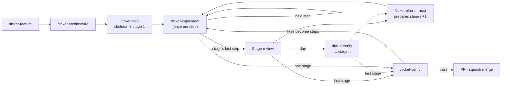
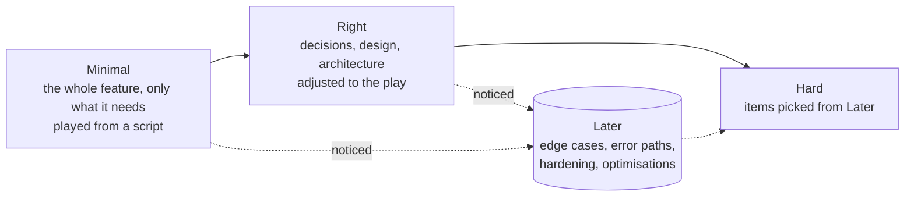
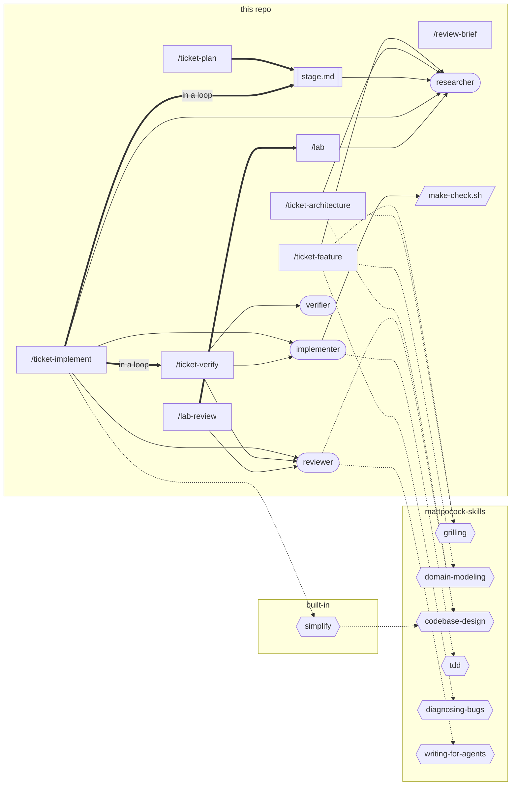
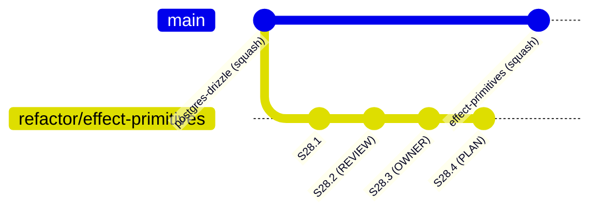

# Spec-driven development

How a change goes from an idea to a merged PR, and what each `/ticket-*` skill does under the hood.
The binding constraints for agents live in [.claude/rules/sdd.md](../../.claude/rules/sdd.md);
this document explains them.

A plan of one stage, or one whose **Status** has no `### Stage` heading, has no Stage review, no
stage verification and no `next`: its steps run straight to `/ticket-verify`
([Plans in stages](#plans-in-stages)).

Every artifact lives in a ticket folder named by `.claude/rules/sdd.md`, started from
[docs/tickets/_template/](../tickets/_template/feature.md). The domain glossary is
`docs/knowledge/glossary.md`, created when the first term is settled.

An older `Refs:` line may name a folder before its rename: the slug is unchanged, and
`git log --follow` on a file of the current folder reaches the commits made under the old name.

## When to run which cycle

| Change | Cycle |
|---|---|
| New behaviour, a new dependency, or any choice a reviewer could question | the full cycle |
| A bug fix or small change with no new decision and an existing seam to test at | `/ticket-feature` with a few requirements (a bug starts from one command that shows it failing), then `/ticket-plan`, `/ticket-implement`, `/ticket-verify`; skip `/ticket-architecture` |
| A ticket that changes only the toolkit or docs (`.claude/`, `docs/`), no app code | the cycle its change calls for, with one `/ticket-verify`: its accepted fixes land as steps without a second run unless one changes what a requirement asks; a past step is replayed (its commit's parent run again under the new toolkit) only for a requirement nothing else can check |
| A direct task: it fits one session, adds no dependency, moves no module boundary and makes no choice a reviewer could question | no ticket: a `<type>/<slug>` branch, the change and `make check`, one Standards and Spec review, one fix round, a commit; the PR on your word. One that turns out bigger stops and becomes a ticket |
| A typo, a version bump, a doc fix | no ticket: one commit with the area as its scope (`docs`, `tooling`) |

## Minimal, right, hard

A ticket, as a lab, runs in three passes, each started on your word, so you judge the feature on
code that runs before anything is built for a case nobody has hit.

1. **Minimal.** The whole feature with only what it needs to work, cut into vertical slices
   through every layer it touches; the first is the thinnest one end to end, each later one adds
   a scenario you can play. It runs, you play it from a script you can repeat (requests against
   `make dev`, a page), and you read how it works at once. Minimal in code, never in quality:
   every rule, review and Seam holds, and the design extends without a rewrite. Its code is the
   feature's, kept and grown, not a prototype thrown away; a throwaway answer to a question is a
   lab's learn step.
2. **Right.** On the running version, with you: its decisions, design, code and architecture
   adjusted to what the play showed, while little code depends on them.
3. **Hard.** The items of `Later` you pick: edge cases, error paths, hardening, open questions,
   optimisations.

**`Later` is the one open list**: `feature.md › Later` in a plan, `lab.md › Later` in a lab.
Whoever notices an item writes it there at once, with its `path:line`: the grilling, the
implementer's report (its *Later* section), a review's finding the feature runs without, your
remarks at the play. The last stage of a plan and the last step of a lab is `Later` itself, so
the list stays in the skeleton and the Map. Before the PR, each item is done, a roadmap entry, or
dropped on your word.

**Never deferred:** a security hole, a loss of stored data, an irreversible contract (a deployed
migration, a published API). Each is fixed in the pass that finds it.

How the passes sit in the flow:

| Where | What changes |
|---|---|
| `/ticket-feature` | grills the minimal feature; what comes up beyond it goes to `Later` |
| `/ticket-architecture` | decides what the minimal feature needs and what is irreversible; the rest stays Direction for the Right stage |
| `/ticket-plan` | stage 1 is the Minimal one, with a `Play:` script; stage 2 is Right, the last is Hard, both cut by `next` after the play |
| `/ticket-implement` | every pass reviews as before; a finding that fails no `R…` goes to `Later`; the Minimal stage's close ends with the play, where a loop stops |
| `/ticket-verify` | asks the fate of each `Later` item still open |
| `/lab` | the Map's Pass column; a minimal step's visible check is the play; each piece adds what it noticed to `Later` |

**Where it comes from.** Each part is an established practice:

- The order is Kent Beck's "Make it run. … Make it right." (*Test-Driven Development by Example*,
  2002, ch. 2), the older "first make it work, then make it right, and, finally, make it fast"
  (Johnson and Kernighan, *Byte*, 1983, as [c2](https://wiki.c2.com/?MakeItWorkMakeItRightMakeItFast)
  cites it).
- The first slice is Alistair Cockburn's walking skeleton, "a tiny implementation of the system
  that performs a small end-to-end function" and "permanent code, built with production coding
  habits, regression tests" (*Crystal Clear*, 2004): hence minimal in code, never in quality. It is
  the tracer bullet of Hunt and Thomas, against a prototype, which is "designed to be thrown away"
  ([Artima, 2003](https://www.artima.com/articles/tracer-bullets-and-prototypes)); the lab's learn
  step is the prototype.
- Slices are vertical: "No slice is just a mockup or UI, a data structure, or test case"
  (Cockburn and Kniberg, *Elephant Carpaccio*, 2013); "integrating vertically on one small piece
  of the project instead of chipping away at the horizontal layers"
  ([*Shape Up*](https://basecamp.com/shapeup), ch. 11).
- The three passes are Jeff Patton's opening, mid and end game
  ([*Better Software*, 2009](https://www.jpattonassociates.com/wp-content/uploads/2015/01/patton_story_mapping_bettersw_1109.pdf)).
- `Later` is the notepad of *Growing Object-Oriented Software, Guided by Tests* (2009, ch. 5):
  "the feature isn't complete until it can handle its failures—this isn't an excuse not to
  bother—but we can choose when", and it is "only finished when we've crossed off everything on
  the list". *Shape Up* marks the same items `~`.
- Design quality is no speculative feature: YAGNI "does not apply to effort to make the software
  easier to modify" ([Fowler, 2015](https://martinfowler.com/bliki/Yagni.html)).

**The risks, and what guards them:**

- Deferred work is never done: "All too often, time is never found for this follow up work"
  ([Foote and Yoder, *Big Ball of Mud*, 1997](http://www.laputan.org/mud/mud.html)); *Shape Up*
  says of its `~` items, "Usually they never get built". Guard: `Later` is the last stage or step,
  and no PR opens while an item has no fate.
- A change to a running system: every source keeps what works today working. Guard: every commit
  is green, and a step that replaces old behaviour adds the new beside it, switches the callers,
  then deletes the old ([Parallel Change](https://martinfowler.com/bliki/ParallelChange.html)).
- The sources differ on error paths: Hunt and Thomas's tracer code carries all its error checking,
  GOOS lets the failures wait. This flow follows GOOS, but for what is never deferred.

## Plans in stages

A plan names every step up front but writes the low level of only a few at a time, once the steps
before them have landed and the facts they rest on are checked: detail written before its facts
goes stale ([why](./decisions.md#plans-in-stages)). The terms are the process's, not the domain's,
so the glossary holds none of them.

- **Stage** — three consecutive steps that deliver one outcome and complete the requirements
  whose last step they hold. A stage of one, two or four names its reason in its heading. It is
  unrelated to the deployment `STAGE` of [aws.md](./aws.md) and to the "stage" the glossary avoids
  for a message's status.
- **Skeleton** — the plan's **Status** table, split by stage: every step's outcome, the `R…` and
  `D…` it serves, its place in the order and its size. `/ticket-plan` cuts it once; a later stage
  changes a row only through its preparation, and drops one only with a finding that says why.
- **Direction** — a recommendation in `architecture.md › Direction` for a choice a stage can
  still make or undo, naming the stage that settles it. It is never put to you: the stage design
  takes it or sets it aside, with the fact. Beside it, each entry of `architecture.md ›
  Assumptions` names the stage whose preparation checks it.
- **Stage design** — the `### Stage design` section of a stage in `plan.md`: the facts checked for
  it, each with its source or probe output; the names, signatures and files the stage fixes; and
  each choice it makes, with the option set aside, the fact and the step that uses it. It is not
  the Design pass of a review, which judges code.
- **Stage preparation** — [stage.md](../../.claude/skills/ticket-plan/stage.md): a `researcher`
  checks the facts and probes what only a run shows; the stage design and the stage's steps in
  full are written; another `researcher` checks them against the repo and every requirement's
  coverage; then the changes are triaged. What changes the architecture or the step list becomes
  one question round for you; the rest commits as `St<n> (PLAN) Prepare stage <n>`, stage 1's with
  your approval of the plan, and that commit is the stage's base. `/ticket-plan` runs it for stage
  1 and on `next`; the loop runs it at a stage's close.
- **Stage review** — the close of a stage, on its last step once that step's own passes are
  settled: `simplify` over the stage's diff, then the Standards and Design passes on it, Design
  also against `architecture.md`, the skeleton and the stage design. Its fixes commit as `STAGE`
  rounds of the steps whose code they change. "Stage review" names the close, never a pass.
- **Stage verification** — `/ticket-verify <ticket> stage <n>`: verifiers on the requirements the
  stage completes and on the earlier ones whose files it changed, over the stage's range; a
  failure is fixed as a `VERIFY` round of the step whose code it changes. When it is **due**
  ([the stage close](../../.claude/skills/ticket-implement/SKILL.md#the-stage-close)), the close
  names it outside a loop, and you may run one for any stage; inside a loop it runs at the close
  without stopping.

You approve the skeleton and stage 1 together; what a later stage commits without your OK is in
the [gates](../../.claude/rules/sdd.md#gates). A ticket whose steps fit one stage is prepared at
once and has no boundary to cross. `/ticket-plan` writes every plan with `### Stage` headings in
its **Status**, and stages apply only to such a plan: a plan without them keeps its form, is not
re-cut, and runs step by step.

## The five skills

All five run in the main session, because grilling, plan review and the commit gate need you.
You start one by typing it or by asking for its phase in words (`run the verify yourself`); each
description tells the model to run the skill only when asked, and the
[gates](../../.claude/rules/sdd.md#gates) (the commit gate, a push, a PR and a merge) still wait
for you. Each takes the ticket folder, except
`/ticket-feature`, which takes a slug.

| Skill | Input | You decide | Output |
|---|---|---|---|
| `/ticket-feature <slug> [idea]` | an idea, notes or a link | the answers to each grilling round; the terms | `feature.md` with EARS requirements; glossary entries |
| `/ticket-architecture <ticket>` | `feature.md` | the Seams and the Decisions | `architecture.md` |
| `/ticket-plan <ticket> [next]` | `feature.md`, `architecture.md`; with `next`, also the closed stages | the skeleton and stage 1, in one approval; with `next`, only a question round, when the preparation raises one | `plan.md`: the skeleton, the coverage and stage 1 in full; with `next`, the next stage in full |
| `/ticket-implement <ticket> [step \| loop]` | the next unblocked step, or each in turn ([the loop](#the-loop)) | whether a ready step closes without your OK, once per session; per round, feedback, a rejection or stop | the step's commits, one per round, each committed before you read it ([Gates](../../.claude/rules/sdd.md#gates)) |
| `/ticket-verify <ticket> [stage <n>]` | the branch against its PR's base branch; with `stage <n>`, that stage's range | which simplifications and lessons to apply; whether to open the PR; for a stage, only a failure that needs a requirement changed | `verification.md`, with a per-stage table for a plan in stages; for a stage, its `## Stage <n>` section and a `VERIFY` round per failure |

## Under the hood

The skills are thin wrappers over the [mattpocock-skills](https://github.com/mattpocock/skills)
plugin, which the project enables in `.claude/settings.json` and `make setup` installs; the same
file turns off the plugins whose skills and agents overlap the wrappers (`superpowers`,
`pr-review-toolkit`, `code-simplifier`, `commit-commands` and `code-review-anthropics`), so none
runs unasked or writes outside the ticket. The wrappers decide **where** files go and **when** you
decide; the plugin decides **how** to interview, model, design and test. Its skills are
referenced by name and never copied, so plugin updates arrive on their own. The review is the
exception: the skills spawn one `reviewer` per pass themselves, since a wrapper that replaced
every input of the plugin's review skill would go silently stale when an update renamed a step.

### Dependency map

What each skill and agent uses, read from their files. A commit that changes what a skill or agent
uses updates this map too; the Standards review checks it against `.claude/rules/claude-md.md`.

| Skill or agent | Plugin skills | Spawns | Default model and effort, per use | Hook | Writes |
|---|---|---|---|---|---|
| `/ticket-feature` | `grilling`, `domain-modeling`; for a bug, `diagnosing-bugs` phases 1 and 2 | `researcher` | a fact to re-verify or a fact question: `opus high` | — | `feature.md`, `docs/knowledge/glossary.md`, `docs/knowledge/roadmap.md` |
| `/ticket-architecture` | `codebase-design`, `grilling` | `researcher` | a fact or an experiment: `opus high` | — | `architecture.md` |
| `/ticket-plan` | — | through [stage.md](../../.claude/skills/ticket-plan/stage.md), read afresh for each stage: `researcher` for the fact check, a second for a probe of behaviour, one for the plan check; for a step that adds, changes or removes a guard, one more for its probes; every probe runs in the disposable worktree `<slug>-plan-probes` set up by `make worktree` | the fact check, a probe of behaviour, the plan check: `opus high`; the guard probes: `sonnet medium`; each step's **Model** line it writes: `opus medium` for a move, rename or config step, `opus high` for one that writes behaviour | — | `plan.md`; `architecture.md` where you agreed to a stage's question; the stage's facts and preparation commits |
| `/ticket-implement` | on a new-interface step and at a stage's close the built-in `simplify`, run by the main session, with `codebase-design` as its vocabulary | `implementer` (one worktree per parallel step, set up by `make worktree`), `reviewer` (one per review pass, in parallel; Standards and Design over the stage's diff at its close), `researcher` (one per claimed finding, in parallel, all writing their confirming tests in one disposable worktree per review round, set up by `make worktree`); in a loop, after a stage's close, what a due stage verification and the next stage's preparation spawn, read afresh from `ticket-verify/SKILL.md` and `ticket-plan/stage.md` | `implementer`: the step's **Model** line; Standards: `sonnet medium`; Spec: `opus medium`; the hunt and Design: `opus high`; a question about the code and a claimed finding: `researcher` on `opus high`; the no-op experiment: `sonnet medium` | `make-check.sh`, through `implementer` | `plan.md`, `architecture.md`, a decision's record in `docs/knowledge/decisions.md`, the step's commits, a stage's `STAGE` rounds; in a loop, what the stage verification and preparation write |
| `/ticket-verify` | — | `verifier` (one per group of requirements, in parallel), `reviewer` (one per axis, in parallel; none for a stage), `implementer` (a stage's `VERIFY` round per failure) | `verifier`: `opus high`, or `xhigh` for a stage over ~30 minutes of work; Standards: `sonnet medium`; Spec: `opus high`; `implementer`: the fixed step's **Model** line, `opus high` when it names none | `make-check.sh`, through `implementer` | `verification.md`, a stage's `VERIFY` rounds |
| `/lab` | — | `researcher` (one per `[R]`, in the background; a second on the same question at a key fork in an unfamiliar area); no `implementer`, since your stop must reach the one who writes; a learn step's draft runs in its own worktree on `wt/<name>`, a lab's own worktree stays on the ticket branch, both set up by `make worktree` (`KEEP=1` for the second) | `researcher`: `opus high` | — | `lab.md`, the lab's rounds, a pair in `design-examples.md` after a stop; at the close, what moves to `docs/knowledge/` |
| `/lab-review` | — | `reviewer` (Standards and the hunt in parallel; Design only on `design`); it picks and reads the lab as `/lab` does, from `/lab`'s file | Standards: `sonnet medium`; the hunt and Design: `opus high` | — | your edits as an `OWNER` round, one `REVIEW` round, `[D:ai]` lines in `lab.md` |
| `/review-brief` | — | — | — | — | nothing: a brief in the chat before you review a range |
| `implementer` | `tdd`, preloaded | — | the spawn's | `make-check.sh` on `Stop` (runs as `SubagentStop`) | the step's files |
| `reviewer` | one pass: Standards, Spec, Design or the hunt, and at a stage's close Standards and Design over its diff, Design also against `architecture.md`, the skeleton and the stage design; on Standards over an instruction file, `writing-for-agents`; on Design, `codebase-design` as its vocabulary | — | the spawn's | — | nothing: read-only |
| `verifier` | — | — | the spawn's | — | nothing: read-only |
| `researcher` | — | — | the spawn's | — | nothing in the main tree; a probe or a confirming test only in a disposable worktree its brief names, set up by `make worktree` |

**The rule for `fable`:** every spawn names its default model and effort. The spawning session
may choose `fable` instead where it judges the result will be better for it, chiefly where a
wrong answer passes every later check: a fact that settles a design, a review of shape, the
verification. A spawn on `fable` names it in the session's status.

Plugin skills are `mattpocock-skills:<name>`; ticket files are in `docs/tickets/<ticket>/`.

Solid arrows spawn an agent or run a hook; thick arrows read another file's procedure and run
it; dotted arrows use a plugin skill.

### What the wrappers override, and why

| Plugin behaviour | Override | Why |
|---|---|---|
| `domain-modeling` writes `GLOSSARY.md` at the root and ADRs to `docs/adr/` | glossary in `docs/knowledge/glossary.md`; ADR candidates become open questions, then `D…` decisions, and a binding one a record in `docs/knowledge/decisions.md` | one docs tree; a decision's history stays next to the ticket that made it, its living record in one page |
| `to-spec` and `to-tickets` write to `.scratch/` or an issue tracker, as user stories | `/ticket-feature` and `/ticket-plan` write EARS requirements and steps into the ticket folder | artifacts are reviewed and committed with the code |
| `tdd` asks the user to confirm seams before testing | the implementer takes them from `architecture.md › Seams`, confirmed earlier | a subagent cannot ask, and the seams were already agreed |
| `implement` commits on its own and reviews committed work | `/ticket-implement` commits each round as soon as it is green, reviews the step's committed rounds, and closes the step under the commit gate | every change, yours included, is a commit you can read alone; the step closes only once reviewed, and as you chose |
| `improve-codebase-architecture` scans the whole codebase, writes an HTML report, grills, and writes `GLOSSARY.md` and ADRs | the Design pass of `/ticket-implement`: a read-only `reviewer` on one step, with at most five candidates, each a sketch and a strength | the shape is questioned while the step is small, and no doc lands outside `docs/knowledge/` and the ticket |
| `research` writes a notes file into the repo | `researcher` answers in its report | facts reach the conversation, not the tree |
| `diagnosing-bugs` runs from a feedback loop to the fix and its regression test | `/ticket-feature` runs phases 1 and 2 only, to one red command on the tree as it stands, copied into `feature.md` | the fix and its test go through the plan and its review |

## The commit gate

The gate is stated in [.claude/rules/sdd.md › Gates](../../.claude/rules/sdd.md#gates), and
`/ticket-implement` runs a step through it: the `implementer`, then `simplify` on a new-interface
step, the round's commit, the review passes, then you. Why it is cut so:

- **The implementer cannot finish red.** A hook runs `make check` when it stops and sends it
  back; `BLOCKED:` is its only way out, and reaches you unchanged.
- **The main session runs `simplify`, never the implementer,** so the agent that wrote the code
  does not judge its own cuts. A move, as `/ticket-implement` defines one, skips it: the
  moved files keep their content for `git` to see the rename.
- **Each round commits before anyone reads it, and each review pass is its own `reviewer` in a
  fresh context,** on the step's committed rounds, so an edit of yours or an agent's over a round
  never mixes with it, and one pass cannot hide another; what a reviewer reads,
  owns and reports is in [reviewer.md](../../.claude/agents/reviewer.md). Design runs only on a
  new-interface step (a behaviour step that adds an export, a module or a Seam), where the shape
  is still cheap to change; the hunt for bugs only on a step whose kind of change it paid off on.
- **A failure no command showed is confirmed before it reaches you.** A behaviour finding names
  its input, the wrong outcome and whether a command showed it; each `claimed` one goes to its
  own `researcher`, not anchored on the reviewer's reading, which answers `confirmed` (you see
  the finding), `refuted` (dropped) or `unclear` (you get it as a question).
- **You decide** on the reports, which the main session presents without re-reading the code.
  Each finding's pass and fate land in the step's **Findings** in `plan.md`, and
  `/ticket-verify` sums them per pass in its **Review ledger**.

### The loop

`/ticket-implement <ticket> loop` runs the plan's unblocked `todo` steps one after another, each
through the whole gate, and closes each without asking you: the main session forwards the fixes
it recommends as rounds, as it would on your word. It stops where
[the skill](../../.claude/skills/ticket-implement/SKILL.md#the-loop) lists, and only then shows
you each committed step and the cause of the stop. To stop it sooner, tell the session to stop:
the rounds already committed stay, and the current round stays uncommitted in the tree. To go on
after a stop, answer it, then type the command again: a run that finds changes in the tree first
asks whose they are, so your edits commit as an `OWNER` round and the agent's stopped round is
finished by the implementer. Pushing and opening the PR still wait for your OK.

In a plan in stages the loop crosses a stage's boundary on its own. On the stage's last step it
runs the Stage review and commits its fixes as `STAGE` rounds; a Design finding that reshapes a
module lands too, for you to read afterwards by its commit, unless it contradicts a `D…`: that one
is held open and shown at the next stop, without causing one. Then it runs a due stage
verification, prepares the next stage with `stage.md` and goes on with that stage's first step.
Beyond a step's own stops, the boundary adds two: a question round of the preparation, and a
verification failure that needs a requirement changed. Outside a loop, a stage's close names the
stage verification when due and `/ticket-plan <ticket> next`, and waits for you.

The loop runs in the main session, which learns that a step is done from the agent's
notification; the built-in `/loop` fires on a timer instead, so it would either wait for nothing
or start a step while the last one still runs.

## Roadmap and history

A ticket starts as an entry in [the roadmap](./roadmap.md), which says what an entry holds and how
`/ticket-feature` picks it up, and ends as one squash commit on `main`.

**`main` is the only long-lived branch.** It holds one commit per ticket: the squash, whose body
is the PR description, the history to read for *what* the template is and *why*. The *how*, step
by step, stays in two places that outlive the ticket branch: the merged PR's commit list on
GitHub, a step's commits by round, and the ticket folder's `plan.md` with each step's findings.
`chore/monorepo-setup` keeps the scaffold ticket's steps, which predate the PRs.

Ticket branches are cut from `main` and deleted on merge; nothing is merged back into a second
branch, so no merge commit is needed and the repository allows none.

## Lessons

`/ticket-verify` ends with **Lessons**, each a recurring mistake turned into one proposed change
to a skill, a rule or a check, applied only on your OK: the toolkit learns from a ticket, while a
`CLAUDE.md` keeps only binding constraints. For a broader look at a whole session, the plugin's
`/mattpocock-skills:retro` is available to run by hand.

## Periodically

Two plugin skills look wider than one ticket. Both are run by hand, because the plugin marks them
user-invoked:

- `/mattpocock-skills:improve-codebase-architecture` scans the code for shallow modules and
  proposes deepening refactors. Run it every few tickets, once real product code has piled up.
  Tell it that the glossary is `docs/knowledge/glossary.md` and decisions are in
  `docs/knowledge/decisions.md` and each ticket's `architecture.md`, since it looks for
  `GLOSSARY.md` and `docs/adr/`.
- `/mattpocock-skills:retro` reviews a whole session and suggests changes to rules, checks and
  skills. Its findings go through the same OK as Lessons.

## After a plugin update

The plugin updates itself, so its behaviour can shift under the wrappers. After an update:

1. Read the plugin's changelog or diff for `grilling`, `domain-modeling`, `codebase-design`,
   `tdd`, `diagnosing-bugs` and `writing-for-agents`, the skills the map above delegates to.
2. Check that each override in the table above still targets something the skill does; a renamed
   file or step makes the override silently stale.
3. Run `/ticket-feature` on a throwaway slug in a scratch clone outside `~/.claude/` and settle one
   term. It must land in `docs/knowledge/glossary.md`, with no `GLOSSARY.md` or `docs/adr/`.
4. Record what changed as a lesson, or as a fix to the wrapper.

## Troubleshooting

| Symptom | Cause | Fix |
|---|---|---|
| `/ticket-*` is not offered when typing `/` | Claude Code was started outside the repository root | start it in the root; the skills live in `.claude/skills/` |
| plugin skills are missing, or a plugin turned off above is active | the plugin is not installed, the session predates `enabledPlugins`, or a `settings.local.json` enables it | install `mattpocock-skills` from `claude-plugins-official`, or remove the plugin's key from `settings.local.json`, then restart the session |
| `implementer` never stops | `make check` stays red and the agent keeps fixing | stop it; resume with guidance, or let it report `BLOCKED:` |
| the `make check` hook never runs | the folder's workspace trust was never accepted (a `-p` session does not accept it) | open Claude Code interactively in the folder once and accept the trust dialog |
| a `GLOSSARY.md` or `docs/adr/` appeared | a plugin skill fired outside `/ticket-feature` | move the terms into `docs/knowledge/glossary.md` and delete the file |
| a verifier or reviewer cites a rule that the file no longer says | the session started before the rule changed, and its agents carry the old copy | run `/ticket-verify` in a new session, or tell each agent to read rules from disk |
| the map above disagrees with a skill or agent file | the file changed without the map | trust the file, fix the map in the next commit |
