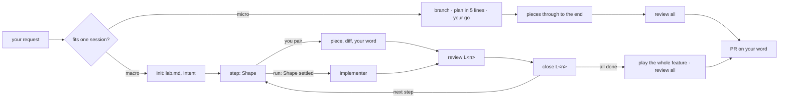
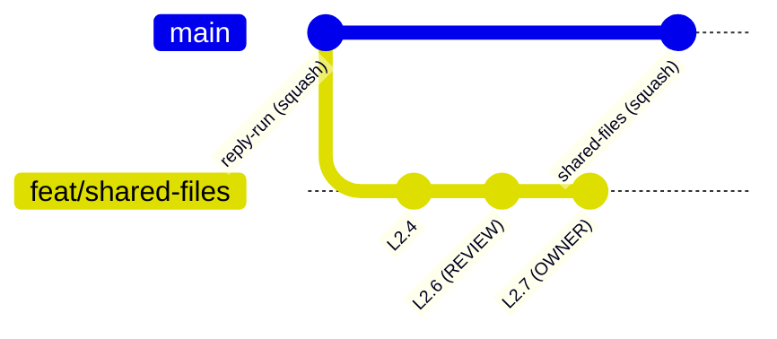

# How a change gets built

Every change of substance, from a one-piece refactor to a feature of many days, runs through one
skill, `/lab`, with you in the loop on the intent and the weak decisions. A typo, a version bump
or a doc fix needs none. The binding text lives in [the skill](../../.claude/skills/lab/SKILL.md);
this page explains why it is cut so.

## Micro or macro

Both build the same way: a failing test first, a piece you can read at one sitting, a green
commit per unit, fresh reviewers once per range, a check you can repeat. What differs is the
context around it.

| | Micro | Macro |
|---|---|---|
| When | one session, nothing new that another process reads, every choice settled ([the rule](../../.claude/skills/lab/SKILL.md#micro-or-macro)) | everything else |
| File | none: your request is the intent | `docs/tickets/<date>_<slug>/lab.md`: Intent, Map, a Shape per step, Knowledge, `Later` |
| You are asked | the plan in five lines, then the result | each Shape, each piece, each `[D:ai]`, each close |
| Commits | the area as scope, `(OWNER)` and `(REVIEW)` alone | `L<step>.<round>` with the slug as scope |
| Review | once, over the branch | once per step, then once over the branch |

A micro change that breaks a condition midway becomes macro on its branch. A macro step goes one
of two ways: you pair with the main session piece by piece, or, once its Shape is settled, `run`
hands it to an `implementer`, which a `make check` hook keeps working until it is green. Several
settled steps run unattended only on your word, as a workflow.

## Why each part

| Part | What it prevents | The evidence |
|---|---|---|
| Your Intent and Shape before code | an agent's design you rework after the fact | a full hand-off cost days of rework, about half thrown away; the four labs since have you writing the Shape |
| Facts by a `researcher`, decisions by you | being asked what the code can answer | "Finding facts is your job, never the user's" (`grilling`) |
| A failing test first, a check seen red | a check that cannot fail | five lessons in four tickets on checks that could not fail |
| A piece read at one sitting, committed green | a diff you cannot judge alone | your rule since the design audit's unit commits; DORA 2025 on small batches |
| Your edits as their own `OWNER` round | your changes mixed into the agent's | 38–65% of each lab's rounds are yours |
| Intent pass (the old Spec) | a diff that leaves out, overdoes or quietly changes what was asked | 76–94% of Spec findings accepted in three ledgers; over a branch it takes the old `verifier`'s catch that every step review passed: a response changed with no requirement asking, and the assertion widened to hide it (replay R3, 2 of 3) |
| Hunt pass, on code and on a guard's change | a failure absorbed in silence; a guard an import gets past | it named the telemetry lab's one batch-killing bug (`traceparent` as `Binary`) in 3 of 3 runs of replay R2, the old hunt in 0 of 3; the verifier's guard catches came from probes, now a line of `.claude/rules/tooling.md` |
| Rules pass; `hard` fixed, `judgement` deferred | the repo's rules drifting | 51 of 93 Standards findings taken in plan Findings, 42 rejected; a `judgement` finding now costs a `Later` line, not a fix round |
| Design pass, on request | a shape question raised when you are not deciding shape | 12 of 22 Design findings taken; you write the Shape, so it runs when you ask |
| One review round; an edge case met by deleting first | review rounds that add guards | the observability branch: about half of ~4,700 lines cut; "a reviewer … will always find something" |
| A `claimed` bug rejected only by a run of its input as a test | a claim argued away instead of run | your rule: a check counts only through a test run or you |
| Minimal, right, hard, and `Later` | hardening before anything runs | below |
| The stops file | the same rejected design proposed again | one pair was recorded against at least nine of your stops; pairs are now written at each step's close |

What the flow replaced, and why:
[decisions.md › One flow, sized at intake](decisions.md#one-flow-sized-at-intake).

## Minimal, right, hard

A feature runs in three passes, each on your word, so you judge it on code that runs before
anything is built for a case nobody has hit: **minimal**, the whole feature in its smallest form,
the least behaviour and never the fewest units
([composition.md](../../.claude/rules/composition.md)), in vertical slices, played from a script
you can repeat; **right**, its design adjusted to what the play showed, while little code depends
on it; **hard**, the items of `Later` you pick.
`Later` is the one open list, and before the PR each item is done, moved to
[roadmap.md › Later](roadmap.md#later), or dropped. Never deferred: a security hole, a loss of
stored data, an irreversible contract (a deployed migration, a published API).

Where it comes from:

- Kent Beck's "Make it run. … Make it right." (*Test-Driven Development by Example*, 2002).
- The first slice is Alistair Cockburn's walking skeleton, "permanent code, built with production
  coding habits" (*Crystal Clear*, 2004), Hunt and Thomas's tracer bullet against a prototype
  "designed to be thrown away"
  ([Artima, 2003](https://www.artima.com/articles/tracer-bullets-and-prototypes)): hence minimal
  in code, never in quality, and the learn step is the prototype.
- Slices are vertical (Cockburn and Kniberg, *Elephant Carpaccio*, 2013;
  [*Shape Up*](https://basecamp.com/shapeup), ch. 11).
- `Later` is the notepad of *Growing Object-Oriented Software, Guided by Tests* (2009, ch. 5).

The risk is that deferred work is never done
([Foote and Yoder, 1997](http://www.laputan.org/mud/mud.html)); the guard is that `Later` is the
Map's last row, and no PR opens while an item has no fate.

## Roadmap and history

A change starts as an entry in [the roadmap](./roadmap.md) or as your request, and ends as one
squash commit on `main`, whose body is the PR description. The rounds stay in the merged PR's
commit list and in the lab's `lab.md`. Older tickets name their steps `S<n>` or `St<s> S<n>` and
keep their `feature.md`, `architecture.md`, `plan.md` and `verification.md`;
`git log --grep 'S4\.'` finds a step's rounds there.

Branches are cut from `main` and deleted on merge; the repository allows no merge commit.

## The plugin skills

`/lab` calls four skills of the [mattpocock-skills](https://github.com/mattpocock/skills)
plugin by name, so its updates arrive on their own: `grilling` when an intent is vague,
`diagnosing-bugs` phases 1 and 2 for a bug's red command, `writing-for-agents` for the Rules pass
on an instruction file, and `tdd`, preloaded by the `implementer`. The plugins whose skills
overlap these are off in `.claude/settings.json`. Two overrides hold: the glossary is
`docs/knowledge/glossary.md` and a decision is a record of `docs/knowledge/decisions.md`, never
`GLOSSARY.md` or `docs/adr/`; a `research` notes file is never written into the repo, the
`researcher` answers in its report.

## Evaluating the toolkit

A change to the skill, an agent or a process rule is judged by a replay run, not by argument: a
one-line instruction cut once lowered coding quality in a way the vendor's own evals missed
([Anthropic, 2026-04-23](https://www.anthropic.com/engineering/april-23-postmortem)).

- **The replays:** past steps with a known result, each run from the commit named, in a
  `git clone --local` under a temp directory, in fresh `claude -p --output-format json` sessions
  with stdin closed, three times on each toolkit, or on the new one against that result. Grade
  what each replay run produced, read the transcripts, and record tokens from the JSON's `modelUsage`,
  which counts the subagents, and wall-clock from the transcript's first and last timestamps:
  `duration_ms` leaves out the wait for background agents. An untrusted clone runs no agent's
  frontmatter hooks under `-p`, so the `implementer`'s gate is checked apart, in a trusted tree,
  by a probe agent whose hook denies once.

  | # | Replays | Passes when |
  |---|---|---|
  | R1 | micro: `attachment-model-rules`, its request, from the parent of `0dada95759` | no gate fails that passed before the replay run; lines within ±30% of the merged +67 −10; no ticket file |
  | R2 | `review L5` of telemetry-minimal at `95584422bf` | the hunt names the non-string `traceparent` attribute at least as often as on the old toolkit |
  | R3 | `review all` of modular-monolith at `dc1eec9fd9`, base `5bfec347df`, its `feature.md` R1 quoted as the Intent | Intent names the changed error body and the race's `500` with its widened assertion in two runs of three |
  | R4 | shared-files at `L0.2`, with and without `stops.md` | with it, no second noun, link table or copy of bytes proposed in two runs of three, and fewer than without it |
  | R5 | `review` of the observability rounds before `1241b56e55`, then its fixes | "cap the read" goes to `Later` or to deleting its cause in two runs of three, never into a fix |

- **The no-op experiment**, for one disputed line: copy the file as `CLAUDE.md` into two new
  folders of the system temp directory, one without the line, run the task the line governs in
  each with `claude -p --model haiku --setting-sources project "<task>"`, and keep the line only
  when the two answers differ in what it asks.
- **The ablation:** when a model lands, remove one part at a time and replay; a part whose
  removal changes no grade goes. In this order: the hunt folded into Intent (R2), the Rules pass,
  the stops file (R4), the hunt replaced by `/code-review high <base>..HEAD` (R2).

## Troubleshooting

| Symptom | Cause | Fix |
|---|---|---|
| `/lab` is not offered when typing `/` | Claude Code was started outside the repository root | start it in the root |
| plugin skills are missing | the plugin is not installed, or a `settings.local.json` overrides it | install `mattpocock-skills` from `claude-plugins-official`, then restart |
| `implementer` never stops | `make check` stays red and the agent keeps fixing | stop it; resume with guidance, or let it report `BLOCKED:` |
| the `make check` hook never runs | the folder's workspace trust was never accepted | open Claude Code interactively in the folder once and accept the trust dialog |
| an agent in a worktree cites a rule its tree no longer says | the harness attaches the rules of the tree the session started in | start the session in that tree, or tell the agent to read rules from its own tree; `run` does |
| a `GLOSSARY.md` or `docs/adr/` appeared | a plugin skill wrote its default | move the terms into `docs/knowledge/glossary.md` and delete the file |
