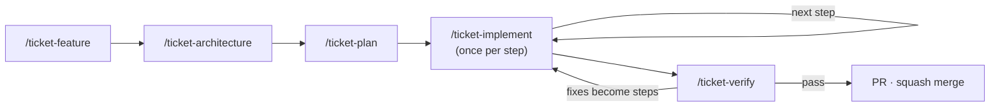
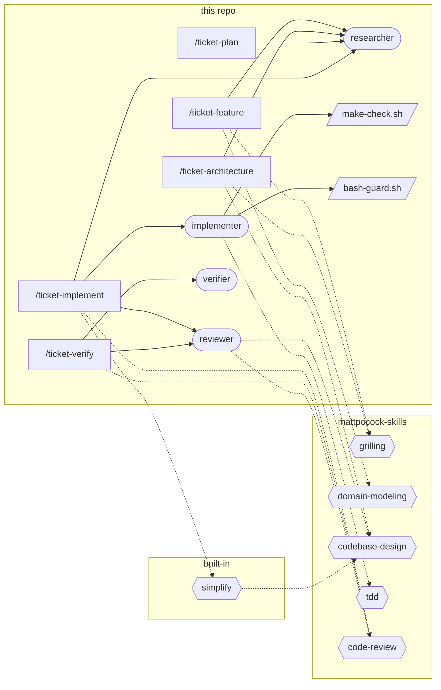
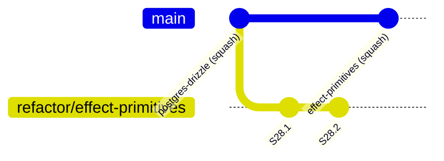

# Spec-driven development

How a change goes from an idea to a merged PR, and what each `/ticket-*` skill does under the hood.
The binding constraints for agents live in [.claude/rules/sdd.md](../../.claude/rules/sdd.md);
this document explains them.

Every artifact lives in a ticket folder named by `.claude/rules/sdd.md`, started from
[docs/tickets/_template/](../tickets/_template/feature.md). The domain glossary is
`docs/knowledge/glossary.md`, created when the first term is settled.

An older `Refs:` line may name a folder before its rename: the slug is unchanged, and
`git log --follow` on a file of the current folder reaches the commits made under the old name.

## When to run which cycle

| Change | Cycle |
|---|---|
| New behaviour, a new dependency, or any choice a reviewer could question | the full cycle |
| A bug fix or small change with no new decision and an existing seam to test at | `/ticket-feature` with a few requirements, then `/ticket-plan`, `/ticket-implement`, `/ticket-verify`; skip `/ticket-architecture` |
| A typo, a version bump, a doc fix | no ticket: one commit with the area as its scope (`docs`, `tooling`) |

## The five skills

All five are typed by you (`disable-model-invocation: true`) and run in the main session, because
grilling, plan review and the commit gate need you. Each takes the ticket folder, except
`/ticket-feature`, which takes a slug.

| Skill | Input | You decide | Output |
|---|---|---|---|
| `/ticket-feature <slug> [idea]` | an idea, notes or a link | the answers to each grilling round; the terms | `feature.md` with EARS requirements; glossary entries |
| `/ticket-architecture <ticket>` | `feature.md` | the Seams and the Decisions | `architecture.md` |
| `/ticket-plan <ticket>` | `feature.md`, `architecture.md` | the plan as a whole: the heavy review | `plan.md` with steps and coverage |
| `/ticket-implement <ticket> [step]` | the next unblocked step | the commit gate's question, once per session; feedback, or stop | the step's commits, by round ([Gates](../../.claude/rules/sdd.md#gates)) |
| `/ticket-verify <ticket>` | the branch against its PR's base branch | which simplifications and lessons to apply; whether to open the PR | `verification.md` |

## Under the hood

The skills are thin wrappers over the [mattpocock-skills](https://github.com/mattpocock/skills)
plugin, which the project enables in `.claude/settings.json` and `make setup` installs; the same
file turns off the plugins whose skills and agents overlap the wrappers (`superpowers`,
`pr-review-toolkit`, `code-simplifier`, `commit-commands` and the plugin `code-review`), so none
runs unasked or writes outside the ticket. The wrappers decide **where** files go and **when** you
decide; the plugin decides **how** to interview, model, design, test and review. Its skills are
referenced by name and never copied, so plugin updates arrive on their own.

### Dependency map

What each skill and agent uses, read from their files. A commit that changes what a skill or agent
uses updates this map too; the Standards review checks it against `.claude/rules/claude-md.md`.

| Skill or agent | Plugin skills | Spawns | Hook | Writes |
|---|---|---|---|---|
| `/ticket-feature` | `grilling`, `domain-modeling` | `researcher` | — | `feature.md`, `docs/knowledge/glossary.md`, `docs/knowledge/roadmap.md` |
| `/ticket-architecture` | `codebase-design`, `grilling` | `researcher` | — | `architecture.md` |
| `/ticket-plan` | — | `researcher` | — | `plan.md` |
| `/ticket-implement` | `code-review`; on a behaviour step the built-in `simplify`, run by the main session, with `codebase-design` as its vocabulary | `implementer` (one worktree per parallel step, set up by `make worktree`), `reviewer` (one per review pass), `researcher` (one per claimed finding, in parallel) | `make-check.sh` and `bash-guard.sh`, through `implementer` | `plan.md`, `architecture.md`, a decision's record in `docs/knowledge/decisions.md`, the step's commits |
| `/ticket-verify` | `code-review` | `verifier` (one per group of requirements, in parallel), `reviewer` | — | `verification.md` |
| `implementer` | `tdd`, preloaded | — | `make-check.sh` on `Stop` (runs as `SubagentStop`); `bash-guard.sh` on `PreToolUse` of `Bash` | the step's files |
| `reviewer` | one pass: an axis of `code-review`, or the hunt | — | — | nothing: read-only |
| `verifier` | — | — | — | nothing: read-only |
| `researcher` | — | — | — | nothing: read-only |

Plugin skills are `mattpocock-skills:<name>`; ticket files are in `docs/tickets/<ticket>/`.

Solid arrows spawn an agent or run a hook; dotted arrows use a plugin skill.

### What the wrappers override, and why

| Plugin behaviour | Override | Why |
|---|---|---|
| `domain-modeling` writes `GLOSSARY.md` at the root and ADRs to `docs/adr/` | glossary in `docs/knowledge/glossary.md`; ADR candidates become open questions, then `D…` decisions, and a binding one a record in `docs/knowledge/decisions.md` | one docs tree; a decision's history stays next to the ticket that made it, its living record in one page |
| `to-spec` and `to-tickets` write to `.scratch/` or an issue tracker, as user stories | `/ticket-feature` and `/ticket-plan` write EARS requirements and steps into the ticket folder | artifacts are reviewed and committed with the code |
| `tdd` asks the user to confirm seams before testing | the implementer takes them from `architecture.md › Seams`, confirmed earlier | a subagent cannot ask, and the seams were already agreed |
| `implement` commits on its own and reviews committed work | `/ticket-implement` reviews the uncommitted step and commits it under the commit gate | a step commits only once reviewed, and as you chose |
| `code-review` diffs from a fixed point to `HEAD` and spawns generic sub-agents | for a step: the uncommitted diff, reviewed by read-only `reviewer` agents that read only what the step cites, each owning one kind of finding | the step is reviewed before it is committed, by agents that cannot edit and read no more than the step needs; no finding comes twice, and the main session forwards one without reading the code |
| `improve-codebase-architecture` scans the whole codebase, writes an HTML report, grills, and writes `GLOSSARY.md` and ADRs | the Depth axis of `/ticket-implement`: a read-only `reviewer` on one step, with a text report | the shape is questioned while the step is small, and no doc lands outside `docs/knowledge/` and the ticket |
| `research` writes a notes file into the repo | `researcher` answers in its report | facts reach the conversation, not the tree |

## The commit gate

The gate is stated in [.claude/rules/sdd.md › Gates](../../.claude/rules/sdd.md#gates), and
`/ticket-implement` runs a step through it: the `implementer`, then `simplify` on a behaviour
step, then the review passes, then you. Why it is cut so:

- **The implementer cannot finish red.** A hook runs `make check` when it stops and sends it
  back; `BLOCKED:` is its only way out, and reaches you unchanged.
- **The main session runs `simplify`, never the implementer,** so the agent that wrote the code
  does not judge its own cuts. A pure move skips it: its files keep their content for `git` to
  see the rename.
- **Each review pass is its own `reviewer` in a fresh context,** and owns one kind of finding, so
  one pass cannot hide another and no finding comes twice. Depth runs only on a behaviour step,
  where it changed the step's shape; the hunt for bugs only on a step whose kind of change it
  paid off on.
- **A failure no command showed is confirmed before it reaches you.** A behaviour finding names
  its input, the wrong outcome and whether a command showed it; each `claimed` one goes to its
  own `researcher`, not anchored on the reviewer's reading, which answers `confirmed` (you see
  the finding), `refuted` (dropped) or `unclear` (you get it as a question).
- **You decide** on the reports, which the main session presents without re-reading the code.
  Each finding's pass and fate land in the step's **Findings** in `plan.md`, and
  `/ticket-verify` sums them per pass in its **Review ledger**.

## Roadmap and history

A ticket starts as an entry in [the roadmap](./roadmap.md), which says what an entry holds and how
`/ticket-feature` picks it up, and ends as one squash commit on `main`.

**`main` is the only long-lived branch.** It holds one commit per ticket: the squash, whose body
is the PR description, the history to read for *what* the template is and *why*. The *how*, step
by step, stays in two places that outlive the ticket branch: the merged PR's commit list on
GitHub, a step's commits by round, and the ticket folder's `plan.md` with each step's findings.
`chore/monorepo-setup` keeps the scaffold ticket's steps, which predate the PRs.

Ticket branches are cut from `main` and deleted on merge; nothing is merged back into a second
branch, so no merge commit is needed and the repository allows none.

## Lessons

`/ticket-verify` ends with **Lessons**, each a recurring mistake turned into one proposed change
to a skill, a rule or a check, applied only on your OK: the toolkit learns from a ticket, while a
`CLAUDE.md` keeps only binding constraints. For a broader look at a whole session, the plugin's
`/mattpocock-skills:retro` is available to run by hand.

## Periodically

Two plugin skills look wider than one ticket. Both are run by hand, because the plugin marks them
user-invoked:

- `/mattpocock-skills:improve-codebase-architecture` scans the code for shallow modules and
  proposes deepening refactors. Run it every few tickets, once real product code has piled up.
  Tell it that the glossary is `docs/knowledge/glossary.md` and decisions are in
  `docs/knowledge/decisions.md` and each ticket's `architecture.md`, since it looks for
  `GLOSSARY.md` and `docs/adr/`.
- `/mattpocock-skills:retro` reviews a whole session and suggests changes to rules, checks and
  skills. Its findings go through the same OK as Lessons.

## After a plugin update

The plugin updates itself, so its behaviour can shift under the wrappers. After an update:

1. Read the plugin's changelog or diff for `grilling`, `domain-modeling`, `codebase-design`, `tdd`
   and `code-review`, the skills the map above delegates to.
2. Check that each override in the table above still targets something the skill does; a renamed
   file or step makes the override silently stale.
3. Run `/ticket-feature` on a throwaway slug in a scratch clone outside `~/.claude/` and settle one
   term. It must land in `docs/knowledge/glossary.md`, with no `GLOSSARY.md` or `docs/adr/`.
4. Record what changed as a lesson, or as a fix to the wrapper.

## Troubleshooting

| Symptom | Cause | Fix |
|---|---|---|
| `/ticket-*` is not offered when typing `/` | Claude Code was started outside the repository root | start it in the root; the skills live in `.claude/skills/` |
| plugin skills are missing, or a plugin turned off above is active | the plugin is not installed, the session predates `enabledPlugins`, or a `settings.local.json` enables it | install `mattpocock-skills` from `claude-plugins-official`, or remove the plugin's key from `settings.local.json`, then restart the session |
| `implementer` never stops | `make check` stays red and the agent keeps fixing | stop it; resume with guidance, or let it report `BLOCKED:` |
| the `make check` hook never runs | the folder's workspace trust was never accepted (a `-p` session does not accept it) | open Claude Code interactively in the folder once and accept the trust dialog |
| a `GLOSSARY.md` or `docs/adr/` appeared | a plugin skill fired outside `/ticket-feature` | move the terms into `docs/knowledge/glossary.md` and delete the file |
| a verifier or reviewer cites a rule that the file no longer says | the session started before the rule changed, and its agents carry the old copy | run `/ticket-verify` in a new session, or tell each agent to read rules from disk |
| the map above disagrees with a skill or agent file | the file changed without the map | trust the file, fix the map in the next commit |
