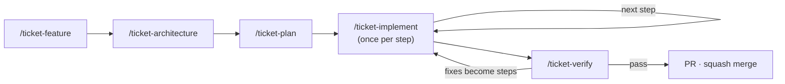
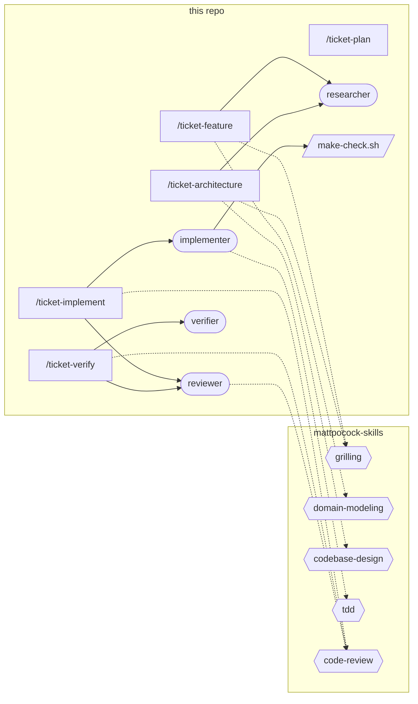

# Spec-driven development

How a change goes from an idea to a merged PR, and what each `/ticket-*` skill does under the hood.
The binding constraints for agents live in [.claude/rules/sdd.md](../../.claude/rules/sdd.md);
this document explains them.

Every artifact lives in `docs/tickets/<YYYY-MM-DD>_<slug>/`, started from
[docs/tickets/_template/](../tickets/_template/feature.md). The domain glossary is
`docs/knowledge/glossary.md`, created when the first term is settled.

## When to run which cycle

| Change | Cycle |
|---|---|
| New behaviour, a new dependency, or any choice a reviewer could question | the full cycle |
| A bug fix or small change with no new decision and an existing seam to test at | `/ticket-feature` with a few requirements, then `/ticket-plan`, `/ticket-implement`, `/ticket-verify`; skip `/ticket-architecture` |
| A typo, a version bump, a doc fix | no ticket: one commit with the area as its scope (`docs`, `tooling`) |

## The five skills

All five are typed by you (`disable-model-invocation: true`) and run in the main session, because
grilling, plan review and commit approval need you. Each takes the ticket folder, except
`/ticket-feature`, which takes a slug.

| Skill | Input | You decide | Output |
|---|---|---|---|
| `/ticket-feature <slug> [idea]` | an idea, notes or a link | the answers to each grilling round; the terms | `feature.md` with EARS requirements; glossary entries |
| `/ticket-architecture <ticket>` | `feature.md` | the Seams and the Decisions | `architecture.md` |
| `/ticket-plan <ticket>` | `feature.md`, `architecture.md` | the plan as a whole: the heavy review | `plan.md` with steps and coverage |
| `/ticket-implement <ticket> [step]` | the next unblocked step | approve, give feedback, or stop | one commit per approved step |
| `/ticket-verify <ticket>` | the branch against `main` | which simplifications and lessons to apply; whether to open the PR | `verification.md` |

## Under the hood

The skills are thin wrappers over the [mattpocock-skills](https://github.com/mattpocock/skills)
plugin, which the project enables in `.claude/settings.json`. The wrappers decide **where** files
go and **when** you decide; the plugin decides **how** to interview, model, design, test and
review. Its skills are referenced by name and never copied, so plugin updates arrive on their own.

### Dependency map

What each skill and agent uses, read from their files. A commit that changes what a skill or agent
uses updates this map too; the Standards review checks it against `.claude/rules/sdd.md`.

| Skill or agent | Plugin skills | Spawns | Hook | Writes |
|---|---|---|---|---|
| `/ticket-feature` | `grilling`, `domain-modeling` | `researcher` | — | `feature.md`, `docs/knowledge/glossary.md` |
| `/ticket-architecture` | `codebase-design`, `grilling` | `researcher` | — | `architecture.md` |
| `/ticket-plan` | — | — | — | `plan.md` |
| `/ticket-implement` | `code-review` | `implementer`, `reviewer` | `make-check.sh`, through `implementer` | `plan.md`, `architecture.md`, one commit per approved step |
| `/ticket-verify` | `code-review` | `verifier`, `reviewer` | — | `verification.md` |
| `implementer` | `tdd`, preloaded | — | `make-check.sh` on `SubagentStop` | the step's files |
| `reviewer` | one axis of `code-review` | — | — | nothing: read-only |
| `verifier` | — | — | — | nothing: read-only |
| `researcher` | — | — | — | nothing: read-only |

Plugin skills are `mattpocock-skills:<name>`; ticket files are in `docs/tickets/<ticket>/`.

Solid arrows spawn an agent or run a hook; dotted arrows use a plugin skill.

### What the wrappers override, and why

| Plugin behaviour | Override | Why |
|---|---|---|
| `domain-modeling` writes `GLOSSARY.md` at the root and ADRs to `docs/adr/` | glossary in `docs/knowledge/glossary.md`; ADR candidates become open questions, then `D…` decisions | one docs tree; decisions stay next to the ticket that made them |
| `to-spec` and `to-tickets` write to `.scratch/` or an issue tracker, as user stories | `/ticket-feature` and `/ticket-plan` write EARS requirements and steps into the ticket folder | artifacts are reviewed and committed with the code |
| `tdd` asks the user to confirm seams before testing | the implementer takes them from `architecture.md › Seams`, confirmed earlier | a subagent cannot ask, and the seams were already agreed |
| `implement` commits on its own and reviews committed work | `/ticket-implement` reviews the uncommitted step and commits only after your OK | every commit is approved |
| `code-review` diffs from a fixed point to `HEAD` and spawns generic sub-agents | for a step: `git diff HEAD` plus untracked files, reviewed by read-only `reviewer` agents | the step is reviewed before it is committed, by agents that cannot edit |
| `research` writes a notes file into the repo | `researcher` answers in its report | facts reach the conversation, not the tree |

## The approval gate

A step runs through three stages before anything is committed:

1. **`implementer`** builds the step test-first at the agreed seam. A hook runs `make check` when
   it tries to finish and sends it back while the gate is red. Its only way out on red is a final
   message starting with `BLOCKED:`, which reaches you unchanged.
2. **`code-review`** runs two `reviewer` agents in parallel, each in a fresh context: **Standards**
   (the rules in `.claude/rules/` and the smell baseline) and **Spec** (the step and its
   requirements). The two reports stay separate, so one axis cannot hide the other.
3. **You** read the report and both reviews, then approve, send feedback to the same implementer,
   or stop. Approval updates `plan.md`, records any decision, and commits with the proposed
   message.

Pushing, opening the PR and creating the remote each need their own OK.

## Lessons

`/ticket-verify` ends with **Lessons**: mistakes that recurred in two or more steps, each turned into
one proposed change. A mechanical mistake (an import shape, a banned API) gets a check: a Biome
rule, a test or a hook. A judgement call gets one line in a named skill or rule. A `CLAUDE.md`
never grows from a lesson, and nothing is applied without your OK. For a broader look at a whole
session, the plugin's `/mattpocock-skills:retro` is available to run by hand.

## After a plugin update

The plugin updates itself, so its behaviour can shift under the wrappers. After an update:

1. Read the plugin's changelog or diff for `grilling`, `domain-modeling`, `codebase-design`, `tdd`
   and `code-review`, the skills the map above delegates to.
2. Check that each override in the table above still targets something the skill does; a renamed
   file or step makes the override silently stale.
3. Run `/ticket-feature` on a throwaway slug in a scratch clone outside `~/.claude/` and settle one
   term. It must land in `docs/knowledge/glossary.md`, with no `GLOSSARY.md` or `docs/adr/`.
4. Record what changed as a lesson, or as a fix to the wrapper.

## Troubleshooting

| Symptom | Cause | Fix |
|---|---|---|
| `/ticket-*` is not offered when typing `/` | Claude Code was started outside the repository root | start it in the root; the skills live in `.claude/skills/` |
| plugin skills are missing, or `superpowers` is active | the plugin is not installed, or the session predates `enabledPlugins` | install `mattpocock-skills` from `claude-plugins-official` and restart the session |
| `implementer` never stops | `make check` stays red and the agent keeps fixing | stop it; resume with guidance, or let it report `BLOCKED:` |
| the `make check` hook never runs | the folder's workspace trust was never accepted (a `-p` session does not accept it) | open Claude Code interactively in the folder once and accept the trust dialog |
| a `GLOSSARY.md` or `docs/adr/` appeared | a plugin skill fired outside `/ticket-feature` | move the terms into `docs/knowledge/glossary.md` and delete the file |
| the map above disagrees with a skill or agent file | the file changed without the map | trust the file, fix the map in the next commit |
