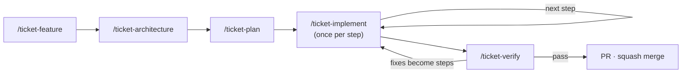
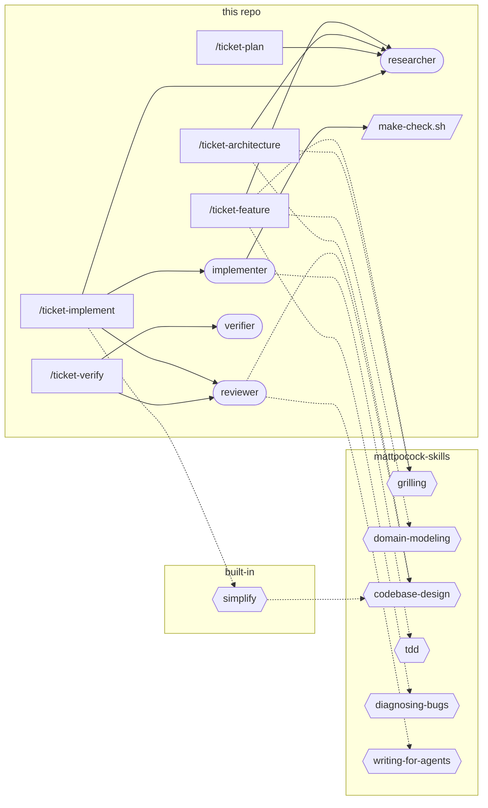
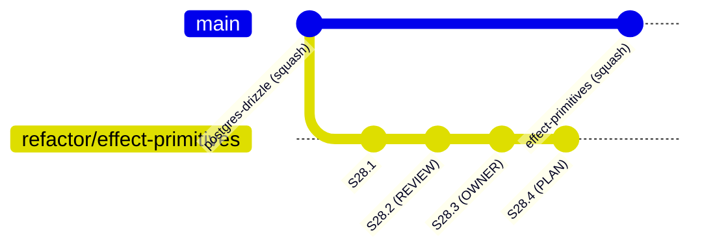

# Spec-driven development

How a change goes from an idea to a merged PR, and what each `/ticket-*` skill does under the hood.
The binding constraints for agents live in [.claude/rules/sdd.md](../../.claude/rules/sdd.md);
this document explains them.

Every artifact lives in a ticket folder named by `.claude/rules/sdd.md`, started from
[docs/tickets/_template/](../tickets/_template/feature.md). The domain glossary is
`docs/knowledge/glossary.md`, created when the first term is settled.

An older `Refs:` line may name a folder before its rename: the slug is unchanged, and
`git log --follow` on a file of the current folder reaches the commits made under the old name.

## When to run which cycle

| Change | Cycle |
|---|---|
| New behaviour, a new dependency, or any choice a reviewer could question | the full cycle |
| A bug fix or small change with no new decision and an existing seam to test at | `/ticket-feature` with a few requirements (a bug starts from one command that shows it failing), then `/ticket-plan`, `/ticket-implement`, `/ticket-verify`; skip `/ticket-architecture` |
| A ticket that changes only the toolkit or docs (`.claude/`, `docs/`), no app code | the cycle its change calls for, with one `/ticket-verify`: its accepted fixes land as steps without a second run unless one changes what a requirement asks; a past step is replayed (its commit's parent run again under the new toolkit) only for a requirement nothing else can check |
| A typo, a version bump, a doc fix | no ticket: one commit with the area as its scope (`docs`, `tooling`) |

## The five skills

All five run in the main session, because grilling, plan review and the commit gate need you.
You start one by typing it or by asking for its phase in words (`run the verify yourself`); each
description tells the model to run the skill only when asked, and the
[gates](../../.claude/rules/sdd.md#gates) (the commit gate, a push, a PR and a merge) still wait
for you. Each takes the ticket folder, except
`/ticket-feature`, which takes a slug.

| Skill | Input | You decide | Output |
|---|---|---|---|
| `/ticket-feature <slug> [idea]` | an idea, notes or a link | the answers to each grilling round; the terms | `feature.md` with EARS requirements; glossary entries |
| `/ticket-architecture <ticket>` | `feature.md` | the Seams and the Decisions | `architecture.md` |
| `/ticket-plan <ticket>` | `feature.md`, `architecture.md` | the plan as a whole: the heavy review | `plan.md` with steps and coverage |
| `/ticket-implement <ticket> [step \| loop]` | the next unblocked step, or each in turn ([the loop](#the-loop)) | whether a ready step closes without your OK, once per session; per round, feedback, a rejection or stop | the step's commits, one per round, each committed before you read it ([Gates](../../.claude/rules/sdd.md#gates)) |
| `/ticket-verify <ticket>` | the branch against its PR's base branch | which simplifications and lessons to apply; whether to open the PR | `verification.md` |

## Under the hood

The skills are thin wrappers over the [mattpocock-skills](https://github.com/mattpocock/skills)
plugin, which the project enables in `.claude/settings.json` and `make setup` installs; the same
file turns off the plugins whose skills and agents overlap the wrappers (`superpowers`,
`pr-review-toolkit`, `code-simplifier`, `commit-commands` and `code-review-anthropics`), so none
runs unasked or writes outside the ticket. The wrappers decide **where** files go and **when** you
decide; the plugin decides **how** to interview, model, design and test. Its skills are
referenced by name and never copied, so plugin updates arrive on their own. The review is the
exception: the skills spawn one `reviewer` per pass themselves, since a wrapper that replaced
every input of the plugin's review skill would go silently stale when an update renamed a step.

### Dependency map

What each skill and agent uses, read from their files. A commit that changes what a skill or agent
uses updates this map too; the Standards review checks it against `.claude/rules/claude-md.md`.

| Skill or agent | Plugin skills | Spawns | Hook | Writes |
|---|---|---|---|---|
| `/ticket-feature` | `grilling`, `domain-modeling`; for a bug, `diagnosing-bugs` phases 1 and 2 | `researcher` | — | `feature.md`, `docs/knowledge/glossary.md`, `docs/knowledge/roadmap.md` |
| `/ticket-architecture` | `codebase-design`, `grilling` | `researcher` | — | `architecture.md` |
| `/ticket-plan` | — | `researcher`; for a step that adds, changes or removes a guard a second one, which plants the probes in the disposable worktree `<slug>-plan-probes` set up by `make worktree` | — | `plan.md` |
| `/ticket-implement` | on a new-interface step the built-in `simplify`, run by the main session, with `codebase-design` as its vocabulary | `implementer` (one worktree per parallel step, set up by `make worktree`), `reviewer` (one per review pass, in parallel), `researcher` (one per claimed finding, in parallel, all writing their confirming tests in one disposable worktree per review round, set up by `make worktree`) | `make-check.sh`, through `implementer` | `plan.md`, `architecture.md`, a decision's record in `docs/knowledge/decisions.md`, the step's commits |
| `/ticket-verify` | — | `verifier` (one per group of requirements, in parallel), `reviewer` (one per axis, in parallel) | — | `verification.md` |
| `implementer` | `tdd`, preloaded | — | `make-check.sh` on `Stop` (runs as `SubagentStop`) | the step's files |
| `reviewer` | one pass: Standards, Spec, Design or the hunt; on Standards over an instruction file, `writing-for-agents`; on Design, `codebase-design` as its vocabulary | — | — | nothing: read-only |
| `verifier` | — | — | — | nothing: read-only |
| `researcher` | — | — | — | nothing in the main tree; a probe or a confirming test only in a disposable worktree its brief names, set up by `make worktree` |

Plugin skills are `mattpocock-skills:<name>`; ticket files are in `docs/tickets/<ticket>/`.

Solid arrows spawn an agent or run a hook; dotted arrows use a plugin skill.

### What the wrappers override, and why

| Plugin behaviour | Override | Why |
|---|---|---|
| `domain-modeling` writes `GLOSSARY.md` at the root and ADRs to `docs/adr/` | glossary in `docs/knowledge/glossary.md`; ADR candidates become open questions, then `D…` decisions, and a binding one a record in `docs/knowledge/decisions.md` | one docs tree; a decision's history stays next to the ticket that made it, its living record in one page |
| `to-spec` and `to-tickets` write to `.scratch/` or an issue tracker, as user stories | `/ticket-feature` and `/ticket-plan` write EARS requirements and steps into the ticket folder | artifacts are reviewed and committed with the code |
| `tdd` asks the user to confirm seams before testing | the implementer takes them from `architecture.md › Seams`, confirmed earlier | a subagent cannot ask, and the seams were already agreed |
| `implement` commits on its own and reviews committed work | `/ticket-implement` commits each round as soon as it is green, reviews the step's committed rounds, and closes the step under the commit gate | every change, yours included, is a commit you can read alone; the step closes only once reviewed, and as you chose |
| `improve-codebase-architecture` scans the whole codebase, writes an HTML report, grills, and writes `GLOSSARY.md` and ADRs | the Design pass of `/ticket-implement`: a read-only `reviewer` on one step, with at most five candidates, each a sketch and a strength | the shape is questioned while the step is small, and no doc lands outside `docs/knowledge/` and the ticket |
| `research` writes a notes file into the repo | `researcher` answers in its report | facts reach the conversation, not the tree |
| `diagnosing-bugs` runs from a feedback loop to the fix and its regression test | `/ticket-feature` runs phases 1 and 2 only, to one red command on the tree as it stands, copied into `feature.md` | the fix and its test go through the plan and its review |

## The commit gate

The gate is stated in [.claude/rules/sdd.md › Gates](../../.claude/rules/sdd.md#gates), and
`/ticket-implement` runs a step through it: the `implementer`, then `simplify` on a new-interface
step, the round's commit, the review passes, then you. Why it is cut so:

- **The implementer cannot finish red.** A hook runs `make check` when it stops and sends it
  back; `BLOCKED:` is its only way out, and reaches you unchanged.
- **The main session runs `simplify`, never the implementer,** so the agent that wrote the code
  does not judge its own cuts. A move, as `/ticket-implement` defines one, skips it: the
  moved files keep their content for `git` to see the rename.
- **Each round commits before anyone reads it, and each review pass is its own `reviewer` in a
  fresh context,** on the step's committed rounds, so an edit of yours or an agent's over a round
  never mixes with it, and one pass cannot hide another; what a reviewer reads,
  owns and reports is in [reviewer.md](../../.claude/agents/reviewer.md). Design runs only on a
  new-interface step (a behaviour step that adds an export, a module or a Seam), where the shape
  is still cheap to change; the hunt for bugs only on a step whose kind of change it paid off on.
- **A failure no command showed is confirmed before it reaches you.** A behaviour finding names
  its input, the wrong outcome and whether a command showed it; each `claimed` one goes to its
  own `researcher`, not anchored on the reviewer's reading, which answers `confirmed` (you see
  the finding), `refuted` (dropped) or `unclear` (you get it as a question).
- **You decide** on the reports, which the main session presents without re-reading the code.
  Each finding's pass and fate land in the step's **Findings** in `plan.md`, and
  `/ticket-verify` sums them per pass in its **Review ledger**.

### The loop

`/ticket-implement <ticket> loop` runs the plan's unblocked `todo` steps one after another, each
through the whole gate, and commits each without asking you: the main session forwards the fixes
it recommends as rounds, as it would on your word. It stops where
[the skill](../../.claude/skills/ticket-implement/SKILL.md#the-loop) lists, and only then shows
you each committed step and the cause of the stop. To stop it sooner, tell the session to stop:
the rounds already committed stay, and the current round stays uncommitted in the tree. To go on
after a stop, answer it, then type the command again. Pushing and opening the PR still wait for
your OK.

The loop runs in the main session, which learns that a step is done from the agent's
notification; the built-in `/loop` fires on a timer instead, so it would either wait for nothing
or start a step while the last one still runs.

## Roadmap and history

A ticket starts as an entry in [the roadmap](./roadmap.md), which says what an entry holds and how
`/ticket-feature` picks it up, and ends as one squash commit on `main`.

**`main` is the only long-lived branch.** It holds one commit per ticket: the squash, whose body
is the PR description, the history to read for *what* the template is and *why*. The *how*, step
by step, stays in two places that outlive the ticket branch: the merged PR's commit list on
GitHub, a step's commits by round, and the ticket folder's `plan.md` with each step's findings.
`chore/monorepo-setup` keeps the scaffold ticket's steps, which predate the PRs.

Ticket branches are cut from `main` and deleted on merge; nothing is merged back into a second
branch, so no merge commit is needed and the repository allows none.

## Lessons

`/ticket-verify` ends with **Lessons**, each a recurring mistake turned into one proposed change
to a skill, a rule or a check, applied only on your OK: the toolkit learns from a ticket, while a
`CLAUDE.md` keeps only binding constraints. For a broader look at a whole session, the plugin's
`/mattpocock-skills:retro` is available to run by hand.

## Periodically

Two plugin skills look wider than one ticket. Both are run by hand, because the plugin marks them
user-invoked:

- `/mattpocock-skills:improve-codebase-architecture` scans the code for shallow modules and
  proposes deepening refactors. Run it every few tickets, once real product code has piled up.
  Tell it that the glossary is `docs/knowledge/glossary.md` and decisions are in
  `docs/knowledge/decisions.md` and each ticket's `architecture.md`, since it looks for
  `GLOSSARY.md` and `docs/adr/`.
- `/mattpocock-skills:retro` reviews a whole session and suggests changes to rules, checks and
  skills. Its findings go through the same OK as Lessons.

## After a plugin update

The plugin updates itself, so its behaviour can shift under the wrappers. After an update:

1. Read the plugin's changelog or diff for `grilling`, `domain-modeling`, `codebase-design`,
   `tdd`, `diagnosing-bugs` and `writing-for-agents`, the skills the map above delegates to.
2. Check that each override in the table above still targets something the skill does; a renamed
   file or step makes the override silently stale.
3. Run `/ticket-feature` on a throwaway slug in a scratch clone outside `~/.claude/` and settle one
   term. It must land in `docs/knowledge/glossary.md`, with no `GLOSSARY.md` or `docs/adr/`.
4. Record what changed as a lesson, or as a fix to the wrapper.

## Troubleshooting

| Symptom | Cause | Fix |
|---|---|---|
| `/ticket-*` is not offered when typing `/` | Claude Code was started outside the repository root | start it in the root; the skills live in `.claude/skills/` |
| plugin skills are missing, or a plugin turned off above is active | the plugin is not installed, the session predates `enabledPlugins`, or a `settings.local.json` enables it | install `mattpocock-skills` from `claude-plugins-official`, or remove the plugin's key from `settings.local.json`, then restart the session |
| `implementer` never stops | `make check` stays red and the agent keeps fixing | stop it; resume with guidance, or let it report `BLOCKED:` |
| the `make check` hook never runs | the folder's workspace trust was never accepted (a `-p` session does not accept it) | open Claude Code interactively in the folder once and accept the trust dialog |
| a `GLOSSARY.md` or `docs/adr/` appeared | a plugin skill fired outside `/ticket-feature` | move the terms into `docs/knowledge/glossary.md` and delete the file |
| a verifier or reviewer cites a rule that the file no longer says | the session started before the rule changed, and its agents carry the old copy | run `/ticket-verify` in a new session, or tell each agent to read rules from disk |
| the map above disagrees with a skill or agent file | the file changed without the map | trust the file, fix the map in the next commit |
