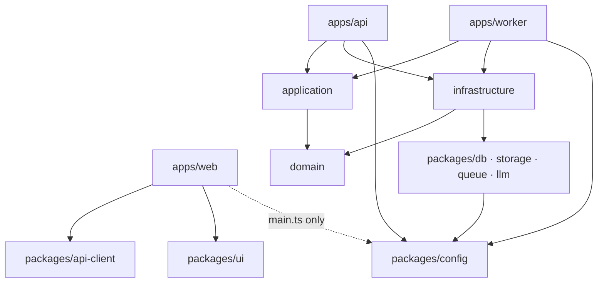
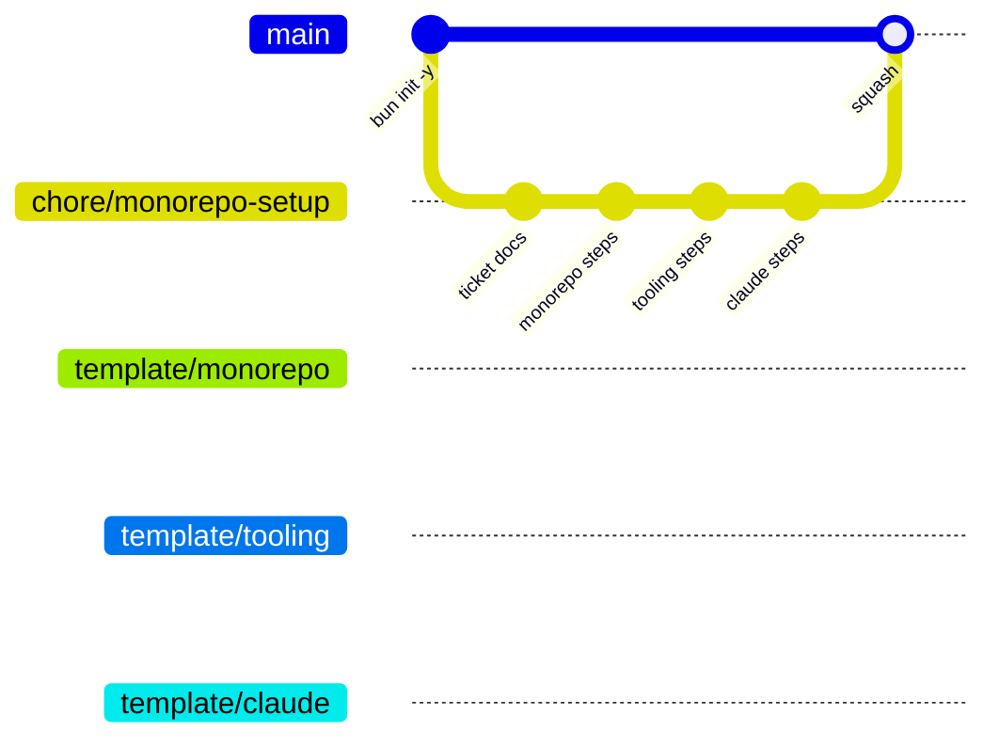
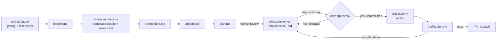

# Monorepo setup — architecture

> Ticket: `2026-10-15_monorepo-setup` · Requirements: [feature.md](./feature.md)

## Overview

### Layers



- **`domain`** has no dependencies. It owns the models, the errors, and the **ports**: interfaces that infrastructure implements.
- **`application`** depends only on `domain`. It receives its ports as arguments.
- **`infrastructure`** implements the domain ports on top of the agnostic `packages/*` clients.
- **`apps/api` and `apps/worker`** are composition roots: `layer.ts` wires infrastructure into application. Each `layer.ts` is the future Effect `Layer` seam.
- **`apps/web`** talks to the backend only through `api-client`.

### Delivery: git



- **Steps.** Each layer in the diagram covers one or more `plan.md` steps, one commit per step. The `template/*` branch is cut at the last step of its layer.
- **Merge.** The PR is squash-merged, so `main` receives one commit. The `template/*` branches keep the step commits alive as frozen snapshots.
- **Starting a new project:** `git checkout template/<layer> -b <project>`, rename the `@oblik` scope, and delete `docs/tickets/2026-10-15_monorepo-setup/`.

### SDD flow



Commands run in the main session, because the grilling, review and commit-approval steps need dialogue with the user. Agents are delegated workers, and their tool limits are set on the agent definition, not on the command.

## Structure

The tree below is the end state of `template/claude`, which already includes this ticket's docs. `★` marks the files of the `example` slice.

```text
.
├── .claude/
│   ├── settings.json                    # permissions: deny npm/yarn/pnpm, push --force, rm -rf; allow bun/bunx/make/git read
│   ├── rules/
│   │   ├── claude-md.md                 # CLAUDE.md ≤ ~40 lines, rule ≤ ~80, one author per fact
│   │   ├── comments.md                  # default no comment; WHY-only gates
│   │   ├── naming.md                    # <name>.<role>.ts, role suffixes, verb-per-layer
│   │   ├── commits.md                   # gitmoji · type(scope) · Decision: · Refs: docs/tickets/…
│   │   ├── pull-requests.md             # squash; PR description = commit body
│   │   ├── tooling.md                   # imperatives → links docs/knowledge/tooling.md
│   │   └── sdd.md                       # flow contract, artifact paths, EARS
│   ├── agents/
│   │   ├── researcher.md                # read-only facts (no Edit/Write/NotebookEdit)
│   │   ├── implementer.md               # plan step → TDD → commit
│   │   └── verifier.md                  # read-only verdict + simplifications
│   ├── commands/
│   │   ├── ticket:feature.md
│   │   ├── ticket:architecture.md
│   │   ├── ticket:plan.md
│   │   ├── ticket:implement.md
│   │   └── ticket:verify.md
│   └── skills/
│       ├── grilling/SKILL.md
│       ├── codebase-design/SKILL.md
│       └── tdd/SKILL.md
├── .github/
│   ├── PULL_REQUEST_TEMPLATE.md
│   ├── PULL_REQUEST_example.md
│   └── workflows/ci.yml
├── .husky/
│   ├── pre-commit                       # bun check && bunx biome check --staged --no-errors-on-unmatched
│   └── pre-push                         # bun test
├── docs/
│   ├── tickets/
│   │   ├── _template/{feature,architecture,plan,verification}.md
│   │   └── 2026-10-15_monorepo-setup/{feature,architecture,plan,verification}.md
│   └── knowledge/
│       ├── tooling.md                   # scripts, Makefile, --hot vs --watch, debug, .env, catalog, references
│       ├── architecture.md              # layers, dependency rules, Effect seam
│       └── sdd.md                       # how to run /ticket:*
├── domain/                              # @oblik/domain
│   ├── CLAUDE.md
│   ├── package.json · tsconfig.json
│   ├── shared/{id,error}.ts             ★
│   └── example/
│       ├── example.model.ts             ★
│       ├── example.error.ts             ★
│       ├── example.service.ts           ★  ports + pure domain ops
│       └── example.service.test.ts      ★
├── application/                         # @oblik/application
│   ├── CLAUDE.md · package.json · tsconfig.json
│   └── example/
│       ├── example.service.ts           ★
│       ├── create.use-case.ts           ★
│       └── create.use-case.test.ts      ★
├── infrastructure/                      # @oblik/infrastructure
│   ├── CLAUDE.md · package.json · tsconfig.json
│   ├── shared/{db.client,outbox.repository}.ts
│   └── example/
│       ├── example.repository.ts        ★  in-memory ExampleRepository
│       ├── example.storage.ts           ★  stub
│       ├── example.queue.ts             ★  stub
│       └── example.llm.ts               ★  stub
├── packages/
│   ├── CLAUDE.md
│   ├── config/{config,load,index}.ts    # @oblik/config (+ load.test.ts optional)
│   ├── db/client.ts                     # @oblik/db       stub
│   ├── storage/client.ts                # @oblik/storage  stub
│   ├── queue/client.ts                  # @oblik/queue    stub
│   ├── llm/client.ts                    # @oblik/llm      stub
│   ├── api-client/index.ts              # @oblik/api-client  getHealth()
│   └── ui/index.ts                      # @oblik/ui       trivial export
│   (each: package.json · tsconfig.json)
├── apps/
│   ├── CLAUDE.md
│   ├── api/                             # @oblik/api
│   │   └── src/{main,http,layer}.ts · http.test.ts ★
│   ├── worker/                          # @oblik/worker
│   │   └── src/{main,layer}.ts · handlers/example.handler.ts ★
│   └── web/                             # @oblik/web
│       └── src/main.ts (Bun.serve + HTML import) · index.html · app/ · features/example/ · shared/
│   (each: package.json with dev/debug/start · tsconfig.json)
├── deployment/                          # @oblik/deployment — stubs only
│   ├── CLAUDE.md · package.json · tsconfig.json
│   ├── local/{docker-compose.yml,README.md}
│   ├── aws/{index,config,database,storage,queue,api,worker,web,iam}.ts
│   ├── shared/{naming,tags}.ts
│   └── Pulumi.yaml
├── .env.example · .gitignore            # .env, node_modules, node_modules/.cache, coverage
├── biome.json
├── bunfig.toml
├── tsconfig.base.json · tsconfig.json
├── package.json · bun.lock
├── Makefile
├── CLAUDE.md
└── README.md
```

### Dependency rules

Rows list what the workspace may import. A `✗` is enforced twice: by `dependencies` and by Biome `noRestrictedImports`.

| From ↓ / may import → | domain | application | infrastructure | packages/config | packages/{db,storage,queue,llm} | api-client · ui |
|---|---|---|---|---|---|---|
| domain | (self) | ✗ | ✗ | ✗ | ✗ | ✗ |
| application | ✓ | (self) | ✗ | ✗ | ✗ | ✗ |
| infrastructure | ✓ | ✗ | (self) | ✓ | ✓ | ✗ |
| packages/config | ✗ | ✗ | ✗ | (self) | ✗ | ✗ |
| packages/{db,storage,queue,llm} | ✗ | ✗ | ✗ | ✓ | ✗ | ✗ |
| packages/{api-client,ui} | ✗ | ✗ | ✗ | ✗ | ✗ | (self) |
| apps/api · apps/worker | ✓ | ✓ | ✓ | ✓ | ✗ | ✗ |
| apps/web (client: `app/`, `features/`, `shared/`) | ✗ | ✗ | ✗ | ✗ | ✗ | ✓ |
| apps/web/src/main.ts (server entry) | ✗ | ✗ | ✗ | ✓ | ✗ | ✓ |
| deployment | ✗ | ✗ | ✗ | ✗ | ✗ | ✗ |

## Contracts

These are sketches of the shape, not final code. They are plain TS, use the kotodama naming verbs (`build`/`ensure` in the domain, `select`/`upsert` in persistence), and contain no Effect.

```ts
// domain/shared/id.ts
export type Id<Brand extends string> = string & { readonly __brand: Brand }
export const buildId = <Brand extends string>(): Id<Brand> => crypto.randomUUID() as Id<Brand>

// domain/shared/error.ts — `_tag` keeps the seam for Effect's Data.TaggedError
export abstract class DomainError extends Error {
  abstract readonly _tag: string
}

// domain/example/example.model.ts
export type ExampleId = Id<'Example'>
export interface Example {
  readonly id: ExampleId
  readonly name: string
  readonly createdAt: Date
}

// domain/example/example.error.ts
export class ExampleNameInvalidError extends DomainError { readonly _tag = 'ExampleNameInvalidError' }
export class ExampleNotFoundError extends DomainError { readonly _tag = 'ExampleNotFoundError' }

// domain/example/example.service.ts — port + pure operation
export interface ExampleRepository {
  upsert(example: Example): Promise<void>
  selectById(id: ExampleId): Promise<Example | undefined>
}
export const buildExample = (name: string, now: Date): Example // throws ExampleNameInvalidError

// application/example/example.service.ts
export interface ExampleService {
  get(id: ExampleId): Promise<Example> // throws ExampleNotFoundError
  save(example: Example): Promise<void>
}
export const createExampleService = (deps: { repository: ExampleRepository }): ExampleService

// application/example/create.use-case.ts — use case composes services
export const createExampleUseCase =
  (deps: { exampleService: ExampleService; now: () => Date }) =>
  (input: { name: string }): Promise<Example>

// infrastructure/example/example.repository.ts — in-memory until Postgres lands
export const createExampleRepository = (): ExampleRepository

// packages/config/config.ts · load.ts
export interface Config {
  readonly nodeEnv: 'development' | 'test' | 'production'
  readonly logLevel: 'debug' | 'info' | 'warn' | 'error'
  readonly api: { readonly port: number }
  readonly web: { readonly port: number }
}
export class ConfigError extends Error { readonly issues: readonly string[] } // names every bad var
export const loadConfig = (env: Record<string, string | undefined> = Bun.env): Config

// apps/api/src/layer.ts — composition root (future Effect Layer)
export const buildLayer = (config: Config) => ({ exampleService, createExample })

// apps/api/src/http.ts — Bun.serve routes, testable without a port
export const buildRoutes = (layer: ReturnType<typeof buildLayer>) => ({
  '/health': () => Response.json({ status: 'ok' }),
  '/examples': { POST: async (req: Request) => Response },
  '/examples/:id': { GET: async (req: Bun.BunRequest<'/examples/:id'>) => Response },
})

// apps/api/src/main.ts
Bun.serve({ port: config.api.port, routes: buildRoutes(buildLayer(config)) })

// apps/worker/src/handlers/example.handler.ts
export const handleExample = (job: { exampleId: ExampleId }): Promise<void>
// apps/worker/src/main.ts — setInterval polling stub that calls handleExample and logs

// packages/api-client/index.ts
export const createApiClient = (baseUrl: string) => ({ getHealth(): Promise<{ status: 'ok' }> })

// apps/web/src/main.ts
import index from './index.html'
Bun.serve({ port: config.web.port, routes: { '/': index }, development: { hmr: true, console: true } })
```

The `packages/{db,storage,queue,llm}/client.ts`, `infrastructure/example/example.{storage,queue,llm}.ts`, `infrastructure/shared/*` and `deployment/**` files are export-only stubs. Each exports a typed factory or constant, for example `createDbClient(config: { url: string })` and `exampleQueueName`. They compile and are imported nowhere at runtime.

## Configuration

### Root `package.json`

```jsonc
{
  "name": "oblik",
  "private": true,
  "type": "module",
  "packageManager": "bun@1.4.3",
  "workspaces": ["domain", "application", "infrastructure", "packages/*", "apps/*", "deployment"],
  "catalogs": {
    "runtime": {
      "@biomejs/biome": "2.5.15",
      "@types/bun": "1.4.3",
      "husky": "9.1.7",
      "typescript": "7.0.2"
    }
  },
  "devDependencies": {
    "@biomejs/biome": "catalog:runtime",
    "@types/bun": "catalog:runtime",
    "husky": "catalog:runtime",
    "typescript": "catalog:runtime"
  },
  "scripts": {
    "prepare": "husky",
    "lint": "biome check",
    "format": "biome check --write",
    "test": "bun test"
  }
}
```

Workspace `package.json`:
- `"name": "@oblik/<ws>"`, `"private": true`, `"type": "module"`;
- `exports` points at `.ts` sources (no build step), e.g. `"./example": "./example/index.ts"` or per-file subpaths;
- internal dependencies use `"workspace:*"`.

### `bunfig.toml`

```toml
[install]
exact = true
linker = "isolated"   # undeclared workspace imports fail to resolve (see D9)
```

### TypeScript

`tsconfig.base.json`:

```jsonc
{
  "compilerOptions": {
    "target": "ESNext", "lib": ["ESNext"], "module": "Preserve", "moduleDetection": "force",
    "moduleResolution": "bundler", "allowImportingTsExtensions": true, "verbatimModuleSyntax": true,
    "types": ["bun"],
    "strict": true, "skipLibCheck": true, "noUncheckedIndexedAccess": true,
    "noImplicitOverride": true, "noFallthroughCasesInSwitch": true,
    "composite": true, "declaration": true, "emitDeclarationOnly": true
  }
}
```

- **Root `tsconfig.json`:** `{ "files": [], "references": [ …every workspace… ] }`.
- **Workspace `tsconfig.json`:** `extends` the base and sets `compilerOptions.rootDir: "."` and `outDir: "<rel>/node_modules/.cache/tsc/<ws>"`. It also sets `include` and `references` to its internal dependencies. `apps/web` adds `"lib": ["ESNext", "DOM"]`.
- **Checked by experiment (TS 7.0.2, Bun 1.4.3):**
  - `bun check` from the root walks the references and emits nothing;
  - `tsc -b` emits only into the cache;
  - `composite` combined with `noEmit` fails with TS6310;
  - references do **not** stop an undeclared cross-package import (see D9 and D10).

### Biome (`biome.json`, root only)

```jsonc
{
  "vcs": { "enabled": true, "clientKind": "git", "useIgnoreFile": true, "defaultBranch": "main" },
  "files": { "ignoreUnknown": true },
  "formatter": { "indentStyle": "space", "indentWidth": 2, "lineWidth": 100 },
  "javascript": { "formatter": { "quoteStyle": "single", "semicolons": "asNeeded" } },
  "linter": {
    "rules": {
      "recommended": true,
      "style": { "useImportType": "error" },
      "suspicious": { "noExplicitAny": "error" }
    }
  },
  "overrides": [
    // one override per row of the dependency-rules table, e.g.:
    { "includes": ["domain/**"], "linter": { "rules": { "style": { "noRestrictedImports": {
      "level": "error",
      "options": { "patterns": [{ "group": ["@oblik/*", "!@oblik/domain"], "message": "domain imports nothing internal" }] }
    } } } } }
  ]
}
```

The exact option shape of `noRestrictedImports` is verified at implementation time (feature V2). Nested `biome.json` files are added only when a workspace needs to differ, using `"extends": "//"`.

### Environment

| Variable | Read by | `.env.example` |
|---|---|---|
| `NODE_ENV` | config | `development` |
| `LOG_LEVEL` | config | `info` |
| `API_PORT` | config → api | `3000` |
| `WEB_PORT` | config → web | `3001` |
| `DATABASE_URL` | (stub) | commented |
| `S3_ENDPOINT`, `S3_BUCKET` | (stub) | commented |
| `QUEUE_URL` | (stub) | commented |
| `LLM_API_KEY` | (stub) | commented |

App scripts load the root file explicitly:

| App | `dev` | `debug` | `start` |
|---|---|---|---|
| api | `bun --env-file=../../.env --hot src/main.ts` | `bun --env-file=../../.env --inspect --hot src/main.ts` | `bun --env-file=../../.env src/main.ts` |
| worker | `… --watch src/main.ts` | `… --inspect --watch src/main.ts` | same as api |
| web | `… --hot src/main.ts` (HMR via `development.hmr`) | `… --inspect --hot src/main.ts` | same as api |

### Makefile (root, GNU Make 3.81-safe)

| Target | Does |
|---|---|
| `help` (default) | lists targets from `##` comments |
| `setup` | `bun install`, then copies `.env.example` → `.env` if `.env` is missing |
| `dev` | `bun --filter './apps/*' --parallel dev` |
| `dev-api` / `dev-worker` / `dev-web` | `bun --filter @oblik/<app> dev` |
| `debug-api` / `debug-worker` / `debug-web` | `bun --filter @oblik/<app> debug` |
| `check` | `lint` + `typecheck` + `test` |
| `lint` / `fmt` | `bun run lint` / `bun run format` |
| `typecheck` | `bun check` |
| `test` | `bun test` |
| `clean` | removes `node_modules`, `node_modules/.cache`, `coverage` |
| `outdated` | `bun outdated` (update by editing one line in `catalogs.<namespace>`) |

### Hooks and CI

- **`pre-commit`:** `bun check` and `bunx biome check --staged --no-errors-on-unmatched`, with no `--write`, so partially staged files are not rewritten.
- **`pre-push`:** `bun test`.
- **`ci.yml`** is adapted from kotodama-core:
  - **triggers:** `pull_request`, plus `push` to `[main, 'template/*']`;
  - **concurrency:** cancels superseded runs of the same workflow and ref;
  - **jobs:**
    - `static` — `biome ci`, then `bun check`;
    - `test` — `bun test`;
    - `links` — `lycheeverse/lychee-action`, `--offline` on `README.md`, `docs/**/*.md`, `.claude/**/*.md`;
  - **Bun matrix:** pinned version via `bun-version-file: package.json` (blocking) and `latest` (`continue-on-error`);
  - **caching and install:** `~/.bun/install/cache` keyed on `bun.lock`, then `bun install --frozen-lockfile`;
  - **dropped from kotodama:** Testcontainers, the docker image cache and the Ryuk env var;
  - **deferred jobs**, kept as a comment: container integration tests, prod build, deploy preview.

### `.github` templates

- **`PULL_REQUEST_TEMPLATE.md`** keeps kotodama's structure: a review-only HTML comment, then Summary · What changed · How it works · Decisions · Refs. It changes in three places:
  - the self-check runs `make check`;
  - the hierarchy check is now `apps → application → infrastructure → domain`, `packages/*` are leaves, and `web` may use only `api-client` and `ui`;
  - the Refs line becomes `Refs: docs/tickets/<ticket>/`.
- **`PULL_REQUEST_example.md`** is rewritten around this ticket, with the title `:tada: chore(monorepo-setup): Scaffold Bun monorepo`.

### `.claude` adaptation from kotodama-core

- **`commits.md`:** scope is `<ticket-slug>` or an area (`api`, `domain`, …). Kotodama-style `F-PLAT-001/T0N` scopes are not used. `Refs:` is a path under `docs/tickets/`; Notion links are dropped.
- **`naming.md`** keeps only the start-up part:
  - role suffixes `.model` `.error` `.service` `.repository` `.storage` `.queue` `.llm` `.use-case` `.handler` `.client`;
  - the `@oblik/<ws>` package names;
  - verb-per-layer.

  Effect and Drizzle sections are dropped.
- **`tooling.md`:** vitest, `--config-path` and the presets package are dropped. It gains Bun, Makefile, `.env`, catalog and references.
- **`sdd.md`:**
  - kotodama's rule *"never mirror a local specs folder"* is inverted: `docs/tickets/` is the single source;
  - Notion data sources are dropped;
  - commands stay flat, with colon filenames;
  - tool boundaries stay on agents.
- **Agents:**
  - `researcher` — `disallowedTools: Edit, Write, NotebookEdit`; Bash is allowed for `npm view` and scratch experiments;
  - `verifier` — same restriction;
  - `implementer` — unrestricted.

  No agent sets `model:`, so each inherits the session model.
- **Vendored skills:** reduced to the parts the flow uses, with paths rewritten to `docs/tickets/`, and with upstream and version recorded in the frontmatter.

## Decisions

- **D1 — Template stack cut from ticket-branch commits; the PR is squash-merged.** `main` gets one commit, and the frozen `template/*` branches hold the step history. *Rejected:* rebase-merging only this PR, which would break the one-PR-one-squash rule; building the templates before the ticket PR, which would leave two sources of truth.
- **D2 — One workspace per layer** (`@oblik/domain`, …). The entity folders are subpath exports. *Rejected:* a package per layer × entity (dozens of packages); `paths`-only aliases (no dependency graph).
- **D3 — Root-level config files** (`biome.json` with `"//"` extends, `tsconfig.base.json`). *Rejected:* kotodama's presets package with `--config-path`. Editors and CI would need the flag, and the name would collide with the runtime `packages/config`.
- **D4 — Project references with `composite` + `emitDeclarationOnly` into `node_modules/.cache/tsc`.** `bun check` is the gate and emits nothing; `tsc -b` stays valid. *Rejected:* `noEmit` (TS6310); a single flat root tsconfig (the user chose references).
- **D5 — Domain `*.service.ts` hosts ports and pure operations.** It keeps the architecture-page file set and later becomes the Effect `Context.Tag` site. *Rejected:* an extra `*.port.ts` role, which deviates from the target tree.
- **D6 — Application depends only on domain; apps wire infrastructure in `layer.ts`.** Services are injected and never import each other; use cases compose services. *Rejected:* application importing infrastructure, which couples scenarios to adapters.
- **D7 — Exact pins in named root catalogs.** Every workspace uses `catalog:<namespace>`, and `exact = true`. *Rejected:* per-package pins, which duplicate versions.
- **D20 — Named catalogs only: a single `runtime` namespace now; lock-step families get their own namespace when introduced.** Using a namespace from day one makes the mechanism visible in `package.json`, so the next agent extends it (e.g. `catalogs.effect`, `catalogs.pulumi`) instead of reaching for a default bucket. Bun rejects a reference to an unknown namespace. *Rejected:* a default `catalog`, which hides the mechanism; splitting `tooling` from `runtime` now (user choice); reserving empty `effect` and `pulumi` namespaces before those tickets exist.
- **D21 — Every step commit needs explicit user approval.** A subagent cannot ask the user, so `implementer` stops after verifying a step and returns a summary. `/ticket:implement`, running in the main session, shows that summary and commits only on an explicit OK (R35a). *Rejected:* the implementer committing autonomously, which the user disallowed on 2026-10-15.
- **D8 — Explicit `--env-file=../../.env` in app scripts.** This was verified: Bun loads `.env` relative to the cwd only. *Rejected:* Makefile-only env loading, which breaks `bun run dev` from a package directory; per-package `bunfig.toml`.
- **D9 — `linker = "isolated"`.** The experiment showed that references do not stop undeclared imports. The isolated linker makes an undeclared workspace import fail at resolution. *Rejected:* `hoisted`, where any package can be imported.
- **D10 — Biome `noRestrictedImports` overrides in the root config are the authoritative layer guard.** They catch the problem at lint time, with a message that names the rule. Dependencies and the isolated linker are the second line.
- **D11 — `--hot` for api and web, `--watch` for worker; there is no `--dev`.** `--hot` swaps `Bun.serve` handlers and keeps `globalThis`. `--watch` restarts the process, so the worker's timers and connections never duplicate. Hot reload is accepted manually (same PID), not with a flaky automated test.
- **D12 — Built-in `bun check` replaces `tsc` as the typecheck gate.** It is a native port, is 3–6× faster, and needs no emit. `typescript` stays installed for the editor and `tsc -b`.
- **D13 — Hooks are split: commit runs typecheck and lint, push runs tests.** Commits stay fast, and CI catches `--no-verify`.
- **D14 — Five commands and three agents.** Interactive phases (grilling, plan review) cannot run in a subagent. Read-only agents return their reports, and the command persists them. *Rejected:* kotodama's 5 agents and 6 commands, as over-scoped.
- **D15 — Skills are vendored, not used from plugins.** The template has to be self-contained, and the plugins write to `.scratch/` and `docs/superpowers/`, which would conflict with `docs/tickets/`.
- **D16 — Ticket templates live in `docs/tickets/_template/`**, next to their output (user choice).
- **D17 — `layer.ts` keeps its name.** The Effect migration then replaces the contents, not the structure.
- **D18 — This ticket's docs are tracked from the first step.** Every template therefore ships a complete worked example of the SDD flow, and a new project deletes it. *Rejected:* keeping the docs untracked until a final step, which risks losing them and hides the flow's own example.
- **D19 — `apps/web/src/main.ts` may import `@oblik/config`.** The rule protects the *client* bundle from server code, and `main.ts` is the server shell, which needs a validated `WEB_PORT` (R18). The exception is a dedicated Biome override for that single file. *Rejected:* reading `Bun.env` directly, which bypasses validation; serving the HTML from `apps/api`, which couples the two apps.

## Risks

| Risk | Mitigation |
|---|---|
| The isolated linker breaks a tool (husky, biome, lychee action) | Fallback to `hoisted`. D10 still guards the layer boundaries. |
| `--env-file` fails when `.env` is missing in CI | Verify early. If it fails, CI writes an empty `.env`, or app scripts are not used in CI (tests don't need them). |
| Biome `noRestrictedImports` cannot express "allow X, deny the rest" | Use `patterns` with negation. Otherwise enumerate the forbidden packages per override. |
| TS 7 programmatic API gaps affect editor plugins | No TS plugins are used. `bun check` is independent of the `typescript` package. |
| The frozen `template/*` branches drift from `main` | They are documented as snapshots. New template versions are cut as new branches, never by rewriting. |
| Templates carry this Oblik-specific ticket (D18) | `README.md` and `docs/knowledge/sdd.md` say to delete `docs/tickets/2026-10-15_*` when a new project is started. |
| GNU Make 3.81 lacks modern features | Use only POSIX-style recipes. Parallelism is delegated to `bun --filter --parallel`. |
