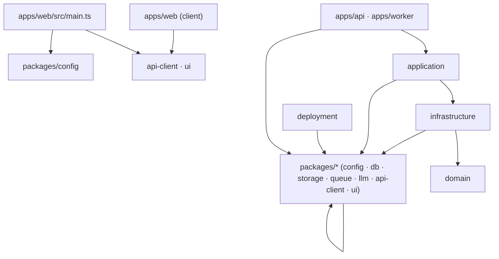
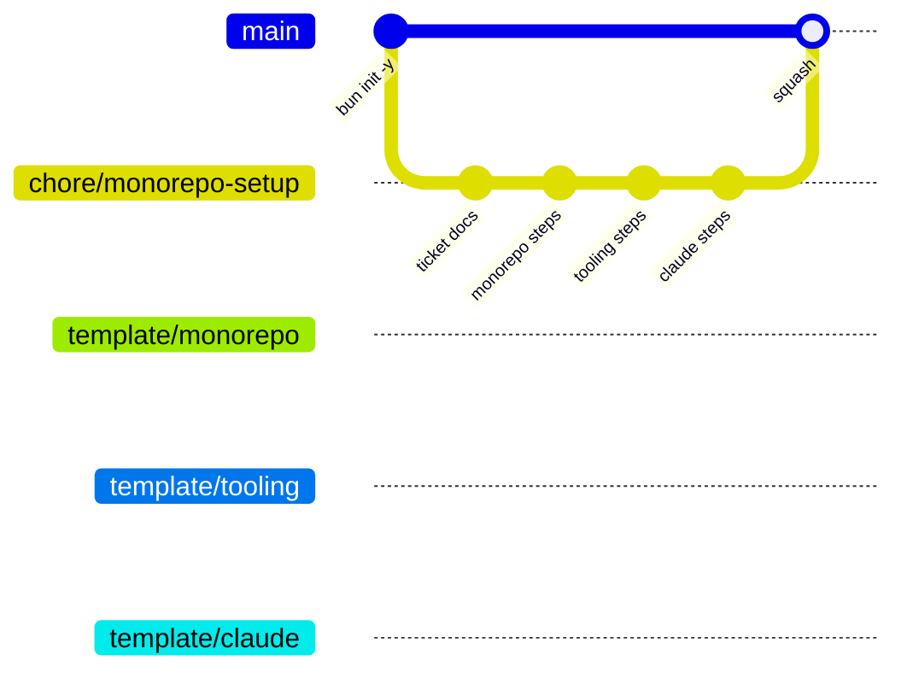
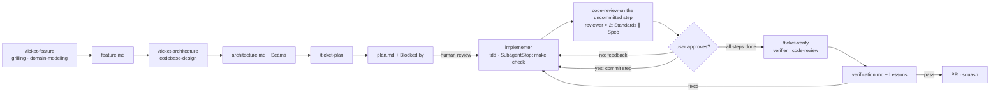

# Monorepo setup — architecture

> Ticket: `2026-10-15_monorepo-setup` · Requirements: [feature.md](./feature.md)

## Overview

### Layers



Imports only go **down**: `apps` → `application` → `infrastructure` → `domain`. A layer may import any layer below it, not only the next one.

- **`domain`** is the pure core: models, errors, ports, and pure operations. It imports no workspace, not even `packages/*`.
- **`infrastructure`** implements domain ports on top of the generic `packages/*` clients.
- **`application`** holds services and use cases. It may import `infrastructure` directly. Injecting ports through `layer.ts` is still the default wiring, but it is no longer a hard rule (D6).
- **`packages/*`** are generic. Every layer except `domain` may import them, and they may import each other, but they never import a layer.
- **`apps/api` and `apps/worker`** are composition roots: `layer.ts` is the future Effect `Layer` seam. Apps never import each other.
- **`apps/web`** ships to the browser, so its client code sees only `api-client` and `ui`. The server entry `main.ts` may also read `config` (D19).

### Delivery: git



- **Steps.** Each layer in the diagram covers one or more `plan.md` steps, one commit per step. The `template/*` branch is cut at the last step of its layer.
- **Merge.** The PR is squash-merged, so `main` receives one commit. The `template/*` branches keep the step commits alive as frozen snapshots.
- **Starting a new project:** `git checkout template/<layer> -b <project>`, rename the `@oblik` scope, and delete `docs/tickets/2026-10-15_monorepo-setup/`.

### SDD flow



- **Wrappers, not a fork.** Our five `/ticket-*` skills decide *where* artifacts go and *when* the user decides. The `mattpocock-skills` plugin decides *how* to interview, model the domain, design, test and review. The plugin updates itself, and the wrappers reference its skills by name (D30).
- **Every skill runs in the main session**, because grilling, plan review and commit approval need the user, and subagents cannot ask questions. Agents are delegated workers, and their tool limits live on the agent definition.

## Structure

The tree below is the end state of `template/claude`, which already includes this ticket's docs. `★` marks the files of the `example` slice.

```text
.
├── .claude/
│   ├── settings.json                    # permissions: deny npm/yarn/pnpm, push --force, rm -rf; allow bun/bunx/make/git read
│   ├── rules/
│   │   ├── claude-md.md                 # CLAUDE.md ≤ ~40 lines, rule ≤ ~80, one author per fact
│   │   ├── comments.md                  # default no comment; WHY-only gates
│   │   ├── naming.md                    # <name>.<role>.ts, role suffixes, verb-per-layer
│   │   ├── commits.md                   # gitmoji · type(scope) · Decision: · Refs: docs/tickets/…
│   │   ├── pull-requests.md             # squash; PR description = commit body
│   │   ├── tooling.md                   # imperatives → links docs/knowledge/tooling.md
│   │   └── sdd.md                       # flow contract, artifact paths, EARS
│   ├── agents/
│   │   ├── researcher.md                # read-only facts, primary sources
│   │   ├── implementer.md               # one plan step; preloads tdd; SubagentStop hook → make check
│   │   ├── reviewer.md                  # read-only; one code-review axis (Standards or Spec)
│   │   └── verifier.md                  # read-only; whole ticket, R-by-R behaviour
│   ├── hooks/
│   │   └── make-check.sh                # SubagentStop gate for implementer
│   └── skills/                          # user-invoked wrappers over mattpocock-skills
│       ├── ticket-feature/SKILL.md
│       ├── ticket-architecture/SKILL.md
│       ├── ticket-plan/SKILL.md
│       ├── ticket-implement/SKILL.md
│       └── ticket-verify/SKILL.md
├── .github/
│   ├── PULL_REQUEST_TEMPLATE.md
│   ├── PULL_REQUEST_example.md
│   └── workflows/ci.yml
├── .husky/
│   ├── pre-commit                       # bun check && bunx biome check --staged --no-errors-on-unmatched
│   └── pre-push                         # bun test
├── docs/
│   ├── tickets/
│   │   ├── _template/{feature,architecture,plan,verification}.md
│   │   └── 2026-10-15_monorepo-setup/{feature,architecture,plan,verification}.md
│   └── knowledge/
│       ├── tooling.md                   # scripts, Makefile, --hot vs --watch, debug, .env, catalog, references
│       ├── architecture.md              # layers, dependency rules, Effect seam
│       ├── sdd.md                       # how to run /ticket-*
│       └── glossary.md                  # domain language, created lazily by /ticket-feature
├── domain/                              # @oblik/domain
│   ├── CLAUDE.md
│   ├── package.json · tsconfig.json
│   ├── shared/{id,error,index}.ts       ★
│   └── example/
│       ├── index.ts                     ★  barrel → @oblik/domain/example
│       ├── example.model.ts             ★
│       ├── example.error.ts             ★
│       ├── example.service.ts           ★  ports + pure domain ops
│       └── example.service.test.ts      ★
├── application/                         # @oblik/application
│   ├── CLAUDE.md · package.json · tsconfig.json
│   └── example/
│       ├── example.service.ts           ★
│       ├── create.use-case.ts           ★
│       └── create.use-case.test.ts      ★
├── infrastructure/                      # @oblik/infrastructure
│   ├── CLAUDE.md · package.json · tsconfig.json
│   ├── shared/{db.client,outbox.repository}.ts
│   └── example/
│       ├── example.repository.ts        ★  in-memory ExampleRepository
│       ├── example.storage.ts           ★  stub
│       ├── example.queue.ts             ★  in-memory ExampleQueue (send/receive)
│       └── example.llm.ts               ★  stub
├── packages/
│   ├── CLAUDE.md
│   ├── config/{config,load,index}.ts    # @oblik/config (+ load.test.ts optional)
│   ├── db/client.ts                     # @oblik/db       stub
│   ├── storage/client.ts                # @oblik/storage  stub
│   ├── queue/client.ts                  # @oblik/queue    stub
│   ├── llm/client.ts                    # @oblik/llm      stub
│   ├── api-client/index.ts              # @oblik/api-client  getHealth()
│   └── ui/index.ts                      # @oblik/ui       trivial export
│   (each: package.json · tsconfig.json)
├── apps/
│   ├── CLAUDE.md
│   ├── api/                             # @oblik/api
│   │   └── src/{main,http,layer}.ts · http.test.ts ★
│   ├── worker/                          # @oblik/worker
│   │   └── src/{main,layer}.ts · handlers/example.handler.ts ★
│   └── web/                             # @oblik/web
│       └── src/main.ts (Bun.serve + HTML import + /api/* proxy) · index.html · app/main.ts
│           · features/example/health-panel.ts · shared/api.ts
│   (each: package.json with dev/debug/start · tsconfig.json)
├── deployment/                          # @oblik/deployment — stubs only
│   ├── CLAUDE.md · package.json · tsconfig.json
│   ├── local/{docker-compose.yml,README.md}
│   ├── aws/{index,config,database,storage,queue,api,worker,web,iam}.ts
│   ├── shared/{naming,tags}.ts
│   └── Pulumi.yaml
├── .env.example · .gitignore            # .env, node_modules, node_modules/.cache, coverage
├── biome.json
├── bunfig.toml
├── tsconfig.base.json · tsconfig.json
├── package.json · bun.lock
├── Makefile
├── CLAUDE.md
└── README.md
```

### Dependency rules

Each row lists what a workspace may import. Biome `noRestrictedImports` enforces the ✗ cells (D10). Even for a ✓ cell, the dependency must be **declared** in the workspace's `package.json`: the isolated linker and `bun check` reject undeclared imports (TS2307, D9).

| From ↓ / may import → | domain | infrastructure | application | packages/* | apps |
|---|---|---|---|---|---|
| domain | — | ✗ | ✗ | ✗ | ✗ |
| infrastructure | ✓ | — | ✗ | ✓ | ✗ |
| application | ✓ | ✓ | — | ✓ | ✗ |
| packages/* | ✗ | ✗ | ✗ | ✓ (each other) | ✗ |
| apps/api · apps/worker | ✓ | ✓ | ✓ | ✓ | ✗ (no sibling app) |
| apps/web client (`app/`, `features/`, `shared/`) | ✗ | ✗ | ✗ | `api-client`, `ui` only | ✗ |
| apps/web/src/main.ts | ✗ | ✗ | ✗ | `api-client`, `ui`, `config` | ✗ |
| deployment | ✗ | ✗ | ✗ | ✓ | ✗ |

## Contracts

These are sketches of the shape, not final code. They are plain TS, use the kotodama naming verbs (`build`/`ensure` in the domain, `select`/`upsert` in persistence), and contain no Effect.

```ts
// domain/shared/id.ts
export type Id<Brand extends string> = string & { readonly __brand: Brand }
export const buildId = <Brand extends string>(): Id<Brand> => crypto.randomUUID() as Id<Brand>

// domain/shared/error.ts — `_tag` keeps the seam for Effect's Data.TaggedError
export abstract class DomainError extends Error {
  abstract readonly _tag: string
}

// domain/example/example.model.ts
export type ExampleId = Id<'Example'>
export interface Example {
  readonly id: ExampleId
  readonly name: string
  readonly createdAt: Date
}

// domain/example/example.error.ts
export class ExampleNameInvalidError extends DomainError { readonly _tag = 'ExampleNameInvalidError' }
export class ExampleNotFoundError extends DomainError { readonly _tag = 'ExampleNotFoundError' }

// domain/example/example.service.ts — port + pure operation
export interface ExampleRepository {
  upsert(example: Example): Promise<void>
  selectById(id: ExampleId): Promise<Example | undefined>
}
export const buildExample = (name: string, now: Date): Example // throws ExampleNameInvalidError

// application/example/example.service.ts
export interface ExampleService {
  get(id: ExampleId): Promise<Example> // throws ExampleNotFoundError
  save(example: Example): Promise<void>
}
export const createExampleService = (deps: { repository: ExampleRepository }): ExampleService

// application/example/create.use-case.ts — use case composes services
export const createExampleUseCase =
  (deps: { exampleService: ExampleService; now: () => Date }) =>
  (input: { name: string }): Promise<Example>

// infrastructure/example/example.repository.ts — in-memory until Postgres lands
export const createExampleRepository = (): ExampleRepository

// packages/config/config.ts · load.ts
export interface Config {
  readonly nodeEnv: 'development' | 'test' | 'production'
  readonly logLevel: 'debug' | 'info' | 'warn' | 'error'
  readonly api: { readonly port: number }
  readonly web: { readonly port: number }
}
export class ConfigError extends Error { readonly issues: readonly string[] } // names every bad var
export const loadConfig = (env: Record<string, string | undefined> = Bun.env): Config

// apps/api/src/layer.ts — composition root (future Effect Layer)
export const buildLayer = () => ({ exampleService, createExample }) // takes Config once a client needs it (D22)

// apps/api/src/http.ts — Bun.serve routes, testable without a port
export const buildRoutes = (layer: ReturnType<typeof buildLayer>) => ({
  '/health': () => Response.json({ status: 'ok' }),
  '/examples': { POST: async (req: Request) => Response },
  '/examples/:id': { GET: async (req: Bun.BunRequest<'/examples/:id'>) => Response },
})

// apps/api/src/main.ts
Bun.serve({ port: config.api.port, routes: buildRoutes(buildLayer()) })

// infrastructure/example/example.queue.ts — in-memory until the queue client exists
export interface ExampleJob { readonly type: 'example.process'; readonly exampleId: ExampleId }
export interface ExampleQueue { send(job: ExampleJob): Promise<void>; receive(): Promise<readonly ExampleJob[]> }
export const createExampleQueue = (): ExampleQueue

// apps/worker/src/handlers/example.handler.ts
export const createExampleHandler = (deps: { exampleService: ExampleService }) => (job: ExampleJob): Promise<void>
// apps/worker/src/layer.ts — buildLayer() => ({ queue, pollOnce() })
// apps/worker/src/main.ts — setInterval(pollOnce, 1_000), errors logged

// packages/api-client/index.ts
export const createApiClient = (baseUrl: string) => ({ getHealth(): Promise<{ status: 'ok' }> })

// apps/web/src/main.ts — server entry; the only web file that may import @oblik/config (D19)
import index from './index.html'
Bun.serve({
  port: config.web.port,
  routes: { '/': index, '/api/*': proxyToApi }, // same-origin calls, no CORS (D23)
  development: config.nodeEnv === 'development' && { hmr: true, console: true },
})
```

The `packages/{db,storage,queue,llm}/client.ts`, `infrastructure/example/example.{storage,queue,llm}.ts`, `infrastructure/shared/*` and `deployment/**` files are export-only stubs. Each exports a typed factory or constant, for example `createDbClient(config: { url: string })` and `exampleQueueName`. They compile and are imported nowhere at runtime.

## Configuration

### Root `package.json`

```jsonc
{
  "name": "oblik",
  "private": true,
  "type": "module",
  "packageManager": "bun@1.4.3",
  "workspaces": ["domain", "application", "infrastructure", "packages/*", "apps/*", "deployment"],
  "catalogs": {
    "tools": {
      "@biomejs/biome": "2.5.15",
      "husky": "9.1.7"
    },
    "runtime": {
      "@types/bun": "1.4.3",
      "typescript": "7.0.2"
    }
  },
  "devDependencies": {
    "@biomejs/biome": "catalog:tools",
    "@types/bun": "catalog:runtime",
    "husky": "catalog:tools",
    "typescript": "catalog:runtime"
  },
  "scripts": {
    "prepare": "husky",
    "lint": "biome check",
    "format": "biome check --write",
    "test": "bun test"
  }
}
```

Workspace `package.json`:
- `"name": "@oblik/<ws>"`, `"private": true`, `"type": "module"`;
- `exports` points at `.ts` sources (no build step), e.g. `"./example": "./example/index.ts"` or per-file subpaths;
- internal dependencies use `"workspace:*"`.

### `bunfig.toml`

```toml
[install]
exact = true
linker = "isolated"   # undeclared workspace imports fail to resolve (see D9)
```

### TypeScript

`tsconfig.base.json`:

```jsonc
{
  "compilerOptions": {
    "target": "ESNext", "lib": ["ESNext"], "module": "Preserve", "moduleDetection": "force",
    "moduleResolution": "bundler", "allowImportingTsExtensions": true, "verbatimModuleSyntax": true,
    "types": ["bun"],
    "strict": true, "skipLibCheck": true, "noUncheckedIndexedAccess": true,
    "noImplicitOverride": true, "noFallthroughCasesInSwitch": true,
    "composite": true, "declaration": true, "emitDeclarationOnly": true
  }
}
```

- **Root `tsconfig.json`:** `{ "files": [], "references": [ …every workspace… ] }`.
- **Workspace `tsconfig.json`:** `extends` the base and sets `compilerOptions.rootDir: "."` and `outDir: "<rel>/node_modules/.cache/tsc/<ws>"`. It also sets `include` and `references` to its internal dependencies. `apps/web` adds `"lib": ["ESNext", "DOM"]`.
- **Checked by experiment (TS 7.0.2, Bun 1.4.3):**
  - `bun check` from the root walks the references and emits nothing;
  - `tsc -b` emits only into the cache;
  - `composite` combined with `noEmit` fails with TS6310;
  - with a hoisted layout, references do **not** stop an undeclared cross-package import. With the isolated linker, such an import fails both at runtime and in `bun check` (TS2307); this was verified in S5 (see D9 and D10).

### Biome (`biome.json`, root only)

```jsonc
{
  "vcs": { "enabled": true, "clientKind": "git", "useIgnoreFile": true, "defaultBranch": "main" },
  "files": { "ignoreUnknown": true, "includes": ["**", "!bun.lock"] },
  "formatter": { "indentStyle": "space", "indentWidth": 2, "lineWidth": 100 },
  "javascript": { "formatter": { "quoteStyle": "single", "semicolons": "asNeeded" } },
  "linter": {
    "rules": {
      "preset": "recommended", // Biome 2.5 syntax
      "style": { "useImportType": "error" },
      "suspicious": { "noExplicitAny": "error" }
    }
  },
  "overrides": [
    // Deny-lists: each layer forbids what sits above it and its sibling apps,
    // so a new packages/* workspace needs no Biome change. Allow-lists remain only
    // for domain (nothing) and the web client (api-client, ui).
    { "includes": ["application/**"], "linter": { "rules": { "style": { "noRestrictedImports": {
      "level": "error",
      "options": { "patterns": [{
        "group": ["@oblik/api", "@oblik/api/**", "@oblik/worker", "@oblik/worker/**", "…"],
        "message": "application may import infrastructure, domain and packages/*: no upward imports"
      }] }
    } } } } }
  ]
}
```

Verified in Biome 2.5 (V2):

- `patterns[].group` takes gitignore-style globs, where `**` covers subpath imports and `!` excludes a path.
- When several overrides set `noRestrictedImports` on the same file, the later override **replaces** the earlier one's options. Each override therefore carries every pattern that applies to its files.
- Nested `biome.json` files are added only when a workspace needs to differ, using `"extends": "//"`.

### Environment

| Variable | Read by | `.env.example` |
|---|---|---|
| `NODE_ENV` | config | `development` |
| `LOG_LEVEL` | config | `info` |
| `API_PORT` | config → api | `3000` |
| `WEB_PORT` | config → web | `3001` |
| `DATABASE_URL` | (stub) | commented |
| `S3_ENDPOINT`, `S3_BUCKET` | (stub) | commented |
| `QUEUE_URL` | (stub) | commented |
| `LLM_API_KEY` | (stub) | commented |

App scripts load the root file explicitly:

| App | `dev` | `debug` | `start` |
|---|---|---|---|
| api | `bun --env-file=../../.env --hot src/main.ts` | `bun --env-file=../../.env --inspect --hot src/main.ts` | `bun --env-file=../../.env src/main.ts` |
| worker | `… --watch src/main.ts` | `… --inspect --watch src/main.ts` | same as api |
| web | `… --hot src/main.ts` (HMR via `development.hmr`) | `… --inspect --hot src/main.ts` | same as api |

### Makefile (root, GNU Make 3.81-safe)

| Target | Does |
|---|---|
| `help` (default) | lists targets from `##` comments |
| `setup` | `bun install`, then copies `.env.example` → `.env` if `.env` is missing |
| `dev` | `bun --filter './apps/*' dev` (long-running scripts start together, with package-prefixed output) |
| `dev-api` / `dev-worker` / `dev-web` | `bun --filter @oblik/<app> dev` |
| `debug-api` / `debug-worker` / `debug-web` | `bun --filter @oblik/<app> debug` |
| `check` | `lint` + `typecheck` + `test` |
| `lint` / `fmt` | `bun run lint` / `bun run format` |
| `typecheck` | `bun check` |
| `test` | `bun test` |
| `clean` | removes `node_modules`, `node_modules/.cache`, `coverage` |
| `outdated` | `bun outdated` (update by editing one line in `catalogs.<namespace>`) |

### Hooks and CI

- **`pre-commit`:** `bun check` and `bunx biome check --staged --no-errors-on-unmatched`, with no `--write`, so partially staged files are not rewritten.
- **`pre-push`:** `bun test`.
- **`ci.yml`** is adapted from kotodama-core:
  - **triggers:** `pull_request`, plus `push` to `[main, 'template/*']`;
  - **concurrency:** cancels superseded runs of the same workflow and ref;
  - **jobs:**
    - `static` — `biome ci`, then `bun check`;
    - `test` — `bun test`;
    - `links` — `lycheeverse/lychee-action`, `--offline` on `README.md`, `docs/**/*.md`, `.claude/**/*.md`;
  - **Bun matrix:** pinned version via `bun-version-file: package.json` (blocking) and `latest` (`continue-on-error`);
  - **caching and install:** `~/.bun/install/cache` keyed on `bun.lock`, then `bun install --frozen-lockfile`;
  - **dropped from kotodama:** Testcontainers, the docker image cache and the Ryuk env var;
  - **deferred jobs**, kept as a comment: container integration tests, prod build, deploy preview.

### `.github` templates

- **`PULL_REQUEST_TEMPLATE.md`** keeps kotodama's structure: a review-only HTML comment, then Summary · What changed · How it works · Decisions · Refs. It changes in three places:
  - the self-check runs `make check`;
  - the hierarchy check is now `apps → application → infrastructure → domain`, `packages/*` are leaves, and `web` may use only `api-client` and `ui`;
  - the Refs line becomes `Refs: docs/tickets/<ticket>/`.
- **`PULL_REQUEST_example.md`** is rewritten around this ticket, with the title `:tada: chore(monorepo-setup): Scaffold Bun monorepo`.

### `.claude` adaptation from kotodama-core

- **`commits.md`:** scope is `<ticket-slug>` or an area (`api`, `domain`, …). Kotodama-style `F-PLAT-001/T0N` scopes are not used. `Refs:` is a path under `docs/tickets/`; Notion links are dropped.
- **`naming.md`** keeps only the start-up part:
  - role suffixes `.model` `.error` `.service` `.repository` `.storage` `.queue` `.llm` `.use-case` `.handler` `.client`;
  - the `@oblik/<ws>` package names;
  - verb-per-layer.

  Effect and Drizzle sections are dropped.
- **`tooling.md`:** vitest, `--config-path` and the presets package are dropped. It gains Bun, Makefile, `.env`, catalog and references.
- **`sdd.md`:**
  - kotodama's rule *"never mirror a local specs folder"* is inverted: `docs/tickets/` is the single source;
  - Notion data sources are dropped;
  - it holds constraints only (artifact paths, EARS, gates); procedures live in the `/ticket-*` skills;
  - tool boundaries stay on agents.
- **Agents:**
  - `researcher`, `reviewer`, `verifier` — `disallowedTools: Edit, Write, NotebookEdit`; Bash is allowed for reading, running checks and scratch experiments;
  - `implementer` — unrestricted, but it never commits, and a `SubagentStop` hook keeps it working until `make check` passes.

  No agent sets `model:`, so each inherits the session model.
- **Vendored skills:** reduced to the parts the flow uses, with paths rewritten to `docs/tickets/`, and with upstream and version recorded in the frontmatter.

## Decisions

- **D1 — Template stack cut from ticket-branch commits; the PR is squash-merged.** `main` gets one commit, and the frozen `template/*` branches hold the step history. *Rejected:* rebase-merging only this PR, which would break the one-PR-one-squash rule; building the templates before the ticket PR, which would leave two sources of truth.
- **D2 — One workspace per layer** (`@oblik/domain`, …). The entity folders are subpath exports. *Rejected:* a package per layer × entity (dozens of packages); `paths`-only aliases (no dependency graph).
- **D3 — Root-level config files** (`biome.json` with `"//"` extends, `tsconfig.base.json`). *Rejected:* kotodama's presets package with `--config-path`. Editors and CI would need the flag, and the name would collide with the runtime `packages/config`.
- **D4 — Project references with `composite` + `emitDeclarationOnly` into `node_modules/.cache/tsc`.** `bun check` is the gate and emits nothing; `tsc -b` stays valid. *Rejected:* `noEmit` (TS6310); a single flat root tsconfig (the user chose references).
- **D5 — Domain `*.service.ts` hosts ports and pure operations.** It keeps the architecture-page file set and later becomes the Effect `Context.Tag` site. *Rejected:* an extra `*.port.ts` role, which deviates from the target tree.
- **D6 — Layers form one stack: `apps` → `application` → `infrastructure` → `domain`; each layer may import any layer below it (user decision, Q45).** `application` may import `infrastructure` directly. Wiring through `layer.ts` is still preferred, so use cases stay testable with fakes. *Rejected:* ports-only (`application` → `domain` only), which the user found too strict; `infrastructure` → `application`.
- **D7 — Exact pins in named root catalogs.** Every workspace uses `catalog:<namespace>`, and `exact = true`. *Rejected:* per-package pins, which duplicate versions.
- **D20 — Named catalogs only: `tools` and `runtime`; lock-step families get their own namespace when introduced.** `tools` holds developer-workflow tools that never shape the code's types or execution (`husky`, `@biomejs/biome`); `runtime` holds everything else, including `typescript` and `@types/bun`, because they define the language and runtime the code is written against. The taxonomy is visible in `package.json` itself, so the next agent classifies a new dependency instead of reaching for a default bucket. Bun rejects a reference to an unknown namespace. *History:* S2 started with a single `runtime` namespace; S12 split `tools` out when `husky` arrived (user decision, Q51). *Rejected:* a default `catalog`, which hides the mechanism; putting `typescript` and `@types/bun` under `tools`.
- **D21 — Every step commit needs explicit user approval.** A subagent cannot ask the user, so `implementer` stops after verifying a step and returns a summary. `/ticket-implement`, running in the main session, shows that summary and commits only on an explicit OK (R35a). *Rejected:* the implementer committing autonomously, which the user disallowed on 2026-10-15.
- **D22 — `packages/*` may import each other, but the clients take explicit options and do not import `@oblik/config` yet.** `infrastructure` maps `Config` onto client options once `Config` has service fields. Agnostic clients stay reusable, and no dependency is declared before it is used. *Rejected:* forcing `config` into every client while all service variables are still commented out (Q33).
- **D23 — The web dev server proxies `/api/*` to the api.** The browser stays same-origin, so the api needs no CORS policy. The api origin is `localhost:${API_PORT}` until a deploy ticket adds `API_URL`. *Rejected:* CORS headers on the api, which leak a dev concern into the backend.
- **D24 — The example queue is in-memory in `infrastructure`, like the repository.** `apps/*` may not import `packages/queue`, so the worker gets its queue from infrastructure. `infrastructure` drops its `@oblik/queue` dependency until a real client exists. *Rejected:* letting the worker import the queue client, which breaks the dependency matrix.
- **D25 — Inside a workspace, imports go through `#<workspace>/…` subpath imports; relative paths are banned.** Every `package.json` maps its own prefix, for example `"#domain/*": "./*.ts"`, or `"#api/*": "./src/*.ts"` for apps, plus `"#web/index.html"` for the HTML entry. `#` means *inside this workspace* and `@oblik/` means *another workspace*, so every import line states where the module lives. Biome bans `./**` and `../**` in every override and at top level, because the overrides replace each other. Types flow through `#` imports unchanged; `@ts-expect-error` traps with an `any` control confirmed this. *Rejected:* a bare `#/` prefix, which TS accepts but Bun 1.4.3 cannot resolve (`Cannot find module`); self-referencing `@oblik/<own>/…`, which risks barrel cycles and clashes with the domain guard; tsconfig `paths`, which only TS understands.
- **D26 — Biome `organizeImports` groups imports, with a blank line between groups:** `:BUN:`/`:NODE:`, then external packages, then `@oblik/**`, then `:ALIAS:` (`#…`). `biome check` fails on a violation and `make fmt` fixes it. `:BLANK_LINE:` works in 2.5 even though the JSON schema does not list it.
- **D27 — Every step is reviewed by the plugin's `code-review`, pointed at the uncommitted diff, before the user approves it (Q54).** `/ticket-implement` overrides three inputs: the diff is `git diff HEAD` plus untracked files, the spec is the step and its requirements, and each axis sub-agent is our read-only `reviewer`. Standards and Spec stay in separate fresh contexts, and the smell baseline stays upstream. `/ticket-verify` runs the same skill at ticket level against `main`. *History:* the design had a standalone reviewer, because `code-review` diffs only committed work; in S16 an explicit override of its fixed point proved simpler and keeps the review discipline in the plugin. *Rejected:* review only at the end of the ticket; copying the smell baseline into our agent.
- **D28 — A `SubagentStop` hook on `implementer` runs `make check` and blocks the agent from finishing while it fails (Q55).** This makes the verification loop deterministic instead of a request. The hook is scoped to the agent, so grilling and doc edits in the main session are not slowed. A final message that starts with `BLOCKED:` passes, so an agent that hits a contradiction in the spec can still report it. `stop_hook_active` cannot serve as that escape: in `SubagentStop` it signals a running main-session `Stop` hook, not a repeated block. *Rejected:* a global `Stop` hook; an instruction only; blocking with no escape, which traps a blocked agent until `maxTurns`.
- **D29 — Procedures are user-invoked skills named `ticket-<phase>`, not commands (Q56).** Commands are merged into skills, and a colon is reserved for plugin namespaces. `disable-model-invocation: true` keeps side-effecting procedures under the user's control. *Rejected:* flat `.claude/commands/ticket:*.md`.
- **D30 — Wrappers own *where* and *when*; the plugin owns *how* (Q60–Q63).** `ticket-feature` calls `grilling` and `domain-modeling`; `ticket-architecture` calls `codebase-design`; `implementer` preloads `tdd`; `ticket-verify` calls `code-review`. The wrappers replace `to-spec`, `to-tickets` and `implement`, because those write to `.scratch/`, use user stories instead of EARS, or commit without approval. *Rejected:* the plugin alone, which cannot produce the `docs/tickets/` layout; our skills alone, which would re-implement disciplines the plugin already refines.
- **D31 — The glossary lives in `docs/knowledge/glossary.md`, written through `domain-modeling` with an explicit path override (Q59, Q64).** The wrapper tells the skill which file to use and forbids `GLOSSARY.md`, `CONTEXT.md` and `docs/adr/`; the root `CLAUDE.md` repeats this in case the skill fires on its own. A live run in S17 confirmed the override: the terms landed in `docs/knowledge/glossary.md`, and no `GLOSSARY.md` or `docs/adr/` appeared. *Rejected:* a root `GLOSSARY.md`, which would break the docs layout; a home-grown glossary step, which would drop the plugin's term-challenging discipline.
- **D32 — `settings.json` enables `mattpocock-skills` and disables `superpowers` for this project (Q62).** A clone gets a prompt to install the required plugin instead of a silently broken flow. `superpowers` is disabled because its skills demand to run first and write to `docs/superpowers/`.
- **D33 — `architecture.md` names the Seams, and `plan.md` steps carry `Blocked by:` (Q58).** `tdd` writes no test at an unconfirmed seam. `Blocked by` shows which steps are independent and could later run in parallel (`isolation: worktree`).
- **D34 — `/ticket-verify` ends with Lessons (Q61).** A mistake that repeated across two or more steps becomes one proposed line in a named skill or rule, never in an always-on `CLAUDE.md`, and is applied only on the user's OK.
- **D35 — Four topic documents in `docs/knowledge/` plus a showcase README, not a Diátaxis split (Q66).** Each document answers one group of questions and mixes how-to, explanation and reference for its topic. The README covers the quick start and starting a project from a template, `tooling.md` holds the troubleshooting table, and `architecture.md` holds the add-an-entity recipe. *Rejected:* ~15 files split by genre, which scatters one topic across folders and breaks the single `docs/knowledge/tooling.md` link from the rules; one large guide, which agents would have to read whole.
- **D36 — `SKILL.md` and agent `metadata` are the single source of the dependency map; `sdd.md` renders it, and a test keeps them equal (Q68).** This keeps "one author per fact" while giving humans one overview. *Rejected:* a hand-kept table without a check, which goes stale; per-skill sections with no overview.
- **D37 — Documentation is written in two passes (Q65).** S18a documents what is already built and verified (README, tooling, architecture). S18b writes `sdd.md` and the ticket templates after S16–S17, from the built and tested flow rather than from its design.
- **D8 — Explicit `--env-file=../../.env` in app scripts.** This was verified: Bun loads `.env` relative to the cwd only. *Rejected:* Makefile-only env loading, which breaks `bun run dev` from a package directory; per-package `bunfig.toml`.
- **D9 — `linker = "isolated"`.** The experiment showed that references do not stop undeclared imports. The isolated linker makes an undeclared workspace import fail at resolution. Verified in S5: importing the undeclared `@oblik/config` from `infrastructure` fails at runtime (`Cannot find module`) and in `bun check` (TS2307). *Rejected:* `hoisted`, where any package can be imported.
- **D10 — Biome `noRestrictedImports` overrides in the root config are the authoritative guard for import direction.** Overrides are deny-lists of the layers above and of sibling apps, so a new `packages/*` workspace needs no Biome change. Each diagnostic names its rule. Two further lines of defence back them up. The isolated linker together with `bun check` rejects any *undeclared* import (TS2307). A relative path into another workspace that is **not referenced** (`../../application/...` from `infrastructure`) fails `bun check` with TS6059/TS6307, because each workspace is a `composite` project with `rootDir: "."`. A relative path into a referenced workspace passes `bun check` (found in S18a), so the relative-path ban in every override (D25) is what stops it.
- **D11 — `--hot` for api and web, `--watch` for worker; there is no `--dev`.** `--hot` swaps `Bun.serve` handlers and keeps `globalThis`. `--watch` restarts the process, so the worker's timers and connections never duplicate. Hot reload is accepted manually (same PID), not with a flaky automated test.
- **D12 — Built-in `bun check` replaces `tsc` as the typecheck gate.** It is a native port, is 3–6× faster, and needs no emit. `typescript` stays installed for the editor and `tsc -b`.
- **D13 — Hooks are split: commit runs typecheck and lint, push runs tests.** Commits stay fast, and CI catches `--no-verify`.
- **D14 — Five wrapper skills and four agents.** The interactive phases (grilling, plan review, commit approval) run in the main session, because `AskUserQuestion` is removed from every subagent. Read-only agents return reports, and the skill persists them. *Rejected:* kotodama's 5 agents and 6 commands, which are over-scoped.
- **D15 — Matt Pocock's skills are referenced through the plugin, never copied or edited (Q63).** The plugin updates itself; the wrappers name its skills. *Rejected:* vendored copies with edits, which fork upstream; `bunx skills add` copies, which pin the version but stop automatic updates. *Trade-off:* behaviour can shift on a plugin update, so `/ticket-verify` Lessons is where such drift surfaces.
- **D16 — Ticket templates live in `docs/tickets/_template/`**, next to their output (user choice).
- **D17 — `layer.ts` keeps its name.** The Effect migration then replaces the contents, not the structure.
- **D18 — This ticket's docs are tracked from the first step.** Every template therefore ships a complete worked example of the SDD flow, and a new project deletes it. *Rejected:* keeping the docs untracked until a final step, which risks losing them and hides the flow's own example.
- **D19 — `apps/web/src/main.ts` may import `@oblik/config`.** The rule protects the *client* bundle from server code, and `main.ts` is the server shell, which needs a validated `WEB_PORT` (R18). The exception is a dedicated Biome override for that single file. *Rejected:* reading `Bun.env` directly, which bypasses validation; serving the HTML from `apps/api`, which couples the two apps.

## Risks

| Risk | Mitigation |
|---|---|
| The isolated linker breaks a tool (husky, biome, lychee action) | Fallback to `hoisted`. D10 still guards the layer boundaries. |
| `--env-file` fails when `.env` is missing in CI | Verify early. If it fails, CI writes an empty `.env`, or app scripts are not used in CI (tests don't need them). |
| Biome `noRestrictedImports` cannot express "allow X, deny the rest" | Use `patterns` with negation. Otherwise enumerate the forbidden packages per override. |
| TS 7 programmatic API gaps affect editor plugins | No TS plugins are used. `bun check` is independent of the `typescript` package. |
| The frozen `template/*` branches drift from `main` | They are documented as snapshots. New template versions are cut as new branches, never by rewriting. |
| Templates carry this Oblik-specific ticket (D18) | `README.md` and `docs/knowledge/sdd.md` say to delete `docs/tickets/2026-10-15_*` when a new project is started. |
| GNU Make 3.81 lacks modern features | Use only POSIX-style recipes. Parallelism is delegated to `bun --filter --parallel`. |
