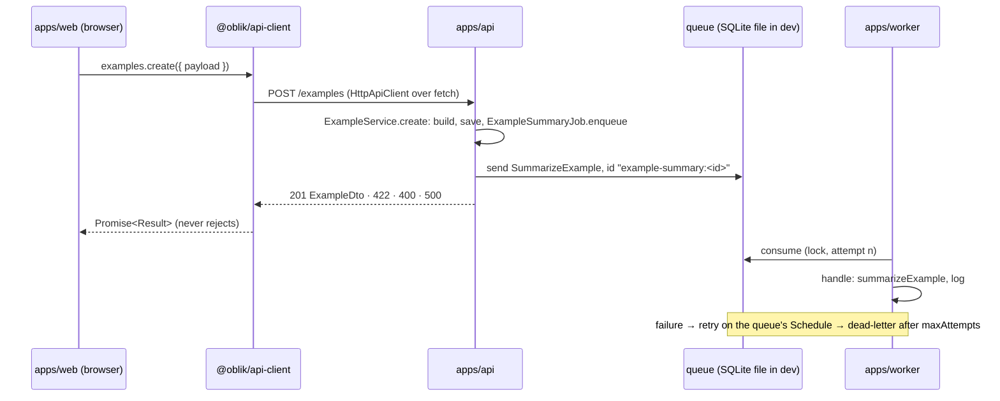
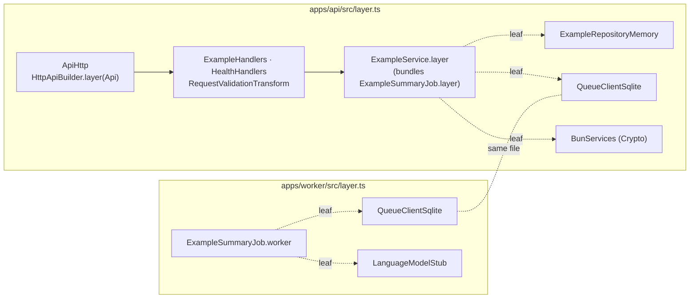

# Effect setup — architecture

> Ticket: `2026-10-16_effect-setup` · Requirements: [feature.md](./feature.md)

## Overview

The layers and their import rules stay as they are. What changes is how they are composed.
Every dependency that varies becomes a `Context.Service` with a `Layer` per implementation; what
does not vary is a value or a function (D17). The only places that choose implementations are the
composition roots `apps/{api,worker}/src/layer.ts`.
The `example` slice now crosses three processes:



How a process is assembled:



- **Contract first.** `@oblik/api-contract` is the one definition of the HTTP surface. The api
  implements it, `@oblik/api-client` derives from it, and `openapi.json` is generated from it.
- **Jobs cross processes, data does not.** The repository is in-memory per process, so a job
  message carries every field the job needs.
- **Layers bundle what has one implementation.** A `static layer` provides every dependency with a
  single implementation; the leaves that vary (ports, clients, platform services) stay open, and
  only the composition roots and tests choose them (D16).
- **The queue is ours, its engine is not.** `packages/queue` defines `JobQueue { send, consume }`;
  `PersistedQueue` implements it today, SQS later (D1).

## Structure

`★` new · `✎` rewritten · `✗` removed. Every workspace not listed is unchanged.

```text
.
├── repos/effect/                          ★ git subtree --squash of Effect-TS/effect at effect@<pinned>
├── vitest.config.ts                       ★ one project per root workspace
├── package.json                           ✎ catalogs effect · typescript · tools; scripts test, prepare
├── tsconfig.base.json                     ✎ plugins: @effect/language-service
├── biome.json                             ✎ v3 ban, domain = effect only, web client bans effect, !repos
├── Makefile                               ✎ typecheck += tsc -b; test → vitest; vendor-effect; openapi
├── .husky/{pre-commit,pre-push}           ✎ + tsc -b · make test
├── .github/workflows/ci.yml               ✎ + tsc -b, tsc --version check, bun run test
├── .env.example · .gitignore              ✎ QUEUE_*; LOG_LEVEL literal; .data/
├── .claude/
│   ├── rules/effect.md                    ★ v3 memory is wrong · source order · data primitives · project choices
│   ├── rules/{tooling,naming}.md          ✎
│   └── settings.json                      ✎ deny `bun test` (Bun's runner, not vitest)
├── README.md                              ✎ links docs/knowledge/effect.md
├── {domain,infrastructure,application,packages,apps}/CLAUDE.md ✎ Effect conventions
├── docs/knowledge/
│   ├── effect.md                          ★
│   └── {tooling,architecture}.md          ✎
├── domain/
│   ├── shared/                            ✗ Id helper and DomainError replaced by Schema
│   └── example/
│       ├── example.model.ts               ✎ ExampleId (branded Schema), Example (Schema.Class)
│       ├── example.error.ts               ✎ Schema.TaggedError
│       ├── example.service.ts             ✎ ExampleRepository port (no layer) · buildExample
│       └── example.service.test.ts        ✎
├── infrastructure/
│   ├── shared/
│   │   ├── outbox.repository.ts           ✎ OutboxMessage as Schema.Struct (stub)
│   │   └── queue.client.ts                ★ QueueClientSqlite: QueueConfig → createQueueClientSqlite
│   └── example/
│       ├── example.repository.ts          ✎ ExampleRepositoryMemory
│       ├── example.queue.ts               ✎ SummarizeExample, exampleSummaryQueue (a definition value)
│       ├── example.prompt.ts              ★ examplePrompt(input)
│       ├── example.llm.ts                 ✎ summarizeExample (a function, not a service)
│       └── example.storage.ts             ✎ buildExampleObjectKey (pure stub)
├── application/example/
│   ├── example.service.ts                 ✎ ExampleService (create, get)
│   ├── example-summary.job.ts             ★ ExampleSummaryJob.enqueue · ExampleSummaryJob.worker
│   ├── create.use-case.ts                 ✗ folded into ExampleService.create
│   └── example.service.test.ts · example-summary.job.test.ts ✎ ★
├── packages/
│   ├── config/{config,layer,index}.ts     ✎ <Area>Config services · createConfigLayer · load.ts ✗
│   ├── queue/{queue,memory,sqlite}.ts     ✎ JobQueue · QueueClient · QueueError · two layers (client.ts ✗)
│   ├── llm/client.ts                      ✎ LanguageModelStub
│   ├── db/client.ts · storage/client.ts   ✎ Context.Service stubs + *Memory layers
│   ├── api-contract/                      ★ @oblik/api-contract
│   │   ├── api.ts · example.ts · health.ts · validation.ts · index.ts
│   │   ├── openapi.ts                     ★ writes openapi.json (make openapi)
│   │   ├── openapi.json                   ★ committed
│   │   └── openapi.test.ts                ★ drift check
│   └── api-client/{client,result,index}.ts ✎ createApiClient → Promise<Result>
└── apps/
    ├── api/src/{main,layer,http,validation}.ts ✎ ★  · http.test.ts ✎
    ├── worker/src/{main,layer}.ts         ✎ · handlers/ ✗
    └── web/src/{main.ts, shared/api.ts, features/example/health-panel.ts} ✎
```

`packages/api-contract` follows the new-workspace checklist in `.claude/rules/tooling.md`. Each
workspace that imports `effect`, `@effect/*` or `@effect/vitest` declares it from `catalog:effect`,
because the isolated linker resolves only declared dependencies.

## Contracts

Sketches of the shape, checked against the installed `effect@4.0.5` by probes. The implementer
verifies the final spelling against `repos/effect`.

### Domain

```ts
// domain/example/example.model.ts
export const ExampleId = Schema.String.check(Schema.isUUID()).pipe(Schema.brand('ExampleId'))
export type ExampleId = typeof ExampleId.Type
export class Example extends Schema.Class<Example>('Example')({
  id: ExampleId, name: Schema.String, createdAt: Schema.DateTimeUtc,
}) {}

// domain/example/example.error.ts — no HTTP status here
export class ExampleNameInvalidError extends Schema.TaggedError<ExampleNameInvalidError>()(
  'ExampleNameInvalidError', { input: Schema.String }) {}
export class ExampleNotFoundError extends Schema.TaggedError<ExampleNotFoundError>()(
  'ExampleNotFoundError', { id: ExampleId }) {}

// domain/example/example.service.ts — a port has no layer; implementations live in infrastructure
export class ExampleRepository extends Context.Service<ExampleRepository, {
  readonly upsert: (example: Example) => Effect.Effect<void>
  readonly selectById: (id: ExampleId) => Effect.Effect<Option.Option<Example>>
}>()('@oblik/domain/example/ExampleRepository') {}

// time and id come in; the name is trimmed with String.trim and rejected when empty
export const buildExample: (input: {
  readonly id: ExampleId; readonly name: string; readonly createdAt: DateTime.Utc
}) => Effect.Effect<Example, ExampleNameInvalidError>
```

### Application

```ts
// application/example/example.service.ts — the entity's use cases are its methods
export class ExampleService extends Context.Service<ExampleService>()(
  '@oblik/application/example/ExampleService', { make: /* yields ExampleRepository, ExampleSummaryJob, Crypto */ }) {
  // create: Effect.fn('ExampleService.create')((input: { name: string }) =>
  //   DateTime.now → createdAt, crypto.randomUUIDv7 (PlatformError → orDie) → ExampleId.make,
  //   buildExample, repository.upsert, summaries.enqueue) : Effect<Example, ExampleNameInvalidError | QueueError>
  // get: Effect.fn('ExampleService.get') → Example | ExampleNotFoundError
  static readonly layer = Layer.effect(this, this.make).pipe(Layer.provide(ExampleSummaryJob.layer))
  // : Layer<ExampleService, never, ExampleRepository | QueueClient | Crypto>  — only the leaves stay open
}

// application/example/example-summary.job.ts — both sides of the job, one file
const queue = Effect.flatMap(QueueClient, (client) => client.make(exampleSummaryQueue))
const handle = Effect.fn('ExampleSummaryJob.handle')(function* (job: SummarizeExample) {
  const summary = yield* summarizeExample(job)
  yield* Effect.logInfo('example summarised').pipe(Effect.annotateLogs({ exampleId: job.exampleId, summary }))
})
export class ExampleSummaryJob extends Context.Service<ExampleSummaryJob>()(
  '@oblik/application/example/ExampleSummaryJob', {
  make: Effect.gen(function* () {
    const { send } = yield* queue
    const enqueue = Effect.fn('ExampleSummaryJob.enqueue')(function* (example: Example) {
      yield* send(new SummarizeExample({ exampleId: example.id, name: example.name }),
        { id: `example-summary:${example.id}` })
    })
    return { enqueue } as const
  }),
}) {
  static readonly layer = Layer.effect(this, this.make)                     // open: QueueClient
  static readonly worker = Layer.effectDiscard(Effect.gen(function* () {    // open: QueueClient | LanguageModel
    const { consume } = yield* queue
    yield* Effect.forkScoped(consume(handle))
  }))
}
```

`handle` is a function of the module, not a method, so `ExampleSummaryJob.layer` needs only the
queue client and the api never builds an LLM layer (D2). `enqueue` and `worker` open the queue
separately; two `PersistedQueue.make` calls with one name share the store and its dedup (probed).
`handle`'s interrupt path does nothing asynchronous, so a `--watch` restart releases the job in time.

### Infrastructure

```ts
// infrastructure/example/example.queue.ts — a definition value, not a service (D17)
export class SummarizeExample extends Schema.Class<SummarizeExample>('SummarizeExample')({
  exampleId: ExampleId, name: Schema.String,   // only what the job reads
}) {}
export const exampleSummaryQueue = {
  name: 'example-summary', schema: SummarizeExample,
  maxAttempts: 5, retrySchedule: Schedule.exponential('1 second'),
} satisfies QueueDefinition<typeof SummarizeExample>

// infrastructure/example/example.prompt.ts — a typed function, no template engine (D14)
export const examplePrompt = (input: { readonly name: string }): string =>
  String.stripMargin(`|Summarise the example "${input.name}".`)

// infrastructure/example/example.llm.ts — a function with a requirement, not a service (D17)
export const summarizeExample = Effect.fn('summarizeExample')(function* (input: { readonly name: string }) {
  const response = yield* LanguageModel.generateText({ prompt: examplePrompt(input) })
  return response.text
})  // : Effect<string, AiError, LanguageModel>

// infrastructure/example/example.repository.ts — implements the domain port
export const ExampleRepositoryMemory: Layer.Layer<ExampleRepository>  // Ref<HashMap<ExampleId, Example>>

// infrastructure/shared/queue.client.ts — config turns into client options here
export const QueueClientSqlite = Layer.unwrap(Effect.map(QueueConfig, createQueueClientSqlite))
```

### Packages

```ts
// packages/queue — generic; the engine never leaks
export interface QueueDefinition<S extends Schema.Top> {
  readonly name: string; readonly schema: S
  readonly maxAttempts: number; readonly retrySchedule: Schedule.Schedule<unknown, number>
}
export interface JobQueue<A> {
  readonly send: (message: A, options: { readonly id: string }) => Effect.Effect<void, QueueError>
  // loops forever; logs each failed attempt (Warn, n/max) and the last one as dead-lettered (Error);
  // a failure never ends the loop; an interrupt releases the in-flight message without counting it
  readonly consume: <E, R>(handle: (message: A) => Effect.Effect<void, E, R>) => Effect.Effect<never, QueueError, R>
}
export class QueueClient extends Context.Service<QueueClient, {
  readonly make: <S extends Schema.Top>(definition: QueueDefinition<S>) => Effect.Effect<JobQueue<S['Type']>>
}>()('@oblik/queue/QueueClient') {}
export class QueueError extends Schema.TaggedError<QueueError>()('QueueError', { cause: Schema.Defect() }) {}
export const QueueClientMemory: Layer.Layer<QueueClient>                    // PersistedQueue.layer + layerStoreMemory
export const createQueueClientSqlite: (options: {
  readonly filename: string; readonly lockExpiration: Duration.Input; readonly lockRefreshInterval: Duration.Input
}) => Layer.Layer<QueueClient, SqlError>                                    // + layerStoreSql + SqliteClient.layer

// packages/config — one service per area; read only through createConfigLayer
export class ApiConfig extends Context.Service<ApiConfig, { readonly port: number }>()('@oblik/config/ApiConfig') {
  static readonly config = Config.all({ port: Config.Port('API_PORT') })
}
// WebConfig { port: WEB_PORT } · RuntimeConfig { nodeEnv: NODE_ENV, logLevel: Config.LogLevel(LOG_LEVEL) }
// QueueConfig { filename: QUEUE_SQLITE_PATH, lockExpiration: 15 s, lockRefreshInterval: 5 s (QUEUE_LOCK_*) }
export class ConfigInvalidError extends Schema.TaggedError<ConfigInvalidError>()(
  'ConfigInvalidError', { issues: Schema.Array(Schema.String) }) {}         // message lists every variable
// Effect.validate over every area's `config` first, then provides each service
export const createConfigLayer: <const Areas extends ReadonlyArray<AreaConfig>>(
  ...areas: Areas) => Layer.Layer<Services<Areas>, ConfigInvalidError>
export const MinimumLogLevelFromConfig: Layer.Layer<never, never, RuntimeConfig> // References.MinimumLogLevel

// packages/llm/client.ts
export const LanguageModelStub: Layer.Layer<LanguageModel.LanguageModel>   // LanguageModel.make, canned text
// packages/db/client.ts · packages/storage/client.ts: DbClient / StorageClient services + *Memory layers
```

### HTTP contract and client

```ts
// packages/api-contract — imports only effect; DTOs and errors of its own
export class ExampleDto extends Schema.Class<ExampleDto>('ExampleDto')({
  id: Schema.String, name: Schema.String, createdAt: Schema.DateTimeUtc }) {}
export class ExampleNotFound extends Schema.TaggedError<ExampleNotFound>()(
  'ExampleNotFound', { id: Schema.String }, { httpApiStatus: 404 }) {}
export class ExampleNameInvalid extends Schema.TaggedError<ExampleNameInvalid>()(
  'ExampleNameInvalid', { message: Schema.String }, { httpApiStatus: 422 }) {}
export class RequestInvalid extends Schema.TaggedError<RequestInvalid>()('RequestInvalid', {
  kind: Schema.String,
  issues: Schema.Array(Schema.Struct({ path: Schema.Array(Schema.String), message: Schema.String })),
}, { httpApiStatus: 400 }) {}
export class RequestValidation extends HttpApiMiddleware.Service<RequestValidation>()(
  '@oblik/api-contract/RequestValidation', { error: RequestInvalid }) {}

export const ExampleGroup = HttpApiGroup.make('examples')
  .add(HttpApiEndpoint.post('create', '/examples', {
    payload: Schema.Struct({ name: Schema.String }), success: ExampleDto /* 201 */, error: [ExampleNameInvalid] }))
  .add(HttpApiEndpoint.get('byId', '/examples/:id', {
    params: { id: Schema.String }, success: ExampleDto, error: [ExampleNotFound] }))
// `.middleware()` reaches only endpoints added before it, so it is the last call, on the whole API
export const Api = HttpApi.make('oblik').add(HealthGroup, ExampleGroup)
  .middleware(RequestValidation)
  .annotate(HttpApi.ParseOptions, { errors: 'all' })

// packages/api-client — derived from the contract, no hand-written endpoint
export type Result<A, E> = { readonly ok: true; readonly value: A } | { readonly ok: false; readonly error: E }
export type ApiClient = Promised<HttpApiClient.ForApi<typeof Api>>
// each method: (request) => Promise<Result<A, Declared | RequestInvalid | InternalServerError
//   | HttpClientError (TransportError, DecodeError) | SchemaError | ClientDefect>>
export const createApiClient: (baseUrl: string, options?: { readonly fetch?: typeof fetch }) => ApiClient
```

- **The facade** builds `HttpApiClient.make(Api, { baseUrl })` once in a `ManagedRuntime` over
  `FetchHttpClient.layer`; `options.fetch` overrides `FetchHttpClient.Fetch`. Every call runs
  through `Effect.exit`, so a typed failure becomes `{ ok: false, error }` and a defect becomes a
  `ClientDefect`; the promise never rejects.
- **The api** (`apps/api/src/http.ts`) maps domain errors to contract errors with
  `Effect.catchTags` and turns infrastructure errors (`QueueError`) into defects, which answer 500.
  A group's builder is an `Effect.fnUntraced` that yields `ExampleService` once,
  before `handlers.handle(…)`: a service yielded inside a handler becomes a per-request requirement
  (`Request<"Requires", …>`) that no layer satisfies.
  `validation.ts` holds the one `HttpApiMiddleware.layerSchemaErrorTransform(RequestValidation, …)`.
  It is provided **to the group layers**, because a group captures its context when built.
- **`ApiHttp`** in `layer.ts` is `HttpApiBuilder.layer(Api)` with the groups and middleware, and no
  server. `ExampleHandlers` bundles `ExampleService.layer`, so the root provides only the leaves.
  `main.ts` serves it with `HttpRouter.serve` over `BunHttpServer.layer({ port })` and starts it
  with `BunRuntime.runMain(Layer.launch(…))`. Tests turn the same layer into a web handler.

### Processes

| Process | Entry | Composition root provides |
|---|---|---|
| api | `BunRuntime.runMain(Layer.launch(ApiServer))` | `createConfigLayer(ApiConfig, QueueConfig, RuntimeConfig)`, `MinimumLogLevelFromConfig`, `BunServices.layer` (Crypto), `ExampleRepositoryMemory`, `QueueClientSqlite` |
| worker | `BunRuntime.runMain(Layer.launch(ExampleSummaryJob.worker.pipe(…)))` | config (`QueueConfig`, `RuntimeConfig`), log level, `QueueClientSqlite`, `LanguageModelStub` |
| web | `Bun.serve` with HMR, unchanged shape | reads `WebConfig`, `ApiConfig`, `RuntimeConfig` once through `createConfigLayer` |

`api` and `worker` run in dev with `--watch`; `web` keeps `--hot` (D12). `QUEUE_SQLITE_PATH` in
`.env.example` is `"../../.data/queue.sqlite"`: both apps run from `apps/<app>`, so the relative path
lands on one file at the root `.data/`, which is gitignored.

## Configuration

- **Catalogs** (exact pins, re-verified at implementation time):
  - `effect`: `effect`, `@effect/platform-bun`, `@effect/sql-sqlite-bun`, `@effect/vitest` (4.0.5);
  - `typescript`: `typescript`, `@effect/tsgo` (0.53.2, embeds TS 7.0.2);
  - `tools`: `vitest` 5.0.5, plus the existing Biome and husky. `runtime` keeps `@types/bun`.
- **Root scripts:** `prepare` = `husky && effect-tsgo patch`; `test` = `bun --bun vitest run`.
  `make test` runs `bun run test`, and `bun test` (Bun's own runner) is denied in `settings.json`.
- **Typecheck gate:** `make typecheck` = `bun check && tsc -b`. The patched `tsc -b` walks the project
  references, writes declarations to the existing cache, and fails on Effect errors and warnings
  (`ignoreEffectWarningsInTscExitCode: false`, the default) (D8). `setup` scaffolds it with
  `effect-tsgo setup`, then trims the result.
- **vitest:** `vitest.config.ts` reads the root `workspaces` and declares each as a project root, so
  a new workspace needs no test config. It excludes `repos/**`.
- **Biome:**
  - a root `noRestrictedImports` lists the v3 packages, each with its v4 replacement in the message;
  - the `domain` override allows only `effect`;
  - the web client override adds `effect`, `effect/*` and `@effect/*`;
  - `files.includes` gains `!repos`.
  Relative imports into `repos/` already fail the existing relative-path ban.
- **Make:**
  - `vendor-effect` shallow-fetches the `effect@<pinned>` tag and runs `git subtree add|merge --squash --prefix repos/effect`;
  - `openapi` writes `openapi.json`;
  - `ids` excludes `repos/`.
- **Hooks and CI:**
  - `pre-commit`: `bun check`, `tsc -b`, `biome check --staged`;
  - `pre-push`: `make test`;
  - CI `static` adds `tsc --version | grep effect-tsgo` and `tsc -b`, and CI `test` runs `bun run test`.

## Seams

Tests observe behaviour only here. Each row is one test file or suite.

| Seam | Catches | Misses |
|---|---|---|
| `buildExample(input)` (`domain`) | trimming, blank-name rejection as `ExampleNameInvalidError`, id and time passed through | everything with an effect |
| `ExampleService.layer` (`create`, `get`) over `ExampleRepositoryMemory`, `QueueClientMemory`, `TestClock`, a fresh `TestCrypto.layer(seed)` per test (`application`) | saves and enqueues once, deterministic UUIDv7 and `createdAt`, job id `example-summary:<id>`, a repeated send deduplicated, a blank name saves and enqueues nothing, not-found | HTTP, the SQLite store |
| `ExampleSummaryJob.layer` + `ExampleSummaryJob.worker` over `QueueClientMemory`, a recording or failing `LanguageModel`, `TestClock` (`application`) | enqueue → handle round trip, the prompt reaching the model, retries on the queue's schedule, dead-letter and its log after `maxAttempts`, interrupt releasing without counting the attempt | the SQL store and its DB clock, `LanguageModelStub`, two processes |
| `JobQueue` suite run against `QueueClientMemory` and `createQueueClientSqlite` on a temp file (`packages/queue`) | send and consume, dedup by id, a message surviving a rebuilt layer on the same file ("worker was stopped"), the loop continuing after a failure | lock-expiry timing (real time), SQS |
| `createConfigLayer(...)` with `ConfigProvider.fromUnknown` (`packages/config`) | defaults, one `ConfigInvalidError` naming every bad variable, `LOG_LEVEL` literals | `--env-file` loading |
| `HttpRouter.toWebHandler(ApiHttp …)` driven by `createApiClient(url, { fetch })` and raw `Request`s (`apps/api`) | each status and JSON body on the wire, each typed `Result`, a 400 listing every issue, `POST /examples` enqueuing the job, a defect or an unencodable response answering 500 | the Bun socket, `--watch` |
| `createApiClient` over a fake `fetch`, plus type tests (`packages/api-client`) | the transport error on a refused connection, `SchemaError` / `DecodeError` on a wrong body or status, no rejected promise, an exhaustive `switch` over `error._tag` | a real server |
| `openapi.test.ts`: `OpenApi.fromApi(Api)` equals the committed `openapi.json` (`packages/api-contract`) | contract drift, the documented 400 and 500 | behaviour the schema does not express |
| `make check` on probe edits (by hand, in `/ticket-verify`) | the Biome bans, a floating Effect failing `tsc -b`, `repos/` ignored by Biome, vitest, `tsc -b` and `make ids` | allowed edges |

Checked by hand in `/ticket-verify`, not by tests:
- the cross-process path (three `POST`s with the worker stopped, then three results);
- `--watch` restarts with one server and one consumer;
- SIGTERM finalizers;
- LazyVim.

## Decisions

- **D1 — An own queue port, `JobQueue { send, consume }` in `packages/queue`, with `PersistedQueue`
  behind it.** `PersistedQueue` provides at-least-once delivery, retries on a `Schedule`,
  `maxAttempts`, dead-lettering and dedup by id, with memory and SQLite stores. Callers see only
  `send` and `consume`, so SQS later becomes one more `QueueClient` layer chosen in the composition
  roots. *Rejected:*
  - `PersistedQueue` used directly in `application`: SQS cannot be a `PersistedQueueStore`, because
    visibility timeouts and a separate dead-letter queue do not map onto its lock rows;
  - `effect/cluster`: it needs shared storage and runners, which is too much for one queue;
  - a hand-written poll loop: it would re-implement retries and locks.
- **D2 — `example-summary.job.ts` owns both sides of the job: `ExampleSummaryJob.enqueue` (a method)
  and `ExampleSummaryJob.worker` (a layer that wires the module's `handle` to `consume`).** The job
  logic lives in one file, and the worker only launches the layer. `handle` is not a method, because
  then `ExampleSummaryJob.layer` would require `LanguageModel`, and the api would have to build an
  LLM layer and carry its secrets. `ExampleService.create` calls `enqueue`, so the order "save, then
  send" stays in `application`. The message is a command named after the job (`SummarizeExample`),
  not an event: a job queue has one consumer. *Rejected:*
  - `enqueue` and `handle` as two methods of one service: this couples the api to the LLM;
  - a `handle` method that declares its own requirement: it leaks requirements into the service
    interface, which upstream style and the language service warn against;
  - the handler in `apps/worker`: job logic in an app;
  - an `ExampleCreated` event: it promises fan-out that a job queue does not have. It returns with
    an SNS-style topic.
- **D3 — `@oblik/api-contract` is a package of its own, with its own DTOs and errors, importing only
  `effect`; `openapi.json` is generated from it and committed.** Web and api share types without the
  browser importing server code, and the wire format can evolve apart from the domain. *Rejected:*
  - the contract inside `apps/api`: web cannot import an app;
  - domain schemas on the wire: this couples storage to transport, and the domain carries no HTTP
    status;
  - `openapi-typescript` from a live spec: it needs a running server and a second type system.
- **D4 — The web client is a `Promise<Result>` facade derived from the contract by one mapped type;
  `fetch` is its only option.** Browser code gets exhaustive, typed errors without importing
  `effect`, and a new endpoint needs no client code. The `fetch` option is also the api test seam.
  *Rejected:*
  - exposing the Effect client to web code: Effect in browser code is out of scope;
  - rejecting promises: the errors become untyped;
  - a wrapper per endpoint: shallow, and it drifts from the contract.
- **D5 — Errors travel with their real HTTP status and a typed JSON body.**
  - One `RequestValidation` middleware turns schema errors into a `RequestInvalid` 400 listing
    every issue (`ParseOptions { errors: 'all' }`). It is applied last, on the whole `HttpApi`.
  - Domain errors map to contract errors in `http.ts`; infrastructure errors become defects (500).
  - Endpoint errors are arrays, because a `Schema.Union` collapses to 500.

  *Rejected:*
  - status 200 with an error body: it breaks HTTP semantics and caches;
  - the default 400: its empty body reaches the client as an untyped `DecodeError`;
  - mapping `QueueError` to a typed 503: one more case for every caller, for a failure no caller
    can handle.
- **D6 — Domain models are `Schema.Class` with branded ids; errors are `Schema.TaggedError`; ports
  are `Context.Service` declarations with no layer; `buildExample` takes the id and time as input
  and returns an `Effect`.** The schemas serialise across HTTP and the queue, and the domain stays
  free of platform services: the application gets time from `Clock` and UUIDv7 from `Crypto`.
  *Rejected:*
  - `Data.TaggedError`: it has no schema, so it cannot cross a process;
  - `Model` (`effect/unstable`): unstable;
  - the domain yielding `Clock` and `Crypto`: every domain test would need the test services.
- **D7 — Settings are one `Context.Service` per area, read only through `createConfigLayer`,
  which runs `Effect.validate` over every area before providing any of them.** One startup error
  names every bad variable, and tests swap the `ConfigProvider`. *Rejected:*
  - a layer per area, or `Config.all`: both stop at the first failure;
  - a `Schema` over the raw env record: it loses the `ConfigProvider` seam.
- **D8 — The Effect gate is the patched `tsc -b` next to `bun check`.** `bun check` ignores
  tsconfig plugins, and `effect-tsgo diagnostics` has no build mode. The patched `tsc -b` walks the
  references incrementally and fails on Effect warnings by default. *Rejected:*
  - `effect-tsgo diagnostics --strict --project` in a loop over workspaces: nine cold runs;
  - replacing `bun check`: R9 keeps it as the typecheck gate.
- **D9 — vitest 5 with `@effect/vitest` on the Bun runtime, one root config, one project per root
  workspace.** `it.effect`, `it.layer` and `TestClock` need vitest; `bun --bun` keeps Bun APIs;
  probes confirmed `#imports`, `.ts` exports and exit 1 on any failure. *Rejected:*
  - `bun:test`: `@effect/vitest` fails under it;
  - vitest on Node: no Bun APIs;
  - a config per workspace: a forgotten one silently skips its tests.
- **D10 — Retries, schedules and dead-letters are tested on the memory store under `TestClock`;
  the SQLite store is tested only for persistence and dedup.** The SQL store measures delays with
  the database clock in whole seconds, which `TestClock` cannot drive. *Rejected:* SQLite with a live
  clock and `Schedule.spaced(0)`: slow, and it still skips real backoff.
- **D11 — Dead letters are observed through logs: `consume` logs each failed attempt and the final
  dead-lettering; failed rows stay in the table.** `PersistedQueue` offers no hook or read API.
  *Rejected:* a `deadLetters()` read on the port: it ties the port to the SQL store, whereas an SQS
  dead-letter queue is a separate queue.
- **D12 — `api` and `worker` run in dev with `--watch`, `web` with `--hot`.** `bun --hot`
  re-evaluates modules without stopping the previous Effect runtime, so servers and fibers pile up.
  *Rejected:* `--hot` with a `globalThis` guard: it works, but every entry carries the guard and
  its subtleties.
- **D13 — Effect's source is vendored as a `git subtree --squash` at `repos/effect`, pinned to the
  catalog's version.** Agents read the exact code, tests and `LLMS.md` of the installed version
  offline. *Rejected:*
  - a submodule: clones and CI do not fetch it by default;
  - reading `node_modules`: no tests or docs there;
  - docs search: network-bound and drifts from the pin.
- **D14 — Prompts are typed functions in `<entity>.prompt.ts`.** A renamed variable fails the
  typecheck, and nothing has to be loaded or rendered. *Rejected for now:* Markdown templates with
  placeholders, optionally checked against a `Schema` in tests. They return when prompts grow long
  or non-developers edit them; imports of `.md` also differ between Bun and vitest.
- **D15 — The slice is rewritten bottom-up, after one step retires the plain code above `domain`
  that the rewrite would break.** A `domain` change breaks `application`, which breaks both apps,
  and the whole chain is far over 400 lines. Removing the plain use case, job adapters, worker
  handler and example routes first lets each later step write final code only; `POST /examples`
  is absent between that step and the api step. *Rejected:*
  - bridges (plain code calling Effect through a `ManagedRuntime`, or Effect handlers wrapping
    plain promises): throwaway code in several steps that a reader of the branch must ignore;
  - one big-bang step: well over 1000 lines.
- **D16 — A `static layer` provides every dependency that has one implementation and leaves open
  the leaves that vary: ports (`ExampleRepository`), clients (`QueueClient`, `LanguageModel`) and
  platform services (`Crypto`).** Upstream recommends layers that carry their dependencies, and a
  provided dependency cannot be replaced from outside (probed: the bundled one wins). Leaving only
  the varying leaves open means the composition roots and tests supply the same short list, and no
  service needs a second `layerNoDeps` static. Layers are memoised by reference, so a leaf
  provided once is built once (probed). *Rejected:*
  - assembling every service in the composition roots: long roots that restate the dependency graph;
  - bundling everything plus `layerNoDeps` on every service: two statics per service, and tests
    unbundle level by level to reach a memory queue.
- **D17 — A service exists only when it holds a resource or something varies behind it; otherwise
  infrastructure exports a value or a function with requirements.** `exampleSummaryQueue` is a
  definition value and `summarizeExample` a function needing `LanguageModel`; `ExampleService`
  (the api's entry) and `ExampleSummaryJob` (it holds the queue handle) stay services. Each
  use case is a method of its entity's `<Entity>Service`. *Rejected:*
  - a service per adapter (`ExampleQueue`, `ExampleLlm`): pass-throughs that add a layer each;
  - a service per use case (`CreateExample.run`) over a thin `ExampleService`: a class, a layer
    and a root entry per verb, and the service in between is a middle man.

## Risks

| Risk | Mitigation |
|---|---|
| `effect/http`, `http-api`, `persistence`, `ai` are `@stability unstable`; a patch release may change them | exact lock-step catalog; `vendor-effect` runs in the same commit as a bump; the seams above catch behaviour changes |
| `effect-tsgo patch` replaces the `tsc` binary; an install without `prepare` silently loses the gate | CI asserts `tsc --version` contains `effect-tsgo`; the troubleshooting section in `tooling.md` covers it |
| A group or API middleware skips endpoints added after it | `.middleware(RequestValidation)` is the last call on `Api`; a type test asserts `RequestInvalid` in every method's error union |
| `take` fails with the handler's error, so `Effect.forever` stops at the first failure | `consume` catches and logs per iteration; the `JobQueue` suite has a "loop continues after failure" case |
| A hard crash consumes the in-flight attempt (only an interrupt releases it) | lock expiry 15 s in dev; the worker shuts down through `runMain` on SIGINT/SIGTERM |
| A shared `TestCrypto` layer value continues its sequence | every test builds its own `TestCrypto.layer(seed)`; noted in `docs/knowledge/effect.md` |
| The relative `QUEUE_SQLITE_PATH` depends on the cwd | both apps run from `apps/<app>`; the value is `../../.data/queue.sqlite`; the startup log prints the resolved path |
| `api-client` puts about 51–55 KB gzip of Effect into the browser | accepted for now; the size is recorded in `effect.md`; Effect UI libraries are out of scope |
| Rewriting a whole layer may exceed ~400 lines per step | `/ticket-plan` splits by seam: domain, application, each package, api, worker, web |

## To verify during implementation

Carried over from `feature.md`: V1 (push with `.git/shallow`), V2 (now: patched `tsc -b` on the
references) and V3 (vitest reporter under an agent). New:

- **V4** — How the 500 enters every endpoint's error union: as an error of `RequestValidation`, or
  declared on the API. A defect's empty 500 body must then decode to `InternalServerError`, not to
  `DecodeError`.
- **V5** — Whether `Config.LogLevel` accepts lower-case values. If it does not, `.env.example`
  switches to `LOG_LEVEL="Info"`.
- **V6** — vitest projects given as the root `workspaces` globs, with no config file per directory.
