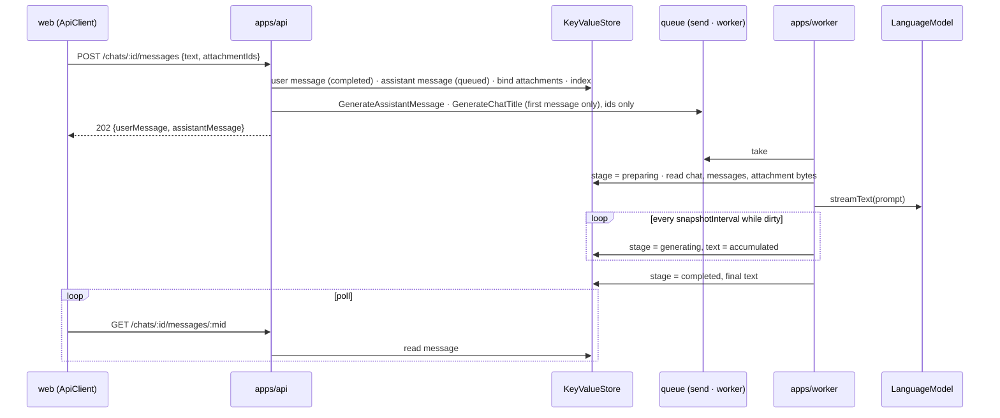

# Chat core — architecture

> Ticket: `2026-10-17_chat-core` · Requirements: [feature.md](./feature.md)

## Overview

Three aggregates (`user`, `chat` with its messages, `attachment`) cross the four layers. The api
authenticates a user by a cookie-borne secret, writes the user's message and a `queued`
assistant message, enqueues two jobs and returns `202`; the worker takes the jobs, streams the
model into throttled snapshots of the assistant message and writes the title; the client polls.
Both processes share one `KeyValueStore`: memory in tests, a file on disk in dev, Postgres later.



Dependencies, bottom-up: `domain` holds the schemas, errors, ports and pure rules;
`infrastructure` implements the ports on `KeyValueStore` through one collection-and-index module,
defines the two queues and the model adapter; `application` holds the three services, the two
jobs and the two use cases that compose them (D26); `http-api` is the `HttpApi` with its security middleware declarations (a layer, D29);
`ApiClient` beside it is the api's one client (D29); `apps/api` and `apps/worker` are
composition roots.

## Structure

New files are marked `+`, removed `−`, changed `~`. Every entity folder keeps an `index.ts`.

### domain

```
+ domain/user/user.id.ts             UserId
+ domain/user/user.model.ts          User · SecretHash · Credential
+ domain/user/user.error.ts          UserUnknownError
+ domain/user/user.service.ts        UserRepository · buildUser · isOwnedBy
+ domain/chat/chat.id.ts             ChatId · MessageId
+ domain/chat/chat.model.ts          maxTitleLength · ChatTitle · Chat · MessageAuthor ·
                                     MessageStage · ActiveMessageStage · MessageFailure · Message · ActiveMessage
+ domain/chat/chat.error.ts          ChatNotFoundError · ChatBusyError · MessageNotFoundError ·
                                     MessageInputInvalidError · MessageStageInvalidError
+ domain/chat/chat.service.ts        ChatRepository · MessageRepository · buildChat · buildUserMessage ·
                                     buildAssistantMessage · isTitledChat · byLatestUpdate ·
                                     isInChat · isActiveMessage · MessageInput ·
                                     ensureMessageInput · ensureChatAcceptsMessage ·
                                     prepareMessage · generateMessage · completeMessage ·
                                     failMessage
+ domain/attachment/attachment.id.ts       AttachmentId
+ domain/attachment/attachment.model.ts    FileName · MediaType · FileSize · Attachment
+ domain/attachment/attachment.error.ts    AttachmentNotFoundError · AttachmentBoundError
+ domain/attachment/attachment.service.ts  AttachmentRepository · AttachmentStore · buildAttachment ·
                                           ensureBindable
− domain/example/*
~ domain/package.json                exports ./user ./chat ./attachment · "sideEffects": false (D29)
```

Each `*.model.ts` and `*.service.ts` has its `*.test.ts` beside it. Ids live in `<aggregate>.id.ts`,
the only file another aggregate's model imports; Biome's `noImportCycles` keeps it so (D20).

### infrastructure

```
+ infrastructure/kv/kv-collection.ts         createCollection · createIndex · createBlobs  (D2)
+ infrastructure/kv/kv-store.ts              KeyValueStoreFileSystem (bundles StoreConfig)   (D4)
~ infrastructure/shared/queue.client.ts      unchanged
+ infrastructure/user/user.repository.ts     UserRepositoryKv
+ infrastructure/chat/chat.repository.ts     ChatRepositoryKv
+ infrastructure/chat/message.repository.ts  MessageRepositoryKv
+ infrastructure/chat/chat.queue.ts          assistantMessageQueue · chatTitleQueue · their message schemas
+ infrastructure/chat/chat.llm.ts            buildChatPrompt · streamAssistantText · suggestChatTitle
+ infrastructure/attachment/attachment.repository.ts  AttachmentRepositoryKv
+ infrastructure/attachment/attachment.storage.ts     AttachmentStoreKv
− infrastructure/example/*  − infrastructure/shared/outbox.repository.ts
```

*Amended in S9:* the title adapter is renamed `suggestChatTitle`: the model proposes a title the
job may discard, and the plan's name differed only by case from the job's `GenerateChatTitle`
payload. `maxTitleLength` joins `chat.model.ts` as the one title limit, read by `ChatTitle`,
the prompt and the cut, and `isTitledChat` joins the domain's predicates.

### application

```
+ application/user/user.service.ts           UserService { ensure, authenticate }
+ application/user/user-lock.ts              UserLock { withPermit } (workspace-internal, D2, D26)
+ application/chat/chat.service.ts           ChatService { create, list, get, rename, delete, getMessage,
                                             findSendable, addUserMessage, addAssistantMessage, touch } ·
                                             ChatSummary · ChatDetail · MessageDetail · SendableChat
+ application/chat/send-message.use-case.ts  SendMessageUseCase { send } · SentMessages          (D26)
+ application/chat/delete-chat.use-case.ts   DeleteChatUseCase { delete }                       (D26)
+ application/chat/touch-chat.ts             touchChat (workspace-internal, shared by ChatService and AssistantMessageJob)
+ application/chat/assistant-message.job.ts  AssistantMessageJob { enqueue } · .worker · SnapshotInterval
+ application/chat/chat-title.job.ts         ChatTitleJob { enqueue } · .worker
+ application/attachment/attachment.service.ts  AttachmentService { upload, get, download, delete,
                                                findBindable, bind, deleteByIds } · BindableAttachments
+ application/testing/{user,attachment,chat}.fixture.ts · chat.fake.ts · queue.fake.ts ·
                     language-model.fake.ts · chat.harness.ts   test support, no barrel (D27)
− application/example/*
```

### http-api

```
+ http-api/                                  new layer @app-template/http-api (imports effect and domain, D29)
    index.ts (the one entry) · api.ts (Api) · api.client.ts (ApiClient) · CLAUDE.md
    shared/errors.ts · shared/security.ts (Auth, CurrentUser, SchemaErrors) · shared/limits.ts
    health/health.http.ts (HealthHttp) · user/user.http.ts (UserHttp) · chat/chat.http.ts (ChatHttp) ·
    attachment/attachment.http.ts (AttachmentHttp); group ids stay health, users, chats, attachments
```

*Amended in S11:* a group file takes a role. *Amended in S12a:* the contract moves from
`packages/api-contract/` to the layer `http-api/`, in entity folders as in the other layers, with
no per-entity barrels; the role is `.http`, and `schemas.ts` goes (`User` and `UserId` are the
domain's). *Amended in S12:* `openapi.ts` and the committed `openapi.json` go (D16); S12b
adds `api.client.ts` (`ApiClient`, D29). *Amended in S12b:* `Api` moves from `index.ts` to
`api.ts`, since `api.client.ts` imports it and `index.ts` re-exports the client (D29).

### packages

```
− packages/api-client                        *Removed in S12b:* the client is ApiClient in http-api (D29)
+ packages/testing/                          new workspace @app-template/testing, devDependencies only:
                                             log.fake.ts (recordLogs) · uuid.ts (isUuidV7) (D27)
~ packages/queue/queue.ts                    send · worker Layer · jobId · AttemptInfo (D3, D21)
~ packages/llm/client.ts                     stub streams ~20 words at 100 ms; generateText returns a title
~ packages/config/config.ts                  + StoreConfig { path } from STORE_PATH
− packages/db  − packages/storage
```

### apps

```
~ apps/api/src/main.ts                       BunRuntime.runMain(Layer.launch(ApiLayer)), stopping the previous `--hot` runtime first (D30, S13)
+ apps/api/src/layer.ts                      ApiHttp: HttpApiBuilder.layer(Api) + groups + Scalar + HttpRouter.serve
                                             on an open server and store · ApiLayer: + BunHttpServer, file store, 'api stopped' log
+ apps/api/src/shared/security.ts            AuthUserService (cookie → CurrentUser) · SchemaErrorsRequestInvalid
                                             (mirrors http-api/shared/security.ts; *Amended in S13*)
+ apps/api/src/{health/health,user/user,chat/chat,attachment/attachment}.handler.ts   *Amended in S12a*
+ apps/api/src/{layer,health/health.handler,user/user.handler,chat/chat.handler,attachment/attachment.handler}.test.ts
                                             seam 7, one file per group beside its handler; layer.test.ts the
                                             checks every route shares (*Amended in S13*)
+ apps/api/src/testing/api.harness.ts        makeApiHarness (ApiHttp on BunHttpServer.layerTest + memory store) ·
                                             withApi (ApiClient.layer over a cookie jar) · shared reads
− apps/api/src/http.ts  − apps/api/src/http.test.ts
~ apps/worker/src/main.ts                    BunRuntime.runMain(Layer.launch(WorkerLayer))
+ apps/worker/src/layer.ts                   AssistantMessageJob.worker + ChatTitleJob.worker + leaves
~ apps/web/src/features/health/health-panel.ts   an Effect over ApiClient, one sentence per error tag
~ apps/web/src/{app/main,shared/api}.ts     runs the panel over ApiClient.layerFetch of the /api proxy (S12b)
~ apps/web/{package.json,tsconfig.json}     − @app-template/api-client; + @app-template/http-api (S12b)
~ apps/{api,worker}/package.json             + @effect/platform-bun; api: + @app-template/http-api
```

### root, rules and docs

```
~ package.json           workspaces + http-api (D29)
~ tsconfig.json          − packages/db, packages/storage, packages/api-client; + http-api
~ Makefile               *Amended in S12:* no openapi target and no drift check (D16)
~ CLAUDE.md              the map + http-api; + http-api/CLAUDE.md (D29)
~ .env.example           + STORE_PATH="../../.data/store"
+ .claude/rules/effect.md
~ .claude/rules/naming.md       + `.job` role (application), `.llm` holds prompt functions
~ docs/knowledge/architecture.md  "Where things live" and "Add a new entity" on the chat slice;
                                 the layer matrix and graph gain http-api (D29)
~ biome.json             + the test-support guard override, biome/test-support-imports.grit (D27),
                           *removed after S12b*; + the domain test override (D27, after S12b);
                         + the http-api layer guard: effect and domain only; only apps/api and
                           the web client import it (D29); − the web client's effect ban and
                           api-client (S12b)
+ .claude/rules/use-cases.md    services and use cases (D26)
```

## Contracts

### Domain shapes

```ts
UserId · ChatId · MessageId · AttachmentId
            = Schema.String.check(Schema.isUUID()).pipe(Schema.brand('<Entity>Id'))
SecretHash  = lower-case hex SHA-256, brand 'SecretHash'
Credential  = { kind: 'secret', hash: SecretHash }
User        = { id, createdAt }
ChatTitle   = Schema.String.check(trimmed, nonEmpty, maxLength(120)), brand 'ChatTitle'
Chat        = { id, userId, title: Option<ChatTitle>, createdAt, updatedAt }
MessageAuthor = 'user' | 'assistant'
MessageStage  = 'queued' | 'preparing' | 'generating' | 'completed' | 'failed'
ActiveMessageStage = MessageStage.pick(['queued', 'preparing', 'generating'])
MessageFailure = { reason: 'ReplyFailed', message: string, cause: string }
                 // message: user-safe, fixed per reason · cause: for operators, never leaves the api
Message     = { id, chatId, author, stage, text, attachmentIds, error: Option<MessageFailure>,
                createdAt, updatedAt }
FileName · MediaType · FileSize = brands: non-empty · type/subtype · Int ≥ 0
Attachment  = { id, userId, messageId: Option<MessageId>, fileName: FileName,
                mediaType: MediaType, size: FileSize, createdAt }
```

Pure rules: `isActiveMessage(message)` holds for an assistant message in `queued`, `preparing` or
`generating`; `ensureChatAcceptsMessage(current: Option<Message>)` fails `ChatBusyError` (with
the message's `chatId`) when the chat's current message is active, whatever message the caller
passes; `ensureMessageInput({ text, attachmentIds })` fails `MessageInputInvalidError` when the
trimmed text is empty and no attachment is given, and when an attachment id repeats;
`ensureBindable(id, found: Option<Attachment>, userId)` returns the attachment, or fails
`AttachmentNotFoundError` when it is missing or foreign and `AttachmentBoundError` when it is
bound; `AttachmentService.findBindable` traverses the ids with `Effect.forEach` over `selectById`; `isActiveMessage` checks the stage with
`Schema.is(ActiveMessageStage)`.

Transitions are named for the stage they move to, check their source stage, and fail
`MessageStageInvalidError { id, from, to }` otherwise (D18):

| Transition | From | Sets |
|---|---|---|
| `prepareMessage(message, at)` | any active stage | `preparing`, empty text, no error |
| `generateMessage(message, at)` | `preparing` | `generating` |
| `completeMessage(message, text, at)` | any active stage | `completed`, final text, no error |
| `failMessage(message, reason, cause, at)` | any active stage | `failed`, the reason's fixed sentence and the cause |

### Ports (domain, `Context.Service`, no layer)

```ts
UserRepository       { insert(user, credential); selectById(id); selectByCredential(credential) }
ChatRepository       { insert(chat); update(chat); selectById(id); selectByUser(userId);
                       delete(id) }
MessageRepository    { insert(message); update(message); selectById(id); selectByChat(chatId);
                       selectActiveByChat(chatId); deleteByChat(chatId) }
AttachmentRepository { insert(a); update(a); selectById(id); selectByIds(ids); deleteByIds(ids) }
AttachmentStore      { insert(id, bytes: Uint8Array); select(id): Option<Uint8Array>; delete(id) }
```

Every `select*` returns `Option` or an array in insertion order; none throws a not-found error:
the application turns `Option.none` into the domain error, so the HTTP layer sees one error type
per case. `selectByUser` returns chats unordered; `ChatService.list` sorts by `updatedAt`.
`selectActiveByChat` returns the chat's active message, if any (`isActiveMessage`); the
application assembles `{ chat, activeMessage }` for the chat list and detail. Ports declare no
error channel: a store failure is a defect (D17).

### Store layout (`KeyValueStore`, D2)

| Key | Value | Written by |
|---|---|---|
| `users/<userId>` | `User` | api |
| `credentials/secret/<sha256-hex>` | `UserId` | api |
| `chats/<chatId>` | `Chat` | api (create, rename, send, delete) · worker (title, `updatedAt` at completion) |
| `users/<userId>/chats` | `ChatId[]` index | api only |
| `messages/<messageId>` | `Message` | api (insert, `deleteByChat`) · worker (stages, snapshots): two writers, see Risks |
| `chats/<chatId>/messages` | `MessageId[]` index | api only |
| `attachments/<attachmentId>` | `Attachment` | api |
| `attachments/<attachmentId>/bytes` | `Uint8Array` | api |

`createCollection(store, { prefix, schema })` gives `get / set / modify / delete` over
`prefix(store, …)` + `toSchemaStore`; `createIndex(store, { prefix, id })` gives
`append / remove / list / delete` on a JSON array. Every operation of the module, collection and
index alike, runs under one per-process `Semaphore(1)`: `KeyValueStore.modify` is get-then-set and
skips a missing key, the file store writes non-atomically, and a plain `set` must not race a
`modify` on the same key. *Amended in S4:* collections gain `update(key, f)`, which reads and writes
under one permit only when the key exists (`none` and no write otherwise), so a port's `update`
never creates a record; `createBlobs(store, { prefix })` gives `get / set / delete` of raw bytes
over `getUint8Array` and `set(key, Uint8Array)`, under the same lock and defect policy, so
`attachments/<id>/bytes` holds the file's bytes, not base64 JSON. *Amended in S5:* collections
gain `getMany(keys)`, which reads every key under one permit, in the order asked, leaving missing
keys out; the repositories' list reads (`selectByUser`, `selectByChat`, `selectByIds`) use it.

### Jobs (`packages/queue` definitions in `infrastructure/chat/chat.queue.ts`)

```ts
GenerateAssistantMessage = { chatId, messageId }   // queue 'assistant-message', job id messageId
GenerateChatTitle        = { chatId, messageId }   // queue 'chat-title', job id chatId
                                                   // messageId: the first user message
AttemptInfo              = { attempt, maxAttempts, isLastAttempt }   // the handler's 2nd argument
```

Each definition carries its `jobId`; a job sends with `send(definition, message)` and consumes
with `worker(definition, handle)`, a Layer (D21). A job id needs no queue prefix: the store keys
uniqueness on `(id, queue_name)`. *Amended in S6.*

### HTTP contract (`@app-template/http-api`)

| Group · endpoint | Success | Errors |
|---|---|---|
| `health` · `GET /health` | `{ status: 'ok' }` | `RequestInvalidError` |
| `users` · `POST /users` | `201 User` + `Set-Cookie: user_secret` | `RequestInvalidError` |
| `chats` · `POST /chats` | `201 Chat` | `UserUnknownError` |
| `chats` · `GET /chats` | `ChatSummary[]` | `UserUnknownError` |
| `chats` · `GET /chats/:chatId` | `ChatDetail` (chat + messages with attachment metadata) | `UserUnknownError`, `ChatNotFoundError` |
| `chats` · `PATCH /chats/:chatId` `{ title }` | `Chat` | `UserUnknownError`, `ChatNotFoundError`, `RequestInvalidError` |
| `chats` · `DELETE /chats/:chatId` | `204` | `UserUnknownError`, `ChatNotFoundError` |
| `chats` · `POST /chats/:chatId/messages` `{ text, attachmentIds }` | `202 { userMessage, assistantMessage }` | `UserUnknownError`, `ChatNotFoundError`, `ChatBusyError`, `AttachmentNotFoundError`, `AttachmentBoundError`, `MessageInputInvalidError` 400 (*Added in S14*), `RequestInvalidError` |
| `chats` · `GET /chats/:chatId/messages/:messageId` | `Message` | `UserUnknownError`, `ChatNotFoundError`, `MessageNotFoundError` |
| `attachments` · `POST /attachments` multipart | `201 Attachment[]` | `UserUnknownError`, `AttachmentTooLargeError` 413, `AttachmentTypeUnsupportedError` 415, `RequestInvalidError` |
| `attachments` · `GET /attachments/:attachmentId` | `Attachment` | `UserUnknownError`, `AttachmentNotFoundError` |
| `attachments` · `GET /attachments/:attachmentId/download` | bytes (`asUint8Array`), real `Content-Type` | `UserUnknownError`, `AttachmentNotFoundError` |
| `attachments` · `DELETE /attachments/:attachmentId` | `204` | `UserUnknownError`, `AttachmentNotFoundError`, `AttachmentBoundError` |

*Amended in S12a (D29):* every error's wire tag is its class name, `…Error` included. The
domain's errors are listed as they are, with the status set where the contract uses them
(`UserUnknownError.pipe(HttpApiSchema.status(401))` in `Auth`): `UserUnknownError` 401,
`*NotFoundError` 404, `ChatBusyError` and `AttachmentBoundError` 409. Only the errors that are
HTTP's own live in `shared/errors.ts`, with `httpApiStatus` on the class: `RequestInvalidError` 400 with
`issues: { path: (string | integer)[], message: string }[]` (*Amended in S11:* the Standard
Schema formatter reports an array index as a number, as V3 expects), and the multipart limits'
`AttachmentTooLargeError` 413 and `AttachmentTypeUnsupportedError` 415. `RequestInvalidError` is produced
by the `SchemaErrors` middleware (`HttpApiMiddleware.layerSchemaErrorTransform`) on the whole api, so
every endpoint lists it. Each group is an `HttpApiGroup` in `<entity>/<entity>.http.ts` (the
group id stays plural: `users`, `chats`), and `index.ts` composes them into `Api` (*Amended in
S11*, *in S12a*). `shared/limits.ts` exports `attachment = { maxFileSize: '10 MiB', maxFiles: 5,
mediaTypes: [...] }`, `message = { maxTextLength: 20_000 }`, `chat = { maxTitleLength: 120 }`,
used by the schemas (`maxLength`, `AttachmentMediaType = Schema.Literals(mediaTypes)`), by
`asMultipartStream({ maxParts: maxFiles, maxFileSize })` and by the handlers;
`chat.maxTitleLength` is the domain's `maxTitleLength` (*Amended in S12a*). `shared/security.ts` declares
`CurrentUser` (`{ id: UserId }`, the domain's brand), the `Auth` middleware (`apiKey` in cookie
`user_secret`, `provides: CurrentUser`, `error: UserUnknownError` at 401) attached to `chats` and
`attachments`, and `SchemaErrors`. *Amended in S12a (D29):* `User` is the domain's model, and the
other wire shapes come from the domain's models through `mapFields` only where a field is
internal or an `Option` must reach the wire as `null`, and (*Amended in S14*, D31) where they
compose into the shape a service returns: `Chat` (`title: string |
null`), `ChatSummary` (+ `activeMessage: { id, stage } | null`, `stage` the `ActiveMessageStage` subset, *Amended in S14*), `ChatDetail` (summary + `messages`), `Message` (`attachments:
Attachment[]`, `error: { reason, message } | null`, never `cause`), `Attachment`. `failMessage` builds the
failure from a reason: the `message` is a fixed user-facing sentence per reason; the provider's
cause is stored beside it for operators (D19). *Amended in S14:* the `rename`
payload is `{ title: Schema.Trim.pipe(Schema.decodeTo(ChatTitle)) }`: the server trims, then
checks, so `" Trip "` is stored as `"Trip"` and a blank or 121-character title is
`400 RequestInvalidError` at `['title']` through `SchemaErrors`; the handler receives the brand.
`ApiClient`'s payload type is the brand and its encode checks `Trimmed`, so it sends only a valid
title. *Rejected:* a plain-string payload decoded in the handler (a second path to
`RequestInvalidError` beside `SchemaErrors`, and a spec that documents no title constraint).
`send` lists the domain's `MessageInputInvalidError` (a blank text without attachments, a
repeated id) at `400`, beside `RequestInvalidError`; the spec joins the two under one `400` as
an `anyOf`. *Rejected:* mapping it to `RequestInvalidError` in the handler (a hand-written
sentence and a domain error the wire no longer names). `Api` carries `HttpApi.ParseOptions`
`{ errors: 'all' }`, so a `400` lists every issue of a request, not the first. The wire
`Attachment` (no `userId`, `messageId: MessageId | null`) is declared in
`attachment/attachment.http.ts` already, since `Message` carries it.

### Client

```ts
class ApiClient extends Context.Service<ApiClient, HttpApiClient.ForApi<typeof Api>>
ApiClient.layer(baseUrl: string): Layer<ApiClient, never, HttpClient>  // HttpApiClient.make(Api, { baseUrl })
ApiClient.layerFetch(baseUrl: string): Layer<ApiClient>              // layer over FetchHttpClient
api.<group>.<endpoint>(request): Effect<Success, E>
// E = the endpoint's declared errors | its middleware's (RequestInvalidError everywhere,
//     UserUnknownError under Auth only) | HttpClientError | SchemaError (unexpected response), by _tag
```

*Replanned in S12b (D29):* `ApiClient` lives in `http-api/api.client.ts` and decodes with the
contract's own schemas, so brands, `DateTime` and error classes reach the caller. It manages no
cookies: the browser sends same-origin cookies by itself through the web proxy, and the api
tests attach theirs with `HttpClient.withCookiesRef` on the `HttpClient` that `layer` leaves open. Web code runs the Effects itself: the
health panel is `ApiClient.use((api) => api.health.get())`, matched into a view, with a table of
sentences `as const satisfies Record<tag, string>` over the call's error tags, provided
`ApiClient.layerFetch` of `/api` at the web entry. The `Promise<Result>` facade goes with D13.

### Configuration

`StoreConfig { path }` from `STORE_PATH`; `ApiConfig`, `RuntimeConfig`, `QueueConfig` unchanged.
The cookie is `Secure` when `RuntimeConfig.nodeEnv === 'production'`. The snapshot interval is
`SnapshotInterval`, a `Context.Reference<Duration>` in `assistant-message.job.ts`, default 300 ms.

## Seams

| Seam | Catches | Misses |
|---|---|---|
| 1 `domain/*` schemas and pure rules | the active-message predicate, message input rule, binding rules, stage transitions, title constraint | persistence, ordering, HTTP |
| 2 `infrastructure/kv/kv-collection` on `layerMemory` and on `layerFileSystem` in a temp dir | key encoding (`/` in keys), index append, remove and delete, missing-key semantics, JSON codec, lost updates under concurrent `modify` | cross-process races |
| 3 repositories and `AttachmentStoreKv` through their ports on `layerMemory` | field mapping, index maintenance (`selectByUser`, `selectActiveByChat`, `deleteByChat` cascade, `deleteByIds`) | the real file store (covered for the module in 2) |
| 4 `send` and `worker` in `packages/queue` on the memory store under `TestClock` | `AttemptInfo` values per attempt, `isLastAttempt` on the dead-letter attempt and no attempt after it, release when the worker's scope closes, one job per `jobId` | SQLite timing |
| 5 `UserService`, `ChatService`, `AttachmentService` and the use cases `SendMessageUseCase`, `DeleteChatUseCase` on memory adapters, `QueueClientMemory`, `TestClock`, `TestCrypto` | ensure/authenticate, send writes two messages and enqueues one or two jobs, `409` while a message is active, bound and foreign attachments, rename (a blank title is a type error: `ChatTitle` is a brand, rejected at seams 1 and 7), delete cascade and its retry after a failed chat write, a delete that waits for a send of the same user under the shared lock, title job only on the first message, concurrent sends (one chat; one attachment in two chats), a title the worker sets during a send, `AttachmentService.findBindable`, `bind` and `deleteByIds` | HTTP statuses, cookies |
| 6 `AssistantMessageJob.worker` and `ChatTitleJob.worker` with a fake `LanguageModel` under `TestClock` | stage sequence, snapshot cadence and final write, `failed` only on the last reply attempt (the third of four, D23), prompt content (history, roles, file parts), title only if `none`, chat deleted meanwhile, a blank text or answer (D25) | a real provider, the SQLite queue |
| 7 `apps/api` through `BunHttpServer.layerTest` + `ApiClient` from `@app-template/http-api` (*Amended in S12*) with `HttpClient.withCookiesRef`, over the real `Crypto` (`BunServices.layer`); one test file per group beside its handler plus `layer.test.ts`, on `testing/api.harness.ts` (*Amended in S13*) | the whole wire: cookie attributes and their refresh, Scalar at `/docs` (*Added in S13*), `401`/`404`/`409`/`413`/`415`/`400` bodies, multipart limits, download headers, `202` shape, the client's typed errors, a stopped server → `HttpClientError` (*Amended in S12b*); the spec from `OpenApi.fromApi(Api)`: the `cookie` scheme on `chats` and `attachments`, every route's errors with their statuses, `multipart/form-data` and `application/octet-stream` (*Added in S12*, from Seam 8) | browser cookie behaviour, the web proxy, `Secure` on http |
| 8 ~~`make check` drift of `openapi.json`~~ *Retired in S12 (D16):* no spec file; its spec assertions move to Seam 7 | — | — |
| 9 ~~`createApiClient` over an injected `fetch`~~ *Retired in S12b (D29):* no facade; the client's typed errors are observed at Seam 7, and an error table's completeness at `make typecheck` | — | — |

Dev-mode behaviour (two processes sharing `.data/store`, `--watch`, SIGTERM) is verified by hand
per the acceptance table, not by a test.

## Decisions

- **D1 — Three aggregates, three folders: `user`, `chat` (with `Message`), `attachment`.** A
  message never exists outside its chat and its stages are the chat's state machine, so they share
  a model file and a service file; an attachment lives before it is bound, so it stands alone.
  *Rejected:* one `domain/chat` folder for everything (a 200-line model file and one barrel that
  hides the aggregates); a folder per entity including `message` (splits one state machine over
  two folders and two repositories' tests). *Amended by D20:* ids move to `<aggregate>.id.ts`.
- **D2 — One collection-and-index module over `KeyValueStore`; indexes written by the api only;
  the active message is found by the repository.** `KeyValueStore` cannot list keys and its `modify` is
  get-then-set that skips a missing key, so every repository would repeat the same index code.
  `createCollection`/`createIndex` hide the prefixing, the JSON codec, the missing-key case and the
  per-process `Semaphore`. The worker writes only its own keys (`messages/<id>`, `chats/<id>`), so
  no index is ever written from two processes. The chat has no state word of its own: the
  contract exposes its active message (`{ id, stage }`), so message stages are the one vocabulary
  and the client knows which message to poll. `MessageRepository.selectActiveByChat` finds it;
  the KV adapter reads the last message of the index, which is equivalent because sends are
  refused while a message is active, and Postgres will query `stage IN (…)` on a partial index.
  *Rejected:* an index per repository (four copies); a stored chat status (two keys and no
  transaction: a crash between the message's terminal write and the chat's leaves the chat busy
  forever, and R12 then refuses every send); a derived `Chat.status = idle | generating` (a second
  vocabulary whose `generating` also covered `queued` and `preparing`); `EXISTS … SELECT 1` as a
  boolean port (the client needs the id and the stage). *Amended in S3:* the module is
  `infrastructure/kv/` (`kv-collection.ts`, with the file-store wiring beside it as `kv-store.ts`)
  and is fully serialised per process: every collection and index operation, reads included,
  takes the one `Semaphore(1)`. Its verbs split by what they touch: whole-key `get / set / modify /
  delete`, index-member `append / remove / list`; `delete` matches `naming.md`, and the ports keep
  its `select / insert / update / delete`. *Rejected:* `infrastructure/shared` (a grab bag beside
  the queue wiring, with no entity barrel of its own); `packages/kv` (packages hold no row
  abstraction of ours over `KeyValueStore`, and the module carries project policy: failures die,
  D17).
  *Amended in S4:* the module gains `Collection.update` (writes only an existing key, under one
  permit) and `createBlobs` (raw bytes, same lock and defects). *Rejected:* read-then-`set` in the
  adapter (two permits: a delete between them is undone); `Schema.Uint8Array` in a collection
  (base64 JSON, a third larger); raw `KeyValueStore` calls in the adapter (bypass the lock and
  repeat `Effect.orDie`).
  *Amended in S5:* collections gain `getMany(keys)` (one permit for the whole read, the order
  asked, missing keys left out), replacing three list-then-`get` copies in the adapters. The
  premise "sends are refused while a message is active" is enforced, not assumed: on KV by a
  per-chat lock in `ChatService.send` that makes the check and the inserts one critical section
  in the api process; on Postgres by a partial unique index allowing one active message per chat.
  *Rejected:* a `get` per id (a permit each, so a write lands between reads, and three copies);
  the unlocked check-then-insert (two concurrent sends both see no active message, and the last
  message then hides the other active one from `selectActiveByChat`).
  *Amended in S10:* the lock is per user, not per chat: one `Semaphore(1)` per `UserId` in an
  `RcMap`, held only while a call holds or awaits it, serialises `ChatService.send`, `rename` and
  `delete` of one user in the api process. It also closes, within that process, the bind of one
  unbound attachment by two sends in two chats, which both pass `ensureBindable`. *Rejected:* a
  per-chat lock (leaves that cross-chat bind open); an unbounded `Map` of semaphores (one per key,
  never freed). *Amended in S10b:* the lock leaves `ChatService` for `UserLock`
  (`application/user/user-lock.ts`), which `SendMessageUseCase.send`, `DeleteChatUseCase.delete`
  and `ChatService.rename` pass to `Effect.fn` as a pipeable (D26). It is not reentrant, so
  `ChatService.delete`, which the delete use case calls while holding it, takes none.
- **D3 — The assistant message is produced by `Ref` + `Schedule.spaced` snapshots with an
  explicit final write, and the handler learns the last attempt from `AttemptInfo`.** The worker
  folds `text-delta` parts into a `Ref` and raises a `dirty` flag; a racing
  `Effect.repeat(snapshot, Schedule.spaced(SnapshotInterval))` writes the accumulated text while
  the flag is up; when the stream ends the job writes `completed` itself, and `onExit` handles the
  failure path. Experiments showed `Stream.throttle('enforce')` drops the final delta,
  `debounce` emits no intermediate state, and `aggregateWithin(Sink.last)` writes twice at the
  window edge. `PersistedQueue.take` exposes `attempts` but not `maxAttempts` and has no
  dead-letter hook, so `JobQueue.consume` now passes `{ attempt, maxAttempts, isLastAttempt }`,
  computed from the same condition the store uses to mark `failed`. *Rejected:* a pure `Stream`
  pipeline (less explicit about the final write); writing `failed` on every attempt (the UI would
  flash `failed` between retries); a dead-letter callback in the store (none exists). *Amended in
  S6:* the handler is the one passed to `worker(definition, handle)` (D21). *Amended in S8a:* the
  `dirty` flag became a comparison: a snapshot writes only when the accumulated text differs
  (`Equal.equals`) from the text it last wrote, so the cadence is the same and a run of empty
  deltas writes nothing. A snapshot runs `uninterruptible`: the race interrupts the snapshot loop
  when the stream ends, and a write cut short then could still land after the final one; the
  race awaits its interrupted loser, so the final write always comes last.
- **D4 — Dev state is `KeyValueStore.layerFileSystem` at `STORE_PATH`, bundled with
  `StoreConfig` in `infrastructure/kv/kv-store.ts`; tests use `layerMemory`.** The two processes
  need one state and the queue already shares `.data/queue.sqlite`. `layerFileSystem` stores
  keys flat with `encodeURIComponent`, needs `FileSystem | Path` (both in `BunHttpServer.layer` and
  `BunServices.layer`), and has no locking: last write wins. D2 keeps every index single-writer;
  only the rows `chats/<id>` (title race) and `messages/<id>` (delete race) are written from both
  processes, see Risks. *Rejected:* `layerSql` over the queue's SQLite file (atomic
  writes and cross-process locking, but a SQL store in the "in-memory" ticket; it remains the
  one-line switch if the file store proves flaky); `layerMemory` in dev (the worker would never see
  the api's writes). *Amended in S3:* the wiring is `infrastructure/kv/kv-store.ts`, beside the
  module (D2); `STORE_PATH` has no default in code and is set in `.env.example`. *Amended in S5:*
  `messages/<id>` has two writers, the api (insert, `deleteByChat`) and the worker (stages,
  snapshots); the earlier wording named `chats/<id>` as the only one.
- **D5 — Limits are constants in `@app-template/http-api` (*Amended in S12a*), and the declared media type is
  checked with a `Schema`.** `asMultipartStream(withLimits)` fixes its limits at schema
  definition, so they cannot be runtime tunables; the contract is browser-safe, so the UI later
  reads the same `limits`. The type check decodes each part's `contentType` with
  `AttachmentMediaType = Schema.Literals(mediaTypes)`; `Mime.getType(fileName)` from
  `effect/http` must agree when the extension is known. Effect has no content sniffing; the part's
  `contentType` is client-supplied. *Rejected:* `Context.Reference` tunables (impossible for the
  transport limits; amends feature R21); the upload limits in `domain` (*Amended in S12a, D29:*
  they bound a multipart body, which the domain never sees, so they are transport limits; a limit
  that is a domain rule, the title length, lives in the domain and `http-api` reuses it as
  `limits.chat.maxTitleLength`); magic-byte sniffing (no Effect module; out of scope).
- **D6 — `CurrentUser`, `Auth` and `SchemaErrors` are declared in the contract; the `users` group
  has no `Auth`; the cookie is set with `HttpApiBuilder.securitySetCookie`.** `HttpApiGroup
  .middleware(Auth)` is part of the group definition, so the declarations must live where the
  groups do, and `CurrentUser` carries the contract's `UserId` (the same brand string as the
  domain's, so the types unify). A missing cookie reaches the middleware as `Redacted('')`; the
  middleware fails `UserUnknown`, which the endpoint's error codec renders as `401` and OpenAPI
  documents with the `cookie` security scheme. `POST /users` reads an existing cookie with
  `securityDecode` and always calls `securitySetCookie` (`httpOnly`, `sameSite: 'lax'`, `maxAge:
  1 year`, `secure` in production), keeping its JSON success schema-encoded. The built-in decode
  failure is an empty `400` absent from OpenAPI, so `layerSchemaErrorTransform` turns it into
  `RequestInvalid` with issues from `SchemaIssue.makeFormatterStandardSchemaV1`. *Rejected:*
  `Auth` on the whole api with an exemption for `users` (none exists); `handleRaw` +
  `HttpServerResponse.setCookie` (loses response encoding and the OpenAPI check); the default
  `400`. *Amended in S11:* `packages/api-contract/schemas.ts` redeclares the `UserId` brand,
  because `packages/*` cannot import `domain`; the two declarations share the check and the brand
  name, which is what lets the types unify. *Amended in S12a (D29):* the redeclared `UserId`
  goes; `CurrentUser` carries the domain's `UserId`, and `Auth` fails the domain's
  `UserUnknownError`, whose `401` the contract sets with `HttpApiSchema.status`.
- **D7 — The user secret is 32 random bytes in base64url; the store keeps its hex SHA-256 under
  `credentials/secret/<hash>`.** `Crypto.randomBytes` and `Crypto.digest('SHA-256')` are platform
  services, so `UserService` does both without an infrastructure adapter. A random 256-bit secret
  has no dictionary, so a fast hash suffices and a store dump reveals no credential. The
  `credentials/<kind>/…` collection and the `Credential { kind, hash }` value leave room for a
  provider identity later (`kind: 'github'`, …) without renaming. *Rejected:* storing the secret
  (a dump is a login); bcrypt or Argon2 (slow hashing protects weak secrets, not random ones);
  a `user-secrets` collection (names today's only kind). *Amended in S7:* the plaintext secret
  is `UserSecret = Redacted.Redacted<string>` in `application/user`, the type the cookie
  security decodes and `securitySetCookie` accepts; `UserService.ensure(secret)` returns
  `{ user, secret }`, creating a user whenever the secret is absent or unknown, and the
  `PlatformError` of `Crypto` dies as a store failure does (D17). *Rejected:* a domain brand
  for the plaintext (no check to carry: the domain knows only the hash).
- **D8 — Uploads are buffered per part in the handler and handed to `AttachmentService.upload` as
  `{ fileName, mediaType, bytes }`.** `KeyValueStore.set` needs the whole value anyway and the
  cap is 10 MiB; `MultipartError` surfaces inside the handler and is mapped there: `FileTooLarge`
  and `BodyTooLarge` → `AttachmentTooLargeError` 413, `TooManyParts` → `RequestInvalidError` 400,
  an unsupported type → `AttachmentTypeUnsupportedError` 415, each before anything is stored
  (*Amended in S12a:* the wire tags take the `Error` suffix, D29). An
  undeclared error would be a `500`. *Rejected:* streaming parts into the store (no streaming
  `set`; S3 brings it in roadmap 5); the buffered `asMultipart` (temp files, and the builder
  `die`s on its errors).
- **D9 — The api test seam is `BunHttpServer.layerTest` with `HttpApiClient` and a cookie jar.**
  `HttpClient.withCookiesRef` keeps the `Set-Cookie` of `POST /users` for the next calls, and
  `responseMode: 'decoded-and-response'` exposes the cookie attributes; the same server also runs
  `@app-template/api-client`, so the facade is covered by the same suite. *Rejected:*
  `HttpApiTest.groups` (no socket, but no `transformClient`, so no cookie); a raw `fetch` test
  (untyped). *Amended in S12b (D29):* the suite's client is `ApiClient` from `http-api`; there is
  no facade left to cover.
- **D10 — `download` is a `handleRaw` returning `HttpServerResponse.uint8Array(bytes, {
  contentType, headers })` under a success declared `asUint8Array()`.** The real type travels in
  the header while OpenAPI documents `application/octet-stream`; `204` is
  `HttpApiSchema.NoContent`, `202` is `HttpApiSchema.status(202)` on the success struct.
  *Rejected:* one success schema per media type (six endpoints' worth of spec for one route).
- **D11 — Attachment metadata and bytes are two ports.** `AttachmentRepository` becomes a Postgres
  table and `AttachmentStore` becomes S3, in different tickets; one port would force both to move
  together. *Rejected:* one port with `put`/`get` of bytes alongside rows.
- **D12 — `ChatService.send` enqueues `ChatTitleJob` when the chat had no messages; the worker
  writes the title only if it is still `none`, re-reading right before the write.** The trigger
  is known in `send` (the last message was `none`), the job carries the text so the worker needs
  no history, and a user's rename always wins except for the millisecond race accepted in Risks.
  *Rejected:* titling inside the assistant-message job (couples two outcomes and two retry
  policies); titling after the first reply (later, and needs the reply). *Amended in S6:* the job
  carries the first message's id, not its text; the worker reads that one message from the store,
  still without history, and the user's text is never copied into the queue table, where it would
  outlive the chat's deletion. *Amended in S10b:* `SendMessageUseCase.send` enqueues the job, on
  the `opensChat` that `ChatService.findSendable` reads (D26).
- **D13 — The client is one mapped type over `HttpApiClient` with `FetchHttpClient`, returning
  `Promise<Result>`; it manages no cookies, and takes an optional `fetch`.** *Superseded in S12b
  by D29:* `packages/api-client` is deleted, and `ApiClient` in `http-api` is `HttpApiClient`
  itself; only "it manages no cookies" stands. The browser sends
  same-origin cookies by itself and the web dev server proxies `/api/`; the `Result` shape and
  the `_tag` unions come from `effect-setup` D4. `createApiClient(baseUrl, { fetch })` feeds
  `FetchHttpClient.Fetch`, so the api test suite and a later Node consumer can attach a cookie in
  their own `fetch` while the browser passes nothing. *Rejected:* a wrapper per endpoint; a
  cookie jar in the client (the browser owns the cookie); a facade without an injection point
  (the facade's error mapping could then be tested only on unauthenticated routes).
- **D14 — `.job` joins `naming.md` as the application role for both sides of a queued job, and
  prompt functions live in the `.llm` adapter.** `effect-setup` D2 placed the job file; the rule
  table never recorded it, and `.prompt` would be a second role for one function. *Rejected:* a
  `.prompt` role; job files under `.service`. *Amended in S6:* `infrastructure/<entity>/
  <entity>.queue.ts` holds only the queue definitions (name, schema, retry policy, `jobId`); jobs
  call `send` and `worker` from `packages/queue` (D21), so no adapter wraps them a second time.
- **D15 — The dev `LanguageModelStub` streams about twenty words with a 100 ms delay each and
  answers `generateText` with a short title; tests use their own fake.** The polling demo shows
  snapshots growing without a provider; a test fake controls timing with `TestClock` and records
  the prompt. *Rejected:* an instant stub (every dev poll already sees `completed`).
- **D16 — `openapi.json` is written by `make openapi` (a script in `packages/api-contract`) and
  checked by `make check` with `git diff --exit-code`.** Library workspaces hold no scripts and
  every command goes through `make`; `OpenApi.fromApi` is deterministic. *Rejected:* a vitest
  snapshot (a failing test for a doc file, and `--update` semantics). *Superseded in S12, on the
  user's review:* no spec is committed. `apps/api` derives it from `Api` at runtime
  (`HttpApiBuilder.layer(Api, { openapiPath: '/openapi.json' })`, Scalar at `/docs`), and Seam 7
  asserts on `OpenApi.fromApi(Api)` what the drift check guarded. *Rejected:* the committed
  snapshot as a wire diff for review: it was the one place a domain edit's HTTP effect showed in
  a PR, which the user judged not worth a file plus two targets.
- **D17 — Ports declare no error channel; adapters turn store failures into defects.** A failed
  read or write of the store, or a stored value that no longer decodes, has one outcome for every
  caller: the request fails with a `500` and the job attempt fails and retries. A typed
  `RepositoryError` on every port would travel through every service signature and handler to
  reach that same outcome. Not-found stays a value (`Option`), never an error. *Rejected:* a typed
  error per port (noise in every signature for one shared outcome). *Amended in S3:* for the KV
  adapters the kv module (`infrastructure/kv/kv-collection.ts`) turns a `KeyValueStoreError` or
  a `SchemaError` into a defect once, so no KV adapter repeats `Effect.orDie`.
- **D18 — Message transitions are named for their target stage, check their source, and fail a
  typed `MessageStageInvalidError`.** The worker needs four moves, so there are four functions
  instead of one ordered `advance`; `prepareMessage` serves the first attempt, a retry and the
  recovery after a crashed worker alike (it clears the text, so earlier snapshots are overwritten).
  A move from a wrong stage is a typed failure in the error channel: the job lets it fail the
  attempt, except at its entry, where `prepareMessage` failing on a terminal message means the
  reply was already written before the lock expired, and the job ends without writing.
  *Rejected:* a generic `advanceMessage` over the literal order (an index comparison for two moves,
  and a silent no-op that hides a caller's mistake); `Option.none` for a refused move (no
  `from`/`to` for the log, and a `match` at every step of the job); `throw` (a defect that bypasses
  the error channel and reads as an infrastructure failure, D17).
- **D19 — A failed message keeps the failure's cause for operators; the contract never exposes
  it.** `MessageFailure` carries `reason` for code, `message` for the user and `cause` (the
  worker's `Cause.pretty`, as text) for whoever investigates, so a failure is traceable from the
  message itself rather than only by matching log lines. The DTO has no `cause` field, and a seam
  7 test asserts its absence. *Rejected:* the cause in the log only (no link from a message to its
  failure); the cause in the user-facing `message` (leaks provider detail to the user).
- **D20 — Each aggregate's ids live in `<aggregate>.id.ts`, and Biome's `noImportCycles` fails
  any import cycle.** `Message.attachmentIds` and `Attachment.messageId` made the chat and
  attachment models import each other, so in whichever loaded first the other's id was not yet
  initialised and building the schema threw. An id file imports nothing of its aggregate, so models depend on ids,
  never on each other, and the lint rule turns the constraint into a check. *Rejected:*
  `Schema.suspend` on both sides (works, but hides the coupling behind comments with no check);
  one shared ids file (breaks one folder per aggregate, D1).
- **D21 — A queue is a static definition value carrying its `jobId`; a job sends with
  `send(definition, message)` and consumes with `worker(definition, handle)`, a Layer whose scope
  owns the consumer fiber.** The definition already holds everything a queue needs, so the id
  rule sits beside the schema and no caller passes an id; `worker` is
  `Layer.effectDiscard(Effect.forkScoped(…))`, so the app merges job layers and closing the scope
  interrupts the consumer, which releases its job at the same attempt. The shape follows effect's
  `DurableQueue`. Any cause that ends the consumer, a typed `QueueError` or a defect (the SQL
  store's `ack` retries, then dies), is logged at `Error` with the queue's name and the consumer
  restarts after a delay that grows from 1 s and is capped at 1 min, with no limit: `tapCause`,
  `Effect.sandbox`, `Effect.retry`, as effect's own SQL poll loop does
  (`Effect.tapCause(Effect.logWarning)`, `Effect.sandbox`, `Effect.retry(Schedule.spaced(500))`).
  An interrupt-only cause is not logged: a handler that interrupts itself releases its job, and
  the consumer restarts. A defect the store adds while settling a failed attempt is logged at
  `Error` before the attempt's failure is recovered, so it is never dropped unseen. The schedule
  is one constant in `packages/queue`, not a definition field, and its state never resets, so
  after a run of failures every restart waits the 1-minute cap (`Schedule` 4.0.5 has no
  `resetAfter`); a restarted consumer still takes the queued jobs, so R19 holds.
  *Rejected:* `QueueClient.make` at call sites (each job repeats the fork, the lifecycle and the
  error policy); a `Context.Service` per queue (a middle man around a value that is already
  static); effect's `DurableQueue` itself (it needs `WorkflowEngine` and is request/response);
  `Effect.orDie` on a store failure (a probe showed a defect in a `forkScoped` fiber is neither
  logged nor ends `Layer.launch`, so the process lives on without a consumer); retrying only a
  typed `QueueError` (the SQL store's defects would end the consumer the same way); a `worker`
  Effect run under `runMain` (gives up the Layer shape); dying after a bounded retry through a
  `Deferred` the main fiber awaits (coupling for no gain: a restart heals an unavailable store no
  better than a retry).
- **D22 — `effect` is patched so `Equal.equals` ignores the position keys Bun puts on an
  `Error`.** *Added in S7.* Without it, `assertEquals` on two equal domain errors fails at random
  on Bun, so `make check` is not a gate. `patches/effect@4.0.5.patch` lives in the root
  `patchedDependencies`; tests and `effect-tests.md` stay as they are. The cause, the fix and what
  a catalog bump must do with it: [tooling.md › Patched
  dependencies](../../knowledge/tooling.md#patched-dependencies). *Rejected:* comparing
  `{ ...error }` spreads in the tests (treats the symptom in every test and drops the prototype
  check); rerunning a red `make check` (a gate that lies and worsens with each new test).
  *Superseded after S12b: the patch is dropped; tests compare errors by their schema's encoded
  form (assertSchemaEquals), which ignores the extra keys.* The cause now lives in [tooling.md ›
  Tests](../../knowledge/tooling.md#tests).

- **D23 — The assistant-message queue keeps one attempt beyond its replies, and that attempt only
  settles a reply the last one left active.** *Added in S8b.* The SQL store marks a job whose
  final attempt lost its lock `failed` without calling the handler, so a crash on the last reply
  would leave the message active and the chat busy for good, against R18. `chat.queue.ts`
  exports `replyAttempts = 3`, and `assistantMessageQueue` has `maxAttempts: replyAttempts + 1`:
  attempts 1–3 reply; the third, the last reply, catches its own failure,
  writes `failed` with `Cause.pretty` of it, logs `Error` and ends, so the queue never reaches
  attempt 4 in the normal path. Attempt 4 runs only when attempt 3 did not settle: it writes
  `failed` with a fixed operator cause and logs `Error` "assistant reply left unsettled by the
  last reply attempt", without calling the model, or ends with the `Info` "already settled" line
  when the message is already terminal. An interrupt-only cause on the last reply is neither caught nor
  logged, so a stopped worker hands the job on at the same attempt (R34). Two paths reach
  attempt 4 without a dead worker, and the cause names both ("its worker stopped or the store
  failed"): a store defect in attempt 3 before its reply starts (reading the chat or the message
  sits outside the reply's catch, and its cause is in the queue's `Warn` line), and a store
  defect in attempt 3's own `failed` write. A lock that expires on a live worker (a stall longer
  than the lock expiry) gives the job to a second worker while the first still runs, the
  duplicate delivery R19 already accepts: attempt 4 may then write `failed` and the live
  attempt 3 overwrite it with snapshots and `completed`, so the message settles on whichever
  writes last. The residual window is a crash during attempt 4's single write. *Rejected:* an
  api-side staleness rule (`ChatService` failing an active message whose `updatedAt` is older
  than the lock expiry: a reply waiting for its first token writes nothing for that long, so it
  needs a heartbeat and races a live but slow worker); a generic recovery attempt in
  `packages/queue` (it changes the dead-letter contract of every queue, and the title job's only
  casualty is a chat left untitled); moving the reads into the last reply's catch (a store that
  fails the read fails the `failed` write too, and the attempt 4 cause covers it); accepting the
  stuck chat (R12 then refuses every send in it).
- **D24 — The job builds its prompt from the store on every attempt and does not use
  `effect/ai/Chat`.** *Added in S8a.* `Chat` keeps its own history in a `Ref` (or in
  `Chat.Persistence`, keyed by chat id), a second source of truth beside `MessageRepository` that
  drifts on `deleteByChat`, failed messages and the api's writes; `Chat.streamText` appends the
  partial response to that history in the release phase of `acquireUseRelease`
  (`repos/effect/packages/effect/src/ai/Chat.ts`, lines 463–486) on failure and interruption too,
  so a retried attempt would see the previous fragment; and its `Semaphore(1)` is per process,
  while the job is stateless and exclusion already comes from one active message per chat
  (`selectActiveByChat`). Seam 6 asserts the prompt that the pure `buildChatPrompt` produces with
  `Prompt.make`, `file` parts included. *Rejected:* `Chat.fromPrompt(…)` or `Chat.layerPersisted`
  as the job's history. Where `Chat` would fit: an ephemeral session inside one attempt, built
  from the store's prompt, if the chat ever gets tools and a reply spans several model turns.
- **D25 — A chat with nothing to title stays untitled: a first message with a blank text (no
  text, or whitespace only, which `ensureMessageInput` allows beside attachments) never reaches
  the model, and a blank answer is no title; both end the job with an `Info` log and no retry.**
  *Added in S9.* Providers reject an empty text block, so a blank text has nothing to ask about;
  a blank answer decodes to no `ChatTitle`, and the user can still rename the chat. *Rejected:*
  failing the attempt so the queue retries (a blank text fails the same way five times and ends
  in a dead letter, an `Error` log for a normal input); a title cut from the message's own text
  (it repeats the user's words, and the title would then have two sources with different
  rules).
- **D26 — Services stay simple and goal-specific; a flow that composes services of one level,
  `.job` producers included, is a use case.** *Added in S10b.* `ChatService.send` had outgrown a
  service: it wrote the attachment aggregate through its port and needed an exception in the
  layer rule to enqueue. `SendMessageUseCase` composes `ChatService` (`findSendable`,
  `addUserMessage`, `addAssistantMessage`, `touch`), `AttachmentService` (`findBindable`,
  `bind`) and the two `.job` producers; `DeleteChatUseCase` composes `ChatService.get`,
  `AttachmentService.deleteByIds` and `ChatService.delete`. `findSendable` returns a
  `SendableChat`, a proof that the input, the owner and the active-message check passed, which the
  three write methods take instead of `(chatId, at)`: its class is exported as a type only and
  carries a private member, so no caller builds or forges one, and no write runs before the check.
  `AttachmentService.findBindable` returns `BindableAttachments` the same way, the only value
  `bind` takes. `ChatService.delete` stays a plain step that leaves the attachments: the rule's
  "every method is safe on its own" exempts a step another aggregate owns, whose doc comment names
  `DeleteChatUseCase`, and entry points call only the use case (S14's Constraint).
  `AttachmentService` is the only writer of attachments; `ChatService` still reads their metadata
  through the port for `MessageDetail`, a port below it, as the rule allows. A use case is a
  `Context.Service` whose `layer` provides its services and `UserLock`; layers memoize by
  reference within one build, so every holder of the lock shares one. The write order of `send`
  is kept: user message, binds, assistant message, chat, then the jobs; the delete cascade
  removes the attachments while the messages still list them, so a retry finishes it. The
  lessons are the rule `.claude/rules/use-cases.md`; `application/CLAUDE.md` points to it.
  *Rejected:* the `.job` exception in `application/CLAUDE.md` (a service composes its own level,
  and the next exception follows); use cases as plain `Effect.fn`s that read the services from
  the context (every requirement, the lock included, leaks into the handler's layer); write
  methods taking `(chatId, at)` (correct only after `findSendable` ran, a trap for the next
  caller); one `ChatService.addMessages` with the binds after both messages (changes the write
  order: a crash before the binds leaves a message listing attachments that stay unbound, which
  the user can then delete under it); reading attachment metadata through `AttachmentService` (a
  call to a service of the same level where the port below it suffices).
- **D27 — Shared test support lives in a `testing/` folder by role (`.fixture`, `.fake`,
  `.harness`), cross-workspace support in `packages/testing`, and a GritQL plugin keeps source
  code from importing either.** *Added in S10b.* The chat harness, its recording queue and its
  yielding repositories serve three test files, and the log recorder and `isUuidV7` were copied
  into three each. `application/testing/` holds one fixture file per aggregate (`user`,
  `attachment`, `chat`), the chat fakes (`interleaveMessages`, `AttachmentRepositoryYielding`),
  the generic ones in their own files (`queue.fake.ts`: `recordQueue`; `language-model.fake.ts`:
  `recordLanguageModel`) and `chat.harness.ts` (`makeChatHarness`, `withChat`, arrange steps,
  reads for assertions). `@app-template/testing` (`recordLogs`, `isUuidV7`) is a
  `devDependency` of `application` and `packages/queue`, and `domain` does not use it. No barrel
  or `exports` lists a `testing/` folder; the `packages/testing` workspace exports its own
  support through its `index.ts`.
  The guard is `biome/test-support-imports.grit`, enabled by one last override for every file but
  `*.test.ts` and `testing/**`. *Rejected:* a proof type for `ChatService.delete` (a type for a
  step only one use case calls; the rule's cascade exception and the doc comment say it); a
  `noRestrictedImports` override (Biome overrides
  replace each other's rule options, so it dropped the layer bans of every file it matched, as a
  probe showed); test support beside the sources as a bare kebab file (no role, and nothing
  stops a source file from importing it); a copy per test file (three harnesses drifting apart).
  *Amended after S12b: the GritQL guard is removed on the user's review; the `testing/` convention
  stays, unenforced. `domain` tests now import `@app-template/testing` (`assertSchemaEquals`),
  allowed by a `domain/**/*.test.ts` override that restates domain's bans.*
- **D28 — Contract errors are named after their wire tag, without the `Error` suffix.**
  *Added in S11.* The class name is the `_tag` that the client's `Result` exposes and that the
  OpenAPI responses describe (`UserUnknown`, `ChatNotFound`, `RequestInvalid`), so code that
  switches on `error._tag` and code that imports the class read the same word. A handler that
  maps the domain's `UserUnknownError` to the contract's `UserUnknown` also never imports two
  classes with one name. *Rejected:* `UserUnknownError` in the contract beside the domain error of
  the same name (an import alias in every handler, and a tag that differs from the class or leaks
  the suffix to the wire). *Superseded in S12 by D29:* from S12a the wire carries the domain's
  tags (`UserUnknownError`), and the contract's own errors follow `naming.md` without exception.
- **D29 — The contract is the layer `http-api/`, reuses the domain and is shared by server and
  client; the handlers live apart in `apps/api`; there is no facade.** *Added in S12, on the
  user's review; the layer and its name in S12a.* `@app-template/http-api` is a layer beside
  `domain/` and `application/`, not a package: it is the system's boundary, specific to this
  app and shared by two apps, so it is neither a generic package nor an app. Its name is effect's
  own term (`HttpApi` from `effect/http-api`), does not clash with `apps/api`, and `contract` was
  too generic. It imports `@app-template/domain` (`effect` only, browser-safe) and
  references its ids, models and errors instead of redeclaring them: statuses are set where the
  contract uses an error (`HttpApiSchema.status`), the server encodes domain errors without a
  mapping, and DTOs come from `mapFields` only to drop an internal field or turn an `Option` into
  `NullOr`. The handlers sit in `apps/api/src/<domain>/<domain>.handler.ts`, and each group in
  `http-api/<domain>/<domain>.http.ts`, over the contract's `Api`. `ApiClient` in `http-api/api.client.ts`, re-exported from
  `http-api/index.ts`, runs `HttpApiClient.make(Api)`, so the client
  decodes with the server's own schemas: brands, `DateTime` and error classes survive. Web code
  imports `effect` and builds its stack on `Api` (Effect, `effect` atoms through `AtomHttpApi`,
  TanStack Query and DB in `web-app`). This is the effect team's layout: *"Api definitions
  should always be separate from the server implementation… Ideally… a separate package"*
  (`repos/effect/ai-docs/src/51_http-server/10_basics.ts`), its fixtures split into `domain/`,
  `api/` and `server/`. A Biome layer guard lets `http-api` import `effect` and `@app-template/domain`
  only, and lets only `apps/api` and the web client import it, and `domain` declares `"sideEffects": false` so its ports leave the
  browser bundle. *Rejected:*
  - the contract with its own DTOs and wire twins (D3 of `effect-setup`, S11): duplication
    beside the domain and a mapping in every handler;
  - the contract colocated with its handlers and the client generated from `openapi.json` by
    `@effect/openapi-generator -f httpapi`: brands, dates and classes become `string` and
    `Struct`, methods carry the group prefix (`usersEnsure`), and a group built over a local
    `HttpApi` (to avoid the import cycle) silently loses the root's `SchemaErrors`;
  - generation from a live server's URL: the generator reads only a file, and CI would boot the
    api;
  - the `Promise<Result>` facade (D13): it hid Effect from a web that now uses it, and
    `HttpApiClient` offers no `Promise`, `signal` or pinned response mode to build it on;
  - `openapi-typescript`, `orval`, `hey-api`, `kubb`: types only, heavy, or no Effect.

  *Amended in S12b:* `Api` is declared in `http-api/api.ts`, and `index.ts` re-exports it beside
  `ApiClient`: with `Api` in `index.ts`, `api.client.ts` importing it and `index.ts` re-exporting
  the client form an import cycle that Biome's `noImportCycles` rejects. *Rejected:* `ApiClient`
  in `index.ts` beside `Api` (no `.client` file, against `naming.md`); a second entry for the
  client (the layer keeps one).
  *Amended in S14:* a DTO may also compose domain models into the shape a service returns
  (D31); otherwise the contract still reuses the domain's ids, models and errors unmapped,
  `MessageInputInvalidError` included.
  *Also in S12b:* `ApiClient.layer` leaves `HttpClient` open and `layerFetch` closes it over
  `FetchHttpClient`, per `effect-services.md › Layers`, so Seam 7 wraps its own client with a
  cookie jar. *Rejected:* `layer` closed over `FetchHttpClient` (the tests could not attach
  cookies).
- **D30 — Under `bun --hot`, `apps/api/src/main.ts` stops the previous runtime before it launches
  its own.** *Added in S13.* A reload re-evaluates the module graph, `effect` included, in the same
  process, so each edit started a new `runMain` beside the old one: a probe layer ticking every
  second showed three tickers after two edits, and SIGTERM ran three sets of finalizers. `Bun.serve`
  reuses its listener, so `lsof` still showed one, which is why the knowledge doc had missed it.
  Each evaluation now awaits `globalThis.stopPreviousApi`, which ends the previous launch with
  `Effect.raceFirst` (a success, so `runMain` does not exit the process) and resolves after its
  finalizers; the handle is a plain `Promise`, since only `globalThis` survives a reload.
  *Rejected:* `--watch` for the api (the rule keeps `api` on `--hot`, and a re-exec drops the
  faster reload); `import.meta.hot.dispose` (undefined under `bun --hot` in Bun 1.4.3); interrupting
  the old fiber (`runMain`'s teardown maps an interrupt to exit code 130 and calls `process.exit`).
- **D31 — A wire DTO composes domain models into the shape a service returns, and the handler
  projects each model onto its fields.** *Added in S14.* `ChatSummary` is `Chat` plus
  `activeMessage`, `ChatDetail` the summary plus `messages`, `Message` a message plus its
  `attachments`: the compositions `ChatService` and `SendMessageUseCase` already return, flat
  on the wire as R6 lists the summary's fields. Each part still comes from its model through
  `mapFields`. The handler's `to<Dto>` functions are typed to the DTO and pick the fields that
  leave the api (`Struct.pick`), so a new model field reaches the wire only once its DTO declares
  it. *Rejected:* returning the services' records nested (`{ chat, activeMessage }`), which
  changes R6's flat summary and relies on the encoder silently dropping `userId` and `cause`;
  spreading the records into the response (`...message`), which relies on the same; the
  projection in the application services, which do not import `http-api` and must not know the
  wire's fields.

## Risks

| Risk | Mitigation |
|---|---|
| Title race: a rename lands between the worker's re-read of the chat and its write of the title or `updatedAt` on the file store, and is lost | the worker re-reads the chat just before each write, never writing a chat read at take time; Postgres (roadmap 4) makes them `UPDATE … WHERE title IS NULL` and `UPDATE … SET updated_at` |
| Delete race: the api's `deleteByChat` lands between a worker's read and write of a message | `Collection.update` writes only an existing key, but the two processes hold separate locks, so the worker can rewrite a deleted message: an orphan `messages/<id>` row no index lists, harmless but leaked; Postgres closes it with a foreign key `ON DELETE CASCADE` |
| Two concurrent `send`s on one chat both pass the "no active message" check | the per-user `UserLock` serialises `send`, `rename` and `delete` within the api process (D2, *Amended in S10* and *in S10b*); it does not span processes, so a second api process needs Postgres's partial unique index (one active message per chat) first |
| Two concurrent `send`s in two chats bind one unbound attachment: both pass `ensureBindable`, and the later bind overwrites the earlier | the per-user lock closes it within one api process; across processes it stays open until Postgres binds with `UPDATE … WHERE message_id IS NULL` |
| An enqueue dies on a `QueueError` after `send` stored its messages, and the user gets a `500`. Chat busy forever: the reply job is missing, a `queued` assistant message with no job stays, and R12 then refuses every send; only `DELETE` (R9) frees the chat. Chat untitled for good: only the title job, enqueued after the reply job, is missing; the reply proceeds, `opensChat` is false on every later send, so R24 never fires again, and the chat does not look busy | none in this ticket; a later ticket writes both jobs in the messages' transaction (the outbox of roadmap 4) or sweeps `queued` messages and untitled chats that have no job |
| `layerFileSystem` has no locking or atomic rename; a crash mid-write leaves a partial file | every index is single-writer, and only the `chats/<id>` and `messages/<id>` rows have a writer in each process (D2, D4); `layerSql` over SQLite is the one-line fallback (D4) |
| `@effect/platform-bun` is in the catalog but installed nowhere | declared by `apps/api` and `apps/worker` in the first step that needs it; `make typecheck` catches a missing declaration |
| `Secure` cookies are dropped by browsers on `http://localhost` | `secure` only when `nodeEnv === 'production'`; verified in `web-app` (7) |
| `maxFileSize` rejected a 5-byte file at a `'10 B'` limit in an experiment | limits are expressed in MiB; the test uses realistic sizes (1 MiB passes, 11 MiB fails) |
| The multipart part's `contentType` is client-supplied | documented in D5; sniffing is out of scope |
| Effect in the browser bundle (~54 KB gzip) | accepted in `feature.md`; measured once in the client step's findings |
| Unstable modules (`http-api`, `persistence`, `ai`) change in a patch | exact lock-step catalog; seams 2, 4, 6, 7 catch behaviour changes |
| A step over ~400 lines | `/ticket-plan` cuts by seam: domain per aggregate, kv-collection, repositories, queue change, services, jobs, contract, client, api groups, worker, web, cleanup, docs |
| A worker crashes on the final attempt: the SQL store's lock-expiry sweep marks the job `failed` without calling the handler (`PersistedQueue.ts`, "Lock expired after final attempt"), so the message stays `preparing` or `generating` and the chat stays busy, against R18 | D23: the definition's final attempt only settles a reply the last one left active; what remains is a crash during that attempt's single write, two crashes in a row |
| A lock expires on a live worker (a stall past the lock expiry): a second worker takes the job while the first still writes, so two attempts interleave snapshots and the settling attempt's `failed` can be overwritten by the live attempt's `completed` | accepted as the duplicate delivery R19 already implies; the message settles on the last writer; Postgres (roadmap 4) can guard the terminal write with `UPDATE … WHERE stage IN (active stages)` |
| A long chat's history grows without bound: every attempt sends every completed message and its files, until the prompt exceeds the model's context window and every reply fails | none in this ticket; roadmap entry 6 (`llm-providers`) trims the history to the window |
| The contract duplicates the domain's ids, models and errors (`UserId`, `User`, `UserUnknown` beside `UserUnknownError`), so each handler maps between them and the copies can drift | *Closed in S12a (D29):* `http-api` imports the domain's schemas, and a Biome layer guard keeps every other workspace of ours out of it |
| A domain edit can change the wire unseen: with no committed spec, nothing in a PR shows the HTTP effect of a change to a domain model or error (D16) | Seam 7 tests assert the wire shapes and, on `OpenApi.fromApi(Api)`, each route's errors and statuses |
| The domain ships to the browser through the contract, so a Bun or Node API, or a top-level side effect, in any domain module breaks the web bundle or bloats it | `domain/CLAUDE.md` forbids both; `"sideEffects": false` drops the ports; the bundle size is recorded in S12a and S12b's findings |
| Dev store grows with attachment bytes | `.data/` is gitignored; `rm -rf .data` resets both store and queue |
| An attachment `DELETE` races a `send` that binds the same unbound attachment: both service checks pass on the unbound row (check-then-act in `AttachmentService.delete` and `SendMessageUseCase.send`) | the atomic `Collection.update` stops the deleted row from being resurrected, but the message may then reference a deleted attachment; Postgres closes it with `UPDATE … WHERE message_id IS NULL` on bind and a delete guarded the same way |

## To verify during implementation

- **V1** — a `Secure`-less cookie set over the web proxy (`localhost:3001` → `localhost:3000`)
  is stored and sent back by the browser; a `curl` round trip in the api step, the browser in 7.
- **V2** — `TestCrypto.randomUUIDv7` within one `TestClock` millisecond is not monotonic; tests
  rely on index order, never on id order.
- **V3** — the `StandardSchemaV1` formatter's `path` for nested payload issues (`['attachmentIds',
  2]`), asserted in seam 7.
