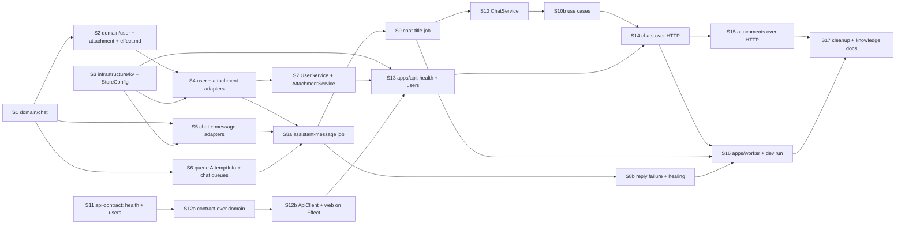

# Chat core — plan

> Ticket: `2026-10-17_chat-core` · Requirements: [feature.md](./feature.md) · Design: [architecture.md](./architecture.md)

## How to run this plan

- **Branch and commits.** Work happens on `feat/chat-core`, one commit per step through
  `/ticket-implement`, made only after the user's OK, with the scope `chat-core`. Before
  committing, set the step's `Status:` to `done`. The ticket's documents (`architecture.md`, this
  plan, the amended `feature.md`) are committed together as `:memo: docs(chat-core)` when the
  plan is approved, before S1.
- **Green at every commit.** Each step leaves `make check` green; `pre-commit` runs the patched
  `tsc -b` and `--no-verify` is banned. Nothing is stubbed to get there: a step ships only what it
  tests, and the api grows one contract group at a time because `HttpApiBuilder.layer` needs
  every declared group implemented.
- **Size.** A step changes ≤ ~400 lines, counted without `bun.lock`. A step that grows past this splits into `Sna`, `Snb`.
- **Effect APIs are verified against `repos/effect`** (the vendored `4.0.5`), never against
  memory: `http-api`, `persistence` and `ai` are unstable modules. Read `repos/effect/LLMS.md`
  before the first Effect file of a session.
- **Tests only at the Seams** of `architecture.md` (1–7; *Replanned in S12:* the facade's Seam 9 is retired, and Seam 8, the spec drift, folds
  into Seam 7 as assertions on `OpenApi.fromApi(Api)`, D16). A step whose behaviour is observed at a
  later step's seam says `config only` and names that seam. Dev-mode behaviour (two processes on
  `.data/store`, `--watch`, SIGTERM) is checked by hand in S16, per `feature.md › Acceptance`.
- **Deviations** are recorded in the step's findings, in `architecture.md › Decisions` when they
  are decisions, and in `feature.md` when they change what a requirement asks.
- **Open checks V1–V3** (`architecture.md`) are settled in the step that names them; the outcome
  goes into that step's findings.
- **Ticket ids** (`R…`, `D…`) stay out of code, rules and `docs/knowledge/` (`make ids`).

## Dependency graph

Steps with no path between them are independent: S1, S3, S6 and S11 can start at once.

## Steps

### Domain

#### S1 — `domain/chat`: Chat, Message and the pure rules

- **Goal:** the chat aggregate as schemas, errors, ports and pure operations: `ChatId`,
  `ChatTitle`, `Chat`, `MessageId`, `MessageAuthor`, `MessageStage`, `MessageFailure`,
  `Message`; `ChatNotFoundError`, `ChatBusyError`, `MessageNotFoundError`,
  `MessageInputInvalidError`; `ChatRepository`, `MessageRepository` (with
  `selectActiveByChat`); `buildChat`, `buildUserMessage`, `buildAssistantMessage`,
  `isActiveMessage`, `ensureMessageInput`, `ensureChatAcceptsMessage`, `prepareMessage`,
  `generateMessage`, `completeMessage`, `failMessage` with `MessageStageInvalidError`; `UserId` and `AttachmentId`, each alone in
  its aggregate's model file (moved to `.id.ts` files in S2, D20); the transition verbs and `update` added to `naming.md`
  (R5, R8, R10, R11, R12, R15, R16, R18, R19, R35; D1, D2, D3, D17, D18, D19).
- **Blocked by:** none.
- **Files:** `domain/chat/{chat.model,chat.model.test,chat.error,chat.service,chat.service.test,
  index}.ts`; `domain/user/{user.model,index}.ts` and `domain/attachment/{attachment.model,
  index}.ts` (ids only); `domain/package.json` (`exports` `./chat`, `./user`, `./attachment`);
  `.claude/rules/naming.md`.
- **Test first:** Seam 1 — `isActiveMessage` holds for an assistant message in `queued |
  preparing | generating` and not for `completed`, `failed` or a user message;
  `ensureChatAcceptsMessage` passes `none`, a user message and a terminal assistant message,
  and fails `ChatBusyError` with the message's `chatId` for an active one;
  `ensureMessageInput` rejects blank text without attachments and accepts an attachment alone;
  each transition succeeds from its allowed stages and fails `MessageStageInvalidError { id,
  from, to }` from every other stage and for a user message; `prepareMessage` clears text and
  error; `generateMessage` refuses a user message at `preparing`; `failMessage` yields `{
  reason: 'ReplyFailed', message, cause }` with a fixed user-facing sentence that does not contain
  the cause; in `chat.model.test.ts`,
  `ChatTitle` rejects `"  "`, `" Trip"` and 121 characters, and decoding a `Message` whose author
  is neither `user` nor `assistant` fails.
- **Verify:** `make check`; `git grep --untracked -nE "Date.now|new Date\(|randomUUID|'system'|'tool'"
  -- 'domain/**/*.ts'` finds nothing.
- **Status:** done
- **Findings:**
  - At ~600 lines the step split into S1a (model and errors, `make check` green alone) and S1b
    (ports, rules and their tests). S1b is ~450 lines, 250 of them tests; it was not split
    further.
  - `UserId` and `AttachmentId` land here, ahead of S2, because `Chat` and `Message` reference
    them.
  - The foreign-author decode test uses `'moderator'`: `'system'` would trip the Verify grep.
  - The Verify grep needs `--untracked`: a step's files are untracked until it is committed.
  - `MessageFailure` stores `cause` for operators (D19); S8b fills it with `Cause.pretty`.
  - `naming.md` also admits `is` for predicates and lets `ensure` guard an invariant
    (`ensureChatAcceptsMessage`, `ensureMessageInput`).
  - S5: the KV `selectActiveByChat` reads the chat's last message and must return it only when
    `isActiveMessage` holds, so a last user or terminal message yields `none`.

#### S2 — `domain/user`, `domain/attachment` and the first `effect.md`

- **Goal:** the two remaining aggregates — `UserId`, `User`, `Credential`,
  `UserUnknownError`, `UserRepository`, `buildUser`; `AttachmentId`, `Attachment`,
  `AttachmentNotFoundError`, `AttachmentBoundError`, `AttachmentRepository`,
  `AttachmentStore`, `buildAttachment`, `ensureBindable` — and `.claude/rules/effect.md` drawn
  from the three domain folders (R1, R4, R13, R20, R23, R37; D1, D7, D11).
- **Blocked by:** S1.
- **Files:** `domain/user/{user.id,user.model,user.model.test,user.error,user.service,index}.ts`;
  `domain/attachment/{attachment.id,attachment.model,attachment.model.test,attachment.error,
  attachment.service,attachment.service.test,index}.ts`; `domain/chat/chat.id.ts` and the `chat.*`
  imports; `domain/example/example.id.ts`; `biome.json` (`noImportCycles`); `.claude/rules/
  naming.md` (the `.id` role); `.claude/rules/effect.md` (`paths: **/*.ts`, ≤ ~80 lines, the
  Effect idioms the domain code uses, linking `domain/CLAUDE.md` for what it already states).
- **Test first:** Seam 1 — `ensureBindable` fails `AttachmentNotFoundError` for a missing id and
  for another user's attachment, `AttachmentBoundError` for a bound one, and passes a user's
  unbound set; `buildAttachment` starts with `messageId: none`; `Credential` is `{ kind:
  'secret', hash }`.
- **Verify:** `make check`; `wc -l .claude/rules/effect.md` ≤ ~80; `make ids` passes with the
  new rule.
- **Status:** done
- **Findings:**
  - Ids moved to `<aggregate>.id.ts` (S1's model files included) and Biome's `noImportCycles`
    now fails a cycle; it was red on the chat ↔ attachment model cycle first (D20, amends D1).
    `Schema.suspend` on both sides worked and was rejected.
  - `AttachmentStore` uses `insert`/`select`/`delete`, the persistence verbs of `naming.md`.
  - `ensureBindable(id, found, userId)` checks one attachment found as an `Option` and returns
    it; S10 traverses the ids with `Effect.forEach` over `selectById`. A batch rule matching
    `ids` against what `selectByIds` returned was written first and rejected. A repeated id
    would pass twice; S10 rejects duplicates in `attachmentIds`.
  - `Credential.hash` is a `SecretHash` brand (lower-case hex SHA-256): S4's key and S7's
    digest must produce lower-case hex.
  - `FileName` (non-empty), `MediaType` (`type/subtype`) and `FileSize` (Int ≥ 0) are brands, so
    `buildAttachment` cannot fail; S7 decodes raw upload values and S15's contract answers `400`
    for a file without a name (R21 amended). *Amended in S7:* the decode moves to the S15
    handler (S7 finding on raw upload values, S15 **Constraint**).
  - Tests sit in `user.model.test.ts` and `attachment.model.test.ts` beside the schemas they
    test; `buildUser` has no test, like `buildChat`.
  - `effect.md` carries a fixture rule: `Schema.DateTimeUtc` decodes a `DateTime`, not an ISO
    string, which had made a rejection test pass for the wrong reason.
  - `ExampleId` moved to `example.id.ts` so the copied pattern matches until S17.
  - ~445 lines, over the ~400 budget: ~165 are tests and ~60 the id moves in S1 and `example`.
    Not split.

### Infrastructure

#### S3 — `infrastructure/kv`: the collection module, the file store and `StoreConfig`

- **Goal:** the deep module every adapter builds on — `createCollection(store, { prefix,
  schema })` with `get / set / modify / delete` and `createIndex(store, { prefix, id })` with
  `append / remove / list / delete`, the module fully serialised per process by one
  `Semaphore(1)` — plus `KeyValueStoreFileSystem` bundling `StoreConfig { path }` from
  `STORE_PATH` (R33; D2, D4).
- **Blocked by:** none.
- **Files:** `infrastructure/kv/{kv-collection,kv-collection.test,kv-store,index}.ts`;
  `infrastructure/package.json` (`exports` `./kv`; `@effect/platform-bun` and
  `@effect/vitest` as `devDependencies`, for the file-system test); `packages/config/config.ts`
  (`StoreConfig`) and `config.test.ts`; `.env.example` (`STORE_PATH="../../.data/store"`);
  `.gitignore` (the `.data` comment now covers the store).
- **Test first:** Seam 2, on `KeyValueStore.layerMemory` and on `layerFileSystem` in a temp
  directory — a key with `/` round-trips; `modify` on a missing key creates it; `append` twice
  then `remove` once lists one id in insertion order; `list` of an unknown index is `[]`; `delete`
  drops the whole index; a value that fails the schema dies with a `SchemaError`, not `none`; two
  concurrent `append`s on one index lose nothing.
- **Verify:** `make check`; `STORE_PATH` is read only through `StoreConfig`; `mv .env .env.bak &&
  make test` passes.
- **Status:** done
- **Findings:**
  - The module lives in `infrastructure/kv/` with its own barrel
    (`@app-template/infrastructure/kv`), and the file-store wiring sits beside it as `kv-store.ts`,
    a bare kebab name: it is part of the kv module, not a client. Recorded as *Amended in S3* on
    D2 and D4. `shared/queue.client.ts` stays where it is.
  - The module is fully serialised per process: every collection and index operation, reads
    included, takes one module-level `Semaphore.makeUnsafe(1)`. A semaphore per store instance was
    rejected: one store per process makes it the same lock. The concurrent-append test proves the
    lock on `modify`, red without it on the file store only (the memory store's synchronous
    get/set never interleaves). The lock on reads and plain writes has no red test: a probe of 50
    concurrent reads against 50 rewrites of a 200 KB value never tore on Bun.
  - The module turns a `KeyValueStoreError` or `SchemaError` into a defect once, so no KV adapter
    repeats `Effect.orDie`; recorded as *Amended in S3* on D17. The test asserts a die whose
    squashed cause is a `SchemaError`.
  - `Index.delete(key)` drops an index; S5's `deleteByChat` cascade uses it. An index whose last
    id is removed holds `[]`.
  - The module's verbs split by what they touch: whole-key `get / set / modify / delete`,
    index-member `append / remove / list`. `delete` matches `naming.md`; the ports keep its
    `select / insert / update / delete`, and S4/S5 map one onto the other without renaming either.
  - Keys are plain strings relative to `prefix`, for collections and indexes alike: S5 writes
    `createIndex(store, { prefix: 'users/', id: ChatId })` and `append(\`${userId}/chats\`, id)`.
    `createIndex` takes `Id extends string`.
  - Members are `Effect.fn` with the spans `Collection.<method>` and `Index.<method>`.
  - `modify(key, f: Option<A> → A)` creates a missing key. The round-trip fixture holds
    `Schema.Option(Schema.DateTimeUtc)`, so a plain `JSON.stringify` codec would fail it.
  - The tests share one store per `describe.each` row through `@effect/vitest`'s `layer`, with
    distinct keys per test.
  - `STORE_PATH` has no default in code: a missing one fails at startup, like
    `QUEUE_SQLITE_PATH`. `feature.md › R33` said "default `../../.data/store`" and now says the
    value is set in `.env.example` (*Amended in S3*); its acceptance row names no default.
  - The local `.env` is untouched: add `STORE_PATH` from `.env.example` before S13's dev run.

#### S4 — User and Attachment adapters on the store

- **Goal:** `UserRepositoryKv`, `AttachmentRepositoryKv` and `AttachmentStoreKv` implementing
  their ports on the collections of S3, with the key layout of `architecture.md › Store layout`
  (R1, R20, R22, R23, R33; D2, D7, D11).
- **Blocked by:** S2, S3.
- **Files:** `infrastructure/user/{user.repository,user.repository.test,index}.ts`;
  `infrastructure/attachment/{attachment.repository,attachment.storage,
  attachment.repository.test,attachment.storage.test,index}.ts`; `infrastructure/package.json`
  (`exports`).
- **Test first:** Seam 3, on `layerMemory` — `insert(user, credential)` then
  `selectByCredential` finds the user and the store holds `credentials/secret/<hex>` with no
  secret; `selectByIds` keeps the order asked and drops unknown ids; `update` rebinds
  `messageId`; `deleteByIds` removes rows and `AttachmentStoreKv.delete` the bytes; `select` of
  unknown bytes is `none`.
- **Verify:** `make check`.
- **Status:** done
- **Findings:**
  - The kv module (`infrastructure/kv/kv-collection.ts` and its test) was changed though it is not
    in this step's Files: S4's review asked for both additions below, and each has a Seam 2 test
    on the memory and the file store (*Amended in S4* on D2 and the Store layout).
  - `Collection.update(key, f)` reads and writes under one permit and only when the key exists
    (`none`, no write, otherwise); `AttachmentRepositoryKv.update` uses it, so `update` never
    creates (`naming.md`) and has no read-then-set window.
  - `createBlobs(store, { prefix })` stores raw bytes (`getUint8Array`, `set(key, Uint8Array)`,
    `remove`) under the same lock and defect policy; `AttachmentStoreKv` uses it. A probe on
    `layerFileSystem` wrote a 4096-byte input as one 4096-byte file
    (`attachments%2F<id>%2Fbytes`), byte-for-byte equal. A collection over `Schema.Uint8Array`
    was written first and rejected: its JSON codec is base64, a third larger.
  - An attachment `DELETE` racing a `send` that binds the same unbound attachment passes both
    service checks (S7's `delete`, S10's `ensureBindable` read the unbound row before either
    writes). The atomic `update` stops the deleted row from coming back, but the message may then
    reference a deleted attachment. Recorded in `architecture.md › Risks`; Postgres closes it
    with `UPDATE … WHERE message_id IS NULL` and a delete guarded the same way.
  - `UserRepository.insert` writes `users/<id>` before `credentials/<kind>/<hash>`, so a crash
    between them leaves an unreachable user, never a credential pointing at nothing;
    `selectByCredential` still returns `none` for a dangling credential.
  - Each key shape is written once, in a local builder (`credentialKey`, `bytesKey`); the
    credential key takes `credential.kind`, so a later kind lands in its own
    `credentials/<kind>/` space without a second collection.

#### S5 — Chat and Message adapters on the store

- **Goal:** `ChatRepositoryKv` and `MessageRepositoryKv` with the two api-only indexes
  (`users/<id>/chats`, `chats/<id>/messages`), `selectActiveByChat` and the `deleteByChat`
  cascade, which drops the message index with `Index.delete` (R6, R7, R9, R10, R14, R33; D2).
- **Blocked by:** S1, S3.
- **Files:** `infrastructure/chat/{chat.repository,message.repository,chat.repository.test,
  message.repository.test,index}.ts`; `infrastructure/package.json` (`exports`).
- **Test first:** Seam 3 — `selectByUser` lists only that user's chats; `delete` removes the
  chat and its index entry; `selectByChat` returns messages in insertion order under one
  `TestClock` millisecond (V2: never by id order); `selectActiveByChat` returns a `queued`
  assistant message and `none` once it is `completed` or when the last message is the user's;
  `deleteByChat` removes every message and the index; `update` of a message never touches the
  index.
- **Verify:** `make check`.
- **Status:** done
- **Findings:**
  - No `TestClock`: the adapters take every timestamp from their input, so the fixtures share one
    `createdAt` and the ids are given against insertion order. Order comes from the index, never
    from ids (V2, for the adapter; S10 meets it again with `TestCrypto`).
  - `selectActiveByChat` reads the last id of `chats/<id>/messages` and returns that message only
    when `isActiveMessage` holds (D2). Mutating it to the first id, or dropping the predicate,
    turns its tests red.
  - Write order keeps a crash recoverable by retry: `insert` writes the row before its index
    entry; `ChatRepository.delete` removes the index entry before the row; `deleteByChat` deletes
    the messages before `Index.delete`. A list read drops an id whose row is gone.
  - `ChatRepository.delete` reads the chat to find its owner's index; an unknown id is a no-op.
    It does not cascade to messages: `ChatService.delete` (S10) calls `deleteByChat`.
  - Both `update`s use `Collection.update`, so within one process a write to a message whose
    chat was deleted never brings it back; each has a "never creates" test beyond the plan's
    list. Across processes the api's `deleteByChat` can land between the worker's read and write
    and leave an orphan row (`architecture.md › Risks`, *Amended in S5* on D4).
  - The kv module gains `Collection.getMany(keys)`, outside this step's Files at the review's
    request: one permit for the whole read, the order asked, missing keys left out. It replaces
    the three list-then-get copies (`selectByUser`, `selectByChat` and S4's `selectByIds`);
    Seam 2 tests it on both stores (*Amended in S5* on D2).
  - The review moved two constraints into later steps: S8 re-reads the chat before writing
    `updatedAt`; S10 fixes the delete order and serialises `send` per chat, which makes D2's
    "sends are refused while a message is active" hold under concurrency (*Amended in S5* on D2).
  - Two tests read the raw store (`chats/<id>/messages` gone, unchanged by `update`), like S4's
    credential key: the port drops dangling ids, so an index leak is invisible through it.
  - `Array` is imported as `Arr` (Biome `noShadowRestrictedNames`), as `String as Str` in domain.

#### S6 — `AttemptInfo` in `packages/queue` and the two chat queues

- **Goal:** `packages/queue` exposes `send(definition, message)` and `worker(definition,
  handle)`, a Layer whose scope owns the consumer fiber; a `QueueDefinition` carries its
  `jobId`, and the handler receives `{ attempt, maxAttempts, isLastAttempt }`, computed from the
  same condition the loop uses to dead-letter; `infrastructure/chat/chat.queue.ts` defines
  `assistantMessageQueue` (`GenerateAssistantMessage { chatId, messageId }`) and
  `chatTitleQueue` (`GenerateChatTitle { chatId, messageId }`, the first user message) with
  `maxAttempts`, a `Schedule` and a `jobId` (R18, R19, R31, R32; D3, D21). *Amended in S6:
  `send` and `worker` replace `QueueClient.make` and `JobQueue`; the title job carries ids.*
- **Blocked by:** S1.
- **Files:** `packages/queue/{queue,queue.test,index,sqlite}.ts`;
  `infrastructure/chat/{chat.queue,index}.ts`; `infrastructure/shared/queue.client.ts`;
  `infrastructure/CLAUDE.md`; `.claude/rules/naming.md`; `docs/knowledge/roadmap.md` (*Amended
  in S6*).
- **Test first:** Seam 4, on the memory store under `TestClock` — a handler that fails on every
  attempt sees `attempt` 1…`maxAttempts`, `isLastAttempt` only on the last, no attempt after it,
  and the worker keeps running; closing a worker's scope releases its job to the next worker at
  the same attempt; two sends with one `jobId` deliver the first only (memory and SQLite).
- **Verify:** `make check`. *Amended in S6:* the existing queue tests move to `send` and
  `worker`, since `QueueClient.make` is gone; each keeps its assertion.
- **Status:** done
- **Findings:**
  - Variant "static definition + `send` + `worker` Layer", after effect's `DurableQueue` (a
    definition value with `idempotencyKey`; its `worker` is
    `Layer.effectDiscard(Effect.forkScoped(…))`), copied in shape only: that module needs
    `WorkflowEngine` and is request/response (D21).
    `QueueClient` becomes `{ send(definition, message), consume(definition, handle) }`; resolving
    the queue per call is free, since `PersistedQueueFactory.make` is `Effect.succeed`
    (`effect/src/persistence/PersistedQueue.ts:249`). `JobQueue` and `QueueClient.make` are gone.
  - `jobId` is typed by `satisfies QueueDefinition<typeof X>` (`(ping) => ping.id` infers its
    parameter), so there is no `define` helper.
  - `Handler<A, E, R>` names the handler type at its three sites; `queue.ts` exports it but the
    barrel does not: jobs pass a lambda to `worker`, and `AttemptInfo` types its second argument.
    One span per enqueue and one per attempt, none on the endless `consume` loop: the service's
    `send` is `Effect.fn('QueueClient.send')` and the free `send` a plain `QueueClient.use`
    accessor, as effect's `PersistedQueue.make` is, so no span is doubled; `runAttempt` is
    `Effect.fn('runAttempt')`, named after itself as `effect.md` asks of a function that is not a
    service method. A probe confirmed `Effect.fn` keeps a generic body's type parameters.
    `isLastAttempt` is the same
    `attempts >= maxAttempts` that picks the dead-letter log, computed once and used for both.
  - The retry test advances `TestClock` until the next attempt shows up rather than once per
    retry: whether a retry's delay starts before or after an advance depends on fiber scheduling.
    After the third attempt it advances a minute and finds no fourth, then the next message is
    still handled.
  - Probes, each red then reverted: `send` ignoring `jobId` fails the dedup test on both stores;
    `forkDetach` for `forkScoped` fails the scope test (the first worker keeps the job); `>` for
    `>=` in `isLastAttempt` fails the attempt-info assertion; the store dead-lettering one attempt
    after `maxAttempts` fails the no-fourth assertion. Counting attempts in the consumer instead
    of the store's count failed the release test in the previous shape.
  - The memory store drops an offer whose id it has seen (`entries.has(id)`), custom or not, so
    the dedup test runs on it as on SQLite.
  - Any cause that ends the consumer is logged at `Error` (annotated with the queue) and the
    consumer restarts on `Schedule.min([exponential('1 second'), spaced('1 minute')])`, unbounded:
    `tapCause` (interrupt-only causes unlogged), `Effect.sandbox`, `Effect.retry`, after effect's
    SQL poll loop (D21). `Effect.orDie` came first and was dropped: a probe showed a defect in a
    fiber forked by `Layer.effectDiscard(Effect.forkScoped(…))` is not logged and does not end
    `Layer.launch`. `tapError` + `retry` came next and was dropped: the SQL store's `ack` dies,
    so a defect slipped past it the same way.
  - The store-failure test runs twice, over a store whose first `take` fails with a typed error
    and one whose first `take` dies: nothing is handled before 1 s, the job is handled after it,
    and one `Error` log names the queue. A handler that interrupts itself is handled again at
    the same attempt, with no log; before `sandbox` it stopped the worker for good. Closing a
    worker's scope logs nothing either. Probes, each red then reverted: no `sandbox` (the defect
    and self-interrupt tests time out), no retry, no log, no annotation, a zero-delay retry,
    logging interrupt-only causes (the self-interrupt test). The scope-close test stays green
    under the last probe: an external interrupt never reaches `tapCause`. The cap has no test.
    The schedule's state never resets while the worker lives (`Schedule` 4.0.5 has no
    `resetAfter`), so after a run of failures every restart waits the full minute.
  - A store whose finalizer dies after a failed attempt (the SQL `ack`) adds its defect beside
    `AttemptFailed`; `catchTags` recovered the attempt and dropped the defect with no log at all,
    as a probe on a `layerStoreMemory` wrapper showed. `consume` now logs it at `Error` when the
    cause carries both a failure and a defect (a defect alone reaches the worker's log instead,
    so nothing is logged twice), and keeps consuming. The test dead-letters one job through that
    wrapper, then sees the next handled and the two `Error` logs; dropping the new log turns it
    red.
  - `GenerateChatTitle` carries ids only, `{ chatId, messageId }` with the first user message's
    id: the worker reads the text from the store, as `R32` asks, and the user's text never lands
    in the queue table, where it would outlive the chat's deletion. Amended in `R24`, the
    `R31–R32` acceptance row, D12 and the Jobs schema line; S9's Goal reads the message by id.
  - `assistantMessageQueue` retries 3 times and `chatTitleQueue` 5, both on
    `Schedule.exponential('1 second')` as the `effect-setup` example did: the user polls the
    reply, nobody waits on the title. Their `jobId`s are `messageId` and `chatId`, unprefixed:
    the store keys uniqueness on `(id, queue_name)` (SQL unique index, the memory store's
    entries per queue).
  - D14 is amended: a `.queue.ts` holds definitions only, and callers use `send` and `worker`.
  - A worker that crashes on the final attempt leaves its message active: the SQL store's
    lock-expiry sweep marks the job `failed` without calling the handler. Added to
    `architecture.md › Risks`; S8b gains the constraint to decide and test the healing.
  - `feature.md` keeps its requirements: R31 already asks for definition values and a `worker`
    layer. Its context paragraph and open question still name `JobQueue`, as history.
  - `createQueueClientSqlite` is now `layerSqlite`, after effect's `SqliteClient.layer` and
    `PersistedQueue.layerStoreSql`; `QueueClientSqliteOptions` keeps its name, since effect names
    a config after its subject (`SqliteClientConfig`). `naming.md` takes `createCollection` as the
    `create<Thing>` example and gains `layer<Variant>` for a function that builds a client's
    `Layer` from options, so `worker` (named as `DurableQueue.worker`) stays outside it. The
    closed `effect-setup` ticket keeps the old name.
  - The `.queue` role is now definitions only: `infrastructure/CLAUDE.md` says no adapter wraps
    `send` or `worker` (its in-memory queue adapter clause went too), and `naming.md` gives
    `.queue` its own row. `naming.md` also names a `Layer`-returning combinator for what it runs
    (`worker`).
  - `docs/knowledge/roadmap.md`, entry 5, gains the SQS caveat: the port promises one delivery per
    `jobId`, which standard SQS lacks and FIFO keeps for 5 minutes, and `isLastAttempt` must come
    from `ApproximateReceiveCount`.
  - S13 and S16 gain Verify checks: one listener after a `--hot` reload; `Layer.launch` under
    `runMain` with no `setInterval`, SIGTERM releasing the job in hand.

### Application

#### S7 — `UserService` and `AttachmentService`

- **Goal:** `UserService { ensure, authenticate }` issuing a 32-byte base64url secret, storing
  its hex SHA-256 and recognising it back; `AttachmentService { upload, get, download, delete }`
  over the two ports, refusing to delete a bound attachment (R1, R2, R4, R20, R22, R23, R35;
  D7, D11, D22).
- **Blocked by:** S4.
- **Files:** `application/user/{user.service,user.service.test,index}.ts`;
  `application/attachment/{attachment.service,attachment.service.test,index}.ts`;
  `application/package.json` (`exports`, `devDependencies`); `patches/effect@4.0.5.patch`; the
  root `package.json` (`patchedDependencies`); `docs/knowledge/tooling.md`;
  `.claude/rules/tooling.md` (*Amended in S7*).
- **Test first:** Seam 5, on memory adapters with `TestClock` and `TestCrypto.layer(seed)` —
  `ensure(none)` creates a user and a secret; `ensure(some(secret))` returns the same user and no
  second record; `authenticate` of an unknown secret is `UserUnknownError`; `upload` stores bytes
  and metadata with `messageId: none`; `get`/`download` of another user's id is
  `AttachmentNotFoundError`; `delete` of another user's one is `AttachmentNotFoundError`; `delete`
  of a bound one is `AttachmentBoundError` and leaves bytes.
- **Verify:** `make check`; the ids the services generate are UUIDv7s from `TestCrypto`,
  asserted by shape (`Schema.isUUID(7)`), never by value or order (V2), while fixture ids
  (`owner`, `stranger`, `unknown`) are literals. *Amended in S7.*
- **Status:** done
- **Findings:**
  - The secret crosses the service as `UserSecret = Redacted.Redacted<string>`: the cookie
    security yields a `Redacted` and `securitySetCookie` accepts one, so the handler passes it
    through, and a log never prints it. A domain `UserSecret` brand was rejected: the domain
    stores only the hash (`SecretHash`), and a brand on the plaintext would be checked nowhere
    (*Amended in S7* on D7).
  - `ensure(some(secret))` with a secret no user holds creates a new user, as `ensure(none)`
    does: the requirement reads "without a *valid* secret". `ensure` is `authenticate` with
    `catchTag('UserUnknownError', registerUser)`.
  - `Crypto` is a platform service without a default, and `TestCrypto.layer(seed)` keeps the
    platform `digest`, so the tests provide `BunCrypto.layer` under it: `@effect/platform-bun`
    joins `application`'s `devDependencies`, as it already is in `infrastructure`'s.
  - `Crypto`'s `PlatformError` (a bad size, a platform failure) dies in the service, as a store
    failure does in an adapter: no caller can handle it differently.
  - `AttachmentService.delete` reuses `ensureBindable`: an attachment is deletable exactly when
    it is bindable (the user's and unbound), so a second rule would restate the first.
  - `upload` writes the bytes before the row and `delete` removes the row before the bytes, so a
    crash between the two writes leaves orphan bytes, never a row whose download fails; a row
    whose bytes are missing anyway is `AttachmentNotFoundError`, not a defect, per the "not
    found is a value" rule.
  - Raw upload values are not decoded here, against the S2 finding ("S7 decodes raw upload
    values"): `AttachmentUpload` takes the branded `FileName` and `MediaType`, so a plain string
    cannot reach the service, and the decode moves to the S15 handler, beside the contract's
    `400` for a nameless file and its `415` for a type outside the limits.
  - The seeded UUIDv7s are asserted by shape, not by literal: a literal would be a snapshot of
    the generator and of test order in the shared layer.
  - **Flake fixed by a patch to `effect`:** `assertEquals` on two equal errors failed at random
    on Bun (`get … AttachmentNotFoundError`); `patches/effect@4.0.5.patch` fixes it, tests and
    `effect-tests.md` unchanged, upstream issue to file. Cause, fix and rejected options: D22.
  - The new `.claude/rules/tooling.md › Dependencies` line (a catalog bump of a patched package
    redoes or drops its patch) was approved by the user at the S7 approval gate (`sdd.md`: a
    rule changes only on the user's OK).

#### S8a — The assistant-message job: the reply

- **Goal:** `infrastructure/chat/chat.llm.ts` (`buildChatPrompt` on `Prompt.make` with `file`
  parts, `streamAssistantText`) and `application/chat/assistant-message.job.ts`:
  `AssistantMessageJob { enqueue }` over `send(assistantMessageQueue, …)`,
  `AssistantMessageJob.worker` = `worker(assistantMessageQueue, …)`, a Layer the worker app
  merges (*Amended in S6*), `SnapshotInterval` (`Context.Reference<Duration>`, 300 ms); stages
  `preparing → generating → completed`, `Ref` + `Schedule.spaced` snapshots with an explicit
  final write, the chat's `updatedAt` bumped after a re-read, a silent exit when the chat is gone
  or the message already settled; the prompt from the store, never `effect/ai/Chat` (R9, R16,
  R17, R19, R31, R32; D3, D12, D14, D24). *Amended in S8a:* split into S8a and S8b; failure
  handling and the healing of a stuck message are S8b.
- **Blocked by:** S4, S5, S6.
- **Files:** `infrastructure/chat/chat.llm.ts` and `index.ts`;
  `application/chat/{assistant-message.job,assistant-message.job.test,index}.ts`;
  `application/package.json` (`exports`; `@app-template/infrastructure`, `@app-template/queue`);
  `application/tsconfig.json`; `.claude/rules/naming.md` (`.job`, `.handler`); `feature.md` (R17); `architecture.md` (D3
  amended, D24, Risks); `docs/knowledge/roadmap.md` (entry 6). *Amended in S8a.*
- **Test first:** Seam 6, with a fake `LanguageModel` (`LanguageModel.make`) that records its
  prompt and emits three deltas under `TestClock`, and `QueueClientMemory` — the message passes
  `preparing` then `generating`; at most one write per `SnapshotInterval` while deltas arrive;
  the final write is `completed` with the whole text and bumps the chat's `updatedAt`; the
  recorded prompt holds every `completed` message in order as `user`/`assistant` with one `file`
  part per attachment and skips a `failed` one; a chat deleted between enqueue and take ends the
  job with a log line and no write; a message found already terminal on take (`prepareMessage`
  fails `MessageStageInvalidError`) ends the job without a write.
- **Constraint:** the worker re-reads the chat immediately before writing `updatedAt` and never
  writes a chat it read at take time, so a rename during generation survives
  (`architecture.md › Risks`, title race).
- **Verify:** `make check`; `git grep -n "'system'\|'tool'" -- domain application` finds
  nothing.
- **Status:** done
- **Findings:**
  - `buildChatPrompt(turns)` is pure and builds with `Prompt.make` over encoded messages, `role`
    being the author; an empty text yields no text part (providers reject an empty block), so a
    message sent with files only is `file` parts alone. The job keeps the `completed` filter and
    reads each turn's files through `AttachmentRepository.selectByIds` and
    `AttachmentStore.select`, one `readTurn` per message. `streamAssistantText(prompt)` keeps
    the provider's part types in
    `infrastructure`; the job sees a `Stream<string>`.
  - `ChatFile { attachment, bytes }` stays in `chat.llm.ts` beside `AttachmentDownload` in
    `application/attachment`: `infrastructure` cannot import `application`, and moving the pair
    to `domain/attachment` would change the domain and S7's service and test for a two-field
    shape.
  - Snapshots compare with the last written text and run `uninterruptible`: D3, amended in S8a.
    A probe that always writes turns the cadence test red; the uninterruptible write has no
    test, since the memory store cannot reorder writes (the race awaits its loser:
    `internal/effect.ts`, `raceAllFirst`).
  - A file whose bytes are missing from the store is left out of the prompt and the message's
    text stays; R17 is amended in S8a, and a seam 6 test covers it.
  - `prepareMessage` failing at entry is caught with `Effect.option` on that call alone: later
    transitions act on values the job built and stay in the error channel (D18).
  - `AssistantMessageJob.enqueue(message)` takes the assistant message and dies on `QueueError`,
    as a store failure dies in an adapter (D17): `ChatService.send` (S10) has one outcome, a
    `500`, whatever the queue's failure. Its one-expression build goes straight into
    `Layer.effect` with `this.of`, the shape staying explicit on the class.
  - `application` gains `@app-template/infrastructure` as a runtime dependency (it was dev-only)
    and `@app-template/queue`; `@app-template/llm` is not needed: the tests use their own fake on
    `LanguageModel.make`, and the dev stub is S9's.
  - Not using `effect/ai/Chat` is D24, on the user's request after verifying `Chat.ts`.
    Roadmap entry 6 gains the history-truncation note, and `architecture.md › Risks` the
    unbounded-history row.
  - `.claude/rules/naming.md › Files` gains the `.job` row (a queue's producer service and its
    worker, in `application`), and the `.handler` row narrows to a request handler in `apps`,
    since a job lives in `.job`. The user approved both rule lines at the S8a review (`sdd.md`:
    a rule changes only on the user's OK).
  - The tests share one module-level `makeHarness(stream)` that returns the recorded writes,
    prompts and logs with the layer. The snapshot test relies on the default `SnapshotInterval`
    with deltas 120 ms apart, so no snapshot coincides with a delta; the clock advances one
    second at a time, as the S6 retry tests do. Probes, each red then reverted: snapshots every
    millisecond; a snapshot without the `Equal` check; no `touchChat`; `failed` messages kept in
    the history; no file parts; an empty text part; the chat read at take time.

#### S8b — The assistant-message job: failure and healing

- **Goal:** the reply's failure policy: a failed attempt retries from `preparing`; the last reply
  attempt writes `failed` with `{ reason: 'ReplyFailed', message, cause }`, the cause as
  `Cause.pretty`; an interrupt-only cause is never caught; `assistantMessageQueue` keeps a fourth
  attempt that only settles a reply whose worker died (R18, R19, R34; D3, D18, D19, and D23,
  which S8b adds).
- **Blocked by:** S8a.
- **Files:** `application/chat/{assistant-message.job,assistant-message.job.test}.ts`;
  `infrastructure/chat/chat.queue.ts` (`replyAttempts = 3`, `maxAttempts: replyAttempts + 1`);
  `architecture.md` (D23, Seam 6, Risks); `feature.md` (R18, R19 amended); `docs/knowledge/roadmap.md` (entry 6: the
  `AiError.isRetryable` / `retryAfter` note).
- **Test first:** Seam 6 — a model that fails on every attempt sets the message back to
  `preparing` on each retry and `failed` with `{ reason: 'ReplyFailed', message, cause }` only on
  the last reply attempt, the model's error in `cause` (`Cause.pretty`) and none of it in
  `message`; a job delivered on the fourth attempt with its message still active (a store wrapper
  reporting that attempt, as the SQL store does after a crash) ends `failed` without calling the
  model; an interrupt on the last reply passes through instead of failing the message.
- **Constraint:** S8b decides and tests how a stuck active message heals when a worker crashes on
  the final attempt and the SQL store's lock-expiry sweep marks the job `failed` without calling
  the handler (`architecture.md › Risks`); the choice is recorded as a new `D…`.
- **Verify:** `make check`.
- **Status:** done
- **Findings:**
  - Healing (the constraint): D23. The last reply (attempt 3) catches its own failure, writes
    `failed` with `Cause.pretty`, logs `Error` `assistant reply failed` and ends, so the queue
    logs two `Warn` attempt lines and no dead letter in the normal path. The fourth attempt's
    test wraps `PersistedQueue.layerStoreMemory` so every take reports `maxAttempts`, as the SQL
    store does after attempt 3's lock expired: the message ends `failed` with the fixed cause and
    the model is never called. R19 still holds: a crash consumes the attempt the store counted at
    claim, so a crash on the last reply is an exhausted job (R18 amended).
  - The fourth attempt reads the message once: `findReply` returns it, `isActiveMessage` guards
    it and `failReply` writes from it. The last reply re-reads (`failStoredReply`), since the
    message it found on take has moved on. A message already terminal on the fourth attempt ends
    with the `Info` `already settled` line; the S8a settled test now runs on both deliveries, and
    dropping the guard turns it red (the job would dead-letter on `MessageStageInvalidError`).
  - A store defect before attempt 3's reply starts, or in its `failed` write, reaches attempt 4
    as well, so its cause reads "its worker stopped or the store failed"; a lock expiring on a
    live worker is the duplicate delivery R19 accepts. Both are in D23 and `Risks`.
  - The failing-model test expects three model calls and one `failed` write:
    `[preparing, generating, generating 'Hel'] × 3, failed 'Hel'`. `failMessage` keeps the text
    stored when it failed, so a failed reply shows its partial text; the contract shows `error`.
  - An interrupt-only cause on the last reply is neither caught nor logged; the ternary is only
    observable when the reply interrupts itself (an external interrupt already stops the
    recovery from running), so the test interrupts the model once on the last reply and sees no
    `failed` write and no log, then the reply completed. That the store does not count an
    interrupted attempt is Seam 4's, in `packages/queue`; the test only lets the store retake it.
  - The chat's `updatedAt` also moves on `failed` (a terminal stage, R16), through `touchChat`.
  - Roadmap entry 6 gains the `AiError.isRetryable` / `retryAfter` note; the Seam 6 row and R18
    now name the last reply attempt.
  - The policy has one source: `chat.queue.ts` exports `replyAttempts = 3` and sets
    `maxAttempts: replyAttempts + 1`; the job's `roleOf(info)` maps an attempt to `reply`,
    `lastReply` or `settle`, and the `attemptRoles` table runs it. `writeSettled` is the shared
    terminal write (the message, then the chat at the message's `updatedAt`) of `completed` and
    `failed`.
  - Probes, each red then reverted: no `lastReply` role; no `settle` role; no settling branch; `maxAttempts: 3`; no catch on the last
    reply; an interrupt caught as a failure; the settling attempt without its terminal guard.

#### S9 — The chat-title job and the dev stub

- **Goal:** `suggestChatTitle` in `chat.llm.ts` (*Amended in S9:* renamed, see Findings);
  `application/chat/chat-title.job.ts` with `ChatTitleJob { enqueue }` over
  `send(chatTitleQueue, …)` and `ChatTitleJob.worker` = `worker(chatTitleQueue, …)`, a Layer
  (*Amended in S6*), writing a title ≤ 120 characters from
  the text of the message the job names, read by id from the store (*Amended in S6*), only
  when the chat's title is still `none`, re-read right before the write; `LanguageModelStub`
  streams about twenty words at 100 ms each and answers `generateText` with a short title
  (R24, R25, R31, R32; D12, D15).
- **Blocked by:** S8a. *Amended in S8a:* the title job needs `chat.llm.ts`, the `.job` shape and
  the manifest, not the reply's failure policy; its exhausted attempts are the queue's dead
  letter.
- **Files:** `infrastructure/chat/chat.llm.ts`; `application/chat/{chat-title.job,
  chat-title.job.test,index}.ts`; `packages/llm/client.ts`; `domain/chat/chat.model.ts`
  (`maxTitleLength`); `domain/chat/{chat.service,chat.service.test}.ts` (`isTitledChat`);
  `feature.md` (R25); `architecture.md` (D25, Seam 6, Structure). *Amended in S9.*
- **Test first:** Seam 6 — the worker sets a title from the fake model's text, truncated and
  trimmed to the `ChatTitle` constraint; a chat renamed before the job runs keeps the user's
  title; a chat deleted meanwhile ends the job without a write; a model failing on every attempt
  leaves `title: none` and the dead-letter log line.
- **Verify:** `make check`.
- **Status:** done
- **Findings:**
  - The title limit lives once, as `maxTitleLength = 120` in `domain/chat/chat.model.ts`, which
    the `ChatTitle` schema and `chat.llm.ts` (the instruction and the cut) both read. The domain
    file was outside the step's original Files; the change was requested at the S9 review.
  - `buildChatTitle` trims the answer, cuts it by whole graphemes (`Intl.Segmenter`) while the
    joined length stays within `maxTitleLength`, trims again and decodes with
    `Schema.decodeUnknownOption(ChatTitle)`: no emoji or surrogate pair is split, and the result
    always passes `isMaxLength`, which counts UTF-16 code units. The leading trim keeps the
    limit for visible text.
  - Nothing to title (D25, R25 amended in S9): a first message with a blank text (no text, or
    whitespace only) never reaches the model, since providers reject an empty text block, and a
    blank answer is no title; both log `Info` `chat title skipped: nothing to title`, write
    nothing and do not retry.
  - The chat is read twice through `findUntitledChat`: before the model call, so a rename or
    delete made before the take costs no model call, and right before the write, so one made
    while the model answers wins. The helper only reads and returns a
    `Result<Chat, ChatLookupSkip>` (`'chatDeleted' | 'alreadyTitled'`), effect's own
    success-or-reason type, built with `Result.fromOption` and `Result.filterOrFail`; the
    bindings `untitledAtTake` and `untitledBeforeWrite` name the lookup, not a chat. `find`
    follows `findReply`: a read helper over ports, while `select` stays for persistence. All four
    skips go through one `titleSkipLogs` table (`as const satisfies Record<TitleSkip, …>`, where
    `TitleSkip` adds `'firstMessageMissing' | 'nothingToTitle'`), each with its own `Info` line:
    `chat title skipped: chat deleted`, `… already titled`, `… first message missing`,
    `… nothing to title`.
  - The title check is the domain predicate `isTitledChat`, beside `isActiveMessage` in
    `domain/chat/chat.service.ts`, with its unit test; the file was outside the step's original
    Files, and the change was requested at the S9 review.
  - The adapter is `suggestChatTitle`: the model proposes a title that the job may still discard
    (a rename wins), and the Goal's first name differed only by case from the
    `GenerateChatTitle` payload. `naming.md` has no verb for an LLM call; `suggest` names the
    outcome, as `stream` does in `streamAssistantText`.
  - A missing first message while the chat exists ends the job with `chat title skipped: first
    message missing`, the indirect sign of a delete in progress; S10 gains the constraint that
    makes that reading right.
  - The title write keeps the chat's `updatedAt`: a late title does not reorder `list`; only a
    reply's terminal write moves it. A test writes the title 500 ms after the take and finds
    `updatedAt` still at the chat's creation.
  - `ChatTitleJob.enqueue(first)` takes the first user message and dies on `QueueError`, as
    `AssistantMessageJob.enqueue` does. A model that always fails exhausts the five attempts:
    four `Warn` lines and one `Error` dead letter, the chat untitled.
  - `LanguageModelStub` is `config only`, checked by hand with a deleted probe script: 20 deltas
    over 2044 ms and `generateText` answering `Stub chat title`; S16's dev run observes it.
  - `suggestChatTitle` is `Effect.fn('suggestChatTitle')`: the provider call is a tracing
    boundary.
  - Probes, each red then reverted: no re-read before the write; no read before the model call;
    the model's failure swallowed; a blank text sent to the model; no trim before or after the
    cut; no nothing-to-title guard; a cut by code units; a cut by grapheme count without the
    length check; the instruction without the limit; the blank check without a trim; each of
    the four skip lines swapped for another (`first message missing` logged as `chat deleted`
    turns the missing-message case red; `nothing to title` logged as `first message missing`
    the three nothing-to-title cases; the `chatDeleted` and `alreadyTitled` rows swapped the
    four rename and delete cases); no title check before the write; `findUntitledChat` ignoring
    the title; the title write setting `updatedAt` to now (the `updatedAt` test sees 500
    instead of 0).
  - Size: the step is ≈587 changed lines (210 in tracked files, 377 in the two new ones), over
    the ~400 gate, accepted at the approval gate: the only clean seam is the dev stub (~33
    lines), and the Seam 6 test cannot be split from the job it tests.

#### S10 — `ChatService`

- **Goal:** `ChatService { create, list, get, rename, delete, send, getMessage }`: `send`
  validates the input, binds the attachments (`Effect.forEach` over the ids with `selectById`
  and `ensureBindable`), writes the user and the `queued` assistant
  message, enqueues `AssistantMessageJob` and, for the first message, `ChatTitleJob`; `list`
  sorts by `updatedAt` descending, each chat with its active message; `delete` cascades messages and
  attachments; every foreign or unknown id is the matching `*NotFoundError` (R4–R14, R24, R35;
  D1, D2, D12).
- **Blocked by:** S9 (and S4, S5 through it).
- **Files:** `application/chat/{chat.service,chat.service.test,index}.ts`.
- **Test first:** Seam 5, on memory adapters, `QueueClientMemory`, `TestClock`, `TestCrypto` —
  `send` stores two messages and bumps `updatedAt`; the first `send` enqueues both jobs, the
  second only the assistant one (title job id derived from the chat id, deduplicated); `send`
  while a message is active fails `ChatBusyError` and stores nothing; an unknown, foreign or bound
  attachment id fails and stores nothing; a repeated attachment id fails
  `MessageInputInvalidError` (`ensureMessageInput` gains the check); `rename` rejects a blank title
  (*Amended in S10:* a blank title is a type error, since `rename` takes the `ChatTitle` brand; the
  rejection is tested at Seam 1 and Seam 7); `delete` while a
  message is active removes chat, messages and attachments; `list` of two chats puts the last
  sent first with its `queued` active message; `getMessage` of another user's chat is `ChatNotFoundError`;
  two concurrent `send`s on one chat: exactly one fails `ChatBusyError` and one pair of messages is
  stored.
- **Constraints:**
  - `delete` runs `selectByChat` to collect the attachment ids, deletes the attachments (rows and
    bytes), then `deleteByChat`, and `ChatRepository.delete` last, so a crashed request can be
    retried: each step still finds what the next one needs.
  - `delete` removes the messages before the chat, so the title job reads a missing first
    message as a delete in progress. *Amended in S9.*
  - `send` is serialised per user in the api process: a per-user lock in the service (a keyed
    semaphore) makes the "no active message" check, the bindability checks and the writes one
    critical section, and also covers `rename` and `delete` (D2, *Amended in S5*, *Amended in
    S10*: per user, not per chat).
- **Verify:** `make check`.
- **Status:** done
- **Findings:**
  - `ChatTitle` is now a brand (`Schema.brand('ChatTitle')`) and `rename` takes only a `ChatTitle`,
    as `effect-schema.md` asks of a constrained value a use case accepts and as S7 did for
    `FileName` and `MediaType`; S14's handler decodes the trimmed payload (its Constraint). A
    `ChatTitleInvalidError` decoded in the service was rejected: an error the architecture lacks
    and a plain string at the service boundary. Outside the step's Files: `domain/chat/
    chat.model.ts` (the brand) and four fixtures that now write `ChatTitle.make('Trip')`
    (`domain/chat/chat.service.test.ts`, `infrastructure/chat/chat.repository.test.ts`,
    `application/chat/{assistant-message,chat-title}.job.test.ts`).
  - The lock is per user (D2, *Amended in S10*): an `RcMap` of `Semaphore(1)` keyed by `UserId`,
    the pipeable `lockUser` on `send`, `rename` and `delete`. A per-chat lock came first and left
    two sends in two chats free to bind one unbound attachment. Probes, each red then reverted:
    no lock (both concurrency tests), a lock keyed by chat (the cross-chat test).
  - The memory store never yields, so the harness yields after `selectActiveByChat` and
    `AttachmentRepository.selectById`; without it, one send finished before the other started and
    both concurrency tests stayed green without the lock. The same hook runs one armed write on
    the next `selectActiveByChat` of any caller; armed right before the `send` under test, it
    lands between that send's check and its writes, as the title worker would.
  - `send` re-reads the chat right before it writes `updatedAt`, so a title set since the send
    read the chat survives; writing back the chat read at the start turns the title test red. The
    write still precedes the enqueues, so the send's own title job cannot run before it.
    `touchChat` moved out of `assistant-message.job.ts` (outside the step's Files) into
    `application/chat/touch-chat.ts`, a bare kebab file (no role in `naming.md` fits) imported
    through `#application/chat/touch-chat` and kept out of the barrel; `chat.service.ts` could not
    host it, since the job would then import the service that imports the job. A probe that drops
    the stored title in it turns the rename test of the reply job and the title test of `send`
    red.
  - Checks precede every write (input, ownership, active message, bindability); the writes run
    user message, binds, assistant message, chat, then the jobs. A probe that binds during the
    check turns the three refused-attachment cases red.
  - `ensureMessageInput` refuses a repeated attachment id, the S2 finding's promise; it takes the
    domain's `MessageInput`, which the service reuses. The "deduplicated" in this step's Test
    first is not exercised: the service decides the title job through `opensChat` (the chat had no
    messages), and the test records `QueueClient.send`, where a second title enqueue would show
    despite the queue's dedup by `jobId`.
  - `send` and `getMessage` return each message with its attachments' metadata (`MessageDetail`),
    the shape of the contract's `Message` DTO, so S14 composes no second service. `ChatSummary`
    and `ChatDetail` carry `activeMessage` from `selectActiveByChat`.
  - `isOwnedBy` is now a domain predicate in `domain/user/user.service.ts`, shared by
    `ensureBindable`, `ChatService` and `AttachmentService`; `isInChat` and `byLatestUpdate` moved
    to `domain/chat/chat.service.ts` beside `isActiveMessage`, each with a unit test. Outside the
    step's Files: `domain/user/user.service.ts`, `domain/attachment/attachment.service.ts`,
    `domain/chat/chat.service.ts` (`MessageInput`, `isInChat`, `byLatestUpdate`, the repeated-id
    check), `application/attachment/attachment.service.ts`, the new
    `application/chat/touch-chat.ts`, and the tests added to `domain/chat/chat.service.test.ts`
    (`isInChat`, `byLatestUpdate`, the repeated attachment id).
  - The pairing `Option.filter` then `*NotFoundError` repeats in four places (`findOwnedChat` and
    `getMessage` in `chat.service.ts`, `AttachmentService.get`, `ensureBindable`): a candidate
    shared domain guard, deferred to S17 (named in its Goal) to keep this step from growing.
  - R10's second half (no active message once the reply is `completed`) is covered by S5's
    repository test of `selectActiveByChat`; no service test settles a reply, since the `list`
    case sends again right away.
  - At the approval gate the user judged that `send` (and `delete`'s cascade) has outgrown a
    service: it writes the attachment aggregate through its port and needs the `.job` exception
    in `application/CLAUDE.md`. Services stay simple, goal-specific and easy to compose; any hard
    composition is a use case. S10 was committed as reviewed, and S10b extracts the use cases.
  - `application/CLAUDE.md` now reads "Services never call each other; a service may enqueue
    through a `.job` producer", and `naming.md › Symbols` gains the verb `find` (a read over
    ports in a service or job: `findReply`, `findOwnedChat`), both approved by the user at the S10
    gate.
  - Risks gained the enqueue-after-insert row (a missing reply job leaves the chat busy for good;
    a missing title job, enqueued second, leaves it untitled for good, since `opensChat` is false
    on every later send) and the cross-process remainder of the cross-chat bind. Roadmap entry 4
    names the outbox for the first and the two Postgres guards (a partial unique index for one
    active message per chat, the bind as `UPDATE … WHERE message_id IS NULL`) that let a second
    api process drop the in-process lock.
  - Size: ≈975 changed lines of code (862 in the three new files, 601 of them the test, and 111
    in tracked files) plus ≈115 of docs and rules, over the ~400
    gate, accepted at the approval gate: there is no clean seam, since the `list`, `get`,
    `delete` and `getMessage` tests arrange through `send`, the lock spans `rename` and `delete`,
    and a `send`-only half would still be ≈500.

#### S10b — The `send-message` and `delete-chat` use cases

- **Goal** (*added at the S10 approval gate*): services stay simple, goal-specific and easy to
  compose. A service composes what lies below it (domain rules, ports, adapters, packages) and
  calls a service of its own level only for a simple job with a good reason; composing services
  of one level, `.job` producers included, is a use case's.
  `application/chat/send-message.use-case.ts` composes `ChatService`,
  `AttachmentService` and the two `.job` producers (checks, binds, writes, enqueues) and
  `application/chat/delete-chat.use-case.ts` composes the attachment and chat deletions, both
  under the per-user lock, which leaves `ChatService` for a shared lock both use cases (and
  `rename`, if it still needs it) take. `ChatService` keeps simple methods over the chat and
  message ports; `AttachmentService` becomes the only writer of attachments (bindability check,
  bind, delete for a chat). `application/CLAUDE.md` replaces the `.job` exception with the rule
  above (approved by the user at the S10 gate); `docs/knowledge/architecture.md › Service and
  use cases` and the ticket's `architecture.md` (a new D…, D2 *Amended in S10b*, Structure)
  record it, and S14's handler calls the use cases (R4, R9, R11–R13, R24; D2, D12).
  *Amended in S10b:* `findSendable` returns `SendableChat`, a proof the write methods take; the
  rule lands as `.claude/rules/use-cases.md` with `naming.md` (use cases, test-support roles),
  `effect-tests.md` and `effect-services.md`; the chat test support moves to
  `application/testing/`, the shared log recorder and `isUuidV7` to a new `packages/testing`, and
  a Biome plugin keeps source code from importing either (D26, D27).
- **Blocked by:** S10.
- **Files:** `application/chat/{send-message.use-case,send-message.use-case.test,
  delete-chat.use-case,delete-chat.use-case.test,chat.service,chat.service.test,index}.ts`,
  `application/attachment/{attachment.service,attachment.service.test}.ts`, the lock's file,
  `application/chat/assistant-message.job.ts` (the unused `Chat` import S10 left),
  `application/CLAUDE.md`, `docs/knowledge/architecture.md`. *Amended in S10b:*
  `application/testing/{chat.fixture,chat.fake,chat.harness}.ts`,
  `application/chat/{assistant-message.job,chat-title.job}.test.ts`,
  `application/user/{user-lock,user.service.test}.ts`, `application/{package,tsconfig}.json`;
  `packages/testing/{package.json,tsconfig.json,index,log.fake,uuid}.ts`,
  `packages/queue/{queue.test.ts,package.json,tsconfig.json}`, root `tsconfig.json`, `bun.lock`;
  `biome.json`, `biome/test-support-imports.grit`; `.claude/rules/{use-cases,naming,effect-tests,
  effect-services}.md`; `docs/knowledge/tooling.md`.
- **Test first:** Seam 5, behaviour unchanged — the `send` and `delete` cases of S10 move to the
  use cases' tests and stay green (busy, refused attachments, cross-chat bind, concurrency, the
  title set during a send, cascade order); `ChatService`'s tests keep its simple methods; the new
  `AttachmentService` methods get their own cases.
- **Verify:** `make check`; *Amended in S10b:* `git grep --untracked -nE
  "attachments\.(update|insert|deleteByIds)|[sS]tore\.(insert|delete)" -- application/chat
  ':!*.test.ts'` finds nothing (no write to the attachment ports), and the same pattern with
  `HEAD` in place of `--untracked` finds S10's three; a source file importing
  `#application/testing/…` or `@app-template/testing` fails `make lint`.
- **Status:** done
- **Findings:**
  - The written Verify could not pass: `assistant-message.job.ts` reads attachments for the
    prompt, and `ChatService` reads their metadata for `MessageDetail` through the port, which
    the rule allows (a port below it; D26). The Verify is now a writes-only grep, without `\b`,
    which Apple Git's `-E` lacks (a first version with it found two of the three writes). At
    `HEAD` it finds `attachments.deleteByIds`, `attachmentStore.delete` and `attachments.update`
    in `chat.service.ts`; in the working tree, with `--untracked` so the new use cases are
    searched, it finds nothing.
  - `SendableChat` is a class exported with `export type` and carrying a `declare private`
    member: a probe calling `addUserMessage` with a literal, `new SendableChat(…)` and a value
    import of it fails `make typecheck` (TS2741, TS1362, TS1485). It also carries the send's time,
    so both messages and the chat's `updatedAt` share one instant, as in S10.
    `findBindable` returns `BindableAttachments` the same way, the only value `bind` takes: a
    probe binding a hand-built array, a literal or `new BindableAttachments(…)` fails
    `make typecheck` (TS2739, TS2741, TS1362, TS1485).
  - `ChatService.delete` leaves the attachments and takes no proof: `use-cases.md`'s "every method
    is safe on its own" now exempts a step another aggregate owns, whose doc comment names
    `DeleteChatUseCase`; S14's Constraint routes the handler through the use case (D26).
  - The lock is `UserLock` in `application/user/user-lock.ts`, out of the barrel like
    `touch-chat.ts`. `rename` still takes it: `touch` re-reads the chat and then writes it, and a
    rename landing between the two would be undone. It is not reentrant, so `ChatService.delete`,
    called while `DeleteChatUseCase` holds it, takes none.
  - The layers memoize `UserLock.layer` by reference, so one harness builds one lock: a probe
    counted 25 builds for 25 harnesses. The shared-lock test forks a delete inside the send's
    check: it waits for the send, then removes its messages. Red with a `Layer.fresh` lock for
    the delete use case (the delete runs inside the send's critical section, and the send then
    writes two orphan messages) and with no lock on `send`.
  - The cascade test fails the first `ChatRepository.delete` and retries: everything is gone.
    Red with the chat delete before the attachment delete (the retry finds no message listing
    the attachments).
  - `findBindable` reads the attachments with one `selectByIds` and matches them by id in memory,
    instead of a `selectById` per id (an N+1 over the port). An id the store leaves out fails
    `AttachmentNotFoundError` as before, and the refusal still names the first bad id in the
    order asked. The harness's yield point moved from `selectById` to `selectByIds`; the
    cross-chat race test is still red without the lock (with the one-chat and shared-lock tests).
    `use-cases.md` gained the batch-read line.
  - Probes, each red and then reverted: no lock on `send` (both concurrency tests), the
    attachment check after the first write (the three refused-attachment cases), `bind` without
    its write, `deleteByIds` without the bytes, `findBindable` without `ensureBindable`.
  - Test support (D27): `application/testing/` holds `{user,attachment,chat}.fixture.ts` (one
    `png`, one id per fixture), `chat.fake.ts`, `queue.fake.ts`, `language-model.fake.ts` and
    `chat.harness.ts`, used by the `ChatService`, `AttachmentService`, use-case and job tests;
    `withChat` hands each test its services and a chat. The job tests share
    `recordLanguageModel` and the fixtures; their repository recorders stay local, each used by
    one file, and their harnesses are `makeAssistantMessageHarness` and `makeChatTitleHarness`.
    `domain` and `infrastructure` tests keep their own copies of the user ids and `png`: they
    cannot import `application`. `@app-template/testing` holds `recordLogs(...annotations)`
    (three recorders before) and `isUuidV7` (three copies), a `devDependency` of `application`
    and `packages/queue`.
  - The guard is a GritQL plugin, not `noRestrictedImports`: a probe showed that a second
    override for that rule replaces the layer bans of every file it matches. It fires on import,
    type import, side-effect import, re-export, `export *` and dynamic `import()` from source
    files in `application` and `packages/queue`, and on none from a `*.test.ts` or `testing/` file.
    Its severity is set to `error` explicitly. It is the fourth boundary guard in
    `docs/knowledge/architecture.md`.
  - Size, without a split: code +341/−101 (of which the workspace, Biome and config files ≈ 45);
    tests +918/−590, of which 450 added lines are S10 or job-test lines moved verbatim, so ≈ 468
    are new or reshaped; docs and rules +278/−46 with this entry (63 of them
    `.claude/rules/use-cases.md`, written by the main session). Splitting off the
    `AttachmentService` methods would have saved ≈ 150 lines from a step that the move dominates.

### Contract, client and api

#### S11 — `@app-template/api-contract` with `health` and `users`

- **Goal:** the new workspace: `limits.ts`, `errors.ts` (every `Schema.TaggedError` with its
  status, `RequestInvalid` with `issues`), `security.ts` (`CurrentUser`, `Auth` as
  `HttpApiSecurity.apiKey` in cookie `user_secret`, `SchemaErrors`), `schemas.ts` (`User`),
  `health.api.ts`, `users.api.ts`, `index.ts` (`Api`), `openapi.ts` writing `openapi.json`; `make
  openapi` and the drift check in `make check` and CI (R26, R27; D5, D6, D16).
- **Blocked by:** none.
- **Files:** `packages/api-contract/{package.json,tsconfig.json,index.ts,limits.ts,errors.ts,
  security.ts,schemas.ts,health.api.ts,users.api.ts,openapi.ts,openapi.json}`; root `package.json`
  (nothing: `packages/*` is already a workspace glob), `tsconfig.json` (reference), `Makefile`
  (`openapi` writes the file; `openapi-drift` runs it, then `git diff --exit-code
  packages/api-contract/openapi.json`; `check` depends on `openapi-drift`),
  `.github/workflows/ci.yml` (`make openapi-drift` in the static job).
- **Test first:** Seam 8 — add a field to `User` in `schemas.ts` without regenerating and see
  `make check` fail on the diff; then regenerate.
- **Verify:** `make check`; `openapi.json` documents the `cookie` security scheme on nothing yet
  and the `400 RequestInvalid` on `POST /users`; `grep -rn "from '" packages/api-contract/*.ts`
  shows only `effect` imports.
- **Status:** done
- **Findings:**
  - Seam 8, red then green: with `openapi.json` staged in a throwaway `GIT_INDEX_FILE`, a
    `name: Schema.String` added to `User` passed `ids`, `lint`, `typecheck` and `test`, then failed
    `make check` on the diff (`"required": ["id", "createdAt", "name"]`); reverted and regenerated,
    the same run was green. `git diff --exit-code` ignores an untracked file, so the check guards
    the spec only from this step's commit on.
  - `RequestInvalid.issues[].path` is `(string | integer)[]`, not `string[]`:
    `SchemaIssue.makeFormatterStandardSchemaV1` reports `ReadonlyArray<PropertyKey>`, an array
    index as a number, and V3 expects `['attachmentIds', 2]`. `Schema.Int` rather than
    `Schema.Number`, whose JSON encoding also admits `"NaN"` and `"Infinity"` (architecture.md
    amended).
  - `make openapi` runs `openapi.ts`, which prints the spec, into the file and then
    `biome format --write`s it: `JSON.stringify` breaks every array over lines, which
    `make lint` rejects. Printing keeps the package free of Bun and Node APIs. One target,
    `openapi-drift`, runs `openapi` and then `git diff --exit-code` on the file; `check` runs it
    before `lint`, and CI calls it before `Lint`.
  - The `cookie` scheme is in no operation yet, so `securitySchemes` is `{}`. A probe with `Auth`
    on a throwaway group emitted `{"cookie":{"type":"apiKey","name":"user_secret","in":"cookie"}}`,
    the operation's `security: [{"cookie":[]}]` and a `401`.
  - `HttpApi.middleware` reaches only the groups added before it, so S14 and S15 add `chats` and
    `attachments` before `.middleware(SchemaErrors)`; `Api` carries the reminder.
  - The contract's errors carry their wire tag as the class name (`UserUnknown`, no `Error`
    suffix; D28, with the exception in `naming.md`) and no fields except `RequestInvalid.issues`.
    `schemas.ts` redeclares the `UserId` brand, since `packages/*` cannot import `domain` (D6).
  - The contract still duplicates the domain's ids, models and errors (a Risk in
    `architecture.md`). The alternative, researched on 2026-10-19 and deferred to the user's own
    study: the contract in `apps/api` reusing the lower layers, with `packages/api-client`
    generated from `openapi.json` by `@effect/openapi-generator@4.0.5 -f httpapi`. Its probes:
    exhaustive `_tag` unions and status → error survive the round trip; brands, dates and
    classes become `string` and `Struct`; `OpenApi.fromApi` distorts `Schema.optional` into
    `optionalKey(X | Null)`; cookie `Auth` and multipart were not verified.
  - A file that defines an API takes the role `.api` (`naming.md`, on the user's review): the
    groups are `health.api.ts` and `users.api.ts`, and S14 and S15 name `chats.api.ts` and
    `attachments.api.ts`. The root `Api` stays in `index.ts`, the package's single entry, which
    composes the groups. The endpoints are `health.get` and
    `users.ensure`; `limits` is a namespace export of the barrel.
  - Living docs, not in Files: `docs/knowledge/tooling.md` gained the `openapi` and
    `openapi-drift` rows; `packages/CLAUDE.md` and `docs/knowledge/architecture.md` list
    `api-contract`, which ships to the browser. R26 in `feature.md` now puts `Auth` on `chats`
    and `attachments` only, as D6 does; S14's Verify checks the `cookie` scheme on `chats`.

#### S12a — The contract over the domain

*Replanned in S12 (D29), on the user's review:* the first S12 built a `Promise<Result>` facade,
and a second plan generated the client from `openapi.json`; both are dropped for the layout the
effect team recommends: the contract over the domain, shared by server and client, the handlers
apart in `apps/api`.

- **Goal:** the contract leaves `packages/` and becomes the layer `http-api/`
  (`@app-template/http-api`, beside `domain/` and `application/`), which imports
  `@app-template/domain` and reuses its ids,
  models and errors instead of redeclaring them: `UserId` and `User` come from the domain (a DTO
  through `mapFields` only where a field is internal or an `Option` must reach the wire as
  `NullOr`), and `UserUnknownError` carries its status where the contract uses it
  (`HttpApiSchema.status`), so the wire tag is the domain's. Only HTTP-own things stay declared:
  `RequestInvalidError` with `issues` (named per `naming.md`, no exception), the multipart
  limits' `AttachmentTooLargeError` (413) and `AttachmentTypeUnsupportedError` (415), `Auth`,
  `SchemaErrors` and the limits. The layer mirrors the others' entity folders:
  `shared/{errors,security,limits}.ts` for what every group uses, one `<entity>/<entity>.http.ts`
  per group (`health/health.http.ts`, `user/user.http.ts`; the group id stays `users`), no
  per-entity barrels, and `index.ts` (`Api`) as the one entry; the role `.http` replaces `.api`.
  A Biome layer guard lets `http-api` import only `effect` and `@app-template/domain`, and only
  `apps/api` and the web client import `http-api`; `domain/package.json` declares
  `"sideEffects": false` so the browser bundle drops the ports. *Amended in S12:* no spec file
  is committed: `openapi.ts`, `openapi.json`, `make openapi`, `make openapi-drift` and the CI step
  go, and the api serves the spec from S13 on (R26–R28; D6, D16, D29).
- **Blocked by:** S11.
- **Files:** `http-api/{index.ts,package.json,tsconfig.json,CLAUDE.md}`,
  `http-api/shared/{errors,security,limits}.ts`, `http-api/health/health.http.ts`,
  `http-api/user/user.http.ts` (moved from `packages/api-contract/`, deleted with its
  `schemas.ts`, `openapi.ts` and `openapi.json`); root `package.json` (`workspaces`), `CLAUDE.md`
  (the map), `Makefile` (the `openapi` targets go), `.github/workflows/ci.yml` (the drift step
  goes); `apps/CLAUDE.md`, `docs/knowledge/tooling.md`; `domain/package.json`; `biome.json`; root `tsconfig.json`
  and `bun.lock`; `.claude/rules/naming.md` (the contract-error exception goes; `.http` replaces
  `.api`; the entity is singular),
  `.claude/rules/effect-schema.md`, `packages/CLAUDE.md`, `domain/CLAUDE.md` (the domain now
  ships to the browser), `docs/knowledge/architecture.md` (the layer matrix).
- **Test first:** `config only` — the wire is observed at Seam 7 from S13 on. Temporary probe
  files prove the Biome layer guard red, then green: `http-api` importing `infrastructure`,
  `config` or `@effect/*` fails `make lint` and importing `@app-template/domain` passes; a lower
  layer, a package, the worker or `deployment` importing `@app-template/http-api` fails, and
  `apps/api` and the web client pass (removed after); `make typecheck` passes on the contract
  over the domain's schemas.
- **Verify:** `make check`; `grep -rhn "from '" http-api/{,*/}*.ts` shows only `effect*`,
  `@app-template/domain*` and `#http-api/*`; `bun build --minify --target=browser
  http-api/index.ts | gzip | wc -c` recorded in findings, with and without
  `sideEffects`.
- **Docs in this step:** `feature.md` R26 (the contract reuses the domain; it imports `effect`
  and `@app-template/domain` and stays browser-safe), R28 if it names wire tags;
  `architecture.md` D6 (the redeclared `UserId` goes), D28 (superseded by D29), the HTTP
  contract section, Structure, the layer matrix, the Risks entry about duplication (closed), D16
  (superseded: no spec file), Seams (Seam 8 retired into Seam 7), Risks (a domain edit can change
  the wire unseen).
- **Status:** done
- **Findings:**
  - Seam 8, red then green, before the spec went (on the user's review, D16): with the
    contract on the domain the drift check failed on `RequestInvalid` → `RequestInvalidError`, and
    after the move to `http-api/` a `name: Schema.String` added to the domain's `User` failed it
    on `"required": ["id", "createdAt", "name"]`. That is the HTTP effect of a domain edit which
    no file now shows in a PR; the Risks row in `architecture.md` names it, and Seam 7 asserts
    the wire.
  - No group carries `Auth` yet, so `UserUnknownError` is absent from the spec. A throwaway
    group with `Auth` emitted `401 UserUnknownError` and the `cookie` scheme in
    `OpenApi.fromApi`: the domain's class
    reaches the wire through `UserUnknownError.pipe(HttpApiSchema.status(401))`, with no mapping.
  - Biome, red then green, one probe per form, linted with `HEAD`'s `biome.json` and then with
    the new one. In `http-api`: `@app-template/domain/user` passes both; `infrastructure/chat`,
    `config` and `@effect/platform-bun` passed and now fail; a relative path fails both. Importing
    `@app-template/http-api` from `application`, `infrastructure`, `packages/queue`,
    `apps/worker` and `deployment` passed and now fails (`domain` failed both); from `apps/api` it
    passes both, and from the web client it failed and now passes. Probes removed.
  - `bun build --minify --target=browser http-api/index.ts | gzip | wc -c`: 36 297 bytes with
    `"sideEffects": false` on `domain`, 40 472 without, where the bundle also holds
    `UserRepository`, `ChatRepository` and `MessageRepository`. The same flag on `http-api`
    changes nothing for this entry, which exports everything; it lets a consumer's bundle drop
    the groups it does not import.
  - The group classes take `<Entity><Role>`, singular: `HealthHttp`, `UserHttp`; their ids stay
    `health` and `users`, so the wire is unchanged. `@effect/vitest` is not an exception in the
    `http-api` guard: a probe importing it fails `make lint`.
  - `AttachmentTooLargeError` (413) and `AttachmentTypeUnsupportedError` (415) stay in
    `shared/errors.ts` beside `RequestInvalidError`: they refuse a multipart part against the
    contract's own `limits.attachment`, and the domain has no such errors. All three take the
    `Error` suffix, and S13–S15 now name the new tags.
  - The entity-folder layout, the `.http` role and the move to `http-api/` (on the user's
    review): the spec stayed byte-identical through the layout change, since operation ids come
    from the group and endpoint ids, not from file names. The service keys follow the
    workspace (`@app-template/http-api/shared/Auth`).
  - `packages/api-client` may not import `http-api`: a package never imports a layer, and
    `biome.json` bans it. On the user's decision, S12b puts `ApiClient` in
    `http-api/api.client.ts` and deletes `packages/api-client`. It stays here: `apps/web` still
    imports its `createApiClient`, and replacing that is S12b's web work.
  - `schemas.ts` is deleted, since `UserId` and `User` were its only content; S14 puts the DTOs
    beside their group. `limits.chat.maxTitleLength` is the domain's `maxTitleLength`, the one
    title limit since S9.

#### S12b — `ApiClient` and the web on Effect

- **Goal:** `http-api/api.client.ts` holds `ApiClient`, a `Context.Service` over
  `HttpApiClient.ForApi<typeof Api>` whose `layer(baseUrl)` runs `HttpApiClient.make(Api)` and
  leaves `HttpClient` open, and `layerFetch(baseUrl)` closes it over `FetchHttpClient`;
  `http-api/index.ts` re-exports it beside `Api`. `packages/api-client` is
  deleted, with its root `workspaces` and `tsconfig.json` entries and every doc mention
  (*Amended in S12a*, on the user's review: a package may not import the `http-api` layer). There is no facade: web
  code imports `effect` (the Biome ban goes), and the web's own stack (Effect, `effect` atoms
  through `AtomHttpApi`, TanStack Query and DB in `web-app`) builds on `Api` directly. The health
  panel is an Effect program over `ApiClient`, run at the web entry, rendering `API status: ok`
  or one sentence per error tag from a table `as const satisfies Record<tag, string>` (R29,
  R30; D29).
- **Blocked by:** S12a.
- **Files:** `http-api/{api,api.client,index}.ts`, `http-api/CLAUDE.md`; `packages/api-client/` deleted, root
  `package.json` and `tsconfig.json`, `apps/web/{package.json,tsconfig.json}`, `bun.lock`;
  `biome.json` (the web client's `effect` ban removed, `api-client` dropped); `apps/web/src/features/health/
  health-panel.ts`, `apps/web/src/app/main.ts`, `apps/web/src/shared/api.ts`; `apps/CLAUDE.md`,
  `packages/CLAUDE.md`, `.claude/rules/naming.md` (`.client` in `http-api`),
  `.github/PULL_REQUEST_{TEMPLATE,example}.md`, `docs/knowledge/{architecture,tooling,roadmap}.md`;
  the `aws-local` ticket's stale `api-contract` mentions.
- **Test first:** `config only` — the client is observed at Seam 7 from S13 on; the panel's
  table without one error tag fails `make typecheck`.
- **Verify:** `make check`; `make dev-api` + `make dev-web` render `API status: ok` at
  `localhost:3001` and, with the api stopped, the `HttpClientError` sentence (headless Chrome
  `--dump-dom` when the extension is not connected); `bun build --minify --target=browser
  apps/web/src/app/main.ts | gzip | wc -c` recorded in findings.
- **Docs in this step:** `feature.md` R29 and R30 rewritten for `HttpApiClient` with typed
  Effect errors, with their acceptance; `architecture.md` D13 (superseded by D29), the Client
  section, the Seams table (Seam 9 retired).
- **Status:** done
- **Findings:**
  - `Api` moves to `http-api/api.ts`: with `Api` in `index.ts`, `api.client.ts` importing it and
    `index.ts` re-exporting the client, Biome's `noImportCycles` failed on `index.ts:19`.
    `index.ts` stays the one entry (D29).
  - `ApiClient.layer` leaves `HttpClient` open and `layerFetch` closes it, per
    `effect-services.md › Layers`: a `layer` closed over `FetchHttpClient` would keep Seam 7 from
    wrapping its client with `HttpClient.withCookiesRef` (D29).
  - Red then green at `make typecheck`: the panel's table without `SchemaError` failed TS2741;
    an extra `ChatNotFoundError` row failed TS2353.
  - Biome, red then green, one probe per form in `apps/web/src/features/`: `effect` and
    `effect/http-api` failed and now pass; `@app-template/http-api` passes both;
    `@app-template/config` and `@app-template/domain/user` fail both; `@app-template/api-client`
    passed and now fails. The server entry still rejects `api-client` and `http-api`. Probes
    removed.
  - Headless Chrome on `localhost:3001`: `API status: ok`; with the api stopped, the proxy answers
    `500` and the panel shows the `HttpClientError` sentence (an undeclared status, not a dropped
    connection: Seam 7 checks the transport failure without the proxy).
  - `bun build --minify --target=browser apps/web/src/app/main.ts | gzip | wc -c`: 55 392 bytes.
- **Findings of the dropped attempts** (kept as evidence for D29):
  - `HttpApiClient.ForApi` cannot be mapped into a facade: its methods are generic in the
    response mode, and `infer` widened `users.ensure`'s success to `User | HttpClientResponse |
    [User, HttpClientResponse]`. `HttpApiClient` has no `Promise`, `signal` or pinned-mode
    option; cancellation works through `Effect.runPromiseExit(effect, { signal })`.
  - `@effect/openapi-generator -f httpapi` turns `openapi.json` into an effect-only `HttpApi`
    with exhaustive `_tag` unions, but brands, dates and classes become `string` and `Struct`,
    methods carry the group prefix (`usersEnsure`), and it reads only a file, never a URL.
  - A contract colocated with its handlers needs each group built over a local `HttpApi` of the
    root's id (the root `Api` in a handler file is an import cycle that fails at runtime), and
    `SchemaErrors` on the root then never reaches the handlers: a bad body answers an empty
    `400`, unseen by `tsc` and the spec.

#### S13 — `apps/api` on `HttpApiBuilder`: health and users

- **Goal:** the api process on `HttpApiBuilder.layer(Api)`, `HttpRouter.serve`,
  `BunHttpServer.layer`, `BunRuntime.runMain`, with `AuthUserService` (cookie → `CurrentUser`
  through `UserService.authenticate`), `SchemaErrorsRequestInvalid` (`layerSchemaErrorTransform` →
  `RequestInvalidError` with `issues`), Scalar at `/docs`, `openapiPath: '/openapi.json'`, the file
  store in dev and the health and users handlers (R1, R2, R27, R28, R34, R35; D4, D6, D9, D30).
  *Replanned in S12 (D29):* each group's handlers sit in `apps/api/src/<domain>/<domain>.handler.ts`
  as `HttpApiBuilder.group(Api, '<group>', …)` over the contract's `Api`. *Amended in S13:* the
  middleware layers are named `<Service><Variant>` (`naming.md`), not `…Live`.
- **Blocked by:** S3, S7, S12b.
- **Files:** `apps/api/src/{main,layer,layer.test}.ts`, `apps/api/src/shared/security.ts`, the
  handlers and their tests in `apps/api/src/{health/health,user/user}.handler{,.test}.ts`,
  `apps/api/src/testing/api.harness.ts`; `apps/api/src/{http,http.test}.ts` deleted;
  `apps/api/package.json` (`@effect/platform-bun`, `@app-template/http-api`; `@effect/vitest` and
  `@app-template/testing` as `devDependencies`), `apps/api/tsconfig.json`, `bun.lock`.
  *Amended in S13:* Seam 7 is one file per group beside its handler, over a shared harness;
  `@app-template/queue` moves to S14.
- **Test first:** Seam 7, on `BunHttpServer.layerTest`, `BunServices.layer` (the real `Crypto`) and
  `KeyValueStore.layerMemory`, with `ApiClient.layer` over `HttpClient.withCookiesRef` —
  `health.handler.test.ts`: `GET /health` is `{ status: 'ok' }` and asks for no credential;
  `user.handler.test.ts`: `POST /users` is `201` with `Set-Cookie: user_secret=…; HttpOnly;
  SameSite=Lax; Max-Age=31536000` and no `Secure`; `users.ensure()` decodes the domain's `User` (a
  branded `UserId`); a second call with the jar returns the same `id` and refreshes the cookie
  (the same secret, a full `Max-Age`); a forged cookie gets a new user; the operation asks for no
  credential; `layer.test.ts`: `GET /openapi.json` serves `OpenApi.fromApi(Api)`, `GET /docs`
  serves Scalar (`200`, `text/html`), the spec lists `400 RequestInvalidError` on every operation,
  and a stopped server fails `ApiClient` with an `HttpClientError` (*Amended in S12*, from Seam 8;
  *in S13*, split by group). ~~A malformed body fails with the request-invalid error and its
  `issues`~~ *moved to S14:* no endpoint of this step decodes a request part.
- **Verify:** `make check`; `make dev-api` logs through `Effect.log`, serves `/docs` and `/openapi.json` and stops on
  SIGTERM with its finalizers; V1 — with `make dev-web` running, `curl -c jar -b jar -X POST
  localhost:3001/api/users` twice returns one `id`; `.data/store/` appears and is ignored by git;
  a file edited during `make dev-api` reloads under `--hot` with one listener left on the port
  (`lsof -i :3000`) and no second server or fiber in the logs (*Added in S6*).
- **Status:** done
- **Findings:**
  - **The malformed-body case moves to S14.** No `health` or `users` endpoint decodes a request
    part (no payload, params, query or headers; a missing or bad cookie decodes to an empty
    `Redacted`), so `HttpApiBuilder` never raises a request `HttpApiSchemaError` in this step.
    `SchemaErrorsRequestInvalid` still ships, because `Api.middleware(SchemaErrors)` makes
    `HttpApiBuilder.layer` require it; its first wire test is S14's blank title and V3.
  - `SchemaErrorsRequestInvalid` maps the request kinds (`Params`, `Headers`, `Query`, `Payload`)
    through a table `satisfies Record<kind, boolean>` and re-fails `Body` and `ResponseHeaders`, so
    a response that fails to encode stays the built-in `500`.
  - The middleware layers follow `naming.md`'s `<Service><Variant>`, the variant naming what backs
    them, as in `UserRepositoryKv`: `AuthUserService`, `SchemaErrorsRequestInvalid`. effect's
    `ai-docs` names them `<Name>Layer` (`AuthorizationLayer`), which the repo keeps for the apps'
    roots (`ApiLayer`).
  - `AuthUserService` ships as planned but runs only from S14 on: no group under `Auth` exists yet.
  - `@app-template/queue` is not declared yet: nothing in this step uses it; S14 adds it with
    `QueueClientMemory`.
  - Seam 7 runs on `BunServices.layer`, the real `Crypto`, so user ids are asserted by shape
    (`isUuidV7`). `testing/api.harness.ts` gives `makeApiHarness()` (one server and memory store
    per test file), `withApi(body, cookies?)` (a fresh jar per call, seeded for the forged
    case) and the shared reads (`readUserSecretCookie`, `spec`, `operations`).
    `BunHttpServer.layerTest` prepends the server's origin, so `ApiClient.layer('')` needs no URL.
  - The stopped-server case builds `BunHttpServer.layerServer` on port `0`, reads its address and
    closes it, then calls `ApiClient.layerFetch` of that URL: an `HttpClientError` whose reason is
    `TransportError`, with no proxy in between (S12b saw the proxy's `500` instead).
  - The spec names the error schema `RequestInvalidErrorEncoded`, and an operation without
    security carries `security: []`, as does the spec itself.
  - Probes, each red then reverted: `secure: true` always; `Max-Age` of one day; the cookie
    ignored (`ensure(none)`); the presented secret written back instead of the issued one; the
    cookie set only on the first call (no refresh); no `openapiPath`; Scalar moved off `/docs`.
  - **`--hot` left the previous runtime running** (D30): `lsof` showed one listener, but a probe
    layer ticking every second showed three tickers after two edits and three finalizers on
    SIGTERM. `main.ts` now stops the previous runtime through a handle on `globalThis` before it
    launches; with it, one ticker at a time, each finalized before the next `Listening on`.
    `docs/knowledge/tooling.md` said `Bun.serve` alone made `--hot` safe and is corrected.
  - `ApiLayer` logs `api stopped` from a finalizer. By hand: one `make dev-api` and SIGTERM logged
    it once, then `Exited with code 130`; with two `--hot` edits in between, each old runtime
    logged it once just before the next `Listening on`, SIGTERM once more, and one listener
    remained throughout.
  - V1 settled with `curl` through the web proxy: three `POST /api/users` with one jar returned one
    `id`, also across two `--hot` reloads; the cookie is `Max-Age=31536000; HttpOnly;
    SameSite=Lax`, without `Secure`.
  - `.data/store` appears after the first `POST`, holding `users%2F<id>` and
    `credentials%2Fsecret%2F<hash>`; `git check-ignore -v .data/store` answers
    `.gitignore:14:.data`.
  - The local `.env` still lacks `STORE_PATH` (see S3); the dev run passed it inline.
  - Living docs, not in Files: `.claude/rules/naming.md` (the `#api/http` and `http.ts` examples
    become `#api/layer` and `layer.ts`) and `docs/knowledge/architecture.md` (steps 7 and 8 of
    "Add a new entity": contract, handler and test).
  - Size: the step is ≈579 changed lines without `bun.lock` (230 in tracked files, 349 in new
    ones), over the ~400 gate, accepted at the approval gate: `HttpApiBuilder.layer(Api)` needs
    every group and the `SchemaErrors` middleware, so neither group splits off without a stub,
    and the D30 fix shows only with `runMain`.

#### S14 — Chats over HTTP

- **Goal:** the `chats` group in `http-api/chat/chat.http.ts` (`Chat`, `ChatSummary`,
  `ChatDetail`, `Message` from the domain models through `mapFields` where a field is internal
  or an `Option`; `create`, `list`, `get`, `rename`, `delete` as `NoContent`, `send` as `202`,
  `getMessage`) under `Auth`, the domain errors with their statuses, its handlers in
  `apps/api/src/chat/chat.handler.ts` (R3–R14, R26, R28, R29; D6,
  D10, D29).
- **Blocked by:** S10b, S13. *Amended in S10:* the handler calls the `send-message` and
  `delete-chat` use cases.
- **Files:** `http-api/{chat/chat.http,index}.ts`;
  `apps/api/src/chat/chat.handler{,.test}.ts`, `apps/api/src/layer.ts`; `apps/api/package.json`
  (`@app-template/queue`, moved from S13). *Amended in S13:* Seam 7 is one test file per group.
- **Constraint** (*Amended in S10*): the handler decodes the trimmed `title` payload into the
  domain's `ChatTitle` brand before `ChatService.rename`, which accepts only the brand.
  *Amended in S10b:* the handler sends a message only through `SendMessageUseCase` and deletes a
  chat only through `DeleteChatUseCase`, never `ChatService.delete`, which leaves the attachments.
- **Test first:** Seam 7, in `chat/chat.handler.test.ts` (*Amended in S13*) — `GET /chats` without a cookie is `401 UserUnknownError`; a chat of user A
  under user B's cookie is `404 ChatNotFoundError`, the same for a message; `POST /chats/:id/messages`
  is `202` with a `completed` user message and a `queued` assistant message, a second send `409
  ChatBusyError`; `PATCH` with `" Trip "` stores `"Trip"`, with `"  "` is `400 RequestInvalidError` whose `issues` carry `path` and
  `message` (V3: a bad `attachmentIds[2]` reports `['attachmentIds', 2]`); `GET /chats` lists the
  last sent chat first with `activeMessage: { id, stage: 'queued' }` and `title: null`; `DELETE` is `204`; through
  `ApiClient` an unknown chat id fails with a `ChatNotFoundError` and a
  blank title to `RequestInvalidError` (the malformed-body case, *moved from S13*); a `failed` message's response carries `reason` and `message`
  and no `cause`; `OpenApi.fromApi(Api)` lists every route's errors with their statuses on the
  `chats` routes (`401`, `404`, `409`, `400` with their tags) and the `cookie` security scheme with a `401 UserUnknownError` on each, the acceptance check for
  R26 and R27 that S11 could not make (*Amended in S11*; *in S12*, moved from Verify's
  `openapi.json` to Seam 7).
- **Verify:** `make check`.
- **Status:** todo

#### S15 — Attachments over HTTP

- **Goal:** the `attachments` group in `http-api/attachment/attachment.http.ts` (`upload` as
  `asMultipartStream` with the contract's limits, `get`, `download` as `handleRaw` with the
  stored `Content-Type` and `Content-Disposition`, `delete` as `NoContent`), its handlers in
  `apps/api/src/attachment/attachment.handler.ts` buffering each part and mapping
  `MultipartError`s before anything is stored (R13, R20–R23,
  R26, R29; D5, D8, D10, D29).
- **Blocked by:** S14.
- **Files:** `http-api/{attachment/attachment.http,index}.ts`;
  `apps/api/src/attachment/attachment.handler{,.test}.ts`, `apps/api/src/layer.ts`. *Amended in
  S13:* Seam 7 is one test file per group.
- **Test first:** Seam 7, in `attachment/attachment.handler.test.ts` (*Amended in S13*) — two 1 MiB PNGs give `201` with two unbound attachments; an 11 MiB
  file is `413 AttachmentTooLargeError`, a `.zip` `415 AttachmentTypeUnsupportedError`, six files or a nameless file
  `400 RequestInvalidError`, and in each case the store holds nothing new; `GET …/download` returns the
  bytes with `image/png` and `inline; filename="…"`; `send` with the two ids binds them and the
  `ChatDetail` shows their metadata; a second `send` with a bound id is `409 AttachmentBoundError`,
  a foreign id `404`; `DELETE` on an unbound one is `204`, on a bound one `409`; `ApiClient`
  uploads a `FormData` and decodes the attachments; `OpenApi.fromApi(Api)` lists every route's
  errors with their statuses on the `attachments` routes (`413 AttachmentTooLargeError`,
  `415 AttachmentTypeUnsupportedError`, `400 RequestInvalidError`, `404 AttachmentNotFoundError`,
  `409 AttachmentBoundError`), documents `multipart/form-data` on `POST /attachments` and
  `application/octet-stream` on `download`, and the `cookie` security scheme with a
  `401 UserUnknownError` on every `attachments` operation (R26;
  *Amended in S11*; *in S12*, moved from Verify's `openapi.json` to Seam 7).
- **Constraint:** the handler decodes each part's raw file name and media type into
  `FileName` and `MediaType` before `AttachmentService.upload`, which accepts only the brands
  (*Amended in S7*, moved from the S2 finding).
- **Verify:** `make check`.
- **Status:** todo

### Worker, cleanup and docs

#### S16 — `apps/worker` and the two-process dev run

- **Goal:** the worker launches `AssistantMessageJob.worker` and `ChatTitleJob.worker` on the
  SQLite queue, the file store and `LanguageModelStub`, through `BunRuntime.runMain`; no job
  logic in the app (R19, R31, R33, R34, R35).
- **Blocked by:** S8b, S9, S14. *Amended in S8a:* the worker it launches settles a reply whose
  worker crashed (S8b).
- **Files:** `apps/worker/src/{main,layer}.ts`; `apps/worker/package.json`
  (`@effect/platform-bun`, `@app-template/domain`, `@app-template/llm`, `@app-template/queue`).
- **Test first:** `config only` — the jobs are tested at Seam 6 (S8a, S8b, S9); the process is checked
  by hand.
- **Verify:** `make check`; with `make dev-api` and `make dev-worker` running: a `send` is
  followed by a growing `text` on polls and then `completed`, and the chat gains a title; three
  sends made while the worker is stopped run on its start; SIGTERM during a generation leaves the
  message at the same attempt for the restarted worker; `wc -l apps/worker/src/*.ts` stays
  small; `apps/worker` starts through `Layer.launch` under `BunRuntime.runMain`, with no
  `setInterval`, and SIGTERM closes the workers' scope, releasing the job in hand (*Added in
  S6*); the Findings record what was observed.
- **Status:** todo

#### S17 — Remove the `example` slice and rewrite the knowledge docs

- **Goal:** `example` gone from every layer and app together with `packages/db`,
  `packages/storage` and `outbox.repository.ts`; `docs/knowledge/architecture.md › Where things
  live` and `Add a new entity` rewritten on the `chat` slice; `naming.md` gains the `.job` role
  and notes that prompt functions live in `.llm`; the `CLAUDE.md` lines the rewrite makes
  redundant are trimmed; roadmap entries 6 and 7 re-read against the worker-job decision; one
  domain guard for the `Option.filter` then `*NotFoundError` pairing (*Amended in S10*: four
  sites, listed in S10's findings) (R36, R38; D14).
- **Blocked by:** S15, S16.
- **Files:** `domain/example/`, `infrastructure/example/`, `application/example/`,
  `infrastructure/shared/outbox.repository.ts`, `packages/db/`, `packages/storage/` deleted;
  `{domain,infrastructure,application}/package.json` (`exports`), `infrastructure/shared/
  index.ts`, root `tsconfig.json`; `docs/knowledge/architecture.md`, `docs/knowledge/roadmap.md`
  (entries 6 and 7 notes); `.claude/rules/naming.md`; `domain/CLAUDE.md` (`buildExample` →
  `buildChat`), `infrastructure/CLAUDE.md`, `application/CLAUDE.md`, `packages/CLAUDE.md`
  (`db`, `storage` mentions if any).
- **Test first:** `config only` — deletions and docs; `make check` is the gate.
- **Verify:** `make check`; `git grep -i example -- ':!docs/tickets' ':!repos'` finds no code;
  `bun install` succeeds without `packages/db` and `packages/storage`; `wc -l */CLAUDE.md` within
  budget; the roadmap row 3 still links here.
- **Findings:**
  - The `example` slices of `domain`, `infrastructure` and `application`, their `exports` and the
    `features/example` folder of `web` (now `features/health`) went early, in the style pass after
    S6, once the `chat` slice could serve as the map: `domain/CLAUDE.md`, `naming.md` and
    `architecture.md › Where things live` now point at `chat`. Left for this step: `packages/db`,
    `packages/storage`, `outbox.repository.ts`, the `Add a new entity` rewrite and the roadmap
    re-read.
  - The style pass also split `.claude/rules/effect.md` into `effect.md` (the hub),
    `effect-schema.md`, `effect-services.md`, `effect-style.md` and `effect-tests.md`
    (`**/*.test.ts`), each within the ~80-line budget.
- **Status:** todo (slice removed; docs, stubs and roadmap remain)

## Requirement coverage

| Req | Steps |
|---|---|
| R1 | S2, S4, S7, S13 |
| R2 | S7, S13 |
| R3 | S11, S14 |
| R4 | S2, S7, S10, S10b, S14, S15 |
| R5 | S1, S10, S14 |
| R6 | S5, S10, S14 |
| R7 | S5, S10, S14, S15 |
| R8 | S1, S10, S14 |
| R9 | S5, S8a, S10, S10b, S14 |
| R10 | S1, S5, S10 |
| R11 | S1, S10, S10b, S14, S15 |
| R12 | S1, S10, S10b, S14 |
| R13 | S2, S10, S10b, S15 |
| R14 | S5, S10, S14 |
| R15 | S1 |
| R16 | S1, S8a |
| R17 | S8a |
| R18 | S1, S6, S8b |
| R19 | S6, S8a, S8b, S16 |
| R20 | S2, S4, S7, S15 |
| R21 | S15 |
| R22 | S4, S7, S15 |
| R23 | S2, S4, S7, S15 |
| R24 | S9, S10, S10b |
| R25 | S9 |
| R26 | S11, S12a, S14, S15 |
| R27 | S11, S13 (*Amended in S12:* the spec is served, not committed) |
| R28 | S12a, S13, S14 |
| R29 | S12b, S13, S14, S15 |
| R30 | S12b |
| R31 | S6, S8a, S9, S16 |
| R32 | S6, S8a, S9 |
| R33 | S3, S4, S5, S13, S16 |
| R34 | S8b, S13, S16 |
| R35 | S1, S7, S10, S13, S16 |
| R36 | S17 |
| R37 | S2 |
| R38 | S17 |
