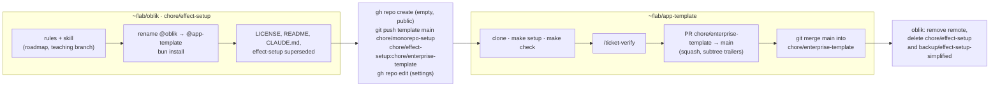

# Template bootstrap — architecture

> Ticket: `2026-10-17_template-bootstrap` · Requirements: [feature.md](./feature.md)

## Overview

No module changes shape; the change is to **names, documents, rules and the repository itself**.
The work has two halves in two working copies: the first in `~/lab/oblik` on `chore/effect-setup`
(rules, documents, rename, licence), which ends with the push that creates the three branches; the
second in a fresh clone `~/lab/app-template` (verification, the PR, the teaching merge, cleanup).
Every commit keeps `make check` green, so each half is a sequence of ordinary plan steps.



## Structure

Per workspace, what changes. No file is added to any code workspace.

| Where | Change |
|---|---|
| root | `package.json` name `app-template`; `biome.json` override globs and messages `@app-template/**`; `Makefile` `--filter @app-template/<app>`; `LICENSE` *(new)*; `README.md`, `CLAUDE.md` rewritten for App Template; `.env.example` placeholders (`app-template` database, bucket, queue) |
| `domain`, `infrastructure`, `application`, `packages/*`, `apps/*`, `deployment` | `package.json` `name` and `workspace:*` dependencies `@app-template/…`; imports `@app-template/…` in `.ts`; `CLAUDE.md` examples; `deployment/shared/naming.ts` `projectName = 'app-template'`; `deployment/Pulumi.yaml` and `deployment/local/docker-compose.yml` `name: app-template`; `apps/web/src/index.html` title; `packages/queue/queue.test.ts` temp prefix |
| `.claude/rules/sdd.md` | one bullet under *Artifacts*: a future ticket is a roadmap entry; `/ticket-feature` starts from it |
| `.claude/rules/pull-requests.md` | one bullet: the teaching branch procedure after a squash merge |
| `.claude/skills/ticket-feature/SKILL.md` | step 1 reads the roadmap entry; step 3 sets the entry's status to the ticket link |
| `docs/knowledge/sdd.md` | a *Roadmap and the teaching branch* section with the branch picture; the dependency map unchanged |
| `docs/knowledge/architecture.md`, `tooling.md` | `@app-template/…` in import examples and troubleshooting |
| `docs/knowledge/roadmap.md`, `glossary.md` | committed in `7bc90c6`; the roadmap's ticket 1 status set to *done* at the end |
| `docs/tickets/2026-10-16_effect-setup/{feature,plan}.md` | one superseded line each, under the title |
| `.github/PULL_REQUEST_example.md` | `Oblik+` → `App Template` in the example's summary line |
| `bun.lock` | regenerated by `bun install` after the rename; versions unchanged |

Not touched: `docs/tickets/2026-10-15_monorepo-setup/`, `repos/`, `.env`, every `.ts` body beyond
import specifiers, the `Context.Service` keys that carry the scope, and the two string literals
named above.

## Contracts

### Names

| Thing | Value |
|---|---|
| package scope | `@app-template` (`@app-template/domain`, `@app-template/config`, …); `#<workspace>/*` unchanged |
| product slug, where a name is a resource or project name | `app-template` (root `package.json`, Pulumi project, compose project, `projectName`, `.env.example` placeholders) |
| product name, where prose names it | App Template |
| repository | `khotei/app-template`, public, MIT |

### Repository settings (`gh repo edit`, verified with `gh api`)

| Setting | Value | Flag |
|---|---|---|
| visibility | public | `gh repo create --public` |
| description | *Effect v4 modular monolith on Bun: a chat clone built as a template for enterprise projects* | `--description` |
| topics | `template effect bun typescript tanstack pulumi aws` | `--add-topic` |
| merges | squash only | `--enable-squash-merge --enable-merge-commit=false --enable-rebase-merge=false` |
| squash message | PR title and description | `--squash-merge-commit-message pr-title-description` |
| head branches | deleted on merge | `--delete-branch-on-merge`, set after the bootstrap PR is merged (D8) |
| template | yes | `--template` |
| default branch | `main` | `--default-branch main` (after the push) |
| wiki, projects | off | `--enable-wiki=false --enable-projects=false` |

### Refs pushed

```
git remote add template git@github.com:khotei/app-template.git
git push --dry-run template main chore/monorepo-setup chore/effect-setup:chore/enterprise-template
git push           template main chore/monorepo-setup chore/effect-setup:chore/enterprise-template
```

`main` → `1bbdd1a`, `chore/monorepo-setup` → `c0bc48f`, `chore/enterprise-template` → the tip of
`chore/effect-setup` after this ticket's commits. Nothing is pushed to `origin`.

### The bootstrap PR

Title: `:memo: chore(template-bootstrap): Cut App Template from the Oblik+ scaffold`. Body per
`pull-requests.md`, plus one paragraph *Carried from effect-setup* naming S1–S12, and the subtree
trailers **outside** the HTML comment, because the squash drops the subtree merge's own metadata
and `make vendor-effect` needs them (`effect-setup` R10):

```
git-subtree-dir: repos/effect
git-subtree-split: 7f524e25cfb49a71ac39b0f44278d08d40dda5de
```

### The teaching branch procedure (commands for `docs/knowledge/sdd.md`)

After a PR is squash-merged into `main`:

```
git switch chore/enterprise-template
git merge --no-ff <type>/<slug>        # the ticket's steps, one merge commit
git merge main                         # records the squash as an ancestor
git push origin chore/enterprise-template
```

For this ticket the first merge is moot (the branch *is* the teaching branch), so only
`git merge main` runs.

### Rule and skill text

- `sdd.md › Artifacts`: *"A ticket that has not started exists only as an entry in
  `docs/knowledge/roadmap.md`. `/ticket-feature <slug>` starts from that entry when one exists and
  replaces its status with a link to the ticket folder."*
- `pull-requests.md`: *"After the squash merge, merge the ticket branch into
  `chore/enterprise-template` with `--no-ff`, then merge `main` into it, so every plan step stays
  readable next to `main`'s one commit and the next ticket merges on a common ancestor. Never
  rebase the teaching branch."*
- `ticket-feature/SKILL.md` step 1: *"… and the slug's entry in `docs/knowledge/roadmap.md` if the
  slug has one, whose goal, scope, inherited requirements, open questions and facts seed the
  grilling; send the entry's dated facts the ticket relies on to the `researcher` agent to
  re-verify."* Step 3 adds: *"the facts the `researcher` confirmed go into Context. If the slug
  has a roadmap entry, set the roadmap entry's status to a link to the ticket folder."* The guards
  match the rule's "when one exists"; the facts clause honours the roadmap's *Facts expire*.

## Seams

This ticket has no code seams; behaviour is observed through commands. Each row is one check the
plan's steps and `/ticket-verify` run.

| Seam | Catches | Misses |
|---|---|---|
| `make check` after the rename | a Biome override, `tsconfig` reference or `workspace:*` dependency still naming `@oblik`; an import the isolated linker cannot resolve | prose and comments |
| `git grep -il oblik -- ':!docs/tickets' ':!repos' ':!bun.lock'` | every leftover in docs, config, rules, html, yaml | an intended rename that changed meaning |
| `bun install --frozen-lockfile` on the renamed tree | a lock that does not match the renamed workspaces; a version drift | — |
| `git push --dry-run template …` then `git ls-remote template` | a wrong remote, refspec or SHA before anything is written; the three refs and `HEAD` after | repository settings |
| `gh api repos/khotei/app-template` (`--jq` on the fields of the settings table) | every setting of R1–R3, R5 | the template flag's "include all branches" behaviour, checked by hand |
| fresh clone: `git clone … && make setup && make check` | anything that worked only because of local state (`.env`, `node_modules`, the patched `tsc`) | — |
| `git merge-base main chore/enterprise-template` = `git rev-parse main` after the teaching merge | the procedure of R6 and R16 applied correctly (rehearsed in a scratch repository on 2026-10-17: three cycles, no conflict, trees equal) | a future ticket skipping the procedure |
| `make ids`, `lychee --offline docs/**/*.md README.md .claude/**/*.md` (CI `links`) | ticket ids in docs, broken relative links after the README and rules edits | content |
| `wc -l CLAUDE.md .claude/rules/*.md` | the `claude-md.md` budgets (≤ 40, ≤ 80) | — |

Checked by hand in `/ticket-verify`: "Use this template" with *Include all branches* on GitHub
produces three branches; `make dev-api` answers `/health` after the rename.

## Decisions

- **D1 — Two working copies, split at the push.** Rules, documents and the rename are committed in
  `~/lab/oblik` on `chore/effect-setup`; the push creates the branches; verification, the PR and
  the teaching merge run in a fresh clone `~/lab/app-template`, which is also the proof that the
  template works without local state. *Rejected:* cloning first and redoing the work there
  (duplicates every step); doing everything from `oblik` and never cloning (verifies nothing about
  a fresh start, and leaves the Claude session in the wrong repository).
- **D2 — An empty repository, the licence committed locally, three refs pushed by explicit refspec.**
  `gh repo create` runs without `--license`, `--add-readme` or `--source`: any of them writes an
  initial commit on GitHub that makes `main` an unrelated history. `LICENSE` is a local commit;
  GitHub detects MIT from the file. The rename of the branch happens in the refspec
  `chore/effect-setup:chore/enterprise-template`, so no local branch is renamed and R4's "no
  `chore/effect-setup`" holds remotely while `oblik` keeps its branch until R7. *Rejected:*
  `gh repo create --source . --push` (pushes only the current branch under its own name);
  `git clone --mirror` (would push `backup/*` and `chore/effect-setup` too).
- **D3 — Teaching branch: `--no-ff` the ticket branch, then merge `main`.** Rehearsed on
  2026-10-17 in a scratch repository: three PR cycles, the third editing the same file as the
  second, merged without conflict, `merge-base == main` and identical trees after each cycle.
  Without the `main` merge the base stays at the scaffold commit and the first overlapping edit
  conflicts (seen in the same rehearsal). *Rejected:* never merging `main` back; rebasing the
  teaching branch (rewrites the history it exists to keep); cutting ticket branches from the
  teaching branch (the PR diff against `main` would replay every earlier ticket).
- **D4 — The bootstrap PR carries `effect-setup` S1–S12 and the subtree trailers.** One squash
  into `main` for both, because they are one state; the body names what it carries and repeats
  `git-subtree-dir` / `git-subtree-split` outside the HTML comment, as `effect-setup` R10 requires
  of any PR that vendors `repos/effect`. *Rejected:* two PRs (`effect-setup` S1–S12 first, then
  bootstrap), which would put a half-finished ticket on `main` under its own name.
- **D5 — The rename is a one-off scripted pass, reviewed by diff; `make rename` waits for
  `template-handoff`.** A `sed` over tracked files (excluding `docs/tickets/`, `repos/`,
  `bun.lock`) for `@oblik/` → `@app-template/`, then the handful of slug and product-name sites by
  hand, then `bun install`. The script is not committed: a reusable `make rename` needs the final
  tree (web app, Pulumi program, compose) to know its sites, and a fresh-clone rehearsal to test
  it, both of which exist only at handoff. *Rejected:* writing `make rename` now and running it on
  itself (tests the target once, against a tree that every later ticket changes).
- **D6 — One token, `app-template`, everywhere a name is an identifier.** The package scope is
  `@app-template` (imports, `package.json` names, `workspace:*` dependencies, every Biome
  `noRestrictedImports` glob and message), the resource and project slug is `app-template`
  (root `package.json`, Pulumi, compose, `projectName`, `.env.example`), and only prose says
  App Template. The within-workspace `#<workspace>/*` imports (`#domain/*`, `#api/*`) carry no
  scope and do not change. One token means the handoff rename is one substitution. *Rejected:* a
  short scope `@template` next to the slug (two tokens to rename, and `template` collides with AWS
  and Pulumi vocabulary in resource names).
- **D7 — `effect-setup` is closed by a note, not by `verification.md`.** One line under each
  title (`feature.md`, `plan.md`) pointing at the roadmap's re-homing table; no verdicts, because
  nothing was verified against its requirements and the re-homed ones will be verified in their
  new tickets. *Rejected:* a `verification.md` with "superseded" per requirement (ritual without
  evidence); deleting the folder (loses the history the template exists to show).
- **D8 — Delete-on-merge is enabled after the bootstrap PR, not at creation.** The head of the
  first PR *is* `chore/enterprise-template`; with the setting on, GitHub deletes the teaching
  branch at the squash merge. The plan sets every other setting at creation and this one right
  after the teaching merge is pushed, so R2 holds before the second ticket starts. *Rejected:*
  enabling it at creation and re-pushing the branch from the clone (a window with no teaching
  branch, and a step that only works because a local copy happens to exist).

## Risks

| Risk | Mitigation |
|---|---|
| a push reaches `origin` (`oblik`) by habit | the remote is named `template`, every push names it, and a `--dry-run` precedes the real push; `origin` is checked unchanged in `/ticket-verify` (`git log origin/main..main` empty, `git ls-remote origin` unchanged) |
| `bun install` after the rename drifts a version | `bun install --frozen-lockfile` must pass on the regenerated lock; `git diff bun.lock` shows only name lines |
| `gh repo create` writes an initial commit | no `--license`, `--add-readme`, `--source`; `git ls-remote` on the empty repository lists nothing before the push |
| the squash message loses the subtree trailers | they sit outside the HTML comment; `/ticket-verify` reads `git log -1 main` on the new repository after the merge |
| `husky` `pre-push` runs `make test` on the three-branch push and fails on a stale `.env` | `make check` passes before the push; tests do not read `.env` (`effect-setup` R15) |
| the fresh clone fails on `make setup` (the patched `tsc`, hooks) | that is the point of the clone step: fix in the branch and push again before the PR |
| GitHub's template flag excludes branches by default | the README's handoff pointer says *Include all branches*; `template-handoff` rehearses it |
| the rule edits land before the rehearsed procedure is used for real | the procedure was rehearsed in a scratch repository; the first real run is this ticket's own `git merge main`, checked by the merge-base seam |

## To verify during implementation

- **V1** — `gh repo edit --squash-merge-commit-message pr-title-description` also sets
  `squash_merge_commit_title: PR_TITLE`; if not, one `gh api -X PATCH` sets both.
- **V2** — `bun install` on the renamed tree changes only `"@oblik/…"` → `"@app-template/…"` lines in
  `bun.lock`; if Bun also reorders, the diff is still version-neutral. *Confirmed in S2:* Bun
  re-sorts the workspace entries (only blank separators move) and does not rewrite the root
  workspace name, which `--frozen-lockfile` ignores; that one line is edited by hand.
- **V3** — `git push` with `husky` `pre-push` on three refs runs `make test` once.
