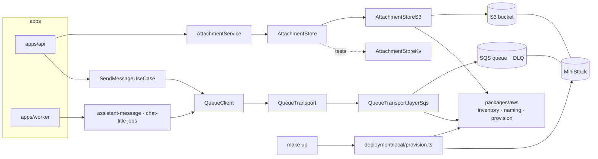

# AWS local — architecture

> Ticket: `2026-10-19-1448_aws-local` · Requirements: [feature.md](./feature.md)

## Overview

Two ports change adapters and one package appears:

- **`QueueClient` is rebuilt over a four-call `QueueTransport`** shaped like SQS, with an SQS
  adapter only. Retry, visibility heartbeat and attempt info are written once above the transport;
  redelivery and dead-lettering stay AWS's job. Every test that consumes runs on MiniStack; tests
  that only send record with `recordQueue()` (D1–D3). `PersistedQueue` and SQLite leave the
  repository.
- **`AttachmentStore` gains an S3 adapter** that streams uploads, tags them `unbound`, presigns
  downloads and deletes objects; the KV adapter stays for tests (D6–D9).
- **`packages/aws`** holds the resource inventory, the naming rule and the provisioner, read by
  the adapters, `make up`, the tests and later Pulumi (D4, D5).



## Structure

**`packages/aws`** (new workspace, follows `tooling.md › New workspace`)

```
+ packages/aws/naming.ts       buildResourceName, projectName (moved from deployment/shared/naming.ts)
+ packages/aws/resources.ts    the inventory: bucket `attachments`, queues `assistant-message`,
                               `chat-title`, each with `maxReceiveCount` and a dead-letter
                               queue named by `buildDeadLetterName`; lifecycle rules     (D4)
+ packages/aws/provision.ts    provision(inventory, stage): idempotent create              (D5)
+ packages/aws/*.test.ts       on MiniStack
```

**`packages/queue`**

```
~ packages/queue/queue.ts            QueueClient over QueueTransport; send, worker unchanged   (D1)
+ packages/queue/queue.transport.ts  QueueTransport, QueueTransport.layerSqs                   (D1)
~ packages/queue/queue.test.ts       QueueClient suite on MiniStack, in real time
+ packages/queue/queue.transport.test.ts   the SQS transport's suite on MiniStack
- @effect/sql-sqlite-bun dependency, QueueClient.layerSqlite, QueueClientSqliteOptions,
  QueueClient.layerMemory
```

**`packages/config`**: `AwsConfig { region: AWS_REGION, endpoint: Option<URL> AWS_ENDPOINT_URL,
stage: STAGE }`; `QueueConfig` keeps `lockExpiration` and `lockRefreshInterval` (now the
visibility timeout and its heartbeat) and drops `QUEUE_SQLITE_PATH` (D10).

**`packages/testing`**: `+ ministack.ts`, a `MiniStack` layer that starts the pinned image with
`testcontainers` (`GenericContainer`, wait on `GET /_ministack/health`) under `acquireRelease`
and provides its endpoint; `+ stage.fixture.ts`, a fresh `test-<random>` stage per file (D12).

**`domain/attachment`**: `~ attachment.service.ts`, the new `AttachmentStore` shape (Contracts);
`+ unboundLifetime = Duration.hours(24)` and `isExpired(attachment, now)`, pure (D9).

**`infrastructure`**

```
+ infrastructure/shared/aws.client.ts        S3Service and SQSService layers from AwsConfig
                                             (forcePathStyle when an endpoint is set)  (D11)
~ infrastructure/shared/queue.client.ts      QueueClientSqs replaces QueueClientSqlite
~ infrastructure/attachment/attachment.storage.ts      AttachmentStoreKv on the new port;
                                                       AttachmentStoreS3 beside it (D6–D8)
~ infrastructure/chat/chat.queue.ts          name and maxAttempts from the inventory     (D4)
+ infrastructure/shared/resources.test.ts       the inventory agreement test               (D4)
```

**`application/attachment`**: `upload` takes the request's files as one `Stream`, all or nothing
(D14); `download` returns `{ attachment, url }`;
`bind` calls `store.keep` before the repository update; every read of an unbound attachment
applies `isExpired` (D9).

**`apps`**: `api` passes the multipart file stream to `upload` (replacing `chat-core` D8's
per-part buffer), answers `download` with `302` (replacing `chat-core` D10).

**`deployment`**

```
- deployment/local/docker-compose.yml   replaced by the Pulumi project below (D13)
+ deployment/local/Pulumi.yaml          runtime: bun; a project of its own beside deployment/Pulumi.yaml
+ deployment/local/ministack.ts         docker.Container ministackorg/ministack:1.5.29@sha256:88f5…,
                                        on the port of AWS_ENDPOINT_URL, named after it, healthcheck
                                        by python urllib with wait, MINISTACK_REGION from AWS_REGION
                                        (both through AwsConfig), state persisted under .data/ministack
+ deployment/local/provision.ts         reads AwsConfig, calls provision(inventory, stage)
- deployment/shared/naming.ts           moved to packages/aws; tags.ts imports projectName from there
~ deployment/CLAUDE.md, deployment/local/README.md   the stub notes go (R22)
```

**Root**: `Makefile` gains `up` (`pulumi up --yes --skip-preview`, then the provisioner), `down`
(`pulumi destroy --yes --skip-preview`) and `reset` (`down`, then removes `.data/`, MiniStack's
state and the Pulumi state included); `stack` (log in to the file backend under `.data/pulumi`,
select or create the `local` stack) is idempotent and precedes `up` and `down`; `setup` (install,
`.env`) needs no Pulumi CLI (D13). Catalogs gain an `effect-aws` namespace (`@effect-aws/client-s3`,
`@effect-aws/client-sqs`, pinned at 2.0.0), a `pulumi` namespace (`@pulumi/pulumi`,
`@pulumi/docker`) and `testcontainers@12.2.1` in `runtime`. `.env.example` per R20.
`docs/knowledge/aws.md` (new), linked from `architecture.md`.

## Contracts

```ts
// packages/queue/queue.transport.ts — the internal seam (D1)
interface Received {
  readonly handle: string; readonly body: string; readonly receiveCount: number
  readonly attributes: { jobId: string }
}

interface QueueTransport {
  readonly send: (queue: string, body: string, attributes: { jobId: string }) => Effect<void, QueueError>
  /** Long-polls up to `wait`; a message received is invisible for `visibility`. A message already
   *  received the `maxReceiveCount` of the queue's RedrivePolicy is moved to its dead-letter queue
   *  instead of returned. */
  readonly receive: (queue: string, options: { visibility: Duration; wait: Duration })
    => Effect<Option<Received>, QueueError>
  /** Visible again after `visibility`: the heartbeat, a retry delay, or 0 to release at once. */
  readonly extend: (queue: string, handle: string, visibility: Duration) => Effect<void, QueueError>
  readonly delete: (queue: string, handle: string) => Effect<void, QueueError>
}
QueueTransport.layerSqs                                       // needs SQSService
// The RedrivePolicy, set by provision from the inventory, enforces maxReceiveCount; the
// transport never reads it.

// QueueClient — interface unchanged; no memory variant (D1, amended in S5 and S5c):
QueueClient.layer({ queueName, lockExpiration, lockRefreshInterval })    // needs QueueTransport
// QueueClientSqs (infrastructure/shared) = QueueClient.layer over QueueTransport.layerSqs
// recordQueue() (@app-template/queue/testing): a send-only QueueClient for tests; it encodes
//   with the client's codec and records; consume dies.
//   queueName: (definition.name) => physical name; URL from GetQueueUrl, cached per queue (D5)

// consume, per message:
//   receive(visibility = lockExpiration) → decode body
//     decode fails      → log error, extend(0)           (redrive dead-letters it, D3)
//     run handler, heartbeat extend(lockExpiration) every lockRefreshInterval
//       success         → delete
//       failure, attempt < max → extend(definition.retryDelay(attempt))
//       failure, last   → log "dead-lettered", extend(0) (redrive, D3)
//       interrupt       → extend(0)                      (costs the attempt, D2)
//     an interrupt in the decode or the handler releases; the settle (delete, extend) runs whole
//   attempt = receiveCount; isLastAttempt = receiveCount >= maxAttempts
```

```ts
// domain/attachment/attachment.service.ts (D6)
class AttachmentStore extends Context.Service<AttachmentStore, {
  /** Writes the bytes marked unbound; fails with the stream's error and leaves nothing behind. */
  readonly insert: <E>(id: AttachmentId, content: Stream<Uint8Array, E>,
    meta: AttachmentMeta /* { mediaType, fileName } */) => Effect<FileSize, E>
  readonly select: (id: AttachmentId) => Effect<Option<Uint8Array>>   // the worker's prompt
  /** A URL that serves the bytes with the stored media type and inline disposition; none for an
   *  id without bytes. */
  readonly url: (id: AttachmentId) => Effect<Option<URL>>
  /** Clears the unbound mark, so lifecycle never collects it; idempotent, and a no-op for an id
   *  without bytes. */
  readonly keep: (id: AttachmentId) => Effect<void>
  readonly delete: (id: AttachmentId) => Effect<void>                 // idempotent
}>() {}
// AttachmentRepository.deleteByIds skips unknown ids (the upload's cleanup relies on it).
// AttachmentService.upload(userId, files: Stream<AttachmentUpload<E>, E>)
//   → Effect<ReadonlyArray<Attachment>, E>: all or nothing (D14).
// AttachmentService.download(userId, id) → AttachmentDownload { attachment, url };
//   AttachmentNotFound when the store has no URL.
// Store failures die, as in chat-core (the KV policy); only the stream's E is typed.
// AttachmentStoreS3: key `attachments/<id>`; Tagging `unbound=true`; ContentType;
//   ContentDisposition `inline; filename*=UTF-8''<percent-encoded>`; url = presigned GetObject,
//   expiresIn 300 s.
// AttachmentStoreKv: url = `data:<mediaType>;base64,…`; keep is a no-op.
```

```ts
// packages/aws/resources.ts (D4) — plain data, no Effect
export const resources = {
  buckets: {
    attachments: { name: 'attachments', lifecycle: { unboundExpirationDays: 1, abortIncompleteUploadDays: 1 } },
  },
  queues: {
    assistantMessage: { name: 'assistant-message', maxReceiveCount: 3 },
    chatTitle: { name: 'chat-title', maxReceiveCount: 5 },
  },
} as const
export const unboundTag = { key: 'unbound', value: 'true' } as const   // the expiration rule's tag
// `name` is a field, not the key, so a definition reads it without spelling the literal (D4).
// physical names: buildResourceName(stage, 'attachments') → app-template-<stage>-attachments;
//   queue `<name>` and its dead-letter queue buildDeadLetterName(<physical name>) (`…-dlq`).
// Lifecycle: two rules (MiniStack accepts a tag filter combined with AbortIncomplete…, AWS does not):
//   { Filter: { Tag: unbound=true }, Expiration: { Days } } and { Filter: { Prefix: '' },
//   AbortIncompleteMultipartUpload: { DaysAfterInitiation } }.
// RedrivePolicy JSON is built with a fixed key order: CreateQueue compares it as a string.
```

```
GET /attachments/:attachmentId/download
  302  Location: <presigned URL>     owner, not expired           (R3)
  404  AttachmentNotFound            unknown, not the owner's, or unbound and expired (R4, D9)
```

## Seams

| Seam | Catches | Misses |
|---|---|---|
| **1. `QueueClient` (`send`, `worker`) on `QueueClient.layer` over `QueueTransport.layerSqs` against MiniStack, in real time** (`packages/queue/queue.test.ts`) | attempt numbers and `isLastAttempt`, retry delays from `retryDelay(attempt)`, the heartbeat keeping a long handler's job from a second consumer, dead-lettering after `maxAttempts`, decode failures, interrupts, a failing transport not ending the loop (R9–R14) | real AWS differences from MiniStack (Risks); SQS's whole seconds bound how short a case can be |
| **2. `QueueTransport` suite** on `QueueTransport.layerSqs` against MiniStack (`queue.transport.test.ts`) | the SQS calls: visibility, `receiveCount`, `extend(0)`, redrive to the dead-letter queue at the next receive, long-poll wait, attributes (R8, R10, R13) | real AWS differences from MiniStack (Risks) |
| **3. `AttachmentStore` contract suite**, run on `AttachmentStoreKv` and `AttachmentStoreS3` against MiniStack (`infrastructure/attachment`) | streamed insert and its size, nothing left after a failing or interrupted stream (no object, no multipart upload), `select`, `url` fetched with plain `fetch` returning the bytes and media type, `delete`; S3-only cases: two-part upload of 10 MB, `inline` disposition, the tag set by a single-put `insert` and cleared by `keep`, expiry `403` (R1–R3, R5, R6) | lifecycle execution (MiniStack never runs it), the 5 MiB part minimum (not enforced by MiniStack), the tag on a multipart upload (MiniStack drops it) |
| **4. `AttachmentService` on the memory adapters under `TestClock`** (`application/attachment`) | an unbound attachment refused at 24 h with its record and bytes kept, a bound one never; `keep` called before the bind; deletes reaching the store (R4, R5, R7) | S3 (seam 3) |
| **5. The api over `BunHttpServer.layerTest`** (`apps/api`) | `download` answers `302` with the store's URL for the owner and `404` without `Location` otherwise; upload limits still map to `413`/`415`/`400` with nothing stored when the file is streamed (R2–R4) | following the URL (seam 3) |
| **6. `provision` against MiniStack** (`packages/aws`) | a second `provision` changes nothing; lifecycle and redrive read back as the inventory says (R15, R16) | IAM and real-account behaviour (ticket 9) |
| **7. The inventory agreement test** (`infrastructure/shared/resources.test.ts`) | every queue definition takes its name and `maxAttempts` from the inventory, every inventory queue has a definition, every inventory bucket is read by an `infrastructure` source as `resources.buckets.<key>` (S11), the bucket's expiration days cover `unboundLifetime` (R15, R17) | names built outside the inventory by hand (review; `git grep` in R20's check); a bucket mentioned only in a comment |

`make dev` against MiniStack (R18) is checked by hand, as `chat-core`'s two-process run is.

## Decisions

- **D1 — `QueueClient` is built once over a four-call `QueueTransport`; `PersistedQueue` goes.** The
  transport has SQS's shape (`send`, `receive` with visibility and long-poll, `extend`, `delete`),
  so the logic above it (decode, heartbeat, attempt info, retry delay, dead-lettering, logs) exists
  once. The retry delay is the definition's `retryDelay(attempt)`, which ticket 9's Lambda edge
  computes the same way per message. *Rejected:* an SQS `PersistedQueueStore` (the store contract
  promises dedupe and free interrupts that SQS cannot keep, so memory and production would differ
  under one interface); a second `QueueClient` implementation beside the `PersistedQueue` one (two
  copies of retry and attempt logic, still two semantics). *Amended in S4:* the memory transport
  goes, and with it `QueueClient.layerMemory` (S5). Redelivery and dead-lettering are AWS's job: a
  memory imitation had to learn the dead-letter queue's name, which tied the generic package to this
  project's naming, and its fidelity was a second implementation to keep true. Every test that needs
  a queue (`packages/queue`, the jobs, the api and chat harnesses) runs on MiniStack in real time;
  `make test` already needs Docker (D12). The transport stays as the seam between the queue logic
  and the SQS calls, and `receive` loses `maxReceiveCount`, which only the imitation read.
  *Rejected:* a memory transport with the dead-letter rule as an option (the option spreads to every
  memory `QueueClient`); one that drops an exhausted message instead of moving it (tests in memory
  then prove less than they seem); a plain test fake of `QueueClient` for the tests above the queue
  (kept fast, but the user chose one queue behaviour everywhere over speed). *Amended in S5:*
  `QueueClient.layer(options)` leaves `QueueTransport` open beside `layerSqs`, which closes it, so
  S5b's tests put a failing transport under the one client. *Rejected:* only `layerSqs` (a test
  could not swap the transport without a second client). *Amended in S5c:* tests that never consume
  take `recordQueue()`, a send-only fake exported as `@app-template/queue/testing` that encodes with
  the client's codec, so the chat and api harnesses run without Docker; the job suites call each
  job's `handle` under `TestClock`, with one MiniStack case per job; Seam 1 alone checks
  consumption. `QueueClient.layerSqs` folds into `QueueClientSqs` (`QueueClient.layer` over
  `QueueTransport.layerSqs`). This takes the fake rejected above: the one queue behaviour that
  choice kept is consumption, which those tests never reach. *Rejected:* the fake in
  `packages/testing` (`packages/queue`'s tests import it, a cycle of project references). *Amended
  in S5d:* a definition gives `retryDelay(attempt)`, a plain function; both chat queues double from
  1 s. *Rejected:* keeping `retrySchedule` (replaying a `Schedule` from a fresh step per attempt is
  machinery for one curve).
- **D2 — Delivery is at-least-once everywhere; an interrupt costs an attempt; `jobId` is an
  attribute.** `receiveCount` is the attempt, and a receive cannot be undone. `jobId` travels as a
  message attribute for logs; no layer deduplicates, and `QueueDefinition.jobId`'s doc says so.
  Handlers already skip a settled message or a titled chat (R9). A process restart costs the job in
  hand one of its 3 or 5 attempts. *Rejected:* FIFO queues (dedupe for 5 minutes only, ordering not
  needed); a dedupe table (needs a database: ticket 4). *Amended in S5:* this reverses `chat-core`
  R34 (an interrupt kept its attempt); feature R12 records it, and `chat-core`'s R34, D21 and D23
  point back here. *Amended in S5b:* the release covers the decode and the handler only; the settle
  runs uninterruptibly, so a retry keeps its delay and a finished job is not run again, and a worker
  stop may wait for that one SQS call.
- **D3 — Redrive is the only way to the dead-letter queue.** A last failed attempt, a message that
  does not decode, and a crash during the last attempt all end the same way: `extend(0)` or an
  expired visibility, then the next receive finds `receiveCount > maxReceiveCount` and moves the
  message without returning it. *Rejected:* `SendMessage` to the DLQ then `DeleteMessage` (two
  calls, not atomic: a crash between them duplicates or loses the message, and a decode failure
  needs no faster path). *Amended in S5d:* `assistant-message` has no settling attempt; its
  `maxReceiveCount` is 3, and the last attempt writes `failed` on any outcome but success, an
  interrupt included, in an exit handler that runs uninterruptibly. Its failure is not caught: the
  queue logs it as dead-lettered and redrive moves the job, as for `chat-title`. *Rejected:* the
  settling attempt (a fourth receive and three attempt roles to cover what the exit handler covers,
  except the cases in Risks); catching the last failure in the job (a second log line for a spent
  job).
- **D4 — The inventory is plain data in `packages/aws`, and queue definitions read it.**
  `infrastructure` and the apps may not import `deployment`, so a `deployment/shared/` inventory
  could not name the resources the code uses. Definitions take `name` and `maxAttempts` from
  `resources.queues`, so code and inventory cannot drift on those; the agreement test (seam 7)
  covers what construction cannot. The package is this project's data, which `packages/CLAUDE.md`
  notes. *Amends feature R15* (location) *and R17* (the check is the agreement test, not a separate
  scan; *amended in S3:* `verify` dropped, see D5). *Rejected:* `deployment/shared/` (unreachable
  from the layers); names in `.env` (the drift R17 exists to prevent). *Amended in S1:* entries are
  keyed by an identifier (`assistantMessage`) and carry `name` as a field, since a name-keyed entry
  can be read only by spelling the literal, the drift the inventory exists to prevent (*rejected:*
  name keys plus a lookup helper, still a literal at the call site); the agreement test discovers
  definitions with a glob over `infrastructure/**/*.queue.ts`, so a new queue file joins the check
  without editing the test (*rejected:* importing the known definitions, which a new file would
  escape); it lives in `infrastructure/shared/` without a `resources.ts` beside it, because
  `packages/aws` may not import `infrastructure`.
- **D5 — Physical names come from `STAGE`; queue URLs are resolved and cached at first use; `verify`
  runs at startup.** `buildResourceName(stage, name)` gives `app-template-<stage>-…`; tests use
  `test-<random>` per file, dev `local`. `verify` checks every bucket and queue of the inventory and
  each queue's `maxReceiveCount`, and fails naming the endpoint and the resource (R19). *Amended in
  S3: `verify` and R19 are dropped.* The application assumes its resources exist: the infrastructure
  provides them (`make up` locally, Pulumi in AWS), and a missing one fails the first call that uses
  it, which telemetry reports. A drifted `maxReceiveCount` already fails `make up`, since
  CreateQueue refuses an existing queue with other attributes. *Rejected:* the startup check (S3
  built it: the application re-checking what the infrastructure owns, and a round of AWS calls on
  every Lambda cold start); a check reduced to existence (the same cost for a clearer message on a
  mistake `make up` already prevents). `provision` is idempotent: `BucketAlreadyOwnedByYou` is
  success, and the redrive JSON has a fixed key order because CreateQueue compares attributes as
  strings. *Amended in S2:* `provision` reads existence first (`HeadBucket`, `GetQueueUrl`) and
  reports each resource as `created` or `unchanged`, since a repeated `CreateBucket` answers `200`
  in `us-east-1` and `make up` must say that its second run changed nothing (R16). *Rejected:* queue
  URLs from configuration (one variable per queue, and stale after a reprovision).
- **D6 — `AttachmentStore` streams in, hands out a URL, and stays a domain port with two
  adapters; there is no `packages/storage`.** The S3 adapter is deep: the upload sink, abort on
  failure, tagging, presigning and headers live behind five calls. The KV adapter's `data:` URL
  serves the bytes and media type through `fetch` too, so one contract suite holds both honestly.
  *Rejected:* a generic blob package (one real user: a hypothetical seam); presigning in
  `application` (puts S3 into the service); an api route that serves bytes when the store has no
  URL (two download paths). *Amended in S6:* `url` returns `Option<URL>`, `none` for an id without
  bytes, so `download` answers `404` rather than a URL to nothing; the S3 adapter (S7) needs a
  `HeadObject` for it or a looser promise, decided there. Browsers refuse to follow a redirect to
  a `data:` URL, so between S6 and S7 a download opens only through `curl` (Risks). *Amended in
  S7:* the S3 adapter heads the object (`HeadObject`) before presigning, one request per
  download, so the promise holds; the adapter sits in `attachment.storage.ts` beside the KV one,
  and the api harness keeps `AttachmentKv` while `ApiLayer` provides `AttachmentKvS3`.
- **D14 — An upload request is all or nothing: a failing file deletes the ones stored before it.**
  Streaming writes each file before the next part is read, so a refusal of a later part (`413`,
  `415`, `400`) or a failed write finds earlier files stored; `chat-core` D8 buffered every part
  first, so a refusal stored nothing. `AttachmentService.upload` takes the request's files as one
  `Stream`, tracks each id before its bytes are written, and on any failure or interrupt deletes
  every tracked id through `deleteByIds`; deleting an id without bytes or record is a no-op.
  *Replaces `chat-core` D8.* *Rejected:* keeping the earlier files (a refused request leaves attachments the
  client never learns of, against R2); tracking an id after its record is written (a failure
  between the byte write and the record leaves bytes no cleanup knows).
- **D7 — The upload sink is our own: one `PutObject` up to 5 MiB, otherwise multipart in 5 MiB
  parts, aborted on failure or interrupt.** With the 10 MiB cap that is at most two parts. *Rejected:* `MultipartUpload.uploadObject` from `@effect-aws/s3@1.0.0`
  (unverified on `effect@4.0.5`, README still on `@effect/platform`); buffering the whole file
  (breaks R1).
- **D8 — Media type and `inline` disposition are written on the object at upload; the URL is
  signed without overrides.** Downloads then need nothing from the request, and the URL is shorter.
  *Rejected:* `ResponseContentType` / `ResponseContentDisposition` presign overrides (work, but
  repeat at every download what the object already knows).
- **D9 — Unbound bytes expire by an S3 lifecycle rule on the `unbound` tag; unbound records expire
  in `AttachmentService`.** `insert` tags the object, `keep` clears the tag before the bind is
  written (a crash between leaves an orphaned object, never a bound attachment without bytes). A
  record unbound for `unboundLifetime` (24 h) reads as not found; S3's
  1-day rule acts no earlier, so nothing bindable loses its bytes. A second rule aborts multipart
  uploads left by a crash. A sweep of untouched records waits for SQL in ticket 4: `KeyValueStore`
  cannot list. MiniStack stores lifecycle rules but never runs them, so locally the rules are
  checked by reading them back, and the deletion itself only on AWS (ticket 9). *Amends feature R7 and its acceptance.* *Rejected:* a sweeper job (needs a time
  index, and SQS delays stop at 15 min); copying to a `bound/` prefix at bind (up to 10 MB copied
  per attachment); a local byte sweeper (lists and reads tags of every object to imitate S3).
  *Amended in S7:* a multipart upload carries `Tagging` on `CreateMultipartUpload` (atomic on AWS)
  and is tagged again by `PutObjectTagging` after the complete, since MiniStack ignores the first;
  that second call runs outside the upload's scope, and its failure deletes the object.
  *Amended in S7b:* the tag on `CreateMultipartUpload` is the only one; the second
  `PutObjectTagging`, the delete on its failure and its test go, so locally an object over 5 MiB
  stays untagged and ticket 9 checks the multipart tag on AWS. *Rejected:* keeping the second
  call (a delete on failure, a failure-path test and a wider window for an untagged object, for
  a tag nothing local reads, since MiniStack never runs the lifecycle rule).
  *Amended in S8:* no read deletes an expired record: `get`, `download`, `delete` and
  `findBindable` read it as not found through the domain's `isVisibleTo(userId, now)`, and every
  expired record waits for ticket 4's sweep. *Rejected:* deleting it when met (S8.2–S8.4), which
  made reads write, so each needed the owner's `UserLock`, a locked re-read and a cross-user
  exception in `findBindable` against a send binding the same attachment.
- **D10 — Credentials come from the SDK's default provider chain, not from `Config`.** On Lambda
  or ECS that is the role, whose session token rotates; locally `.env` holds
  `AWS_ACCESS_KEY_ID="test"` and `AWS_SECRET_ACCESS_KEY="test"`, which MiniStack accepts. Only our
  settings (`AWS_REGION`, `AWS_ENDPOINT_URL`, `STAGE`) pass through `@app-template/config`.
  *Amends feature R20.* *Rejected:* credentials as `Config.Redacted` (freezes a rotating token and
  duplicates the SDK's chain).
- **D11 — With an endpoint set, S3 uses path-style addressing, and presigned URLs carry that
  endpoint's host.** The host is part of the signature, so the browser must reach the same host
  the api signs with: true in dev (`localhost:4566`, api on the host) and on AWS. Virtual-host
  style works on MiniStack only for `<bucket>.localhost`. *Rejected:* rewriting the URL host after
  signing (invalidates the signature: `403`).
- **D12 — AWS tests start one MiniStack container per test file and provision a fresh stage.**
  `testcontainers@12.2.1` runs on Bun 1.4.3 (the hangs are fixed, and the project runs a Bun smoke
  test); MiniStack starts in under 2 s; those files raise the hook timeout to 60 s. Unique names
  isolate parallel files without resets. *Rejected:* one container per run in `globalSetup`
  (Docker in every run, even a filtered one, and shared state between files); `POST
  /_ministack/reset` between tests (serialises the files).
- **D13 — Pulumi runs MiniStack for `make up`; there is no compose file.** `deployment/local/`
  is a Pulumi project of its own (`runtime: bun`): `@pulumi/docker`'s `Container` with the image
  by digest, the port, the environment, the `.data/ministack` bind mount and the health check
  with `wait: true`, so `pulumi up` returns only once MiniStack answers. State lives in a file
  backend under `.data/pulumi` with an empty passphrase (nothing secret is stored), and
  `PULUMI_HOME` sits in the repo too, outside `.data` so that `make reset` keeps the provider
  plugin, and a clone touches nothing outside the repo. The inventory is
  still applied by `deployment/local/provision.ts` (one engine), and the tests keep
  `testcontainers` (D12). Measured: cold `up` 4.1 s with the provider plugin cached (the first
  run downloads it), no-op `up` under 1.3 s, `destroy` 0.5 s. The Pulumi CLI becomes a developer
  prerequisite beside Docker; `make check` never needs it. *Amends feature Scope and Out of
  scope; answers roadmap 9's open question.* *Rejected:* `docker compose` (a second tool and
  format beside the deploy program ticket 9 builds, for 28 lines of YAML); Pulumi applying the
  inventory through `@pulumi/aws` against the endpoint (83 MB more, and the inventory in two
  engines since the tests provision with `provision`). *Amended in S2:* the container stops
  gracefully (`destroyGraceSeconds` and `stopTimeout` of 15 s), since MiniStack writes its state
  on shutdown and a plain remove left `sqs.json` unwritten, so the queues came back `created`
  after `make down` (*rejected:* re-creating on every `up`, which loses queued messages between
  sessions); the region reaches the program as the stack config `region` with a default equal to
  `.env.example`'s `AWS_REGION`, since the Makefile does not read `.env` and R20 keeps
  `process.env` out of code (*rejected:* `AWS_REGION` from the shell, a second source beside
  `.env`; the duplicate default is the accepted cost); `Pulumi.local.yaml` is gitignored, since
  `stack init` generates it per clone and it holds only the salt of a stack without secrets
  (*rejected:* committing it, a conflict on every init); `up` and `destroy` run with
  `--skip-preview`, the diff of a one-container stack being nothing a developer reads; `make
  stack` precedes `up` and `down`, so `make up` works after `make reset` and on a fresh clone,
  while `make setup` (install, `.env`) needs no Pulumi CLI, so a checkout runs `make check` with
  Docker alone; `PULUMI_HOME` is the gitignored `.pulumi/` at the root, a cache that `make reset`
  keeps. *Amended in S9:* a worktree runs its own MiniStack, so the program takes the host port
  from `AWS_ENDPOINT_URL` and names the container after it, and `make up` exports `.env` to the
  program; with `.env` in reach, the region comes from `AWS_REGION` through `AwsConfig`, which
  reverses the stack-config route above and removes its duplicate default (*rejected:* one shared
  MiniStack with a stage per worktree, which ties each worktree to the main tree's `make down`
  and `make reset`).

## Risks

| Risk | Mitigation |
|---|---|
| MiniStack differs from AWS: it never runs lifecycle rules, does not enforce the 5 MiB part minimum, drops `Tagging` on `CreateMultipartUpload`, compares `RedrivePolicy` as a string, and answers a repeated `CreateBucket` by region | D7 fixes the part size in one constant with an S3-adapter test at the boundary; D5's fixed key order and `BucketAlreadyOwnedByYou` handling; ticket 9 adds a smoke run on real AWS, where lifecycle deletion is checked |
| An S3 error outside `@effect-aws`'s tagged list (`EntityTooSmall`, `InvalidPart`) arrives as a bare `SdkError` | store failures die (D6), so the cause is logged whole; no branch depends on those codes |
| The api later runs inside Docker and signs with `http://ministack:4566`, which the browser cannot reach (D11) | out of scope here; ticket 9 or a compose-run api adds a presign-only S3 layer on the public endpoint |
| Restarts and deploys spend attempts (D2) | 3 and 5 attempts; the heartbeat keeps long handlers alive; the last reply attempt writes `failed` even when interrupted (D3) |
| A reply stays active and the chat busy when its last attempt never writes `failed`: the process is killed (kill, OOM), the store fails that write, or a stopped worker's long poll spends that attempt; the job goes to the dead-letter queue (D3, amended in S5d; accepted by the user) | rare outside dev, where `--watch` reloads make it likely; nothing consumes the dead-letter queue yet: a consumer or a sweep belongs to ticket 4 or 9 |
| A stopped worker's long poll outlives it: MiniStack keeps the aborted receive open and hides the next message for `QUEUE_LOCK_EXPIRATION`, spending its attempt (AWS may do the same) | costs one attempt and 15 s per worker stop; a shorter receive wait narrows it at the cost of more calls |
| Tests that consume a queue need Docker and run in real time: `packages/queue` and one case per job suite (D1, amended in S5c) | one container per file (D12); SQS's whole-second waits kept to 1–2 s; the api and chat harnesses and the job handlers run without Docker on `recordQueue()` and `TestClock` |
| Between S6 and S7 the dev download redirects to a `data:` URL, which browsers do not follow | dev only, for one step; `curl -i` shows the `302`; S7 redirects to MiniStack |
| A record whose bytes are gone can still be bound; the worker skips its file | `download` answers `404` (D6); after 24 h an unbound record reads as not found (S8) |
| Every expired unbound record stays in the dev store, read as not found (D9 amended in S8) | dev only (the store is `.data/`, reset by `make reset`); ticket 4 sweeps with SQL |
| No margin at the 24 h boundary: S3's 1-day rule rounds up to midnight UTC, so an object created exactly at midnight can go the moment its record expires; a send that passed `findBindable` just before and runs `keep` just after binds an attachment without bytes | S3 deletes asynchronously, often hours late; the worker skips a file without bytes; a longer `unboundExpirationDays` adds margin if it ever matters |
| An S3 object can outlive a failed `insert`: an interrupt during `CompleteMultipartUpload` (the abort then finds no upload) | `AttachmentService.upload` deletes every tracked id on any failure (D14); on AWS the object is tagged `unbound` from `CreateMultipartUpload`, so the lifecycle rule collects it (D9) |
| A crash between `keep` and the bind leaves an untagged, unbound object forever | costs storage only; ticket 4's sweep can list orphans by key against the table |
| `make test` and CI now need Docker | CI's `ubuntu-latest` has Docker 28; `docs/knowledge/aws.md` says so; non-AWS files run without it when filtered |
| The enqueue-after-insert gap of `chat-core` remains (a job lost if `send` fails after the write) | inherited, owned by ticket 4's outbox, which publishes through the SQS layer |
| `@effect-aws/*` 2.0.0 is a young line over `@aws-sdk` 3.1152 | pinned exactly in its own catalog namespace; seams 2, 3 and 6 run its calls against MiniStack |
