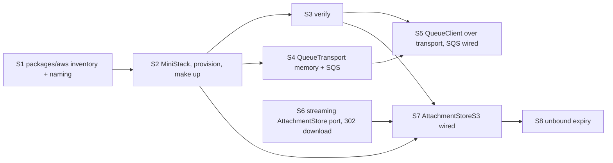

# AWS local — plan

> Ticket: `2026-10-19-1448_aws-local` · Requirements: [feature.md](./feature.md) · Design: [architecture.md](./architecture.md)

## How to run this plan

- **Branch and commits.** Work happens on `feat/aws-local`, cut from `main` after `chat-core`
  merges. Each step is one commit through `/ticket-implement`, made only after the user's OK, with
  the scope `aws-local`; before committing, set the step's `Status:` to `done`. The ticket's
  documents (`feature.md`, `architecture.md`, this plan) and the roadmap edits are committed
  together as `:memo: docs(aws-local)` when the plan is approved, before S1.
- **Green at every commit.** Each step leaves `make check` green, and `make dev` keeps working
  between steps: the SQLite queue and the file-store bytes are removed only in the step that
  wires their replacement (S5, S7).
- **Size.** A step changes ≤ ~400 lines, without `bun.lock`. S5 is the largest; it splits as
  written there if it overruns.
- **Docker.** From S2 on, `make test` needs a running Docker daemon (Seams 2, 3, 6 start MiniStack
  through `testcontainers`); `make dev` needs `make up`.
- **APIs are checked, not remembered.** Effect against `repos/effect` (the vendored `4.0.5`);
  `@effect-aws/*` against its installed sources; MiniStack against the pinned image. The
  research scripts in the session scratchpad (`effaws/exp/*.ts`) show working calls.
- **Tests only at the Seams 1–7** of `architecture.md`. `make dev` against MiniStack (R18) is
  checked by hand in S5 and S7.
- **Living docs move with behaviour.** `docs/knowledge/aws.md` is created in S2 and grows in S5,
  S7 and S8; each step that writes it trims any rule or `CLAUDE.md` line that would restate it.
- **Deviations** go into the step's findings, `architecture.md › Decisions` when they are
  decisions, and `feature.md` when they change a requirement. Ticket ids stay out of code, rules
  and `docs/knowledge/` (`make ids`).

## Dependency graph

S1 and S6 are independent and can start first; S4 and S6 can run in parallel after S2.

## Steps

#### S1 — `packages/aws`: the inventory and the naming rule

- **Goal:** the new workspace `packages/aws` with `naming.ts` (`projectName`, `buildResourceName`,
  moved from `deployment/shared/naming.ts`) and `resources.ts` (bucket `attachments` with its two
  lifecycle settings; queues `assistant-message` with `maxReceiveCount: 4` and `chat-title` with
  `5`; each queue's `<name>-dlq` derived, not listed); `infrastructure/chat/chat.queue.ts` takes
  `name` and `maxAttempts` from it (`replyAttempts` derived as `maxAttempts - 1`); the agreement
  test (R15, R17; D4).
- **Blocked by:** none.
- **Files:** `packages/aws/{package.json,tsconfig.json,index.ts,naming.ts,resources.ts}`; root
  `package.json` `workspaces`, `tsconfig.json` `references`; `deployment/shared/naming.ts`
  deleted, `deployment/shared/tags.ts` and `deployment/aws/resource.ts` import from
  `@app-template/aws`, `deployment/package.json`; `infrastructure/chat/chat.queue.ts`,
  `infrastructure/package.json`; `infrastructure/shared/resources.test.ts` (new);
  `packages/CLAUDE.md` (one line: `aws` is this project's resource data);
  `deployment/CLAUDE.md` (names come from `@app-template/aws`); `docs/knowledge/architecture.md`
  (the package in the layer diagram and the workspace list).
- **Test first:** Seam 7 — the agreement test fails red while `chat.queue.ts` still hard-codes its
  names: every definition's `name` and `maxAttempts` equal an inventory entry; every inventory
  queue has a definition; a definition whose name is missing from the inventory is reported by
  name.
- **Verify:** `make check`; `git grep -n "'assistant-message'\|'chat-title'"` finds the names only
  in `packages/aws/resources.ts` and tests.
- **Status:** done
- **Findings:**
  - Inventory entries are keyed by an identifier and carry `name` as a field, not the
    `Contracts` sketch's name keys: a definition could read a name key only by spelling the
    literal (*Amended in S1* on D4; the sketch is updated).
  - The agreement test globs `infrastructure/**/*.queue.ts` and filters each module's exports by
    the `QueueDefinition` shape, so a new queue file cannot escape it; it sits in
    `infrastructure/shared/` with no `resources.ts` beside it, since `packages/aws` may not import
    `infrastructure` (D4). Under `vitest`, Bun's `import.meta.dir` is undefined; the test resolves
    its workspace from `import.meta.url`.
  - Red was proved by mutation: after the inventory was created the test passed at once, because
    the hard-coded values already matched, so a renamed definition, an orphan inventory queue and
    a changed `maxAttempts` were each shown to fail by name.
  - Nothing derives `<name>-dlq` yet; `provision` and `verify` (S2, S3) do. Seam 7's check that the
    bucket's expiration days cover `unboundLifetime` waits for S8, where the constant appears.
  - Root `package.json` was not touched: the `packages/*` glob already covers the workspace.

#### S2 — MiniStack, `AwsConfig`, the provisioner and `make up`

- **Goal:** MiniStack in `docker-compose.yml` (pinned `ministackorg/ministack:1.5.29@sha256:88f5…`,
  port 4566, python-urllib healthcheck on `/_ministack/health`, `MINISTACK_REGION`, state under
  `.data/ministack`); `AwsConfig { region, endpoint, stage }` in `@app-template/config`;
  `provision(inventory, stage)` in `packages/aws` (bucket, two lifecycle rules, each DLQ then its
  queue with a fixed-order `RedrivePolicy`; `BucketAlreadyOwnedByYou` and an identical queue are
  success); `deployment/local/provision.ts`; `make up`, `make down`, `make reset`; the `MiniStack`
  test layer and the `test-<random>` stage in `packages/testing` (R15, R16, R20; D5, D10, D12).
- **Blocked by:** S1.
- **Files:** `deployment/local/{docker-compose.yml,provision.ts,README.md}`, `deployment/CLAUDE.md`
  (the local stub note goes); `packages/aws/{provision.ts,provision.test.ts,package.json}`;
  `packages/config/{config.ts,config.test.ts}`; `packages/testing/{ministack.ts,stage.ts,index.ts,
  package.json}`; `Makefile`; root `package.json` catalogs (`effect-aws`: `@effect-aws/client-s3`,
  `@effect-aws/client-sqs` at `2.0.0`; `tools`: `testcontainers@12.2.1`); `.env.example`
  (`AWS_REGION`, `AWS_ENDPOINT_URL="http://localhost:4566"`, `STAGE="local"`,
  `AWS_ACCESS_KEY_ID="test"`, `AWS_SECRET_ACCESS_KEY="test"`; `S3_ENDPOINT`, `S3_BUCKET`,
  `QUEUE_URL` dropped); `docs/knowledge/aws.md` (new: start, stop, reset, the inventory, adding a
  resource, Docker for tests), `docs/knowledge/tooling.md` (the `effect-aws` namespace, `make up`).
- **Test first:** Seam 6 on a MiniStack container — after `provision`, the bucket exists with both
  lifecycle rules read back as the inventory states and each queue has its DLQ and
  `maxReceiveCount`; a second `provision` succeeds and changes nothing. `AwsConfig`'s rows join the
  config table test (`AWS_ENDPOINT_URL` optional).
- **Verify:** `make check` (with Docker running); `make up` twice, the second without change;
  `make down` leaves no container; `make reset` empties `.data/`. Findings record the container's
  measured start time.
- **Status:** todo

#### S3 — `verify` at startup

- **Goal:** `verify(inventory, stage)` in `packages/aws`: `HeadBucket` and `GetQueueUrl` +
  `GetQueueAttributes` for every resource, failing with one error that names the endpoint, the
  resource and what differs (missing, or `maxReceiveCount` not the inventory's) (R19; D5).
- **Blocked by:** S2.
- **Files:** `packages/aws/{verify.ts,verify.test.ts,index.ts}`.
- **Test first:** Seam 6 — on a stage never provisioned, `verify` fails naming the endpoint and the
  bucket; with one queue re-created at another `maxReceiveCount`, it names that queue; after
  `provision`, it succeeds.
- **Verify:** `make check`.
- **Status:** todo

#### S4 — `QueueTransport`: memory and SQS

- **Goal:** `packages/queue/queue.transport.ts` with the `QueueTransport` interface,
  `transportMemory` (visibility, `receiveCount`, redrive to `<queue>-dlq` at receive, long-poll on
  `Clock`) and `transportSqs` over `SQSService` (queue URL by `GetQueueUrl`, cached per queue;
  `jobId` as a message attribute); nothing uses them yet (R8, R10, R13, R21; D1–D3, D5).
- **Blocked by:** S2.
- **Files:** `packages/queue/{queue.transport.ts,queue.transport.test.ts,package.json}`
  (`@effect-aws/client-sqs`; `@app-template/aws` and `@app-template/testing` as dev).
- **Test first:** Seam 2, one suite run on `transportMemory` and on `transportSqs` against
  MiniStack (queues made by `provision` with a test inventory) — a sent body is received with
  `receiveCount: 1` and its attribute; a received message is not received again within its
  visibility; `extend(0)` returns it at once with `receiveCount: 2`; `delete` removes it; after
  `maxReceiveCount` receives the next receive is empty and the message is on `<queue>-dlq`; an
  empty receive waits for `wait` and returns early when a message is sent.
- **Verify:** `make check`.
- **Status:** todo

#### S5 — `QueueClient` over the transport; SQS in the apps

- **Goal:** `QueueClient` rebuilt over `QueueTransport` per `architecture.md › Contracts` (decode;
  heartbeat every `lockRefreshInterval`; `attempt = receiveCount`; retry delay replayed from
  `retrySchedule` with `Schedule.toStep`; last failure, decode failure and interrupt as
  `extend(0)`); `QueueClient.layerMemory` and `QueueClient.layerSqs`; `PersistedQueue`,
  `layerSqlite`, `QueueClientSqliteOptions` and `@effect/sql-sqlite-bun` removed;
  `QueueClientSqs` in `infrastructure/shared/queue.client.ts` over the new
  `infrastructure/shared/aws.ts` (`SQSService` from `AwsConfig`); api and worker wired to it and
  running `verify` before they serve or consume; `QueueDefinition.jobId`'s doc says delivery is
  at-least-once; the `chat.queue.ts` comment explains the settling attempt by redrive
  (R8–R14, R18, R19, R20; D1–D3, D5).
- **Blocked by:** S3, S4.
- **Files:** `packages/queue/{queue.ts,queue.test.ts,index.ts,package.json}`;
  `infrastructure/shared/{aws.ts,queue.client.ts,index.ts}`, `infrastructure/package.json`;
  `infrastructure/chat/chat.queue.ts`; `apps/api/src/layer.ts`, `apps/worker/src/layer.ts`,
  `apps/*/src/main.ts`; `packages/config/{config.ts,config.test.ts}` (`QUEUE_SQLITE_PATH` out);
  `.env.example`, `.gitignore` (`queue.sqlite`); `application/testing/queue.fake.ts` if its
  wrapping needs it; `docs/knowledge/aws.md` (queues: delivery, attempts, dead letters).
- **Test first:** Seam 1 on `transportMemory` under `TestClock`, rewriting the existing suite —
  red while `QueueClient` still runs on `PersistedQueue`: a handler failing every time sees
  attempts `1…maxAttempts` with `isLastAttempt` only on the last, retries no earlier than each
  schedule delay, and the message then sits on the DLQ; a handler running past the visibility
  timeout is not handed to a second worker; a malformed body reaches the DLQ and the handler never
  runs; an interrupted handler's job comes back with the next attempt number; a transport that
  fails does not end the worker. The "one job per jobId" and "interrupt keeps the attempt" cases
  are deleted.
- **Split if over ~400 lines:** S5a ends after `queue.ts` and the cases above with the apps
  switched; S5b adds the failing-transport and decode cases.
- **Verify:** `make check`; by hand, `make up && make dev`: send a message, the reply reaches
  `completed` and the title appears; stop the worker, send three messages, start it, all three
  run; `.data/` holds no `queue.sqlite`; `make dev` without `make up` exits naming the endpoint
  and the queue.
- **Status:** todo

#### S6 — A streaming `AttachmentStore` and a redirecting download

- **Goal:** the port of `architecture.md › Contracts` (`insert` from a `Stream` returning
  `FileSize`, `select`, `url`, `keep`, `delete`); `AttachmentStoreKv` on it (bytes and media type
  stored, `url` as a `data:` URL, `keep` a no-op); `AttachmentService.upload` takes the stream and
  `download` returns `{ attachment, url }`; the api passes each multipart file's stream through
  `Multipart.withLimits` instead of buffering it (replacing `chat-core` D8) and answers `download`
  with `302` (replacing `chat-core` D10) (R1–R5, R21; D6).
- **Blocked by:** none.
- **Files:** `domain/attachment/attachment.service.ts`;
  `infrastructure/attachment/{attachment.storage.ts,attachment.storage.test.ts}`;
  `application/attachment/{attachment.service.ts,attachment.service.test.ts}`,
  `application/testing/attachment.fixture.ts`; `http-api/attachment/attachment.http.ts` (the
  `download` success as `302` with `Location`); `apps/api/src/{attachment/attachment.handler,http.test}.ts`.
- **Test first:** Seam 3 on `AttachmentStoreKv` — red on the old signatures: an inserted stream's
  size is returned and `select` returns its bytes; `fetch(url)` returns the bytes with the media
  type; a stream failing part-way fails `insert` with its error and `select` is `none`; `delete`
  twice succeeds. Seam 5 — `download` for the owner is `302` with the store's `Location`, for
  another user `404 AttachmentNotFound` without `Location`; an 11 MB streamed file is `413` and
  nothing is stored.
- **Verify:** `make check`; by hand, `make dev`: an uploaded image opens in the browser through
  the `data:` redirect (dev still runs the KV store until S7).
- **Status:** todo

#### S7 — `AttachmentStoreS3` in the apps

- **Goal:** `AttachmentStoreS3`: key `attachments/<id>`; `insert` tags `unbound=true` and writes
  `ContentType` and `inline` `ContentDisposition`, one `PutObject` up to 5 MiB, else multipart in
  5 MiB parts, aborted on failure or interrupt; `select` by `GetObject` (`NoSuchKey` → `none`);
  `url` presigned for 300 s; `keep` clears the tag; `delete` idempotent; `S3Service` from
  `AwsConfig` with `forcePathStyle` when an endpoint is set; api and worker wired to it, and the
  file store no longer holds bytes (R1–R3, R5, R6, R18, R19, R21; D6–D8, D11).
- **Blocked by:** S2, S3, S6.
- **Files:** `infrastructure/attachment/{attachment.storage.s3.ts,attachment.storage.test.ts,
  index.ts}`; `infrastructure/shared/aws.ts`, `infrastructure/package.json`
  (`@effect-aws/client-s3`); `apps/api/src/layer.ts`, `apps/worker/src/layer.ts`;
  `docs/knowledge/aws.md` (attachments: upload, presigned download, the signed host).
- **Test first:** Seam 3, the S6 suite now also on `AttachmentStoreS3` against MiniStack, plus the
  S3-only cases — a 10 MB stream is stored by a two-part multipart upload with identical bytes; a
  stream failing after the first part leaves `ListObjectsV2` and `ListMultipartUploads` empty; the
  object has `unbound=true` after `insert` and no tag after `keep`; the presigned URL serves
  `content-type` and `inline`, and a URL signed in the past is `403`.
- **Verify:** `make check`; by hand, `make up && make dev`: upload, open the image (the browser
  follows the `302` to `localhost:4566`), send it, the worker's prompt holds it; delete the chat
  and `aws s3 ls` (or the SDK) shows no object; `.data/store` holds no attachment bytes.
- **Status:** todo

#### S8 — Unbound attachments expire

- **Goal:** `unboundLifetime` (24 h) and `isExpired(attachment, now)` in `domain/attachment`;
  `AttachmentService` treats an expired unbound attachment as not found in `get`, `download`,
  `delete` and `findBindable`, deleting its record and object when met; `bind` calls
  `store.keep` for each attachment before the repository update; the agreement test checks that
  the bucket's expiration days cover `unboundLifetime` (R7; D9).
- **Blocked by:** S7.
- **Files:** `domain/attachment/{attachment.service.ts,attachment.service.test.ts}`;
  `application/attachment/{attachment.service.ts,attachment.service.test.ts}`,
  `application/testing/chat.fake.ts` if a recording store is needed;
  `infrastructure/shared/resources.test.ts`; `docs/knowledge/aws.md` (lifecycle, what MiniStack does
  not run).
- **Test first:** Seam 4 under `TestClock` — an unbound attachment at 24 h is `AttachmentNotFound`
  from `get` and `findBindable` and its record is gone; one at 23 h 59 min is found; a bound one
  at 48 h is found; `bind` reaches the store's `keep` before the repository's `update` (a recording
  store and repository). Seam 7 — lowering the lifecycle days below the lifetime fails the
  agreement test.
- **Verify:** `make check`.
- **Status:** todo

## Requirement coverage

| Req | Steps |
|---|---|
| R1 | S6, S7 |
| R2 | S6, S7 |
| R3 | S6, S7 |
| R4 | S6, S8 |
| R5 | S6, S7 |
| R6 | S7 |
| R7 | S2 (rules), S7 (tag, `keep`), S8 |
| R8 | S4, S5 |
| R9 | S5 |
| R10 | S4, S5 |
| R11 | S5 |
| R12 | S5 |
| R13 | S4, S5 |
| R14 | S5 |
| R15 | S1, S2 |
| R16 | S2 |
| R17 | S1, S8 |
| R18 | S5, S7 (by hand) |
| R19 | S3, S5, S7 |
| R20 | S2, S5, S7 |
| R21 | S4, S6, S7 |
| R22 | S2, S5, S7, S8 |
