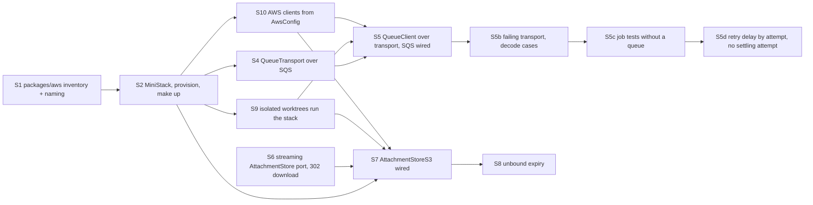

# AWS local — plan

> Ticket: `2026-10-19-1448_aws-local` · Requirements: [feature.md](./feature.md) · Design: [architecture.md](./architecture.md)

## How to run this plan

- **Branch and commits.** Work happens on `feat/aws-local`, cut from `main` after `chat-core`
  merges. Each step is one commit through `/ticket-implement`, made only after the user's OK, with
  the scope `aws-local`; before committing, set the step's `Status:` to `done`. The ticket's
  documents (`feature.md`, `architecture.md`, this plan) and the roadmap edits are committed
  together as `:memo: docs(aws-local)` when the plan is approved, before S1.
- **Green at every commit.** Each step leaves `make check` green, and `make dev` keeps working
  between steps: the SQLite queue and the file-store bytes are removed only in the step that
  wires their replacement (S5, S7).
- **Size.** A step changes ≤ ~400 lines, without `bun.lock`. S5 is the largest; it splits as
  written there if it overruns.
- **Docker.** From S2 on, `make test` needs a running Docker daemon (Seams 2, 3, 6 start MiniStack
  through `testcontainers`); `make dev` needs `make up`.
- **APIs are checked, not remembered.** Effect against `repos/effect` (the vendored `4.0.5`);
  `@effect-aws/*` against its installed sources; MiniStack against the pinned image. The
  research scripts in the session scratchpad (`effaws/exp/*.ts`) show working calls.
- **Tests only at the Seams 1–7** of `architecture.md`. `make dev` against MiniStack (R18) is
  checked by hand in S5 and S7.
- **Living docs move with behaviour.** `docs/knowledge/aws.md` is created in S2 and grows in S5,
  S7 and S8; each step that writes it trims any rule or `CLAUDE.md` line that would restate it.
- **Deviations** go into the step's findings, `architecture.md › Decisions` when they are
  decisions, and `feature.md` when they change a requirement. Ticket ids stay out of code, rules
  and `docs/knowledge/` (`make ids`).

## Dependency graph

S1 and S6 are independent and can start first; S4 and S6 can run in parallel after S2. S3 was
dropped (D5). S9 and S10 were added after S4 and S6 closed, so S5 and S7 run in parallel, each
checking `make dev` by hand in its own worktree.

## Steps

#### S1 — `packages/aws`: the inventory and the naming rule

- **Goal:** the new workspace `packages/aws` with `naming.ts` (`projectName`, `buildResourceName`,
  moved from `deployment/shared/naming.ts`) and `resources.ts` (bucket `attachments` with its two
  lifecycle settings; queues `assistant-message` with `maxReceiveCount: 4` and `chat-title` with
  `5`; each queue's `<name>-dlq` derived, not listed); `infrastructure/chat/chat.queue.ts` takes
  `name` and `maxAttempts` from it (`replyAttempts` derived as `maxAttempts - 1`); the agreement
  test (R15, R17; D4).
- **Blocked by:** none.
- **Files:** `packages/aws/{package.json,tsconfig.json,index.ts,naming.ts,resources.ts}`; root
  `package.json` `workspaces`, `tsconfig.json` `references`; `deployment/shared/naming.ts`
  deleted, `deployment/shared/tags.ts` and `deployment/aws/resource.ts` import from
  `@app-template/aws`, `deployment/package.json`; `infrastructure/chat/chat.queue.ts`,
  `infrastructure/package.json`; `infrastructure/shared/resources.test.ts` (new);
  `packages/CLAUDE.md` (one line: `aws` is this project's resource data);
  `deployment/CLAUDE.md` (names come from `@app-template/aws`); `docs/knowledge/architecture.md`
  (the package in the layer diagram and the workspace list).
- **Test first:** Seam 7 — the agreement test fails red while `chat.queue.ts` still hard-codes its
  names: every definition's `name` and `maxAttempts` equal an inventory entry; every inventory
  queue has a definition; a definition whose name is missing from the inventory is reported by
  name.
- **Verify:** `make check`; `git grep -n "'assistant-message'\|'chat-title'"` finds the names only
  in `packages/aws/resources.ts` and tests.
- **Status:** done
- **Findings:**
  - Inventory entries are keyed by an identifier and carry `name` as a field, not the
    `Contracts` sketch's name keys: a definition could read a name key only by spelling the
    literal (*Amended in S1* on D4; the sketch is updated).
  - The agreement test globs `infrastructure/**/*.queue.ts` and filters each module's exports by
    the `QueueDefinition` shape, so a new queue file cannot escape it; it sits in
    `infrastructure/shared/` with no `resources.ts` beside it, since `packages/aws` may not import
    `infrastructure` (D4). Under `vitest`, Bun's `import.meta.dir` is undefined; the test resolves
    its workspace from `import.meta.url`.
  - Red was proved by mutation: after the inventory was created the test passed at once, because
    the hard-coded values already matched, so a renamed definition, an orphan inventory queue and
    a changed `maxAttempts` were each shown to fail by name.
  - Nothing derives `<name>-dlq` yet; `provision` (S2) does. Seam 7's check that the
    bucket's expiration days cover `unboundLifetime` waits for S8, where the constant appears.
  - Root `package.json` was not touched: the `packages/*` glob already covers the workspace.

#### S2 — MiniStack, `AwsConfig`, the provisioner and `make up`

- **Goal:** MiniStack in `docker-compose.yml` (pinned `ministackorg/ministack:1.5.29@sha256:88f5…`,
  port 4566, python-urllib healthcheck on `/_ministack/health`, `MINISTACK_REGION`, state under
  `.data/ministack`); `AwsConfig { region, endpoint, stage }` in `@app-template/config`;
  `provision(inventory, stage)` in `packages/aws` (bucket, two lifecycle rules, each DLQ then its
  queue with a fixed-order `RedrivePolicy`; `BucketAlreadyOwnedByYou` and an identical queue are
  success); `deployment/local/provision.ts`; `make up`, `make down`, `make reset`; the `MiniStack`
  test layer and the `test-<random>` stage in `packages/testing` (R15, R16, R20; D5, D10, D12).
- **Blocked by:** S1.
- **Files:** `deployment/local/{docker-compose.yml,provision.ts,README.md}`, `deployment/CLAUDE.md`
  (the local stub note goes); `packages/aws/{provision.ts,provision.test.ts,package.json}`;
  `packages/config/{config.ts,config.test.ts}`; `packages/testing/{ministack.ts,stage.ts,index.ts,
  package.json}`; `Makefile`; root `package.json` catalogs (`effect-aws`: `@effect-aws/client-s3`,
  `@effect-aws/client-sqs` at `2.0.0`; `tools`: `testcontainers@12.2.1`); `.env.example`
  (`AWS_REGION`, `AWS_ENDPOINT_URL="http://localhost:4566"`, `STAGE="local"`,
  `AWS_ACCESS_KEY_ID="test"`, `AWS_SECRET_ACCESS_KEY="test"`; `S3_ENDPOINT`, `S3_BUCKET`,
  `QUEUE_URL` dropped); `docs/knowledge/aws.md` (new: start, stop, reset, the inventory, adding a
  resource, Docker for tests), `docs/knowledge/tooling.md` (the `effect-aws` namespace, `make up`).
- **Test first:** Seam 6 on a MiniStack container — after `provision`, the bucket exists with both
  lifecycle rules read back as the inventory states and each queue has its DLQ and
  `maxReceiveCount`; a second `provision` succeeds and changes nothing. `AwsConfig`'s rows join the
  config table test (`AWS_ENDPOINT_URL` optional).
- **Verify:** `make check` (with Docker running); `make up` twice, the second without change;
  `make down` leaves no container; `make reset` empties `.data/`. Findings record the container's
  measured start time.
- **Status:** done
- **Findings:**
  - MiniStack starts in 1.1–1.4 s on this machine (three runs of the `MiniStack` layer: start and
    `/_ministack/health` 200), and stops in 0.12 s; the whole `provision.test.ts` runs in 2.4 s.
    `make up` takes 3.4 s cold (the compose health check polls every 2 s) and 0.85 s warm.
  - `provision` returns `ReadonlyArray<ProvisionedResource>` (`name`, `outcome: created |
    unchanged`), so `make up` can print "unchanged" for every resource on its second run (the
    acceptance of R16) and the Seam 6 test can assert it directly. For that, existence is read
    first: `HeadBucket` before `CreateBucket` (a repeated `CreateBucket` answers by region, `200` in
    `us-east-1`), `GetQueueUrl` before `CreateQueue`. `BucketAlreadyOwnedByYou` stays a success for
    the race (*Amended in S2* on D5). Lifecycle rules are re-put on every run (idempotent); a
    drifted `maxReceiveCount` fails with `QueueNameExists`, documented in `aws.md` with
    `make reset` as the way back.
  - `resources.ts` gained the `Resources` interface (the parameter type of `provision`) and
    `unboundTag = { key: 'unbound', value: 'true' }`, the inventory's own datum for the
    expiration rule, which `AttachmentStoreS3` (S7) must read rather than respell; the Contracts
    sketch lists it.
  - `testcontainers` sits in the `runtime` catalog, not `tools`: `packages/testing/ministack.ts`
    imports it, so it shapes the test runtime (S2.2).
  - The S3 and SQS client layers are built twice: in `deployment/local/provision.ts` from
    `AwsConfig` and in `provision.test.ts` from `MiniStack`. `infrastructure/shared/aws.ts` (S5,
    S7) cannot serve `deployment`, which may import only `packages/*`; if S5 wants one home for
    the `AwsConfig` → client options mapping, it is `packages/aws`.
  - The `MiniStack` service provides `region` and `credentials` beside `endpoint`, so a test file
    spells neither; the stage fixture is `buildStage()` in `packages/testing/stage.fixture.ts`.
    The compose service pins the same image by digest; `aws.md` says to bump both together, and
    `deployment/CLAUDE.md` points there. State persists through `PERSIST_STATE`/`STATE_DIR` (written on
    shutdown) and `S3_PERSIST`/`S3_DATA_DIR`, both under `.data/ministack`; checked by `make down`
    then `make up` reporting every resource unchanged.
  - An existing `.env` does not receive the new variables (`make setup` only creates the file):
    copy the AWS block from `.env.example`. Lesson, applied on the user's OK in S2.2: the rule
    `.claude/rules/tooling.md › Environment` now lists in `.env.example` the variables a client
    SDK reads from the environment itself (the AWS credentials, D10), not only what the code
    reads; `docs/knowledge/tooling.md` explains why.
  - S2.3 replaces `docker compose` with the Pulumi project `deployment/local/` (D13): `Pulumi.yaml`
    (`runtime: bun`) and `index.ts` with `docker.RemoteImage` (`keepLocally`) and
    `docker.Container` (the digest of `packages/testing/ministack.ts`, port 4566, the environment,
    the bind mount of the repo's `.data/ministack` resolved from `import.meta.url`, the python
    healthcheck, `wait: true`, `waitTimeout: 60`). The `Makefile`'s `PULUMI` runs the CLI with
    `PULUMI_HOME` and the file backend under `.data/pulumi` and an empty passphrase; `make stack`
    (login, `stack select local || stack init local`) is idempotent and runs before `setup`, `up`
    and `down`, so a `make up` after `make reset` needs no manual login. Catalog `pulumi`:
    `@pulumi/pulumi@3.270.0`, `@pulumi/docker@5.2.0`; `bun pm untrusted` lists nothing blocked,
    and `tsc -b` passes with the real types since `deployment/aws/*` imports no `@pulumi/*`.
  - The region reaches the program as stack config (`new pulumi.Config().get('region')`, default
    `us-east-1`), not `process.env`: the Makefile does not read `.env`, and MiniStack's default
    region only names ARNs for unsigned requests, since the router takes the signed region first.
  - `Pulumi.local.yaml` (the stack's `encryptionsalt` only) is gitignored: `stack init` generates
    it per clone, like `.env`, and it holds no secret with the empty passphrase; `.data` already
    covers the backend and `PULUMI_HOME`.
  - `docker.Container` sets `destroyGraceSeconds: 15` and `stopTimeout: 15`: the provider's plain
    remove killed MiniStack mid-save (`scheduler.json.tmp`, no `sqs.json`), so the queues came
    back as `created` after `make down`; with a graceful stop the state is complete and the next
    `make up` reports every resource `unchanged`.
  - Measured with CLI 3.270.0 from the scratchpad: `make setup` 1.1 s (login and `stack init`);
    `make up` 11.5 s cold (the docker provider plugin downloads, the container is healthy after
    3 s), 1.6 s as a no-op (`3 unchanged`, five `unchanged`), 5.2–5.5 s after a `make down`;
    `make down` 1.3 s; `make reset` 1.1 s. The Pulumi CLI is a prerequisite for `stack`, `up` and
    `down` (`tooling.md`), never for `make check`.
  - S2.4, on the user's request: the program is `deployment/local/ministack.ts`, not `index.ts`:
    `deployment/aws/` names files by resource (`queue.ts`, `storage.ts`), `index.ts` is a barrel
    name in this repo (`naming.md`), and "ministack" now finds exactly the two files that pin the
    digest. It exports nothing, since nothing reads stack outputs. The root `README.md` gains a
    Quick-start subsection on the local environment (examples and edge cases, linking `aws.md`).
  - `make setup` no longer depends on `stack`: a newcomer without the Pulumi CLI still gets
    `bun install` and `.env` for `make check`; `up` and `down` run `stack` first. `PULUMI_HOME` is
    the repo's gitignored `.pulumi/`, outside `.data`, so `make reset` keeps the provider plugin
    (D13 amended by the main session); only the backend lives under `.data/pulumi`. Measured
    after the move: `make stack` 0.17 s, `make up` 11.2 s with the plugin download into the new
    home, 1.0 s as a no-op (`3 unchanged`, five `unchanged`), `make down` 0.65 s.
  - `deployment/Pulumi.yaml` (the AWS stub) still declares `runtime: nodejs` with
    `packagemanager: bun` while `local/Pulumi.yaml` uses `runtime: bun`; left as is, ticket 9
    reconciles them.
  - Red was proved by the missing module, then by mutation: `maxReceiveCount + 1`, a queue
    reported `created` on the second run, and `unboundExpirationDays + 1` each fail the test that
    names them.

#### S3 — `verify` at startup

- **Goal:** `verify(inventory, stage)` in `packages/aws`: `HeadBucket` and `GetQueueUrl` +
  `GetQueueAttributes` for every resource, failing with one error that names the endpoint, the
  resource and what differs (missing, or `maxReceiveCount` not the inventory's) (R19; D5).
- **Blocked by:** S2.
- **Files:** `packages/aws/{verify.ts,verify.test.ts,index.ts}`.
- **Test first:** Seam 6 — on a stage never provisioned, `verify` fails naming the endpoint and the
  bucket; with one queue re-created at another `maxReceiveCount`, it names that queue; after
  `provision`, it succeeds.
- **Verify:** `make check`.
- **Status:** dropped
- **Findings:**
  - Built and reviewed, then dropped with R19 on the user's call (D5): the application does not
    re-check what the infrastructure owns. Not committed. The review's other points (one helper
    for `<name>-dlq`, one MiniStack client layer for the tests) move to S4, where the copies are.

#### S4 — `QueueTransport` over SQS

- **Goal:** `packages/queue/queue.transport.ts` with the `QueueTransport` interface,
  `transportMemory` (visibility, `receiveCount`, redrive to `<queue>-dlq` at receive, long-poll on
  `Clock`) and `transportSqs` over `SQSService` (queue URL by `GetQueueUrl`, cached per queue;
  `jobId` as a message attribute); nothing uses them yet (R8, R10, R13, R21; D1–D3, D5).
- **Blocked by:** S2.
- **Files:** `packages/queue/{queue.transport.ts,queue.transport.test.ts,package.json}`
  (`@effect-aws/client-sqs`; `@app-template/aws` and `@app-template/testing` as dev).
- **Test first:** Seam 2, one suite run on `transportMemory` and on `transportSqs` against
  MiniStack (queues made by `provision` with a test inventory) — a sent body is received with
  `receiveCount: 1` and its attribute; a received message is not received again within its
  visibility; `extend(0)` returns it at once with `receiveCount: 2`; `delete` removes it; after
  `maxReceiveCount` receives the next receive is empty and the message is on `<queue>-dlq`; an
  empty receive waits for `wait` and returns early when a message is sent.
- **Verify:** `make check`.
- **Status:** done
- **Findings:**
  - Landed in four rounds (S4.1–S4.4), +359 / −32 lines without `bun.lock`. `make check`: 321
    tests; the transport's suite is 8 cases on MiniStack, about 4 s.
  - **The memory transport was built, then removed on the user's call (D1 amended).** It had to
    know each queue's dead-letter name to imitate redrive, which made `packages/queue` import
    `@app-template/aws` at runtime; passing the rule as an option would have spread to every
    memory `QueueClient`. Redelivery and dead-lettering stay AWS's job, and every test that needs
    a queue runs on MiniStack (S5 carries that out). `ReceiveOptions` drops `maxReceiveCount`,
    which only the imitation read; `QueueClient` still derives `isLastAttempt` from
    `receiveCount`.
  - The suite is the SQS transport's own: a sent body with its attribute and `receiveCount: 1`;
    hidden within its visibility; `extend(0)` returns it, and wakes a waiting receive; `delete`;
    redrive to `buildDeadLetterName(queue)` after `maxReceiveCount` receives; a full wait on an
    empty queue; an early return on `send`. SQS takes whole seconds, rounded up, so the long-poll
    cases wait 2 s.
  - `Received` carries `attributes` (`jobId`); `QueueError` moves to `queue.transport.ts` so
    `queue.ts` imports it without a cycle; queue URLs come from `GetQueueUrl`, cached per queue
    while the lookups succeed.
  - The review's points from S3 landed here: `buildDeadLetterName` in `packages/aws/naming.ts`
    (used by `provision`, its test and the transport's suite), and `AwsClientsMiniStack` in
    `packages/testing/ministack.ts` (the S3 and SQS clients on a test file's container).
  - `@app-template/aws` and `@app-template/testing` are dev dependencies of `packages/queue`.

#### S5 — `QueueClient` over the transport; SQS in the apps

- **Goal:** `QueueClient` rebuilt over `QueueTransport` per `architecture.md › Contracts` (decode;
  heartbeat every `lockRefreshInterval`; `attempt = receiveCount`; retry delay replayed from
  `retrySchedule` with `Schedule.toStep`; last failure, decode failure and interrupt as
  `extend(0)`); `QueueClient.layerSqs` only (D1 amended in S4: no memory layer); `PersistedQueue`,
  `layerSqlite`, `QueueClientSqliteOptions` and `@effect/sql-sqlite-bun` removed;
  `QueueClientSqs` in `infrastructure/shared/queue.client.ts` over the new
  `infrastructure/shared/aws.client.ts` (S10); api and worker wired to it;
  `QueueDefinition.jobId`'s doc says delivery is at-least-once; the `chat.queue.ts` comment
  explains the settling attempt by redrive (R8–R14, R18, R20; D1–D3, D5).
- **Blocked by:** S4, S9, S10.
- **Files:** `packages/queue/{queue.ts,queue.test.ts,index.ts,package.json}`;
  `infrastructure/shared/{queue.client.ts,index.ts}`, `infrastructure/package.json`;
  `infrastructure/chat/chat.queue.ts`; `apps/api/src/layer.ts`, `apps/worker/src/layer.ts`,
  `apps/*/src/main.ts`; `packages/config/{config.ts,config.test.ts}` (`QUEUE_SQLITE_PATH` out);
  `.env.example`, `.gitignore` (`queue.sqlite`); `application/testing/queue.fake.ts` if its
  wrapping needs it; `docs/knowledge/aws.md` (queues: delivery, attempts, dead letters).
- **Tests on MiniStack (D1 amended in S4).** Every test that uses `QueueClient.layerMemory` today
  moves to `QueueClient.layerSqs` on a MiniStack container with provisioned queues: the api
  harness (`apps/api/src/testing/api.harness.ts`), the chat harness and `queue.fake.ts` in
  `application/testing`, and the job tests (`assistant-message.job.test.ts`,
  `chat-title.job.test.ts`), 11 files and about 90 tests in all. They run in real time, so test
  definitions shorten their retry schedules; SQS counts whole seconds. Files gain those tests,
  the harnesses and `apps/api/package.json` / `application/package.json` (`@app-template/aws` and
  `@app-template/testing` as dev).
- **Test first:** Seam 1 on `QueueClient.layerSqs` against MiniStack, rewriting the existing suite —
  red while `QueueClient` still runs on `PersistedQueue`: a handler failing every time sees attempts
  `1…maxAttempts` with `isLastAttempt` only on the last, retries no earlier than each schedule
  delay, and the message then sits on the DLQ; a handler running past the visibility timeout is not
  handed to a second worker; a malformed body reaches the DLQ and the handler never runs; an
  interrupted handler's job comes back with the next attempt number; a transport that fails does not
  end the worker. The "one job per jobId" and "interrupt keeps the attempt" cases are deleted.
- **Split if over ~400 lines:** S5a ends after `queue.ts` and the cases above with the apps
  switched; S5b adds the failing-transport and decode cases. Moving the harnesses and job tests
  to MiniStack (S4's amendment) belongs to S5a, since `QueueClient.layerMemory` goes with it;
  expect S5a over the limit and agree its size before it starts.
- **Verify:** `make check`; by hand, `make up && make dev`: send a message, the reply reaches
  `completed` and the title appears; stop the worker, send three messages, start it, all three
  run; `.data/` holds no `queue.sqlite`.
- **Status:** done (as S5a; S5b below)
- **Findings:**
  - Landed as S5a in five rounds (S5a.1–S5a.5), built in its own worktree (N=1) beside S7.
    `make check`: 328 tests with S7 (313 alone; the memory and SQLite duplicates went). About
    1400 changed lines without `bun.lock`, over the 600–800 agreed before the step; the queue
    rewrite and the move of every queue test to MiniStack could not land apart and keep
    `make check` green, and the user accepted the size. By hand on MiniStack: a reply reached
    `completed` with its title; with the worker stopped, three messages waited and all ran once
    it started; `.data/` holds no `queue.sqlite`.
  - `QueueClient.layer(options)` beside `layerSqs` (D1 amended), so S5b swaps the transport.
  - An interrupt now spends its attempt (D2), reversing `chat-core` R34: feature R12 states it
    as an EARS clause, and `chat-core`'s R34, its acceptance row, D21 and D23 carry amendment
    notes. The job test for an interrupt on the last reply now expects the settling attempt to
    fail the reply, where it was retried before.
  - The job suites keep the handlers' sleeps on the `TestClock` and wait for SQS in real time
    (`runUntilDrained`), counting times from a handler's first write; earlier attempts are
    simulated by receiving with visibility 0 (`abandonAttempts`), so the chat-title dead-letter
    case starts at its last attempt. Those helpers live in `application/testing/queue.harness.ts`;
    `queue.fake.ts` keeps only `recordQueue`.
  - The retry case runs on `Schedule.exponential` (2 s, then 4 s, past the 2 s visibility) and
    asserts each gap; a constant delay passed even with the replayed delay removed.
  - Files beyond the list: `.claude/rules/effect-services.md` (its example named the removed
    layers), `docs/knowledge/tooling.md`, `README.md`, `Makefile`, the chat-core ticket's
    `feature.md` and `architecture.md`, more tests wrapped on MiniStack, `tsconfig` references
    and dev dependencies (`@app-template/aws`, `@effect-aws/client-sqs`).
  - A stopped worker's long poll can hide the next message for 15 s and spend its attempt, and
    the settling attempt can itself be spent; both are in Risks.
  - Interrupting during the decode, between the receive and the handler, has no `onInterrupt`,
    so the job returns after `lockExpiration` rather than at once as R12 says; S5b closes it.

#### S5b — The failing-transport and decode cases

- **Goal:** Seam 1 gains the cases S5a left: a transport that fails does not end the worker, and
  a body that does not decode reaches the dead-letter queue without the handler running; an
  interrupt between the receive and the handler (during the decode) makes the job visible at
  once, as R12 says (R12, R14; D1, D3).
- **Blocked by:** S5.
- **Files:** `packages/queue/{queue.ts,queue.test.ts}`.
- **Test first:** Seam 1 on `QueueClient.layer` over a wrapped `QueueTransport` on MiniStack: a
  `receive` that fails once, then succeeds, still hands the next job to the handler; a malformed
  body sent straight to the queue reaches `<queue>-dlq` and the handler never runs; a worker
  interrupted while a message decodes leaves it visible at once with the next attempt number.
- **Verify:** `make check`.
- **Status:** done
- **Findings:**
  - Landed in two rounds (S5b.1, S5b.2), built in its own worktree (N=1) beside S8. `make check`:
    332 tests with S5b alone; about 300 changed lines.
  - The decode case was red: only the handler race released on an interrupt, so a stop during
    the decode hid the job until `lockExpiration` (2.07 s against a 1 s bound). The receive loop
    now runs under `uninterruptibleMask`, releasing on an interrupt in the decode and the handler.
  - The failing-transport and malformed-body cases were green before the change; each was shown
    red by a mutation (no consumer restart; a decode failure that deletes).
  - S5b.1 released during the settle too, which skipped R11's retry delay and returned a finished
    job; S5b.2 runs the settle uninterruptibly, with a case that stops a worker while a failed
    attempt settles (red at 8 ms against the 4 s delay). R12 says so (*Clarified in S5b*) and D2
    is amended. A hung SQS call during the settle holds a worker stop until the SDK's timeout.

#### S5c — Job tests without a queue; a recording queue for the harnesses

- **Goal:** the job suites call each job's handler directly with plain `AttemptInfo` values under
  `TestClock`, and keep one MiniStack test per job (enqueue, worker, settled); a recording
  `QueueClient` for tests records each job and encodes it with the client's own codec, forwarding
  nothing; it lives in `packages/queue/testing` and is imported as `@app-template/queue/testing`,
  since `packages/testing` cannot import `queue` (a cycle of project references); the chat and api
  harnesses use it, so their tests need no Docker;
  `QueueClient.layerSqs` folds into `QueueClientSqs` (`QueueClient.layer` over
  `QueueTransport.layerSqs`); `application/testing/queue.harness.ts`, `abandonAttempts`,
  `runUntilDrained` and `application`'s SQS dev dependency go; the per-message outcome rules keep
  one author, the `consume` doc, which `aws.md › Queues` points to (D1 amended: a send-only
  fake serves tests that never consume).
- **Blocked by:** S5b.
- **Files:** `application/chat/{assistant-message.job,chat-title.job}{,.test}.ts`;
  `application/testing/{queue.harness.ts,queue.fake.ts,chat.harness.ts}`,
  `application/package.json`;
  `packages/queue/{queue.ts,index.ts,package.json,testing/queue.fake.ts}`;
  `apps/api/src/testing/api.harness.ts`, `apps/api/package.json`;
  `infrastructure/shared/queue.client.ts`; `.claude/rules/effect-services.md` (its `layerSqs`
  example); `.claude/rules/{naming.md,effect-tests.md}` (a package may export a test double of its
  own service as `<package>/testing`); `docs/knowledge/aws.md` (Queues).
- **Test first:** the job suites on the handler with `AttemptInfo` under `TestClock` — red until
  the handler is reachable without a queue; the recording queue fails a job that does not encode.
- **Verify:** `make check`; the chat, delete-chat, send-message and api test files start no
  container.
- **Status:** todo

#### S5d — Retry delay by attempt; no settling attempt

- **Goal:** `QueueDefinition.retryDelay: (attempt) => Duration.Input` replaces `retrySchedule` and
  `replayRetryDelay`; `assistant-message` drops its settling attempt: the last reply attempt
  writes `failed` on any outcome but success, an interrupt included, in an exit handler that
  runs to its end, and its `maxReceiveCount` goes from 4 to 3 in the inventory; the attempt roles,
  `failStoredReply` and `replyAttempts` go (amends `chat-core` R18, R19 and D23; D1, D3 and the
  settling-attempt row of Risks).
- **Blocked by:** S5c.
- **Files:** `packages/queue/{queue.ts,queue.test.ts}`; `infrastructure/chat/chat.queue.ts`;
  `packages/aws` (the inventory's `maxReceiveCount`); `application/chat/{assistant-message.job,
  chat-title.job}{,.test}.ts`; `docs/knowledge/aws.md` (Queues).
- **Test first:** Seam 1 — a failing handler retries after `retryDelay(attempt)` for each attempt;
  the `assistant-message` handler on its last attempt failing, or interrupted, leaves the reply
  `failed`; the inventory agreement test with `maxReceiveCount` 3.
- **Verify:** `make check`.
- **Status:** todo

#### S6 — A streaming `AttachmentStore` and a redirecting download

- **Goal:** the port of `architecture.md › Contracts` (`insert` from a `Stream` returning
  `FileSize`, `select`, `url`, `keep`, `delete`); `AttachmentStoreKv` on it (bytes and media type
  stored, `url` as a `data:` URL, `keep` a no-op); `AttachmentService.upload` takes the stream and
  `download` returns `{ attachment, url }`; the api passes each multipart file's stream through
  `Multipart.withLimits` instead of buffering it (replacing `chat-core` D8) and answers `download`
  with `302` (replacing `chat-core` D10) (R1–R5, R21; D6).
- **Blocked by:** none.
- **Files:** `domain/attachment/attachment.service.ts`;
  `infrastructure/attachment/{attachment.storage.ts,attachment.storage.test.ts}`;
  `application/attachment/{attachment.service.ts,attachment.service.test.ts}`,
  `application/testing/attachment.fixture.ts`; `http-api/attachment/attachment.http.ts` (the
  `download` success as `302` with `Location`); `apps/api/src/{attachment/attachment.handler,http.test}.ts`.
- **Test first:** Seam 3 on `AttachmentStoreKv` — red on the old signatures: an inserted stream's
  size is returned and `select` returns its bytes; `fetch(url)` returns the bytes with the media
  type; a stream failing part-way fails `insert` with its error and `select` is `none`; `delete`
  twice succeeds. Seam 5 — `download` for the owner is `302` with the store's `Location`, for
  another user `404 AttachmentNotFound` without `Location`; an 11 MB streamed file is `413` and
  nothing is stored.
- **Verify:** `make check`; by hand, `make dev`: `curl -i` on an uploaded image's download shows
  `302` with a `data:` `Location` (browsers refuse to follow a redirect to `data:`, so opening it
  in the browser waits for S7).
- **Status:** done
- **Findings:**
  - Landed in four rounds (S6.1–S6.4). `make check`: 313 tests. The by-hand check was not run:
    the step was built in a parallel worktree, where `make dev` is off limits (shared ports);
    Seam 5 covers the `302` and its `Location`.
  - Streaming stores a file before the next part of the request is read, so a later refusal
    (`413`, `415`, `400`) now finds earlier files already stored. `AttachmentService.upload` takes
    the request's files as one `Stream` and is all or nothing: the ids are tracked before each
    write, and any failure or interrupt deletes every tracked id (D14, replacing `chat-core` D8's
    buffer-first order). A test with a repository whose `insert` dies proves the bytes go too.
  - `AttachmentStore.url` returns `Option<URL>`, `none` for an id without bytes, so `download`
    answers `404` instead of a URL to nothing (D6 amended). A record without bytes can still be
    bound and is skipped by the worker; after 24 h S8 reads such a record as not found.
  - New shapes: `AttachmentMeta` (`mediaType`, `fileName`, all the store gets beside the bytes),
    `AttachmentDownload { attachment, url }`, `ChatFile` in `infrastructure/chat/chat.llm.ts` for
    the prompt's files; `decodeUpload` in the api replaces `bufferFile`.
  - The api's `inline` `Content-Disposition` builder goes: the store writes the disposition
    (D8), so S7 owns it and its non-ASCII case (`filename*`); S7's test first adds a non-ASCII
    name.
  - S7 must answer `url` with `none` for a missing object: presigning does not look, so the S3
    adapter needs a `HeadObject` first or the contract a looser promise; decided there.
  - The api's download test compares `Location` with a literal `data:` URL, an independent
    expectation that breaks if the KV adapter's encoding changes.
  - Files beyond the list: `infrastructure/chat/chat.llm.ts`, `infrastructure/{package.json,
    tsconfig.json}` (`@app-template/testing` as dev), `packages/testing/{stream.ts,index.ts}`
    (`breakAfter`, a stream cut part-way), `application/testing/chat.harness.ts` (the shared
    `upload` helper), `application/chat/assistant-message.job.test.ts`, and
    `domain/attachment/attachment.model.ts`; `apps/api/src/http.test.ts` was not touched.

#### S7 — `AttachmentStoreS3` in the apps

- **Goal:** `AttachmentStoreS3`: key `attachments/<id>`; `insert` tags `unbound=true` and writes
  `ContentType` and `inline` `ContentDisposition`, one `PutObject` up to 5 MiB, else multipart in
  5 MiB parts, aborted on failure or interrupt; `select` by `GetObject` (`NoSuchKey` → `none`);
  `url` presigned for 300 s; `keep` clears the tag; `delete` idempotent; `S3Service` from
  `AwsConfig` with `forcePathStyle` when an endpoint is set; api and worker wired to it, and the
  file store no longer holds bytes (R1–R3, R5, R6, R18, R21; D6–D8, D11).
- **Blocked by:** S2, S6, S9, S10.
- **Files:** `infrastructure/attachment/{attachment.storage.s3.ts,attachment.storage.test.ts,
  index.ts}`; `apps/api/src/layer.ts`, `apps/worker/src/layer.ts`;
  `docs/knowledge/aws.md` (attachments: upload, presigned download, the signed host).
- **Test first:** Seam 3, the S6 suite now also on `AttachmentStoreS3` against MiniStack, plus the
  S3-only cases — a 10 MB stream is stored by a two-part multipart upload with identical bytes; a
  stream failing after the first part leaves `ListObjectsV2` and `ListMultipartUploads` empty; the
  object has `unbound=true` after `insert` and no tag after `keep`; the presigned URL serves
  `content-type` and `inline`, and a URL signed in the past is `403`.
- **Verify:** `make check`; by hand, `make up && make dev`: upload, open the image (the browser
  follows the `302` to `localhost:4566`), send it, the worker's prompt holds it; delete the chat
  and `aws s3 ls` (or the SDK) shows no object; `.data/store` holds no attachment bytes.
- **Status:** done
- **Findings:**
  - Landed in five rounds (S7.1–S7.5), built in its own worktree (N=2) beside S5. `make check`:
    336 tests. About 550 changed lines, over the ~400 limit; the user agreed to keep one step.
    By hand on MiniStack: a 9 MiB upload, the `302` followed to the bucket with the bytes, media
    type and `filename*` disposition, a message with the file reaching `completed`, and an empty
    bucket and a `404` after the delete. Not checked: opening the URL in a real browser (`curl -L`
    followed it), and the worker's prompt itself (the stub model hides it; the adapter read the
    bytes back with the same `.env`).
  - `AttachmentStoreS3` lives in `attachment.storage.ts` beside the KV adapter, not in
    `attachment.storage.s3.ts`: `naming.md` allows one role suffix, and the test file then mirrors
    one source.
  - `url` heads the object before presigning (D6 amended), closing S6's open question.
  - A multipart upload is tagged at the create and again after the complete, outside the upload's
    scope; a failing second tag deletes the object (D9 amended). MiniStack ignores the first, so
    only ticket 9's run on AWS shows the atomic tag. Three narrower windows where an object can
    outlive a failed `insert` are in Risks with what covers them.
  - `keep` is a no-op for an id without bytes, as on KV, so S8's bind cannot fail on a record
    without bytes; the port doc and Contracts say so.
  - `ApiHttp` no longer provides attachments: `ApiLayer` provides `AttachmentKvS3` and
    `apps/api/src/testing/api.harness.ts` (beyond the file list) `AttachmentKv`, so the api tests
    stay off Docker.
  - Left to `/ticket-verify`: R1's "no single 10 MB buffer" (the test streams 64 KiB chunks but
    does not measure memory) and R6's worker test with a recorded `file` part.

#### S8 — Unbound attachments expire

- **Goal:** `unboundLifetime` (24 h) and `isExpired(attachment, now)` in `domain/attachment`;
  `AttachmentService` treats an expired unbound attachment as not found in `get`, `download`,
  `delete` and `findBindable`, deleting its record and object when met; `bind` calls
  `store.keep` for each attachment before the repository update; the agreement test checks that
  the bucket's expiration days cover `unboundLifetime` (R7; D9).
- **Blocked by:** S7.
- **Files:** `domain/attachment/{attachment.service.ts,attachment.service.test.ts}`;
  `application/attachment/{attachment.service.ts,attachment.service.test.ts}`,
  `application/testing/chat.fake.ts` if a recording store is needed;
  `infrastructure/shared/resources.test.ts`; `docs/knowledge/aws.md` (lifecycle, what MiniStack does
  not run).
- **Test first:** Seam 4 under `TestClock` — an unbound attachment at 24 h is `AttachmentNotFound`
  from `get` and `findBindable` and its record is gone; one at 23 h 59 min is found; a bound one
  at 48 h is found; `bind` reaches the store's `keep` before the repository's `update` (a recording
  store and repository). Seam 7 — lowering the lifecycle days below the lifetime fails the
  agreement test.
- **Verify:** `make check`.
- **Status:** done
- **Findings:**
  - Landed in six rounds (S8.1–S8.6), built in its own worktree (N=2) beside S5b and S5c.
    `make check`: 344 tests. Net change about 250 lines.
  - The rule changed during the step (D9 and R7 amended): no read deletes an expired record.
    S8.1 deleted it when met; review found a race in which a read deleted an attachment a
    concurrent send had just bound (against R7's "never collected"). S8.2–S8.4 fixed it with the
    owner's `UserLock`, a locked re-read, and `findBindable` leaving another user's expired
    attachment to avoid a deadlock; the user then asked for the simpler shape, and S8.5 replaced
    it: the domain's `isVisibleTo(userId, now)` (owned and not expired) serves `get` and
    `ensureBindable`, which now takes `now`, so `download`, `delete` and `findBindable` follow.
  - Seam 4 covers 24 h (not found, record and bytes kept), 23 h 59 min and bound at 48 h for all
    four methods, and `keep` before `update` with a recording store and repository kept in the
    test file, its only user. Seam 7's agreement test was green at once (the constant existed);
    lowering the days to 0, or the lifetime to 25 h, turned it red.
  - No domain test for `isExpired`: the boundary cases live at Seam 4. `domain`'s
    `ensureBindable` tests gained the `now` argument only.
  - `AttachmentRepository.selectById` stays (the user's call, like the other repositories).
  - Out of scope: three chat-core tests in `attachment.service.test.ts` still nest a `yield*`.

#### S9 — Isolated worktrees run the stack

- **Goal:** a worktree is a full copy of the environment, so steps in parallel worktrees each run
  `make up` and `make dev` beside the main tree and each other. A worktree has a number `N` (the
  main tree is 0) and its own `node_modules`, `.env`, `.data/`, `.pulumi/` and MiniStack: the
  worktree's `.env` is the main tree's (found through `git rev-parse --git-common-dir`) with
  `API_PORT=3000+10N`, `WEB_PORT=3001+10N` and `AWS_ENDPOINT_URL` on port `4566+10N`, written by
  a setup block in the skill, with no `make` target or script; `deployment/local/ministack.ts`
  publishes MiniStack on the endpoint's port and takes its region from `AWS_REGION`, both read
  through `AwsConfig`, and names the container after the port (`<projectName>-ministack-<port>`),
  so two stacks share no port, container or state. The main tree keeps today's ports.
  `ticket-implement › Parallel steps` changes with it:
  - steps run in parallel when their overlap is mechanical only (a line added to a shared list
    or `package.json`, separate sections of one doc, `bun.lock`), never when both create one new
    file or change one function or contract;
  - the main session's prompt carries `N` and the setup block, which refuses the main tree, an
    `N` below 1 and a main `.env` lacking a port line, then runs `bun install` and writes the
    `.env`; the agent may then run `make up` and `make dev` for its *Verify*;
  - a `bun.lock` conflict is resolved by `bun install`, never by hand; a rebase is followed by
    `bun install`;
  - `make down` runs in a worktree on stop and before it is removed; a stopped worktree is kept;
  - every status names a worktree's path, `N` and ports.
- **Blocked by:** S2.
- **Files:** `Makefile` (`up` exports `.env` to the Pulumi program); `deployment/local/
  ministack.ts`, `deployment/CLAUDE.md`; `.claude/skills/ticket-implement/SKILL.md` (the setup
  block); `.claude/rules/tooling.md`; `docs/knowledge/aws.md` (the local stand-in on any port),
  `docs/knowledge/tooling.md` (worktrees: the port table for a worktree made by hand),
  `docs/knowledge/sdd.md` (the map row); `README.md` (the container's name).
- **Test first:** none; no Seam covers the tooling, so *Verify* checks it by hand.
- **Verify:** `make check`; by hand: with the main tree's `make up` running, a scratch worktree
  whose `.env` is written by the setup block for `N=1` holds ports 3010, 3011 and 4576 and every
  other line of the main `.env`; its `make up` starts a second container (`docker ps` lists
  both); `make dev` in both trees, and `curl` on each api's health route answers; `make down` in
  the worktree leaves the main stack up. The block refuses the main tree, leaving its `.env`
  byte-identical, and run from a subfolder writes the worktree root's `.env`; `make up` sets
  `MINISTACK_REGION` from `AWS_REGION`.
- **Status:** done
- **Findings:**
  - Added to the plan after S4 and S6 closed, on the user's call, so S5 and S7 run in parallel
    and check `make dev` by hand, which S6 had to skip. Landed in four rounds (S9.1–S9.4);
    `make check`: 321 tests. Verified by hand as above, both stacks side by side.
  - **No `make worktree-env` target** (the user's call): the setup block lives in the skill, the
    port table for humans in `tooling.md › Worktrees`.
  - **Each worktree runs its own MiniStack**, not the main tree's with a stage per worktree
    (weighed with the user): a shared container would tie every worktree to the main tree's
    `make down` and `make reset`, keep dropped stages in the main tree's state, and test a
    change to `ministack.ts` on the old container. The cost is a container per worktree and a
    one-time download of the Docker provider (about 10 s), since `.pulumi/` is per tree too.
  - **The region moved from the stack config to `AWS_REGION` (D13 amended):** once `make up`
    exported `.env`, the reason for the stack config was gone, and two sources could disagree.
  - The first block wrote `sed … "$main/.env" > .env`, which truncates the main `.env` when run
    there; the review caught it. The block now refuses the main tree (its git dir equals the
    common one, so a symlink cannot fool it), writes `.env.new` and keeps it only when the three
    ports are in it, and runs its checks before `bun install`.
  - `deleteBeforeReplace` on the container: the rename would otherwise start the new container
    beside the old one, which still holds the port. Not exercised by hand.
  - `make up` loads `.env` through the shell, since Pulumi starts the program itself and
    `--env-file` cannot reach it; the rule now asks for quotes around a value with a space.
  - Out of scope, open: `make debug-<app>` uses bun's default inspector port in every tree, so
    two debuggers would collide; `make down` removed the container in under 0.2 s although
    `destroyGraceSeconds` is 15, so the graceful stop D13 relies on may not happen (it predates
    S9).

#### S10 — AWS clients from `AwsConfig`

- **Goal:** `infrastructure/shared/aws.client.ts` builds `S3Service` and `SQSService` from `AwsConfig`
  (region; the endpoint when set, with S3 path-style then), so S5 and S7 wire the same clients
  and neither invents its own; no app uses them until S5 and S7 (D10, D11).
- **Blocked by:** S2.
- **Files:** `infrastructure/shared/{aws.client.ts,index.ts}`, `infrastructure/package.json`
  (`@effect-aws/client-s3`, `@effect-aws/client-sqs`).
- **Test first:** none at a Seam; S5's and S7's tests reach the clients through the apps.
- **Verify:** `make check`.
- **Status:** done
- **Findings:**
  - Landed in one round, +29 lines with `bun.lock`; `make check`: 321 tests. Checked by hand with
    a probe: with an endpoint the presigned S3 URL is `http://localhost:<port>/<bucket>/<key>` and
    SQS calls the endpoint; without one the URL is AWS's virtual-host form; without `AWS_REGION`
    the layer fails with a `ConfigError`.
  - The file is `aws.client.ts`, not the planned `aws.ts`: `naming.md` gives the `.client` role
    to client wiring in `infrastructure/shared`, beside `queue.client.ts`.
  - Two layers, `S3ServiceFromConfig` and `SQSServiceFromConfig`, not one bundle: S5 needs only
    SQS and S7 only S3; `AwsConfig.layer` is shared, so Effect builds it once. `FromConfig`
    follows `MinimumLogLevelFromConfig`; `S3ServiceConfig` is already a module of
    `@effect-aws/client-s3`.
  - The `AwsConfig` → client options mapping now lives here and in
    `deployment/local/provision.ts`, which may not import `infrastructure`; kept twice, as S2's
    finding foresaw.

## Requirement coverage

| Req | Steps |
|---|---|
| R1 | S6, S7 |
| R2 | S6, S7 |
| R3 | S6, S7 |
| R4 | S6, S8 |
| R5 | S6, S7 |
| R6 | S7 |
| R7 | S2 (rules), S7 (tag, `keep`), S8 |
| R8 | S4, S5 |
| R9 | S5, S5c |
| R10 | S4, S5 |
| R11 | S5, S5d |
| R12 | S5, S5b, S5d |
| R13 | S4, S5, S5d |
| R14 | S5, S5b |
| R15 | S1, S2 |
| R16 | S2 |
| R17 | S1, S8 |
| R18 | S5, S7 (by hand) |
| R19 | dropped in S3 (D5) |
| R20 | S2, S5, S7 |
| R21 | S4, S6, S7 |
| R22 | S2, S5, S7, S8 |
