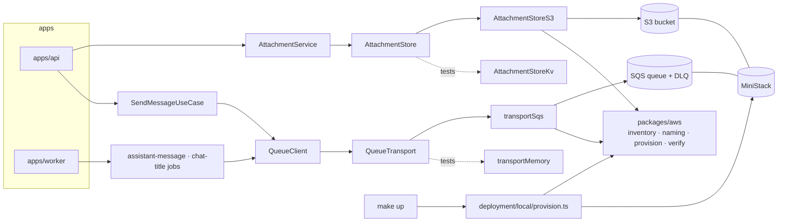

# AWS local — architecture

> Ticket: `2026-10-19_aws-local` · Requirements: [feature.md](./feature.md)

## Overview

Two ports change adapters and one package appears:

- **`QueueClient` is rebuilt over a five-call `QueueTransport`** shaped like SQS, with a memory and
  an SQS adapter. Retry, visibility heartbeat, attempt info and dead-lettering are written once
  above the transport, so a memory test under `TestClock` proves what SQS will do (D1–D3).
  `PersistedQueue` and SQLite leave the repository.
- **`AttachmentStore` gains an S3 adapter** that streams uploads, tags them `unbound`, presigns
  downloads and deletes objects; the KV adapter stays for tests (D6–D9).
- **`packages/aws`** holds the resource inventory, the naming rule, the provisioner and the
  startup check, read by the adapters, `make up`, the tests and later Pulumi (D4, D5).



## Structure

**`packages/aws`** (new workspace, follows `tooling.md › New workspace`)

```
+ packages/aws/naming.ts       buildResourceName, projectName (moved from deployment/shared/naming.ts)
+ packages/aws/resources.ts    the inventory: bucket `attachments`, queues `assistant-message`,
                               `chat-title`, each with `maxReceiveCount` and a `<name>-dlq`;
                               lifecycle rules                                          (D4)
+ packages/aws/provision.ts    provision(inventory, stage): idempotent create              (D5)
+ packages/aws/verify.ts       verify(inventory, stage): every resource exists and matches  (D5)
+ packages/aws/*.test.ts       on MiniStack
```

**`packages/queue`**

```
~ packages/queue/queue.ts            QueueClient over QueueTransport; send, worker unchanged   (D1)
+ packages/queue/queue.transport.ts  QueueTransport, transportMemory, transportSqs             (D1)
~ packages/queue/queue.test.ts       QueueClient suite on transportMemory under TestClock
+ packages/queue/queue.transport.test.ts   one contract suite: memory, MiniStack
- @effect/sql-sqlite-bun dependency, QueueClient.layerSqlite, QueueClientSqliteOptions
```

**`packages/config`**: `AwsConfig { region: AWS_REGION, endpoint: Option<URL> AWS_ENDPOINT_URL,
stage: STAGE }`; `QueueConfig` keeps `lockExpiration` and `lockRefreshInterval` (now the
visibility timeout and its heartbeat) and drops `QUEUE_SQLITE_PATH` (D10).

**`packages/testing`**: `+ ministack.ts`, a `MiniStack` layer that starts the pinned image with
`testcontainers` (`GenericContainer`, wait on `GET /_ministack/health`) under `acquireRelease`
and provides its endpoint; `+ stage.ts`, a fresh `test-<random>` stage per file (D12).

**`domain/attachment`**: `~ attachment.service.ts`, the new `AttachmentStore` shape (Contracts);
`+ unboundLifetime = Duration.hours(24)` and `isExpired(attachment, now)`, pure (D9).

**`infrastructure`**

```
+ infrastructure/shared/aws.ts               S3Service and SQSService layers from AwsConfig
                                             (forcePathStyle when an endpoint is set)  (D11)
~ infrastructure/shared/queue.client.ts      QueueClientSqs replaces QueueClientSqlite
+ infrastructure/attachment/attachment.storage.s3.ts   AttachmentStoreS3            (D6–D8)
~ infrastructure/attachment/attachment.storage.ts      AttachmentStoreKv on the new port
~ infrastructure/chat/chat.queue.ts          name and maxAttempts from the inventory     (D4)
+ infrastructure/shared/resources.test.ts       the inventory agreement test               (D4)
```

**`application/attachment`**: `upload` takes a `Stream`; `download` returns `{ attachment, url }`;
`bind` calls `store.keep` before the repository update; every read of an unbound attachment
applies `isExpired` (D9).

**`apps`**: `api` passes the multipart file stream to `upload` (replacing `chat-core` D8's
per-part buffer), answers `download` with `302` (replacing `chat-core` D10), and both `api` and
`worker` run `verify` before they serve or consume (R19).

**`deployment`**

```
~ deployment/local/docker-compose.yml   service `ministack`: ministackorg/ministack:1.5.29@sha256:88f5…,
                                        port 4566, healthcheck by python urllib, MINISTACK_REGION from
                                        AWS_REGION, state persisted under .data/ministack
+ deployment/local/provision.ts         reads AwsConfig, calls provision(inventory, stage)
- deployment/shared/naming.ts           moved to packages/aws; tags.ts imports projectName from there
~ deployment/CLAUDE.md, deployment/local/README.md   the stub notes go (R22)
```

**Root**: `Makefile` gains `up` (`docker compose up -d --wait`, then the provisioner), `down`,
and `reset` (`down`, then removes `.data/`, MiniStack's state included). Catalogs gain an `effect-aws` namespace
(`@effect-aws/client-s3`, `@effect-aws/client-sqs`, pinned at 2.0.0) and `testcontainers@12.2.1`
in `tools`. `.env.example` per R20. `docs/knowledge/aws.md` (new), linked from `architecture.md`.

## Contracts

```ts
// packages/queue/queue.transport.ts — the internal seam (D1)
interface Received { readonly handle: string; readonly body: string; readonly receiveCount: number }

interface QueueTransport {
  readonly send: (queue: string, body: string, attributes: { jobId: string }) => Effect<void, QueueError>
  /** Long-polls up to `wait`; a message received is invisible for `visibility`. A message received
   *  more than `maxReceiveCount` times is moved to `<queue>-dlq` instead of returned. */
  readonly receive: (queue: string, options: {
    visibility: Duration; wait: Duration; maxReceiveCount: number
  }) => Effect<Option<Received>, QueueError>
  /** Visible again after `visibility`: the heartbeat, a retry delay, or 0 to release at once. */
  readonly extend: (queue: string, handle: string, visibility: Duration) => Effect<void, QueueError>
  readonly delete: (queue: string, handle: string) => Effect<void, QueueError>
}
// transportSqs ignores maxReceiveCount: the queue's RedrivePolicy enforces it, and verify checks
// that it equals the inventory's.

// QueueClient — interface unchanged; layers:
QueueClient.layerMemory                                       // transportMemory
QueueClient.layerSqs({ queueName, lockExpiration, lockRefreshInterval }) // needs SQSService
//   queueName: (definition.name) => physical name; URL from GetQueueUrl, cached per queue (D5)

// consume, per message:
//   receive(visibility = lockExpiration) → decode body
//     decode fails      → log error, extend(0)           (redrive dead-letters it, D3)
//     run handler, heartbeat extend(lockExpiration) every lockRefreshInterval
//       success         → delete
//       failure, attempt < max → extend(retryDelay(retrySchedule, attempt))
//       failure, last   → log "dead-lettered", extend(0) (redrive, D3)
//       interrupt       → extend(0)                      (costs the attempt, D2)
//   attempt = receiveCount; isLastAttempt = receiveCount >= maxAttempts
```

```ts
// domain/attachment/attachment.service.ts (D6)
class AttachmentStore extends Context.Service<AttachmentStore, {
  /** Writes the bytes marked unbound; fails with the stream's error and leaves nothing behind. */
  readonly insert: <E>(id: AttachmentId, content: Stream<Uint8Array, E>,
    meta: { mediaType: MediaType; fileName: FileName }) => Effect<FileSize, E>
  readonly select: (id: AttachmentId) => Effect<Option<Uint8Array>>   // the worker's prompt
  /** A URL that serves the bytes with the stored media type and inline disposition. */
  readonly url: (id: AttachmentId) => Effect<URL>
  /** Clears the unbound mark, so lifecycle never collects it; idempotent. */
  readonly keep: (id: AttachmentId) => Effect<void>
  readonly delete: (id: AttachmentId) => Effect<void>                 // idempotent
}>() {}
// Store failures die, as in chat-core (the KV policy); only the stream's E is typed.
// AttachmentStoreS3: key `attachments/<id>`; Tagging `unbound=true`; ContentType;
//   ContentDisposition `inline; filename*=UTF-8''<percent-encoded>`; url = presigned GetObject,
//   expiresIn 300 s.
// AttachmentStoreKv: url = `data:<mediaType>;base64,…`; keep is a no-op.
```

```ts
// packages/aws/resources.ts (D4) — plain data, no Effect
export const resources = {
  buckets: { attachments: { lifecycle: { unboundExpirationDays: 1, abortIncompleteUploadDays: 1 } } },
  queues: {
    'assistant-message': { maxReceiveCount: 4 },
    'chat-title': { maxReceiveCount: 5 },
  },
} as const
// physical names: buildResourceName(stage, 'attachments') → app-template-<stage>-attachments;
//   queue `<name>` and its `<name>-dlq`.
// Lifecycle: two rules (MiniStack accepts a tag filter combined with AbortIncomplete…, AWS does not):
//   { Filter: { Tag: unbound=true }, Expiration: { Days } } and { Filter: { Prefix: '' },
//   AbortIncompleteMultipartUpload: { DaysAfterInitiation } }.
// RedrivePolicy JSON is built with a fixed key order: CreateQueue compares it as a string.
```

```
GET /attachments/:attachmentId/download
  302  Location: <presigned URL>     owner, not expired           (R3)
  404  AttachmentNotFound            unknown, not the owner's, or unbound and expired (R4, D9)
```

## Seams

| Seam | Catches | Misses |
|---|---|---|
| **1. `QueueClient` (`send`, `worker`) on `transportMemory` under `TestClock`** (`packages/queue/queue.test.ts`) | attempt numbers and `isLastAttempt`, retry delays from `retrySchedule`, the heartbeat keeping a long handler's job from a second consumer, dead-lettering after `maxAttempts`, decode failures, interrupts, a failing transport not ending the loop (R9–R14) | whether SQS behaves like the memory transport (seam 2) |
| **2. `QueueTransport` contract suite**, run on `transportMemory` and on `transportSqs` against MiniStack (`queue.transport.test.ts`) | the fake's fidelity: visibility, `receiveCount`, `extend(0)`, redrive to `<queue>-dlq` at the next receive, long-poll wait, attributes (R8, R10, R13) | real AWS differences from MiniStack (Risks) |
| **3. `AttachmentStore` contract suite**, run on `AttachmentStoreKv` and `AttachmentStoreS3` against MiniStack (`infrastructure/attachment`) | streamed insert and its size, nothing left after a failing or interrupted stream (no object, no multipart upload), `select`, `url` fetched with plain `fetch` returning the bytes and media type, `delete`; S3-only cases: two-part upload of 10 MB, `inline` disposition, the tag set by `insert` and cleared by `keep`, expiry `403` (R1–R3, R5, R6) | lifecycle execution (MiniStack never runs it), the 5 MiB part minimum (not enforced by MiniStack) |
| **4. `AttachmentService` on the memory adapters under `TestClock`** (`application/attachment`) | an unbound attachment refused and its record removed at 24 h, a bound one never; `keep` called before the bind; deletes reaching the store (R4, R5, R7) | S3 (seam 3) |
| **5. The api over `BunHttpServer.layerTest`** (`apps/api`) | `download` answers `302` with the store's URL for the owner and `404` without `Location` otherwise; upload limits still map to `413`/`415`/`400` with nothing stored when the file is streamed (R2–R4) | following the URL (seam 3) |
| **6. `provision` and `verify` against MiniStack** (`packages/aws`) | a second `provision` changes nothing; lifecycle and redrive read back as the inventory says; `verify` fails naming the endpoint and the resource when one is missing or its `maxReceiveCount` differs (R15, R16, R19) | IAM and real-account behaviour (ticket 9) |
| **7. The inventory agreement test** (`infrastructure/shared/resources.test.ts`) | every queue definition takes its name and `maxAttempts` from the inventory, every inventory queue has a definition, the bucket's expiration days cover `unboundLifetime` (R15, R17) | names built outside the inventory by hand (review; `git grep` in R20's check) |

`make dev` against MiniStack (R18) is checked by hand, as `chat-core`'s two-process run is.

## Decisions

- **D1 — `QueueClient` is built once over a five-call `QueueTransport`; `PersistedQueue` goes.**
  The transport has SQS's shape (`send`, `receive` with visibility and long-poll, `extend`,
  `delete`, redrive on receive), so the memory adapter has the same semantics as production and
  the logic above it (decode, heartbeat, attempt info, retry delay, dead-lettering, logs) exists
  once. The retry delay replays `retrySchedule` with `Schedule.toStep`, as effect's unexported
  `PersistedQueue.retryDelay` does, without a clock. Ticket 9's Lambda edge reuses the same
  per-message step. *Rejected:* an SQS `PersistedQueueStore` (the store contract promises
  dedupe and free interrupts that SQS cannot keep, so memory and production would differ under
  one interface); a second `QueueClient` implementation beside the `PersistedQueue` one (two
  copies of retry and attempt logic, still two semantics).
- **D2 — Delivery is at-least-once everywhere; an interrupt costs an attempt; `jobId` is an
  attribute.** `receiveCount` is the attempt, and a receive cannot be undone, so the memory
  transport counts the same way. `jobId` travels as a message attribute for logs; no layer
  deduplicates, and `QueueDefinition.jobId`'s doc says so. Handlers already skip a settled
  message or a titled chat (R9). A process restart costs the job in hand one of its 4 or 5
  attempts. *Rejected:* FIFO queues (dedupe for 5 minutes only, ordering not needed); a dedupe
  table (needs a database: ticket 4).
- **D3 — Redrive is the only way to the dead-letter queue.** A last failed attempt, a message
  that does not decode, and a crash during the last attempt all end the same way: `extend(0)` or
  an expired visibility, then the next receive finds `receiveCount > maxReceiveCount` and moves
  the message without returning it. `assistant-message` keeps its extra settling attempt
  (`replyAttempts + 1`), now justified by redrive instead of the SQL store's lock expiry.
  *Rejected:* `SendMessage` to the DLQ then `DeleteMessage` (two calls, not atomic: a crash
  between them duplicates or loses the message, and a decode failure needs no faster path).
- **D4 — The inventory is plain data in `packages/aws`, and queue definitions read it.**
  `infrastructure` and the apps may not import `deployment`, so a `deployment/shared/` inventory
  could not name the resources the code uses. Definitions take `name` and `maxAttempts` from
  `resources.queues`, so code and inventory cannot drift on those; the agreement test (seam 7)
  covers what construction cannot. The package is this project's data, which `packages/CLAUDE.md`
  notes. *Amends feature R15* (location) *and R17* (the check is the agreement
  test plus `verify`, not a separate scan). *Rejected:* `deployment/shared/` (unreachable from the
  layers); names in `.env` (the drift R17 exists to prevent).
- **D5 — Physical names come from `STAGE`; queue URLs are resolved and cached at first use;
  `verify` runs at startup.** `buildResourceName(stage, name)` gives `app-template-<stage>-…`;
  tests use `test-<random>` per file, dev `local`. `verify` checks every bucket and queue of the
  inventory and each queue's `maxReceiveCount`, and fails naming the endpoint and the resource
  (R19). `provision` is idempotent: `BucketAlreadyOwnedByYou` is success, and the redrive JSON has
  a fixed key order because CreateQueue compares attributes as strings. *Rejected:* queue URLs
  from configuration (one variable per queue, and stale after a reprovision).
- **D6 — `AttachmentStore` streams in, hands out a URL, and stays a domain port with two
  adapters; there is no `packages/storage`.** The S3 adapter is deep: the upload sink, abort on
  failure, tagging, presigning and headers live behind five calls. The KV adapter's `data:` URL
  serves the bytes and media type through `fetch` too, so one contract suite holds both honestly.
  *Rejected:* a generic blob package (one real user: a hypothetical seam); presigning in
  `application` (puts S3 into the service); an api route that serves bytes when the store has no
  URL (two download paths).
- **D7 — The upload sink is our own: one `PutObject` up to 5 MiB, otherwise multipart in 5 MiB
  parts, aborted on failure or interrupt.** With the 10 MiB cap that is at most two parts. *Your
  OK pending (round 3, C2).* *Rejected:* `MultipartUpload.uploadObject` from `@effect-aws/s3@1.0.0`
  (unverified on `effect@4.0.5`, README still on `@effect/platform`); buffering the whole file
  (breaks R1).
- **D8 — Media type and `inline` disposition are written on the object at upload; the URL is
  signed without overrides.** Downloads then need nothing from the request, and the URL is shorter.
  *Rejected:* `ResponseContentType` / `ResponseContentDisposition` presign overrides (work, but
  repeat at every download what the object already knows).
- **D9 — Unbound bytes expire by an S3 lifecycle rule on the `unbound` tag; unbound records expire
  in `AttachmentService`.** `insert` tags the object, `keep` clears the tag before the bind is
  written (a crash between leaves an orphaned object, never a bound attachment without bytes). A
  record unbound for `unboundLifetime` (24 h) reads as not found and is deleted when met; S3's
  1-day rule acts no earlier, so nothing bindable loses its bytes. A second rule aborts multipart
  uploads left by a crash. A sweep of untouched records waits for SQL in ticket 4: `KeyValueStore`
  cannot list. MiniStack stores lifecycle rules but never runs them, so locally the rules are
  checked by reading them back, and the deletion itself only on AWS (ticket 9). *Your OK pending
  (round 3, C1).* *Amends feature R7 and its acceptance.* *Rejected:* a sweeper job (needs a time
  index, and SQS delays stop at 15 min); copying to a `bound/` prefix at bind (up to 10 MB copied
  per attachment); a local byte sweeper (lists and reads tags of every object to imitate S3).
- **D10 — Credentials come from the SDK's default provider chain, not from `Config`.** On Lambda
  or ECS that is the role, whose session token rotates; locally `.env` holds
  `AWS_ACCESS_KEY_ID="test"` and `AWS_SECRET_ACCESS_KEY="test"`, which MiniStack accepts. Only our
  settings (`AWS_REGION`, `AWS_ENDPOINT_URL`, `STAGE`) pass through `@app-template/config`.
  *Amends feature R20.* *Rejected:* credentials as `Config.Redacted` (freezes a rotating token and
  duplicates the SDK's chain).
- **D11 — With an endpoint set, S3 uses path-style addressing, and presigned URLs carry that
  endpoint's host.** The host is part of the signature, so the browser must reach the same host
  the api signs with: true in dev (`localhost:4566`, api on the host) and on AWS. Virtual-host
  style works on MiniStack only for `<bucket>.localhost`. *Rejected:* rewriting the URL host after
  signing (invalidates the signature: `403`).
- **D12 — AWS tests start one MiniStack container per test file and provision a fresh stage.**
  `testcontainers@12.2.1` runs on Bun 1.4.3 (the hangs are fixed, and the project runs a Bun smoke
  test); MiniStack starts in under 2 s; those files raise the hook timeout to 60 s. Unique names
  isolate parallel files without resets. *Rejected:* one container per run in `globalSetup`
  (Docker in every run, even a filtered one, and shared state between files); `POST
  /_ministack/reset` between tests (serialises the files).

## Risks

| Risk | Mitigation |
|---|---|
| MiniStack differs from AWS: it never runs lifecycle rules, does not enforce the 5 MiB part minimum, compares `RedrivePolicy` as a string, and answers a repeated `CreateBucket` by region | D7 fixes the part size in one constant with an S3-adapter test at the boundary; D5's fixed key order and `BucketAlreadyOwnedByYou` handling; ticket 9 adds a smoke run on real AWS, where lifecycle deletion is checked |
| An S3 error outside `@effect-aws`'s tagged list (`EntityTooSmall`, `InvalidPart`) arrives as a bare `SdkError` | store failures die (D6), so the cause is logged whole; no branch depends on those codes |
| The api later runs inside Docker and signs with `http://ministack:4566`, which the browser cannot reach (D11) | out of scope here; ticket 9 or a compose-run api adds a presign-only S3 layer on the public endpoint |
| Restarts and deploys spend attempts (D2) | 4 and 5 attempts; the heartbeat keeps long handlers alive; `assistant-message` keeps its settling attempt |
| The memory transport drifts from SQS | seam 2 runs one suite on both |
| An expired unbound record that is never touched stays in the dev store | dev only (the store is `.data/`, reset by `make reset`); ticket 4 sweeps with SQL |
| A crash between `keep` and the bind leaves an untagged, unbound object forever | costs storage only; ticket 4's sweep can list orphans by key against the table |
| `make test` and CI now need Docker | CI's `ubuntu-latest` has Docker 28; `docs/knowledge/aws.md` says so; non-AWS files run without it when filtered |
| The enqueue-after-insert gap of `chat-core` remains (a job lost if `send` fails after the write) | inherited, owned by ticket 4's outbox, which publishes through the SQS layer |
| `@effect-aws/*` 2.0.0 is a young line over `@aws-sdk` 3.1152 | pinned exactly in its own catalog namespace; seams 2, 3 and 6 run its calls against MiniStack |
