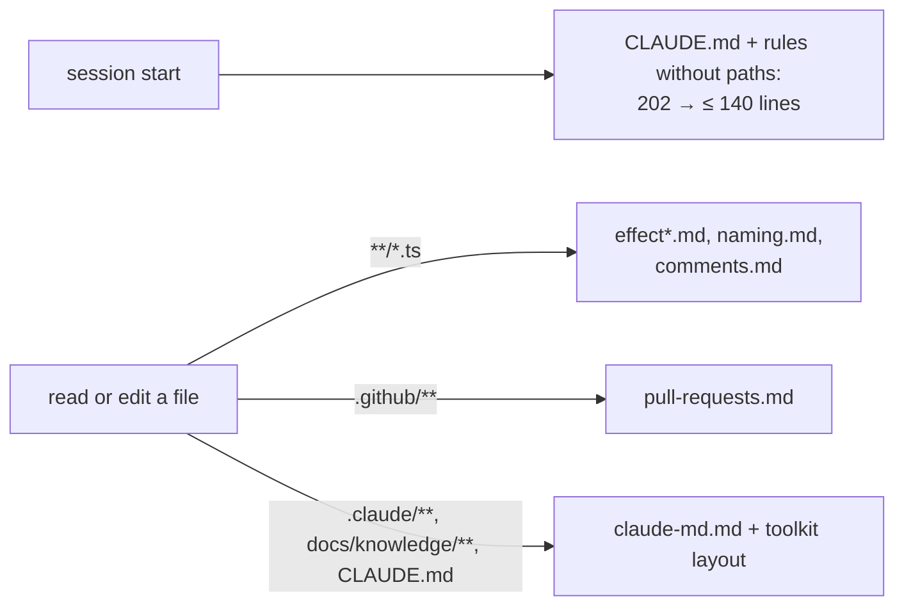

# Claude toolkit — architecture

> Ticket: `2026-10-20_claude-toolkit` · Requirements: [feature.md](./feature.md)

## Overview

No product code changes and no new module. The ticket edits one existing shell check
(`make-check.sh`), the rules' frontmatter and bodies (what loads when), two skill and agent
lines, and the roadmap. Every change is observable from the files themselves or by running the
hook by hand.

## Structure

| File | Change | Req |
|---|---|---|
| `.claude/hooks/make-check.sh` | `cd` failure exits 2 with a message | R1 |
| `.claude/skills/ticket-verify/SKILL.md`, `.claude/agents/verifier.md` | fixed point `git merge-base HEAD origin/main` | R2 |
| `.claude/rules/pull-requests.md` | gains `paths: [".github/**"]` | R3 |
| `.claude/rules/sdd.md` | *Toolkit layout* removed; the two *Artifacts* bullets `CLAUDE.md` already states removed | R3 |
| `.claude/rules/claude-md.md` | six condensed toolkit lines; `docs/**` → `docs/knowledge/**` | R3, R4 |
| `.claude/rules/tooling.md` | the lines `settings.json`, `.gitignore` and the knowledge doc already own are cut | R3 |
| `packages/CLAUDE.md` | the new-workspace pointer goes to `docs/knowledge/tooling.md` | R3 |
| `docs/knowledge/roadmap.md` | entries 2, 3, 12 (landed with `feature.md`) | R5 |

## Contracts

**`make-check.sh`.** Unchanged input (the `Stop` JSON on stdin) and outputs; the one new path:
`cd` fails → a message on stderr naming the directory, exit 2.

**Rule frontmatter.** `paths:` lists only. The code rules keep `**/*.ts`; `claude-md.md` lists
`**/CLAUDE.md`, `.claude/**` and `docs/knowledge/**`, so a ticket artifact under `docs/tickets/`
matches none of them.

**Always-loaded budget.** Root `CLAUDE.md` plus every rule without `paths:` is at most 140 lines.

## Seams

| Seam | Catches | Misses |
|---|---|---|
| `sh .claude/hooks/make-check.sh < stop.json` with `CLAUDE_PROJECT_DIR` | the exit code and message on a missing directory, and on a green and a red tree | whether Claude Code acts on exit 2: one real `/ticket-implement` run shows it |
| the rule files themselves (`grep`, `wc -l`) | the budget, the `paths:` lists, the moved and cut lines | what a session loads: `/context` in a fresh session, by hand, once |
| `git grep` over `.claude/` | a bare `main` fixed point | a skill that computes the base some third way |

## Decisions

- **D1 — The code rules keep `**/*.ts`; only `claude-md.md` narrows, from `docs/**` to
  `docs/knowledge/**`.** Editing a ticket artifact then loads no `claude-md.md`, and the rules a
  library read pulls in are the ones almost every session loads anyway. *Rejected:* enumerating
  the workspace directories (`{domain,…,deployment}/**/*.ts`), tried and reverted within this
  ticket: the workspace-local `node_modules` symlinks still matched it and `paths:` has no
  negation, almost every session touches a workspace `.ts` file anyway, and it cost a list
  repeated 9 times plus an *Add a workspace* step for every new top-level directory. Also
  rejected: a `claudeMdExcludes` setting, which excludes `CLAUDE.md` files, not rules.
- **D2 — The toolkit-layout constraints move to `claude-md.md`, condensed, rather than being
  deleted or kept in `sdd.md`.** They bind only when `.claude/` is edited, which is what
  `claude-md.md`'s `paths:` already express; the one with a recorded violation (the dependency
  map, `template-bootstrap` Spec c1) stays verbatim. *Rejected:* a third rule file for the
  toolkit, one more always-loaded description of where things live.
- **D3 — `pull-requests.md` loads for `.github/**` only, with no pointer in `CLAUDE.md`.** The
  two readers are `/ticket-verify` step 4, which names the file, and an edit of the PR template.
  *Rejected:* a pointer line in `CLAUDE.md`, paid in every session for a once-per-ticket event;
  folding the rule into the skill, which would make `commits.md` and the skill two authors of the
  PR body format.

## Risks

| Risk | Mitigation |
|---|---|
| A rule's YAML breaks while editing `paths:` and the rule loads unconditionally without an error | the verification runs `claude --debug` once over `.claude/rules/*.md` |
| The 140-line budget is met by cutting a line that did change behaviour | every cut names its owner (`settings.json › deny`, `.gitignore`, `docs/knowledge/tooling.md`) in the step's findings |
| A rule moved behind `paths:` is needed by a session that never touches a matching file | `pull-requests.md` is read by name from `/ticket-verify`; the toolkit lines are needed only when `.claude/` is edited, which matches |
