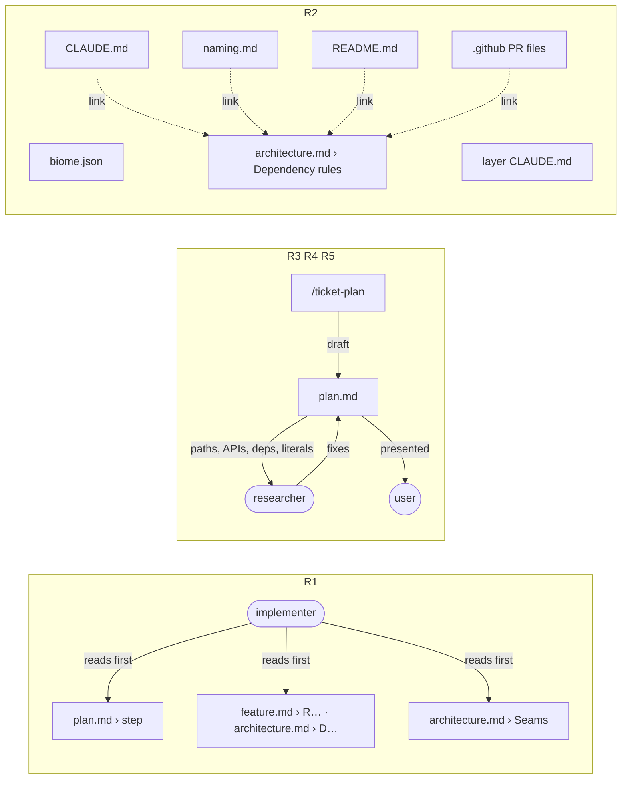

# Toolkit reading — architecture

> Ticket: `2026-10-21-1347_toolkit-reading` · Requirements: [feature.md](./feature.md)

## Overview

Three text changes to the toolkit, no product code. `implementer` gains a reading discipline;
`/ticket-plan` gains a check step that spawns `researcher` once before the plan is presented; the
import direction keeps three authors (Biome, `docs/knowledge/architecture.md`, each layer's
`CLAUDE.md`) and every other mention becomes a link.

## Structure

| File | Change | Req |
|---|---|---|
| `.claude/agents/implementer.md` | a **Read the step** discipline | R1 |
| `.claude/skills/ticket-plan/SKILL.md` | a **Check** step between writing the plan and presenting it | R3, R4 |
| `docs/knowledge/sdd.md` | `/ticket-plan` row of the dependency map lists `researcher`; the diagram gains `plan --> researcher` | R5 |
| `CLAUDE.md` | the chain becomes one pointer line | R2 |
| `.claude/rules/naming.md` | *Across workspaces* keeps the `@app-template/<workspace>[/<entity>]` form and a link; the chain and the `packages/*` sentence go | R2 |
| `README.md` | *Layers import only downwards* links instead of listing the chain | R2 |
| `.github/PULL_REQUEST_TEMPLATE.md`, `.github/PULL_REQUEST_example.md` | the two import checkboxes become one that links | R2 |
| `docs/knowledge/roadmap.md` | entry 14 linked (landed with `feature.md`) | R6 |

Untouched: `reviewer.md`, `ticket-implement`, the `plan.md` template, the layer `CLAUDE.md` files,
`biome.json`, `docs/knowledge/architecture.md`, `docs/knowledge/tooling.md`.

## Contracts

**`implementer` › Read the step** (sketch):

> Read the step, not the ticket: the step in `plan.md`, the `R…` in `feature.md` and the `D…` in
> `architecture.md` it cites, and the Seam its *Test first* names, located with `grep -n` and read
> with offset and limit. Open the rest of the ticket when the step touches a contract or decision
> those parts do not quote.

**`/ticket-plan` › Check** (sketch). After the plan is written, spawn `researcher` once with two
lists:

| List | Each item | `researcher` returns |
|---|---|---|
| **Exists** | an existing file path, API, flag or dependency a step names (paths the plan creates are left out) | `confirmed` or `wrong`, with evidence and the correct value |
| **Conforms** | a literal a step fixes (a name, signature, path or message), with the workspace it lands in | `conforms` or the rule line (`path:line`) it breaks, in `.claude/rules/*.md` or that workspace's `CLAUDE.md` |

Every `wrong` and every broken rule is fixed in `plan.md` before step 5 presents the plan. The
report stays in the conversation; `plan.md` records no check.

**Pointer line** (root `CLAUDE.md`; `naming.md` and `README.md` in their own words):

> Imports follow [docs/knowledge/architecture.md › Dependency rules](…#dependency-rules); Biome
> enforces them.

## Seams

The change is text read by agents, so the Seams are checks over the tree; there is no test code.

| Seam | Catches | Misses |
|---|---|---|
| `git grep` over `.claude/agents/implementer.md` and `.claude/skills/ticket-implement/` | the rule is present and nothing asks for whole-file reads | whether the agent follows it (the replay was dropped) |
| `git grep -nE 'application.{1,8}infrastructure.{1,8}domain\|apps.{1,8}http-api' -- ':!docs/tickets' ':!repos'` | the chain restated anywhere but `architecture.md` | a restatement in other words, such as "domain imports no workspace" |
| `.claude/skills/ticket-plan/SKILL.md`, read in order | the check comes after writing and before presenting, with both lists | how well `researcher` checks |
| `docs/knowledge/sdd.md › Dependency map` | the row and the diagram name `researcher` for `/ticket-plan` | other prose about `/ticket-plan` drifting |
| `make check` | ticket ids in parentheses outside `docs/tickets/`, Biome on the touched files | Markdown content: Biome does not read `.md` |

## Decisions

- **D1 — One `researcher` call checks both paths and literals (R3, R4).** Its brief carries the
  **Exists** and **Conforms** lists. A fresh context judges literals the main session wrote; in
  `chat-core` the main session kept `AuthLive` in the plan against a rule already in `naming.md`
  until S13. *Rejected:* the main session checks the literals while writing the plan, the context
  that produced them; two `researcher` calls, which double the briefing for one pass over the plan.
- **D2 — "Open the rest" stays a judgement, with no record (R1).** The agent reads beyond the step
  when it needs to, and its report says nothing about it. *Rejected:* a named trigger (a file that
  `architecture.md › Structure` describes), which almost every step meets; a *Read beyond the
  step* line in the report, which the user declined as bookkeeping nobody asked for.
- **D3 — Root `CLAUDE.md` keeps a pointer line, not the chain (R2).** The main session plans
  before Biome runs, so it needs to know where the matrix lives; it does not need the matrix.
  *Rejected:* correcting the chain in place ("`apps/api` and `apps/web` → `http-api`"), which
  keeps a second author that drifts at the next new layer, as it already did for `worker`;
  deleting the line, which leaves the always-loaded set with no route to the rules.
- **D4 — The check leaves no trace in `plan.md` (R3, R4).** Errors are fixed before the user sees
  the plan, and the report stays in the conversation, as for every `researcher` answer
  (`docs/knowledge/sdd.md › What the wrappers override`). *Rejected:* a *Checked by researcher*
  line per plan, evidence no later reader uses, paid in every plan.

## Risks

| Risk | Mitigation |
|---|---|
| `implementer` misses a constraint stated outside its step, and amendments grow | the rule keeps "open the rest" when the step touches an unquoted contract; `/ticket-verify` Lessons catch a recurrence |
| A large plan (chat-core: 22 steps) overflows one `researcher` call | the brief lists items, not prose; `researcher` reports `Unverified` for what it could not reach, and the main session checks those by hand |
| A literal breaks a rule that lands mid-ticket (three of the four `chat-core` cases) | not covered: the `git grep` lesson was dropped; the Standards review still catches it per step |
| `reviewer` loads the edited `naming.md` and loses the chain it used to read there | `reviewer.md` already reads `docs/knowledge/architecture.md` from disk for the layers |
