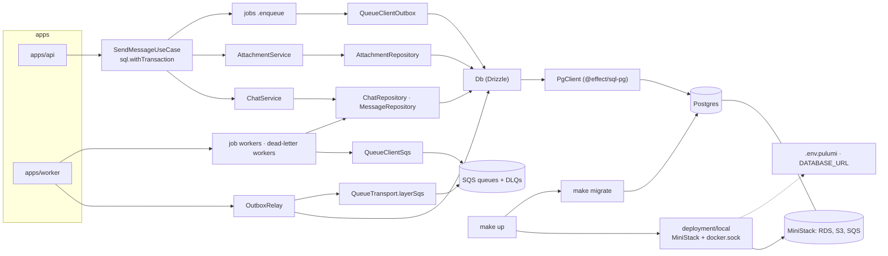

# Postgres and Drizzle — architecture

> Ticket: `2026-10-22-1915_postgres-drizzle` · Requirements: [feature.md](./feature.md)

## Overview

Four ports change adapters, one port gains a second implementation, and the local stand gains a
database:

- **The repositories move to Postgres** through Drizzle's Effect integration over
  `@effect/sql-pg`. Each aggregate declares its tables once, in `<entity>.entity.ts`, with the
  constraints that hold its invariants; the row codecs are derived from the tables by
  `drizzle-orm/effect-schema` and refined with the domain's own schemas, so no mapping function
  is written by hand. Reads that span aggregates run as one relational query behind a read
  method of the port (D1, D2, D6, D9).
- **A send is one transaction.** `SqlClient.withTransaction` wraps the use case; the
  repositories join it through the Effect context. Jobs are written to an `outbox` table by a
  second `QueueClient`, `QueueClientOutbox`, and a relay in the worker publishes them to SQS
  (D3, D4).
- **The database guards replace `UserLock`.** A partial unique index allows one active
  assistant message per chat; conditional single-statement writes (`ON CONFLICT DO NOTHING`,
  `WHERE message_id IS NULL`, `WHERE stage = $from`, `WHERE title IS NULL`) return whether they
  applied, and the application raises the domain error (D5).
- **Stuck replies** are settled by a consumer of the assistant message's dead-letter queue (D8).
- **Locally the database is an RDS instance on MiniStack**, created by `@pulumi/aws` in the one
  Pulumi program of `deployment/local`, beside the bucket and the queues; **tests** share one Postgres container per run and take a
  database each from a migrated template (D10, D11).
- **Drizzle's source is vendored** in `repos/drizzle`, as Effect's is (D14).



## Structure

**Catalogs and vendoring** (`package.json`, `Makefile`)

```
+ catalogs.drizzle     drizzle-orm 1.0.0-rc.5, drizzle-kit 1.0.0-rc.5 (one release train)   (D14, D16)
~ catalogs.effect      + @effect/sql-pg 4.0.5
~ catalogs.runtime     + @testcontainers/postgresql 12.2.1
~ catalogs.pulumi      + @pulumi/aws 7.51.1
+ repos/drizzle        git subtree of drizzle-team/drizzle-orm at v<catalogs.drizzle.drizzle-orm>  (D14)
+ make vendor-drizzle  the subtree pull (add on the first run), beside vendor-effect
+ make migrate         bun --env-file=.env --env-file=.env.pulumi infrastructure/db/migrate.ts; retries while
                       the database refuses connections                                          (D13)
+ make migration       NAME=<name>: cd infrastructure && bunx drizzle-kit generate --name $(NAME)
+ make migration-check generate (stdin closed), fail and remove if a new folder appeared; soft locally, strict in CI  (D13)
~ make up · down · reset   one program on deployment/local, .env.pulumi, migrate; down and reset through Docker  (D11)
~ make check           + migration-check
~ .github/workflows/ci.yml   static job + make migration-check                                  (D13)
- STORE_PATH, .data/store    from .env.example, tooling.md, the Makefile comment on reset
+ RDS_BASE_PORT, OUTBOX_POLL_INTERVAL   in .env.example; DATABASE_URL in .env.pulumi (gitignored, the apps'
                       second --env-file)
~ vitest.config.ts     globalSetup: infrastructure/db/testing/postgres.setup.ts               (D10)
```

**`domain`**

```
~ domain/chat/chat.model.ts     + MessageDetail, ChatSummary, ChatDetail (moved from application) (D6)
~ domain/chat/chat.service.ts   ChatRepository, MessageRepository: Contracts › Ports             (D5, D6)
~ domain/attachment/attachment.service.ts   AttachmentRepository.bind replaces update          (D5)
~ domain/user/user.model.ts     + secretHashPattern, read by SecretHash and the credentials check
~ domain/chat/chat.service.ts   SendableChat doc: holds inside the send's transaction, the index is the backstop
```

**`infrastructure`**

```
+ infrastructure/db/db.client.ts        Db (Context.Service over EffectPgDatabase), Db.layer (needs PgClient;
                                        provides the Debug EffectLogger and EffectCache.Default),
                                        Db.layerFromConfig over PgClientFromConfig (DatabaseConfig → PgClient.layer);
                                        layerFromConfig also publishes PgClient, so SqlClient.withTransaction
                                        runs on Db's connection, see D3; isSqlError; unwrapQueryError (a Drizzle
                                        query error's own SqlError, a defect if it wraps anything else);
                                        orDieWithSqlError (catchIf on the query error, then Effect.orDie), the last
                                        pipeable of every Postgres repository method                       (D1, D3, D12)
+ infrastructure/db/columns.ts          fresh builders: id() (uuid pk DEFAULT uuidv7()), createdAt() (timestamptz, no default); updatedAt() with its first table  (D9)
+ infrastructure/db/relations.ts        defineRelations over every .entity.ts table                          (D6)
+ infrastructure/db/migrate.ts          the migrate program: DatabaseConfig → PgClient → migrate(db, …), failing with
                                        the SqlError (unwrapQueryError); the CLI runs through BunRuntime.runMain and
                                        retryWhileUnreachable (ConnectionError or cannot_connect_now only)  (D13)
+ infrastructure/db/migrations/         drizzle-kit output, committed
+ infrastructure/db/testing/postgres.setup.ts   vitest globalSetup: container, template, provide           (D10)
+ infrastructure/testing/db-test.ts     DbTest: Db over PgClientTest, publishes PgClient for transactions   (D3, D10)
+ infrastructure/testing/{rows,repository-stacks}.ts   rows written directly; every repository on each store
+ infrastructure/drizzle.config.ts      dialect, schema glob ./*/*.entity.ts, out ./db/migrations; no credentials
+ infrastructure/user/user.entity.ts    users, credentials; UserRow, UserInsert codecs (the credential row needs none)  (D2)
+ infrastructure/chat/chat.entity.ts    chats, the title check, its index; ChatRow, ChatInsert
+ infrastructure/chat/message.entity.ts messages, the enums, the partial unique index, checks; MessageRow, MessageInsert
                                        (one entity file per entity, as the folder's repositories are split)
+ infrastructure/attachment/attachment.entity.ts   attachments; codecs
+ infrastructure/outbox/outbox.entity.ts   outbox
+ infrastructure/outbox/outbox.relay.ts    OutboxRelay, a worker layer                                      (D4)
~ infrastructure/user/user.repository.ts        UserRepositoryPg
~ infrastructure/chat/chat.repository.ts        ChatRepositoryPg (relational reads, touch, updateTitle)
~ infrastructure/chat/message.repository.ts     MessageRepositoryPg (insert → boolean, update from)
~ infrastructure/attachment/attachment.repository.ts   AttachmentRepositoryPg (bind)
~ infrastructure/*/index.ts             UserPg, ChatPg, AttachmentPgS3 (replacing *Kv; no bundle keeps AttachmentStoreKv)
~ infrastructure/shared/queue.client.ts   + QueueClientOutbox                                               (D4)
~ infrastructure/chat/chat.queue.ts     + assistantMessageDeadLetterQueue, chatTitleDeadLetterQueue         (D8)
~ infrastructure/package.json           + drizzle-orm, @effect/sql-pg; devDependencies + drizzle-kit, @testcontainers/postgresql
- infrastructure/kv/                    kv-collection, kv-store and their tests
```

**`application`**

```
~ application/chat/chat.service.ts              no UserLock; list → selectSummaries, get → selectDetail,
                                                 rename → update, delete → chats.delete, touch → chats.touch,
                                                 addAssistantMessage: insert false → ChatBusyError          (D5, D6)
~ application/chat/send-message.use-case.ts     Effect.fn(…, sql.withTransaction); bind(userId, ids, messageId) (D3)
~ application/chat/delete-chat.use-case.ts      no lock; attachments, then the chat (the cascade does the messages)
~ application/attachment/attachment.service.ts  bind replaces findBindable + bind; BindableAttachments goes (D5)
~ application/chat/assistant-message.job.ts     update(message, { from }); + deadLetterWorker (failReply)   (D8)
~ application/chat/chat-title.job.ts            updateTitle(id, title); + deadLetterWorker (log)
- application/chat/touch-chat.ts                replaced by ChatRepository.touch
- application/user/user-lock.ts
~ application/testing/chat.harness.ts           services on ChatPg · AttachmentPgS3 · QueueClientOutbox over PgClientTest + MiniStack;
                                                 reads the outbox table in place of recordQueue
~ application/testing/chat.fake.ts              interleaveMessages and AttachmentRepositoryYielding go (real concurrency now);
                                                 keeps one MessageRepository wrapper that fails the assistant insert (the rollback case)
```

**`packages`**

```
~ packages/config/config.ts     + DatabaseConfig { url: Redacted } from DATABASE_URL;
                                QueueConfig + outboxPollInterval (OUTBOX_POLL_INTERVAL, default 1 s);
                                - StoreConfig; + MiniStackConfig { rdsBasePort } from RDS_BASE_PORT          (D11, D15)
~ packages/config/ministack.ts  ministackImage → MiniStack 1.5.31 by digest
+ packages/config/postgres.ts   postgresImage: postgres:18.6-alpine by digest (tests)
+ packages/testing/postgres.ts  setupTemplateDatabase (the setup's half); PgClientTest: a fresh database
                               per test from the template, PgClient on it; PgClientUnauthenticated: a PgClient
                               with a wrong password, for the failed-connection tests                    (D10)
+ packages/testing/postgres.test.ts  a test's database is gone from pg_database once its scope closes   (D10)
~ packages/testing/package.json  + @effect/sql-pg
```

**`apps`**

```
~ apps/api/src/layer.ts         UserPg, ChatPg, AttachmentPgS3; QueueClientOutbox; Db.layerFromConfig
~ apps/worker/src/layer.ts      ChatPg, AttachmentPgS3; QueueClientSqs; OutboxRelay; the four workers; Db.layerFromConfig
~ apps/api/src/testing/api.harness.ts   ApiHttp over PgClientTest and QueueClientOutbox
```

**`deployment`**

```
~ deployment/local/index.ts       the program: MiniStack, the provider on it, the database, the bucket, the queues;
                                  exports DATABASE_URL, built from the instance's endpoint                    (D11)
~ deployment/local/Pulumi.yaml    main: index.ts
+ deployment/local/settings.ts    the one Effect: AwsConfig and MiniStackConfig; the fixed local credentials
- deployment/Pulumi.yaml          the nodejs stub
~ deployment/local/ministack.ts   + /var/run/docker.sock, MINISTACK_RDS_PUBLIC_ENDPOINT=1, RDS_PERSIST=1, RDS_BASE_PORT
- deployment/local/provision.ts   the bucket and the queues come from the program; provision stays for the tests
+ deployment/aws/provider.ts      aws.Provider: endpoint set → endpoints: [{ rds, s3, sqs }], the three skip flags,
                                  s3UsePathStyle; unset → defaults (ticket 9)
~ deployment/aws/database.ts      createDatabase(provider, settings): aws.rds.Instance, identifier
                                  buildResourceName(stage, 'database'), postgres 18, db.t4g.micro,
                                  allocatedStorage = maxAllocatedStorage = 20, user, password and dbName from its
                                  settings, skipFinalSnapshot, publiclyAccessible; returns the instance
~ deployment/aws/storage.ts, queue.ts   createStorage(provider, stage), createQueues(provider, stage): the
                                  inventory's bucket with its lifecycle rule, the queues with their dead-letter
                                  queues and RedrivePolicy
~ deployment/aws/index.ts         exports the create functions
~ deployment/package.json         + @pulumi/aws
```

**Docs and rules**

```
+ docs/knowledge/database.md     schema and entity files, codecs, the transaction and the outbox, the guards,
                                 migrations, the local database, tests, Debug logging
~ docs/knowledge/architecture.md  table row for infrastructure/db, "Where things live" (+ .entity, + .relay),
                                 "Add a new entity" step 5 on Postgres, Seams; links database.md
~ docs/knowledge/aws.md          The local stand-in: one program, the socket, RDS_BASE_PORT, VCR_MODE, the targets
~ docs/knowledge/tooling.md      targets, catalogs, worktree ports (+ RDS_BASE_PORT, STAGE), .env and .env.pulumi, vendor-drizzle, tests
~ .claude/rules/naming.md        .entity, .relay roles; <Entity>Pg bundles; the harness line (no memory store)
~ .claude/rules/effect.md        Drizzle APIs checked against repos/drizzle/drizzle-orm/src
~ .claude/rules/use-cases.md     Concurrency: the transaction and the database guards replace the lock lines
~ infrastructure/CLAUDE.md       the KV placeholder line → Db and .entity
```

## Contracts

### Tables (`snake_case` in the database, declared with `snakeCase.table`)

```
users        id uuid pk default uuidv7() · created_at timestamptz
credentials  hash text pk check (~ secretHashPattern) · kind credential_kind ('secret') · user_id → users on delete cascade
chats        id · user_id → users · title text null check (trimmed, 1..maxTitleLength) · created_at · updated_at
             index (user_id, updated_at desc)
messages     id · chat_id → chats on delete cascade · author message_author · stage message_stage ·
             text text · error jsonb null · created_at · updated_at
             index (chat_id, created_at)
             unique index messages_chat_id_active_index (chat_id)
               where author = 'assistant' and stage in ('queued', 'preparing', 'generating')
attachments  id · user_id → users · message_id uuid null → messages (restrict) · file_name text check (non-empty) ·
             media_type text check (~* mediaTypePattern) · size integer check (>= 0) · created_at
             index (message_id, created_at, id)
outbox       id uuid pk default uuidv7() · queue text · job_id text · body text · created_at
             index (created_at)
```

Enums come from the domain literals (`pgEnum('message_stage', MessageStage.literals)`); the
checks read the same constants as the brands (`maxTitleLength`, `secretHashPattern.source`, which
drizzle-kit inlines into the DDL). `created_at` and `updated_at` have no default: the domain
writes them (D9). `attachments.message_id` is the only link between a message and its
attachments, which read in upload order, `created_at` then `id` (D17).

### Codecs (per `.entity.ts`, from `drizzle-orm/effect-schema`)

```ts
export const ChatRow = createSelectSchema(chats, {
  id: ChatId,
  userId: UserId,
  title: Schema.OptionFromNullOr(ChatTitle),
  createdAt: Schema.DateTimeUtcFromDate,
  updatedAt: Schema.DateTimeUtcFromDate,
})
export const ChatInsert = createInsertSchema(chats, { /* the same overrides */ })
// read:  decode(row) → new Chat(fields)     write: encode(chat) → db.insert(chats).values(row)
```

`error` on `messages` is `Schema.OptionFromNullOr(MessageFailure)` (the derived `jsonb` schema
loses `$type`, so the override is what types it). Relational reads decode each nested row with
the same codecs. `Message.attachmentIds` has no column: until S12 drops it from the domain, the
reader fills it from the message's attachments.

### Ports (domain, `Context.Service`, no layer; changes only)

```ts
ChatRepository {
  insert(chat): void
  update(chat): void                                   // rename: title and updatedAt
  touch(id, at): void                                  // updated_at only
  updateTitle(id, title): boolean                      // writes only while untitled; false: titled meanwhile
  selectById(id): Option<Chat>
  selectSummaries(userId): ReadonlyArray<ChatSummary>   // most recently updated first, with the active message
  selectDetail(id): Option<ChatDetail>                  // messages in creation order, each with its attachments
  delete(id): void                                      // the messages go by the cascade
}
MessageRepository {
  insert(message): boolean      // false: the chat already has an active message (the partial index)
  update(message, { from: MessageStage }): boolean   // false: the stored stage is not `from`
  selectById(id): Option<Message>
  selectByChat(chatId): ReadonlyArray<Message>       // the job's history
  selectActiveByChat(chatId): Option<ActiveMessage>
}
AttachmentRepository {
  insert · selectById · deleteByIds                     // unchanged
  selectByIds                                          // goes in S12, with Message.attachmentIds
  bind(ids, messageId): ReadonlyArray<Attachment>      // the ones bound now: WHERE message_id IS NULL
}
UserRepository                                         // unchanged; insert writes two tables in one transaction
```

Ports keep no error channel: a conditional write answers with a value, and the application
raises `ChatBusyError`, `AttachmentBoundError` or skips (D5). `selectByUser`, `deleteByChat`,
`AttachmentRepository.update` and the read models in `application` go.

### The send (use case)

```ts
const send = Effect.fn('SendMessageUseCase.send')(function* (userId, chatId, input) {
  const sendable = yield* chatService.findSendable(userId, chatId, input)
  const userMessage = yield* chatService.addUserMessage(sendable)
  const bound = yield* attachmentService.bind(userId, input.attachmentIds, userMessage.id)
  const assistantMessage = yield* chatService.addAssistantMessage(sendable)   // insert false → ChatBusyError
  yield* chatService.touch(sendable)
  yield* assistantJob.enqueue(assistantMessage)                               // an outbox row
  if (sendable.opensChat) yield* titleJob.enqueue(userMessage)
  return …
}, sql.withTransaction)
```

`attachmentService.bind` selects the ids, checks each with `ensureBindable` (not found, foreign,
expired, bound), runs the conditional update and raises `AttachmentBoundError` for an id the
update skipped (a concurrent bind).

### Outbox and relay

- `QueueClientOutbox.send(definition, message)`: `encodeBody` as the SQS client does, then
  `insert into outbox (queue, job_id, body)`; it joins the caller's transaction. `consume` dies:
  the api never consumes.
- `OutboxRelay` (worker layer, `Effect.forkScoped` under `Layer.effectDiscard`): in a
  transaction, `select … order by created_at, id limit 10 for update skip locked`; for each row
  `QueueTransport.send(buildResourceName(stage, queue), { body, attributes: { jobId } })`, then
  `delete`; commit. An empty batch sleeps `outboxPollInterval`; a full one polls again at once.
  A failed send fails the transaction: the rows stay and the next poll retries; the loop
  restarts on any cause with the queue consumers' `consumerRestart` schedule.
- Delivery is at-least-once: a crash between the SQS send and the commit republishes; the
  handlers are idempotent (`aws-local` R9).

### Dead-letter consumers

```ts
assistantMessageDeadLetterQueue = { name: buildDeadLetterName(assistantMessage.name), schema: GenerateAssistantMessage,
  maxAttempts: Number.MAX_SAFE_INTEGER, retryDelay: capped doubling (max 5 min), jobId }
AssistantMessageJob.deadLetterWorker = worker(assistantMessageDeadLetterQueue, failDeadLettered)
  // failDeadLettered: selectById → if active: failMessage(ReplyFailed, cause 'dead-lettered after N attempts')
  //                   → update(failed, { from: active.stage }) → touch; else log 'already settled' / 'chat deleted'
ChatTitleJob.deadLetterWorker = worker(chatTitleDeadLetterQueue, log 'chat title dead-lettered')
```

A dead-letter queue has no redrive, so a handler failure must never spend a "last attempt":
`maxAttempts` is unreachable and the retry delay is capped.

### Configuration

| Service | Variable | Default |
|---|---|---|
| `DatabaseConfig.url` (`Redacted`) | `DATABASE_URL` | — (written to `.env.pulumi` by `make up`; not in `.env.example`) |
| `QueueConfig.outboxPollInterval` | `OUTBOX_POLL_INTERVAL` | `1 second` |

`PgClientFromConfig = Layer.unwrap(Effect.map(DatabaseConfig, ({ url }) => PgClient.layer({ url })))`.
The worktree table gains `RDS_BASE_PORT` (`15432 + 10N`) and `STAGE` (`local<N>`).

### The local stand (D11)

| Target | Does |
|---|---|
| `make up` | `pulumi refresh` of the MiniStack container alone, once it is in the state → `pulumi up` on `deployment/local` with `VCR_MODE=REPLAY_ONLY` (MiniStack with the socket and the RDS variables; through the provider on it, the RDS instance, the bucket with its lifecycle rule, the queues with their dead-letter queues) → `pulumi stack output --shell > .env.pulumi` → `make migrate`, which retries while the respawned database refuses connections |
| `make down` | `docker stop` of the MiniStack container: MiniStack saves its state and removes the instance's container, whose volume keeps the data; the next `up` recreates the MiniStack container (the refresh sees it stopped), MiniStack recreates the instance's container from the volume on the same port, and every other resource is unchanged |
| `make reset` | `docker rm -f` of the MiniStack container and of the instance's container (labels `ministack=rds`, `db_id=<identifier>`) → `docker volume rm` of the instance's volume (`ministack-rds-<hash of account and region>-instance-<identifier>-data`, kept by `DeleteDBInstance`) → `rm -rf .data .env.pulumi`; `.data` holds the Pulumi state; no `pulumi destroy` |

The identifier is `app-template-<STAGE>-database` and MiniStack names the instance's container
and volume by it, so each worktree sets its own `STAGE` (`local<N>`) and `RDS_BASE_PORT`
(`15432 + 10N`) beside its ports. The apps read `DATABASE_URL` from `.env.pulumi`, loaded as a
second `--env-file` after `.env`; the bucket's and queues' names need no output, since the apps
build them with `buildResourceName` as the program does.

### Tests (D10)

- `postgres.setup.ts` (`globalSetup`): `new PostgreSqlContainer(postgresImage).start()`, then
  `setupTemplateDatabase` from `@app-template/testing`, given the same program as `make migrate`:
  create the `template` database, migrate it (`setupTemplateDatabase`'s TSDoc states what the template
  needs before the first copy), `ALTER DATABASE … is_template`,
  `provide('databaseUrl', <admin url>)`; the container stops on teardown and when the template
  fails. Every name of the protocol (the template, the key, the `test_` prefix) lives in
  `@app-template/testing`.
- `PgClientTest` (`@app-template/testing`): `inject('databaseUrl')`, `CREATE DATABASE test_<random>
  TEMPLATE template`, `PgClient.layer({ url })` for it; the scope's release drops the database
  `WITH (FORCE)`. Each test provides its stack over it (`Effect.provide`, usually through
  `DbTest`), about 40 ms for the create, the connection and the drop.
- `recordQueue` stays in `packages/queue/testing` for suites with no database; the harnesses read
  `outbox` rows instead.

## Seams

| Seam | Catches | Misses |
|---|---|---|
| 1 `domain/*` schemas and pure rules (unchanged) | input and binding rules, stage transitions, read-model shapes | persistence |
| 2 `infrastructure/db` on `PgClientTest`: `migrate`, `Db.layer`, the codecs of every `.entity.ts`; the test-database protocol of `@app-template/testing` | migrations apply to an empty database and are a no-op the second time; each test runs on a fresh database, so a table one test writes is absent from the next, and the database is dropped once the test ends; a row encodes and decodes back to an equal model (`Option`, `DateTime.Utc`, brands, `jsonb` error); a relational query nests a message's attachments in upload order; the active predicate renders as literals; SQL logged at `Debug` with `query` and `params`, nothing at `Info`; `make migrate`'s retry repeats while the database refuses connections, stops after its bound, and gives up at once on a refused password | drift between entities and the committed migrations (Seam 9) |
| 3 repositories through their ports on `PgClientTest` (one suite per port) | field mapping, `selectSummaries` order and active message, `selectDetail` nesting and order, `insert` false on an active message, `update` false on a stale `from`, `bind` partial result, `updateTitle` false when titled, `touch` keeps the title, the cascade from `chats.delete`, `RESTRICT` on a bound attachment, the check constraints reject what the brands reject | cross-process timing |
| 4 `QueueClientOutbox` and `OutboxRelay` on `PgClientTest` + MiniStack | a `send` inside a failed transaction leaves no row; a row is published to its queue with its `jobId` and deleted; two relays over one database publish each row once; a failing transport keeps the row; the poll interval under `TestClock` | SQS outages longer than a test |
| 5 services and use cases on `ChatPg`, `AttachmentPgS3` over MiniStack, `QueueClientOutbox`, `TestCrypto` | a send writes two messages, the binds, the touch and one or two outbox rows in one transaction, and nothing on a failing step; two concurrent sends to one chat → one `ChatBusyError`; two concurrent binds of one attachment → one `AttachmentBoundError`; rename beside a send keeps both; delete cascade and the attachments' removal; `addAssistantMessage` alone is refused on a busy chat | HTTP statuses |
| 6 jobs with the fake `LanguageModel` on Postgres under `TestClock` | the stage sequence through `update(…, { from })`; a message settled by another writer stops the job with `already settled`; the dead-letter handler fails an active message with `ReplyFailed` and a dead-letter cause, leaves a terminal one, logs for a deleted chat; the title dead-letter handler only logs; `updateTitle` skips a titled chat | a real provider |
| 7 `apps/api` through `BunHttpServer.layerTest` + `ApiClient` on `PgClientTest` | the wire unchanged (`/openapi.json` equal to `main`'s), `202` with outbox rows, `409` on a busy chat across two concurrent requests | the worker, the relay |
| 8 `apps/worker` layer build on `PgClientTest` + MiniStack (`layer.test.ts`) | the relay, the four workers and the Db compose and start | live SQS timing |
| 9 `make migration-check` (local in `make check`; strict in CI on a fresh checkout) | an entity change without a committed migration (CI), or without any migration in the tree (local); a changed domain literal or pattern that an enum or check reads | a migration edited by hand; locally, a migration not yet committed |
| 10 by hand (acceptance R16–R18): `make up`, `down`, `reset`, worktree `N=1` | the instance, the bucket and the queues created by Pulumi, `DATABASE_URL` in `.env.pulumi`, persistence across `down`, the volume on `reset`, two trees side by side | the prod stack (ticket 9) |

## Decisions

- **D1 — Drizzle over `@effect/sql-pg`, reached only through Effect.** `PgDrizzle.make()` runs on
  the `PgClient` service; queries are Effects, transactions are `SqlClient.withTransaction`,
  errors are `SqlError` with a typed `reason`, logging is an `EffectLogger` service. Nothing in
  the code awaits a Drizzle promise. *Rejected:* `@effect/sql` alone with `sql` templates and
  `SqlResolver` (hand-written SQL per query, no typed tables, no migrations tool); Drizzle's own
  `pg` driver (a second connection pool beside Effect's, and no shared transaction).
- **D2 — The table is the one declaration; the codecs are derived.** `createSelectSchema` and
  `createInsertSchema` with a refine of the columns that carry a domain type (ids, `DateTime`,
  `Option`, `jsonb`) give the row codecs, and only for a table whose columns differ from the
  model's fields; a row whose values are already the domain's (brands, literals) is written as is,
  as `credentials` is from the credential and the user. The repository decodes to the model's fields and encodes
  the model to a row, with no mapping function. The domain stays the source of truth: its
  `Schema.Class` models, literals and brands are unchanged and the enums and checks read its
  constants. *Rejected:* `$type` and `customType` columns with hand-built models (a mapping
  function per entity, and `Option` still by hand); a hand-written `Schema.Struct` per row (the
  table twice); deriving the domain from the tables (the domain would import Drizzle).
- **D3 — The transaction is `SqlClient.withTransaction` as the use case's pipeable.** It stands
  where `userLock.withPermit` stood; every repository call inside joins it through the
  `TransactionConnection` service that `@effect/sql` puts in the fiber context, and a nested
  one is a savepoint. One `PgClient` per process, since the service is keyed by client. *Rejected:*
  a domain `Transaction` port with one adapter (a seam nothing varies across);
  `db.transaction((tx) => …)` (the `tx` parameter is the same mechanism with a second name).
- **D4 — The outbox is a `QueueClient`, the relay is a worker layer, a published row is
  deleted.** `QueueClientOutbox.send` inserts the encoded job, so the jobs and the use case do not
  change and the insert joins the send's transaction by D3. The relay in the worker takes rows
  with `FOR UPDATE SKIP LOCKED`, sends each to SQS through `QueueTransport` and deletes it in the
  same transaction; delivery is at-least-once and the handlers are idempotent. *Rejected:* an
  eager publish from the api after commit with the relay as a backstop (two paths, systematic
  duplicates); a `sent_at` mark (a second table to sweep); a domain `Outbox` port written beside
  `enqueue` (two concepts, every job changed); `LISTEN`/`NOTIFY` to wake the relay (a polling
  interval of a second is enough and needs no second connection).
- **D5 — Guards are single statements that answer with a value; `UserLock` goes.** The partial
  unique index holds "one active message per chat"; `insert` uses `ON CONFLICT (chat_id) WHERE
  <active> DO NOTHING RETURNING id` and answers `false`; `update(…, { from })`, `bind` (`WHERE
  message_id IS NULL`), `updateTitle` (`WHERE title IS NULL`) and `touch` (`updated_at` only) are
  each one `UPDATE` whose row count is the answer. The application raises the domain error, so
  ports keep no error channel, and the "re-read before write" pattern (`touchChat`, the title
  job's second read) disappears. Two api processes are safe without any shared lock. *Rejected:*
  catching `UniqueViolation` by constraint name in the adapter (a port with a domain error); `SERIALIZABLE` isolation (retries on every
  conflict, including unrelated ones); advisory locks (a lock again, now in the database).
- **D6 — Read models live in the domain; the adapter answers them with relational queries.**
  `MessageDetail`, `ChatSummary` and `ChatDetail` move to `domain/chat`; `ChatRepository` gains
  `selectSummaries` and `selectDetail`, which `ChatRepositoryPg` runs as one `db.query` each over
  the relations declared once in `infrastructure/db/relations.ts`. The service becomes one port
  call, and the port stays the seam. Every repository read is a relational query, not only the
  read models (amended in S5): `findFirst` emits the limit, nested rows arrive inside their
  parent, and a reader meets one shape; writes stay on the core builder, which `db.query` lacks.
  *Rejected:* composing the detail in the service from three port reads (N+1 reads, the shapes in
  the wrong layer); exposing `db.query` to the service (the adapter leaks); single-table reads on
  the core builder with `.limit(1)` (two read styles side by side; a join that nests rows needs
  hand-written grouping).
- **D7 — The cascade is the database's.** `messages.chat_id` cascades, `attachments.message_id`
  restricts, so `ChatService.delete` is one `delete` and a wrong order (a chat before its
  attachments) fails instead of leaving rows. The use case still removes the attachments first,
  since their bytes in S3 are outside the transaction. *Rejected:* explicit deletes per aggregate
  with the "retry finishes the cascade" ordering (three statements, and no guard against the
  wrong order).
- **D8 — Stuck replies are settled by a consumer of the dead-letter queue, defined as a queue
  with no last attempt.** Every path that leaves a reply active ends with its job in
  `assistant-message-dlq` (`aws-local`), so a `worker()` over a definition for that queue closes
  them with the same `failReply` the job uses, guarded by `update(…, { from })`. The definition's
  `maxAttempts` is unreachable and its delay capped, because a dead-letter queue has no redrive.
  The title dead-letter consumer only logs. *Rejected:* a time-based sweep of active messages (it
  cannot tell a dead reply from a backlog); a dead-letter queue for the dead-letter queue.
- **D9 — Time and ids come from the domain; the database defaults are fallbacks.** Columns carry
  no `DEFAULT now()`, no `$onUpdate`; `id` keeps `DEFAULT uuidv7()` for hand-written SQL. The
  driver returns `timestamptz` as a `Date` at millisecond precision, which is the precision the
  domain writes. *Rejected:* `$onUpdate` (a second clock, divergent from `TestClock`);
  `mode: 'string'` columns with a string codec (microseconds the domain never produces).
- **D10 — Tests share one Postgres per run, and each test takes a fresh database from a migrated
  template.** A test sees only the rows it wrote, also through readers of a whole table (the
  relay, the dead-letter consumers, later reports), at about 40 ms per test (create, connect,
  drop; the container starts once in about 1.2 s). The `globalSetup` lives in
  `infrastructure/db/testing` because it runs the migrator; the protocol and the per-test layer
  live in `@app-template/testing` because every workspace's tests use them and they need only
  `@effect/sql-pg`; `setupTemplateDatabase`'s TSDoc states what the template needs before its
  first copy. MiniStack keeps its container per file.
  *Rejected:* a database per file with rows scoped by owner (breaks on whole-table readers, and
  the boundary rests on discipline); `TRUNCATE` between tests (a table list to maintain, skipped
  when a test crashes, longer with every table); a rolled-back transaction per test (turns the
  real transactions and the concurrency tests into savepoints, and hides uncommitted rows from a
  second connection); a container per file (2 s plus migrations per file); PGlite (a second
  driver and database type, the production path untested); `withReuse()` (a container that
  outlives `make test`).
- **D11 — The local stand is one Pulumi program: MiniStack, and inside it the RDS instance, the
  bucket and the queues.** `deployment/local` runs the MiniStack container and, through an
  `aws.Provider` on its endpoint, creates every resource of the inventory and the database; the
  resource code in `deployment/aws` takes the provider, so ticket 9's prod stack reuses it. The
  database's URL is a stack output written to `.env.pulumi`, so MiniStack's choice of port needs
  no check of our own. The provider's fixed waits (RDS 60 s then three polls 10 s apart; a queue
  25 s; a lifecycle rule 55 s; in terraform-provider-aws, which `@pulumi/aws` 7.51.1 embeds) are
  dropped locally by `VCR_MODE=REPLAY_ONLY`, a switch of the provider's own test harness: a cold
  `make up` takes 8 s instead of 87 s, and a release that drops it makes `make up` slow, never
  wrong. `make down` is `docker stop`, since Pulumi cannot destroy the container without its
  dependents; `make up` refreshes the container alone first, and never `up --refresh`, which
  drops the bucket from the state while MiniStack is down. The tests keep Testcontainers and
  `provision` (D10): Pulumi there costs its CLI start per stack. *Rejected:* a plain Postgres
  container beside MiniStack (built in S3.2; the user wants every resource inside MiniStack and
  created by Pulumi); two projects, `local` for MiniStack and `aws` for the instance (built in
  S3.1; needed only while `make down` destroyed a stack); `provision.ts` for `make up` (a second
  engine); a static `DATABASE_URL` with a port check (`check-database.ts` in S3.1); a Pulumi
  stack per test file (56–85 s of provider waits per stack, measured); Effect around the
  program's resources (they are synchronous `pulumi.Output`s; one module reads the config).
- **D12 — SQL is logged at `Debug` by our own `EffectLogger` layer.** Drizzle's `EffectLogger.layer`
  logs with `Effect.log()`, that is at `Info`, which would print every statement in production.
  *Rejected:* Drizzle's layer gated by `LOG_LEVEL` in the composition root (two places decide one
  thing).
- **D13 — Migrations are drizzle-kit SQL applied by Drizzle's Effect migrator, never by the apps.**
  `make migration NAME=…` generates with no database, `make migrate` applies through an Effect
  program on `DatabaseConfig`, the test setup applies the same way, and `make migration-check`
  fails when an entity changed without a migration. It runs twice: in `make check` it counts
  every folder in the tree, committed or not, so a step that adds a migration stays green before
  its commit; CI runs it on a fresh checkout, which holds only committed migrations, so there an
  entity changed without a committed migration fails the build. *Rejected:* Effect's
  `PgMigrator` (loads `.ts` modules, so each SQL file needs a wrapper and a second ledger);
  `drizzle-kit push` or `migrate` (reads credentials outside `@app-template/config`); failing
  `make check` on uncommitted files under `infrastructure/db/migrations` (every step that adds a
  migration would be red at the gate, which runs before the commit). *Amended in S2.*
- **D14 — Drizzle's source is a subtree in `repos/drizzle`, pinned to the catalog.** Agents check
  APIs against `repos/drizzle/drizzle-orm/src`, as `effect.md` has them do for Effect; the rc line
  changes between releases and the docs lag. The subtree is the whole monorepo (kit, zod,
  integration tests), since `git subtree` takes no subfolder. *Rejected:* `node_modules` `.d.ts`
  only (no implementation to read, and `drizzle-orm/effect-postgres` is thinly documented).
- **D15 — One `DATABASE_URL`, read as `Redacted` by `DatabaseConfig`.** The Pulumi program builds
  it from the instance's endpoint and the fixed local credentials, and `make up` writes it to
  `.env.pulumi`, so the database is named once. *Amended in S3:* the URL derives from the
  instance, not the instance from a URL in `.env`.
  *Rejected:* host, port, user, password, name as five variables (five places to keep in step
  with the instance).
- **D16 — `drizzle-orm` and `drizzle-kit` share the `drizzle` catalog namespace.** `drizzle-kit`
  peers `drizzle-orm >=1.0.0-rc.5`: one release train, bumped together. *Rejected:* `drizzle-kit`
  in `tools` (it shapes the migrations, and lags the orm by hours).

- **D17 — A message's attachments hang off one foreign key and read in upload order.**
  `attachments.message_id` is the only link; `messages` keeps no `attachment_ids` array, and a
  message's attachments read by `created_at`, then `id`, which the `(message_id, created_at, id)`
  index serves. A send of `[C, A]` after uploading A, B, C reads back `[A, C]`.
  `Message.attachmentIds` stays in the domain until S12, filled by the reader. *Rejected:* the
  array beside the key (a copy of the bind that Postgres cannot check, since a foreign key cannot
  cover array elements); a `position` column the bind fills (keeps the send's order, at the cost
  of a column only the send uses); the array alone (no `RESTRICT`, no index).
- **D18 — A relational read states the active message as an object filter.**
  `selectActiveByChat` filters `{ chatId, author: 'assistant', stage: { in:
  ActiveMessageStage.literals } }`; `activeMessage` stays the partial index's predicate and the
  one an `ON CONFLICT … WHERE` takes. Both read their stages from the same domain literals, and a
  shared case with a user message in an active stage guards the author. The read may not use the
  partial index once a prepared statement turns generic; it falls back to the
  `(chat_id, created_at)` index, enough for one chat. *Rejected:* `activeMessage` in the relational
  `where` (it names `"messages"`, while the query aliases the table as `d0`); a
  `RAW: (table) => …` callback over a shared `activeMessageOf(table)` (one condition, but raw SQL
  in a read, chosen against for readability); a join on the core builder (rows per attachment,
  grouped by hand).

## Risks

| Risk | Mitigation |
|---|---|
| `drizzle-orm@1.0.0-rc.*` moves between rcs (`EffectDrizzleQueryError.cause` is typed `unknown`, `defineRelations` is the rc relations API) | pinned exactly; every API checked in `repos/drizzle` at the step that uses it; `unwrapQueryError` reads `cause` once, in `db.client.ts`, and dies if it is not a `SqlError` |
| `defineRelations` and the relational `db.query` on the Effect driver are read from source, not run | S4 ran `findMany({ with: { … orderBy } })` live (chats with messages, messages with attachments); S5 runs every repository read on it: `where` with `in` and a relation filter (`exists`), `findFirst`'s limit; if one fails, `selectDetail` is a join query behind the same port |
| `ON CONFLICT (chat_id) WHERE <predicate>` must match the partial index's predicate exactly, or Postgres finds no arbiter; a prepared statement switches to a generic plan after five runs, which cannot prove a predicate from bound parameters | the predicate is one `sql` constant, `activeMessage`, rendered with `.inlineParams()` and used by both the index and the insert; a test checks the rendered query binds only the chat id; Seam 3 inserts two active messages |
| A relational query aliases its tables (`d0`, `d1`), while `activeMessage` names `"messages"` | `activeMessage` serves the index and `ON CONFLICT` only; a relational read states the active message as an object filter (D18, since S5) |
| A transaction that holds the `FOR UPDATE SKIP LOCKED` rows while SQS is slow blocks nothing but delays the batch | batch of 10, the transport's own timeout; a failed send fails the batch and the rows stay |
| The relay republishes after a crash between send and commit | at-least-once as before; handlers skip settled replies and titled chats |
| A dead-letter handler that keeps failing loops every 5 minutes forever | logged each attempt; `OUTBOX`-style sweeps are out of scope; ticket 8 makes it visible |
| MiniStack's port counter moves if the instance is re-created without a reset | the port is a stack output, so `.env.pulumi` follows it |
| MiniStack reports `available` when the host port is taken by another container | each worktree has its own `RDS_BASE_PORT`; `make migrate` fails on a wrong database at once |
| MiniStack writes its state only on a graceful stop | `make down` is `docker stop` with MiniStack's stop timeout; `make reset` removes the instance's volume |
| Two worktrees share the host's Docker, and MiniStack names the RDS container by account, region and identifier | each worktree sets its own `STAGE`, which the identifier carries, and its own `RDS_BASE_PORT` |
| The named volume survives `destroy` and resurrects data under the same identifier (and skips `initdb`, so a changed password would not apply) | `make reset` removes the volume; the local password is a constant in `deployment/local/settings.ts`, and changing it needs `make reset` |
| `VCR_MODE` is a test switch of terraform-provider-aws, not a documented setting | local stack only; without it `make up` waits ~87 s from a clean state, nothing breaks |
| After `make down`, `make up` changes nothing in Pulumi but the MiniStack container while MiniStack respawns the database in the background, so `make migrate` can connect before it listens | `make migrate` retries on `ConnectionError` or `cannot_connect_now` only, within a bound |
| `pulumi up --refresh` while MiniStack is stopped drops the bucket from the state | `make up` refreshes the container alone, then runs a plain `up` |
| `CREATE DATABASE … TEMPLATE` fails while the setup's pool is open | `setupTemplateDatabase`'s TSDoc states the condition; Seam 2 covers a first copy |
| `provide`/`inject` typing (`ProvidedContext` augmentation) under the patched `tsc` was not checked | S1 adds the augmentation in `packages/testing` and `make typecheck` decides |
| The Drizzle monorepo is large (size unknown; the clone was denied) | S1 measures `du -sh repos/drizzle`; above several times `repos/effect`, the user decides |
| The `skipLibCheck: false` path fails on Drizzle's `.d.ts` under `exactOptionalPropertyTypes` | `tsconfig.base.json` keeps `skipLibCheck: true`, as today |
| Application tests on a real database are slower than on memory | a database per test costs ~40 ms (create, connect, drop; measured in S1); the container starts once in ~1.2 s; `make test` stays under Docker as it is |

## To verify during implementation

- `defineRelations` and `db.query.<table>.findMany({ with, where, orderBy, limit })` on
  `drizzle-orm/effect-postgres` rc.5, and the shape of nested rows for the codecs (S4): `with`
  and a nested `orderBy` verified in S4, nested rows decode with the entity codecs; `where`
  (object, `in`, relation filter) and `findFirst`'s limit verified in S5.
- `onConflictDoNothing({ target, where })` on the partial index through Drizzle, or `sql` for
  that one insert (S7).
- `createSelectSchema` with a refine of `jsonb` to `Schema.OptionFromNullOr(MessageFailure)`
  (S4): verified.
- `PgClient.layer({ url })` from a `Redacted` (S1) and the Debug `EffectLogger` annotations in
  the output of `make dev-api` (S6).
- `make down` then `make up` with the bucket and queues in the stack (S3): verified; the
  MiniStack container is recreated, the other 10 resources are unchanged, and the port and a
  hand-inserted row survive.
