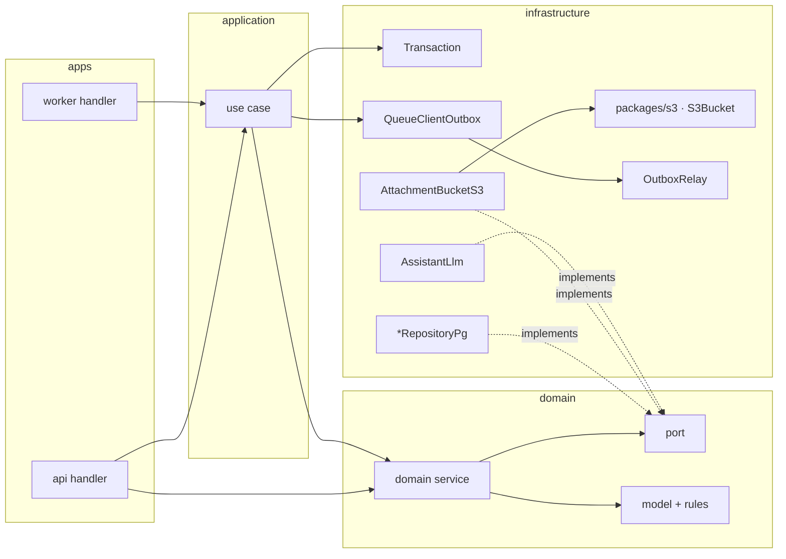

# Architecture audit — architecture

> Ticket: `2026-10-27-1433_architecture-audit` · Requirements: [feature.md](./feature.md)

## Overview

One model for every flow: a handler (api route or worker queue) calls one domain service method,
or one use case when the flow composes several services, a transaction, the queue or the bucket.
Domain services own the rules and are the only writers of their records; they see ports, the
clock and `Crypto`. Adapters implement the ports in `infrastructure`; `packages/s3` gains the
generic `S3Bucket` the attachment bucket runs on. Tests split by what they need: unit tests in
`tests/` over memory layers of the ports, e2e tests in `e2e/` over containers the run starts for
itself, and one journey in a root `e2e/` workspace that drives both app layers in one process.



The read path keeps today's shape (`db.query.*` relational queries behind the ports); the write
path changes hands: `application` writes nothing itself, and the worker's two `.job` files
become two handlers in `apps/worker` over two use cases.

## Structure

Per workspace; **new** marks a file that does not exist today, *gone* one that is removed.
Every `tests/` and `e2e/` file mirrors the source path; test support lives only in a `testing/`.

### `domain`

| File | Holds |
|---|---|
| `chat/chat.model.ts` | `Chat`, `ChatSummary`, `ChatDetail`, `ChatTitle`, `buildChat`, `buildChatTitle` (from `chat.llm.ts`) |
| `chat/message.model.ts` **new** | `Message`, `MessageDetail`, `MessageStage`, `ActiveMessage`, `MessageFailure`, `MessageInput`, the builders, `isActiveMessage`, `ensureMessageInput`, the transitions `prepareMessage` … `failMessage` |
| `chat/message.error.ts` **new** | `MessageNotFoundError`, `MessageInputInvalidError`, `MessageStageInvalidError`, `MessageMovedError` |
| `chat/chat.port.ts` **new** | `ChatRepository`, `ChatSet`, `ChatWhere`, `ChatOneWhere` |
| `chat/message.port.ts` **new** | `MessageRepository`, `MessageWhere`, `MessageOneWhere` |
| `chat/assistant.port.ts` **new** | `Assistant`, `AssistantTurn` |
| `chat/chat.service.ts` | `ChatService` (domain), `SendableChat` |
| `chat/message.service.ts` **new** | `MessageService` |
| `attachment/attachment.port.ts` **new** | `AttachmentRepository`, `AttachmentBucket`, `AttachmentSet`, `AttachmentWhere`, `AttachmentOneWhere` |
| `attachment/attachment.model.ts` | model, `buildAttachment`, `unboundLifetime`, `isExpiredAt`, `ensureUnbound` |
| `attachment/attachment.service.ts` | `AttachmentService` (domain) |
| `user/user.port.ts` **new** · `user/user.service.ts` | `UserRepository` · `UserService` (domain), `UserSecret` |
| `shared/` *gone* | `ensureFound` and the `./shared` export |
| `testing/` **new** | `chat.test-fixture.ts`, `user.test-fixture.ts`, `attachment.test-fixture.ts` (from `application/testing`); `chat.test-fake.ts`: `ChatRepositoryTest`, `MessageRepositoryTest`; `attachment.test-fake.ts`: `AttachmentRepositoryTest`, `AttachmentBucketTest`; `user.test-fake.ts`: `UserRepositoryTest`; `assistant.test-fake.ts`: `recordAssistant(script)`, `holdAssistantCall()`; `index.ts` |
| `tests/` **new** | `chat/chat.model.test.ts`, `chat/message.model.test.ts`, `chat/chat.service.test.ts`, `chat/message.service.test.ts`, `attachment/…`, `user/…` |
| `package.json` | `exports["./testing"]`; `@effect/platform-bun` in `devDependencies` (`BunCrypto.layer` in tests) |

`chat/message-stage.model.ts` **new** holds only the stage schemas, `MessageStage` and
`ActiveMessageStage`, which `message.model.ts` and `message.error.ts` both import. When a
`.model.ts` outgrows one screen of rules, the rules move with the value they act on; `.model`
stays the one suffix.

### `http-api`

Unchanged: it imports the barrels, and the bundle guard proves the services and ports it now
sits beside never reach the browser.

### `infrastructure`

| File | Holds |
|---|---|
| `db/db.client.ts` | `Db`; **new** `Transaction` (`run`) with `Transaction.layer` over `SqlClient` |
| `db/columns.ts` | the column defaults; **new** `SetColumns`, `WhereColumns`, `buildSet`, `buildWhere` |
| `db/migrations/<n>_outbox_body_jsonb.sql` **new** | `ALTER TABLE outbox ALTER COLUMN body TYPE jsonb USING body::jsonb` |
| `db/testing/db.test-layer.ts` **new** | `DbTest`, `flipSqlError` (from `testing/db.test-layer.ts`) |
| `db/testing/transaction.test-fake.ts` **new** | `TransactionTest` (identity) |
| `db/testing/postgres.setup.ts` *gone* | replaced by `testing/e2e.test-setup.ts` |
| `chat/chat.repository.ts`, `chat/message.repository.ts`, `attachment/attachment.repository.ts`, `user/user.repository.ts` | `selectOne(where)`, the shared builders, no `unknown` |
| `chat/assistant.llm.ts` **new** · `chat/chat.llm.ts` *gone* | `AssistantLlm`: the prompts, `streamText`, `suggestTitle` over `LanguageModel` |
| `attachment/attachment.bucket.ts` | `AttachmentBucketS3` over `S3Bucket`: keys, headers, the domain mapping; under 80 lines |
| `shared/aws.client.ts` | `SQSServiceFromConfig`, `S3ServiceFromConfig`, **new** `S3BucketFromConfig` (bucket from `AwsConfig.stage`) |
| `shared/queue.client.ts` · `outbox/outbox.entity.ts` · `outbox/outbox.relay.ts` | `body` as `jsonb` (the job's encoded JSON value); the relay's loop as one pipeline; `OutboxRelay` requires `AwsConfig`, `OutboxRelaySqs` provides `AwsConfig.layer` |
| `testing/e2e.test-setup.ts` **new** | the e2e `globalSetup`: Postgres + migrated template, MiniStack; `provide('databaseUrl')`, `provide('awsEndpoint')` |
| `testing/aws.test-layer.ts` **new** | `AwsTest`: a stage per test, `provision(resources, stage)`, `AwsConfig` over `inject('awsEndpoint')`, with the SQS and S3 clients |
| `testing/rows.test-util.ts`, `testing/repository-stack.test-layer.ts` | as today |
| `tests/shared/resources.test.ts` | the only pure suite |
| `e2e/` **new** | `chat/chat.entity.e2e.ts`, `chat/message.entity.e2e.ts`, `chat/chat.repository.e2e.ts`, `chat/message.repository.e2e.ts`, `attachment/attachment.entity.e2e.ts`, `attachment/attachment.repository.e2e.ts`, `attachment/attachment.bucket.e2e.ts` **new**, `user/user.repository.e2e.ts`, `db/db.client.e2e.ts`, `db/migrate.e2e.ts`, `outbox/outbox.relay.e2e.ts`, `shared/queue.client.e2e.ts` |
| `package.json` | `exports["./testing"]` (one `index.ts` over `testing/` and `db/testing/`) |

### `packages`

| File | Holds |
|---|---|
| `s3/bucket.ts` **new** · `s3/index.ts` · `s3/package.json` | `S3Bucket`, `S3Bucket.layer({ bucket })` over `S3Service`; `e2e/bucket.e2e.ts` |
| `aws/provision.ts` | `provision(resources, stage)` creates the bucket too, idempotent like the queues; `provisionQueues(queues, stage)` alone needs no S3 client |
| `queue/e2e/queue.e2e.ts` | from `queue.test.ts`, on the run's MiniStack through `SqsClientTest` and `provisionQueues` under a stage of its own |
| `testing/aws.test-layer.ts` **new** · `testing/ministack.test-layer.ts` *gone* | `SqsClientTest`, `S3ClientTest` over `inject('awsEndpoint')`; `ProvidedContext` gains `awsEndpoint` |
| `testing/queue.test-fake.ts` **new** | `recordQueue()` → `{ sent, layer }`: a `QueueTransport` over a `Ref` |
| `testing/postgres.test-layer.ts` | `PgClientTest`, as today |

### `application`

| File | Holds |
|---|---|
| `chat/send-message.use-case.ts` | over `ChatService`, `MessageService`, `AttachmentService`, `QueueClient`, `Transaction` |
| `chat/delete-chat.use-case.ts` | over `ChatService`, `AttachmentService`, `Transaction` |
| `chat/generate-assistant-message.use-case.ts` **new** | `GenerateAssistantMessageUseCase`: `generate(job)`, `fail(messageId, cause)` |
| `chat/generate-chat-title.use-case.ts` **new** | `GenerateChatTitleUseCase`: `generate(job)` |
| `chat/chat.service.ts`, `chat/*.job.ts`, `attachment/attachment.service.ts`, `user/user.service.ts` *gone* | moved to `domain` or split into the use cases |
| `testing/chat.test-layer.ts` | `ChatTest`: the use cases over the memory layers, `TransactionTest`, `recordQueue()`; the arrange and read steps over the memory ports |
| `testing/db.test-layer.ts`, `testing/attachment.fake.ts`, `testing/language-model.test-fake.ts`, the fixtures *gone* | moved to `domain/testing` and `infrastructure/db/testing` |
| `tests/chat/*.use-case.test.ts` | one suite per use case |

### `apps` (no `src/`)

| File | Holds |
|---|---|
| `api/layer.ts`, `api/main.ts`, `api/<entity>/<entity>.handler.ts`, `api/shared/…` | handlers call `ChatService`, `AttachmentService`, `UserService` from `domain` and the use cases; `exports["./layer"]` |
| `api/testing/api.test-layer.ts` | `ApiTest`: `ApiHttp` over the memory layers and `BunHttpServer.layerTest`; no database |
| `api/tests/<entity>/<entity>.handler.test.ts` | statuses, cookies, the wire shape |
| `worker/layer.ts`, `worker/main.ts` | `WorkerLayer`; `exports["./layer"]` |
| `worker/chat/assistant-message.handler.ts` **new** · `worker/chat/chat-title.handler.ts` **new** | `handle`, `handleDeadLettered` exported; `AssistantMessageHandler`, `ChatTitleHandler` layers (`worker(queue, handle)` + dead-letter) |
| `worker/tests/chat/*.handler.test.ts` **new** | `handle(job, info)` on the memory layers: the last attempt, the dead letter |
| `web/main.ts`, `web/app/`, `web/features/`, `web/shared/`, `web/index.html` | as today, one level up; the Biome override names `apps/web/main.ts` |
| `*/package.json`, `*/tsconfig.json` | `#api/*` → `./*.ts`, `include: ["**/*.ts"]`, scripts on `main.ts` |

### `e2e` **new workspace** `@app-template/e2e`

| File | Holds |
|---|---|
| `package.json`, `tsconfig.json` | `devDependencies` only: `@app-template/api`, `worker`, `http-api`, `infrastructure`, `testing`, `config`, `effect`, `@effect/vitest`, `@effect/platform-bun` |
| `testing/stand.test-layer.ts` | `StandTest`: `ApiLayer` and `WorkerLayer` in one runtime over `DbTest`, `AwsTest`, `LanguageModelStub` and a `ConfigProvider.fromUnknown` of the containers' addresses; `ApiClient` on the api's port |
| `chat.e2e.ts` | the journey: a user, a chat, an upload, a send, the message polled to `completed`, the title, the delete with its attachments |

### Root

| File | Change |
|---|---|
| `vitest.config.ts` | two inline `projects`: `unit` and `e2e` |
| `Makefile` | `test-unit`, `test-e2e`, `test`, `bundle-check`; `check` runs `test` and `bundle-check` |
| `biome.json` | `domain/tests/**` override (adds `@effect/platform-bun`); `apps/web/main.ts`; an `e2e/**` override that bans only relative paths; the per-layer overrides already match any depth |
| `package.json` | `catalogs.effect` at `4.0.6`; `workspaces` gains `e2e` |
| `tsconfig.json` | the `e2e` and `packages/s3` references |
| `docs/knowledge/architecture.md`, `tooling.md`, `database.md`, `aws.md` | the new model, the test commands, the outbox body, the bucket in tests |
| `.claude/rules/use-cases.md` → `layering.md`, `naming.md`, `effect-tests.md`, `effect-services.md`, the four `CLAUDE.md` | R21 |

## Contracts

### Ports

```ts
// domain/chat/chat.port.ts
export type ChatSet = RequireAtLeastOne<Pick<Chat, 'title' | 'updatedAt'>>
/** The row a write finds by `id`; `title` must still hold its value. */
export type ChatWhere = { readonly id: ChatId } & Partial<Pick<Chat, 'title'>>
/** The row a read finds by `id`; `userId` must still hold, so an owner mismatch reads as absent. */
export type ChatOneWhere = { readonly id: ChatId } & Partial<Pick<Chat, 'userId'>>

export class ChatRepository extends Context.Service<ChatRepository, {
  readonly insert: (chat: Chat) => Effect.Effect<void>
  readonly update: (set: ChatSet, where: ChatWhere) => Effect.Effect<boolean>
  readonly selectOne: (where: ChatOneWhere) => Effect.Effect<Option.Option<Chat>>
  readonly selectDetail: (where: ChatOneWhere) => Effect.Effect<Option.Option<ChatDetail>>
  readonly selectSummaries: (userId: UserId) => Effect.Effect<ReadonlyArray<ChatSummary>>
  readonly delete: (id: ChatId) => Effect.Effect<void>
}>()('@app-template/domain/chat/ChatRepository') {}

// domain/chat/message.port.ts
/** `id` finds the row; `chatId` and the chat's `userId` must still hold (a nested relation filter). */
export type MessageOneWhere = { readonly id: MessageId } & Partial<{ chatId: ChatId; userId: UserId }>
/** The stored stage a write requires; the row is always found by the message's id. */
export type MessageWhere = Pick<Message, 'stage'>

export class MessageRepository extends Context.Service<MessageRepository, {
  readonly insert: (message: Message) => Effect.Effect<boolean>
  readonly update: (message: Message, where: MessageWhere) => Effect.Effect<boolean>
  readonly selectOne: (where: MessageOneWhere) => Effect.Effect<Option.Option<Message>>
  readonly selectDetail: (where: MessageOneWhere) => Effect.Effect<Option.Option<MessageDetail>>
  readonly selectByChat: (chatId: ChatId) => Effect.Effect<ReadonlyArray<MessageDetail>>
  readonly existsByChat: (chatId: ChatId) => Effect.Effect<boolean>
  readonly selectActiveByChat: (chatId: ChatId) => Effect.Effect<Option.Option<ActiveMessage>>
}>()('@app-template/domain/chat/MessageRepository') {}

// domain/chat/assistant.port.ts
export interface AssistantTurn {
  readonly message: Message
  readonly files: ReadonlyArray<{ readonly attachment: Attachment; readonly bytes: Uint8Array }>
}
export class Assistant extends Context.Service<Assistant, {
  /** The assistant's text for the chat's next message, as deltas. */
  readonly streamText: (history: ReadonlyArray<AssistantTurn>) => Stream.Stream<string>
  /** A title for a chat opened by `text`; none when the text or the answer is blank. */
  readonly suggestTitle: (text: string) => Effect.Effect<Option.Option<ChatTitle>>
}>()('@app-template/domain/chat/Assistant') {}
```

`selectOne` takes `AttachmentOneWhere`, `{ id }` with an optional `userId`; the batch
`AttachmentWhere` of `selectMany` (was `selectByIds`) and `update` gains `userId` and requires at
least one of `id` (an array) and `userId`; `AttachmentBucket` and `UserRepository` keep today's
methods.

### Domain services

```ts
// domain/chat/chat.service.ts
export class ChatService extends Context.Service<ChatService, {
  readonly create: (userId: UserId) => Effect.Effect<Chat>
  readonly list: (userId: UserId) => Effect.Effect<ReadonlyArray<ChatSummary>>
  readonly get: (userId: UserId, chatId: ChatId) => Effect.Effect<ChatDetail, ChatNotFoundError>
  readonly rename: (userId: UserId, chatId: ChatId, title: ChatTitle) => Effect.Effect<Chat, ChatNotFoundError>
  /** Titles a chat no one has titled yet, keeping its `updatedAt`. */
  readonly updateTitle: (chatId: ChatId, title: ChatTitle) => Effect.Effect<void, ChatNotFoundError | ChatTitledError>
  readonly delete: (userId: UserId, chatId: ChatId) => Effect.Effect<void, ChatNotFoundError>
  readonly findSendable: (userId: UserId, chatId: ChatId, input: MessageInput) =>
    Effect.Effect<SendableChat, MessageInputInvalidError | ChatNotFoundError | ChatBusyError>
}>()('@app-template/domain/chat/ChatService', { make }) {
  static readonly layer = Layer.effect(this, this.make)   // needs ChatRepository, MessageRepository (reads), Crypto
}

// domain/chat/message.service.ts
export class MessageService extends Context.Service<MessageService, {
  readonly get: (userId: UserId, chatId: ChatId, messageId: MessageId) =>
    Effect.Effect<MessageDetail, MessageNotFoundError>
  readonly addUserMessage: (sendable: SendableChat) => Effect.Effect<Message>
  readonly addAssistantMessage: (sendable: SendableChat) => Effect.Effect<Message, ChatBusyError>
  /** Each stage move writes only while the stored message is still at `message.stage`. */
  readonly prepare: (message: Message, at: DateTime.Utc) => Effect.Effect<Message, MessageStageInvalidError | MessageMovedError>
  readonly generate: (message: Message, at: DateTime.Utc) => Effect.Effect<Message, MessageStageInvalidError | MessageMovedError>
  readonly snapshot: (message: Message, text: string, at: DateTime.Utc) => Effect.Effect<Message, MessageMovedError>
  readonly complete: (message: Message, { text, at }) => Effect.Effect<Message, MessageStageInvalidError | MessageMovedError>
  readonly fail: (message: Message, { reason, cause, at }) => Effect.Effect<Message, MessageStageInvalidError | MessageMovedError>
}>()('@app-template/domain/chat/MessageService', { make }) {
  static readonly layer = Layer.effect(this, this.make)   // needs MessageRepository, Crypto
}
```

`MessageStageInvalidError` is the transition refused in memory (a bug); `MessageMovedError` is
the stored message found at another stage (a lost race). The use case retries the first and
logs the second as skipped, as the job does today.

### Use cases and handlers

```ts
// application/chat/send-message.use-case.ts
const send = Effect.fn('SendMessageUseCase.send')(function* (userId, chatId, input) {
  const sendable = yield* chatService.findSendable(userId, chatId, input)
  // A rule-free write: one field, one row; the chat gone since the check is the only refusal.
  const touched = yield* chats.update({ updatedAt: sendable.at }, { id: chatId })
  if (!touched) return yield* new ChatNotFoundError({ id: chatId })
  const userMessage = yield* messageService.addUserMessage(sendable)
  const bound = yield* attachmentService.bind(userId, input.attachmentIds, userMessage.id)
  const assistantMessage = yield* messageService.addAssistantMessage(sendable)
  yield* queue.send(assistantMessageQueue, new GenerateAssistantMessage({ chatId, messageId: assistantMessage.id }))
  if (sendable.opensChat) yield* queue.send(chatTitleQueue, new GenerateChatTitle({ chatId, messageId: userMessage.id }))
  return { userMessage: { message: userMessage, attachments: bound }, assistantMessage: { message: assistantMessage, attachments: [] } }
}, transaction.run)

// application/chat/generate-assistant-message.use-case.ts
export class GenerateAssistantMessageUseCase extends Context.Service<…, {
  /** Prepares, generates with snapshots and completes the message; a moved message is skipped. */
  readonly generate: (job: GenerateAssistantMessage) => Effect.Effect<void, MessageStageInvalidError>
  /** Fails the message while it is active, with `cause` kept out of the user's sight. */
  readonly fail: (messageId: MessageId, cause: Cause.Cause<unknown>) => Effect.Effect<void, MessageStageInvalidError>
}>()(…) {}   // needs ChatRepository (the `updatedAt` write), MessageService, AttachmentBucket (reads), Assistant

// apps/worker/chat/assistant-message.handler.ts
export const handle = Effect.fn('AssistantMessageHandler.handle')(function* (job, info: AttemptInfo) {
  const useCase = yield* GenerateAssistantMessageUseCase
  if (!info.isLastAttempt) return yield* useCase.generate(job)
  yield* Effect.onExit(useCase.generate(job), (exit) =>
    Exit.isSuccess(exit) ? Effect.void : useCase.fail(job.messageId, exit.cause))
})
export const AssistantMessageHandler = Layer.mergeAll(
  worker(assistantMessageQueue, handle),
  worker(assistantMessageDeadLetterQueue, handleDeadLettered),
).pipe(Layer.provide(GenerateAssistantMessageUseCase.layer))
```

`GenerateChatTitleUseCase.generate(job)` reads the first message with
`messages.selectOne({ id: job.messageId })` (a rule-free read, no user in a job), then
`assistant.suggestTitle`, then `chatService.updateTitle`, mapping `ChatNotFoundError` and
`ChatTitledError` to the skip logs as today. `GenerateAssistantMessageUseCase` settles with
`messageService.complete(…)` and then `chats.update({ updatedAt }, { id })`, ignoring a chat
deleted meanwhile, as `settleReply` does today.

### Transaction

```ts
// infrastructure/db/db.client.ts
export class Transaction extends Context.Service<Transaction, {
  /** Runs `self` in one transaction; its own `SqlError` is a defect. */
  readonly run: <A, E, R>(self: Effect.Effect<A, E, R>) => Effect.Effect<A, E, R>
}>()('@app-template/infrastructure/db/Transaction') {
  static readonly layer = Layer.effect(this, Effect.map(SqlClient.SqlClient, (sql) =>
    this.of({ run: (self) => sql.withTransaction(self).pipe(Effect.catchTag('SqlError', Effect.die)) })))
}
// infrastructure/db/testing/transaction.test-fake.ts
export const TransactionTest = Layer.succeed(Transaction, { run: identity })
```

### Repository write mapping

```ts
// infrastructure/db/columns.ts
type SetColumn<Table extends PgTable, K> = PgUpdateSetSource<Table>[K & keyof PgUpdateSetSource<Table>]
export type SetColumns<Fields, Table extends PgTable> = {
  readonly [K in keyof Required<Fields>]: (value: Fields[K]) => SetColumn<Table, K>
}
export type WhereColumns<Fields> = {
  readonly [K in keyof Required<Fields>]: (value: Fields[K]) => SQL | undefined
}
type SetRow<Fields, Table extends PgTable> = { [K in keyof Required<Fields>]?: SetColumn<Table, K> }
export const buildSet =
  <Fields extends object, Table extends PgTable>(columns: SetColumns<Fields, Table>) =>
  (set: Fields): SetRow<Fields, Table> =>
    pipe(
      Struct.keys(columns),
      Arr.reduce({}, (row: SetRow<Fields, Table>, key) =>
        Object.assign(row, { [key]: columns[key](set[key]) }),
      ),
    )
export const buildWhere =
  <Fields extends object>(columns: WhereColumns<Fields>) =>
  (where: Fields) =>
    pipe(
      Struct.keys(columns),
      Arr.map((key) => columns[key](where[key])),
      (conditions) => and(...conditions),
    )

// infrastructure/chat/chat.repository.ts
const encodeSet = buildSet<ChatSet, typeof chats>({
  title: UndefinedOr.map(Option.getOrNull),
  updatedAt: UndefinedOr.map(DateTime.toDateUtc),
})
const encodeWhere = buildWhere<ChatWhere>({
  id: (id) => eq(chats.id, id),
  title: UndefinedOr.map(Option.match({ onNone: () => isNull(chats.title), onSome: (t) => eq(chats.title, t) })),
})
// update: db.update(chats).set(encodeSet(set)).where(encodeWhere(where))
```

`PgUpdateSetSource<Table>[K & keyof PgUpdateSetSource<Table>]` is Drizzle's own type for `set`
(`GetColumnData | SQL | undefined`), so a mapper that returns the wrong shape fails typecheck
instead of hiding behind `unknown`; a `Fields` key the table has no column for demands `never`,
so its mapper fails too, and a key without a mapper is a missing property. The builders walk
`Struct.keys(columns)` instead of `Record.map(columns, …)`: `Record.map` collapses the
mappers into one value type, which loses the per-key correlation between `columns[key]` and
`set[key]`, and the record it answers cannot be related to Drizzle's row under generics without an
`as unknown as`. `buildSet` answers `SetRow`, a mapped type over `Fields`, which resolves to a
concrete row at the call site that `.set()` accepts. The module-level constants are
`encodeSet`/`encodeWhere`, beside `encodeChat`: `set`/`where` would shadow the parameters of
`update(set, where)`.

### `S3Bucket`

```ts
// packages/s3/bucket.ts
export interface PutOptions {
  readonly contentType: string
  readonly fileName?: string           // Content-Disposition: inline; filename*=UTF-8''…
  readonly tags?: Record<string, string>
}
export class S3Bucket extends Context.Service<S3Bucket, {
  /** One PutObject below `partSize`, else a multipart upload; a failed stream leaves no object. */
  readonly put: <E>(key: string, content: Stream.Stream<Uint8Array, E>, options: PutOptions) => Effect.Effect<number, E>
  readonly get: (key: string) => Effect.Effect<Option.Option<Uint8Array>>
  readonly exists: (key: string) => Effect.Effect<boolean>
  /** A presigned GET valid for `lifetime`; none for a missing key. */
  readonly url: (key: string, lifetime: Duration.Duration) => Effect.Effect<Option.Option<URL>>
  /** Idempotent, a no-op for a missing key. */
  readonly untag: (key: string) => Effect.Effect<void>
  /** Idempotent. */
  readonly delete: (key: string) => Effect.Effect<void>
}>()('@app-template/s3/S3Bucket') {
  static readonly layer = (options: { readonly bucket: string; readonly partSize?: ByteSize.ByteSize }) =>
    Layer.effect(this, …)   // needs S3Service
}
```

The chunking: `content.pipe(Stream.transduce(Sink.fold(Arr.empty, (held) => size(held) < partSize, append)),
Stream.map(Bytes.concat), Stream.zipWithNext)`: each element is a part with "is there a next
one" beside it, so the first part that has no successor decides between `PutObject` (no
multipart was started) and the last `UploadPart` + `CompleteMultipartUpload`. The multipart
upload opens under `Effect.acquireRelease`, so a failure aborts it.

### Tests

```ts
// vitest.config.ts
export default defineConfig({
  test: {
    projects: [
      { test: { name: 'unit', include: ['**/tests/**/*.test.ts'], exclude, sequence: { concurrent: true } } },
      { test: { name: 'e2e', include: ['**/e2e/**/*.e2e.ts'], exclude,
                globalSetup: ['infrastructure/testing/e2e.test-setup.ts'], sequence: { concurrent: true } } },
    ],
  },
})
```

```make
test-unit: ## Run the unit tests (no Docker)
	bun --bun vitest run --project unit
test-e2e: ## Run the e2e tests on their own containers (Docker running)
	bun --bun vitest run --project e2e
test: test-unit test-e2e
bundle-check: ## Fail when a domain service, port or adapter reaches the web bundle
	bun build apps/web/app/main.ts --outdir node_modules/.cache/web-bundle --target browser
	! grep -rE '@app-template/(domain|infrastructure)/[a-z-]+/[A-Za-z]*(Service|Repository|Bucket|Assistant)' node_modules/.cache/web-bundle
check: ids lint typecheck migration-check test bundle-check
```

The guard greps the service keys (`'@app-template/domain/chat/ChatService'`), which are
string literals and survive minification; it needs no knowledge of how Bun tree-shakes.

```ts
// infrastructure/testing/e2e.test-setup.ts
export default async function setup(project: TestProject) {
  const [postgres, ministack] = await Promise.all([startPostgresWithTemplate(), startMiniStack()])
  project.provide('databaseUrl', postgres.getConnectionUri())
  project.provide('awsEndpoint', ministack.endpoint)
  return () => Promise.all([postgres.stop(), ministack.stop()])
}
// infrastructure/testing/aws.test-layer.ts
/** A stage of its own per test on the run's MiniStack: the bucket and the queues provisioned fresh. */
export const AwsTest = Layer.unwrap(Effect.gen(function* () {
  const stage = `e2e${crypto.randomUUID().slice(0, 8)}`
  yield* provision(resources, stage)
  return Layer.succeed(AwsConfig, { region, endpoint: Option.some(new URL(inject('awsEndpoint'))), stage })
}).pipe(Layer.provideMerge([SqsClientTest, S3ClientTest]))
```

## Seams

| Seam | Catches | Misses |
|---|---|---|
| `ChatService`, `MessageService`, `AttachmentService`, `UserService` over the memory layers (`domain/tests`) | every rule: ownership through `Where`, the busy chat, the stage transitions and the lost race (`MessageMovedError`), the bind order, the expiry, the title cut | what the database enforces (the partial unique index, the cascade), the SQL the `Where` becomes |
| `buildChatTitle`, the transitions, `ensureMessageInput` (`domain/tests/chat/*.model.test.ts`) | the grapheme cut, blank text, duplicate ids, the transition table | nothing stored |
| the use cases over the memory layers, `TransactionTest`, `recordQueue()`, `recordAssistant()` (`application/tests`) | the order of steps, the jobs sent and when, the chat's `updatedAt` after a send and a settle, the snapshots and the settle, the skip on a moved message, the fail on the last attempt's cause | the transaction's atomicity, a real race between two sends, the outbox |
| `handle(job, info)` of each worker handler (`apps/worker/tests`) | the last-attempt policy, the dead-letter log and fail | the queue loop, redrive |
| `ApiTest` over the memory layers (`apps/api/tests`) | statuses, the cookie, the wire shape, multipart limits | the database, S3 |
| each `*RepositoryPg` on `DbTest` (`infrastructure/e2e`) | the `Where` as SQL (an owner mismatch reads as absent), the builders, the unique index on the active message, the relational reads, the cascade refusing a bound attachment | the rules above |
| `OutboxRelay` on `DbTest` + `AwsTest` (`infrastructure/e2e`) | a batch locked, sent to SQS and deleted; a failed send keeps its rows; the `jsonb` body round trip | what the worker does with the job |
| `S3Bucket` on `S3ClientTest` and a bucket the suite creates (`packages/s3/e2e`) | 0 bytes, exactly 5 MiB and 5 MiB + 1 as one `PutObject`, one part or two; a failed stream leaves no object and no open upload; `url`, `exists`, `untag`, `delete` on a missing key | the attachment keys and the domain mapping |
| `AttachmentBucketS3` on `AwsTest` (`infrastructure/e2e`) | the key, the headers (type, disposition), the `unbound` tag on a `PutObject`, `keep` as `untag` | the tag on a multipart upload (MiniStack drops it) |
| the journey over `StandTest` (`e2e/chat.e2e.ts`) | the wiring of both apps: HTTP → outbox → relay → SQS → worker → the stages and the title read back over HTTP; the delete that removes the objects | any rule (each has a lower seam); the production config |
| `make bundle-check` | a service, port or adapter name in the web bundle | a type-only import that is erased |

## Decisions

- **D1 — Two domain services for the chat aggregate; cross-entity flows are use cases, which
  may write a rule-free field through the repository.** `ChatService` holds the chat's rules
  (create, rename, the untitled-only title, the owner's delete, the sendable check);
  `MessageService` the message's (the builders, every stage move). A flow touching both (the
  send, the settle) is a use case under `Transaction.run`. A write that holds no rule, one
  `set` and one `where` whose only refusal is "the row is gone", may be the use case's own
  repository call: the chat's `updatedAt` at a send and at a settle is such a write, so there
  is no `ChatService.touch`. The line: a precondition, a transition, a second field or a
  domain error beyond not-found makes it a service method. The cost accepted: "a chat's last
  activity is its latest message" is restated in each use case that adds activity, and the
  check of R2 is a review, not a grep. *Rejected:* one service writing both tables (every
  rule of two entities in one `make`); `MessageService` writing `chats` (a second owner of the
  chat's fields); an intention method `ChatService.touch(chatId, at)` (one `update` and one
  `if` behind a name, for two callers); Drizzle's `$onUpdate` on `updatedAt`, which would move
  the chat on the title job's write and break `chat.updatedAt == message.createdAt`.
- **D2 — Pure operations live in `.model.ts`, split by the value they act on.** Builders,
  predicates, `buildChatTitle` and the transitions sit beside the `Schema.Class` they produce;
  `.service.ts` holds only the service, `.port.ts` only the port, so the bundle guard can prove
  that neither reaches the browser. A file that outgrows a screen splits by value type
  (`message-stage.model.ts`), never into a `.rule` suffix. The stage schemas sit apart from
  `message.model.ts` because `MessageStageInvalidError` reads them while the transitions fail
  with it: in one file the model and the error would import each other, a cycle Biome
  rejects. *Rejected:* rules in `.service.ts` next to the service, which drags a
  `Context.Service` into every barrel the browser imports.
- **D3 — The `Assistant` port declares no error.** Every caller treats a model failure alike:
  retry, and fail the message on the last attempt with the cause kept for the log. The adapter
  turns `AiError` into a defect. The path when a rule starts to care: the port declares a domain
  error in domain words (`AssistantRefusedError`), the adapter maps the provider's errors onto
  it and nothing else; a client's error type never appears on a port. *Rejected:* an
  `AssistantUnavailableError` today, which no rule reads.
- **D4 — The last-attempt policy lives in the worker handler.** `AttemptInfo` is the queue's
  notion; the use case exposes `generate(job)` and `fail(messageId, cause)`, and the handler
  composes them with `Effect.onExit` on the last attempt. *Rejected:* passing `AttemptInfo`
  into the use case.
- **D5 — `Transaction` is an infrastructure service with a memory variant.** A use case runs
  its writes through `Transaction.run`; `Transaction.layer` wraps `SqlClient.withTransaction`,
  `TransactionTest` is the identity, so a use case has a unit test over memory ports.
  `application` keeps no service of its own. *Rejected:* use cases tested only e2e (R17 asks
  for a unit suite per use case); SQLite in memory for `BEGIN`/`COMMIT` (a dependency for one
  combinator); a `Transaction` declared in `application`, which would need its adapter there
  too, since `infrastructure` cannot import `application`.
- **D6 — The memory layers live in `domain/testing` and mirror the port's contract, index
  included.** One layer per port over a `Ref<HashMap>` (a write replaces the row,
  never mutates it), exported as `@app-template/domain/testing`
  so `application` and the apps reuse them; `MessageRepositoryTest.insert` answers `false` on a
  second active message, `update` honours its `Where`, `ChatRepositoryTest.delete` dies on a
  bound attachment. Each such rule has its e2e twin on the Pg repository. *Rejected:* a fake per
  suite (the rules drift apart), a shared "database in memory" (a second ORM).
- **D7 — One journey in a root `e2e` workspace, both app layers in one process.**
  `apps/api` and `apps/worker` export `./layer`; `StandTest` runs `ApiLayer` and `WorkerLayer`
  in one runtime over the test database, a test stage on MiniStack and the model stub, and the
  test talks HTTP through `ApiClient`. The apps therefore have no `e2e/` of their own.
  *Rejected:* two child processes (they need `.env` and ports, which R18 forbids, and their
  failures are read from logs); an `e2e/` per app that mirrors each handler (each status proved
  twice).
- **D8 — E2E isolation is a stage per test on one MiniStack per run.** `provision(resources,
  stage)` learns to create the bucket, and `AwsTest` gives each test a stage `e2e<8 hex>` so
  the adapters build their names as in production. *Rejected:* a bucket per run with a key
  prefix per test (the prefix is a test notion the bucket adapter would have to know); a MiniStack per
  file (1.1–1.4 s per start, 25 files).
- **D9 — `S3Bucket` is bound to one bucket per layer and gains `get`.** The bucket is an option of
  `S3Bucket.layer`, resolved once in `S3BucketFromConfig`; `get` serves the assistant's read of the
  attachments' bytes, which R15's list left out. *Rejected:* a bucket per call.
- **D10 — Ownership is a `Where` field, not a predicate.** `selectOne({ id, userId })` lets the
  database answer "not yours" and "not found" alike; for messages the chat's `userId` is a
  nested relation filter of the relational query. `isExpiredAt` stays a predicate, since it reads
  the clock. *Rejected:* `ensureFound` with `isOwnedBy` after the read.
- **D11 — Test files carry their kind: `tests/**/*.test.ts` and `e2e/**/*.e2e.ts`.** The
  vitest projects select by folder and suffix at once, and an editor tab tells the kinds apart.
  *Rejected:* an `.adapter` suffix, which names one kind of e2e seam and not the journey.
- **D12 — The bundle guard greps the service keys of a `bun build` of the web entry.** The keys
  are string literals, so the check is independent of how Bun applies `sideEffects`.
  *Rejected:* trusting `"sideEffects": false` alone, which Bun's docs confirm only for packages
  in general and not for a workspace reached through a symlink.
- **D13 — Ids come from `BunCrypto.layer` everywhere; `TestCrypto.layer(seed)` only for a test
  that asserts an id.** `effect/testing` has the seeded layer (`feature.md` said it did not;
  corrected). No test today asserts an id: it reads it from the model returned.
- **D14 — A domain service that owns all of an aggregate's rules is named by the aggregate;
  one that holds a single operation belonging to no entity is named by the operation.**
  `ChatService`, `MessageService`, `AttachmentService` and `UserService` are the aggregates'
  rule owners over the ports, the clock and `Crypto`, one per aggregate in `<entity>.service.ts`;
  the operations that belong to an entity stay on it as pure functions named by the operation
  (`prepareMessage`, `buildChatTitle`, `ensureBindable`), as Evans asks. A service for one
  operation that belongs to no entity, if one appears, is named by that operation in the
  ubiquitous language without the `Service` suffix (`FundsTransfer`), in `<operation>.service.ts`;
  none exists today. Use cases already carry their goal (`SendMessageUseCase`). *Rejected:*
  operation names for the four services now (`UserAuthentication`, `MessageStaging`): two of
  the four have no single operation to be named by, and splitting them to find one gives
  shallow modules; a kind word on every name (`ChatRulesService`), which would distinguish
  nothing once `application` holds no service.
- **D15 — A relational read's `<Entity>OneWhere` becomes a filter object.** Drizzle's relational
  query (`findFirst`, `with`) aliases the table, so a `RAW` condition from `buildWhere` over the
  table's columns fails with `42P01`; the filter names fields instead, an absent one becomes
  `EmptyFilter` (`skipUndefined`, since Drizzle refuses `undefined`), and the message's owner is
  the relation filter `{ chat: { userId } }`. `buildWhere` stays for `update`, a query-builder
  call. *Rejected:* `buildWhere` for the reads; dropping absent keys one by one, which spreads a
  condition over every optional field.

## Risks

| Risk | Mitigation |
|---|---|
| effect 4.0.6 memoizes layers by identity in `Layer.provide`/`mergeAll`, which can change which instance a test layer shares | the upgrade is the first step, alone, with `make check`; a layer built twice in one test (`DbTest` for two runtimes) is built through one constant |
| A memory layer drifts from the database's behaviour, so a unit test passes on a rule the real store refuses | each memory rule in D6 names its e2e twin; the plan's coverage table lists both |
| MiniStack drops `Tagging` on `CreateMultipartUpload`, so the `unbound` tag of a large upload is untestable locally | `attachment.bucket.e2e.ts` asserts the tag on the `PutObject` path only and says so; `aws.md` keeps the gap |
| The journey polls a message to `completed` through a real queue and can be slow or flaky | a bounded `Effect.repeat` with `Schedule.spaced(100 ms)` under a 15 s `Effect.timeout`; the stub model answers at once |
| The move touches some 60 files; a step over 400 lines or a step that breaks `make check` midway | the plan separates `git mv` steps (no behaviour) from behaviour steps, and does the test split before the service move, so every step is green |
| Bun ignores `sideEffects` for a symlinked workspace, and the whole `domain` is bundled | the guard is a grep of the bundle, so it fails loudly; the fix would be an explicit `sideEffects` list, a later step |
| A domain `.model.ts` imports `effect` modules the browser cannot run | none today (`Intl.Segmenter`, `Effect`, `Schema` all run in the browser); the guard builds for `--target browser`, so an import of a Bun API fails the build |
