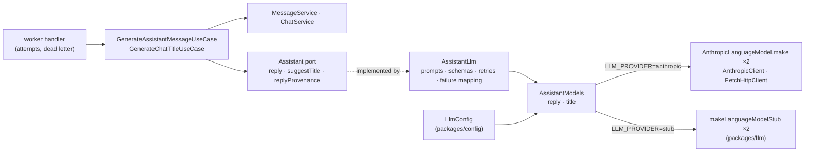

# LLM providers — architecture

> Ticket: `2026-10-29-1435_llm-providers` · Requirements: [feature.md](./feature.md)

## Overview

The `Assistant` port keeps its two methods, and both answer whole: a reply is one
`LanguageModel.generateObject` request decoded by a reply schema, a title another one decoded by
a title schema. Behind the port, `AssistantLlm` holds the prompts, the schemas, the retries and
the mapping of provider failures. Two language models, one per purpose, come from a new
infrastructure service, `AssistantModels`, which `LLM_PROVIDER` fills with Anthropic or with
the stub:

- **Failures are settled where they are understood** (D1–D3). The adapter retries a retryable
  provider failure in place, honouring a rate limit's wait, and lets only a final failure out of
  the port, as one of two domain errors. The use case turns each into a `failed` message with its
  reason, and the queue's job ends. The queue's own retries now cover crashes only: a database
  that is down, a killed process.
- **A refusal is told apart from a malformed reply** by reading the response's finish reason
  through `effect/ai`'s telemetry hook, which sees every response part before the decode (D4).
- **Nothing streams.** The `generating` stage carries no text. The snapshots, their 300 ms
  interval and `MessageService.snapshot` go (R5), and the message is written `completed` with its
  text in one write.
- **Provenance is a value of the port**, fixed when the process starts, and the use case writes
  it with the `generating` move, the moment the request is sent (D6).



## Structure

**Catalogs** (`package.json`)

```
~ catalogs.effect   + @effect/ai-anthropic 4.0.6 (lock-step with effect 4.0.6; 4.1.0 needs the effect upgrade, out of scope)
```

**`domain/chat/`**

```
~ message.model.ts     + MessageProvenance; Message + provenance;
                         MessageFailure.reason + 'ReplyRefused', failureMessages + its sentence;
                         generateMessage takes the provenance; − snapshotMessage
+ assistant.model.ts   AssistantReply (text): the port's answer
+ assistant.error.ts   AssistantRefusedError, AssistantFailedError
~ assistant.port.ts    streamText → reply; suggestTitle fails; + replyProvenance
~ message.service.ts   − snapshot; generate takes the provenance
~ index.ts             exports the two new files
```

**`domain/testing/`**: `assistant.test-fake.ts` scripts `reply` and `suggestTitle` with an
answer or an error and exposes a fixed `replyProvenance`; `chat.test-fixture.ts` gains a reply
and a provenance.

**`infrastructure/chat/`**

```
~ assistant.llm.ts              the system prompt, the reply and title schemas with their field
                                descriptions, the prompts, the finish-reason capture, the retry
                                schedules, the AiError mapping, hashInstructions; over AssistantModels and Crypto
+ assistant-models.client.ts    AssistantModels with layerAnthropic(options), layerStub, layerFromConfig
~ message.entity.ts             + provenance jsonb (D8)
+ db/migrations/<n>_…           the column
~ index.ts                      exports AssistantModels
```

**`packages/`**

```
~ llm/client.ts        LanguageModelStub (a word stream) → makeLanguageModelStub({ text, delay }),
                       a LanguageModel that answers `text` whole after `delay`
~ config/config.ts     + LlmConfig
```

**`application/chat/`**: `generate-assistant-message.use-case.ts` loses the stream and the
snapshots and settles the port's errors (D3); `generate-chat-title.use-case.ts` logs a port
error and leaves the chat untitled.

**`http-api/`, `apps/`, `e2e/`**

```
~ http-api/chat/chat.http.ts     Message DTO: − provenance (Struct.omit), so the new field never reaches the wire
~ apps/worker/layer.ts           AssistantModels.layerFromConfig + FetchHttpClient.layer replace LanguageModelStub
~ e2e/testing/stand.test-layer.ts the config provider gains LLM_PROVIDER: 'stub'
```

**Docs, rules and configuration**

```
+ docs/knowledge/ai.md              every effect/ai module at 4.0.6: used where, or why not; how to
                                    change the system prompt or the reply schema, and what each
                                    change does to the prompt cache (R20)
~ docs/knowledge/architecture.md    the adapter row names AssistantModels
~ docs/knowledge/glossary.md        + Provenance (who answered, and with which instructions; operators only)
~ .claude/rules/effect-schema.md    the port rule names the Assistant exception (D2)
~ infrastructure/CLAUDE.md          drop "runs on packages/llm's stub until…"
~ .env.example                      LLM_PROVIDER="stub", the key and both models commented out (R21)
~ docs/tickets/2026-10-17-1748_chat-core/feature.md   R16, R17, R18, R25 amended, in the commit that changes each
```

## Contracts

**The port** (`domain/chat/assistant.port.ts`)

```ts
export class Assistant extends Context.Service<Assistant, {
  /** Who answers replies and with which instructions; fixed for the process's life. */
  readonly replyProvenance: MessageProvenance
  /** The next message of the chat whose completed turns are `history`, oldest first. */
  readonly reply: (
    history: ReadonlyArray<AssistantTurn>,
  ) => Effect.Effect<AssistantReply, AssistantRefusedError | AssistantFailedError>
  /** None only for a blank `text`, which asks no model. */
  readonly suggestTitle: (
    text: string,
  ) => Effect.Effect<Option.Option<ChatTitle>, AssistantRefusedError | AssistantFailedError>
}>()('@app-template/domain/chat/Assistant') {}
```

Both errors are final: the adapter has spent its retries or knows none would help.

```ts
// assistant.error.ts — `cause` is operator detail and never reaches the wire (R18)
export class AssistantRefusedError extends Schema.TaggedError<AssistantRefusedError>()(
  'AssistantRefusedError', { cause: Schema.String }) {}
export class AssistantFailedError extends Schema.TaggedError<AssistantFailedError>()(
  'AssistantFailedError', { cause: Schema.String }) {}
```

**Models** (`domain/chat/message.model.ts`, `assistant.model.ts`)

```ts
export class MessageProvenance extends Schema.Class<MessageProvenance>('MessageProvenance')({
  provider: Schema.String, model: Schema.String, instructionsHash: Schema.String,
}) {}

// Message gains:
provenance: Schema.Option(MessageProvenance),

export class AssistantReply extends Schema.Class<AssistantReply>('AssistantReply')({
  text: Schema.String.check(<non-empty after trim>),
}) {}
```

The transitions after this ticket:

| Transition | Writes | Clears |
|---|---|---|
| `prepareMessage(message, at)` | `preparing` | `text`, `error`; keeps `provenance`, so a failure before the next request still names the model that was last asked |
| `generateMessage(message, { provenance, at })` | `generating`, `provenance` | — |
| `completeMessage(message, { text, at })` | `completed`, `text` | `error` (unchanged) |
| `failMessage(message, { reason, cause, at })` | `failed`, `error` | — |

**The reply schema the model sees** (`assistant.llm.ts`): the domain's `AssistantReply` field
with a `description` annotation (R6), so the description is prompt material that lives in the
adapter while the bound stays the domain's (D7). A later field (follow-ups, out of scope) is one
more row here and in `AssistantReply`:

```ts
const ReplyAnswer = Schema.Struct({
  text: AssistantReply.fields.text.annotate({ description: '…' }),
})
const TitleAnswer = Schema.Struct({ title: ChatTitle.annotate({ description: '…' }) })
```

The adapter also exports `hashInstructions(systemPrompt, schema)`: the SHA-256, in hex, of the
system prompt, a newline and `JSON.stringify` of the schema's JSON Schema document.
`replyProvenance.instructionsHash` is that function over the reply's prompt and schema.

**Failure mapping** in `AssistantLlm`, per request:

| What came back | Retry in place | Final error |
|---|---|---|
| finish reason `content-filter` (decoded or not) | no | `AssistantRefusedError` |
| finish reason `length` (decoded or not) | yes | `AssistantFailedError` after the last request |
| `StructuredOutputError` (the answer failed the schema) | yes | `AssistantFailedError` after the last request |
| `RateLimitError` with `retryAfter` ≤ 30 s | yes, waiting at least `retryAfter` | `AssistantFailedError` after the last request |
| `RateLimitError` with `retryAfter` > 30 s | no | `AssistantFailedError` |
| any other `AiError` with `isRetryable` (5xx, 529, a transport error) | yes | `AssistantFailedError` after the last request |
| any other `AiError` (401/403, 400/404/422 incl. an overlong prompt or no credit) | no | `AssistantFailedError` |

The schedules: a reply makes three requests at most, 1 s then 2 s apart (`chat-core` R18's
numbers); a title five, 1, 2, 4 and 8 s apart (the title queue's numbers). Each wait is the larger
of the schedule's delay and `retryAfter`.

**`AssistantModels`** (`infrastructure/chat/assistant-models.client.ts`)

```ts
export class AssistantModels extends Context.Service<AssistantModels, {
  readonly provider: string
  readonly replyModel: string
  readonly reply: LanguageModel.Service
  readonly title: LanguageModel.Service
}>()('@app-template/infrastructure/chat/AssistantModels') {
  /** Built once: two `AnthropicLanguageModel.make`, each with its purpose's request config. */
  static readonly layerAnthropic: (options: AnthropicOptions) => Layer.Layer<AssistantModels, never, HttpClient.HttpClient>
  /** Two `makeLanguageModelStub` answering canned JSON after 1 s; no key, no network. */
  static readonly layerStub: Layer.Layer<AssistantModels>
  /** Chooses by `LlmConfig.provider`. */
  static readonly layerFromConfig: Layer.Layer<AssistantModels, ConfigError, HttpClient.HttpClient>
}
```

| Purpose | Request config |
|---|---|
| reply | `max_tokens: 16000`, `cache_control: { type: 'ephemeral' }`, effort and thinking left to the model's default |
| title | `max_tokens: 1000`, `output_config.effort: 'low'`, `thinking: { type: 'disabled' }` |

No `temperature` is sent; the package sends none by default.

**Configuration** (`packages/config/config.ts`)

```ts
export class LlmConfig extends Context.Service<LlmConfig,
  | { readonly provider: 'stub' }
  | { readonly provider: 'anthropic'; readonly apiKey: Redacted.Redacted;
      readonly replyModel: string; readonly titleModel: string }
>()('@app-template/config/LlmConfig') {}
```

`LLM_PROVIDER` (`stub` | `anthropic`, required), `ANTHROPIC_API_KEY`, `LLM_REPLY_MODEL` and
`LLM_TITLE_MODEL` (all three required when the provider is `anthropic`). A missing or unknown
value fails the layer with `Config`'s error, which names the variable (R3).

**Data** (`messages`)

```sql
provenance jsonb          -- { provider, model, instructionsHash } or null
```

**Wire**: unchanged. `provenance` and `error.cause` never leave the api (R12, R18).

## Seams

| Seam | Catches | Misses |
|---|---|---|
| 1 `AssistantLlm` over `AssistantModels.layerAnthropic` and a fake `HttpClient` (`HttpClient.makeWith` + `HttpClientResponse.fromWeb`, under `TestClock`), `infrastructure/tests/chat/assistant.llm.test.ts` | the request body: the model per purpose (R1), the system prompt first, then the user turns with text and files and the assistant turns as their text (R8), the same system prompt for two chats (R9), `cache_control` without `ttl` (R10), `max_tokens`, effort and thinking per purpose (R11), a description on the schema's field (R6); the answer: every row of the failure mapping, the waits and the request counts (R13–R17, R19's retries) | the real Anthropic: what a refusal body looks like, latency, what a real 400 says, whether Anthropic accepts the JSON Schema |
| 2 `hashInstructions`, the same file | the hash changes with the system prompt and with the schema (R12) | whether the hash reaches the stored message (Seam 4) |
| 3 `AssistantLlm` over `AssistantModels.layerStub` | the stub's canned reply and title pass the same schemas (R2) | the stub's delay as a client sees it (by hand, R2's acceptance) |
| 4 `GenerateAssistantMessageUseCase` over the memory layers, `recordAssistant` and `holdAssistantCall` | the stages written: `preparing`, `generating` with the provenance, then one `completed` with the text (R5, R12); `failed` with `ReplyRefused` or `ReplyFailed` from each port error, after one call, provenance kept (R13, R16, R17); only completed messages reach the port (R8) | how a provider failure becomes a port error (Seam 1) |
| 5 `GenerateChatTitleUseCase` over the memory layers and `recordAssistant` | a port error logs and leaves the chat untitled; the rest of `chat-core` R25 still holds (R19) | the title's schema (Seam 1) |
| 6 `LlmConfig.layer` over `ConfigProvider.fromUnknown` | `stub` alone passes; a missing or unknown provider, or `anthropic` without its key or a model, fails naming the variable (R3) | the worker exiting (by hand, R3's acceptance) |
| 7 `domain/tests/chat/message.model.test.ts`, `domain/tests/chat/assistant.model.test.ts` | the `AssistantReply` bound (R6); the transitions above, the `ReplyRefused` sentence | — |
| 8 `MessageRepositoryPg` on `DbTest`, `infrastructure/e2e/chat/message.repository.e2e.ts` | `provenance` survives a write and a read, `null` as none | — |
| 9 `apps/api` handler tests, `apps/api/tests/chat/chat.handler.test.ts` | no `provenance` and no `cause` on the wire (R12, R18) | — |
| 10 the journey `e2e/chat.e2e.ts` on `layerStub` | the worker wiring end to end with no key and no network (R2, R4) | Anthropic itself (by hand, R1's acceptance) |

The worker handlers' suites (`apps/worker/tests/chat/`) keep their cases. Their behaviour does not
change: the last attempt still settles a reply that a crash left active.

## Decisions

- **D1 — A provider failure is retried in place, inside `AssistantLlm`; the queue retries only
  crashes.** *Answers Q1.*
  - **Why:** the adapter is the only place that sees `AiError`, so it can tell what a retry can
    fix and honour `retryAfter`. The port then answers only final outcomes, and `packages/queue`
    does not change.
  - **Cost accepted:** while it waits, the job holds its queue lock: up to three requests and two
    waits of at most 30 s each. The heartbeat extends the lock every 5 s. A worker that crashes
    on every attempt can make 3 × 3 requests for one message.
  - **Reversal:** one commit. The schedules are two constants in `assistant.llm.ts`.
  - **Rejected:**
    - a port error carrying "retryable" and "wait at least", and the queue hiding the job for
      that wait — it needs a new failure type in `packages/queue`, and it splits one policy
      between the adapter, the handler and the queue definition.

- **D2 — The `Assistant` port declares two errors, `AssistantRefusedError` and
  `AssistantFailedError`, an exception to "a port declares no error channel".**
  - **Why:** R13–R17 give each outcome its own reason, and a defect cannot carry that choice to
    the use case. Under D1 every error that leaves the port is final, so "a retry cannot fix it"
    and "the retries ran out" are handled alike. They differ only in `cause`, which operators
    read.
  - **Cost accepted:** `effect-schema.md` gains a named exception; every fake of the port scripts
    errors.
  - **Reversal:** one commit.
  - **Rejected:**
    - three errors (refused, rejected, unavailable) — two of them would share every handler;
    - one error with a `kind` field — a `switch` in place of `catchTag`.

- **D3 — The use cases settle every port error themselves.** `generate` writes `failed`
  (`ReplyRefused` or `ReplyFailed`, `cause` from the error) and ends the job successfully; the
  title use case logs and ends. The worker handlers keep only the last attempt and the dead
  letter, for crashes.
  - **Why:** the reason a port error maps to is a domain rule, and the number of the attempt
    plays no part in it, so `AttemptInfo` stays out of the use case (`layering.md`).
  - **Cost accepted:** none beyond D1.
  - **Reversal:** one commit.

- **D4 — The finish reason is read through `Telemetry.CurrentSpanTransformer`, provided for
  each request.** *Answers Q2.* `generateObject` hands every response part to the current span
  transformer before it decodes. The adapter provides one per request that keeps the `finish`
  part, then reads it whether the decode passed or failed. Verified by experiment on the
  installed `effect` 4.0.6 against a `LanguageModel.make` fake: refusal text with
  `content-filter` fails as `StructuredOutputError` while the hook holds `content-filter`; whole
  JSON with `length` decodes while the hook holds `length`.
  - **Why:** `StructuredOutputError` carries the answer's text but not its finish reason, and
    `generateText` cannot take the JSON response format. Without the hook, a refusal would be
    retried three times and end as `ReplyFailed`, against R16.
  - **Cost accepted:** a telemetry hook does control flow, and `effect/ai` is unstable. An
    upgrade that stops calling it before the decode turns a refusal back into a retried
    failure. Seam 1's refusal case catches that.
  - **Reversal:** one commit.
  - **Rejected:**
    - our own request through `AnthropicClient.createMessage` — it rewrites the package's
      private prompt conversion (text, images, PDF) and JSON Schema rewriting, hundreds of lines
      to keep in step with each release;
    - treating every undecodable answer as malformed — R16 would need weakening.

- **D5 — Two language models, built once in `AssistantModels`, chosen by `LLM_PROVIDER`; the
  stub is a generic model that answers canned JSON.** *Answers Q4.*
  - **Why:**
    - R1 asks for a model per purpose with its own request config. Two service values make each
      call's model explicit, with no `Effect.provide` per call.
    - The stub stays project-agnostic in `packages/llm`: it answers the text it is given after a
      delay. `layerStub` hands it a reply and a title as JSON, and `AssistantLlm` decodes them
      with the same schemas as Anthropic's answers (R2).
    - The 1 s delay keeps `generating` visible to a polling client.
  - **Cost accepted:** each stub reply takes 1 s, the journey's too; the canned JSON is written
    by hand, so a schema change can break it (Seam 3 catches that).
  - **Reversal:** one commit.
  - **Rejected:**
    - one `LanguageModel` with the model switched per call by `withConfigOverride` — it works,
      but the reader cannot see which call runs which model;
    - a stub at the port level — R2 would no longer prove the schemas.

- **D6 — Provenance is the port's `replyProvenance`, fixed when the process starts and written
  by the `generating` move.** *Answers Q3.*
  - **Why:**
    - Provider, model and instructions hash change only with configuration or code, so no answer
      needs to carry them.
    - `generating` is the moment the request is sent, so `completed` and a `failed` after a call
      keep the value, and a message failed before any call has none (R12).
    - The hash is SHA-256 from `Crypto.digest` (provided by `BunCrypto.layer`), so two versions
      of the instructions do not collide.
  - **Cost accepted:** a message retried after a crash shows the provenance of its last
    `generating`, not of every request.
  - **Reversal:** one commit.
  - **Rejected:**
    - provenance returned with every answer and every error — the same value, carried through
      more types;
    - `Hash.string` — 32 bits, not cryptographic.

- **D7 — The bound of a reply lives in the domain; the field description the model reads lives
  in the adapter.** `AssistantReply` (a text non-empty after trimming) is the domain's;
  `ReplyAnswer` annotates its field.
  - **Why:**
    - The description is prompt text, and prompts stay in the adapter (`infrastructure/CLAUDE.md`).
    - Anthropic does not enforce "non-empty after trimming" (the pattern `effect/ai` sends for a
      trimmed string accepts `""`), so the decode against the domain's check is what enforces it,
      and a blank reply is a retried schema failure (R15).
  - **Reversal:** one commit.

- **D8 — `provenance` is one `jsonb` column.**
  - **Why:** provenance is always whole, three fields or none, stored the way `error` already is.
  - **Cost accepted:** selecting messages by model or hash reads into JSON.
  - **Reversal:** a migration.
  - **Rejected:**
    - three nullable columns — they need an all-or-none check, and three columns decoded into
      one `Option`.

## Risks

- **An `effect/ai` upgrade moves the span transformer after the decode, or drops it.** A refusal
  would be retried and end as `ReplyFailed`. *Contained by:* Seam 1's refusal case, over the fake
  `HttpClient`, fails on the upgrade.
- **A long reply runs into an HTTP timeout.** A non-streamed request for up to 16 000 tokens can
  take minutes. If Bun's `fetch` or something in between cuts it, a retryable transport error
  spends every request and pays for each. *Contained by:* V1, and R1's acceptance run by hand.
- **The fake `HttpClient`'s canned response drifts from what the package parses.** Seam 1 would
  test a shape Anthropic never sends. *Contained by:* the canned bodies copy the package's own
  tests (`AnthropicLanguageModel.test.ts`), and R1's run by hand checks the real one.
- **A short prefix is not cached.** Anthropic silently skips caching below 512 tokens, and the
  first turns of a chat are short. R10 only asks for caching, so nothing fails, and `ai.md` says so.
- **The history outgrows the context window.** Every later reply in that chat fails at once
  (R17). *Contained by:* accepted until `context-window`.

## To verify during implementation

- **V1** — whether Bun's `fetch` applies a default timeout to a request that streams nothing for
  minutes, and what error it raises; if it does, `FetchHttpClient` gets an explicit timeout
  above the reply's worst case.
- **V2** — the minimum fields a canned Messages response needs for `makeResponse` to accept it,
  so Seam 1's fixture is as small as the package allows.
