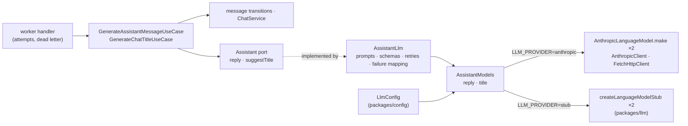

# LLM providers — architecture

> Ticket: `2026-10-29-1435_llm-providers` · Requirements: [feature.md](./feature.md)

## Overview

The `Assistant` port keeps its two methods, and both answer whole: a reply is one
`LanguageModel.generateObject` request decoded by a reply schema, a title another one decoded by
a title schema. Behind the port, `AssistantLlm` holds the prompts, the schemas, the retries and
the mapping of provider failures. Two language models, one per purpose, come from a new
infrastructure service, `AssistantModels`, which `LLM_PROVIDER` fills with Anthropic or with
the stub:

- **Failures are settled where they are understood** (D1–D3). The adapter retries a retryable
  provider failure in place, honouring a rate limit's wait, and lets only a final failure out of
  the port, as one of two domain errors. The use case turns each into a `failed` message with its
  reason, and the queue's job ends. The queue's own retries now cover crashes only: a database
  that is down, a killed process.
- **A refusal is told apart from a malformed reply** by reading the response's finish reason
  through `effect/ai`'s telemetry hook, which sees every response part before the decode (D4).
- **Nothing streams.** The `generating` stage carries no text. The snapshots and their 300 ms
  interval go (R5), and the message is written `done` with its text in one write.
- **Provenance travels in the reply's job.** The api's send-message use case fills it from
  `CurrentReplyProvenance`, fixed when the layer is built, and the outbox keeps every sent row,
  so operators read it there; the message and the domain never carry it (D6, D8).



## Structure

**Catalogs** (`package.json`)

```
~ catalogs.effect   + @effect/ai-anthropic 4.0.6 (lock-step with effect 4.0.6; 4.1.0 needs the effect upgrade, out of scope)
```

**`domain/chat/`**

```
~ message.model.ts     MessageFailure.reason + 'ReplyRefused', failureMessages + its sentence;
                         − snapshotMessage
+ assistant.model.ts   AssistantReply (text): the port's answer
+ assistant.error.ts   AssistantRefusedError, AssistantFailedError
~ assistant.port.ts    streamText → reply; suggestTitle fails
~ chat.model.ts        − buildChatTitle and its grapheme cut: the title schema bounds the answer
~ index.ts             exports the two new files
```

**`domain/testing/`**: `assistant.test-fake.ts` scripts `reply` and `suggestTitle` with an
answer or an error; `chat.test-fixture.ts` gains a reply.

**`infrastructure/chat/`**

```
~ assistant.llm.ts              the system prompt, the reply and title schemas with their field
                                descriptions, the prompts, the finish-reason capture, the retry
                                schedules, the AiError mapping, generateInstructionsHash;
                                + CurrentReplyProvenance with layerFromConfig (D6)
+ assistant.client.ts    AssistantModels with layerAnthropic(options), layerStub, layerFromConfig
~ chat.queue.ts                 + ReplyProvenance; GenerateAssistantMessage + provenance (D6)
~ index.ts                      exports AssistantModels, CurrentReplyProvenance
```

**`infrastructure/outbox/`, `db/`, `testing/`**

```
~ outbox.entity.ts              + sent_at; the created_at index → a partial one over unsent rows (D8)
~ outbox.relay.ts               polls unsent rows, marks a sent one instead of deleting it
+ db/migrations/<n>_outbox_sent_at
+ testing/chat.test-fake.ts     CurrentReplyProvenanceTest and the provenance it holds
```

**`packages/`**

```
~ llm/client.ts        LanguageModelStub (a word stream) → createLanguageModelStub({ text, delay }),
                       a LanguageModel that answers `text` whole after `delay`
~ config/config.ts     + LlmConfig; + ReplyModelConfig (the provider and the reply model, no key)
```

**`application/chat/`**: `generate-assistant-message.use-case.ts` loses the stream and the
snapshots and settles the port's errors (D3); `generate-chat-title.use-case.ts` logs a port
error and leaves the chat untitled; `send-message.use-case.ts` puts `CurrentReplyProvenance`
into the reply's job (D6).

**`http-api/`, `apps/`, `e2e/`**

```
~ apps/api/layer.ts              + CurrentReplyProvenance.layerFromConfig
~ apps/worker/layer.ts           AssistantModels.layerFromConfig + FetchHttpClient.layer replace LanguageModelStub
~ e2e/testing/stand.test-layer.ts the config provider gains LLM_PROVIDER: 'stub'
```

**Docs, rules and configuration**

```
+ docs/knowledge/ai.md              every effect/ai module at 4.0.6: used where, or why not; how to
                                    change the system prompt or the reply schema, and what each
                                    change does to the prompt cache (R20)
~ docs/knowledge/architecture.md    the adapter row names AssistantModels
~ docs/knowledge/glossary.md        + Provenance (who the api expects to answer a reply, and with which
                                    instructions; in the reply's job; operators only);
                                    a failed message is one the assistant gave up on or declined
~ docs/knowledge/database.md, aws.md  the relay marks a sent row and keeps it
~ docs/tickets/2026-10-22-1915_postgres-drizzle/feature.md   R7 amended: a sent entry is kept
~ .claude/rules/effect-schema.md    the port rule states its exception as a pattern (D2)
~ infrastructure/CLAUDE.md          drop "runs on packages/llm's stub until…"
~ .env.example                      LLM_PROVIDER="stub", the key and both models commented out (R21)
~ docs/tickets/2026-10-17-1748_chat-core/feature.md   R16, R17, R18, R25 amended, in the commit that changes each
```

## Contracts

**The port** (`domain/chat/assistant.port.ts`)

```ts
export class Assistant extends Context.Service<Assistant, {
  /** The next message of the chat whose `done` turns are `history`, oldest first. */
  readonly reply: (
    history: ReadonlyArray<HistoryMessage>,
  ) => Effect.Effect<AssistantReply, AssistantRefusedError | AssistantFailedError>
  /** None only for a blank `text`, which asks no model. */
  readonly suggestTitle: (
    text: string,
  ) => Effect.Effect<Option.Option<ChatTitle>, AssistantRefusedError | AssistantFailedError>
}>()('@app-template/domain/chat/Assistant') {}
```

Both errors are final: the adapter has spent its retries or knows none would help.

```ts
// assistant.error.ts — `cause` is operator detail and never reaches the wire (R18)
export class AssistantRefusedError extends Schema.TaggedError<AssistantRefusedError>()(
  'AssistantRefusedError', { cause: Schema.String }) {}
export class AssistantFailedError extends Schema.TaggedError<AssistantFailedError>()(
  'AssistantFailedError', { cause: Schema.String }) {}
```

**Models** (`domain/chat/assistant.model.ts`)

```ts
export class AssistantReply extends Schema.Class<AssistantReply>('AssistantReply')({
  text: Schema.String.check(<non-empty after trim>),
}) {}
```

The transitions after this ticket:

| Transition | Writes | Clears |
|---|---|---|
| `prepareMessage(message, at)` | `preparing` | `text`, `error` |
| `generateMessage(message, at)` | `generating` | — |
| `completeMessage(message, { text, at })` | `done`, `text` | `error` (unchanged) |
| `failMessage(message, { reason, cause, at })` | `failed`, `error` | — |

**The reply schema the model sees** (`assistant.llm.ts`): the domain's `AssistantReply` field
with a `description` annotation (R6), so the description is prompt material that lives in the
adapter while the bound stays the domain's (D7). A later field (follow-ups, out of scope) is one
more row here and in `AssistantReply`:

```ts
const ReplyAnswer = Schema.Struct({
  text: AssistantReply.fields.text.annotateKey({ description: '…' }),
})
const TitleAnswer = Schema.Struct({
  title: Schema.String.annotate({ description: '…' }).pipe(
    Schema.decodeTo(ChatTitle, SchemaTransformation.trim()),
  ),
})
```

`ChatTitle` checks `isTrimmed`, so the title is trimmed on its way in, by the transformation
`Schema.Trim` uses; a title over 120 characters fails the schema and is asked again, so
`buildChatTitle`'s cut goes. Where the description sits: on a checked schema, `annotate` lands on
the check, which the JSON Schema leaves out, so `text`'s sits on the key (S3: `{"type":"string"}`
with no description); the JSON Schema is the encoded side's, so `title`'s sits on the encoded
`String`, where `Schema.Trim`'s own `expected` text would replace it (S6). Seam 1's description
cases cover both.

The adapter also exports `generateInstructionsHash(systemPrompt, schema)`: the SHA-256, in hex,
of the system prompt, a newline and `JSON.stringify` of the schema's JSON Schema document.

**Provenance** (`infrastructure/chat/chat.queue.ts`, `assistant.llm.ts`)

```ts
export class ReplyProvenance extends Schema.Class<ReplyProvenance>('ReplyProvenance')({
  provider: Schema.String, model: Schema.String, instructionsHash: Schema.String,
}) {}

export class GenerateAssistantMessage extends Schema.Class<GenerateAssistantMessage>(
  'GenerateAssistantMessage',
)({ chatId: ChatId, messageId: MessageId, provenance: ReplyProvenance }) {}

// fixed at layer build from ReplyModelConfig and generateInstructionsHash(systemPrompt, ReplyAnswer)
export class CurrentReplyProvenance extends Context.Service<CurrentReplyProvenance, ReplyProvenance>()(…) {
  static readonly layerFromConfig: Layer.Layer<CurrentReplyProvenance, Config.ConfigError, Crypto.Crypto>
}
```

The field is required although the worker never reads it, so a job queued without it fails to
decode. `GenerateChatTitle` carries none.

**Failure mapping** in `AssistantLlm`, per request:

| What came back | Retry in place | Final error |
|---|---|---|
| finish reason `content-filter` (decoded or not), raised as `ContentPolicyError`, or a `ContentPolicyError` itself | no | `AssistantRefusedError` |
| finish reason `length` (decoded or not), raised as `InvalidOutputError` | yes | `AssistantFailedError` after the last request |
| `StructuredOutputError` (the answer failed the schema) | yes | `AssistantFailedError` after the last request |
| `RateLimitError` with `retryAfter` ≤ 30 s | yes, waiting at least `retryAfter` | `AssistantFailedError` after the last request |
| `RateLimitError` with `retryAfter` > 30 s | no | `AssistantFailedError` |
| any other `AiError` with `isRetryable` (5xx, 529, a transport error) | yes | `AssistantFailedError` after the last request |
| any other `AiError` (401/403, 400/404/422 incl. an overlong prompt or no credit) | no | `AssistantFailedError` |

The schedules: a reply makes three requests at most, 1 s then 2 s apart (`chat-core` R18's
numbers); a title five, 1, 2, 4 and 8 s apart (the title queue's numbers). Each wait is the larger
of the schedule's delay and `retryAfter`. Every final error's `cause` is the `AiError`'s message:
the provider's text for an HTTP error, the finish reason for an early finish; a rate limit's
names the wait alone, the provider's text staying in the error's HTTP context.

**`AssistantModels`** (`infrastructure/chat/assistant.client.ts`)

```ts
export class AssistantModels extends Context.Service<AssistantModels, {
  readonly reply: LanguageModel.LanguageModel
  readonly title: LanguageModel.LanguageModel
}>()('@app-template/infrastructure/chat/AssistantModels') {
  /** Built once: two `AnthropicLanguageModel.make`, each with its purpose's request config. */
  static readonly layerAnthropic: (options: AnthropicOptions) => Layer.Layer<AssistantModels, never, HttpClient.HttpClient>
  /** Two `createLanguageModelStub` answering canned JSON after 1 s; no key, no network. */
  static readonly layerStub: Layer.Layer<AssistantModels>
  /** Chooses by `LlmConfig.provider`. */
  static readonly layerFromConfig: Layer.Layer<AssistantModels, ConfigError, HttpClient.HttpClient>
}
```

| Purpose | Request config |
|---|---|
| reply | `max_tokens: 16000`, `cache_control: { type: 'ephemeral' }`, effort and thinking left to the model's default |
| title | `max_tokens: 1000`, `output_config.effort: 'low'`, `thinking: { type: 'disabled' }` |

No `temperature` is sent; the package sends none by default.

**Configuration** (`packages/config/config.ts`)

```ts
export class LlmConfig extends Context.Service<LlmConfig,
  | { readonly provider: 'stub' }
  | { readonly provider: 'anthropic'; readonly apiKey: Redacted.Redacted;
      readonly replyModel: string; readonly titleModel: string }
>()('@app-template/config/LlmConfig') {}
```

`LLM_PROVIDER` (`stub` | `anthropic`, required), `ANTHROPIC_API_KEY`, `LLM_REPLY_MODEL` and
`LLM_TITLE_MODEL` (all three required when the provider is `anthropic`). A missing or unknown
value fails the layer with `Config`'s error, which names the variable (R3).
`ReplyModelConfig` (`{ provider, replyModel }`, `stub` for both under the stub) shares the
`LLM_PROVIDER` and `LLM_REPLY_MODEL` reads with `LlmConfig` and never reads the key, so the api
names the reply model without holding the provider's secret.

**Data** (`outbox`)

```sql
sent_at timestamptz       -- set by the relay; null until the row is sent
outbox_unsent_created_at_index ON (created_at) WHERE sent_at IS NULL
-- body of a reply's job: { chatId, messageId, provenance: { provider, model, instructionsHash } }
```

**Wire**: unchanged. `error.cause` never leaves the api (R18); provenance lives in the outbox
only (R12).

## Seams

| Seam | Catches | Misses |
|---|---|---|
| 1 `AssistantLlm` over `AssistantModels.layerAnthropic` and a fake `HttpClient` (`HttpClient.make` + `HttpClientResponse.fromWeb`, under `TestClock`), `infrastructure/tests/chat/assistant.llm.test.ts` | the request body: the model per purpose (R1), the system prompt first, then the user turns with text and files and the assistant turns as their text (R8), the same system prompt for two chats (R9), `cache_control` without `ttl` (R10), `max_tokens`, effort and thinking per purpose (R11), a description on the schema's field (R6); the answer: every row of the failure mapping, the waits and the request counts (R13–R17, R19's retries) | the real Anthropic: what a refusal body looks like, latency, what a real 400 says, whether Anthropic accepts the JSON Schema |
| 2 `generateInstructionsHash` and `CurrentReplyProvenance.layerFromConfig`, the same file | the hash changes with the system prompt and with the schema; the provenance names the configured provider and reply model with no key (R12) | whether the provenance reaches the job (Seams 11, 8) |
| 3 `AssistantLlm` over `AssistantModels.layerStub` | the stub's canned reply and title pass the same schemas (R2) | the stub's delay as a client sees it (by hand, R2's acceptance) |
| 4 `GenerateAssistantMessageUseCase` over the memory layers, `recordAssistant` and `holdAssistantCall` | the stages written: `preparing`, `generating`, then one `done` with the text (R5); `failed` with `ReplyRefused` or `ReplyFailed` from each port error, after one call, the chat `failed` with it (R13, R16, R17); only `done` messages reach the port (R8) | how a provider failure becomes a port error (Seam 1) |
| 5 `GenerateChatTitleUseCase` over the memory layers and `recordAssistant` | a port error logs and leaves the chat untitled; the rest of `chat-core` R25 still holds (R19) | the title's schema (Seam 1) |
| 6 `LlmConfig.layer` and `ReplyModelConfig.layer` over `ConfigProvider.fromUnknown` | `stub` alone passes; a missing or unknown provider, or `anthropic` without its key or a model, fails naming the variable (R3); `ReplyModelConfig` reads `anthropic` without the key | the worker exiting (by hand, R3's acceptance) |
| 7 `domain/tests/chat/message.model.test.ts`, `domain/tests/chat/assistant.model.test.ts` | the `AssistantReply` bound (R6); the transitions above, the `ReplyRefused` sentence | — |
| 8 `QueueSenderOutbox` and `OutboxRelay` on `DbTest`, `infrastructure/e2e/shared/queue.client.e2e.ts`, `infrastructure/e2e/outbox/outbox.relay.e2e.ts` | the reply job's body in the outbox holds the provenance; a sent row is kept with `sent_at` and never sent again; the body on SQS carries it too (R12) | — |
| 9 `apps/api` handler tests, `apps/api/tests/chat/chat.handler.test.ts` | no `cause` on the wire (R18) | — |
| 10 the journey `e2e/chat.e2e.ts` on `layerStub` | the worker wiring end to end with no key and no network (R2, R4) | Anthropic itself (by hand, R1's acceptance) |
| 11 `SendMessageUseCase` over the memory layers and `CurrentReplyProvenanceTest`, `application/tests/chat/send-message.use-case.test.ts` | the reply's job carries the provenance, the title's job none (R12) | the api's layer wiring (Seam 10) |

The worker handlers' suites (`apps/worker/tests/chat/`) keep their cases. Their behaviour does not
change: the last attempt still settles a reply that a crash left active.

## Decisions

- **D1 — A provider failure is retried in place, inside `AssistantLlm`; the queue retries only
  crashes.** *Answers Q1.*
  - **Why:** the adapter is the only place that sees `AiError`, so it can tell what a retry can
    fix and honour `retryAfter`. The port then answers only final outcomes, and `packages/queue`
    does not change.
  - **Cost accepted:** while it waits, the job holds its queue lock: up to three requests and two
    waits of at most 30 s each. The heartbeat extends the lock every 5 s. A worker that crashes
    on every attempt can make 3 × 3 requests for one message.
  - **Reversal:** one commit. The schedules are two constants in `assistant.llm.ts`.
  - **Rejected:**
    - a port error carrying "retryable" and "wait at least", and the queue hiding the job for
      that wait — it needs a new failure type in `packages/queue`, and it splits one policy
      between the adapter, the handler and the queue definition.

- **D2 — The `Assistant` port declares two errors, `AssistantRefusedError` and
  `AssistantFailedError`, named together `AssistantError`, an exception to "a port declares no
  error channel".**
  - **Why:** R13–R17 give each outcome its own reason, and a defect cannot carry that choice to
    the use case. Under D1 every error that leaves the port is final, so "a retry cannot fix it"
    and "the retries ran out" are handled alike. They differ only in `cause`, which operators
    read.
  - **Cost accepted:** `effect-schema.md` gains an exception, stated as a pattern (a port whose
    failures a use case settles each its own way), not by the port's name; every fake of the port
    scripts errors.
  - **Reversal:** one commit.
  - **Rejected:**
    - three errors (refused, rejected, unavailable) — two of them would share every handler;
    - one error with a `kind` field — a `switch` in place of `catchTag`.

- **D3 — The use cases settle every port error themselves.** `generate` writes `failed`
  (`ReplyRefused` or `ReplyFailed`, `cause` from the error) through `settleFailed`, which moves
  the chat to `failed` in the same transaction, as a crash on the last attempt does, and ends
  the job successfully; the
  title use case logs and ends. The worker handlers keep only the last attempt and the dead
  letter, for crashes.
  - **Why:** the reason a port error maps to is a domain rule, and the number of the attempt
    plays no part in it, so `AttemptInfo` stays out of the use case (`layering.md`).
  - **Cost accepted:** none beyond D1.
  - **Reversal:** one commit.

- **D4 — The finish reason is read through `Telemetry.CurrentSpanTransformer`, provided for
  each request.** *Answers Q2.* `generateObject` hands every response part to the current span
  transformer before it decodes. The adapter provides one per request that keeps the `finish`
  part, then reads it whether the decode passed or failed. Verified by experiment on the
  installed `effect` 4.0.6 against a `LanguageModel.make` fake: refusal text with
  `content-filter` fails as `StructuredOutputError` while the hook holds `content-filter`; whole
  JSON with `length` decodes while the hook holds `length`.
  - **Why:** `StructuredOutputError` carries the answer's text but not its finish reason, and
    `generateText` cannot take the JSON response format. Without the hook, a refusal would be
    retried three times and end as `ReplyFailed`, against R16.
  - **Cost accepted:** a telemetry hook does control flow, and `effect/ai` is unstable. An
    upgrade that stops calling it before the decode turns a refusal back into a retried
    failure. Seam 1's refusal case catches that.
  - **Reversal:** one commit.
  - **Rejected:**
    - our own request through `AnthropicClient.createMessage` — it rewrites the package's
      private prompt conversion (text, images, PDF) and JSON Schema rewriting, hundreds of lines
      to keep in step with each release;
    - treating every undecodable answer as malformed — R16 would need weakening.

- **D5 — Two language models, built once in `AssistantModels`, chosen by `LLM_PROVIDER`; the
  stub is a generic model that answers canned JSON.** *Answers Q4.*
  - **Why:**
    - R1 asks for a model per purpose with its own request config. Two service values make each
      call's model explicit, with no `Effect.provide` per call.
    - The stub stays project-agnostic in `packages/llm`: it answers the text it is given after a
      delay. `layerStub` hands it a reply and a title as JSON, and `AssistantLlm` decodes them
      with the same schemas as Anthropic's answers (R2).
    - The 1 s delay keeps `generating` visible to a polling client.
  - **Cost accepted:** each stub reply takes 1 s, the journey's too; the canned JSON is written
    by hand, so a schema change can break it (Seam 3 catches that).
  - **Reversal:** one commit.
  - **Rejected:**
    - one `LanguageModel` with the model switched per call by `withConfigOverride` — it works,
      but the reader cannot see which call runs which model;
    - a stub at the port level — R2 would no longer prove the schemas.

- **D6 — Provenance is a required field of the reply's job, filled by the api from
  `CurrentReplyProvenance`, fixed when its layer is built.** *Answers Q3, revised in S7.2.*
  - **Why:**
    - Provider, model and instructions hash change only with configuration or code, so one
      value per process serves every job.
    - The domain, the port and the message never carry it: it is operator detail, and the job
      already crosses from the api to the worker in the outbox (D8).
    - `ReplyModelConfig` reads the provider and the reply model only, so the api holds no
      Anthropic key.
    - The hash is SHA-256 from `Crypto.digest` (provided by `BunCrypto.layer`), so two versions
      of the instructions do not collide.
    - The field is required although the worker ignores it, so a job queued without it fails
      to decode instead of passing unnoticed.
  - **Cost accepted:** the value is what the api expects, not what answered: while a deploy
    rolls out, the worker may run another model or other instructions (R12 says so). The title's
    job carries none.
  - **Reversal:** one commit, plus D8's migration.
  - **Rejected:**
    - the port's `replyProvenance`, written to the message by the `generating` move (S7.1) — the
      user moved provenance out of the domain;
    - provenance added to the outbox body outside the job's schema — nothing would check it, and
      the coupling between the api and the outbox would not show in the code;
    - provenance returned with every answer and every error — the same value, carried through
      more types;
    - `Hash.string` — 32 bits, not cryptographic.

- **D7 — The bound of a reply lives in the domain; the field description the model reads lives
  in the adapter.** `AssistantReply` (a text non-empty after trimming) is the domain's;
  `ReplyAnswer` annotates its field.
  - **Why:**
    - The description is prompt text, and prompts stay in the adapter (`infrastructure/CLAUDE.md`).
    - Anthropic does not enforce "non-empty after trimming" (the pattern `effect/ai` sends for a
      trimmed string accepts `""`), so the decode against the domain's check is what enforces it,
      and a blank reply is a retried schema failure (R15).
  - **Reversal:** one commit.

- **D8 — The outbox keeps its sent rows: the relay sets `sent_at` instead of deleting, and polls
  unsent rows over a partial index.** *Revised in S7.3.* This reverses `postgres-drizzle` D4,
  and that ticket's R7 is amended.
  - **Why:** the reply's job body is where provenance lives (D6); a deleted row would lose it
    seconds after the send. The partial index `WHERE sent_at IS NULL` keeps the poll as cheap as
    before however many sent rows pile up.
  - **Cost accepted:** the table grows without bound, since nothing removes sent rows in this
    ticket; selecting jobs by model or hash reads into the `jsonb` body.
  - **Reversal:** a migration.
  - **Rejected:**
    - a `provenance jsonb` column on `messages` (S7.1) — it put provenance on the message;
    - deleting a row once sent (`postgres-drizzle` D4) — provenance would vanish with it;
    - a separate `meta` column on the outbox — the user put provenance in the job's body.

- **D9 — Anthropic's requests wait up to 10 minutes for a byte; the bound sits on
  `AnthropicClient`.** Bun's `fetch` cuts a request that receives nothing for 360 s (V1,
  `TimeoutError`), and a non-streamed answer of 16 000 tokens arrives whole at the end.
  `AnthropicClient.layer`'s `transformClient` provides `FetchHttpClient.RequestInit` with
  `timeout`, Bun's idle limit, set to Anthropic SDK's own 10 minutes.
  - **Why:** the bound serves the reply's `max_tokens`, so it sits beside it and reaches only
    the provider's requests.
  - **Cost accepted:** it replaces, not merges, any `RequestInit` a process provides; none does.
  - **Reversal:** one commit.
  - **Rejected:**
    - a timeout on `FetchHttpClient` in `apps/worker` — far from the bound it serves, and every
      other request of the worker would get it.

## Risks

- **An `effect/ai` upgrade moves the span transformer after the decode, or drops it.** A refusal
  would be retried and end as `ReplyFailed`. *Contained by:* Seam 1's refusal case, over the fake
  `HttpClient`, fails on the upgrade.
- **A long reply runs into an HTTP timeout.** A non-streamed request for up to 16 000 tokens can
  take minutes. If Bun's `fetch` or something in between cuts it, a retryable transport error
  spends every request and pays for each. *Contained by:* D9 (V1: Bun cuts at 360 s), and R1's
  acceptance run by hand.
- **The fake `HttpClient`'s canned response drifts from what the package parses.** Seam 1 would
  test a shape Anthropic never sends. *Contained by:* the canned bodies copy the package's own
  tests (`AnthropicLanguageModel.test.ts`), and R1's run by hand checks the real one.
- **An answer cut by the context window passes as whole.** Anthropic's `stop_reason:
  "model_context_window_exceeded"` reaches `effect/ai` as finish reason `unknown`, so a cut
  answer whose text still decodes is kept as the reply; one that does not decode is retried as a
  schema failure. *Contained by:* accepted; `context-window` owns a history that outgrows it.
- **A short prefix is not cached.** Anthropic silently skips caching below 512 tokens, and the
  first turns of a chat are short. R10 only asks for caching, so nothing fails, and `ai.md` says so.
- **The history outgrows the context window.** Every later reply in that chat fails at once
  (R17). *Contained by:* accepted until `context-window`.
- **Sent outbox rows pile up.** Nothing removes them, so the table and its backups grow without
  bound; the poll stays cheap over the partial index. *Contained by:* `job-ledger`'s retention
  question in the roadmap.
- **Provenance names the expected model, not the one that answered.** During a deploy the api
  and the worker may run different configurations or instructions. *Contained by:* accepted in
  R12.
- **A deploy lacks `LLM_PROVIDER` and `LLM_REPLY_MODEL`.** `deployment/` sets neither, so the
  worker (since S2) and now the api fail at start with `Config`'s error. *Contained by:* an
  `aws-deployment` note in the roadmap; the local stand reads them from `.env`.

## To verify during implementation

- **V1** — whether Bun's `fetch` applies a default timeout to a request that streams nothing for
  minutes, and what error it raises; if it does, `FetchHttpClient` gets an explicit timeout
  above the reply's worst case.
- **V2** — the minimum fields a canned Messages response needs for `makeResponse` to accept it,
  so Seam 1's fixture is as small as the package allows.
