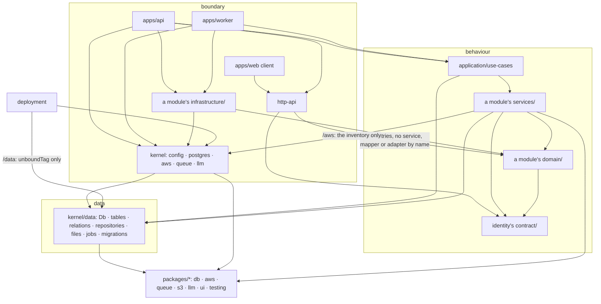

# Modular monolith — architecture

> Ticket: `2026-10-31-0926_modular-monolith` · Requirements: [feature.md](./feature.md)

## Overview

Today the workspaces are layers (`domain`, `application`, `infrastructure`) with a folder per
aggregate inside each. After the ticket the code is three rings, and every dependency points
inward:

- **The data**, `kernel/data`, is the one source of truth over every store: `Db` over every table
  and relation, the migrations, the repositories in the data layer's own types (`ChatEntity`,
  `ChatEntityWhere`), `JobRepository`, and `FileRepository` over the attachments' objects. It
  imports only `packages/*` and takes its clients (`PgClient`, `S3Bucket`) from the context.
- **The behaviour**, `application/`: the modules `chat` and `identity`, and above them every use
  case in `application/use-cases`. A module's `domain/` holds its models, pure rules, errors and
  the ports that reach outside, and ships to the browser; its `services/` hold the domain
  services, the mappers between an entity and a model and the job definitions, over the data
  layer's repositories; its `infrastructure/` the adapters of its ports. A module reaches another
  only through its contract, a folder `contract/` exported through its entry
  (`application/identity/contract/`).
- **The boundary** is everything that touches the world outside the process: the kernel's
  configured clients (`/config`, `/postgres`, `/aws`, `/queue`, `/llm`), each module's
  `infrastructure/`, `http-api` and the apps, which assemble the layers and provide the clients.
- `packages/*` is configurable and knows no app; every ring may use it.



What may import what (✓ allowed, ✗ refused by Biome; a ✓ still needs the `package.json` entry):

| From ↓ / may import → | another module | a contract | `use-cases` | `kernel/data` | rest of `kernel` | `packages/*` | `http-api` |
|---|---|---|---|---|---|---|---|
| a module's `domain/` | ✗ | ✓ | ✗ | ✗ | ✗ | ✗ | ✗ |
| a module's `services/` | ✗ | ✓ | ✗ | ✓, but `Db`, `relations`, `migrationsFolder` | `/aws`, but `*FromConfig`, `*OfStage` | `aws`, `db`, `queue` | ✗ |
| a module's `infrastructure/` | ✗ | ✓ | ✗ | ✓ | ✓ | ✓ | ✗ |
| a contract | ✗ | ✗ | ✗ | ✗ | ✗ | ✗ | ✗ |
| `use-cases` | ✓, through each module's entry | ✓ | — | ✓ | ✗ | ✓ | ✗ |
| `kernel/data` | ✗ | ✗ | ✗ | — | ✗ | ✓ | ✗ |
| rest of `kernel` | ✗ | ✗ | ✗ | ✓ | ✓ | ✓ | ✗ |
| `packages/*` | ✗ | ✗ | ✗ | ✗ | ✗ | ✓ (each other) | ✗ |
| `http-api` | its entry, but `*Service`, `*FromEntity`, `*FromConfig`, `encode*`, `decode*` | ✓ | ✗ | ✗ | ✗ | ✗ | — |
| `apps/api`, `apps/worker` | ✓ | ✓ | ✓ | in `layer.ts` only | ✓ | ✓ | api only |
| `apps/web` client | ✗ | ✗ | ✗ | ✗ | ✗ | `ui` | ✓ |
| `deployment` | ✗ | ✗ | ✗ | `unboundTag` only | `/config`; `/aws`, but `*FromConfig`, `*OfStage` | ✓ | ✗ |

Tests import as their workspace's source does, plus the test support of the workspaces it
declares: a unit test (`__tests__/`) their `./testing`, an e2e suite (`__e2e__/`) their
`./testing` and `./testing/e2e`. A unit test never imports e2e support (R17).

A module's `domain/` and a contract import only `effect` (and `type-fest` for types), so the
domain still ships to the browser through `http-api`; `make bundle-check` proves no service, use
case, repository or adapter does. A module's `services/` reach the outside world only through the
ports its `domain/` declares (`Assistant`, and `CurrentReplyProvenance` with its value
`ReplyProvenance`, which move there from `assistant.llm.ts` and `chat.queue.ts`), each implemented
by a layer in its `infrastructure/` (`CurrentReplyProvenanceFromConfig`); the data layer's
repositories are not ports, they are the data. The one boundary part `services/` may read is
the inventory of `@app-template/kernel/aws`, the app's queues and buckets as plain constants
(Biome refuses its `*FromConfig` and `*OfStage` clients by name), so a job definition takes its
queue's name from the one list `deployment` reads too.

## Structure

Moves are `old → new`; **new** marks a file that does not exist today. `__tests__/` and `__e2e__/`
mirror the source path in every workspace.

```
application/                     @app-template/application: the behaviour, one workspace (S27);
                                 unit tests only (S34)
  chat/                          @app-template/application/chat, through chat/index.ts
    domain/                      ← domain/chat/*, domain/attachment/*, domain/shared/status.model.ts,
                                   minus every *.port.ts of a repository or the bucket
      assistant.port.ts            + CurrentReplyProvenance, ReplyProvenance ← assistant.llm.ts, chat.queue.ts
    services/                    ← domain/chat/chat.service.ts, domain/attachment/attachment.service.ts,
                                   infrastructure/chat/chat.queue.ts (queue names from kernel/aws/resources)
      chat.mapper.ts               new: ChatFromEntity, MessageFromEntity (from today's *FromRow)
      attachment.mapper.ts         new: AttachmentFromEntity
    infrastructure/              ← infrastructure/chat/assistant.llm.ts (assistant.client.ts goes)
    __tests__/
      testing/                   ← domain/testing/{chat,attachment,assistant}.test-*, chat.test-layer,
                                   attachment.test-layer, infrastructure/testing/chat.test-fake.ts;
                                   arrange and read helpers take models and go through the mappers
      domain/  services/  infrastructure/   ← domain/tests/{chat,attachment}, infrastructure/tests/chat
  identity/                      @app-template/application/identity, through identity/index.ts
    domain/user.model.ts         ← domain/user/user.model.ts (UserId, UserUnknownError leave)
    services/                    user.service.ts ← domain/user; user.mapper.ts new
    contract/                    the contract, exported through identity/index.ts
      user.id.ts                   UserId               ← domain/user/user.id.ts
      user.error.ts                UserUnknownError     ← domain/user/user.error.ts
      auth.ts                      CurrentUser, Auth    ← http-api/shared/security.ts
    __tests__/{testing,domain,services}/  ← domain/testing/user.test-fixture.ts, domain/tests/user
  use-cases/                     @app-template/application/use-cases ← today's application/ workspace
    chat/                          send-message, generate-assistant-message, generate-chat-title
    __tests__/{testing,chat}/      ← application/{testing/chat.test-layer.ts,tests/chat}
  CLAUDE.md                      new: from domain/CLAUDE.md and infrastructure/CLAUDE.md
kernel/                          @app-template/kernel
  data/                          → /data: imports only packages/*, takes its clients from the context
    db.client.ts                   Db = createDb(relations), needs PgClient ← infrastructure/db/db.client.ts
    migrations.ts                  migrationsFolder, the path the migrator and the e2e setup apply
    relations.ts                   ← infrastructure/db/relations.ts
    drizzle.config.ts              ← infrastructure/drizzle.config.ts
    migrations/                    one initial migration, in place of infrastructure/db/migrations/
    chat/                          chat.{table,entity}.ts, message.{table,entity}.ts ← infrastructure/chat/*.entity.ts;
                                   chat.repository.ts, message.repository.ts (the query code of today's)
    attachment/                    attachment.{table,entity,repository}.ts ← infrastructure/attachment/
    user/                          user.{table,entity,repository}.ts ← infrastructure/user/ (users, credentials)
    job/                           job.{table,entity}.ts (table jobs) ← infrastructure/outbox/outbox.entity.ts;
                                   job.repository.ts new
    file/                          file.entity.ts new: FileEntity, the key attachments/<id>, the unbound tag;
                                   file.repository.ts: FileRepository over S3Bucket
                                   ← infrastructure/attachment/attachment.bucket.ts
  config/                        → /config ← packages/config
  postgres/                      → /postgres
    postgres.client.ts             PgClientFromConfig ← infrastructure/db/db.client.ts
    migrate.ts                     the `make migrate` entry ← infrastructure/db/migrate.ts
  aws/                           → /aws
    aws.client.ts                  S3ServiceFromConfig, SQSServiceFromConfig ← infrastructure/shared;
                                   S3BucketOfStage, S3BucketFromConfig (S3Bucket on the stage's
                                   bucket)
    resources/                     through /aws: the inventory (buckets with their lifecycle,
                                   queues) and the naming rule ← packages/aws/{resources,naming}.ts
  queue/                         → /queue
    queue.client.ts                QueueConsumerSqs, QueueSenderJobs over JobRepository
                                   ← infrastructure/shared/queue.client.ts
    job.relay.ts                   JobRelaySqs over JobRepository ← infrastructure/outbox/outbox.relay.ts
  llm/llm.client.ts              → /llm: new: createLanguageModel, the provider chosen by LlmConfig
  <part>/__tests__/  <part>/__e2e__/   each part keeps its tests (S25): config/__tests__,
                                   data/__tests__/testing → /data/testing: the memory repositories
                                   over entities, RepositoryStackTest ← domain/testing/*.test-fake.ts;
                                   data/__e2e__/<store>/, postgres/__e2e__/, queue/__e2e__/
                                   ← infrastructure/e2e/**, in entities, no model;
                                   data/__tests__/testing/e2e → /data/testing/e2e: DbTest,
                                   e2e.test-setup; aws/__tests__/testing/e2e → /aws/testing/e2e:
                                   AwsTest ← infrastructure/{db/testing,testing}
  CLAUDE.md                      new
packages/
  db/                            new  @app-template/packages/db: createDb, Transaction, generateId, decodeOptionalRow,
                                 unwrapQueryError, orDie*, columns.ts, migrateDatabase(folder),
                                 retryWhileUnreachable; __tests__/testing: TransactionTest;
                                 __tests__/testing/e2e: flipSqlError
  aws/                           keeps provision, provisionQueues, Resources, buildDeadLetterName;
                                 naming by a function the caller passes
  llm/                           + the Anthropic and stub builders from infrastructure/chat/assistant.client.ts
  queue/  s3/                    tests, e2e, testing → __tests__/, __e2e__/
  testing/                       + epoch, matches, matchesAny, updateRow, the memory orDieOnNoRows
                                 (the package is test support itself)
http-api/                        imports the chat and identity entries, their domain and contract;
                                 shared/security.ts keeps SchemaErrors; shared/errors.ts unchanged
apps/
  api/                           layer.ts provides the clients from kernel/postgres and kernel/aws
    __tests__/{testing,…}/         ← apps/api/{testing,tests}
  e2e/                           @app-template/e2e, the test app (S35) ← e2e/ (the journey over
                                   both processes), the use cases' cases as requests to the api
                                   in e2e/api/ (S31)
  worker/                        layer.ts the same; __tests__/ ← tests/
  web/                           import paths
deployment/                      imports kernel/config, the inventory of kernel/aws, kernel/data (the tag)
```

Gone: the `domain` and `infrastructure` workspaces, the root `e2e/` folder, the old `application` workspace's
place, `packages/config`, the inventory half of `packages/aws`, the repository ports
(`ChatRepository` and the four others in `domain/*/*.port.ts`) with their `*RepositoryPg`
adapters, the `AttachmentBucket` port with `AttachmentBucketS3`, `domain/shared/id.ts`
(`generateId` moves to `packages/db`), the `*FromRow` codecs (now `*FromEntity` in the modules).

Docs and rules: `docs/knowledge/decisions.md` (**new**, R20) with a pointer from `CLAUDE.md`;
`docs/knowledge/architecture.md` rewritten (the rings, dependency rules, add a module, add an
entity, add a store's client, where tests live, a use case spanning modules); `database.md`,
`tooling.md`, `ai.md`, `aws.md`, the glossary and the roadmap; `.claude/rules/modules.md`
(**new**, the review rule of D12); `<Entity>` placeholders in the rules become `<Model>`;
`naming.md` (the test folders, the layers' suffixes), `layering.md` (use cases above the modules,
a repository without a port); `application/CLAUDE.md` and `kernel/CLAUDE.md` (**new**),
`packages/CLAUDE.md` without its exceptions.

## Contracts

**Package exports.** A workspace exports each unit by its folder, `./<unit>`, and the unit's test
support as `./<unit>/testing` and `./<unit>/testing/e2e`, both under its `__tests__/testing/`;
inside, a unit aliases its files as `#<unit>/*` and its support as `#testing/<unit>/*` and
`#testing/<unit>/e2e/*` (S27 to S32). A module's contract is a folder of the module, exported
through the module's entry, never a package of its own.

```json
// kernel/package.json, an excerpt
{
  "name": "@app-template/kernel",
  "exports": {
    "./config": "./config/index.ts", "./postgres": "./postgres/index.ts",
    "./aws": "./aws/index.ts", "./data": "./data/index.ts",
    "./llm": "./llm/index.ts", "./queue": "./queue/index.ts",
    "./data/testing": "./data/__tests__/testing/index.ts",
    "./data/testing/e2e": "./data/__tests__/testing/e2e/index.ts",
    "./aws/testing/e2e": "./aws/__tests__/testing/e2e/index.ts"
  },
  "imports": { "#kernel/*": "./*.ts", "#testing/data/*": "./data/__tests__/testing/*.ts",
               "#testing/data/e2e/*": "./data/__tests__/testing/e2e/*.ts",
               "#testing/aws/e2e/*": "./aws/__tests__/testing/e2e/*.ts", … }
}
// application/package.json, an excerpt
{
  "name": "@app-template/application",
  "sideEffects": false,
  "exports": { "./chat": "./chat/index.ts", "./identity": "./identity/index.ts",
               "./use-cases": "./use-cases/index.ts",
               "./chat/testing": "./chat/__tests__/testing/index.ts", … },
  "imports": { "#chat/*": "./chat/*.ts", "#identity/*": "./identity/*.ts",
               "#use-cases/*": "./use-cases/*.ts",
               "#testing/chat/*": "./chat/__tests__/testing/*.ts", … }
}
```

Each module has its own alias, `#<module>/*`, so Biome holds one override per module's layer,
naming the modules below it, and a contract is a folder with an override of its own. `kernel`,
`packages` and `application` are one project each for `tsc -b`, so the direction between their
units is Biome's (D5). Vitest picks `**/__tests__/**/*.test.ts` and `**/__e2e__/**/*.e2e.ts`.

**Service keys** read `'@app-template/<folder>/<Name>'`, the file's folder from the repository
root (`'@app-template/application/chat/services/ChatService'` from S29,
`'@app-template/kernel/data/chat/ChatRepository'`, `'@app-template/packages/s3/S3Bucket'`);
`make bundle-check` greps every key under `kernel/`, `use-cases/` and a module's `services/`,
`infrastructure/` or `domain/`, where only the ports carry one (S37):
`@app-template/(kernel/|application/(use-cases/|[a-z-]+/(services|infrastructure|domain)/))`.

**An entity in the data layer** speaks its own types and imports only packages. A table is
Drizzle's description of SQL in `<name>.table.ts`, and an entity is the schema read from it in
`<name>.entity.ts`. Tables import only tables, for their keys, and entities import tables and other
entities, so a chat's entity nests its attachments without a cycle
(`chat.entity` → `attachment.entity` → `attachment.table` → `message.table` → `chat.table`). Every
read of a chat or a message nests its attachments, so their entity does too. A write is the row
alone:

```ts
// kernel/data/chat/chat.table.ts
export const chatStatus = pgEnum('chat_status', ['idle', 'queued', 'failed'])
export const chats = snakeCase.table('chats', { id: id(), userId: uuid().notNull().references(() => users.id), … })

// kernel/data/chat/chat.entity.ts
/** A chat with its attachments, in upload order: every read nests them. */
export const ChatEntity = Schema.Struct({
  ...createSelectSchema(chats).fields,
  attachments: Schema.Array(AttachmentEntity),
})
export const ChatEntityInsert = createInsertSchema(chats)
// never empty: a write finds its rows by a key, so it never matches every row
export type ChatEntityWhere = RequireAtLeastOne<Pick<typeof ChatEntity.Type, 'id' | 'userId'>> &
  Partial<Pick<typeof ChatEntity.Type, 'title' | 'status'>>
export type ChatEntitySet = RequireAtLeastOne<Pick<typeof ChatEntity.Type, 'title' | 'status' | 'updatedAt'>>

// kernel/data/chat/chat.repository.ts
export class ChatRepository extends Context.Service<ChatRepository, {
  readonly insert: (chat: typeof ChatEntityInsert.Type) => Effect.Effect<void>
  readonly selectOne: (where: ChatEntityWhere) => Effect.Effect<Option.Option<typeof ChatEntity.Type>>
  readonly update: (set: ChatEntitySet, where: ChatEntityWhere) => Effect.Effect<void>
  …
}>()('@app-template/kernel/data/chat/ChatRepository') {
  static readonly layer = Layer.effect(this, Db.useSync((db) => this.of({ … })))   // needs Db
}
```

An enum, a check or an index states the data layer's own view with its own values; the module's
models check the same rule on their side (D11).

**Files** are a store like a table; the repository shares the verbs, adds `url` where the shape
differs, and says what it cannot do:

```ts
// kernel/data/file/file.repository.ts: Layer<FileRepository, never, S3Bucket>
/** An object store joins no transaction: keep the bytes before the row that binds them, delete them once the rows are gone. */
export class FileRepository extends Context.Service<FileRepository, {
  readonly insert: <E>(file: FileEntityInsert<E>) => Effect.Effect<number, E>   // tagged unbound; the byte count
  readonly selectOne: (where: FileEntityWhere) => Effect.Effect<Option.Option<Uint8Array>>
  readonly url: (where: FileEntityWhere) => Effect.Effect<Option.Option<URL>>
  readonly update: (set: FileEntitySet, where: FileEntityWhere) => Effect.Effect<void>   // { bound: true } untags
  readonly delete: (where: FileEntityDeleteWhere) => Effect.Effect<void>
}>()('@app-template/kernel/data/file/FileRepository') {
  static readonly layer = Layer.effect(this, S3Bucket.useSync((bucket) => this.of({ … })))
}
```

**Clients come from the context** (D18): the data layer names what it needs, the boundary builds
it from config, the process provides it.

```ts
// kernel/postgres/postgres.client.ts
export const PgClientFromConfig: Layer.Layer<PgClient.PgClient | SqlClient.SqlClient, Config.ConfigError | SqlError.SqlError>
// kernel/aws/aws.client.ts: S3Bucket on buildResourceName(stage, resources.buckets.attachments.name)
export const S3BucketFromConfig: Layer.Layer<S3Bucket, Config.ConfigError>
// apps/api/layer.ts
const DataLayer = Layer.mergeAll(ChatRepository.layer, …, FileRepository.layer).pipe(
  Layer.provide(Db.layer),
  Layer.provide([PgClientFromConfig, S3BucketFromConfig]),
)
```

**A module maps** an entity to its model, and a service composes it. The mapper lays the model's
schemas over the entity's fields: each one's encoded side is the entity's type (`string`,
`string | null`, `Date`), so `decodeTo` needs no transformation of its own. A nested model is laid
by its encoded side (`AttachmentFromEntity.from`, `Schema.toEncoded(MessageFailure)`): encoding
the parent hands it plain fields, which the model's own schema refuses. A repository writes a
model encoded through its mapper and then decoded through `<Name>EntityInsert`, which cuts the
nested attachments and checks the row:

```ts
// application/chat/services/chat.mapper.ts
export const ChatFromEntity = Schema.Struct({
  ...ChatEntity.fields,
  id: ChatId,
  userId: UserId,
  title: Schema.OptionFromNullOr(ChatTitle),
  createdAt: Schema.DateTimeUtcFromDate,
  updatedAt: Schema.DateTimeUtcFromDate,
  attachments: Schema.Array(AttachmentFromEntity.from),
}).pipe(Schema.decodeTo(Chat))

// application/chat/services/chat.service.ts
const get = Effect.fn('ChatService.get')(function* (id: ChatId) {
  const chats = yield* ChatRepository
  const found = yield* chats.selectOne({ id }).pipe(Effect.flatMap(decodeOptionalWith(ChatFromEntity)))
  return yield* Option.match(found, { onNone: () => Effect.fail(new ChatNotFoundError({ id })), onSome: Effect.succeed })
})
```

**Jobs** are data, written in the caller's transaction (the transactional outbox); the queue's
transport is the boundary's, composed over it:

```ts
// kernel/data/job/job.repository.ts: insert, selectMany of the unsent `for update skip locked`, update of sentAt
// under a JobEntityUpdateWhere, which requires both `id` and `sentAt: null`, so sentAt is set once
export class JobRepository extends Context.Service<JobRepository, { … }>()('@app-template/kernel/data/job/JobRepository') {}
// kernel/queue/queue.client.ts: writes a job through the repository, joining the caller's transaction
export const QueueSenderJobs: Layer.Layer<QueueSender, never, JobRepository>
// kernel/queue/queue.client.ts: receives from SQS; the worker provides SQSService once, for it and the relay
export const QueueConsumerSqs: Layer.Layer<QueueConsumer, Config.ConfigError | QueueLockRefreshIntervalInvalidError, SQSService>
// kernel/queue/job.relay.ts: sends the unsent rows to SQS
export const JobRelaySqs: Layer.Layer<never, Config.ConfigError, JobRepository | SqlClient.SqlClient | SQSService>
```

**The language model.**

```ts
// kernel/llm/llm.client.ts: the provider by LlmConfig; the purpose's settings come from the caller
export const createLanguageModel: (purpose: {
  readonly anthropic: { readonly model: (config: AnthropicOptions) => string; readonly config: AnthropicRequestConfig }
  readonly stub: { readonly text: string }
}) => Effect.Effect<LanguageModel.LanguageModel, Config.ConfigError, HttpClient.HttpClient>
```

**A use case** composes the modules' services and holds the transaction (D2); one that spans
modules has the same shape (none today, R18):

```ts
// two modules' services, each holding its own rule, under one transaction
const place = Effect.fn('PlaceOrderUseCase.place')(function* (
  customerId: CustomerId,
  lines: OrderLines,
) {
  yield* customers.requireActive(customerId)
  return yield* orders.place(customerId, lines)
}, transaction.run)
```

**Biome overrides**, one per ring and layer, each repeating the relative-path ban and naming its
record in `decisions.md`:

| Override | Refuses |
|---|---|
| `application/<module>/domain/**` | `@app-template/**` but the entry of a module below it; `#<module>/services/**`, `#<module>/infrastructure/**`; `@effect/**` |
| `application/<module>/services/**` | `@app-template/**` but `packages/{aws,db,queue}`, the entry of a module below it, of `kernel/data` the stores and of `kernel/aws` the inventory; `#<module>/infrastructure/**`; `@effect/**` |
| `application/<module>/infrastructure/**` | `@app-template/**` but the entry of a module below it, `kernel/*` and `packages/*`; `#<module>/services/**` |
| `application/<module>/contract/**` | `@app-template/**`; `@effect/**`; its module's other files |
| `application/use-cases/**` | `@app-template/**` but the modules' entries, `kernel/data` and `packages/*`; any `/testing` in source |
| `kernel/data/**` | `@app-template/**` but the `packages/*` names; `#kernel/**` but `#kernel/data/**` |
| `kernel/**` | `@app-template/**` but `packages/*` |
| `packages/**` | `@app-template/**`, but the packages below it in a package's own override |
| `http-api/**` | `@app-template/**` but a module's entry, and of it the names `*Service`, `*FromEntity`, `*FromConfig`, `encode*`, `decode*`; `@effect/**` |
| `apps/{api,worker}/**` | `@app-template/**` but `application/*`, `kernel/*`, `packages/*` (and `http-api` for the api); `kernel/data` and a module's mappers but in `layer.ts` |
| `deployment/**` | `@app-template/**` but `packages/*` and of the kernel `/config`, `/aws` (the inventory) and `/data` (the files' key) |
| `<workspace>/__tests__/**`, one per workspace (`kernel/*/__tests__/**` for the kernel's parts) | that workspace's bans repeated, and `#testing/*/e2e/**`, `@app-template/**/testing/e2e` |

A mask such as `!@app-template/application/identity` works in Biome 2.5.15 (verified in a
sandbox). When two overrides match one file, Biome replaces the first one's
`noRestrictedImports` options with the last one's instead of merging them (verified), so a test
folder's override repeats its workspace's bans. A list that names the modules grows by one
entry per module: the add-a-module checklist says so.
*Note (S21):* rows for the apps and `deployment` added, the use cases refuse a module's `./testing`
in source, and the matrix's cells for a module's `services/` packages and the apps' `kernel/data`
follow `biome.json`; the relative-path and app-independence bans got records of their own.

**One initial migration.** The app is not in production, so the two migrations go and one
initial migration is generated from the data layer (D20). Every table, enum, index and constraint
keeps its name and definition but `outbox`, now `jobs`; the data layer redeclares the enums' and
checks' values itself (D11), and a `pg_dump --schema-only` diff against `main` shows only the
rename (R4, R5). `make migration` and `make migration-check` run from the root with
`--config kernel/data/drizzle.config.ts`, whose paths drizzle-kit resolves against the working
directory (`schema: 'kernel/data/*/*.table.ts'`, `out: 'kernel/data/migrations'`); `drizzle-kit`
is a root devDependency, since the isolated linker puts a workspace's binary only in that
workspace.

## Seams

The behaviour must not change, so the seams are today's, at their new paths.

| Seam | Catches | Misses |
|---|---|---|
| `Api` through `ApiHttp` on the api test layer (`apps/api/__tests__/`) | statuses, cookies and the wire shape of every endpoint (R1) | the database, the queue, the worker |
| the OpenAPI document of `Api`, before and after | any change of a route, a schema or an error tag on the wire (R1) | runtime behaviour behind the routes |
| the journey over `ApiLayer` and `WorkerLayer` (`apps/e2e/api/chat.e2e.ts`) | the wiring of both processes: a sent message gets its reply and its title, the job sits in `jobs` (R2, R10) | which module or layer a fault comes from |
| a use case through the api on Postgres and MiniStack (`apps/e2e/api/chat.e2e.ts`) | one transaction across the writes and `jobs`, rolled back by a refused write; a deleted chat loses its rows and objects (R3, R10) | which write a defect comes from: a refusal reads as a `500` |
| a module's services and the use cases over the memory repositories, `TransactionTest` and `recordQueue()` (`application/*/__tests__/`) | the rules, a use case's checks, writes and jobs (R2) | SQL, the real transaction, S3 |
| a repository on Postgres or MiniStack (`kernel/data/__e2e__/<store>/`), in entities | the SQL, the relations, the partial unique index, the cascades, the checks, the object keys and tags (R9) | the models' rules |
| a mapper over the schemas (`application/<module>/__tests__/services/`) | each model's extreme value and every status and author through the entity's insert schema; each limit and pattern equal to the table's export, which the data layer's e2e binds to its check (R9) | the services, the SQL |
| the `AssistantLlm` adapter over a recording `HttpClient` (`application/chat/__tests__/infrastructure/`) | the requests to the provider, the settings, the retries, the stub (R2) | the provider itself |
| a worker handler (`apps/worker/__tests__/`) | attempts, the last attempt and the dead letter (R2) | SQS itself |
| `make reset`, `make up` and a schema dump diffed against `main`'s; `make migration-check` | one migration, the same schema but `jobs` (R4, R5) | a database that is not reset |
| `make check` with a throwaway import | each Biome override, the isolated linker, `tsc -b`, the bundle check (R12–R17) | what only the review rule names (D12) |

## Decisions

Each becomes a record in `docs/knowledge/decisions.md` (R20).

- **D1 — Partition the behaviour by capability: `chat` and `identity` under `application/`;
  attachments stay in `chat`.**
  - **Why:** a module owns what changes together; chat and attachments import each other in 8 + 3
    files and share the send's transaction and the delete's cascade. `identity` names the
    capability, and `user` is reserved in Postgres.
  - **Cost accepted:** `chat` is the larger module until `shared-files` (16) splits `drive`.
  - **Reversal:** a later ticket moves files out with their services.
  - **Rejected:**
    - a `drive` module now — makes the coupling two-way and the send a cross-module flow.

- **D2 — Every use case lives in `application/use-cases`, above the modules: synchronous, one
  transaction whatever modules it touches; no events, facades or reactions between modules.**
  - **Why:** one home for every flow, so a flow that grows a second module does not move; one path
    from the request to the last write, debuggable without following an event; one transaction
    for free on one database.
  - **What a use case does:** it composes the modules' services, holds the transaction, orders
    the writes against a store outside it, enqueues the jobs, and reads or writes a repository
    only where no rule applies (`layering.md › Use cases`); a rule stays in its module's
    `domain/` or `services/`.
  - **Cost accepted:** a module's flows live outside the module; a shared transaction makes a
    module harder to extract.
  - **Reversal:** a use case moves into its module's `services/`, one flow at a time.
  - **Rejected:**
    - a module's use cases in its `services/`, only the spanning ones above — two homes, and a flow
      moves when it grows a module.
    - reactions through jobs — the request → event → job path is hard to debug in production.
    - a transaction per module — guards a data boundary the data layer does not have (D7).

- **D3 — A module contract is a folder `contract/` of the module, exported through its entry
  (a workspace of its own until S29), created with its first consumer: today identity's
  (`UserId`, `UserUnknownError`, `CurrentUser`, `Auth`).**
  - **Why:** `chat` and `http-api` need these four and nothing else of identity.
  - **Cost accepted:** a nested workspace needs `exclude` and a reference in its module's
    `tsconfig.json`; `Auth`, an HTTP middleware, lives outside `http-api`.
  - **Reversal:** one commit folds the contract back.
  - **Rejected:**
    - a `contract/` subpath export of the module — a consumer then declares the whole module and
      the linker no longer stops it reaching the rest.
  - **Note (S11):** `http-api` also imports identity's `domain`, since its user DTO is the `User`
    model; a module's `domain` still imports only the contracts.
  - **Note (S29):** with `application/` one workspace (D21), the contract is a folder of identity,
    `application/identity/contract/`, exported through `@app-template/application/identity`
    with the rest: the user's word on 2026-11-02, one entry per module, guarded as the kernel's
    parts are, by a Biome override per unit over whole entries. What another module takes from
    identity's entry (today `UserId` alone) is held by review (`modules.md`), on the user's word,
    no longer by a package boundary. Rejected: `@app-template/application/identity/contract`, a
    second entry for one module; a Biome list of the contract's names (`allowImportNames`) or a
    ban by name (`importNamePattern`, inverted to the contract's `<Name>Id`, `<Name>Error`,
    `Current<Name>`): review over a name rule, the user's word.

- **D4 — A module holds `domain/`, `services/` and, once it has an adapter, `infrastructure/`,
  one alias `#<module>/*` and one entry per module (per-layer aliases and exports until S29); a
  repository is no port.**
  - **Why:** `domain/` ships to the browser, so what reads the data cannot sit there; the data
    layer's repository already is the contract a service needs, and a port with an adapter over it
    would repeat its methods; the same aliases let one Biome override per layer cover every module.
  - **Cost accepted:** a service depends on the data layer directly, so its unit tests take the
    data layer's memory repositories; an alias line does not name its module.
  - **Reversal:** a port per repository in `domain/` and an adapter in `infrastructure/`.
  - **Rejected:**
    - ports in `domain/` with adapters over the data layer — two layers with the same methods.
    - an alias per module (`#chat/…`) — an override per module.
  - **Note (S17):** a handler calls one service method or one use case and never a repository, so
    each record has one owner every caller goes through: `ChatService` gains `create` and `list`,
    and `MessageService` owns a message's reads (`getOne`, the owner through its chat). Rejected:
    the handler over the repositories for a step no rule guards, as `layering.md` allowed, which
    put the mappers and the data layer in the apps; `getMessage` in `ChatService`, a second
    entity's reads in the chat's service.
  - **Note (S29):** a module now has one entry, its `index.ts`, in place of an export per layer
    (D21); a Biome ban on another unit's layer matches the imported name instead
    (`importNamePattern`). With `application/` one workspace, the aliases name the module
    (`#chat/domain/*`, `#identity/services/*`), and the layer patterns match them by glob
    (`#*/services/**`). Each module's layer is still an override of its own
    (`application/<module>/<layer>/**`): Biome replaces the options of two overrides matching one
    file, so a shared layer override would erase the module's ban on another's files. A use case may
    import any layer of a module below it, its infrastructure included: the user's word on
    2026-11-02.

- **D5 — One kernel workspace, `@app-template/kernel`, with subpaths `/config`, `/postgres`,
  `/aws` (its clients and the inventory), `/queue`, `/llm` and `/data`; it holds the data and the boundary's
  configured clients, and no service rule; `packages/*` is configurable and knows no app.**
  - **Why:** the exceptions in `packages/` (the AWS inventory, the pinned images) and the wiring in
    `infrastructure/shared` and `infrastructure/db` are one kind of code: this app's tools and
    data; one workspace keeps one manifest and one project.
  - **Cost accepted:** one manifest declares every client's dependency, so the linker no longer
    stops a module reaching a kernel part it does not use, and inside the kernel the data's
    direction rests on Biome, not on `tsc -b`.
  - **Reversal:** split the folder into packages; or move `/data` to its own workspace.
  - **Rejected:**
    - a package per kernel part (`kernel-config`, `kernel-data`, …) — seven manifests for one
      app's tools.
    - `packages/aws` moved whole — the queue package's e2e would import the kernel; the generic
      provisioner stays, the inventory and the naming rule move.
  - **Note (S27):** the subpaths became parts imported by folder (D21): `@app-template/kernel/data`
    is one entry for every store, and the AWS inventory joins `@app-template/kernel/aws`.

- **D6 — The language-model technology lives in `packages/llm` (the provider builders) and
  `kernel/llm` (the provider by `LlmConfig`); `chat` keeps only `AssistantLlm` with its prompts and
  the two purposes; its test builds the models from `LlmConfig`.**
  - **Why:** `openai-provider` (19) and `bedrock-provider` (21) add a provider in one place; the
    test takes the path the app takes.
  - **Cost accepted:** the test's setup names the environment variables.
  - **Reversal:** one commit moves the provider choice back into `chat`.
  - **Rejected:**
    - `layerAnthropic` and `layerStub` kept for the test — an interface only a test uses.
    - the test building the models itself — it would copy chat's settings and check its copy.
  - **Note (S7):** `AssistantLlm` builds both models itself; an `AssistantModels` service between
    them failed the deletion test. The purpose is still keyed by provider and carries Anthropic's
    request settings, so a second provider adds a key in `chat` too: `openai-provider` (19)
    decides a provider-neutral purpose, translated inside `kernel/llm`, with two providers to
    test it against.

- **D7 — The data is the centre: `kernel/data` holds every store (tables, relations, the
  attachments' objects) and its repository in its own types, one `Db` over every table, imports
  only `packages/*` and takes its clients from the context (D18); the tables stay in `public` with
  today's foreign keys.**
  - **Why:** the data is the app's source of truth; one place declares every store, joins and
    foreign keys included, and every module reads what it needs.
  - **Cost accepted:** most features change `kernel/data`; two modules may use one repository, so a
    change of its behaviour reaches both, held by the repository's e2e; any module may write any
    record (D16); a module can be extracted only with its stores carved out of the data layer.
  - **Reversal:** a schema and a Drizzle per module, one migration.
  - **Rejected:**
    - a Postgres schema and a typed Drizzle per module, no key across modules — boundaries on data
      the app reads as one.
    - the tables, repositories and models in the kernel — a shared domain, the guide's "coupling
      magnet".

- **D8 — The data layer's names end in `Entity` (`ChatEntity`, `ChatEntityInsert`,
  `ChatEntityWhere`, `ChatEntitySet`); its repositories are `<Name>Repository`; a table keeps its
  SQL name and lives in `<name>.table.ts`, its entities in `<name>.entity.ts`; an entity is the
  shape every read returns, so `ChatEntity` and `MessageEntity` nest their attachments; a module
  maps with `<Model>FromEntity` in `<model>.mapper.ts`; "Entity" names nothing else, and the
  domain's records are models.**
  - **Why:** a reader tells the data's view from the domain's by the name alone, and a table from
    its entity by the file; tables that import only tables leave the entities free to nest one
    another without an import cycle.
  - **Cost accepted:** the rules' `<Entity>` placeholders (about 40, in 10 files) become `<Model>`;
    a store has two files where it had one.
  - **Reversal:** a rename; the tables back into the entity files.
  - **Rejected:**
    - a flat `ChatEntity` beside a `ChatEntityWithAttachments` — a second name for the one shape
      every read returns, kept in `attachment.entity.ts` to dodge the cycle, as `ChatFromRow` is
      today.
    - the service composing a chat from two repositories — two queries and a grouping where one
      relational read serves.

- **D9 — Jobs are the table `jobs` (today's `outbox`) and `JobRepository` in the data layer
  (`insert`, `selectMany` of the unsent with a lock, `update` of `sentAt`); `QueueSenderJobs`,
  `QueueConsumerSqs` and `JobRelaySqs` live in `kernel/queue` over it, composed by layers;
  `QueueSender` stays one service.**
  - **Why:** a row is a job, the glossary's word, and stays after the relay sends it; the table is
    data like any other, the transport the boundary's; one service keeps the use cases and
    `recordQueue()` unchanged. "Outbox" stays the name of the pattern, not of the table.
  - **Cost accepted:** none today; `jobs` (22) adds the statuses to the same table.
  - **Reversal:** a rename in a migration.
  - **Rejected:**
    - `outbox` kept — names the pattern, not what a row is, and goes wrong once rows outlive the
      send.
    - an event ledger — a row is a command for the worker, not a fact others subscribe to (D2).
    - `QueueSenderJobs` in the data layer — the data would know the queue's job shape.
    - an outbox per module built by a generic `packages/outbox` — needed only with a schema per
      module.
  - **Note (S10):** `update` takes `JobEntityUpdateWhere`, which requires both `id` and
    `sentAt: null`: with the one `JobEntityWhere` of `selectMany`, `update({ sentAt }, { sentAt:
    null })` would typecheck and mark every unsent job sent. `QueueConsumerSqs` takes `SQSService`
    from the context, as `JobRelaySqs` does.

- **D10 — HTTP groups stay in `http-api`, handlers in the apps; `RequestInvalidError` stays in
  `http-api`; `generateId` lives in `packages/db`, beside the `id()` column.**
  - **Why:** a handler needs the assembled `Api`, which imports the groups: a module owning its
    handler would make a cycle. No module raises `RequestInvalidError`. A shared `generateId`
    knows no app (a `Crypto` and a brand's `make` in, a UUIDv7 out) and no model calls it, only
    services, use cases and handlers, which may import `packages/*`; beside `id()`, whose default
    is `uuidv7()`, the id format lives in one file.
  - **Cost accepted:** a module's HTTP shape lives outside the module, against the guide's
    "internal layering per module (API → domain → infrastructure)".
  - **Reversal:** none needed while `Api` assembles the groups.
  - **Rejected:**
    - `generateId` spelled out at its five calls — breaks `deep-modules.md`'s "an id maker given
      the brand".
    - a copy per module — two copies of one rule no module owns.
    - `generateId` in `kernel/data` — it knows no app, so it is a package's.

- **D11 — The tables keep their checks: the data layer redeclares the enums' values and the
  checks' limits and patterns itself, and the models check the same rules on their side.**
  - **Why:** the database stays a guard against any writer, as the partial unique index already
    is.
  - **Cost accepted:** a limit or a pattern lives twice (`maxTitleLength`, `mediaTypePattern`,
    `secretHashPattern`, the statuses); a drift is caught by the mappers' unit tests, which
    compare each with the table's export, and by the data layer's e2e of each check.
  - **Reversal:** a migration drops a check.
  - **Rejected:**
    - the checks dropped, the rule only in the services — the database would accept a row the app
      never writes.

- **D12 — The guards are `exports`, the isolated linker, `tsc -b`, Biome and the bundle check;
  what no configuration expresses (a cycle of modules through their contracts, a service rule in
  the kernel, another module's rule copied) is the review rule `.claude/rules/modules.md`, never
  hand-written test code.**
  - **Why:** every guard is configuration of a tool the repo has; a fitness test is code to keep.
  - **Cost accepted:** those violations pass `make check` when review misses them.
  - **Reversal:** a test added later, beside the rule.
  - **Rejected:**
    - a module-graph test — test code for a rule review can hold.
    - dependency-cruiser — needs a TypeScript parser the repo lacks.
  - **Note (S30):** with `packages/` and `application/` one workspace each (D21), the linker
    checks only between the workspaces; a Biome list per workspace of the units it may import
    tells the units inside one apart (D22).

- **D13 — `Status` belongs to `chat`.**
  - **Why:** only the chat and the message use it; `jobs` (22) gets a job vocabulary of its own.
  - **Cost accepted:** none today.
  - **Reversal:** one commit.
  - **Rejected:**
    - `Status` in a shared place — a vocabulary owned by no module.
  - *Note (S20):* the rejected alternative added with its record in `decisions.md`.

- **D14 — Tests keep every case and assertion; they change in paths, in the arrange and read
  steps that go through a repository (entities in place of models), and in the language model's
  setup.**
  - **Why:** proves behaviour kept (R1) while the repository ports go.
  - **Cost accepted:** the memory repositories are rewritten over entities.
  - **Reversal:** not applicable.
  - **Rejected:**
    - rewriting the suites with the code — nothing would show what changed.
  - *Note (S20):* the rejected alternative added with its record in `decisions.md`.

- **D15 — The decisions live in `docs/knowledge/decisions.md`, which `CLAUDE.md` points to and
  every Biome message and review rule names.**
  - **Why:** a session about to change a boundary reads why it exists first (R20).
  - **Cost accepted:** each decision is written twice: here as history, there as living rule.
  - **Reversal:** one commit.
  - **Rejected:**
    - `docs/adr/` — banned by `CLAUDE.md`.

- **D16 — A module reads and writes any record through the data layer's repositories; a rule
  another module owns is called through a use case, never copied, unless it is a rule of its own
  that only looks alike.**
  - **Why:** the data layer is every module's source of truth, its repositories open to all; a rule
    kept in one place changes in one place. The test: if the owner changes the rule, must this
    module change too? Yes, one rule, called; no, two rules, each kept by its module (the guide:
    "Duplication is sometimes the cheapest way to stay decoupled").
  - **Cost accepted:** a module may write another module's records past that module's rules (a
    user inserted without `ensure`); no tool stops it. This deviates from the guide's "one writer
    per dataset".
  - **Reversal:** a Biome ban per entity subpath, or a review rule on writes.
  - **Rejected:**
    - writes only through the owner's service — the user keeps every repository open to every
      module.

- **D17 — Files are `FileEntity` and `FileRepository` in `kernel/data/file`, in place of the
  `AttachmentBucket` port and `AttachmentBucketS3`: `insert` (answering the byte count of the
  stream it stored), `selectOne`, `update` (`keep` becomes `update({ bound: true }, where)`),
  `delete`, and `url`, its one verb of its own, over the `S3Bucket` in the context.
  The data layer declares the key (`attachments/<id>`) and the `unbound` tag, how `bound` is
  stored; `kernel/aws/resources` declares the bucket's name and lifecycle, where the data lives;
  `deployment` reads both.**
  - **Why:** a consumer reads and writes through one kind of repository, whichever store holds the
    data; the objects stay in today's bucket under today's keys.
  - **Cost accepted:** one interface over a store that joins no transaction: the repository's doc
    comment and `layering.md` keep the order (the bytes before the row that binds them, deleted
    once the rows are gone), checked by the use cases' e2e.
  - **Reversal:** the port back in `chat`'s `domain/` with its adapter in `infrastructure/`.
  - **Rejected:**
    - the `AttachmentBucket` port in `chat` (today) — a module adapter over data every module may
      need.
    - the bucket's name and lifecycle in the data layer — the name depends on the stage, a
      configuration the data does not read.

- **D18 — The data layer takes its clients from the context: `Db` needs `PgClient` and
  `FileRepository` needs `S3Bucket`; `kernel/postgres` (`PgClientFromConfig`, the migrate entry)
  and `kernel/aws` (`S3BucketFromConfig`) build them from config; the processes provide
  them, and the data's e2e provides `DbTest` and `AwsTest` the same way.**
  - **Why:** the centre reads no configuration and names no connection; a test swaps a client by
    providing another layer.
  - **Cost accepted:** each process's `layer.ts` names every client; a missing one is a type error
    in the layer's requirements, not a runtime failure.
  - **Reversal:** the data layer builds its clients from `/config`.
  - **Rejected:**
    - `PgClientFromConfig` and the migrate entry in `kernel/data` — the centre would read the
      boundary's configuration.
  - **Note (S18):** `S3BucketOfStage`, over `AwsConfig` and `S3Service` in the context, is the one
    place that names the stage's bucket; `S3BucketFromConfig` closes it over the config and
    `AwsTest` reuses it, so the e2e runs on the name the processes use. The delete's where is
    `FileEntityDeleteWhere`, `naming.md`'s `<Verb>Where`; D17's "before the commit" read as the
    code never ran it: the rows go first, then the bytes, as the delete-chat e2e proves.

- **D19 — Every workspace keeps its unit tests in `__tests__/` and its e2e in `__e2e__/`, the
  kernel in each of its parts, each with its support in a `testing/` inside, exported as
  `./testing` and `./testing/e2e`; an e2e suite may import both, a unit test never
  `./testing/e2e`; `application` has unit tests
  alone, and the e2e through the api live in the test app `apps/e2e` (`@app-template/e2e`).**
  - **Why:** the folder tells a unit test from an e2e and from source; the behaviour ring runs
    over memory, the real stores are tested in the kernel, the assembled layers in the apps.
  - **Cost accepted:** every workspace changes its test paths once. A use case's race or
    rollback runs through the api with both processes up (S31), slower than a call of the use
    case.
  - **Reversal:** a rename of the folders.
  - **Rejected:**
    - `tests/`, `e2e/` and `testing/` at a workspace's top (today) — test support beside the
      source folders.
    - the use cases' e2e in `application`, calling the use case on Postgres — the user's word
      (S31): the use cases are tested on Postgres through the api, the full flow.
    - the mappers' e2e in `apps/__e2e__/mappers` (S1–S30) — the drift check of D11 away from the
      mappers it checks.
    - the e2e in each app's `__e2e__` — the journey would make the api import the worker, and apps
      never import each other.
    - the e2e workspace at the root (today's `e2e/`) — a test of the processes away from them.
    - the kernel's tests at its top (S1–S24) — its parts are units like packages, yet their tests
      sat apart from them.
  - **Note (S25):** the user's word after verification: the kernel's tests moved into its parts,
    their support exported per part; the e2e run's `globalSetup` stays one file in the data's e2e
    support, since vitest runs `globalSetup` files one after another and a split would stop
    Postgres and MiniStack from starting in parallel.
  - **Note (S28):** a unit's support lives in `__tests__/testing/`, the part only the e2e use in
    `__tests__/testing/e2e/`, imported as `<folder>/testing` and `<folder>/testing/e2e` (D21), so
    the import names the folder and Biome still refuses `testing/e2e` in a unit test (R17); the
    files keep their kind suffixes (`db.test-layer.ts`). Rejected: a label in the file name
    (`db.e2e-layer.ts`) beside the unit's other support — the label is lost behind the `/testing`
    entry, so only review could refuse it; `/testing-e2e`, a name no folder carries. The shared
    `packages/testing` keeps only what several units use; support of one package (its rows, its
    Postgres or MiniStack clients) lives in that package, as the kernel's parts hold theirs.
  - **Note (S31):** the user's word: a test sits beside what it checks, and `apps/__e2e__` checks
    only the flow from a request to the api to the worker. The mappers' e2e move to
    `application/<module>/__e2e__/services/`, over the data layer's `DbTest`, each inserting the
    owner's row itself, so `DbWithUsersTest` goes; the use cases' e2e become requests to the api over
    `StandTest`, each case and assertion kept (D14), the database's refusal still added by the
    test. Rejected: the use cases' e2e beside them in `application/use-cases/__e2e__` — a use
    case called directly, not the flow a user starts.
    The database's refusal reads on the wire as a `500`, the rows compared with their reads before
    the refused write; the race's probe drops all four of its guards, since the partial unique
    index alone also serves the insert's `ON CONFLICT`.
  - **Note (S34):** the user's word: the mappers' round trips run over the entity's insert
    schema, as unit tests; the tables export their limits and patterns, which each mapper's suite
    compares with the model's, and the data layer's e2e refuse the title limit plus one and accept
    each extreme value. Rejected: the entity's insert schema checking the table's limits, which
    keeps the constants private but catches one direction of a drift and checks every insert.
  - **Note (S35):** `apps/__e2e__` is the test app `apps/e2e`, its suites in `apps/e2e/api/`:
    everywhere else `__e2e__/` holds the e2e of its own folder's source.

- **D20 — The migrations restart as one initial migration generated from the data layer; every
  database is recreated (`make reset`).**
  - **Why:** the app is not in production, so no deployed row needs a migration path; one
    migration reads as the schema, and the rename to `jobs` costs nothing now.
  - **Cost accepted:** every developer's database and any deployed stage's database are recreated
    once, losing their rows; the history of the two old migrations stays only in `git log`.
  - **Reversal:** none needed; once the app is in production, every change is a migration again.
  - **Rejected:**
    - the two migrations kept, `outbox` renamed in a third — a history no deployed database
      needs.

- **D21 — `packages/` and `application/` each become one workspace, `@app-template/packages`
  and `@app-template/application`, like the kernel: each unit inside (a package, a module, the
  identity contract, the use cases, a kernel part) is imported by its folder,
  `@app-template/<folder>`, through one export, its `index.ts`, and its test support,
  `<folder>/testing` (and `/testing/e2e`); the apps and `http-api` keep their package names.**
  - **Why:** an import tells where its code lives; one entry per unit is all a caller must know;
    the kernel already works this way (D5), so one scheme serves the repo.
  - **Sources:** a probe on 2026-11-02: the web bundle is byte-identical with `http-api` importing
    chat through one entry that also re-exports its services, since the bundler drops them.
  - **Cost accepted:** one manifest per folder declares every unit's dependencies, so the linker
    tells the folders apart but not the units inside (D22 lists them); the internal aliases name
    their unit (`#chat/domain/*`, `#db/*`); the bundler parses a module's services to drop them;
    a ban on another unit's layer matches names, not paths.
  - **Reversal:** split a folder into workspaces again, as D5's reversal splits the kernel.
  - **Rejected:**
    - package names carrying the path (`@app-template/application/chat`) — npm names allow one
      `/` after the scope.
    - a workspace per unit with `paths` aliases in `tsconfig.base.json` — probed: `tsc -b`, Bun
      and vitest (with `resolve.tsconfigPaths`) resolve them, but an alias bypasses the linker
      entirely and needs a setting in every tool; the user's word on 2026-11-02.
    - a subpath per layer under the folder (`/chat/domain`) — the user's word: one entry.

- **D22 — Each workspace's (or unit's) Biome override lists the units it may import
  (`@app-template/**` refused but for `!@app-template/<folder>` per unit); the list follows the
  rings.**
  - **Why:** the isolated linker sees `@app-template/packages`, not `/db` or `/ui`, once a folder
    is one workspace (D21); Biome's message names the record, which TS2307 never could (R12).
  - **Cost accepted:** a list per unit, kept by hand. Each folder is one `tsconfig.json`
    project, as the kernel is (S29, S30), so the lists alone record which unit imports which:
    `tsc -b` no longer refuses a cycle between units of one folder (TS6202) nor rebuilds them one
    by one; Biome's `noImportCycles` refuses one of value imports (probed in S30), review one
    through `import type`. Where one override covers a unit's source and its e2e (a kernel part,
    a package), the source may import the test support its list admits.
  - **Reversal:** with D21's reversal, the workspace dependencies again.
  - **Rejected:**
    - no list, the boundary held by review — the user's word: the guard stays configuration.
    - a `tsconfig.json` project per unit beside its list — its `references` would repeat the list
      (TS6307 refuses an unreferenced unit), one rule in two places; the user's word on
      2026-11-02.

## Risks

- **The data layer grows into a shared domain** (a model or a service rule drifts into
  `kernel/data`). *Contained by:* the `kernel/data/**` override refuses every module import, and
  `modules.md` refuses a service rule in the kernel.
- **The kernel's data reaches its boundary** (a data file importing `#kernel/aws` or
  `/config`), unseen by `tsc -b` inside one project. *Contained by:* the `kernel/data/**` override,
  which has no exception.
- **`FileRepository` reads as transactional** beside the table repositories. *Contained by:* its
  doc comment, `layering.md`'s order rule and the send-message e2e.
- **The bundle check's grep keeps passing with the old pattern** once the service keys change.
  *Contained by:* each step that renames keys proves the pattern with a throwaway import (R16).
- **A list of module packages in a Biome override misses a new module.** *Contained by:* the
  per-workspace lists of D22 (an unlisted unit is refused) and the add-a-module checklist.
- **A cycle between units of one folder**, once the folder is one `tsconfig.json` project and
  `tsc -b` no longer sees units (D22). *Contained by:* Biome's `noImportCycles` for value
  imports; for one through `import type`, each list names only units below its own in the rings,
  so a cycle needs two lists to name each other, which review of `biome.json` sees.
- **A limit duplicated by D11 drifts** between a model and its check. *Contained by:* a
  mapper's unit test compares the model's limit and pattern with the table's export; the data
  layer's e2e refuse the title limit plus one and accept each extreme value.
- **The plan's interim states.** The ports' adapters delegate to the data layer's repositories
  from the step that moves a repository until chat's services switch (three steps), and the
  memory repositories over entities wait one step for their first user. *Contained by:* each is
  named in its step and removed in a named later one.
- **What only review checks slips through** (a contract cycle, a service rule in the kernel).
  *Contained by:* `.claude/rules/modules.md`, read by the Standards reviewer on every step.
- **A database migrated before the ticket** meets an initial migration it already holds and
  fails. *Contained by:* the step that restarts the migrations runs `make reset` in its verify and
  says so in its commit body; `docs/knowledge/database.md` names the reset.
- **A nested contract compiled twice** when its module's `tsconfig.json` lacks the `exclude` or the
  reference, while a contract was a workspace of its own. *Contained by:* the step that created
  identity's contract set both; gone since S29, when the contract became a folder of the one
  `application` project.
