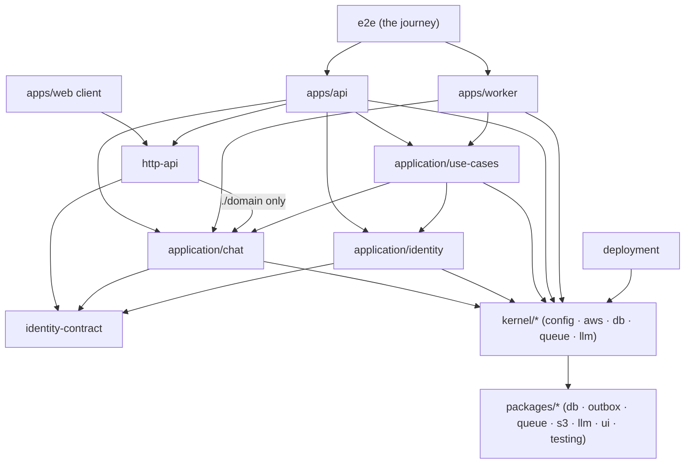

# Modular monolith — architecture

> Ticket: `2026-10-31-0926_modular-monolith` · Requirements: [feature.md](./feature.md)

## Overview

Today the workspaces are layers (`domain`, `application`, `infrastructure`) with a folder per
aggregate inside each. After the ticket the workspaces follow the business:

- `application/` holds every business rule: the modules `chat` and `identity`, each a workspace
  with a flat `domain/` and `infrastructure/`, and `use-cases`, one workspace above them with
  every use case. A module never imports another module, only its contract, and never the use
  cases; a flow that needs two modules is a use case.
- `kernel/*` is the app's foundation: the tools of `packages/*` configured for this app (its
  config, its AWS resources, its database with the migrations, its queue and language-model
  clients). It holds no business rule and knows no module.
- `packages/*` is configurable and knows no app, with no exception.
- `http-api` and the apps keep their role; only their imports change.



What may import what (✓ allowed, ✗ refused by Biome; a ✓ still needs the `package.json` entry):

| From ↓ / may import → | another module | a contract | `use-cases` | `kernel-*` | `packages/*` | `http-api` |
|---|---|---|---|---|---|---|
| a module's `domain/` | ✗ | ✓ | ✗ | ✗ | ✗ | ✗ |
| a module's `infrastructure/` | ✗ | ✓ | ✗ | ✓ | ✓ | ✗ |
| a contract | ✗ | ✗ | ✗ | ✗ | ✗ | ✗ |
| `use-cases` | ✓ (`domain`, `infrastructure`) | ✓ | — | ✓ | ✓ | ✗ |
| `kernel-*` | ✗ | ✗ | ✗ | ✓ (each other) | ✓ | ✗ |
| `packages/*` | ✗ | ✗ | ✗ | ✗ | ✓ (each other) | ✗ |
| `http-api` | `./domain` only | ✓ | ✗ | ✗ | ✗ | — |
| `apps/api`, `apps/worker` | ✓ | ✓ | ✓ | ✓ | ✓ | api only |
| `apps/web` client | ✗ | ✗ | ✗ | ✗ | `ui` | ✓ |

A module's `domain/` and a contract import only `effect` (and `type-fest` for types), so the
domain still ships to the browser through `http-api` and `make bundle-check` proves its services
and ports do not.

## Structure

Moves are `old → new`; **new** marks a file that does not exist today.

```
application/
  chat/                      @app-template/chat
    domain/                  ← domain/chat/*, domain/attachment/*, domain/shared/status.model.ts
    infrastructure/          ← infrastructure/chat/*, infrastructure/attachment/*
      chat.entity.ts           + chatSchema = snakeCase.schema('chat'), exported for drizzle-kit
      outbox.entity.ts         new: outbox = outboxTable(chatSchema)
      relations.ts             new: defineRelations over chats, messages, attachments
      db.ts                    new: ChatDb, the Drizzle typed by chat's relations
      outbox.ts                new: ChatQueueSender, ChatOutboxRelay
      assistant.llm.ts         keeps the prompts and the two purposes; AssistantModels builds
                               them through kernel-llm (assistant.client.ts goes)
    testing/                 ← domain/testing/{chat,attachment,assistant,repository-stack}*,
                               infrastructure/testing/chat.test-fake.ts; owner and stranger as
                               plain UserIds; ChatDbTest
    tests/domain/…  tests/infrastructure/…  e2e/infrastructure/…
  identity/                  @app-template/identity
    domain/                  ← domain/user/* (UserId and UserUnknownError leave for the contract)
    infrastructure/          ← infrastructure/user/*; + identitySchema, relations.ts, db.ts (IdentityDb)
    testing/  tests/  e2e/
    contract/                @app-template/identity-contract
      user.id.ts               UserId               ← domain/user/user.id.ts
      user.error.ts            UserUnknownError     ← domain/user/user.error.ts
      auth.ts                  CurrentUser, Auth    ← http-api/shared/security.ts
  use-cases/                 @app-template/use-cases  ← application/chat/*
    send-message.use-case.ts  generate-assistant-message.use-case.ts  generate-chat-title.use-case.ts
    testing/  tests/  e2e/   (delete-chat.e2e.ts, send-message.use-case.e2e.ts)
kernel/
  config/                    @app-template/kernel-config  ← packages/config
  aws/                       @app-template/kernel-aws     ← packages/aws,
                               infrastructure/shared/aws.client.ts, infrastructure/testing/aws.test-layer.ts
  db/                        @app-template/kernel-db
    db.client.ts               PgClientFromConfig     ← infrastructure/db/db.client.ts (its config half)
    migrate.ts                 the `make migrate` entry over `migrations/`
    drizzle.config.ts          new: schema ['application/*/infrastructure/*.entity.ts']
    migrations/                ← infrastructure/db/migrations/, + one new migration (D11)
    testing/                   e2e.test-setup.ts      ← infrastructure/testing/e2e.test-setup.ts
  queue/                     @app-template/kernel-queue
    queue.client.ts            QueueConsumerSqs       ← infrastructure/shared/queue.client.ts
    outbox.relay.ts            OutboxRelaySqs(table)  ← infrastructure/outbox/outbox.relay.ts (its SQS half)
  llm/                       @app-template/kernel-llm
    llm.client.ts              new: makeLanguageModel, the provider chosen by LlmConfig
packages/
  db/                        new  @app-template/db: makeDb, Transaction, decodeOptionalRow,
                               unwrapQueryError, orDie*, columns.ts, migrateDatabase(folder),
                               retryWhileUnreachable; testing/: TransactionTest, flipSqlError
  outbox/                    new  @app-template/outbox: outboxTable(schema), QueueSenderOutbox(table),
                               OutboxRelay(table, options)
  llm/                       + the Anthropic and stub builders from infrastructure/chat/assistant.client.ts
  testing/                   + epoch
http-api/                    imports chat/domain and identity-contract; shared/security.ts keeps
                             SchemaErrors; shared/errors.ts unchanged
apps/api, apps/worker        import paths; layer.ts provides per-module adapters (Contracts)
e2e/                         raw SQL names chat.outbox and chat.messages
```

Gone: the `domain` and `infrastructure` workspaces, the old `application` workspace (its folder
name is reused), `packages/config`, `packages/aws`, `domain/shared/id.ts` (`generateId`: its five
callers spell `crypto.randomUUIDv7().pipe(Effect.orDie, Effect.map(<Id>.make))`), the relation
`users.chats` (no reader), `DbWithUsersTest` (it existed for the two foreign keys to `users`).

Docs and rules: `docs/knowledge/decisions.md` (**new**, the living decisions document, R18) with a
pointer from `CLAUDE.md`; `docs/knowledge/architecture.md` rewritten (module map, dependency
rules, add a module, add an entity, a use case spanning modules); `database.md`, `tooling.md`,
`ai.md`, the glossary and the roadmap; `.claude/rules/modules.md` (**new**, the review rule of
D12); `application/CLAUDE.md` (**new**, from `domain/CLAUDE.md` and `infrastructure/CLAUDE.md`),
`kernel/CLAUDE.md` (**new**), `packages/CLAUDE.md` without its exceptions; `layering.md` paths.

## Contracts

**Package exports.** Each module's `package.json`:

```json
{
  "name": "@app-template/chat",
  "sideEffects": false,
  "exports": { "./domain": "./domain/index.ts", "./infrastructure": "./infrastructure/index.ts",
               "./testing": "./testing/index.ts" },
  "imports": { "#domain/*": "./domain/*.ts", "#infrastructure/*": "./infrastructure/*.ts",
               "#testing/*": "./testing/*.ts" }
}
```

The aliases are the same in every module, so one Biome override per layer covers every module
(verified in a sandbox: Bun, `tsc -b` and vitest resolve each alias to its own package). A module
with a nested contract sets `"exclude": ["contract"]` and references `./contract` in its
`tsconfig.json`; without both, `tsc -b` silently compiles the contract twice (verified).
`use-cases` exports `.` and `./testing` with `#use-cases/*`; each kernel package exports `.` and,
where it has test support, `./testing`.

**Service keys** read `@app-template/<package>/<layer>/<Name>`
(`'@app-template/chat/domain/ChatRepository'`), and `make bundle-check` greps
`@app-template/[a-z-]+/(domain|infrastructure)/[A-Za-z]*(Service|Repository|Bucket|Assistant)`.

**A module's database.** One `PgClient` and one pool; each module its own typed Drizzle:

```ts
// application/chat/infrastructure/db.ts
export class ChatDb extends Context.Service<ChatDb, EffectPgDatabase<typeof relations>>()(
  '@app-template/chat/infrastructure/ChatDb',
  { make: makeDb(relations) },              // packages/db
) { static readonly layer = Layer.effect(this, this.make) }
```

Two Drizzle instances over one `PgClient` run in the same transaction and roll back together
(verified in `feature.md › Context`), so `Transaction` from `packages/db` spans modules.

**A module's outbox.**

```ts
// application/chat/infrastructure/outbox.ts
export const ChatQueueSender = QueueSenderOutbox(outbox)   // packages/outbox: Layer<QueueSender, never, PgClient>
export const ChatOutboxRelay = OutboxRelaySqs(outbox)      // kernel-queue: over the stage, QueueConfig and SQS
```

`QueueSender` stays one service: a process provides each module's sender on the layers of the
use cases that send its jobs, never globally (`SendMessageUseCase.layer.pipe(Layer.provide(ChatQueueSender))`).

**The language model.**

```ts
// kernel/llm/llm.client.ts: the provider by LlmConfig; the purpose's settings come from the caller
export const makeLanguageModel: (purpose: {
  readonly anthropic: { readonly model: (config: AnthropicOptions) => string; readonly config: AnthropicConfig }
  readonly stub: { readonly text: string }
}) => Effect.Effect<LanguageModel.LanguageModel, Config.ConfigError, HttpClient.HttpClient>
```

**A use case that spans modules** (none today; the docs show the shape, R16):

```ts
// application/use-cases/delete-user.use-case.ts
const deleteUser = Effect.fn('DeleteUserUseCase.deleteUser')(function* (id: UserId) {
  yield* ChatService.deleteAllOf(id)
  yield* UserService.delete(id)
}, transaction.run)
```

**Biome overrides**, one per layer over every module, each repeating the relative-path ban:

| Override | Refuses |
|---|---|
| `application/*/domain/**` | `@app-template/**` but `*-contract`; `#infrastructure/**`; `@effect/**` but `@effect/vitest` |
| `application/*/infrastructure/**` | the other module packages, `use-cases`, `http-api`, the apps, `deployment` |
| `application/*/contract/**` | `@app-template/**` |
| `application/use-cases/**` | `http-api`, the apps, `deployment` |
| `kernel/**` | the module packages, `*-contract`, `use-cases`, `http-api`, the apps |
| `packages/**` | `kernel-*`, the module packages, `*-contract`, `use-cases`, `http-api`, the apps |
| `http-api/**` | `@app-template/**` but `*-contract` and `*/domain`; `@effect/**` |

The masks `!@app-template/*-contract` and `!@app-template/*/domain` work in Biome 2.5.15 (verified
in a sandbox). A list that names the module packages grows by one entry per module: the add-a-module
checklist says so.

**The migration.** One migration, generated once by hand with a rename hint per table and enum
(10): `ALTER TABLE … SET SCHEMA chat|identity` for the six tables, `ALTER TYPE … SET SCHEMA` for the
four enums, `CREATE SCHEMA` for both, and the two `DROP CONSTRAINT`s of the foreign keys to
`users`. `make migration` and `make migration-check` run from the root with
`--config kernel/db/drizzle.config.ts`, since drizzle-kit resolves its globs against the working
directory (verified).

## Seams

The behaviour must not change, so the seams are today's, at their new paths; the ticket adds the
migration's.

| Seam | Catches | Misses |
|---|---|---|
| `Api` through `ApiHttp` on the api test layer (`apps/api/tests/`) | statuses, cookies and the wire shape of every endpoint (R1) | the database, the queue, the worker |
| the OpenAPI document of `Api`, before and after | any change of a route, a schema or an error tag on the wire (R1) | runtime behaviour behind the routes |
| the journey `e2e/chat.e2e.ts` over `ApiLayer` and `WorkerLayer` | the wiring of both processes: a sent message gets its reply and its title, a deleted chat loses its rows and objects, the job sits in `chat.outbox` (R2, R3, R10) | which module or layer a fault comes from |
| a use case over memory layers, `TransactionTest` and `recordQueue()` (`application/use-cases/tests/`) | the flow's checks, writes and jobs (R2) | SQL, the real transaction |
| a use case's e2e on Postgres (`application/use-cases/e2e/`) | one transaction across chat's writes and its outbox, rolled back by a refused write (R10, R3) | the HTTP shape |
| a domain service over memory layers (`application/<m>/tests/domain/`) | the module's rules | the database's guards |
| a repository on its module's Drizzle (`application/<m>/e2e/infrastructure/`) | the SQL with the schema prefix, the module's relations, the partial unique index (R9) | other modules' tables |
| a worker handler (`apps/worker/tests/`) | attempts, the last attempt and the dead letter (R2) | SQS itself |
| `migrateDatabase` on a Postgres seeded by `main`'s migrations with a row per table (`kernel/db/e2e/`) | every row, index, in-module foreign key and cascade survives; the two foreign keys to `users` are gone (R4); a fresh database gets the same schema (R5) | a lock on a busy production table |
| `make check` with a throwaway import or table | each Biome override, the isolated linker, `tsc -b`, the bundle check (R11–R15) | what only the review rule names (D12) |

## Decisions

Each becomes a record in `docs/knowledge/decisions.md` (R18). The `Q…` are the answers in
`feature.md › Decisions from the grilling`; the architecture grilling of 2026-10-31 settled the
rest.

- **D1 — Partition by capability: `chat` and `identity` under `application/`; attachments stay in
  `chat`.** (Q2, Q3, Q18, Q22)
  - **Why:** a module owns what changes together; chat and attachments import each other in 8 + 3
    files, share the send's transaction and the delete's cascade.
  - **Cost accepted:** `chat` is the larger module until `shared-files` (16) splits `drive`.
  - **Reversal:** a later ticket moves files out with their tables; one migration.
  - **Rejected:**
    - a `drive` module now — makes the coupling two-way and the send a cross-module transaction.
    - the name `user` — reserved in Postgres; `identity` names the capability.
    - `modules/` as the folder — `application/` reads as "every business rule", the kernel as what
      binds it.

- **D2 — Every use case lives in `application/use-cases`, above the modules; a flow that spans
  modules is a use case, synchronous, and may commit their writes in one transaction; no events,
  facades or reactions between modules.** (Q27 rewritten, Q12, Q24, Q16)
  - **Why:** one path from the request to the last write, debuggable without following an event
    into a job handler; atomicity for free on one database; no module imports another.
  - **Cost accepted:** a capability's rules (its module) and its flows (`use-cases`) sit in two
    places; `use-cases` imports every module; moving a module to its own database later turns its
    shared transactions into events.
  - **Reversal:** a use case moves into a module, or a call becomes a job, one flow at a time.
  - **Rejected:**
    - reactions through jobs in the writer's outbox (Q27-A) — the request → event → job path is
      hard to debug in production.
    - use cases inside each module plus a layer for cross-module flows — two homes for use cases,
      and modules start importing each other's services.

- **D3 — A module contract is its own workspace in the module's folder, created with its first
  consumer: today `identity-contract` (`UserId`, `UserUnknownError`, `CurrentUser`, `Auth`).**
  (Q11, Q13)
  - **Why:** `chat` and `http-api` need these four and nothing else of identity; a package with no
    implementation is what lets them depend on identity without reaching its internals.
  - **Cost accepted:** a nested workspace needs `exclude` and a reference in its module's
    `tsconfig.json`; `Auth`, an HTTP middleware, lives outside `http-api`.
  - **Reversal:** one commit folds the contract back.
  - **Rejected:**
    - a `contract/` subpath export of the module — a consumer then declares the whole module and
      the linker no longer stops it reaching the rest.

- **D4 — A module holds a flat `domain/` and `infrastructure/`, the same `#domain/*`,
  `#infrastructure/*`, `#testing/*` aliases in every module, and an export per layer.** (grilling)
  - **Why:** four entities need no folder each; same aliases let one Biome override per layer
    cover every module; per-layer exports let `http-api` take `./domain` only and the bundle check
    match a layer.
  - **Cost accepted:** an import line `#domain/chat.model` does not name its module; the file's path
    does.
  - **Reversal:** a mechanical rename of imports.
  - **Rejected:**
    - a folder per entity in each layer — nesting for four entities.
    - an alias per module (`#chat/…`) — an override per module.

- **D5 — `packages/*` is configurable and knows no app; `kernel/*` is the same tools configured for
  this app, named `@app-template/kernel-*`; `config` and `aws` move to the kernel; no kernel
  package runs in the browser today.** (Q29 rewritten, grilling)
  - **Why:** the exceptions in `packages/` (the AWS inventory, the pinned images) and the wiring
    in `infrastructure/shared` and `infrastructure/db` are one kind of code: configuration of a
    tool for this app. A prefix keeps `packages/db` and `kernel/db` apart and lets Biome mask the
    kernel.
  - **Cost accepted:** five kernel workspaces and two new packages; 36 files change an import of
    `config` or `aws`; "no business rule in the kernel" rests on review.
  - **Reversal:** moving folders and renaming packages.
  - **Rejected:**
    - a kernel of browser-safe code only, the server side in `packages/` — `packages/db` would
      hold this app's migrations as one more exception.
    - a browser package `kernel-id` for `generateId` — a workspace for one line of Effect.
    - `RequestInvalidError` in the kernel — only `http-api`, `apps/api` and `apps/web` use it.

- **D6 — The language-model technology lives in `packages/llm` (the provider builders) and
  `kernel-llm` (the provider by `LlmConfig`); `chat` keeps only `AssistantLlm` with its prompts and
  the two purposes.** (grilling)
  - **Why:** the same split as the queue; `openai-provider` (19) and `bedrock-provider` (21) add a
    provider in one place for every module.
  - **Cost accepted:** one plan step that is not a move; `ai.md` changes.
  - **Reversal:** one commit moves the provider choice back into `chat`.
  - **Rejected:**
    - rename the port to `chat-agent` — "agent" is banned and "assistant" is on the wire
      (`author: 'assistant'`, `assistantMessage`, the SQS queue).
    - one word `assistant` for the package — a chat word in a package that knows no chat.

- **D7 — A Postgres schema per module (`chat`, `identity`); across modules a plain id column with
  no foreign key; the two foreign keys to `users` go.** (Q6, Q15, Q18, Q22)
  - **Why:** the schema shows the owner of every table; a foreign key across modules couples their
    deletes and migrations.
  - **Cost accepted:** a chat may outlive its user's row until a use case deletes both; against
    Exasol's "define foreign keys for all persistent relationships".
  - **Reversal:** a migration re-adds the keys.
  - **Rejected:**
    - a Postgres role and a pool per module — a pool per module to enforce what review checks.

- **D8 — One `PgClient` and one `Transaction`; each module declares its own typed Drizzle over its
  tables and relations.** (Q10)
  - **Why:** one `Db` typed by every table would import every module's entities into one place,
    and a relation across modules is impossible without importing another module's table.
  - **Cost accepted:** a join across modules is not expressible; a use case reads each module and
    joins in code.
  - **Reversal:** one commit.

- **D9 — Each module that sends jobs owns an outbox table in its schema, built by
  `outboxTable(schema)`; `QueueSender` stays one service, provided per module on its use cases.**
  (Q29, Q6 of this grilling)
  - **Why:** an outbox belongs to the module whose transaction writes it (R10); one service keeps
    the use cases and `recordQueue()` unchanged.
  - **Cost accepted:** a process that provides `QueueSender` globally sends every job to one
    outbox; a use case sending jobs of two modules needs per-module senders.
  - **Reversal:** one service per module (`ChatQueueSender` as a tag) is one change of the use
    cases.

- **D10 — HTTP groups stay in `http-api`, handlers in the apps; `RequestInvalidError` stays in
  `http-api`; `generateId` goes.** (Q17, Q26)
  - **Why:** a handler needs the assembled `Api`, which imports the groups: a module owning its
    handler would make a cycle. No module raises `RequestInvalidError`.
  - **Cost accepted:** a module's HTTP shape lives outside the module.
  - **Reversal:** none needed while `Api` assembles the groups.

- **D11 — One migration moves the tables and enums into their schemas, generated once by hand
  with rename hints; the journal stays in `drizzle`.** (R4, Q22)
  - **Why:** drizzle-kit needs a hint per renamed table and enum, and `make migration-check` runs
    without hints; verified on a seeded database that every row, index and cascade survives.
  - **Cost accepted:** `SET SCHEMA` takes `ACCESS EXCLUSIVE`; a deployed run sets `lock_timeout`.
  - **Reversal:** irreversible once deployed: a new migration moves the tables back.

- **D12 — The guards are `exports`, the isolated linker, `tsc -b`, Biome and the bundle check;
  what no configuration expresses (a cycle of modules through their contracts, a table, enum or
  trigger outside its owner's schema, a business rule in the kernel) is the review rule
  `.claude/rules/modules.md`, never hand-written test code.** (Q9, Q28 rewritten)
  - **Why:** every guard is configuration of a tool the repo has; a fitness test is code to keep.
  - **Cost accepted:** those three violations pass `make check` when review misses them.
  - **Reversal:** a test added later, beside the rule.
  - **Rejected:**
    - a module-graph test and a table-ownership test (code and catalog) — test code for rules
      review can hold.
    - dependency-cruiser — needs a TypeScript parser the repo lacks.

- **D13 — `Status` belongs to `chat`.** (Q30)
  - **Why:** only the chat and the message use it; `job-ledger` (22) gets a job vocabulary of its
    own, since `queued` means "sent to SQS" for a job and "reply in work" for a message.
  - **Cost accepted:** none today.
  - **Reversal:** one commit.

- **D14 — Tests change only in import paths, raw SQL schema prefixes and the setup that existed
  only for the foreign keys to `users`.** (Q5)
  - **Why:** proves behaviour kept (R1); chat's tests may not import identity, and with no foreign
    key they need no user row.
  - **Cost accepted:** none.
  - **Reversal:** not applicable.

- **D15 — The decisions live in `docs/knowledge/decisions.md`, which `CLAUDE.md` points to and
  every Biome message and review rule names.** (Q19, Q32)
  - **Why:** a session about to change a boundary reads why it exists first (R18).
  - **Cost accepted:** each decision is written twice: here as history, there as living rule.
  - **Reversal:** one commit.
  - **Rejected:**
    - `docs/adr/` — banned by `CLAUDE.md`.

## Risks

- **The old `application/` workspace and the new `application/` folder share a name.** A step that
  creates `application/chat` while the old `application/chat` exists would mix them. *Contained
  by:* the plan moves the old use cases to `application/use-cases` before any module lands.
- **The bundle check's grep keeps passing with the old pattern** once the service keys change, so
  a leak would go unseen. *Contained by:* the step that renames the keys proves the new pattern
  with a throwaway import of a service into the web app (R15).
- **A list of module packages in a Biome override misses a new module,** which then is not refused
  in the kernel or another module. *Contained by:* the isolated linker (an undeclared workspace
  fails with TS2307) and the add-a-module checklist in `architecture.md`.
- **What only review checks slips through** (a contract cycle, a table in the wrong schema, a
  trigger reaching another module, a rule in the kernel). *Contained by:* `.claude/rules/modules.md`,
  read by the Standards reviewer on every step; a foreign key or relation in code still fails as an
  import.
- **`QueueSender` provided globally** would send a module's jobs to another module's outbox.
  *Contained by:* the journey e2e finds the job in `chat.outbox` (R10); D9 and the add-a-module
  checklist forbid the global provide.
- **The schema move locks a table on a deployed database** (`ACCESS EXCLUSIVE`). *Contained by:* the
  migration sets `lock_timeout`; the migration e2e on seeded rows (R4).
- **Raw SQL with unqualified table names** (the journey names `outbox` and `messages`) breaks after
  the move. *Contained by:* the journey fails loudly; the step qualifies them.
- **A nested contract compiled twice** when its module's `tsconfig.json` lacks the `exclude` or the
  reference, silently. *Contained by:* the step that creates `identity-contract` sets both, and the
  add-a-module checklist names them.
- **`use-cases` becomes a bag of every flow.** *Contained by:* a use case's file name starts with
  its verb and object as today; when it passes a screenful of files, a folder per initiating module
  is a plain move.
