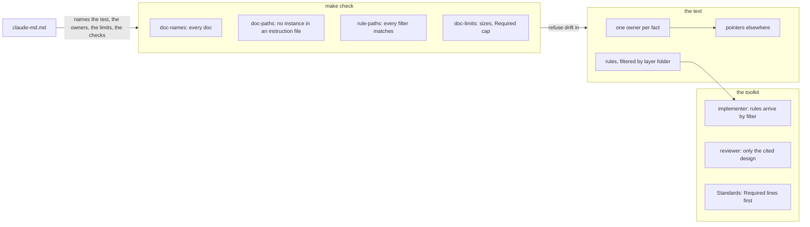

# Lean instructions — architecture

> Ticket: `2026-11-02-1820_lean-instructions` · Requirements: [feature.md](./feature.md)

## Overview

The ticket changes no code. It changes three things around it: the **text** of every Markdown
file outside `docs/tickets/` (patterns and pointers instead of instances), the **checks** in
`make check` that keep the text that way, and the **reading** the toolkit does per session (which
rules load where, what the implementer and the reviewers open).



The facts that shape the design, each from an experiment or a count (Claude Code 2.1.309):

- **A subagent loads instructions on its own.** It gets the root `CLAUDE.md` and the rules
  without `paths:` at its start, and loads a path-scoped rule or a nested `CLAUDE.md` when it reads
  or writes a matching file; it inherits nothing the main session loaded.
- **A rule arrives after the write that matched it.** When the first touch of a folder is a
  `Write` of a new file, that rule's text lands only after the file is written.
- **`git ls-files ':(glob)…'` matches what `paths:` matches for `*` and `**`, and nothing for
  braces**, which Claude Code expands and git does not.
- **The widened `doc-names` finds one failure today** (a tool name in a skill), so widening it is
  cheap.
- **The rules are partly layer-specific.** By section (characters ÷ 4): the deep repository
  section binds only the data layer (~520 tokens), the use-case, handler and flow sections of
  `layering.md` only use cases and apps (~490), the layers section of `effect-services.md` no
  domain file (~370).

Order of the work, for the plan: the baseline measurement first, on the tree as it stands; each
check lands in the step that makes the tree pass it; the levers last, measured against the
baseline. The ticket starts only after the `modular-monolith` ticket passes its verification.

## Structure

| Area | Change |
|---|---|
| `Makefile` | `doc-names` reads every `*.md` outside `docs/tickets/`, `repos/` and the roadmap; new `doc-paths`, `rule-paths`, `doc-limits`; `check` runs them |
| `.claude/rules/claude-md.md` | the test, the owner of each fact, the pattern, the numeric limits and the `**Required:**` cap, each check by its `make` target |
| `.claude/rules/*.md` | rewritten to patterns; filters by layer folder; a section whose layer its rule no longer loads in moves to one that does, or to a new rule named for the layer (the deep repository section, filtered to the data layer); up to 10 `**Required:**` lines |
| every `CLAUDE.md` | rewritten to patterns and pointers; the traps the audit found added where they bite |
| `.claude/agents/implementer.md` | rules arrive by filter; read a file of a folder before writing a new file in it |
| `.claude/agents/reviewer.md` | reads only the parts of the ticket's design the brief names; on Standards, the `**Required:**` lines that bind the diff first |
| `.claude/skills/ticket-implement/SKILL.md` | the review brief names the step's `D…` ids, its Seam and its Contracts entries; a `**Required:**` breach holds the commit |
| `docs/knowledge/*.md`, `README.md`, `.github/*.md` | each fact kept only in its owner; live names, counts and versions only in the doc that owns them |
| `docs/knowledge/tooling.md` | the table of `make` targets and the CI `links` job name the new checks |
| `docs/knowledge/decisions.md` | new record **Instructions name patterns** (D3, D5) |
| `docs/knowledge/sdd.md` | the dependency map, where a skill's or agent's reading changes |
| `docs/knowledge/roadmap.md` | entry `docs-diet` marked done |
| `deployment/local/README.md` | **deleted**: it retells `aws.md` (R6) |

### Owners of the facts told in several places

Each fact is stated once, in its owner; every other file points to it by name (R2). From the
audit and the count of 2026-11-02:

| Fact | Owner | Today also stated in |
|---|---|---|
| The rings, which folder holds what | `architecture.md › The three rings` | root `CLAUDE.md` map, `README.md`, the glossary, `application/CLAUDE.md` |
| Versions | the manifests (root `package.json`: `packageManager`, the catalogs); a doc says "the pinned version" | root `CLAUDE.md`, `README.md`, `effect.md`, `tooling.md`, `aws.md`, the PR example |
| The test layout | `tooling.md › Tests` | `architecture.md`, `README.md`, `naming.md`, `modules.md` |
| The resource naming | `aws.md` | `deployment/CLAUDE.md` |
| The dependency command | `tooling.md › Add a dependency` | root `CLAUDE.md` |
| The worktree ports | `tooling.md › Worktrees` | the block of `/ticket-implement` computes them and cites the table; `aws.md` |
| The database's guards | `database.md › Guards`; the repository's write contract stays in the rule that loads in the data layer; the why in `decisions.md` | `layering.md`, `effect-tests.md`, `architecture.md`, `README.md` |
| The data layer's types rule | `kernel/CLAUDE.md`; the why in `decisions.md` | `naming.md` |

A major version that changes what Claude writes (Effect 4 against the Effect 3 it remembers) is a
trap, not a version: it stays once, in the instruction file where it bites (R5).

## Contracts

The checks are the contracts other sessions rely on. Each prints one line per hit and exits 1;
an internal failure (a pattern that does not compile, a missing limit) exits 2.

```text
$ make doc-names     # R7
<file>:<line>: <path or name>
$ make doc-paths     # R8
<file>:<line>: <span>
$ make rule-paths    # R9
<rule>: <filter>
$ make doc-limits    # R10, R16
<file>: <lines> lines, over <limit>
.claude/rules: <n> **Required:** lines, over <cap>
```

**What `doc-paths` refuses** (D3), in the instruction files Claude reads (every `CLAUDE.md`,
`.claude/rules/`, `.claude/skills/`, `.claude/agents/`): a backticked span with no placeholder
(`<…>`), glob or space, not under `docs/`, `.claude/`, `.github/` or `repos/`, that is

- a path with a `/` ending in a source extension (`.ts`, `.tsx`, `.sql`, `.json`, `.css`), e.g.
  `shared/tags.ts`;
- a folder of depth three or more that is not the folder of an `exports` key of its workspace;
- a package specifier `@app-template/<path>` that is not an `exports` key;
- a bare file name with a source extension that matches exactly one tracked file (an instance,
  such as a snapshot); a role name present in several workspaces (`layer.ts`, `index.ts`,
  `package.json`) passes.

**The limits live in `claude-md.md`** (D5), in one line the check reads:

```md
- **Limits, checked by `make doc-limits`:** a `CLAUDE.md` 40 lines, a rule 80, and 10
  `**Required:**` lines across `.claude/rules/`.
```

**The review brief of a step** (D2), from `/ticket-implement` to each `reviewer`: the step id,
its `R…` ids, its `D…` ids, its Seam row and its Contracts entries. The reviewer locates each with
`grep -n` on the stable anchors (`- **D<n> —`, `## Seams`, `## Contracts`) and reads it with
offset and limit, as the implementer does.

## Seams

| Seam | Catches | Misses |
|---|---|---|
| `make doc-names`, `make doc-paths`, `make rule-paths`, `make doc-limits`, run on a planted probe and on the clean tree | each form R7–R10 and R16 name, red on the probe with file and line, green on the tree | whether a true, existing name merely retells the code (judged in review, R3, R4) |
| `make check` on the tree | the four checks wired into the gate and green together | the same as above |
| A move probe: a module folder moved and a file renamed, then `git grep` of the old names over the instruction files, then reverted | R1: no instruction file names an instance a refactor moves | a constraint that changed without a doc edit |
| The `InstructionsLoaded` log and the agents' transcripts, on the scenarios of D6, before and after | R12–R15: what loads and what is read, per lever, in the same units | whether Claude is guided as well with less (judged in review and the step ledger) |
| The Standards `reviewer`'s report on a probe diff that breaks a `**Required:**` line | R17: the breach is reported first, as hard, citing the line, and the commit is held | consistency over many runs: one run proves the path, not the rate |
| The step report's ledger: each removed line with its new home or "dropped:" and why, each trap added and where | R3, R5, R6: nothing lost silently | nothing beyond what the reviewer reads |

## Decisions

- **D1 — A rule's filter names the layer folders its subject lives in; a section moves to the
  rule that loads in its layer.** (answers Q1)
  - **Why:** a folder outlives a suffix, and `rule-paths` catches a folder that goes. Filters are
    anchored at the workspace (`application/*/services/**`), since `**/services/**` also matches
    `repos/`. A section whose subject sits in a layer its rule no longer loads in moves to a rule
    that does, or to a new rule named for that layer (the deep repository section, filtered to
    the data layer), so no line stops loading where it binds.
  - **Cost accepted:** a file of a new layer folder loads none of these rules until a filter names
    it; the rule files are regrouped by layer, a larger rewrite than changing filters alone.
  - **Reversal:** one commit (restore the filters and the sections).
  - **Rejected:**
    - a filter by file suffix (`*.service.ts`) — misses a file under a new suffix, and no check
      sees the miss;
    - narrowing the filters without moving sections — the domain loses the lines on how a rule
      is written, or keeps loading every rule.

- **D2 — `/ticket-implement` names the parts of the design a step cites; the reviewer reads only
  those.** (answers Q2)
  - **Why:** the skill knows the step, as it already does for the implementer; a reviewer that
    finds the parts from the step's text alone tends to open the whole file to be sure.
  - **Cost accepted:** a step that touches a decision it does not cite is reviewed without it;
    the reviewer may still open more when the diff touches a contract the cited parts do not
    quote, as the implementer may.
  - **Reversal:** one commit.
  - **Rejected:**
    - the reviewer finding the parts on its own — no cut it can be held to.

- **D3 — `doc-paths` refuses an instance by its shape, with the allowed anchors derived from the
  code, not listed.** (answers Q3)
  - **Why:** the instances that churned are source files and folders inside a unit; the stable
    anchors are the workspaces and their `exports` keys, and a role name sits in several
    workspaces. All three are read from the tree, so the check holds no copy that goes stale.
    Counted on today's tree: a depth rule alone misses `shared/tags.ts` and `openapi.json` and
    flags the package specifiers; an extension rule alone flags `layer.ts` and `index.ts`; the
    combined rule catches the three real instances and flags none of the anchors.
  - **Cost accepted:** a bare instance name without an extension (a folder named alone) passes;
    `doc-names` still fails it once it goes stale. Binds beyond the ticket: new record
    **Instructions name patterns** in `docs/knowledge/decisions.md`, landed with the check.
  - **Reversal:** one commit (drop the target).
  - **Rejected:**
    - an allowlist of names — itself a copy that goes stale;
    - prefixes plus depth below three alone (Q3's option A as written) — misses the real hits
      above.

- **D4 — At most 10 `**Required:**` lines across all rules, each from a breach the branch
  found.** (answers Q4)
  - **Why:** the weight of the marker comes from its rarity across the whole set; the lines are
    chosen in the step that rewrites the rules, each citing the review or feedback that found
    the breach (a rule written in a service's body, a check after a write).
  - **Cost accepted:** a costly constraint past the cap stays unmarked until another is demoted.
  - **Reversal:** one commit.
  - **Rejected:**
    - a cap per rule file — spreads the marks evenly whatever they cost.

- **D5 — The limits are numbers in `claude-md.md`, and `doc-limits` reads them from it.**
  - **Why:** R10 and R16 name "the limits the maintenance rule names", and one author per fact is
    the ticket's own rule: a second copy in the `Makefile` would drift unseen.
  - **Cost accepted:** the check depends on one line's shape; a reworded line makes it exit 2,
    loudly, until the shape is restored. The "about" goes: 40 and 80 become hard.
  - **Reversal:** one commit (move the numbers into `Makefile` variables).
  - **Rejected:**
    - the numbers in the `Makefile`, the rule pointing to them — a reader of the rule must open
      the `Makefile` to learn a limit.

- **D6 — The levers are measured on fixed scenarios, before and after, counting only the slice
  each lever targets.**
  - **Why:** an agent's whole context varies from run to run; the slice a lever targets does not.
    The baseline is taken in the first step, before any lever lands, with an `InstructionsLoaded`
    hook kept out of git:
    - R12: the reviewers of one committed behaviour step of `modular-monolith`, replayed
      uncommitted in a scratch worktree with the old and the new toolkit; the slice is what they
      read of the ticket's `architecture.md`;
    - R13: the implementer on the same replayed step; the slice is the rules it reads or loads;
    - R14: one session editing one `.ts` file of a module's `domain/` and one of its `services/`;
      the slice is the rules loaded.
  - **Cost accepted:** about six agent runs for R12 and R13, the replay of a real step on
    `opus`.
  - **Reversal:** none needed; it changes no file the ticket commits.
  - **Rejected:**
    - computing the cut from file sizes alone — blind to whether the agents read what the brief
      says.

- **D7 — The implementer relies on the filters, and reads a file of a folder before writing a
  new file in it.**
  - **Why:** the experiment shows a subagent loads path-scoped rules itself, but a rule matched
    first by a `Write` arrives after the file is written; reading a neighbour first loads the
    folder's rules in time.
  - **Cost accepted:** one extra read when a step starts a new folder; a rule whose filter misses
    a file the step writes no longer reaches the implementer at all, only the reviewer, who reads
    every rule from disk.
  - **Reversal:** one commit.
  - **Rejected:**
    - keeping the up-front read of every rule — 24% of the implementer's load, the cut R13 asks.

- **D8 — A breach of a `**Required:**` line holds the commit; the way out is a fix or a changed
  rule, never a waiver.**
  - **Why:** R17 asks for exactly this; a marker the user can wave through each time weighs as
    little as bold.
  - **Cost accepted:** a rule that is wrong for one case must be rewritten, with its record when
    it has one, before the step commits.
  - **Reversal:** one commit.

- **D9 — R14's 20% is held on a domain file; a services file's cut is shown, with no
  threshold.**
  - **Why:** the four rules are mostly about services, so a services file keeps most of them by
    D1; by section estimate a domain file loses about a quarter of its rule load and a services
    file about a tenth. Chasing 20% there would narrow `effect-schema.md` and `naming.md` too,
    at the risk of a rule not loading where it binds. The user accepted a smaller services cut
    at equal rule quality. Amends R15 and R14's acceptance in `feature.md`.
  - **Cost accepted:** a services edit still loads about 85–90% of today's rules.
  - **Reversal:** one commit (restore the threshold and narrow the two rules more).
  - **Rejected:**
    - narrowing six rules to reach 20% on services — about −20% by estimate, on the edge, and
      more filters that can miss;
    - dropping the lever — loses the domain's cut too.

## Risks

- **A narrowed filter misses a file it binds.** Claude writes that file without the rule, and
  `rule-paths` sees only a filter that matches nothing. *Contained by:* the Standards reviewer
  reads every rule from disk, whatever loaded; the filter table is reviewed with the step that
  sets it.
- **The rewrite drops a line Claude needed.** Guidance gets worse with less text, against the
  goal. *Contained by:* the step ledger (R3), review of each "dropped:", and the `**Required:**`
  lines for the costliest constraints.
- **R14's cut on a domain file falls under 20% once measured.** The estimate (about a quarter)
  rests on characters ÷ 4 and on which sections move. *Contained by:* D6 measures it; a lever
  under 20% where R15 requires it is reverted, as the 20% rule says (D9).
- **`doc-paths` flags an anchor nobody foresaw.** A writer bends the text around the check.
  *Contained by:* anchors derived from the tree (D3); a false positive is fixed in the check, not
  by an escape list.
- **The limits line in `claude-md.md` is reworded.** `doc-limits` exits 2. *Contained by:* the
  error names the line it expects (D5).
- **Text written before `modular-monolith` settles goes stale at once.** *Contained by:* the plan
  starts after that ticket's verification passes; the audit's drafts are a model, not a paste.
