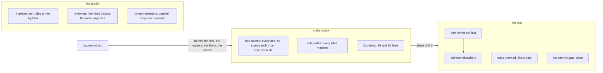

# Lean instructions — architecture

> Ticket: `2026-11-02-1820_lean-instructions` · Requirements: [feature.md](./feature.md)

## Overview

The ticket changes no code. It changes three things around it: the **text** of every Markdown
file outside `docs/tickets/` (patterns and pointers instead of instances, shorter rules, one owner
per fact), the **checks** in `make check` that keep the text that way, and the **reading** the
toolkit does per session (what the implementer, the reviewers and `/ticket-implement` load), and
how its agents split their work (who reads what, which pass owns which finding).



The facts that shape the design, from two experiments, a fresh audit and the official docs
(Claude Code 2.1.309):

- **A subagent loads instructions on its own.** It gets the root `CLAUDE.md` and the rules
  without `paths:` at its start, and loads a path-scoped rule or a nested `CLAUDE.md` when it reads
  or writes a matching file; it inherits nothing the main session loaded.
- **A rule arrives after the write that matched it**, and so does any hook's
  `additionalContext`: nothing reaches Claude before a `Write` of a new file.
- **Every `.ts` file of a module loads the same rule set**, about 9.6k tokens; a services file
  read after a domain file loads nothing more. A step pays for the union of its layers.
- **About 22% of the instruction tokens are retold facts or lines Claude gets right anyway**, by
  the fresh audit; the largest items are default Effect style in `effect-style.md`, the "where"
  column of `naming.md`'s file table, and `layering.md` and `modules.md` covering one subject.
- **The docs advise against emphasis markers**: current models over-apply an emphasised rule, and
  a rule that cannot bend belongs in a check or a hook.
- **The agents' runs** (234 runs of `modular-monolith`): every role earns its place, Depth most;
  the waste is overlap (Standards and Depth on shape; the bug hunt and Spec on the same bugs),
  findings about what only the main session writes, `/simplify` run inside the implementer, a
  verifier that reads the whole plan, and reports written in the user's style.
- **`git ls-files ':(glob)…'` matches what `paths:` matches for `*` and `**`, and nothing for
  braces**, which Claude Code expands and git does not.

Order of the work, for the plan: the baseline measurement first, on the tree as it stands; each
check lands in the step that makes the tree pass it; each lever is measured against the baseline
in the step that lands it. The ticket starts only after the `modular-monolith` ticket passes its
verification.

## Structure

| Area | Change |
|---|---|
| `Makefile` | `doc-names` reads every `*.md` outside `docs/tickets/`, `repos/` and the roadmap, and refuses a source path in an instruction file; new `rule-paths` and `doc-limits`; a target that sets up a parallel step's worktree; `check` runs the new checks |
| `.claude/rules/claude-md.md` | the test, the owner of each fact, the pattern, the limits line, each check by its `make` target; its toolkit section cut to what `docs/knowledge/sdd.md` does not hold |
| `.claude/rules/*.md` | rewritten to patterns and trimmed; filters kept; `layering.md` and `modules.md` merged or split so each subject has one file; the Effect-4 trap first in `effect.md` |
| every `CLAUDE.md` | rewritten to patterns and pointers; the traps the branch found added where they bite |
| `.claude/rules/sdd.md` | owns the commit gate |
| `.claude/agents/implementer.md` | rules arrive by filter; read a file of a folder before writing a new file in it; no stash, checkout, commit or `/simplify`; `plan.md` is the main session's |
| `.claude/agents/reviewer.md` | reads only the design parts and the rules the brief names; per axis, the findings it owns |
| `.claude/agents/verifier.md` | reads `feature.md`, its acceptance and `architecture.md › Contracts`, not `plan.md` |
| every agent | the report is for the main session: English, no status block; a reviewer's finding in one shape |
| `.claude/skills/ticket-implement/` | `SKILL.md` keeps the main session an orchestrator that decides on reports, names the step's design parts and matching rules in the review brief, splits the axes, runs `/simplify` itself and the one hunt pass by its condition, asks the commit question once per session, and points to **new** `parallel-steps.md`; the worktree setup becomes a **new** script beside it |
| the other skills, the agents | the commit gate as a pointer; patterns |
| `docs/knowledge/*.md`, `README.md`, `.github/*.md` | each fact kept only in its owner; live names, counts and versions only in the doc that owns them |
| `docs/knowledge/tooling.md` | the table of `make` targets and the CI `links` job name the new checks and the worktree target |
| `docs/knowledge/decisions.md` | new record **Instructions name patterns** (D3) |
| `.claude/skills/ticket-verify/SKILL.md`, `.claude/agents/verifier.md` | one verifier per group of requirements, in parallel; the main session merges the verdicts |
| `docs/knowledge/sdd.md` | the dependency map and the approval gate, where reading or gating changes |
| `docs/knowledge/roadmap.md` | entry `docs-diet` marked done |
| `deployment/local/README.md` | **deleted**: it retells `aws.md` (R6) |
| `docs/tickets/_template/{feature,architecture,plan}.md`, `.claude/skills/ticket-{feature,architecture,plan}/SKILL.md` | what a requirement, a design entry and a step name concretely, and what they leave to a pattern, a grep or a check (D15) |

### Owners of the facts told in several places

Each fact is stated once, in its owner; every other file points to it by name (R2).

| Fact | Owner | Also stated in, at design time (the step re-finds them by `git grep`) |
|---|---|---|
| The rings, which folder holds what | `architecture.md › The three rings` | root `CLAUDE.md` map, `README.md`, the glossary, `application/CLAUDE.md` |
| Versions | the manifests (root `package.json`: `packageManager`, the catalogs); a doc says "the pinned version" | root `CLAUDE.md`, `README.md`, `effect.md`, `tooling.md`, `aws.md`, the PR example |
| The test layout | `tooling.md › Tests` | `architecture.md`, `README.md`, `naming.md`, `modules.md` |
| The resource naming | `aws.md` | `deployment/CLAUDE.md` |
| The dependency command | `tooling.md › Add a dependency` | root `CLAUDE.md` |
| The worktree ports | `tooling.md › Worktrees`; the setup script computes them | the block of `/ticket-implement`, `aws.md` |
| The database's guards | `database.md › Guards`; the repository's write contract stays in the rule that loads in the data layer; the why in `decisions.md` | `layering.md`, `effect-tests.md`, `architecture.md`, `README.md` |
| The data layer's types rule | `kernel/CLAUDE.md`; the why in `decisions.md` | `modules.md`, `naming.md` |
| The commit gate | `sdd.md › Gates` | `commits.md`, `pull-requests.md`, the five skills, `implementer.md`, `claude-md.md` |

A major version that changes what Claude writes (Effect 4 against the Effect 3 it remembers) is a
trap, not a version: it stays once, first in `effect.md`, in plain words (R5, D4).

## Contracts

The checks are the contracts other sessions rely on. Each prints one line per hit and exits 1;
an internal failure (a pattern that does not compile, a missing limits line) exits 2. None reads
`repos/`, which holds a tracked vendored skill.

```text
$ make doc-names     # R7, R8
<file>:<line>: <path or name>
<file>:<line>: <source path>, write the pattern
$ make rule-paths    # R9
<rule>: <filter>
$ make doc-limits    # R10
<file>: <lines> lines, over <limit>
```

**The source path `doc-names` refuses** (D3): in an instruction file (every `CLAUDE.md`,
`.claude/rules/`, `.claude/skills/`, `.claude/agents/`), a backticked span with a `/`, ending in
`.ts`, `.tsx` or `.json`, with no `<…>` placeholder, no glob and no `@app-template/` prefix.

**The limits line in `claude-md.md`** (D5), which `doc-limits` reads:

```md
- **Limits, checked by `make doc-limits`:** a `CLAUDE.md` 40 lines, a rule 80.
```

**A rule's filter** uses only `*` and `**`; a brace matches nothing in git, so `rule-paths` fails
it.

**The review brief of a step** (D2), from `/ticket-implement` to the Standards and Spec
`reviewer`: the step id, its `R…` ids, and the `D…` ids, Seam row and Contracts entries the step's
own lines name; to the Standards reviewer also the rules `make review-rules` prints, those without
`paths:` and those whose filter matches a file of the uncommitted diff, untracked files and both
sides of a rename included. The reviewer locates each design part with `grep -n` on the stable
anchors (`- **D<n> —`, `## Seams`, `## Contracts`) and reads it with offset and limit, as the
implementer does. The Depth reviewer keeps its own sources: `deep-modules.md`,
`docs/knowledge/architecture.md` and the records it must not re-open.

**The commit question** (D8), asked by `/ticket-implement` once, at the first step of a session:
commit each ready step without the user's OK, or wait for it. A step is ready when its reviews
ran, their fixes are in and `make check` is green. Pushing, a PR and a merge always wait.

**The passes of a step's review** (D11, D12), in order: the implementer reports; on a behaviour
step the main session runs `/simplify`; then in parallel Standards (the binding rules of
`.claude/rules/` and the touched `CLAUDE.md` files), Spec (the step and its requirements; an edit
only the main session may make is no finding), Depth on a behaviour step (the shape), and the hunt
pass (correctness bugs and silent failures in one brief) when the step touches a write guard, a
transaction, a test fake, concurrent access or error handling.

**A reviewer's finding** (D13), the one shape the main session forwards without reading the
code:

```text
- <path>:<line> — <rule or requirement> — hard | judgement — <the proposed fix>
```

**The parallel-steps path** (D9): `SKILL.md` keeps one line, "for steps run in parallel, read
`parallel-steps.md` beside this file"; that file holds today's section, and the worktree setup
runs as `make <target> N=<n> NAME=<name>` over a script in the skill's folder, with the same
refusals and the same `.env` it writes today.

## Seams

| Seam | Catches | Misses |
|---|---|---|
| `make doc-names`, `make rule-paths`, `make doc-limits`, run on a planted probe and on the clean tree | each form R7–R10 name, red on the probe with file and line, green on the tree | whether a true, existing name merely retells the code (judged in review, R3, R4) |
| `make check` on the tree | the checks wired into the gate and green together | the same as above |
| A move probe: a module folder moved and a file renamed, then `git grep` of the old names over the instruction files, then reverted | R1: no instruction file names an instance a refactor moves | a constraint that changed without a doc edit |
| The `InstructionsLoaded` log and the agents' transcripts, on the scenarios of D6, before and after | R12–R16: what loads and what is read, per lever, in the same units | whether Claude is guided as well with less (judged in review and the ledger) |
| `/doctor prompt-audit`, run by hand at verification | R2: contradictions and dead references across the instruction files | facts retold in agreement |
| `make <worktree target>` in a scratch worktree, against the old block's output | R16: the same refusals, ports and stage in the written `.env` | a parallel run end to end |
| A new session's first `/ticket-implement` step, then its second | R17: the question asked once, the answer held | the gate's wording in every pointer (judged by `git grep`) |
| The next real steps and verification after the step that lands R18–R20, read in their transcripts | R18–R20: the verifier reads no `plan.md`; no Spec finding on a `plan.md` edit; no finding reported by two axes; no hunt outside its condition; no `/simplify` call in the implementer; reports in English without the status block | quality over many steps: a few runs prove the path, not the rate |
| The next steps' main-session transcript and the next verification's timing | R21, R22: no source file or diff read by the main session to write a fix round; findings in the four fields; verifiers in parallel, verdicts sooner than 33 min | whether a forwarded finding needed the main session's own reading (judged when a round misfires) |
| Review of the step that lands R23, against `research.md` | R23: each template and skill rule traced to its evidence; nothing load-bearing dropped | whether later tickets amend their artifacts less (seen over the next tickets) |
| The step report's ledger: each removed line with its new home or "dropped:" and why, each trap added and where | R3, R5, R6, R14: nothing lost silently | nothing beyond what the reviewer reads |

## Decisions

- **D1 — R14's cut comes from trimming the rules' text; the path filters stay as they are.**
  (answers Q1)
  - **Why:** every `.ts` file of a module loads the same rule set, and a step edits several
    layers, so it pays for their union: filters by layer would save only what no layer of the
    step needs, about 10–14% for services. Trimming the retold and default-style lines cuts about
    30% of that load on every edit, with no filter that can miss a file.
  - **Cost accepted:** each rule is rewritten line by line, judged by the ledger; a domain-only
    edit loads lines it does not need.
  - **Reversal:** one commit per rewritten rule (restore its text).
  - **Rejected:**
    - filters by layer folder, with sections moved between rules — a small cut per step, a
      regrouping, and a filter that can miss a file it binds;
    - filters by file suffix — misses a file under a new suffix, and no check sees it.

- **D2 — `/ticket-implement` names what a reviewer reads: the design parts the step cites, and on
  Standards the rules that match the diff.** (answers Q2; R12)
  - **Why:** the skill knows the step and the diff; a reviewer left to find them opens the whole
    design and every rule to be sure. A rule whose filter matches no diff file cannot bind it.
  - **Cost accepted:** a step that touches a decision it does not cite is reviewed without it; a
    reviewer still opens more when the diff touches a contract the cited parts do not quote; a
    contract the step's files reach but its lines do not name is read only when the diff touches
    it; the Standards reviewer reads each bound rule whole (S3: 4.8 times its old rule reading),
    so it can be held to naming each.
  - **Note (S3):** worded "its Contracts entries of its files", the first replay handed the Spec
    reviewer eight parts for a step citing one and read 22% more than the baseline; the brief now
    names what the step's own lines name, and `make review-rules` lists the rules.
  - **Reversal:** one commit.
  - **Rejected:**
    - the reviewer finding the parts on its own — no cut it can be held to.

- **D3 — No concrete source path in an instruction file: one pattern in `doc-names`.** (answers
  Q3; R8)
  - **Why:** the instances that churned are source files (`shared/tags.ts`); one pattern refuses
    them, and `doc-names` already fails any other stale name after a rename. The record
    **Instructions name patterns** in `docs/knowledge/decisions.md` says why, landed with the
    check.
  - **Cost accepted:** a bare file name or a folder instance passes until it goes stale; R1's probe
    finds those at verification.
  - **Reversal:** one commit (drop the pattern).
  - **Rejected:**
    - a separate `doc-paths` with anchors derived from `exports` and depth — four heuristics for
      three hits;
    - an allowlist of names — itself a copy that goes stale.

- **D4 — No emphasis markers; the costliest trap leads its file in plain words.** (answers Q4)
  - **Why:** the docs say emphasis makes current models over-apply a rule and that a rule which
    cannot bend belongs in a check; the branch shows no costly breach a mark would have stopped.
    The costliest trap, checking an Effect API against `repos/effect` rather than memory of
    Effect 3, moves to the first line of `effect.md`, at no cost in tokens.
  - **Cost accepted:** nothing marks a line as heavier than its neighbours; weight comes from
    order and brevity.
  - **Reversal:** one commit.
  - **Rejected:**
    - `**Required:**` marks with a cap, a check and a hard stop on a breach — machinery for an
      unevidenced problem, and the hard stop took the decision from the user.

- **D5 — The limits are numbers in `claude-md.md`, and `doc-limits` reads them from it.**
  - **Why:** R10 names the limits the maintenance rule states; one author per fact is the
    ticket's own rule, and a second copy in the `Makefile` would drift unseen.
  - **Cost accepted:** the check depends on one line's shape; a reworded line makes it exit 2,
    naming the line it expects. The "about" goes: 40 and 80 become hard.
  - **Reversal:** one commit (move the numbers into `Makefile` variables).
  - **Rejected:**
    - the numbers in the `Makefile`, the rule pointing to them — a reader of the rule must open
      the `Makefile` to learn a limit.

- **D6 — The levers are measured on fixed scenarios, before and after, counting only the slice
  each lever targets.**
  - **Why:** an agent's whole context varies from run to run; a slice a lever targets varies less,
    and a reviewer's reading still varies, so it is the mean of two runs. The baseline is taken
    in the first step, before any lever lands, with an `InstructionsLoaded` hook kept out of git,
    in `acceptEdits` (in `bypassPermissions` an agent edits through Bash and no filter fires):
    - R12: the reviewers of one committed behaviour step of `modular-monolith`, replayed
      uncommitted in a scratch worktree; the slice is what the Spec reviewer reads of the
      ticket's `architecture.md`; the Standards reviewer is held to citing the rules that bind
      the diff, since it reads no design and, given those rules, reads more than it did;
    - R13: the implementer on the same replayed step, rerun once the rules are trimmed; the slice
      is the rules it reads or loads, all through the filters already;
    - R14: one session that edits a `.ts` file of a module's `domain/`, then one of its
      `services/`; the slice is the rules and `CLAUDE.md` loaded;
    - R16: the text `/ticket-implement` loads on a one-step run.
  - **Cost accepted:** about six agent runs for R12 and R13, the replay of a real step on
    `opus`.
  - **Reversal:** none needed; it changes no file the ticket commits.
  - **Rejected:**
    - computing the cut from file sizes alone — blind to whether the agents read what the brief
      says.
  - **Note (S1, the user's word):** the baseline found the Standards reviewer reading no design
    and at most three rules, the implementer reading no rule up front, and a reviewer's slice
    doubling between runs; R12's cut moved to the Spec reviewer and R13's to after the trims.
    Rejected: keeping a cut for each reviewer, which the lever would miss or reverse.

- **D7 — The implementer relies on the filters, reads and edits through the file tools, and
  reads a file of a folder before writing a new file in it.** (R13)
  - **Why:** a subagent loads path-scoped rules itself, but only on `Read`, `Edit` and `Write`: an
    edit through Bash, which `bypassPermissions` steers to, loads none (S1: 3 rules instead of
    13); and a rule matched first by a `Write` arrives after the file is written, so reading a
    neighbour first loads the folder's rules in time.
  - **Cost accepted:** one extra read when a step starts a new folder; a rule lost to the
    implementer's own compaction returns only at its next matching file.
  - **Reversal:** one commit.
  - **Rejected:**
    - keeping the up-front read of every rule — 24% of the implementer's load by the audit; S1
      found the implementer skipping it already;
    - a hook that injects the rule before a write — the docs place hook context after the tool
      result, so it cannot.

- **D8 — The commit gate lives in `sdd.md › Gates`, and `/ticket-implement` asks once per session
  whether ready steps commit without the user's OK.** (R17)
  - **Why:** the gate is told in ten files and they say "only on the user's OK", while the user
    commits ready steps without one; contradicting instructions let Claude pick either. Asking
    once keeps the choice the user's in each session, and a team adopting the template keeps the
    strict answer by giving it.
  - **Cost accepted:** a new session asks again; a session that forgets its answer after
    compaction asks again.
  - **Reversal:** one commit.
  - **Rejected:**
    - "only on the user's OK" everywhere — slows every step and no longer matches the practice;
    - commit without asking, always — a team adopting the template loses the gate silently.

- **D9 — `/ticket-implement` keeps its parallel-steps procedure in a file beside it and the
  worktree setup in a script run through `make`.** (R16)
  - **Why:** the section is 60% of the skill and most runs execute one step; the docs advise
    supporting files read on demand. A script runs the same each time, where a block copied from
    text into a prompt can drift.
  - **Cost accepted:** a parallel run reads one more file; the script is code the ticket adds,
    reviewed as a behaviour step.
  - **Reversal:** one commit (inline the file and the block again).
  - **Rejected:**
    - a separate skill for parallel steps — splits one procedure across two entry points.

- **D10 — Each agent's definition says what it reads and what it leaves to the main session; its
  report is written for the main session.** (R18)
  - **Why:** the runs show agents doing what is not theirs: Spec flagging `plan.md` edits only the
    main session makes, the implementer stashing to run e2e, the verifier reading the whole plan
    twice; and the user's global style rule reaches every subagent, so reports carry a Russian
    status block the main session then retells. A line in the agent's file holds for every brief,
    so the main session stops repeating it in each prompt.
  - **Cost accepted:** the verifier no longer sees the steps' findings; what binds beyond the
    ticket is in `decisions.md`, and the Spec axis of verification still reads the branch.
  - **Reversal:** one commit.
  - **Rejected:**
    - repeating the limits in each brief — the drift the runs show.

- **D11 — Each finding has one owning pass: Standards the binding rules, Depth the shape; the bug
  hunt and the silent-failure hunt run as one pass, only where such bugs live.** (R19)
  - **Why:** Standards' judgement calls repeated Depth's in 3 of 5 sampled steps; the bug hunt
    found a real bug once in 12 runs, on a step with test fakes, and Spec found it too; the
    silent-failure hunter found none in 3. A condition on what the step touches keeps the hunt
    where it paid.
  - **Cost accepted:** a step outside the condition gets no dedicated bug hunt; Spec and Depth
    still read it.
  - **Reversal:** one commit.
  - **Rejected:**
    - dropping the hunt — it found the one real bug class (fakes diverging from Postgres);
    - keeping both hunts on every behaviour step — two reports with nothing in them most of the
      time.

- **D12 — The main session runs `/simplify`, after the implementer and before the review; the
  implementer never runs it.** (R20)
  - **Why:** the skill always said so, but the main session's prompts told the implementer to run
    it, so the same agent judged its own simplifications, and one deleted a needed function
    (restored a round later). Run before the review, its edits meet fresh reviewers.
  - **Cost accepted:** none beyond the main session's one call.
  - **Reversal:** one commit.
  - **Rejected:**
    - `/simplify` as a review pass that only proposes deletions — the same function, one fix
      round later.

- **D13 — The main session orchestrates: it decides on the agents' reports and forwards findings
  by `path:line`; whatever needs the code goes to an agent.** (R21)
  - **Why:** the orchestrator-workers pattern keeps the orchestrator's context for decisions and
    gives the reading to workers with their own context (Anthropic, *Building effective agents*
    and the multi-agent research system). In `modular-monolith` the main session read diffs and
    code to restate findings the reviewers had already located, peaking at 530k tokens with 14
    compactions. One finding shape lets it forward a finding as is.
  - **Cost accepted:** the main session judges a contested finding without reading the code
    itself; such a finding goes to a `researcher` or to the user.
  - **Reversal:** one commit.
  - **Rejected:**
    - clearing the main session between steps — it is also the user's conversation, and the user
      keeps it;
    - letting agents write the code of one step together — a step is coupled work, which loses
      detail at every hand-off.

- **D14 — `/ticket-verify` runs one verifier per group of requirements in parallel; the Spec
  review of the branch still reads them all.** (R22)
  - **Why:** verification waits on its longest agent, one verifier over every requirement (33 min
    in run 2); groups are independent reading work, the case parallel agents fit best. The Spec
    review over the whole branch keeps the view across groups.
  - **Cost accepted:** more agents and tokens per verification (the user values time over tokens);
    a problem between two groups rests on the Spec review.
  - **Reversal:** one commit.
  - **Rejected:**
    - one verifier, as today — the slowest stage of a ticket.

- **D15 — The ticket templates get a light edit, not a restructure: a step pins its outcome,
  its constraints, its decided names and traps, and a check proven red first; the rest is found by
  `git grep` at the step.** (R23)
  - **Why:** `research.md`: the artifacts of `modular-monolith` were amended again and again for
    restated code (file lists, configs, paths), and once for changed behaviour; the implementer
    found every file a list missed, while decided names, invisible traps and red-first checks were
    what it could not do without. The external sources agree: name what the agent cannot read from
    the repo, give it a check, keep the rest short. The templates already separate what from how
    and put a check on every step, so only the parts that copy the code change.
  - **Cost accepted:** a step whose file list is a start, not the bound, relies on the
    implementer's leftover grep and on review to find the rest; the `Conforms` check of
    `/ticket-plan` has fewer literals to check.
  - **Reversal:** one commit (restore the template lines).
  - **Rejected:**
    - a restructure toward a spec-only form, with no paths in the plan either — loses the decided
      names and traps that were load-bearing;
    - leaving the templates as they are — keeps the amendments for no gain in results;
    - keeping lesson L2's cure (`/ticket-plan` lists every file `git grep` finds) — it served the
      size estimate and the reviewer's expectations, which S5's size estimate per step and the
      step report's list of files now serve, and it produces the longest lists.

## Risks

- **The rewrite drops a line Claude needed.** Guidance gets worse with less text, against the
  goal. *Contained by:* the step ledger (R3, R14), review of each "dropped:", and the measured
  slices compared with the step's behaviour in later sessions.
- **The trimmed rules miss 20% on a module's `.ts` edit.** The 30% is the audit's estimate.
  *Contained by:* D6 measures it in the step that trims; a shortfall is reported, and the step
  cuts further or the lever is reported under the threshold for the user's call.
- **A reviewer misses a rule because its filter is too narrow.** With D2 the Standards reviewer reads
  the rules whose filter matches the diff, not a fixed list. *Contained by:* the filters stay as broad as today (D1); `rule-paths`
  catches a filter that matches nothing.
- **The verifier misses a detail only the plan records.** A step's finding that changed what a
  requirement means is lost to verification. *Contained by:* a finding that changes a requirement
  edits `feature.md` in the same commit (`sdd.md`), and a binding one `decisions.md`.
- **The worktree script diverges from the block it replaces.** A parallel step gets wrong ports
  or a shared `.env`. *Contained by:* the R16 seam compares the script's `.env` with the old
  block's on a scratch worktree, refusals included.
- **The limits line in `claude-md.md` is reworded.** `doc-limits` exits 2. *Contained by:* the
  error names the line it expects (D5).
- **A step with less listed detail drifts.** The implementer misses a file or picks a name the
  plan meant to fix. *Contained by:* the step still pins decided names and traps (D15), its check
  is proven red first, the leftover grep and the Spec axis find a missed file; a recurrence brings
  the list back for that kind of step (`research.md`).
- **Text written before `modular-monolith` settles goes stale at once.** *Contained by:* the plan
  starts after that ticket's verification passes.
