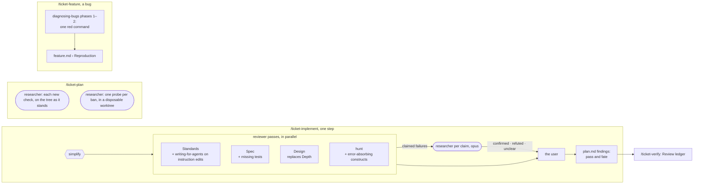

# Toolkit quality — architecture

> Ticket: `2026-11-04-1009_toolkit-quality` · Requirements: [feature.md](./feature.md)

## Overview

The ticket changes no code. It changes what the toolkit's review and plan passes look for, what a
finding must carry before it reaches the user, and what the ticket records about each pass. Every
change lands in a skill, an agent file or a template; `make check` guards their text as it does
today.



The facts that shape the design (researcher, 2026-11-04):

- **A guard cannot be probed without a file in a tree.** `biome check --stdin-file-path` reports
  no diagnostic of any rule or plugin, clean input included; a temporary copy of Biome's config
  fires both kinds of ban, but `tsc -b`, the tests and the bundle check read only the tree's
  files. A fresh worktree is ready in 7 to 9 s, mostly `bun install`.
- **A background agent's wall time reaches the main session** in its task notification, as
  `duration_ms`; the launch result holds none.
- **`claude -p` loads the `CLAUDE.md` of a temporary folder** without a trust prompt, and a run on
  haiku with `--setting-sources project` takes about 4.5 s; one line ("answer in uppercase")
  changed the answer.
- **`diagnosing-bugs` phase 1 ends in one red-capable command already run once**; when none can
  be built it stops and asks the user for an environment, an artifact or instrumentation.
  `writing-for-agents` settles its no-op test "by running the document, not by debate".
  Both from `mattpocock-skills` 1.3.1.

Order of the work, for the plan: the ledger's finding format first, so every later step of this
ticket records its passes (R12); each pass's change in the step that rewrites its brief; the
replay last, in a fresh session, once every change has landed (R11).

## Structure

| Area | Change |
|---|---|
| `.claude/agents/reviewer.md` | **Design** replaces Depth (D1); the hunt asks of each error-absorbing construct what it hides (R4); a behaviour finding carries its failure scenario and whether it is shown (D3); Spec owns a missing test (D3); Standards on an instruction edit also judges by `writing-for-agents` (D6) |
| `.claude/skills/ticket-implement/SKILL.md` | the Design brief and its sources; the Standards brief names `writing-for-agents` when the diff touches an instruction file; step 4 confirms each claimed failure before presenting it (D4); step 5 writes each finding's pass and fate (D9) |
| `.claude/skills/ticket-implement/design-examples.md` | **new**: do and don't pairs on a neutral entity, one per lens, pointing to the rule examples and records they rest on (D2) |
| `.claude/agents/researcher.md` | may work in a disposable worktree the brief names and run `claude -p` in a temporary folder (D5, D6); a confirmation answers `confirmed`, `refuted` or `unclear` (D4) |
| `.claude/skills/ticket-plan/SKILL.md` | step 4's check runs every check for new work on the tree as it stands, and every probe of a guard-changing step in a disposable worktree; the probes and their failing output stay in `plan.md` (D5) |
| `.claude/skills/ticket-feature/SKILL.md` | a bug ticket starts from one red command, before the grilling (D7) |
| `docs/tickets/_template/feature.md` | a `## Reproduction` section, kept only by a bug ticket (D7) |
| `docs/tickets/_template/plan.md` | the findings line with pass and fate; a guard-changing step's probe list (D5, D9) |
| `.claude/skills/ticket-verify/SKILL.md`, `docs/tickets/_template/verification.md` | a **Review ledger** per pass, summed from `plan.md` (D9) |
| `docs/knowledge/sdd.md` | the dependency map (`writing-for-agents` through `reviewer`, `diagnosing-bugs` through `/ticket-feature`, the probe worktree), the override row of `improve-codebase-architecture`, and the commit-gate paragraph on passes |
| `docs/knowledge/roadmap.md` | entry 25's status; the note to re-count each zero-catch check of `make check` after three or four tickets |
| this ticket's `replay.md` | **new**: the replay's table and reports (D8) |

The implementer's file gains nothing: `writing-for-agents` stays out of it (out of scope, R9).

## Contracts

**A finding about behaviour** (R5, D3), from Spec or the hunt. The scenario is an input and the
wrong outcome it gets; `shown` names the command or test output that shows it, `claimed` means
none was run. A behaviour finding without a scenario and a `path:line` is not reported.

```text
- `path:line` — <R… or bug> — <input> → <wrong outcome> — shown: <command> | claimed — <fix>
```

A rule finding of Standards, and any other finding not about behaviour, keeps today's line
(`path:line` — rule — hard | judgement — fix).

**A Design candidate** (R1, R2), at most five per step, most valuable first:

````text
### <n>. <lens>: <the change, one line> — Strong | Worth exploring | Speculative

`path:line` · <cohesion or coupling: what moves together, or what one module stops knowing>

```ts
// before
```

```ts
// after
```
````

The lenses are R1's four: a narrower interface, composition in place of a wrapper per case, a
pure function taken out of an effect, a shorter or plainer implementation. Import direction is no
lens: Biome's bans own it.

**The Design brief** (R3): the step id, the diff command, the diff's files and their callers,
`design-examples.md` by its path, `.claude/rules/deep-modules.md`,
`docs/knowledge/architecture.md`, and the records of `docs/knowledge/decisions.md` and the
ticket's `D…` it must not re-open without real friction; no question of its own.

**A confirmation** (R6, D4): the main session sends each `claimed` finding, verbatim, to its own
`researcher`, all in parallel, on `model: opus`. The answer:

```text
Verdict: confirmed | refuted | unclear
Evidence: <the path:line chain the input takes, or an existing test or command and its output>
```

`confirmed` reaches the user as the finding; `refuted` is dropped and counted as rejected;
`unclear` reaches the user as a question, with what the researcher could not settle.

**The plan-time run** (R7, R8, D5), step 4 of `/ticket-plan`, beside today's **Exists** and
**Conforms** lists:

- **Red:** every Verify check for new work (one that names a state the step creates), run once on
  the main tree, read-only. Each comes back `fails as expected` with its output, `passes`, or
  `cannot run` with its error; the plan fixes every `passes` and `cannot run` before it is
  presented. The report stays in the conversation.
- **Probes:** for a step that changes or removes a guard, one probe per ban the guard enforces
  today, read from its config: a file path and its content. A researcher plants each in the
  worktree `<slug>-plan-probes` (`make worktree`, set up and removed by the main session), runs
  the guard and quotes the failure. The step's Verify lists every probe with that output, and
  the implementer runs the same probes after the change:

```text
- **Probes** (<guard>, run at plan time):
  - <ban> — `<path>`: `<content>` → `<the guard's failing line>`
```

**A step's findings in `plan.md`** (R12, D9): each finding the review raised, with its pass and
fate, so `/ticket-verify` sums them without reading a report:

```text
- <pass> — accepted, fixed in S<n>.2 | accepted, open | rejected: <why> — <the finding, one line>
```

**The Review ledger** of `verification.md` (R12):

```text
| Pass | Findings | Accepted | Fixed | Rejected |
```

**A bug ticket's reproduction** (R10, D7), in `feature.md` before the requirements:

````text
## Reproduction

<the user's symptom, in their words>

```sh
<one command that runs on the tree as it stands>
```

```text
<its failing output, trimmed to the symptom>
```
````

The bug's requirement takes this command as its acceptance check.

**The replay set** (R11, D8), chosen by a researcher from later fixes and confirmed by the user.
Each step's round, by the hash on its ticket's final chain (S30.2 is a second round, reviewed
alone as it was then); the later commit is the ground truth its report is read against, and any
later commit that makes a finding's change counts as a hit, not only the one listed.

| Pass | Step | Round, parent | Found later |
|---|---|---|---|
| Design | `llm-providers` S2.1 | `aead0e163d`, `350e77ba7a` | fields no caller reads (`34c5b53643`), options retyped field by field (`51bc0c3711`), the worker providing the models' layer itself (`02457604ca`) |
| Design | `postgres-drizzle` S10.1 | `db5270171b`, `76ea73d8bf` | a send-only client implementing consume as a die (`9d50a4775a`) |
| Design | `architecture-audit` S11.1 | `0859909545`, `e0d228ace7` | one wrapper per message write, a service with no rule of its own (`9a3863c3cb`) |
| hunt | `architecture-audit` S30.2 | `af2e4c9682`, `34673464f1` | a failing `perl` piped into `grep .` passes the gate (`f09318d2ce`) |
| hunt | `postgres-drizzle` S8.1 | `a2c21e2502`, `7a2c073f1d` | a write's "did it write" answer discarded, a deleted chat ignored (`f6e2561120`) |
| plan-time run | `modular-monolith` S26, S27, S30, S36, S37 | each at the parent of its implementation, with the plan text there | greps matching what they should not, a glob that matches nothing, a probe that cannot fail (L4) |
| probes | `modular-monolith` S39 | `dbb29d488a`, `8572da12bf` | the bans of `apps/api`, `apps/worker`, `deployment` and the domain tests' override, lost, then restored by S43 (L8) |

The hunt runs on both its steps whatever its trigger says, since the replay measures what it
finds. Since the squash merges the step commits sit on no local branch; each is in the head of
its merged PR on GitHub, which `git fetch origin pull/<n>/head` brings back. The step that runs
the replay first checks the S36 and S37 pairings and that S8.1's own diff shows the discarded
answer.

**The no-op experiment** (R9, D6), run by a researcher when a reviewer and the main session
disagree whether an instruction line changes behaviour: the instruction file copied into two
temporary folders as `CLAUDE.md`, with and without the line, and the task the line governs run
in each by `claude -p --model haiku --setting-sources project`. The line stays when the two
answers differ in what the line asks; where `writing-for-agents` and
`.claude/rules/claude-md.md` disagree, the rule wins.

## Seams

The toolkit has no code to test: each seam is a place where a pass's behaviour can be observed on
real input. `tdd` writes no test here; a step's *Test first* names the seam to observe it at.

| Seam | Catches | Misses |
|---|---|---|
| `make check` over the edited skills, agents and templates | a broken link, a missing path, a source path in an instruction file, an over-width line | whether a line changes what an agent does |
| The replay of a committed step (`replay.md`) | what the Design pass and the hunt report on a real diff, against what was found later; the finding shapes (R5); the confirmations (R6); each pass's wall time | step kinds outside the replayed five; the variance of one run per step |
| The plan-time run on a past plan (`replay.md`) | checks that pass on the tree before their step, checks that cannot run, a guard rewrite's bans with no probe (R7, R8) | plans with checks of another kind |
| A brief as the skill writes it | that the Design brief links the examples file, the Standards brief of an instruction edit names `writing-for-agents`, the implementer's brief names neither (R3, R9) | whether the agent follows the brief |
| A template and the skill that fills it | the Reproduction section and its order in `/ticket-feature` (R10); the Review ledger, which this ticket's own verification fills (R12) | a real bug ticket's reproduction, until the first one runs |

## Decisions

- **D1 — A Design pass replaces Depth, on the same steps, as one `reviewer`.**
  - **Why:** Depth judges one thing, the width of an interface; the four lenses of R1 cover what
    made past steps hard to change, and cohesion and coupling give each candidate a reason the
    user can weigh. A behaviour step is still the one test (`ticket-implement` step 2), so a
    move-only step gets none.
  - **Cost accepted:** design remarks are the least acted-on kind (28.6% fixed in Atlassian's
    study); the cap of five, the strength and the sketch are what make one cheap to judge.
  - **Reversal:** one commit restores the Depth line and brief.
  - **Rejected:**
    - Two narrower passes (interface, implementation) — out of scope; one pass sees the trade-off
      between them.
    - Import direction as a lens — Biome's bans refuse it already, so every candidate would
      repeat a check.

- **D2 — The examples live beside `/ticket-implement`, linked only from the Design brief.**
  - **Why:** only the Design pass reads them (R3); a file beside the skill, as
    `parallel-steps.md` is, loads for no one else. Written on a neutral entity, they point to the
    rule examples and the records they rest on by anchor, so a rule change leaves them true.
  - **Cost accepted:** a reader of `reviewer.md` does not see them; the brief is their only door.
  - **Reversal:** one commit.
  - **Rejected:**
    - A rule in `.claude/rules/` — its `paths:` filter would load it into every session that
      touches code.
    - Inline in `reviewer.md` — every pass would pay for them.

- **D3 — Spec owns a missing test; a behaviour finding names its scenario and whether it is
  shown.**
  - **Why:** Spec runs on every step and already reads the step's requirements and *Test first*;
    the hunt runs only on risky steps, and reports a hidden failure as a bug, so no finding comes
    twice. `shown` or `claimed` tells the main session, without reading code, which findings need
    a confirmation.
  - **Cost accepted:** Spec's report grows on behaviour steps.
  - **Reversal:** one commit in `reviewer.md`.
  - **Rejected:**
    - The hunt owns missing tests — they would surface only on risky steps.

- **D4 — A claimed failure is confirmed by its own `researcher` on opus, by trace or an existing
  test, never by a file planted in the tree.**
  - **Why:** a fresh agent is not anchored on the claim, as the reviewer that raised it is; opus,
    because a wrong `refuted` hides a real bug from the user, and a step raises one or two such
    claims. The tree holds the uncommitted step, so a planted file would join its diff.
  - **Cost accepted:** the wall time of the slowest confirmation before the step is presented; a
    failure that only a new test shows comes back `unclear` and costs the user a question.
  - **Reversal:** one commit in `ticket-implement` and `researcher.md`.
  - **Rejected:**
    - The raising reviewer re-checks through `SendMessage` — it confirms its own reading.
    - The main session reads the code — it orchestrates on reports (`ticket-implement` step 4).
    - A confidence threshold — out of scope; filtering after the report is the verdict's job.

- **D5 — The plan's new checks run read-only on the main tree; guard probes run in a disposable
  worktree, and stay in `plan.md` with their output.**
  - **Why:** a check for new work only reads the tree, so it needs none; a probe needs a file the
    guard reads, and Biome's stdin reports nothing, while `tsc` and the bundle check read only the
    tree. A worktree costs 7 to 9 s and leaves the main tree clean. The probes stay in the plan
    because the step runs the same ones after the change (R8); every other result stays in the
    conversation, as today.
  - **Cost accepted:** one worktree's setup and removal per plan with a guard-changing step; the
    exception to "`plan.md` records no check".
  - **Reversal:** one commit in `ticket-plan`.
  - **Rejected:**
    - Probes planted by the main session in the main tree — a forgotten probe joins the plan's
      commit, and the outputs fill the session that reviews the plan.
    - A temporary copy of Biome's config — it fires Biome's bans only.

- **D6 — An instruction edit's Standards pass also loads `writing-for-agents`; a no-op dispute is
  settled by a `claude -p` experiment.**
  - **Why:** the skill's own test is to run the document; two temporary folders and haiku answer
    in seconds, outside the repository. An instruction file is one of the four kinds whose source
    paths `make doc-lint` rejects: every `CLAUDE.md`, `.claude/rules/`, `.claude/skills/`,
    `.claude/agents/`.
  - **Cost accepted:** the experiment uses the user's login and runs a model outside the session,
    and each `claude -p` run waits for the user's approval. `--setting-sources project` keeps the
    user's `~/.claude/rules/` out and still loads the folder's `CLAUDE.md` (checked in S4).
  - **Reversal:** one commit.
  - **Rejected:**
    - Settling it by argument between the reviewer and the main session — the skill names
      exactly that as what not to do.

- **D7 — A bug ticket starts from `diagnosing-bugs` phases 1 and 2 only, with a command that runs
  on the tree as it stands.**
  - **Why:** the red command fixes what the requirement means before any grilling; the failing
    test, at a Seam, is the fix step's *Test first* (`tdd`), and the fix goes through the plan,
    so phases 3 on stay out. A bug is what the user reports as broken; the skill asks when the
    input leaves it open.
  - **Cost accepted:** a symptom only a new test shows has no command yet; the skill then stops
    and asks the user, as phase 1 does.
  - **Reversal:** one commit in `ticket-feature` and the template.
  - **Rejected:**
    - Writing the failing test in the feature phase — a test file before the plan, outside any
      step and its review.

- **D8 — The replay runs each chosen step's first round, uncommitted, in its own worktree at the
  step's parent, in a fresh session, with the reviewer at low effort.**
  - **Why:** the review sees the step as it saw it then, the rules of that commit included; a
    fresh session spawns the agents from the new files, not the copies loaded at its start. Low
    effort, because Anthropic reports accuracy holds there; the default stays medium until the
    user reads the replay. Wall time is the notification's `duration_ms`.
  - **Cost accepted:** one run per step says nothing of variance; no baseline (out of scope).
  - **Reversal:** none needed: the replay changes no file of the toolkit.
  - **Rejected:**
    - Reviewing the committed step against `HEAD` of today — today's rules and code would review
      a diff they no longer match.

- **D9 — Each finding's pass and fate are written in `plan.md` when its step commits; the ledger
  sums them.**
  - **Why:** the main session decides each finding's fate, so it records it at the commit gate it
    already runs; commit bodies name the passes, not their counts. The verifier never reads
    `plan.md`, so `/ticket-verify`'s main session sums the ledger.
  - **Cost accepted:** a line per finding in `plan.md`; a ledger only from the step that lands the
    format on.
  - **Reversal:** one commit.
  - **Rejected:**
    - Rebuilding the counts from the commit bodies — they hold no count to rebuild.

None of these binds beyond the toolkit, so none adds a record to `docs/knowledge/decisions.md`;
`docs/knowledge/sdd.md` explains them.

## Risks

- **The Design pass proposes abstractions nobody needs.** The user spends time rejecting them,
  as current models over-build. *Contained by:* the cap of five, the strength, the examples'
  don't of a wrapper or a seam with one adapter, and the ledger's rejected count.
- **Design and `simplify` propose the same cut.** A finding comes twice. *Contained by:* Design
  reviews the diff after `simplify`'s edits; the replay shows the overlap.
- **Confirmations slow every step.** The user waits longer for a review. *Contained by:* only
  `claimed` findings go out, in parallel; `replay.md` records their time.
- **The examples use an Effect 3 API.** The Design pass would propose code that does not compile.
  *Contained by:* the step that writes them checks each API against `repos/effect`, and uses plain
  TypeScript where Effect is not the point.
- **This ticket's early steps miss the ledger.** R12's acceptance fails on this ticket.
  *Contained by:* the finding format lands in the first step.
- **A probe worktree is left behind.** A stale branch and folder pile up. *Contained by:* the main
  session removes it in a command of its own and checks `git worktree list`.
- **The replayed steps do not hold the problem they were chosen for.** The table says little.
  *Contained by:* the user confirms the list of steps, each with what was found later (Q1).
- **Git collects the replay's local copies.** No local branch holds them, and the reflog
  entries expire. *Contained by:* every commit of the set is in a merged PR's head on GitHub
  (checked with `git merge-base --is-ancestor`), fetched again when missing.
