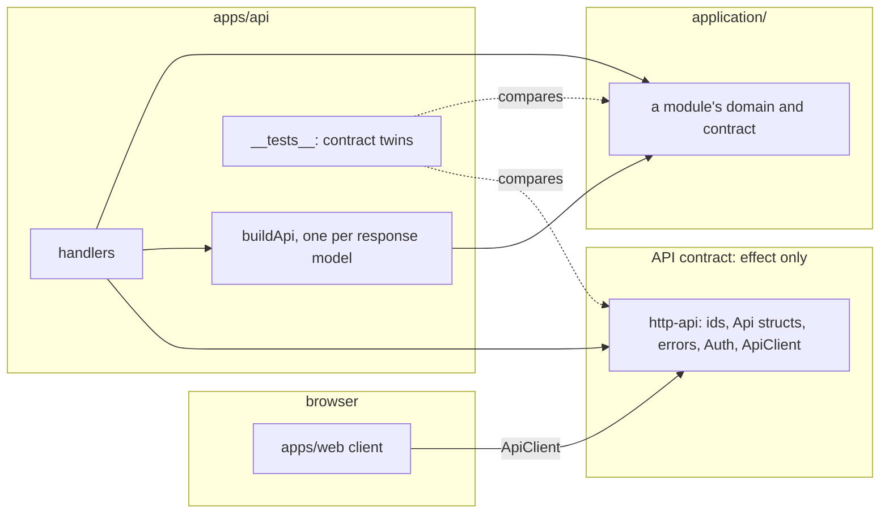

# Client publishing — architecture

> Ticket: `2026-11-04-1131_client-publishing` · Requirements: [feature.md](./feature.md)

## Overview

`http-api` becomes a self-standing API contract: it declares every id, constrained string, model
shape, error, limit and the auth middleware itself and imports only `effect`. The api's handlers
hand it the domain's values as they are, one mapper per response model, and its errors as they
are; the contract's codec writes the wire and the web's client reads it back with every type
intact. A test in the api, the one workspace that sees both sides, compares each contract schema
with its domain twin by name; the web bundle check reads the build's module graph and refuses any
package the web has not listed. Nothing of `application/` reaches the browser, so the domain's
"ships to the browser" reason goes while its import bans stay (roadmap entry 26 opens them).



Today the web bundle holds `application/chat` and `application/identity` (the metafile of a
`bun build` of the web entry lists both); after the change the only inputs outside `apps/web`
are `effect`, `http-api` and `packages/ui`.

## Structure

- **`http-api`** (unchanged layout, new content). `shared/ids.ts` holds the four ids;
  `shared/limits.ts` the limits as the contract's own numbers (the title's 120 lives there a
  third time, beside the table's and the domain's); `shared/errors.ts` the HTTP-only errors as
  today; `shared/security.ts` `SchemaErrors`, `UserUnknownError`, `CurrentUser` and `Auth`, moved
  in from identity's contract (D4); each group file its constrained strings, its `Api<Model>`
  struct and its error classes with the status on the class (D2). Invariant: the manifest
  declares only `effect`, `tsconfig.json` references no project, and the Biome override for
  `http-api/**` bans `@app-template/**` and `@effect/**` whole (R1); `"sideEffects": false`
  stays, since the contract is a browser library.
- **`apps/api`.** A mapper file per group beside its handler (`apps/api/<group>/<entity>.mapper.ts`)
  with one `buildApi<Model>` per response model, the identity while the shapes match (D6);
  `shared/security.ts` implements the contract's `Auth` over identity's `UserService`, handing
  `CurrentUser` the user as it is; the handlers return `buildApi<Model>(value)` and fail with
  domain errors untouched. `__tests__/contract-twins.test.ts` is the parity check (D3).
  Invariant: a handler imports the contract and the module's services or a use case, never a
  codec of its own ([layering.md › Handlers](../../../.claude/rules/layering.md#handlers), whose
  "mapper" line gains the api's).
- **`application/identity`.** `contract/` keeps `UserId`, which chat needs, and loses `auth.ts`;
  `UserUnknownError` moves to `domain/user.error.ts`, since no other module raises it. The
  module's `package.json` drops `"sideEffects": false`: no bundler consumes `application/` any
  more, and the flag promised what the bundle check never proved.
- **`apps/web`.** No client code changes. Its `package.json` gains the list of the packages the
  browser bundle may hold (D5); `make bundle-check` reads it.
- **Guards.** `.misc/lint/biome.base.json`: the `http-api/**` override shrinks to one pattern;
  the `apps/web/**` override stays. `Makefile › bundle-check` builds with `--metafile` and runs
  `.misc/lint/bundle-check.mjs` instead of the `grep`. No repository folder name remains in the
  check.
- **Docs and rules that describe the old boundary.** `docs/knowledge/architecture.md` (the
  three rings, the `http-api` row and the "domain imports only effect" bullet of Dependency
  rules, the bundle row of Boundary guards and the paragraph under it, the Known gaps the new
  check closes, step 6 of Add a new entity); `decisions.md` (D1's new record, and the rewrites
  D1, D4 and D5 name); `tooling.md` (the `bundle-check` row); `http-api/CLAUDE.md` rewritten;
  `application/CLAUDE.md`'s browser bullet; `layering.md › Handlers`; `naming.md`'s `.mapper`
  row; `effect-schema.md`'s "null exists only in a wire DTO" line; the roadmap's entry 10.

## Contracts

The contract's schemas, as sketches; every name a payload or response uses is exported from
`http-api/index.ts`, and nothing is re-exported from the app.

```ts
// http-api/shared/ids.ts — an id keeps the domain's brand name, so a handler passes it through
export const ChatId = Schema.String.check(Schema.isUUID()).pipe(Schema.brand('ChatId'))

// http-api/chat/chat.http.ts — a constrained string restates the domain's checks (D3 sees a drift)
export const ChatTitle = Schema.String.check(
  Schema.isTrimmed(), Schema.isNonEmpty(), Schema.isMaxLength(limits.chat.maxTitleLength),
).pipe(Schema.brand('ChatTitle'))
export const ChatStatus = Schema.Literals(['idle', 'queued', 'failed'])

// a model's wire shape is a struct: it encodes any object with these fields and writes only them
export const ApiChat = Schema.Struct({
  id: ChatId, userId: UserId, title: Schema.OptionFromNullOr(ChatTitle), status: ChatStatus,
  createdAt: Schema.DateTimeUtc, updatedAt: Schema.DateTimeUtc, attachments: Schema.Array(ApiAttachment),
})
export type ApiChat = typeof ApiChat.Type // title: Option<ChatTitle>, createdAt: DateTime.Utc

// an error is a class with the domain's tag and the status on the class
export class ChatNotFoundError extends Schema.TaggedError<ChatNotFoundError>()(
  'ChatNotFoundError', { id: ChatId }, { httpApiStatus: 404 },
) {}

// http-api/shared/security.ts — the auth middleware is the contract's
export class CurrentUser extends Context.Service<CurrentUser, { readonly id: UserId }>()(
  '@app-template/http-api/shared/CurrentUser',
) {}
export class Auth extends HttpApiMiddleware.Service<Auth, { provides: CurrentUser }>()(
  '@app-template/http-api/shared/Auth',
  { security: { cookie: HttpApiSecurity.apiKey({ key: 'user_secret', in: 'cookie' }) },
    error: UserUnknownError },
) {}
```

```ts
// apps/api/chat/chat.mapper.ts — the identity on its own fields; a nested model goes through its
// own mapper; tsc fails it on a drift
const attachments = Arr.map(buildApiAttachment)
export const buildApiChat = (chat: Chat): ApiChat => Struct.evolve(chat, { attachments })
export const buildApiMessage = (message: Message): ApiMessage =>
  Struct.evolve(message, { attachments })

// apps/api/chat/chat.handler.ts
.handle('get', Effect.fn('ChatHandler.get')(function* ({ params }) {
  const user = yield* CurrentUser
  return buildApiChat(yield* chatService.getOne({ id: params.chatId, userId: user.id }))
}))
```

```ts
// apps/api/__tests__/contract-twins.test.ts — pairs by export name, compares representations
import * as Contract from '@app-template/http-api'
import * as Chat from '@app-template/application/chat'
import * as Identity from '@app-template/application/identity'

const modules = { Chat, Identity }
const twins = pipe(modules, Rec.values, Arr.flatMap(twinsOf)) // per module, every export both sides hold
// the JSON form: the live representation holds closures that never compare equal
const representationOf = flow(Schema.toRepresentation, SchemaRepresentation.toJson)
it.effect.each(twins)('$name: the contract declares the domain\'s checks', ({ contract, domain }) =>
  Effect.sync(() => assert.deepStrictEqual(representationOf(contract), representationOf(domain))))
```

```jsonc
// apps/web/package.json — what the browser bundle may hold; `apps/web` itself is implied
"browserPackages": ["effect", "@app-template/http-api", "@app-template/packages/ui"]
```

```sh
# Makefile › bundle-check
bun build apps/web/app/main.ts --outdir $(WEB_BUNDLE) --target browser --metafile=$(WEB_BUNDLE)/meta.json
bun .misc/lint/bundle-check.mjs $(WEB_BUNDLE)/meta.json
# on a refusal, one per refused package, exit 1:
# bundle-check: drizzle-orm is not in apps/web/package.json › browserPackages
#   apps/web/app/main.ts
# → apps/web/features/health/health-panel.ts
# → packages/ui/index.ts
# → node_modules/.bun/drizzle-orm@<version>+<hash>/node_modules/drizzle-orm/index.js
```

The metafile (`bun build --metafile`, Bun 1.4.3) lists every input the bundle keeps by its path
from the repo root with its `imports` (`path`, `kind`, `original`). The script takes the metafile
alone and reads the list from the entry's manifest, the nearest `package.json` above the one
`outputs[*].entryPoint`. It maps an input to a package: the last `node_modules/<name>` or
`node_modules/@<scope>/<name>` on its path; a `node:<name>` input (a built-in Bun polyfills) is
its own package; any other input is the nearest `package.json`'s `name` plus the subpath of the
export whose target folder holds it (`@app-template/packages/ui`). Bun records an import of a
folder as `<folder>.js` while the input is `<folder>/index.js`, so the script tries both. Every
refused package is reported once, with its shortest chain to the package from the entry,
walked back through the importers; a chain through a module the bundler dropped (a re-export a side-effects flag let
go, so no input) shows a gap there, `… (a module the bundle dropped)`.

## Data

No store changes. The wire stays as today (R4): `make api-check` holds the OpenAPI snapshot,
and the only drift the contract's own schemas cause is the user model's component name
(`UserEncoded` today, from the domain class; `User` from a struct annotated `identifier: 'User'`),
settled in D2.

## Seams

| Seam | Catches | Misses |
|---|---|---|
| `ApiClient` over `ApiServerTest` (`apps/api/__tests__/<group>/<entity>.handler.test.ts`) | the round trip through the contract: a chat read back as `Option`, `DateTime` and a branded id, a refusal caught by its tag as the contract's class (R2); on the raw `HttpClient`, `title: null`, an ISO date, a domain error's status and a domain-only field (`cause`) absent from the JSON (R3); a handler that forgets its mapper only where the shapes differ | the web's own code, which has no test; a mapper that is the identity (tsc proves it) |
| `make api-check` (`http-api/openapi.json`) | any route, field, status or error shape the contract changes (R4) | a schema's checks that JSON Schema does not carry (a pattern's `i` flag); the component names are documentation, not wire |
| `apps/api/__tests__/contract-twins.test.ts` | a constraint that differs between a contract schema and the domain export of the same name: a limit, a pattern and its flags, a UUID version, a literal added or removed; a class whose identifier or fields differ (R5); one hand-written case proves a domain error instance encodes through the contract's class, so an Effect upgrade that drops the class marker fails here | a twin declared under another name (review, `http-api/CLAUDE.md`); a brand's name, which the representation does not carry (tsc catches it through the mappers and `CurrentUser`) |
| `make typecheck` (the mappers, `CurrentUser`) | a brand renamed, a tag or literal drifted, a field renamed or made optional on one side only: the model's own mapper no longer typechecks (R5, R8) | a value-level constraint (the twins test) |
| `make lint` (`.misc/lint/biome.base.json`: the `http-api/**` and `apps/web/**` overrides) | an import of any workspace or `@effect/*` package in the contract (R1); a web client import outside `http-api` and `packages/ui` | what reaches the bundle through an allowed import (the bundle check) |
| `make bundle-check` (`.misc/lint/bundle-check.mjs` over the metafile) | a package outside `browserPackages` in the built bundle, with the chain that brought it, whether a side-effects flag holds or not (R6, R7); a server library pulled by an allowed package | a type-only import (erased, as it should be); a package the list allows that later grows a server import |
| `make test-e2e` (`apps/e2e/api/chat.e2e.ts`) | the assembled apps answering through the contract on real stores | nothing the seams above do not already prove; it changes only where the shapes change |

## Decisions

- **D1 — The API contract declares the wire itself and imports only `effect`; the api implements
  it, the web calls it, and nothing of `application/` reaches the browser.**
  - **Why:** the web's freedom from server code rested on tree shaking (a build fails once the
    side-effects flag goes), the backend kept rules for the web's sake, and the bundle check
    was rewritten on every rename. A contract of its own closes the only path from the browser
    into the app.
  - **Cost accepted:** every id, constrained string, status list and error is declared twice,
    in the domain and in the contract, held in step by D3; a wire field costs one more line than
    today; `openapi.json`'s component names follow the contract's identifiers (D2).
  - **Reversal:** one commit per group, back to `mapFields` over the domain; the guards go back
    with it.
  - **Record:** adds *The API contract on its own* to `docs/knowledge/decisions.md`; rewrites
    *A module's layers* (the domain no longer ships to the browser; its bans stay for roadmap
    entry 26) and the *Cost* of *Module contracts* (`Auth` and the user DTO lines), in the step
    that lands the contract.
  - **Rejected:**
    - today's `mapFields` over the domain's schemas — the browser bundle then holds whatever
      the bundler fails to drop, and the domain must stay browser-safe for it.
    - a client generated from `openapi.json` — loses `Option`, `DateTime` and the error
      classes, and adds a generator to keep.
    - a module `contract/` that ships to the browser — every module would carry the browser's
      constraints, and the web would import `application/`.

- **D2 — A model's wire shape is a `Schema.Struct` named `Api<Model>`; an error is a
  `Schema.TaggedError` with the domain's tag and `httpApiStatus` on the class; the api hands both
  the domain's values as they are.**
  - **Why:** a struct encodes any object that has its fields and writes only them, so a domain
    class instance passes through and an internal field (`MessageFailure.cause`) stays off the
    wire with no code (checked: `Schema.toCodecJson(struct)` on a class instance with an extra
    field). An error class gives the client a yieldable error to `catchTag`, and the contract
    class accepts the domain's instance by the class marker Effect puts on every instance for an
    identifier (`~effect/Schema/Class/<identifier>`, a getter on the prototype), so no handler
    translates errors.
  - **Cost accepted:** the marker is internal: Effect marks it "HMR support" and tests it
    nowhere, so an upgrade may drop it and turn every domain error into a `500`; the twins test
    holds one case that would fail first. The user model's component is named `User` by the
    struct's `identifier` annotation where today's class gave `UserEncoded`: `make api-snapshot`
    moves the snapshot once, with R4's acceptance reworded to "the snapshot differs only in a
    component's name" in the same commit.
  - **Reversal:** one commit: `ApiUser` as a class with identifier `User` keeps today's
    snapshot byte for byte, at the price of the marker for a model too.
  - **Rejected:**
    - a class per model with the domain's identifier (the prototype's `ApiUser`) — every model
      then rests on the marker, and a class on the wire side invites methods.
    - errors as tagged structs — the client gets a plain object, not an `Error` it can yield.
    - a translation per handler (`new ApiChatNotFoundError({ id: error.id })`) — about 98 lines
      the prototype removed, each a place for the wire to drift.

- **D3 — The twins test pairs a contract export with the domain export of the same name and
  compares the JSON form of their `Schema.toRepresentation`; tsc covers the rest through the
  mappers.**
  - **Why:** a hand list of pairs or boundary values drifts with the first new twin (R5). The
    representation carries what the types cannot: a limit's number, a pattern's source and
    flags (JSON Schema drops the `i` flag), a UUID version, every literal; equal representations
    mean equal checks (checked: a 120 vs 121 limit and an `i` flag each differ). The test
    compares its JSON form (`SchemaRepresentation.toJson`): the live document holds each check's
    closures (`toJsonSchema`, `toCode`), which never compare equal across two declarations, and
    the JSON form drops every annotation that is not JSON. A brand's name is not in the
    representation, and need not be: the identity mapper and `CurrentUser` make a renamed brand,
    tag, literal or field a type error.
  - **Cost accepted:** a twin declared under another name is never compared; the contract's
    rule (a twin keeps the domain's name, `http-api/CLAUDE.md`) and the Standards review hold
    it. `Api<Model>` structs are not paired by design: their shape differs (`Option` vs
    `NullOr`), and the mapper's identity types them.
  - **Reversal:** one commit, to a hand list.
  - **Rejected:**
    - the prototype's boundary table — a list kept by hand, and a value per limit.
    - comparing JSON Schema documents — a pattern loses its flags, and `Option`'s encoding is
      not a JSON Schema concern.
    - pairing by brand name or identifier — the representation holds no brand, and only
      classes hold an identifier.

- **D4 — `Auth` and `CurrentUser` move into the contract; identity's contract keeps `UserId`.**
  - **Why:** the contract may import nothing of the app (R1), and `Auth` is an HTTP middleware:
    the cookie's name, the `401` and what a handler gets from it are the wire's. `CurrentUser`
    carries the contract's `UserId`, the same brand name as the domain's, so a handler hands it
    to a service unchanged.
  - **Cost accepted:** identity's contract shrinks to one id; `UserUnknownError` moves to its
    domain, since only identity raises it. The record *Module contracts* loses its "`Auth`
    lives outside `http-api`" cost line.
  - **Reversal:** one commit back, and the contract imports identity again (R1 breaks).
  - **Rejected:**
    - `Auth` stays in identity and the contract imports only it — one import is the whole
      path into the app.
    - two middlewares, the contract's over identity's — one HTTP concept declared twice.

- **D5 — `make bundle-check` reads the build's metafile and refuses any package outside the
  list the web keeps in its `package.json` (`browserPackages`), naming the package and the
  import chain.**
  - **Why:** a `grep` of keys knew the repository's folder names and broke on every rename; a
    denylist of server packages would grow on the backend for the web's sake. The metafile
    names every input and its imports, so the check sees the built bundle, which no import rule
    can, and explains a refusal (R7). The web's manifest is where a reader looks for what the
    web depends on, and the list sits beside the dependencies it narrows.
  - **Cost accepted:** a package the list allows may itself grow a server import unseen; the
    list is a second statement of the web's Biome override, at the bundle's level. The check
    depends on Bun's metafile shape; a change there stops it with exit 2, never a clean pass. A
    chain through a module the bundler dropped shows a gap there.
  - **Reversal:** one commit, back to the `grep`.
  - **Record:** rewrites the bundle-check lines of *Guards are configuration* and of *A
    module's layers* › Guarded by.
  - **Rejected:**
    - the `grep` of service keys — folder names in the check, six rewrites so far, and it
      proves only that services are absent, not what is present.
    - a denylist of server packages — kept by the backend for the web.
    - a separate file for the list — one more file to find; the manifest already holds what
      the web may import.

- **D6 — One mapper per response model, `buildApi<Model>` in `apps/api/<group>/<entity>.mapper.ts`,
  the identity while the shapes match, a nested response model through its own mapper; inputs
  have none.**
  - **Why:** renaming a nested domain field on the wire broke 8 of 13 handlers without a
    mapper and only the mappers with one (the prototype's experiment); one handler reads each
    payload, so an input needs no mapper. The api is the one place that knows both shapes.
  - **Cost accepted:** a function that returns its argument, per model, and one more name in a
    handler's return.
  - **Reversal:** one commit, inlining the calls.
  - **Rejected:**
    - the mapper in `http-api` — the contract would import the domain.
    - the mapper in a module's `services/` — the module would know the wire.
    - no mapper — the rename experiment.

## Risks

- **Effect drops the class marker.** Every domain error becomes a `500` on the wire. *Contained
  by:* the twins test's hand-written case (a domain error through the contract's class) and the
  handler tests, which read a domain error's status through `ApiClient`; `make vendor-effect`
  runs `make check`.
- **A contract-only annotation leaks into the representation.** `httpApiStatus` on the contract's
  error classes could make every error pair differ. *Settled in S3:* the JSON form of the
  representation drops every annotation that is not JSON and holds no `httpApiStatus`, so no
  strip is needed; a JSON annotation on one side only (a `description`) differs, so a twin
  carries none the domain's lacks (`http-api/CLAUDE.md`), and one Effect adds later fails the
  error pairs.
- **A twin under another name.** A constraint drifts with no test noticing. *Contained by:*
  `http-api/CLAUDE.md`'s rule and the Standards review; the twins test lists the pairs it
  compared in its titles, so a missing one is visible.
- **`openapi.json` moves more than a component name.** A wire change hides in the snapshot
  commit. *Contained by:* the step diffs the snapshot and records that only `UserEncoded` became
  `User`.
- **The metafile's shape changes with Bun.** The check reads nothing and passes. *Contained by:*
  the script refuses an input without `imports` or an entry it cannot find with exit 2, and the
  Makefile stops on it as the `grep` does today.
- **`CurrentUser`'s `UserId` and the domain's diverge.** A handler could not pass the user to a
  service. *Contained by:* tsc on the first handler; the brand names are the same string.
