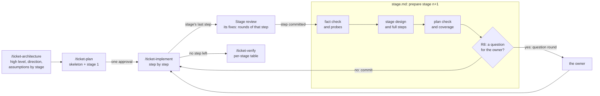

# SDD in stages — architecture

> Ticket: `2026-11-07-1232_sdd-stages` · Requirements: [feature.md](./feature.md)

## Overview

The ticket changes no app code. It moves the low level of a ticket out of the architecture and out
of the up-front plan, into a **stage**: about three steps, prepared once the steps before them have
landed and the facts they rest on are checked, and reviewed together once they land. The
architecture keeps the high level, the plan a **skeleton** of every step. One procedure prepares a
stage; three callers run it: the first plan, the owner's `next` and the loop.

**A stage opens forward and closes backward.** Its opening (the fact check, the stage design, its
steps in full, and any change to the architecture they force) looks only at the stage ahead,
taking what landed as its base, never reviewing it. Every check, review and verification sits at
a close: the plan check closes the preparation, the Stage review closes the stage, and
`/ticket-verify` closes the ticket.



The fact that shapes D1 (researcher, 2026-11-07, Claude Code 2.1.311, `claude -p` on sonnet):
a skill that calls another through the Skill tool, with `args`, follows it and then resumes its
own steps, 5 runs of 5, even when the inner skill ends with "end the turn" and its description
says to run only when asked; `$ARGUMENTS` is substituted. The inner skill is not a subroutine:
its whole text enters the conversation and stays there, and the docs say nothing of one skill
calling another. A long loop, an inner skill that waits for the user, and opus were not tried.

Order of the work, for the plan: the templates first (the plan's stage layout and the
architecture's direction and assumptions), since every skill edit writes into them; then the
stage procedure and the plan skill; then the Stage review pass and the implement skill's stage
boundary; then verification's table; the guide, its map and the gate last, once the behaviour they
describe is whole; the fixture runs at the end, in a fresh session.

## Structure

| Area | Change |
|---|---|
| `docs/tickets/_template/architecture.md` | adds **Direction** and **Assumptions**; Structure names modules and workspaces, never files or signatures (R1) |
| `.claude/skills/ticket-architecture/SKILL.md` | writes the high level only; asks the owner about seams, contracts and irreversible decisions, records each direction as a recommendation (R1, R2) |
| `docs/tickets/_template/plan.md` | the skeleton as the **Status** table split by stage; a section per stage with its design, its steps and its review (D3) |
| `.claude/skills/ticket-plan/SKILL.md` | cuts the skeleton and runs the stage procedure for stage 1, then presents both for one approval; `next` runs the procedure for the next stage (R3–R5, R12) |
| `.claude/skills/ticket-plan/stage.md` | **new**: the stage procedure, from the fact check to the commit or the question round (D1, R6–R9, R13) |
| `.claude/agents/reviewer.md` | a **Stage** pass (D5) |
| `.claude/skills/ticket-implement/SKILL.md` | a stage's last step also gets the Stage pass, its fixes as that step's rounds (D2, D5, R10); once it commits: in a loop, runs the procedure and goes on unless it asks; outside, names `/ticket-plan <ticket> next`; a new stop (R11, R12) |
| `.claude/skills/ticket-verify/SKILL.md`, `docs/tickets/_template/verification.md` | the per-stage table (D8, R16) |
| `.claude/rules/sdd.md` | the heavy-review gate and the commit gate for a stage preparation (D7) |
| `docs/knowledge/sdd.md` | the terms, the loop diagram with stages, the skills table, the dependency map (R17) |
| `docs/knowledge/decisions.md` | a record **Plans in stages** (D7) |
| every skill that spawns an agent, `claimed-findings.md` | the model and effort at each spawn (D9, R19) |
| this ticket's `sample/` | **new**: the fixture ticket the acceptance runs start from (the second Seam) |

The `implementer` and `verifier` files gain nothing: a full step pins the names its stage design
chose, so the implementer still reads its step alone.

## Contracts

**The architecture's high level** (R1, R2). Overview, Structure, Contracts (between modules and
between steps), Seams, Decisions and Risks keep their meaning, without a function signature or a
file list. Two sections join them:

```text
## Direction
- **<area>** — recommend <option>, over <option>: <why>. Settled in Stage <n>.

## Assumptions
- **A<n> — <what the design takes as true>.** Checked in Stage <n>, by <a read | a probe>.
  If false: <the Seam, Contract or D… it changes>.
```

A direction is never put to the owner; the stage design takes it or sets it aside, with the fact.

**The plan's layout** (R3, R4, R5, D3, D4):

```text
## Status
### Stage 1 — <what the stage delivers>
| Step | Delivers | Serves | Size | Status |
|---|---|---|---|---|
| S1 | <outcome> | R1, D2 | ~200 | todo |
### Stage 2 — <title> (four steps: <reason>)
…

## Stage 1 — <title>
### Stage design
<names, signatures and files the stage fixes; then its choices:>
- **<choice>** — set aside: <option> — fact: <the fact, its source or probe output> — used by: S<n>
### Steps
#### S1 — <title>          (the step's fields as today)
### Stage review           (written by the stage's last step, in its last round)

## Stage 2 — <title>
Not prepared: `/ticket-plan <ticket> next` prepares it once Stage 1 lands.

## Requirement coverage
```

The skeleton row is a step's outcome, what it serves, its order (the row's place) and its size; a
stage of other than three steps names its reason in its heading. A plan with no `### Stage`
heading is the old form, and every skill runs it as before (R15).

**The stage procedure** (`stage.md`), one interface for three callers:

- **In:** the ticket folder and the stage to prepare.
- **Does, in order:** the fact check: a `researcher` confirms every assumption naming this stage
  and every fact its steps rest on, and a probe in the disposable worktree `<slug>-plan-probes`
  settles any fact only a run shows (R6);
  the stage design and the steps in full; the plan check of today's step 4 over the stage's steps,
  plus a coverage list that fails on a requirement no skeleton or stage step serves (R7); the
  triage below.
- **Out:** the edited `plan.md` (and `architecture.md` where the owner agreed), plus either
  nothing for the owner or one question round.

**The triage** (R8, R9). A question round, each question with options and a recommendation, for:

- a change to the architecture: a false assumption, a Seam, a Contract, a `D…`;
- a change to the step list: a step added, removed or reordered, or a step's outcome changed;
- a choice a reviewer could question that changes visible behaviour or costs much to undo;
- a stage choice whose `used by` names a step outside the stage: it is raised to a `D…`.

Every other choice the stage design records, and the preparation commits.

**The caller's end:**

| Caller | No question | A question round |
|---|---|---|
| `/ticket-plan <ticket>` (stage 1) | presents the skeleton and stage 1 for one approval (R5) | the same, with the round |
| `/ticket-plan <ticket> next` | commits; names the stage's first step | presents the round and waits |
| `/ticket-implement … loop` | commits and returns to its step 1 (R11) | stops the loop with the round |

A step that ends its stage outside a loop names `/ticket-plan <ticket> next` (R12), or
`/ticket-verify` after the last stage. A plan of one stage has no stage boundary, so nothing is
named and no Stage review runs (R14).

**The preparation's commit** (R13): `:memo: docs(<slug>): Prepare stage <n>`, its body naming
what changed in the skeleton, the coverage or `architecture.md`, and why, the Stage review's
findings among the causes.

**The Stage review** (R10, D2, D5): on a stage's last step, once its own passes are clean, one
more `reviewer` pass, `Stage`, over the diff from the parent of the stage's first round
(`S<first>.1`, found by its commit body) to the working tree; its sources: `architecture.md`, the
skeleton and the stage's design. It checks conformance, scaffolding a later step would rewrite,
coverage and the recorded choices. Its findings go through `ticket-implement` step 4 as any
pass's do, and land under `### Stage review` in the step's last round.

**The per-stage table** (R16, D8), one row per stage in `verification.md`:

```text
| Stage | Outcome or order changed | Details only | Later steps edited | Loop stopped |
```

**Model and effort per use** (R19, D9). Each skill names the default where it spawns the agent;
the guide's dependency map carries the same column, and the rule for `fable` once.

| Agent | Use | Default | `fable` likely pays |
|---|---|---|---|
| `researcher` | a fact for `/ticket-feature` or `/ticket-architecture`; a stage's fact check and its probes of behaviour | `opus high` | when the answer settles a design and nothing after it re-checks it |
| `researcher` | the plan check (Exists, Conforms, Red, Shape, coverage), at the first plan and each stage | `opus high` | on a Shape list of many steps or a stage with hard cuts |
| `researcher` | the guard probes; the no-op experiment | `sonnet medium` | no: a run decides |
| `researcher` | the confirmation of a `claimed` finding | `opus high` | rarely: a run decides |
| `implementer` | a move, rename or config step / a behaviour step | `opus medium` / `opus high` | rarely: the step is specified and checked |
| `reviewer` | Standards, per step and at verification | `sonnet medium` | no: each finding cites a rule |
| `reviewer` | Spec, per step | `opus medium` | rarely |
| `reviewer` | the hunt | `opus high` | on concurrency or a transaction |
| `reviewer` | Design; Stage | `opus high` | usually: shape is judged by nothing after it |
| `reviewer` | Spec at verification, the whole `feature.md` | `opus high` | usually |
| `verifier` | a group of requirements | `opus high` | usually |

**The rule for `fable`:** the spawning session may choose `fable` over the default when it
judges the task's result will be better for it, chiefly where a wrong answer passes every later
check; the third column is guidance, not a mandate. A spawn on `fable` names it in the status
(`Модель:` line of the owner's style).

## Seams

The toolkit has no code to test: each seam is a place where a skill's behaviour can be observed on
real input. `tdd` writes no test here; a step's *Test first* names the seam it is observed at.

| Seam | Catches | Misses |
|---|---|---|
| `make check` over the edited skills, agents, templates and rule | an over-limit rule (R18), a missing path, a source path in an instruction file, an over-width line | whether a line changes what an agent does |
| A skill run with `claude -p` in a `git clone --local` outside the tree, on the fixture ticket in `sample/` at the state a requirement needs | the documents and commits a phase writes (R1–R14, R16): the high level, the skeleton, a stage's design and check, a question round or a commit, the loop crossing a boundary, the per-stage table; each variant the acceptance names (a coverage gap, a choice used by a later stage, a choice of two contract shapes) | the variance of one run; a real ticket's facts; the owner's answers, since a `-p` run ends at the question |
| The files as written: the guide, its map, the glossary, the closed plans, each spawn line | the terms in the guide and not the glossary, the map against the skills' files, closed plans unchanged by `git diff main` (R15, R17); a model and effort at every spawn, matching the map (R19) | whether an agent reads the guide; whether `fable` gives better answers, which only the per-stage table and the verification show over tickets |

## Decisions

- **D1 — The stage procedure is one file beside the plan skill, read directly by every caller;
  the loop does not call the plan skill.** (Q1, Q2.)
  - **Why:** the procedure has three callers that end differently (one approval, a commit, the
    loop going on); a file with no ending of its own leaves each caller its end. The plan skill
    then holds the skeleton alone, and a first plan and a later stage each read what they need.
  - **Cost accepted:** one more file in the dependency map; `ticket-implement` reads a file of
    another skill's folder.
  - **Reversal:** one commit.
  - **Rejected:**
    - The loop calls `/ticket-plan <ticket> next` through the Skill tool — it works in the
      experiment, but the whole plan skill would enter the loop's context at every boundary, with
      its "present and wait" lines pulling toward a stop, and the case that matters (a long loop,
      an inner skill that waits) is untried.
    - All in the plan skill — a stage preparation would read the skeleton's cut, a first plan the
      stage's triage.

- **D2 — The Stage review closes a stage, as a pass of its last step; the fact check and the
  stage design open the next.** (The owner's choice.)
  - **Why:** the review runs while the stage's last implementer is still live, so its fixes are
    that step's next rounds, through the round rules already in place; the next stage is then
    prepared on code already reviewed, and outside a loop the owner sees the review with the step
    that ends the stage.
  - **Cost accepted:** the last step of a stage waits for one more pass; a fix to an earlier
    step's code lands as a round of the last one.
  - **Reversal:** one commit in `ticket-implement` and `stage.md`.
  - **Rejected:**
    - The review as the first part of the next preparation — outside a loop it waits for the
      owner's `next`, and its fixes become new steps of a stage not yet designed.

- **D3 — The skeleton is the plan's Status table, split by stage; each stage owns a section with
  its design, steps and review.**
  - **Why:** one table is the skeleton, the status and what `ticket-implement` step 1 already
    reads, so nothing is written twice; a section per stage keeps a stage's low level next to the
    review of it (Q3).
  - **Cost accepted:** `plan.md` grows by a section per stage; a reader of a late stage scrolls
    past the early ones.
  - **Reversal:** one commit in the template and the skills; written plans keep their form.
  - **Rejected:**
    - A file per stage — the implement skill and the Spec brief would learn which file holds a
      step.
    - A skeleton section beside the Status table — two lists of the same steps drift.

- **D4 — One plan shape: a ticket of one stage is its degenerate case, and a plan without a stage
  heading is the old form.**
  - **Why:** a small ticket runs the same procedure once, with no boundary to cross (R14), and
    the skills tell an old plan by the heading alone (R15), so no flag or version is kept.
  - **Cost accepted:** a three-step ticket carries a stage heading and a stage design section it
    hardly needs.
  - **Reversal:** one commit.
  - **Rejected:**
    - A separate small-ticket form — two templates, and a ticket that grows past four steps would
      be rewritten.

- **D5 — The Stage review is its own `reviewer` pass, `Stage`, and its findings are decided as
  any pass's are.**
  - **Why:** the step passes see one step; only a pass over the stage's diff sees scaffolding a
    later skeleton step rewrites, or a stage choice the code departs from. A fresh reviewer is not
    anchored on the stage design the main session wrote; its model follows D9. Its findings go
    through `ticket-implement` step 4 unchanged: a fix that restores the architecture or the
    skeleton is a round the main session forwards, and one that reshapes them is the owner's
    question, so the loop stops only where it stops today.
  - **Cost accepted:** one more reviewer per boundary; a long stage diff makes it the slowest pass.
  - **Reversal:** one commit in `reviewer.md` and `ticket-implement`.
  - **Rejected:**
    - The step passes rerun over the stage's diff — Standards and Spec already ran on each step,
      and neither reads the skeleton.
    - The main session reviews the stage itself — it wrote the stage design it would judge.
  - **Naming:** the pass is `Stage`, never "design", so it stays apart from the Design pass and
    the stage design (R17).

- **D6 — Every assumption names the stage that checks it, and that stage's preparation checks it
  before writing a line of its design.**
  - **Why:** the drift the audit found came from names fixed before the facts; an assumption tied
    to a stage makes the fact check a list, not a search, and a false one is an architecture
    change the triage puts to the owner.
  - **Cost accepted:** the architecture phase must say, for each assumption, when it is checked.
  - **Reversal:** one commit in the template and `stage.md`.
  - **Rejected:**
    - Every fact checked at the first plan — the facts a run shows need the earlier stages' code.

- **D7 — The gates change for plans in stages, and a record keeps why.**
  - **Why:** "the heavy review lands once, on the plan" becomes: on the skeleton and the first
    stage, then each later stage is checked when prepared and reviewed when it lands; a stage
    preparation that asks the owner nothing commits without the owner's OK. The change binds every
    later ticket, so `docs/knowledge/decisions.md` gains **Plans in stages** (why, the audit's
    figures, the rejected full plan, revisit after `lambda-processes` and `telemetry-minimal`
    report their per-stage tables), in the step that changes the gate.
  - **Cost accepted:** the owner sees later stages only as commits, unless one asks.
  - **Reversal:** one commit restores the gate and drops the record; staged plans already written
    stay readable.
  - **Rejected:**
    - Each stage approved by the owner — the critic's 8–14 approvals per ticket.

- **D8 — The per-stage table lives in `verification.md`, summed from the plan and its history.**
  - **Why:** the plan holds what the steps did, the verification what the ticket measured (Q3);
    the figures come from each Stage review, the findings and `git log -p -- plan.md`, so no step
    keeps a counter.
  - **Cost accepted:** `/ticket-verify` reads the plan's history by hand.
  - **Reversal:** one commit.
  - **Rejected:**
    - The table in the plan — a stage would edit a table of the verification's.

- **D9 — Every spawn names a default model and effort on `opus` or `sonnet`; `fable` is the
  spawning session's option, taken where it judges the result will be better.** (R19, added at
  the owner's word.)
  - **Why:** today the toolkit names `sonnet` for every researcher and nothing for effort, and
    the choice of `fable` lives only in the main session's memory. A default per use makes a run
    repeatable; the option keeps the session's judgement where it pays, chiefly where a wrong
    answer passes every later check (a fact that settles a design, a review of shape, the
    verification). `high` where an answer is open, `medium` where the work is a list to run.
  - **Cost accepted:** two runs of one use may differ in model; the status names it, and the
    per-stage table and verification show whether it paid. `xhigh` and `max` stay unused.
  - **Reversal:** one commit in the skills and the map.
  - **Rejected:**
    - `fable` fixed for the judgement uses — the owner wants it an option, not a rule.
    - No default, the session choosing every time — a run would not be repeatable, and a
      forgotten choice falls back to the agent file's front matter unseen.

## Risks

- **The loop stops at most boundaries.** The owner's load comes back as question rounds.
  *Contained by:* the triage's narrow list; D5 sends the Stage review's fixes as rounds; the
  per-stage table counts the stops, read after the first two tickets (D7's revisit).
- **Stages drift from the requirements,** the known failure of rolling-wave planning. A
  requirement loses its step unseen. *Contained by:* the coverage list at every preparation (R7)
  and the Stage review's coverage.
- **Fresh implementers choose differently across stages.** A name or shape a stage chose is
  redone by the next. *Contained by:* the full step pins the stage design's names; the Stage
  review reports a departure; a choice used beyond its stage becomes a `D…` (R9).
- **A preparation in the loop fills the main session.** A long loop compacts mid-stage.
  *Contained by:* `stage.md` reads only the stage's sources; facts and checks go to `researcher`.
- **The Stage review's base is found by a round id.** A commit body that does not open with
  `S<n>.1` gives the wrong diff. *Contained by:* the commit gate's format (`sdd.md › Gates`); the
  review names the base it used.
- **The fixture runs are long and vary.** One run per requirement may pass by chance.
  *Contained by:* each run named in `verification.md` with its output; a rate is out of scope, as
  in `toolkit-quality`.
