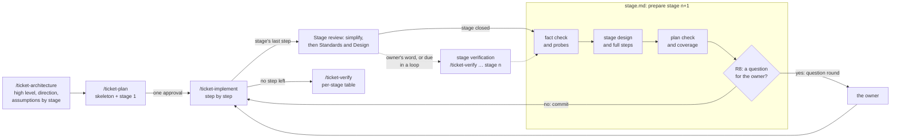

# SDD in stages — architecture

> Ticket: `2026-11-07-1232_sdd-stages` · Requirements: [feature.md](./feature.md)

## Overview

The ticket changes no app code. It moves the low level of a ticket out of the architecture and out
of the up-front plan, into a **stage**: about three steps, prepared once the steps before them have
landed and the facts they rest on are checked, then reviewed together for the quality of their
code once they land, and verified when the owner asks, when the session recommends it, or, in a
loop, when that recommendation falls due. The
architecture keeps the high level, the plan a **skeleton** of every step. One procedure prepares a
stage; three callers run it: the first plan, the owner's `next` and the loop.

**A stage opens forward and closes backward.** Its opening (the fact check, the stage design, its
steps in full, and any change to the architecture they force) looks only at the stage ahead. Its
base is `feature.md`, `architecture.md` and what the stages before it delivered: their code,
designs, reviews and any verification run; it never reviews them. Every check, review and
verification sits at a close: the plan check closes the preparation, the Stage review closes the
stage, a stage verification closes the stages since the last one, and `/ticket-verify` closes the
ticket.

Every round is a commit whose name says where it belongs: the stage, the step, the round and who
asked for it (`St2 S4.3 (STAGE)`), so the owner reads each change alone and sees what it fixes.



The fact that shapes D1 (researcher, 2026-11-07, Claude Code 2.1.311, `claude -p` on sonnet):
a skill that calls another through the Skill tool, with `args`, follows it and then resumes its
own steps, 5 runs of 5, even when the inner skill ends with "end the turn" and its description
says to run only when asked; `$ARGUMENTS` is substituted. The inner skill is not a subroutine:
its whole text enters the conversation and stays there, and the docs say nothing of one skill
calling another. A long loop, an inner skill that waits for the user, and opus were not tried.

Order of the work, for the plan: the rounds and their names first, since every later commit,
the stage preparation's among them, uses them; then the templates (the plan's stage layout and
the architecture's direction and assumptions), since every skill edit writes into them; then the
stage procedure and the plan skill; then verification's stage mode and table; then the Stage
review, the implement skill's stage boundary and the heavy-review gate; the guide and its map
last, once the behaviour they describe is whole, but for the lines on rounds, which land with
the rounds; the fixture runs at the end, in a fresh session.

## Structure

| Area | Change |
|---|---|
| `docs/tickets/_template/architecture.md` | adds **Direction** and **Assumptions**; Structure names modules and workspaces, never files or signatures (R1) |
| `.claude/skills/ticket-architecture/SKILL.md` | writes the high level only; asks the owner about seams, contracts and irreversible decisions, records each direction as a recommendation (R1, R2) |
| `docs/tickets/_template/plan.md` | the skeleton as the **Status** table split by stage; a section per stage with its design, its steps and its review (D3) |
| `.claude/skills/ticket-plan/SKILL.md` | cuts the skeleton and runs the stage procedure for stage 1, then presents both for one approval; `next` runs the procedure for the next stage (R3–R5, R12) |
| `.claude/skills/ticket-plan/stage.md` | **new**: the stage procedure, from the fact check to the commit or the question round (D1, R6–R9, R13) |
| `.claude/agents/reviewer.md` | the Design pass, given a stage's diff, also checks conformance to the architecture and scaffolding a later step rewrites, and reports only what changes correctness or shape (D5) |
| `.claude/skills/ticket-implement/SKILL.md` | every round committed before it is presented, the owner's own edits as an `OWNER` round, the passes over committed rounds (D11, R21–R23); a stage's last step also gets the Stage review, its fixes as rounds of the steps whose code they change (D2, D5, R10); a due stage verification, named outside a loop and run inside one (D10, R20); once the stage closes: in a loop, runs the procedure and goes on unless it asks; outside, names `/ticket-plan <ticket> next`; a new stop (R11, R12) |
| `Makefile` (`review-rules`), `ticket-implement/parallel-steps.md`, `ticket-implement/claimed-findings.md`, `docs/knowledge/tooling.md` | read a step's committed rounds instead of the uncommitted tree (D11) |
| `.claude/settings.json` | allows `git revert`, so a rejected round does not stop for a permission (D11) |
| `.claude/skills/ticket-verify/SKILL.md`, `docs/tickets/_template/verification.md` | a stage mode: the requirements the stage completes and the earlier ones whose files it changed, from the stage's base, one section per stage, a failure fixed as a `VERIFY` round (D10, R20); the whole-ticket run's per-stage table (D8, R16) |
| `.claude/rules/sdd.md` | the heavy-review gate, the round gate and the commit gate (D7, D11) |
| `.claude/rules/commits.md` | the round's id and source at the head of the subject, and the fixed commit at the head of a fix's body (D11, R21) |
| `docs/knowledge/sdd.md` | the rounds and their names, in the step that changes them; the terms, the loop diagram with stages, the skills table, the dependency map (R17) |
| `docs/knowledge/decisions.md` | the records **Rounds by commit** (D11) and **Plans in stages** (D7) |
| every skill that spawns an agent, `claimed-findings.md` | the model and effort at each spawn (D9, R19) |
| this ticket's `sample/` | **new**: the fixture ticket the acceptance runs start from (the second Seam) |

The `implementer` file gains nothing: a full step pins the names its stage design chose, so the
implementer still reads its step alone; a `STAGE` round's brief adds the Files and Traps of the
steps whose code it changes. A `verifier` already takes a fixed point and a list of `R…`, which
for a stage are its base and its requirements; its line that calls the fixed point a merge-base is
generalised to the brief's fixed point, and its line that leaves a fix to a later plan step names
the stage mode's round.

## Contracts

**The architecture's high level** (R1, R2). Overview, Structure, Contracts (between modules and
between steps), Seams, Decisions and Risks keep their meaning, without a function signature or a
file list. Two sections join them:

```text
## Direction
- **<area>** — recommend <option>, over <option>: <why>. Settled in Stage <n>.

## Assumptions
- **A<n> — <what the design takes as true>.** Checked in Stage <n>, by <a read | a probe>.
  If false: <the Seam, Contract or D… it changes>.
```

A direction is never put to the owner; the stage design takes it or sets it aside, with the fact.
An open question of `feature.md` that a stage can still settle closes as a direction's area. An
assumption names the first stage whose work rests on it, since no plan exists yet (S2).

**The plan's layout** (R3, R4, R5, D3, D4):

```text
## Status
### Stage 1 — <the outcome it delivers> · completes R1, R3
| Step | Delivers | Serves | Size | Status |
|---|---|---|---|---|
| S1 | <outcome> | R1, D2 | ~200 | todo |
### Stage 2 — <title> (four steps: <reason>)
…

## Stage 1 — <title>
### Stage design
<the facts, each with its source or probe output; then the names, signatures and files the stage fixes; then its choices:>
- **<choice>** — set aside: <option> — fact: <the fact, its source or probe output> — used by: S<n>
### Steps
#### S1 — <title>          (the step's fields as today)
### Stage review           (written by the stage's last step, in its last round)
                           (a verification, when run: `verification.md › Stage 1`)

## Stage 2 — <title>
Not prepared: `/ticket-plan <ticket> next` prepares it once Stage 1 lands.

## Requirement coverage
| Req | Steps | Completed in |
|---|---|---|
| R1 | S1, S4 | Stage 2 |
```

The skeleton row is a step's outcome, what it serves, its order (the row's place) and its size; a
stage of other than three steps names its reason in its heading. A requirement is completed in
the stage of its last step, and a stage verification runs it there. A plan with no `### Stage`
heading is the old form, and every skill runs it as before (R15).

**The stage procedure** (`stage.md`), one interface for three callers:

- **In:** the ticket folder and the stage to prepare; it reads `feature.md`, `architecture.md`,
  the skeleton, and of each closed stage its design, its Stage review and its verification
  section where one was run, with the code as it stands.
- **Does, in order:** reads `stage.md` afresh, since compaction restores only the files last
  modified; the fact check: a `researcher` confirms every assumption naming this stage and every
  fact its steps rest on, and a probe in the disposable worktree `<slug>-plan-probes` settles any
  fact only a run shows (R6); the facts head the stage design in place of its "Not prepared"
  line and commit at once as `St<n> (PLAN) Record the facts of stage <n>`, so a compaction or a
  question round loses none, and `next` resumes a stage that has a design but no `Prepare stage
  <n>` commit; a first plan's facts commit with its approval instead, since the commit gate
  commits an artifact only once the owner confirms it (S3);
  the stage design and the steps in full; the plan check of today's step 4 over the stage's steps,
  plus a coverage list that fails on a requirement no skeleton or stage step serves (R7); the
  triage below.
- **Out:** the edited `plan.md` (and `architecture.md` where the owner agreed), plus either
  nothing for the owner or one question round.

**The triage** (R8, R9). A question round, each question with options and a recommendation, for:

- a change to the architecture: a false assumption, a Seam, a Contract, a `D…`;
- a change to the step list: a step added, removed or reordered, or a step's outcome changed; a
  skeleton row is never dropped without a finding that names why;
- a choice a reviewer could question that changes visible behaviour or costs much to undo;
- a stage choice that changes a Contract and whose `used by` names a step outside the stage: it
  is raised to a `D…`. A name a later step merely reuses stays in the stage design.

Every other choice the stage design records, and the preparation commits.

**The caller's end:**

| Caller | No question | A question round |
|---|---|---|
| `/ticket-plan <ticket>` (stage 1) | presents the skeleton and stage 1 for one approval (R5) | the same, with the round |
| `/ticket-plan <ticket> next` | commits; names the stage's first step | presents the round and waits |
| `/ticket-implement … loop` | commits and returns to its step 1 (R11) | stops the loop with the round |

A step that closes its stage outside a loop names `/ticket-plan <ticket> next` (R12), or
`/ticket-verify` after the last stage. A plan of one stage has no stage boundary, so nothing is
named and no Stage review or stage verification runs: `/ticket-verify` is its verification (R14).

**The preparation's commit** (R13): `:memo: docs(<slug>): St<n> (PLAN) Prepare stage <n>`, its
body naming what changed in the skeleton, the coverage or `architecture.md`, and why, the Stage
review's findings among the causes.

**The Stage review** (R10, D2, D5): on a stage's last step, once its own passes are settled and
its rounds committed, the quality passes run once more over the stage's diff, from its
`St<n> (PLAN) Prepare stage <n>` commit, not the facts commit before it, to `HEAD`:

- `simplify`, run by the main session with that range named in its args, since without one it
  reviews the whole branch; its edits commit as a `STAGE` round of the steps whose code they
  change;
- then Standards and Design in parallel. Standards also asks, of each deletion in the `simplify`
  round, where the deleted rule or case now lives. Design's sources gain `architecture.md`, the
  skeleton and the stage's design, so it also reports a departure from them and scaffolding a
  later step rewrites; it reports only what changes correctness or shape.

The findings go through `ticket-implement` step 4 as any pass's do, but for one rule: in a loop, a
Design finding that reshapes a module and contradicts no `D…` is fixed without asking, the owner
reading it afterwards by its `STAGE` commit; one that contradicts a `D…` is recorded open under
`### Stage review` and presented at the loop's next stop, without causing one. Each accepted fix
goes to the last step's implementer, resumed by its agent id (or a fresh one, given that step's
brief, if it was stopped), with the Files and Traps of the steps whose code the fix changes, and
commits as a `STAGE` round of those steps. The findings land under `### Stage review` in the
close's `PLAN` round.

**The stage verification** (R20, D10): `/ticket-verify <ticket> stage <n>` runs one `verifier`
per group of the stage's requirements, as `/ticket-verify` step 1 groups them, with the stage's
base as the fixed point. Its requirements are those the stage completes and the earlier ones
whose steps' files the stage changed, since a later stage breaking an earlier requirement is the
drift this ticket fights. No reviewer, since the Stage review ran, and no lessons, which stay with
the ticket. A `fail` goes to an `implementer` as a `VERIFY` round of the step whose code it
changes, and only the failed requirements are verified again; one that needs a requirement
changed is the owner's question. The verdicts land as `## Stage <n> — <date>` in
`verification.md`.

It is **due** when two stages have closed since the last one, or the stage changed a contract or
the architecture. Outside a loop the close names the command; the owner may run it for any stage.
Inside a loop a due verification runs at the close without stopping, as part of the loop's
waiver; only a failure that needs a requirement changed stops it.

**Commit names and rounds** (R21–R23, D11). Every commit of a ticket names its round at the head
of the subject, and a fix names what it fixes at the head of its body:

```text
:sparkles: feat(<slug>): St2 S4.1 Add the widget parser
:bug: fix(<slug>): St2 S4.2 (REVIEW) Reject an empty widget
:recycle: refactor(<slug>): St2 S5.2 (OWNER) Rename load to read
:recycle: refactor(<slug>): St2 S4.3 (STAGE) Drop the parser wrapper
:recycle: refactor(<slug>): St2 S5+S6 (STAGE) One widget type for both
:rewind: revert(<slug>): St2 S5.3 (OWNER) Revert S5.2
:memo: docs(<slug>): St3 (PLAN) Prepare stage 3
:memo: docs(<slug>): St2 S4.4 (PLAN) Close S4

body of a fix:  Fixes St2 S4.1: <what was wrong>
```

- The source is the one who asked: none for the implementer's first pass, `REVIEW` the step's
  passes, `OWNER` the owner's word or edit, `STAGE` the Stage review, `VERIFY` a verification,
  `PLAN` an edit of the plan alone (a stage's preparation, a step's close: its status and
  findings). The kind of change stays in the gitmoji and type.
- A fix carries the id of the step whose code it changes; one that changes several names each
  (`S5+S6`). A plan of the old form drops the stage (`S4.2 (REVIEW)`). The id counts apart from
  the subject's 50 characters. The body names the fixed round by its id alone: a hash goes stale
  after the cherry-pick that parallel steps use.
- A search for a step anchors on the subject: `git log -E --grep='^:[a-z_]+: [a-z]+\([^)]*\): (St[0-9]+ )?(S[0-9]+\+)*S4(\+S[0-9]+)*[. ]'`
  finds `S4.1`, `S4.2` and `S4+S6`, not `S41` or a body's `Fixes St2 S4.1` (experiment,
  2026-11-07).
- A round commits as soon as it is ready, before the owner reads it; the owner's word decides
  whether the step closes. A rejected round is reverted by a new commit while it is the last
  commit of the branch; once later work rests on it, the rejection is a round that fixes forward.
- The owner's own edits, found between rounds, commit as an `OWNER` round before anything else
  runs, the body naming what changed and what it reaches (callers, tests). At a run's start the
  session asks whose each change is, since a stopped round and the owner's edit look alike in
  `git status` and a fresh session never saw the stop (rejected: asking only when the last status
  named a stopped round). An edit during a live round is not told apart from the agent's; the
  owner says stop first. No commit the owner has
  seen is amended or squashed before the PR.
- A step's passes review its committed rounds, from the parent of `S<n>.1` to `HEAD`; `simplify`
  runs before the first commit, so its edits are part of `S<n>.1`.

**The per-stage table** (R16, D8), one row per stage in the whole-ticket run of
`verification.md`:

```text
| Stage | Outcome or order changed | Details only | Later steps edited | Loop stopped |
```

**Model and effort per use** (R19, D9). Each skill names the default where it spawns the agent;
the guide's dependency map carries the same column, and the rule for `fable` once.

| Agent | Use | Default | `fable` likely pays |
|---|---|---|---|
| `researcher` | a fact for `/ticket-feature` or `/ticket-architecture`; a stage's fact check and its probes of behaviour | `opus high` | when the answer settles a design and nothing after it re-checks it |
| `researcher` | the plan check (Exists, Conforms, Red, Shape, coverage), at the first plan and each stage | `opus high` | on a Shape list of many steps or a stage with hard cuts |
| `researcher` | the guard probes; the no-op experiment | `sonnet medium` | no: a run decides |
| `researcher` | the confirmation of a `claimed` finding | `opus high` | rarely: a run decides |
| `implementer` | a move, rename or config step / a behaviour step | `opus medium` / `opus high` | rarely: the step is specified and checked |
| `reviewer` | Standards, per step and at verification | `sonnet medium` | no: each finding cites a rule |
| `reviewer` | Spec, per step | `opus medium` | rarely |
| `reviewer` | the hunt | `opus high` | on concurrency or a transaction |
| `reviewer` | Standards at a stage's close | `sonnet medium` | no: each finding cites a rule |
| `verifier` | a stage verification | `opus high`; `xhigh` for a stage over ~30 minutes of work | usually |
| `reviewer` | Design, per step and at a stage's close | `opus high` | usually: shape is judged by nothing after it |
| `reviewer` | Spec at verification, the whole `feature.md` | `opus high` | usually |
| `verifier` | a group of requirements | `opus high` | usually |

**The rule for `fable`:** the spawning session may choose `fable` over the default when it
judges the task's result will be better for it, chiefly where a wrong answer passes every later
check; the third column is guidance, not a mandate. A spawn on `fable` names it in the status
(`Модель:` line of the owner's style).

## Seams

The toolkit has no code to test: each seam is a place where a skill's behaviour can be observed on
real input. `tdd` writes no test here; a step's *Test first* names the seam it is observed at.

| Seam | Catches | Misses |
|---|---|---|
| `make check` over the edited skills, agents, templates and rule | an over-limit rule (R18), a missing path, a source path in an instruction file, an over-width line | whether a line changes what an agent does |
| A skill run with `claude -p` in a `git clone --local` outside the tree, on the fixture ticket in `sample/` at the state a requirement needs | the documents and commits a phase writes (R1–R14, R16, R20–R23): the high level, the skeleton, a stage's design and check, a question round or a commit, the loop crossing a boundary, the per-stage table; each variant the acceptance names (a coverage gap, a choice used by a later stage, a choice of two contract shapes) | the variance of one run; a real ticket's facts; the owner's answers, since a `-p` run ends at the question |
| The files as written: the guide, its map, the glossary, the closed plans, each spawn line | the terms in the guide and not the glossary, the map against the skills' files, closed plans unchanged by `git diff main` (R15, R17); a model and effort at every spawn, matching the map (R19) | whether an agent reads the guide; whether `fable` gives better answers, which only the per-stage table and the verification show over tickets |

## Decisions

- **D1 — The stage procedure is one file beside the plan skill, read directly by every caller;
  the loop does not call the plan skill.** (Q1, Q2.)
  - **Why:** the procedure has three callers that end differently (one approval, a commit, the
    loop going on); a file with no ending of its own leaves each caller its end. The plan skill
    then holds the skeleton alone, and a first plan and a later stage each read what they need.
  - **Cost accepted:** one more file in the dependency map; `ticket-implement` reads a file of
    another skill's folder; each preparation reads it afresh, since a file read once is not among
    those compaction restores (Claude Code docs, context window).
  - **Reversal:** one commit.
  - **Rejected:**
    - The loop calls `/ticket-plan <ticket> next` through the Skill tool — it works in the
      experiment, but the whole plan skill would enter the loop's context at every boundary, with
      its "present and wait" lines pulling toward a stop, and the case that matters (a long loop,
      an inner skill that waits) is untried.
    - All in the plan skill — a stage preparation would read the skeleton's cut, a first plan the
      stage's triage.

- **D2 — The Stage review closes a stage, as passes of its last step; the fact check and the
  stage design open the next. A fix carries the id of the step whose code it changes.** (The
  owner's choice.)
  - **Why:** the review runs while the stage's last implementer is still live, so it makes the
    fixes through the round rules already in place; the next stage is then prepared on code
    already reviewed, and outside a loop the owner sees the review with the step that ends the
    stage. Naming the fix by the step whose code it changes keeps each step's history in one
    `git log --grep`.
  - **Cost accepted:** the last step of a stage waits for the passes; its implementer edits code
    an earlier step wrote, so its brief carries that step's Files and Traps. It is resumed by its
    agent id, since a name no longer resolves after a compaction (Claude Code 2.1.299), and
    replaced by a fresh one when it was stopped.
  - **Reversal:** one commit in `ticket-implement` and `stage.md`.
  - **Rejected:**
    - The fixes as rounds of the last step — a fix to S4's code would read `S6.2`, out of S4's
      history.
    - The fixes as a step of their own in the stage — a step kind with no red-first check and no
      skeleton row, for what the round's name already links.
    - The review as the first part of the next preparation — outside a loop it waits for the
      owner's `next`, and its fixes become new steps of a stage not yet designed.

- **D3 — The skeleton is the plan's Status table, split by stage; each stage owns a section with
  its design, steps and review.**
  - **Why:** one table is the skeleton, the status and what `ticket-implement` step 1 already
    reads, so nothing is written twice; a section per stage keeps a stage's low level next to the
    review of it (Q3).
  - **Cost accepted:** `plan.md` grows by a section per stage; a reader of a late stage scrolls
    past the early ones.
  - **Reversal:** one commit in the template and the skills; written plans keep their form.
  - **Rejected:**
    - A file per stage — the implement skill and the Spec brief would learn which file holds a
      step.
    - A skeleton section beside the Status table — two lists of the same steps drift.

- **D4 — One plan shape: a ticket of one stage is its degenerate case, and a plan without a stage
  heading is the old form.**
  - **Why:** a small ticket runs the same procedure once, with no boundary to cross (R14), and
    the skills tell an old plan by the heading alone (R15), so no flag or version is kept.
  - **Cost accepted:** a three-step ticket carries a stage heading and a stage design section it
    hardly needs.
  - **Reversal:** one commit.
  - **Rejected:**
    - A separate small-ticket form — two templates, and a ticket that grows past four steps would
      be rewritten.

- **D5 — The Stage review is the step's quality passes over the stage's diff: `simplify`,
  Standards and Design; Design also checks conformance and scaffolding. No new pass.** (The
  owner's word: the close is about standards, simpler code and a better abstraction.)
  - **Why:** a step's passes see one step; over the stage's diff they see what no step shows: a
    repeat across steps, a wrapper a later step made needless, two near-alike abstractions, code a
    step left that the stage no longer uses. Design already judges shape; with `architecture.md`,
    the skeleton and the stage design among its sources it also reports a departure from them and
    scaffolding a later step rewrites, so no second reader of the same diff is spawned. Its
    findings go through `ticket-implement` step 4 unchanged, so the loop stops only where it stops
    today.
  - **Cost accepted:** `simplify` and two reviewers per boundary; a long stage diff makes them the
    slowest passes of the stage. `simplify` over three steps may delete more than over one, so
    Standards asks where each deleted rule or case now lives. In a loop, a Design reshape that
    contradicts no `D…` lands without the owner's word, read afterwards by its commit; otherwise
    the loop would stop at nearly every boundary (critic's replay, 2026-11-07). Design reports only
    what changes correctness or shape, so fixing every finding adds no layers (Claude Code best
    practices).
  - **Reversal:** one commit in `reviewer.md` and `ticket-implement`.
  - **Rejected:**
    - A new `Stage` pass for conformance, scaffolding and coverage — the owner wants the close to
      judge the code's quality; coverage is checked at every preparation (R7), and the rest is
      Design's reading.
    - Spec over the stage's diff — it ran on each step, and the ticket's verification runs it
      over the whole.
    - The main session reviews the stage itself — it wrote the stage design it would judge.
  - **Naming:** "Stage review" is the close, never a pass's name, so it stays apart from the
    Design pass and the stage design (R17).

- **D6 — Every assumption names the stage that checks it, and that stage's preparation checks it
  before writing a line of its design.**
  - **Why:** the drift the audit found came from names fixed before the facts; an assumption tied
    to a stage makes the fact check a list, not a search, and a false one is an architecture
    change the triage puts to the owner.
  - **Cost accepted:** the architecture phase must say, for each assumption, when it is checked.
  - **Reversal:** one commit in the template and `stage.md`.
  - **Rejected:**
    - Every fact checked at the first plan — the facts a run shows need the earlier stages' code.

- **D7 — The gates change for plans in stages, and a record keeps why.**
  - **Why:** "the heavy review lands once, on the plan" becomes: on the skeleton and the first
    stage, then each later stage is checked when prepared and reviewed when it lands; a stage
    preparation that asks the owner nothing commits without the owner's OK. The change binds every
    later ticket, so `docs/knowledge/decisions.md` gains **Plans in stages** (why, the audit's
    figures, the rejected full plan, revisit after `lambda-processes` and `telemetry-minimal`
    report their per-stage tables), in the step that changes the gate.
  - **Cost accepted:** the owner sees later stages only as commits, unless one asks.
  - **Reversal:** one commit restores the gate and drops the record; staged plans already written
    stay readable.
  - **Rejected:**
    - Each stage approved by the owner — the critic's 8–14 approvals per ticket.

- **D8 — The per-stage table lives in `verification.md`, summed from the plan and its history.**
  - **Why:** the plan holds what the steps did, the verification what the ticket measured (Q3);
    the figures come from each Stage review, the findings and `git log -p -- plan.md`, so no step
    keeps a counter.
  - **Cost accepted:** `/ticket-verify` reads the plan's history by hand.
  - **Reversal:** one commit.
  - **Rejected:**
    - The table in the plan — a stage would edit a table of the verification's.

- **D9 — Every spawn names a default model and effort on `opus` or `sonnet`; `fable` is the
  spawning session's option, taken where it judges the result will be better.** (R19, added at
  the owner's word.)
  - **Why:** today the toolkit names `sonnet` for every researcher and nothing for effort, and
    the choice of `fable` lives only in the main session's memory. A default per use makes a run
    repeatable; the option keeps the session's judgement where it pays, chiefly where a wrong
    answer passes every later check (a fact that settles a design, a review of shape, the
    verification). `high` where an answer is open, `medium` where the work is a list to run,
    `xhigh` for a verification over a stage of more than ~30 minutes of work, as the effort docs
    advise for long agentic tasks.
  - **Cost accepted:** two runs of one use may differ in model; the status names it, and the
    per-stage table and verification show whether it paid. `max` stays unused.
  - **Reversal:** one commit in the skills and the map.
  - **Rejected:**
    - `fable` fixed for the judgement uses — the owner wants it an option, not a rule.
    - No default, the session choosing every time — a run would not be repeatable, and a
      forgotten choice falls back to the agent file's front matter unseen.

- **D10 — A stage verification runs when due: outside a loop at the owner's word, named at the
  close; inside a loop at the close, without stopping. It covers the stage's requirements and the
  earlier ones whose files the stage changed. `/ticket-verify` still closes the ticket.** (The
  owner's word: a verifier where time or change calls for it; in a loop, the owner's waiver.)
  - **Why:** a requirement that fails in stage 1 is best found before stages 2 and 3 build on it,
    but a stage of small changes gains little from a verifier at every boundary. A verification is
    due when two stages have closed since the last one or the stage changed a contract or the
    architecture. Outside a loop the owner decides; inside one a recommendation is seen only at
    the stop, stages too late, so the loop runs it. The earlier requirements whose files the stage
    changed join the run: in `modular-monolith` a requirement completed early broke in S31 and
    S38 and was found at the ticket's end (its `verification.md`, lesson 5). The verifier takes a
    fixed point and a list of `R…`; only its wording on the fixed point and on fixes changes.
  - **Cost accepted:** a verifier run every second boundary of a loop; a stage the owner does not
    verify outside a loop is a base only the Stage review has checked.
  - **Reversal:** one commit in `ticket-implement`, `ticket-verify` and the template.
  - **Rejected:**
    - A verification at every close — a verifier at each boundary, for stages that changed little.
    - A recommendation only, in a loop too — the loop does not stop for it, so nobody sees it.
    - Verification only at the ticket's end — a stage's failure surfaces after later stages rest
      on it.
    - Every requirement at every stage — most are not built yet, and the run grows with each
      stage.

- **D11 — Every round is a commit named by its stage, step, round and source, committed before
  the owner reads it; the owner's own edits are a round; no seen commit is rewritten.** (R21–R23,
  added at the owner's word during the plan.)
  - **Why:** the owner reviews by commit. A change made over an uncommitted round, by an agent or
    by the owner's hand, cannot be told apart afterwards, and the owner then re-reads the whole
    code to find what moved. A name that opens with `St2 S4.3 (STAGE)` and a body that opens with
    the commit it fixes show in `git log --oneline` where a change belongs, who asked for it and
    what it corrects. Committing before reading costs nothing on `main`: the ticket lands as one
    squash-merged PR.
  - **Cost accepted:** more commits on the branch, a rejected round among them as a revert; the
    subject is longer by the id, which counts apart from its 50 characters. A commit costs 1.3 s
    for docs and 2.5 s for code with the pre-commit hook (experiment, 2026-11-07), about a minute
    over a ticket. Every reader of the uncommitted step (`make review-rules`, the parallel steps'
    pick, the claimed-finding copy) moves to the committed range, and `git revert` joins the allow
    list. A rejection after later work rests on the round fixes forward, since a revert there would
    pull the base from under the next stage.
  - **Reversal:** one commit in `commits.md`, `sdd.md` and `ticket-implement`; a written history
    keeps its names.
  - **Rejected:**
    - The kind of change in the brackets (`FIX`, `REFACTOR`) — it repeats the gitmoji and type,
      and leaves the source unnamed.
    - The fixed commit's hash in the body — it goes stale after a cherry-pick or rebase
      (experiment: the old hash still resolves but is off the branch).
    - The stage's base found by its first step's commit — a revert of that step breaks it; the
      preparation commit is never reverted.
    - Review of uncommitted rounds — the owner's edits over one mix with it.
    - The owner's edits folded into the next agent round — the round's diff would no longer be
      the agent's.
  - **Record:** `docs/knowledge/decisions.md` gains **Rounds by commit**, in the step that
    changes the gate.

## Risks

- **The loop stops at most boundaries.** The owner's load comes back as question rounds.
  *Contained by:* the triage's narrow list; D2 sends the Stage review's fixes as rounds; the
  per-stage table counts the stops, read after the first two tickets (D7's revisit).
- **Stages drift from the requirements,** the known failure of rolling-wave planning. A
  requirement loses its step unseen. *Contained by:* the coverage list at every preparation (R7),
  each preparation reading `feature.md` and `architecture.md` again, and the stage verification
  the close recommends.
- **Fresh implementers choose differently across stages.** A name or shape a stage chose is
  redone by the next. *Contained by:* the full step pins the stage design's names; the Stage
  review reports a departure; a choice used beyond its stage becomes a `D…` (R9).
- **A preparation in the loop fills the main session.** A long loop compacts mid-stage, and an
  uncommitted `plan.md` would look like the owner's edit. *Contained by:* `stage.md` reads only
  the stage's sources and is read afresh at each preparation; facts and checks go to `researcher`;
  the facts commit before the design.
- **The Stage review's base is found by a subject.** A preparation commit misnamed gives the wrong
  diff. *Contained by:* the names of `commits.md` (D11); the review names the base it used.
- **A stage's close grows long.** `simplify` and two reviewers run on the stage's diff, and the
  loop waits. *Contained by:* the verifier is not part of the close (D10); the per-stage table
  shows the time a close took.
- **A stage the owner does not verify is a weak base.** A failed requirement surfaces stages
  later. *Contained by:* the due rule, run by the loop and named outside it (D10); the ticket's
  verification.
- **A reshape lands in a loop without the owner's word.** The owner disagrees with a `STAGE`
  refactor. *Contained by:* its own commit, named by step and source; an open finding where it
  contradicts a `D…`; a fix-forward round on the owner's word.
- **The fixture runs are long and vary.** One run per requirement may pass by chance.
  *Contained by:* each run named in `verification.md` with its output; a rate is out of scope, as
  in `toolkit-quality`.
