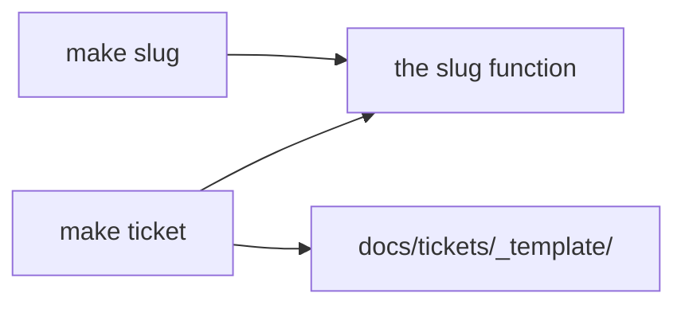

# New ticket from a title — architecture

> Ticket: `2026-01-01-0000_sample` · Requirements: [feature.md](./feature.md)

## Overview

Two `make` targets over one script folder of the root tooling: `make slug` prints a title's slug,
and `make ticket` creates the ticket's folder from the template under that slug. Both build the
slug through one function, so the folder's name and the printed slug never differ.

## Structure

| Area | Change |
|---|---|
| the root tooling (`.misc/`, the `Makefile`) | a script folder for tickets, and the two targets |
| `docs/knowledge/tooling.md` | the two targets in the **Commands** table |

## Contracts

- **The slug** — lower-case letters and digits, words joined by single hyphens, at most 30
  characters, cut at a word boundary, an accented letter written as its base letter; one function
  builds it for both targets.
- **The ticket folder** — `docs/tickets/<YYYY-MM-DD-HHmm>_<slug>/` in local time, holding the
  template's files, the feature's heading set to the title.
- **The output of `make ticket`** — on success, the folder's path and the command of the next
  phase; on a refusal, a non-zero exit and the existing folder on stderr, with nothing created.

## Seams

| Seam | Catches | Misses |
|---|---|---|
| `make slug TITLE="<title>"`, its output | the slug's words, hyphens, cut and letters (R1–R3) | the folder |
| `make ticket TITLE="<title>"`, run in a `git clone --local` of the repo | the folder, its files and heading, the refusal and the printed lines (R4–R6) | a run across a minute's edge |

## Decisions

- **D1 — One slug function, which both targets call.**
  - **Why:** the folder's name and the output of `make slug` cannot drift apart.
  - **Cost accepted:** the two targets share code, so a change of the slug reaches both.
  - **Reversal:** one commit.
  - **Rejected:**
    - the slug built in the recipe with `tr` and `sed` — the cut and the accents need more than a
      pipe says clearly, and a second copy would follow.
- **D2 — A ticket is identified by its slug, whatever its date.**
  - **Why:** two folders of one slug make a `/ticket-*` argument and the branch `<type>/<slug>`
    ambiguous.
  - **Cost accepted:** a title used again needs new words.
  - **Reversal:** one commit.
  - **Rejected:**
    - the whole folder name as the identity — a second ticket of the same slug a minute later
      would pass.

## Direction

- **The script's language** — recommend a Bun ES module beside the lint scripts, over a POSIX
  shell script: Unicode decomposition is one call in JavaScript and none in `sh`. Settled in
  Stage 1.
- **The refusal's exit code** — recommend 1, over 2, which the repo's checks keep for a check that
  could not run. Settled in Stage 2.
- **The output's layout** — recommend the folder's path on one line and the next command on the
  next, over one line holding both: a caller reads a whole line. Settled in Stage 2.

## Assumptions

- **A1 — A variable given on make's command line reaches the recipe's environment,** so the
  script reads the title from there and a title holding quotes needs no escaping. Checked in
  Stage 1, by a probe. If false: the Seams of both targets change (the title passed as an
  argument).
- **A2 — Unicode decomposition (NFD) followed by dropping the combining marks turns é, ü and ç
  into e, u and c.** Checked in Stage 2, by a probe. If false: the slug Contract changes.

## Risks

- **Two runs in the same minute with two titles of one slug.** The second would overwrite the
  first. *Contained by:* D2's refusal, which compares slugs, not folder names.
